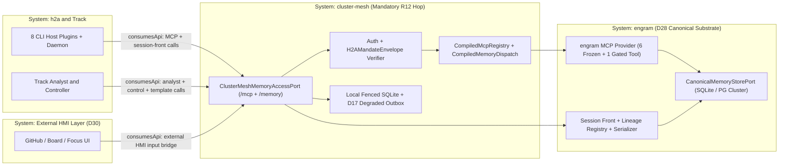

# SPEC — Engram `cluster-mesh` Memory Access and MCP Wiring (Spec 6A)

- **Spec ID:** `SPEC_ENGRAM_CLUSTER_MESH_MEMORY_ACCESS_AND_MCP_WIRING` (Spec 6A in `spec/memory/PLAN_SPEC_ENGRAM_FRONT.md:147-156`)
- **Stage:** `DESIGN`
- **Status:** `proposed`
- **Version:** `0.1.0`
- **Date:** `2026-11-14`
- **Repository of Record:** `engram` (`@sentropic/engram`, branch `docs/memory-r15-sediment`)
- **Primary Owners:** `engram` + `sentropic` (boundary consumer: `h2a` / `Track`)
- **Dependencies:**
  - `spec/SPEC_ENGRAM_METAMODEL_AND_LINEAGE_REGISTRY.md` (`Spec 0`: `Sha256Digest` `:144`, `OntologyTemplateEnvelopeRef` `:149-154`, `H2AMandateEnvelope` `:161-174`, travelling templates, domain-blind metamodel primitives)
- **Downstream Specs Unblocked by Spec 6A:**
  - `spec/SPEC_ENGRAM_SESSION_FRONT_AND_EXTRACTION.md` (`Spec 1`, `PLAN_SPEC_ENGRAM_FRONT.md:157-172`)
  - `spec/SPEC_ENGRAM_CONTEXTUAL_GRAPH_AND_PROMPT_LOOP.md` (`Spec 2`, `PLAN_SPEC_ENGRAM_FRONT.md:174-186`)
  - `spec/SPEC_ENGRAM_TRACK_ANALYST_CONTROL_AND_PR_SERIALIZATION.md` (`Spec 5`, `PLAN_SPEC_ENGRAM_FRONT.md:211-220`)
  - `spec/SPEC_ENGRAM_CLUSTER_MESH_TRANSACTIONAL_GRAPH_SYNC.md` (`Spec 6B`, `PLAN_SPEC_ENGRAM_FRONT.md:222-232`)
- **Binding Authorities:**
  - `spec/memory/OWNER-DECISIONS-2026-11-14.md:1-29` (`T-M-C`, Points `1B`, `2B`, `3C`, `4B`, `5B`, `6A`; `D28` kept)
  - `spec/memory/R15-SEDIMENT.md:1-141` (`D1`–`D34`, settled R15 architecture)
  - `spec/memory/PLAN_SPEC_ENGRAM_FRONT.md:134-156,236-245` (Spec 0, Spec 6A, and §4 Owner Review Points)
  - `spec/memory/ARCHITECTURE-RULES.md:1-13` (`R12` no-bypass invariant, `D30` separate system layers, `archi@1` relation rules)
  - `spec/memory/contracts/engram-cluster-mesh.md:1-181`
  - `spec/memory/contracts/engram-h2a.md:1-214`
  - `spec/memory/contracts/engram-track.md:1-247`
- **Amends:**
  - `spec/SPEC_MEMORY_MCP_V2.md:536-580` (`M7` Sentropic platform alignment; provider manifest example at `:553-575`; `MCP-L4`–`MCP-L8` qualification and cutover sequence at `:577-695,1096-1108`)
  - `plan/08-BRANCH_MEMORY_FINALIZATION.md:200-240` (`MCP-L4`–`MCP-L8` status ledger at `:214-220` and EVOL §10 host-integration gaps at `:224-240`)
- **Evidence Baseline Verified (Read-Only):**
  - `engram` (`@sentropic/engram` `0.28.0` at branch `docs/memory-r15-sediment`, `package.json:2-3`)
  - `sentropic` (`origin/main` commit `e9f272c94`, `@sentropic/cluster-mesh` `0.26.0-dev.18`, `@sentropic/mcp-platform` `0.4.2`, `@sentropic/mcp-broker` `0.1.0`)
  - `h2a` (`origin/main` commit `1f57127de` / tag `v0.98.10`, `@sentropic/h2a` `0.98.10`, `@sentropic/h2a-runtime` `0.98.10`, `@sentropic/track` `0.98.10`)

---

## 0. Binding Governance, Scope Boundary, and Amendments

### 0.1 Binding Owner Decisions (`D1`–`D34`, `T-M-C`, Points `1B`–`6A`, `D28` Kept)

This specification executes the settled R15 and R16 owner directives without reopening any decision in `D1`–`D34` (`spec/memory/R15-SEDIMENT.md:42-80`) or Points `1B`–`6A` (`spec/memory/OWNER-DECISIONS-2026-11-14.md:1-29`).

1. **Templates / Metamodel / Control (`T-M-C`)** (`spec/memory/OWNER-DECISIONS-2026-11-14.md:6,9-18`):
   > « Les question sont pas assez detaillees. Pose les ici. On est en train de faire des modif coté track sjr les ontologies de son domaine, il fdoit en rester maitre au moins piur les templates et engram pour leur metamodel et application track pour leur controle. Mene un tour avec h2a rapide en fable 5.2 + carbon et repose les 6 quesfion a l issi »

2. **Owner Ratification of Points `1B`–`6A` and Retention of `D28`** (`spec/memory/OWNER-DECISIONS-2026-11-14.md:7,20-29`):
   > « Tout comme recommandé »

   | Point | Binding Decision | Impact on Spec 6A |
   | --- | --- | --- |
   | **T-M-C** | `Track` owns project domain ontology templates and project control; `engram` owns the domain-blind metamodel and lineage registry; `h2a` owns role/activity/harness templates and mandate authority (`OWNER-DECISIONS-2026-11-14.md:9-16`). | `cluster-mesh` transports records strictly by `OntologyTemplateEnvelopeRef` + `Sha256Digest` and verifies signed `h2a` mandates without embedding domain enums (§2, §5). |
   | **1B** | Engram-first ingestion and per-PR `.track/` projection (`D29=both`, `D34=engram`) produced by `engram` under `Track`'s published template version + digest; `Track` validates and replays before merge (refused, never repaired by `engram`); `engram` checks metamodel well-formedness only (`OWNER-DECISIONS-2026-11-14.md:21`). | `ClusterMeshMemoryAccessPort` exposes first-rank session-front ingestion and template-pinned PR serialization triggers over `R12` (§2.2, §5). |
   | **2B** | Spec 2 written now and seventh tool (`engram_memory_context`) built **disabled by default**; enabled only after `engram` + `sentropic` co-signature and `MCP-L5` qualification, then switched on per CLI host with a fixed end date; fixes only the template-reference + digest envelope (`OWNER-DECISIONS-2026-11-14.md:22`). | Spec 6A freezes only the 7th tool's outer wire envelope and three-gate rollout; internal query/prompt-loop semantics stay in Spec 2 (§4). |
   | **3C** | Dormant dreaming runs nightly/mid-day/saturation passes locally and weekly/monthly/cross-repo audit passes remotely after graph sync; dreamed `Track` template proposals go to `Track`, and typed `Track` writes pass `Track` control (`OWNER-DECISIONS-2026-11-14.md:23`). | Local `D10` context logs/summaries remain local unless mandate + repo policy allow transfer; dreaming writes respect `Point 5B` / `Point 6A` (§2.3, §5). |
   | **4B** | Sibling `h2a` and `Track` lineages under `engram`'s metamodel alongside unchanged `archi@1` (`D16`); version-pinned cross-lineage composition; Git-serialized `.h2a/` workspace overlays (`D31`, `D34`) never modify `Track` templates (`OWNER-DECISIONS-2026-11-14.md:24`). | `/memory/v1/templates/*` and MCP dispatch attribute `sentropic.h2a` vs `sentropic.track` distinctly and enforce sole-author lineage rights (§2.2, §3). |
   | **5B** | Split joint control (`D32`): `Track`'s rules and verdict (`verdictAuthority: 'track'`) are authoritative for the `Track` domain (`engram` records and never replaces them; unratified typed writes stay `proposed` while raw records are already in `engram`); `engram` enforces metamodel well-formedness and `D7` deny-lists (`OWNER-DECISIONS-2026-11-14.md:25`). | `cluster-mesh` routes distinctly attributed `sentropic.track` control verdicts and never promotes `proposed` `Track` nodes without a `Track` verdict (§2.2, §5.3). |
   | **6A** | One bidirectional workspace-scoped sync over `cluster-mesh`; template versions travel with the graph; `cluster-mesh` carries objects without knowing `Track` types, **never** overwrites a `Track`-controlled record, and refuses concurrent offline template versions so `Track` decides (`OWNER-DECISIONS-2026-11-14.md:26`). | Enforced at both the `cluster-mesh` memory access write gate and the local/remote `D17` outbox ingress (§5.1–§5.4). |
   | **`D28=engram`** | **Kept unchanged:** `engram`'s live registry remains the canonical fact reference; Git/PR files are serialized reviewable views (`OWNER-DECISIONS-2026-11-14.md:3,21`; `R15-SEDIMENT.md:73`). | `cluster-mesh` routes all canonical reads and writes to `engram` stores, never treating `.track/` files or shadow caches as canonical (§2, §3.5, §5.4). |

3. **`cluster-mesh` Mandatory MCP Registry & Access Hop (`R12`)** (`spec/memory/contracts/engram-cluster-mesh.md:170`; `spec/memory/ARCHITECTURE-RULES.md:5`):
   > « repose bien sur le mcp registry de cluster mesh »

4. **`engram` First-Rank Session Front, `D20` Seventh Tool, `D30` Separate HMI Layer, `D32` Split Control, and `D24` Integral Graph Sync** (`spec/memory/R15-SEDIMENT.md:12,26,31-32,65,69,75,77`):
   - > « Engram doit etee en premier front pour recup les donnes de session avant track, avec des analystes »
   - > « Attention track c juste pour les decision et gestion d evenement projet. Engram doit etre la premiere etape in fine. Cette assertion me smeble tres mauvaiss »
   - > « Attention car le premier rang doit etre engram (enregistrement pkur serialisarkkn eg tour de parole + regles + conrrole track si possible par agent). »
   - > « Je vois pas comment tu gere adapte sans outil memoire »
   - > « Attention tu confonds l outil track la memoire e tun outil ihm pour interagir avec - gh pourra donner de l input c une autre layer »
   - > « Donc part de engram - et de track » / « api type jev/decison »
   - > « De plus j ai demande un partage de graphe entre local et remote. Integral. Engram doit gere ca comme des transaction et synchro de cluster de db via cluster mesh. »

### 0.2 Scope Boundary Between Spec 6A, Spec 0, Spec 2, and Spec 6B

- **Spec 0 (`SPEC_ENGRAM_METAMODEL_AND_LINEAGE_REGISTRY.md`)** defines the shared metamodel grammar, `Sha256Digest` (`:144`), `OntologyTemplateEnvelopeRef` (`:149-154`), `H2AMandateEnvelope` (`:161-174`), and the domain-blind metamodel operation classes carried over `cluster-mesh` (`raw_event`, `typed_node`, `typed_edge`, `turn_text`, `ontology_template`, `control_verdict`, `context_log`, `context_summary` in `spec/memory/contracts/engram-cluster-mesh.md:74-82`). Spec 6A imports these types unchanged.
- **Spec 6A (this document)** owns:
  1. The `MCP-L4` → `MCP-L5` → `MCP-L6` → `MCP-L7` → `MCP-L8` delivery chain, qualification checkpoints, and exit gates (§1).
  2. `cluster-mesh` as the mandatory `R12` memory access hop for all `h2a`, `Track`, and external HMI (`D30`) reads and writes, including endpoints, dual-layer authentication + cryptographic `h2a` mandate verification, and `D17=degraded` local durability (§2).
  3. Provider registration, selection, configuration, compilation, catalog projection, and HTTP/JSON-RPC + stdio dispatch across `engram`, `cluster-mesh`, `mcp-platform`, `mcp-broker`, `sentropic/api`, and `h2a`, plus retirement of the legacy memory ports (§3).
  4. The outer wire envelope and `Point 2B` activation/rollout gating of the seventh MCP tool (`engram_memory_context`) (§4).
  5. Domain-blind `Track` record transport by `OntologyTemplateEnvelopeRef` + `Sha256Digest` and the `Point 6A` non-overwrite / concurrent-template refusal invariants at the `cluster-mesh` boundary (§5).
- **Spec 2 (`SPEC_ENGRAM_CONTEXTUAL_GRAPH_AND_PROMPT_LOOP.md`)** owns the internal execution semantics of `engram_memory_context`: graph ranking, fingerprint traversal, `D22` role-consciousness subgraph projection, `D23` durationless prompt assembly, and `D14` host text purge (`PLAN_SPEC_ENGRAM_FRONT.md:174-186`).
- **Spec 6B (`SPEC_ENGRAM_CLUSTER_MESH_TRANSACTIONAL_GRAPH_SYNC.md`)** owns the multi-node ACID replication protocol (`ClusterMeshGraphClusterSyncPort`), causal watermarks, and replacement of `MemoryReplicationPort` (`PLAN_SPEC_ENGRAM_FRONT.md:222-232`). Spec 6A defines the local `D17=degraded` outbox seam and `Point 6A` ingress guard that Spec 6B's replication engine drains.

### 0.3 Formal Amendments to `SPEC_MEMORY_MCP_V2.md` and `plan/08-BRANCH_MEMORY_FINALIZATION.md`

1. **Amendment A1 — `SPEC_MEMORY_MCP_V2.md` `M7` (`:536-580`, specifically `:553-575`):**
   - `SPEC_MEMORY_MCP_V2.md:554-556` originally illustrated the manifest with `appId: "engram"` and `providerId: "engram-memory"`.
   - Shipped P2 platform contracts in both `engram` (`src/mcp/memory/contracts.ts:143-146`, `src/mcp/memory/gates.ts:292-298`, `registry/entries.v1.json:8,268`) and `sentropic` (`packages/mcp-platform/src/memory/contracts.ts:30-33`, `packages/mcp-broker/src/memory/contracts.ts:36-37`, `h2a:packages/h2a/src/registry/memory-provider.ts:6`) standardize the identifier tuple as:
     - `appId`: `'engram'`
     - `providerId` (and registry entry `id`): `'sentropic.engram.memory'`
     - `connectorId`: `'engram-memory'`
     - `sourceId` (broker/catalog binding): `'mcp:engram-memory'`
     - storage neutral-handle `moduleId`: `'engram-memory'` (`sentropic:packages/cluster-mesh/src/engram-memory/neutral-handle.ts:85`)
   - Spec 6A formally amends `SPEC_MEMORY_MCP_V2.md:555` from `providerId: "engram-memory"` to `providerId: "sentropic.engram.memory"` while retaining `connectorId: "engram-memory"` (§3.1).
2. **Amendment A2 — `SPEC_MEMORY_MCP_V2.md` `M1` (`:164-198`) and `M7` (`:560-575`):**
   - The six `M1` tools remain frozen under profile `sentropic.engram.memory-tools/2020-12-v1` (`src/mcp/memory/schemas.ts:25`). Under `D20=seventh` and `Point 2B` (`OWNER-DECISIONS-2026-11-14.md:22`), a seventh read-only tool `engram_memory_context` is introduced **disabled by default** under co-signed profile `sentropic.engram.memory-tools/2020-12-v2` (`sentropic.engram.memory-wire/v2`), never mutating the `v1` 6-tool compatibility digest (§4).
3. **Amendment A3 — `plan/08-BRANCH_MEMORY_FINALIZATION.md` (`:214-220`):**
   - Updates `MCP-L4` from `todo` (`plan/08-BRANCH_MEMORY_FINALIZATION.md:214`) to `candidate_shipped_awaiting_L5_qualification` (`@sentropic/engram` `0.22.0`–`0.28.0`, `CHANGELOG.md:55-67`), updates `MCP-L5` (`:215`) to record Lot 1 shipped in `sentropic` (`packages/mcp-platform/src/memory/*`, `packages/mcp-broker/src/memory/*`) with Lot 2 durable workflow stores + #704 Postgres qualification pending, and binds `MCP-L6`–`MCP-L8` (`:216-220`) to the R15 `R12` access hop, signed `H2AMandateEnvelope` verification, `D17=degraded` mode, and `Point 6A` `Track` non-overwrite rules (§1).

---

## 1. The MCP Delivery Chain (`MCP-L4` → `MCP-L5` → `MCP-L6` → `MCP-L7` → `MCP-L8`)

### 1.1 End-to-End Dependency and Qualification Topology

`MCP-L0` through `MCP-L3` shipped in `@sentropic/engram` `0.20.0`–`0.23.0` (`CHANGELOG.md:55-112`), establishing the frozen L0 contracts (`src/mcp/memory/contracts.ts:1-615`), total M6 error sanitizer (`src/mcp/memory/errors.ts:1-721`), Option B in-process read/write facades (`src/memory-tools/index.ts:1-7`), and the injected neutral module-storage adaptation `openModuleStorageCanonicalMemoryStoreV1` (`src/memory-substrate/index.ts:19-50`).

The remaining delivery chain from `MCP-L4` to `MCP-L8` (`plan/08-BRANCH_MEMORY_FINALIZATION.md:214-222`; `spec/SPEC_MEMORY_MCP_V2.md:1096-1112`) follows a strict qualification order: **`MCP-L4` shipped as an optional, default-disabled candidate in `0.22.0`, but cannot exit `candidate` status until `MCP-L5` completes production qualification (`L5-MEMORY-V1`)**. `MCP-L6`, `MCP-L7`, and `MCP-L8` then advance in strict lockstep.

```mermaid
flowchart LR
  L03["MCP-L0..L3 (engram 0.20.0-0.23.0: frozen contracts, memory-tools, memory-substrate)"]
  L4C["MCP-L4 Candidate (engram 0.22.0-0.28.0: ./mcp-memory + ./registry/*)"]
  L5["MCP-L5 Qualification (sentropic: durable workflow stores + #704 PG + SQLite + L5-MEMORY-V1)"]
  L4X["MCP-L4 Qualified Exit (engram: PROVENANCE + peer range + GWRC-CI-V1 receipt)"]
  L6["MCP-L6 Mesh Access Hop (sentropic/cluster-mesh: /memory + R12 port + mandate auth + D17)"]
  L7["MCP-L7 App Registry & Dispatch (sentropic/api: cluster-registry + registry-dispatch + retire shadow port)"]
  L8["MCP-L8 Host Cutover (h2a + Track: 8 CLI hosts + daemon wiring + retire 8 legacy memory files)"]
  P2B["Point 2B Gate (engram + sentropic co-signature -> 7th tool per-host switchover)"]

  L03 --> L4C
  L4C --> L5
  L5 --> L4X
  L4X --> L6
  L5 --> L6
  L6 --> L7
  L7 --> L8
  L8 --> P2B
```



### 1.2 Code-Fact Matrix Across `MCP-L4` → `MCP-L8`

Every claim below is anchored to verified source lines in `engram` (`docs/memory-r15-sediment`), `sentropic` (`e9f272c94`), and `h2a` (`1f57127de` / `v0.98.10`).

| Step & Owner | What Exists in Code Today (`file:line`) | What Is Missing | Mandatory Step Exit Gates |
| --- | --- | --- | --- |
| **`MCP-L4`** (`engram`) | 1. Optional subpath `./mcp-memory` (`package.json:35-38`, `src/mcp-memory/index.ts:1-92`) exporting `createEngramMemoryProviderV1` (`src/mcp-memory/provider.ts:648-965`), 9-step `invokeTool` (`provider.ts:661-891`), `createManifestMemoryDispatchPlanV1` (`provider.ts:197-229`), `MEMORY_FROZEN_PROFILE_BINDINGS_V1` (`src/mcp-memory/profiles.ts:19-31`), and `createEngramMemoryMcpServerV1` (`src/mcp-memory/server.ts:265-415`).<br/>2. Registry package subpaths `./registry/manifest` (`src/registry/manifest.ts:1-69`), `./registry/definitions` (`src/registry/definitions.ts:1-84`), `./registry/validator` (`src/registry/validator.ts:1-2`), and packed `registry/entries.v1.json:1-424` + `registry/publisher-assets.v1.json:1-212`.<br/>3. Optional peers `@sentropic/mcp-broker: "0.1.0"` and `@sentropic/mcp-platform: "0.4.0"` (`package.json:185-186,203-208`), `@modelcontextprotocol/sdk: "^1.31.0"` (`package.json:166-167`). | 1. `L5-MEMORY-V1` production qualification receipt (`CHANGELOG.md:64-67`, `plan/08-BRANCH_MEMORY_FINALIZATION.md:214`).<br/>2. Peer range widening in `package.json:186` from exact `"0.4.0"` to `">=0.4.0 <0.5.0"` to match `sentropic:packages/mcp-platform/package.json:3` (`0.4.2`) and `h2a:packages/h2a/package.json:87` (`0.4.1`), plus published `@sentropic/mcp-broker`.<br/>3. Update `src/mcp/memory/standard/PROVENANCE.json:3` from `97fe9f53e8079694e35771227c11544ce8658316` to the `L5-MEMORY-V1` commit.<br/>4. R15 mandate verification hook on `ReadAuthenticationV1` / `WriteAuthenticationV1` (`src/mcp-memory/provider.ts:55-96`) and default-disabled 7th tool envelope (§4). | - `validateMemoryPublisherAssetsV1` (`src/mcp/memory/receipts.ts:145-218`) passes on packed tarball.<br/>- Root import `@sentropic/engram` (`package.json:18-21`) loads zero MCP SDK, platform, or broker modules.<br/>- `mcp.createMemoryPortV2 === substrate.createMemoryPortV2` (`sentropic:packages/cluster-mesh/src/integrations/mcp/memory.ts:45-47`).<br/>- `L5-MEMORY-V1` and `GWRC-CI-V1` receipts committed (`SPEC_MEMORY_MCP_V2.md:656-693`). |
| **`MCP-L5`** (`sentropic`) | 1. **Lot 1 shipped:** `packages/mcp-platform/src/memory/contracts.ts:1-404` (`MEMORY_PROVIDER_ID = 'sentropic.engram.memory'` `:31`, `MEMORY_CONNECTOR_ID = 'engram-memory'` `:33`, `MEMORY_TOOL_NAMES` `:40-47`), `invocation-context.ts:41-112` (`requireTrustedInvocationContext`, `projectMemoryContext`, `validateMemoryProjection`), `mutation-guard.ts`, `confirmation-guard.ts`, and `packages/mcp-broker/src/memory/compiled-dispatch.ts:96-232` (`CompiledMemoryDispatch`).<br/>2. Draft PostgreSQL + stdio/HTTP qualification harness (`packages/cluster-mesh/docs/memory-mcp.md:86-104`, `docs/memory-mcp-candidate.md:3-46`) pinned to `@sentropic/engram` `0.22.0` (`packages/cluster-mesh/package.json:257,282`; `src/modules/catalog.ts:18`). | 1. **Production durable workflow stores (`MCP-L5` Lot 2):** `SqliteMemoryWorkflowStoreV1` and `PostgresMemoryWorkflowStoreV1` implementing crash-window `MemoryReservationStorePortV1`, single-use `ConfirmationContinuationPortV1`, durable audit sink, and cursor store (`docs/memory-mcp.md:101-104` notes current launcher uses test-only fixture authorities).<br/>2. Publishable `@sentropic/mcp-broker` (`packages/mcp-broker/package.json:4` currently has `"private": true`).<br/>3. Sentropic #704 durable Postgres backend qualification (`engram/CHANGELOG.md:98`, currently `unverified`) + Milestone 2 SQLite neutral-handle support (`docs/memory-mcp.md:19`; `neutral-handle.ts:85` currently hardcodes `backend: 'postgres'`).<br/>4. Enrolled `sent-tech.ca` confirmation attestation (`docs/memory-mcp.md:33`, `SPEC_MEMORY_MCP_V2.md:646`), E2/P1 `lot2-manifest.json` handoff (`SPEC_MEMORY_MCP_V2.md:656-672`), and peer bump from `>=0.22.0 <0.23.0` (`catalog.ts:18`) to `>=0.28.0 <0.29.0`. | - Process-kill / crash-window recovery passes for all 4 mutating tools (`capture`, `request_admission`, `withdraw`, `forget`) on both SQLite and Postgres.<br/>- Replayed or cross-client `elicitation_ref` rejected before effect.<br/>- `make memory-mcp-qualify` passes with zero skips against `@sentropic/engram` `0.28.0+` using production workflow stores.<br/>- `@sentropic/mcp-broker` published (`private: false`).<br/>- `L5-MEMORY-V1` checkpoint tag & `lot2-manifest.json` SHA-256 receipt issued. |
| **`MCP-L6`** (`sentropic/cluster-mesh`) | 1. `@sentropic/cluster-mesh/mcp/memory` (`packages/cluster-mesh/package.json:251-254`, `src/integrations/mcp/memory.ts:1-55`) exporting `createEngramMemoryBuiltin` (`:21-55`), `registerEngramMemoryTools` (`src/integrations/mcp/memory-transport.ts:21-59`), and `createEngramMemoryWireManifest` (`src/integrations/mcp/memory-manifest.ts:4-10`).<br/>2. Qualified peer loaders `loadEngramMemoryMcp` and `loadEngramMemorySubstrate` (`src/loaders/mcp/memory.ts:5-15`) over `PROVIDER_CATALOG['mcp/memory']` and `PROVIDER_CATALOG['engram-memory/substrate']` (`src/modules/catalog.ts:107-118`).<br/>3. Stateless `/mcp` router (`src/compose/mcp.ts:169-242`) and stateful wrapper (`src/compose/mcp-stateful.ts:23-95`).<br/>4. Fenced storage bindings in `src/engram-memory/{binding,neutral-handle,sqlite,postgres}.ts` (`binding.ts:18,91-127`, `neutral-handle.ts:55-165`). | 1. `memory` (`namespace: '/memory'`) is still gated in `GATED_OWNERS` (`status: 'source_unavailable'`) at `src/modules/catalog.ts:137,168-170`.<br/>2. Missing public subpaths `./memory`, `./loaders/memory`, `./compose/memory` in `packages/cluster-mesh/package.json:58-259`, and `disabledNamespaceModule` (`src/compose/disabled.ts:5`) only accepts `'/llm-mesh' \| '/gw'`.<br/>3. Mode contradiction: `memory.ts:29` restricts `mode` to `['embedded-local']` while `memory-compose.ts:26` throws `'memory MCP requires a fenced PostgreSQL store'` and `neutral-handle.ts:85` hardcodes `'postgres'`. Must support both `embedded-local` (fenced SQLite + `D17=degraded` outbox) and `external-host` (fenced multi-node Postgres).<br/>4. `R12` `ClusterMeshMemoryAccessPort` service endpoints (§2.2), signed `H2AMandateEnvelope` verifier (§2.3), and `Point 6A` `Track`-controlled non-overwrite guard (§5.3). | - `memory` graduated from `GATED_OWNERS` (`catalog.ts:137`) to `PROVIDER_CATALOG`.<br/>- `disabledNamespaceModule('/memory')` returns `{ namespace: '/memory', enabled: false }` (`disabled.ts:5`).<br/>- Both `embedded-local` (SQLite) and `external-host` (Postgres) modes compile and pass fenced-store checks.<br/>- Signed `H2AMandateEnvelope` verification, `D17=degraded` banner/outbox, and `Point 6A` non-overwrite suites pass.<br/>- Writer handoff order (`#679` → `#685` → `R2/R7a/R3` → `MCP-L5` → `MCP-L6`, `SPEC_MEMORY_MCP_V2.md:629-639`) respected without lockfile regression. |
| **`MCP-L7`** (`sentropic/api` + `cluster-mesh`) | 1. `compileAppMcpRegistry` (`api/src/services/mcp/cluster-registry.ts:29-56`) compiles `createMcpRegistry` (`src/mcp/registry.ts:64-213`), but hardcodes `builtins: [builtin]` with only `createArtifactsBuiltin` (`cluster-registry.ts:47-48`).<br/>2. `createRegistryDispatchRouter` (`api/src/services/mcp/registry-dispatch.ts:22-108`) handles JSON-RPC `tools/list` & `tools/call` on `POST /` (`:32-33,105`), but restricts `POST /invoke` to `params?.connectorId === 'sentropic.artifacts'` (`:34`), types `transport()` as `ArtifactTransport` (`:8`), and returns `{ error: 'artifact_request_refused' }` on catch (`:102`).<br/>3. `HostRegistryCatalogSource` (`api/src/services/catalog/sources/host-registry-source.ts:17-62`) and `CatalogExecutionSeam` (`api/src/services/catalog/execution-seam.ts:78-154`) exist, but `createHostRegistryCatalogSource` (`:51-62`) invokes `ArtifactTransport` with `ARTIFACT_SESSION_CLIENT`.<br/>4. Legacy shadow port `H2aGraphifyMemoryPort` and `createGraphifyMemoryAdapter` remain in `packages/cluster-mesh/src/memory.ts:18-151`. | 1. Mount `createEngramMemoryBuiltin` (`providerId: 'sentropic.engram.memory'`, `connectorId: 'engram-memory'`) and optional `sentropic.h2a` / `sentropic.track` definitions in `compileAppMcpRegistry` (`cluster-registry.ts:13-56`), default-disabled until persisted tenant + agent opt-in (`memory-definition.ts:9`).<br/>2. Generalize `createRegistryDispatchRouter` (`registry-dispatch.ts:7-108`) to provider-neutral compiled-plan dispatch (`sentropic.artifacts`, `sentropic.engram.memory` / `engram-memory`, `sentropic.h2a` / `h2a-coordination`, `sentropic.track` / `track-read`).<br/>3. Enforce the 9-field `MemoryCatalogCacheKeyV1` (`src/mcp/memory/topology.ts:515-560`) and `CompiledMemoryDispatch` (`mcp-broker/src/memory/compiled-dispatch.ts:96-232`) on catalog/seam execution.<br/>4. Delete `H2aGraphifyMemoryPort` and `createGraphifyMemoryAdapter` (`packages/cluster-mesh/src/memory.ts:18-151`). | - Unopted-in tenants and agents receive zero `engram_memory_*` tools on `tools/list` and `HostRegistryCatalogSource.snapshot()`.<br/>- `POST /` (`tools/call`) and `POST /invoke` route `engram-memory` through `CompiledMemoryDispatch` with verified `StpConnectorContext` and never emit `artifact_request_refused` for memory calls.<br/>- Zero references to `H2aGraphifyMemoryPort` or `createGraphifyMemoryAdapter` remain anywhere in `sentropic`. |
| **`MCP-L8`** (`h2a` + `Track`) | 1. `packages/h2a/src/registry/memory-provider.ts:1-48` defines `MEMORY_PROVIDER_ID = "sentropic.engram.memory"` (`:6`), 6-tool `MEMORY_TOOL_NAMES` (`:7`), and `resolveHostMemoryRegistration` (`:43-48`), which currently throws `missingMemoryBuiltin()` (`:22-26,47`) when uninjected.<br/>2. `packages/h2a/src/registry/sentropic-daemon.ts:325-499` composes `sentropic.h2a`, `sentropic.track`, and optional `sentropic.engram.memory` via `createMcpRegistry` (`:51,358-399`) with a 6-tool lock check (`:365-371`).<br/>3. `packages/h2a/package.json:80-88` pins `@modelcontextprotocol/sdk: "^1.30.0"` (`:80`), `@sentropic/cluster-mesh: "0.25.0"` (`:81`, matching `h2a-runtime/package.json:27`), `@sentropic/engram: "0.28.0"` (`:83`), `@sentropic/mcp-platform: "0.4.1"` (`:87`).<br/>4. Legacy 10-file directory `packages/h2a/src/runtime/memory/` still holds 8 direct v1/v2 adapter files + `preflight.ts` + `d11-ceremony.ts`.<br/>5. 8 CLI hosts in `packages/h2a/src/hosts/plugin.ts:85-152`. | 1. Upgrade `@sentropic/cluster-mesh` (`packages/h2a/package.json:81`, `packages/h2a-runtime/package.json:27`) to `>=0.26.0` (qualified `MCP-L6`/`L7` release) and `@modelcontextprotocol/sdk` (`packages/h2a/package.json:80`, `packages/track/package.json:70`) to `"^1.31.0"`.<br/>2. Bind real `createEngramMemoryBuiltin` (`embedded-local` SQLite + `D17=degraded` outbox) in `resolveHostMemoryRegistration` (`memory-provider.ts:43-48`) and supply verified `StpConnectorContext` + `H2AMandateEnvelope` at `sentropic-daemon.ts:428-431`.<br/>3. Delete the 8 legacy memory files (`admit-client.ts`, `graphify-contracts-v2.vendored.ts`, `note-builder.ts`, `port-v1.ts`, `port-v2-adapter.ts`, `port-v2-compat.ts`, `promote-client.ts`, `recall-client.ts` + v1 `preflight.ts`) and re-anchor `d11-ceremony.ts` onto `cluster-mesh` MCP (`D11=dedicated`).<br/>4. Wire the 8 CLI host hooks (`hosts/plugin.ts:85-152`) to `cluster-mesh` session-front ingestion (`R12`). | - Zero direct `@sentropic/engram` store/engine imports in `packages/h2a` or `packages/track` (`R12` CI gate).<br/>- All 8 legacy memory files deleted from `packages/h2a/src/runtime/memory/`.<br/>- All 8 CLI hosts (`claude`, `codex`, `gemini`, `agy`, `hermes`, `opencode`, `muse`, `vibe`) pass local + remote + `D17=degraded` memory round-trips.<br/>- `D11` anti-self-certification suite passes via `engram_memory_capture` + `engram_memory_request_admission`.<br/>- Unblocks `MCP-L9` parity suite and `MCP-L10` canary/kill-switch rehearsal (`plan/08-BRANCH_MEMORY_FINALIZATION.md:221-222`). |

### 1.3 Cross-Repository Handshake Checkpoints (`lot2-manifest.json`, `GWRC-CI-V1`, Writer Handoff)

1. **`lot2-manifest.json` E2/P1 Handoff (`MCP-L5` → `MCP-L4` Exit):**
   - Pursuant to `SPEC_MEMORY_MCP_V2.md:656-672`, `sentropic` emits a machine-verifiable `lot2-manifest.json` receipt recording the exact git commit SHA, npm tarball `sha512`, `PROVENANCE.json` SHA-256 digests for `manifest.ts` and `experimental/manifest-elicitation.ts` (`src/mcp/memory/standard/PROVENANCE.json:1-9`), and the reviewed wire manifest digest `computeManifestDigest(createEngramMemoryWireManifest(MEMORY_PROVIDER_MANIFEST))` (`sentropic:packages/cluster-mesh/docs/memory-mcp.md:58-60`).
2. **`GWRC-CI-V1` Co-Freeze Gate:**
   - `engram`'s `validateMemoryPublisherAssetsV1` (`src/mcp/memory/receipts.ts:145-218`) and `sentropic`'s `composeEngramMemoryDefinition` (`packages/cluster-mesh/src/integrations/mcp/memory-compose.ts:22-24`) run in CI against the pinned peer tuple so any unreviewed schema, tool-list, or digest drift fails compilation atomically before storage opens.
3. **Shared-File Writer Handoff in `sentropic` (`SPEC_MEMORY_MCP_V2.md:629-639`):**
   - Modifications to `packages/cluster-mesh/package.json`, `packages/cluster-mesh/src/modules/catalog.ts`, and `packages/cluster-mesh/src/compose/disabled.ts` execute strictly in sequence (`#679` → `#685` → `R2/R7a/R3` → `MCP-L5` → `MCP-L6` → `MCP-L7`) so namespace registration and module-catalog graduation never collide.

---

## 2. `cluster-mesh` Memory Access as the Mandatory Hop (`R12`)

### 2.1 Architectural Invariant (`R12` and `D30`)

Per `spec/memory/ARCHITECTURE-RULES.md:5-7`, `spec/memory/R15-SEDIMENT.md:31-32,75`, and `spec/memory/contracts/engram-cluster-mesh.md:9-15`:

1. **Zero Bypass (`R12`):** Neither `@sentropic/h2a`, `@sentropic/track`, the 8 CLI host plugins (`h2a:packages/h2a/src/hosts/plugin.ts:85-152`), nor the external GitHub/board HMI layer (`h2a:packages/h2a-runtime/src/gateway-host/live-github.ts:1-329`, `@sentropic/focus`, Sentropic web UI) may open an `engram` SQLite/PostgreSQL file, call `createMemoryPortV2` directly, or read/write `.graphify/` or `.track/` as an unmediated runtime store. Every runtime read and write transits `@sentropic/cluster-mesh`.
2. **Four Separate System Layers Mediated by `cluster-mesh` (`D30`):**
   - `@sentropic/engram` (canonical graph substrate, metamodel & lineage registry, extraction, contextual query engine, dreaming, and `D34` Git serializer),
   - `@sentropic/h2a` + `@sentropic/track` (master harness, formal mandate authority, coordination, and project decision/event analyst & controller),
   - External HMI / Input Layer (`GitHub` issues/PRs/discussions, `@sentropic/focus`, board UIs — `D30`),
   - Git Repositories & PR Artifacts (serialized `.track/`, `.h2a/`, and `spec/` views — `D28`, `D29`, `D31`, `D34`),
   mediated exclusively by `@sentropic/cluster-mesh`.



### 2.2 Complete Endpoint and Port Surface (`ClusterMeshMemoryAccessPort`)

`cluster-mesh` exposes two complementary, non-bypassable surfaces over the same underlying `engram` canonical store and mandate guard:

1. **Agent-Facing MCP Tool Surface (`/mcp` HTTP JSON-RPC + `POST /invoke` + stdio bridge):**
   - Mounted via `createMcpNamespaceModule` (`sentropic:packages/cluster-mesh/src/compose/mcp.ts:169-242`), `createStatefulMcpNamespace` (`src/compose/mcp-stateful.ts:23-95`), `createRegistryDispatchRouter` (`api/src/services/mcp/registry-dispatch.ts:22-108`), and `registerEngramMemoryTools` (`src/integrations/mcp/memory-transport.ts:21-59`).
   - Serves the **6 frozen `M1` tools** (`src/mcp/memory/contracts.ts:149-156`) and, only when unlocked by `Point 2B` (§4), the **7th tool** `engram_memory_context`.
2. **Host, Analyst, Control, and HMI Service Access Surface (`@sentropic/cluster-mesh/memory` + Hono namespace `/memory`):**
   - Graduated from `GATED_OWNERS['memory']` (`sentropic:packages/cluster-mesh/src/modules/catalog.ts:137`) into `PROVIDER_CATALOG['memory']` with subpaths `@sentropic/cluster-mesh/memory`, `@sentropic/cluster-mesh/loaders/memory`, and `@sentropic/cluster-mesh/compose/memory`.
   - Serves deterministic runtime host hooks (session-front turn recording, lineage template registration, `Track` analyst streams, `D32` control verdicts, `D30` HMI input ingestion, and `D34` PR serialization triggers) that **must execute deterministically on every turn/event rather than relying on optional LLM tool calls** (`R15-SEDIMENT.md:12-16,69`).

| Surface / Endpoint | Method / RPC | Caller(s) | Mutability & Required Right | Purpose & Spec Owner |
| --- | --- | --- | --- | --- |
| `/mcp` (`POST /`, `POST /invoke`) & stdio MCP | `engram_memory_search`, `engram_memory_get` | `h2a` agents, `Track` read queries, Sentropic chat (authenticated memory identity) | `read-only` (`memory:read`; refused when session lacks a memory identity per `D18=readonly`) | Frozen `M1` lexical/record reads (`src/mcp/memory/contracts.ts:150-151`). |
| `/mcp` (`POST /`, `POST /invoke`) & stdio MCP | `engram_memory_capture`, `engram_memory_request_admission`, `engram_memory_withdraw`, `engram_memory_forget` | Mandated `h2a` agents, enrolled host | `write` (signed `H2AMandateEnvelope` with `memory:capture`, `memory:admit`, `memory:lifecycle` + confirmation on `withdraw`/`forget`, `D4`) | Frozen `M1` governed mutations (`src/mcp/memory/contracts.ts:152-155`; `src/mcp/memory/gates.ts:171-290`). |
| `/mcp` (`POST /`, `POST /invoke`) & stdio MCP | `engram_memory_context` (**disabled by default**, `Point 2B`) | `h2a` host prompt loop / mandated agents | `read-only` (`memory:context`; under `D18=readonly` non-memory slices only, zero memory content) | 7th tool envelope & gating in §4; internal query/prompt loop in **Spec 2**. |
| `/memory/v1/session-front/ingest` (in-process: `ingestSessionTurn`) | `POST` | 8 `h2a` CLI host plugins (`h2a:src/hosts/plugin.ts:85-152`), `h2a` daemon | `write` (enrolled host attachment proof; `mandateEnvelope` optional on raw ingress per `engram-cluster-mesh.md:50`) | First-rank recording of `tour de parole`, tool outputs, harness rules, and refs before `Track` (`D19`, `Point 1B`, **Spec 1**). |
| `/memory/v1/templates/register` & `/memory/v1/templates/resolve` | `POST` / `GET` | `Track`, `h2a`, `archi`, `engram` | `write` (signed lineage-author mandate `template:register`, `Point 4B`) / `read-only` | Register and fetch travelling `ontology_template` envelopes by `(lineage, templateId, templateVersion, templateDigestSha256)` (`Point 4B`, `Point 6A`, **Spec 0**). |
| `/memory/v1/track/stream` & `/memory/v1/track/query` | `GET` (SSE/cursor) / `POST` | `Track` analyst (`@sentropic/track`), `h2a` | `read-only` (`track:analyze` or `memory:read`) | Causal cursor stream and typed lineage read for `Track` project event/decision analysis (`engram-track.md:77-94`, **Spec 5**). |
| `/memory/v1/track/annotations` & `/memory/v1/control/verdicts` | `POST` | `Track` controller (`sentropic.track`), `h2a` (`sentropic.h2a`) | `write` (signed `H2AMandateEnvelope` with `track:control` or `h2a:control`) | Append `Track` typed nodes/edges (`trackControlled: true`) and authoritative `Point 5B` / `D32` control verdicts (`R15-SEDIMENT.md:26,77`, **Spec 5**). |
| `/memory/v1/hmi/input` | `POST` | GitHub bridge (`live-github.ts`), `@sentropic/focus`, board UI | `write` (enrolled service/user auth + source attestation) | `D30` external HMI input ingestion into `engram` first (`engram-cluster-mesh.md:23`, **Spec 1** / **Spec 5**). |
| `/memory/v1/serialization/export` | `POST` | `h2a` PR lifecycle / `Track` pre-merge gate | `read-only` / export (`serialization:export`) | Trigger `D34=engram` deterministic Git/PR serialization under `Track` or `h2a` template version + digest (`Point 1B`, `Point 4B`, **Spec 4** / **Spec 5**). |
| `/memory/v1/health` (in-process: `status()`) | `GET` | CLI hosts, `h2a` doctor, Sentropic UI | `read-only` | Reports `healthy` vs `degraded` (`D17`), outbox depth, and active store fence (`engram-cluster-mesh.md:20,169`). |

```typescript
// Normative TypeScript port contract for @sentropic/cluster-mesh/memory (Spec 6A)
import type {
  Sha256Digest,
  OntologyTemplateEnvelopeRef,
  H2AMandateEnvelope,
  LineageId,
} from '@sentropic/engram/metamodel'; // Spec 0 §1.4 (:144-174)

export type MemoryAccessMode = 'embedded-local' | 'external-host';

export type DegradedModeReason =
  | 'remote_unreachable'
  | 'context_service_unavailable'
  | 'remote_auth_expired'
  | 'replication_lag_exceeded';

export interface ClusterMeshMemoryHealthStatus {
  readonly state: 'healthy' | 'degraded';
  readonly mode: MemoryAccessMode;
  readonly degradedReason?: DegradedModeReason;
  readonly degradedSince?: string;          // RFC 3339 UTC
  readonly userVisibleBanner: string | null; // Non-null whenever state === 'degraded' (D17)
  readonly pendingOutboxUnits: number;
  readonly localFenceId: string;
}

export interface MandateBoundAccessContext {
  readonly invocationId: string;
  readonly correlationId: string;
  readonly tenantId: string;
  readonly workspaceId: string;
  readonly scopeRef: string;
  readonly derivedWorktreeId?: string;       // D21 derived Git worktree node ID
  readonly hasMemoryIdentity: boolean;       // False => D18=readonly (non-memory slices only, zero memory content)
  readonly providerAttribution: 'sentropic.engram.memory' | 'sentropic.h2a' | 'sentropic.track';
  /** Signed h2a mandate envelope; null ONLY on raw session ingress or unassigned-role reads (D16). */
  readonly mandateEnvelope: H2AMandateEnvelope | null;
}

export interface DomainBlindRecordEnvelope {
  readonly recordId: string;
  /** Stable engram metamodel classes (engram-cluster-mesh.md:74-82) — never a closed list of Track types. */
  readonly metamodelClass:
    | 'raw_event'
    | 'typed_node'
    | 'typed_edge'
    | 'turn_text'
    | 'ontology_template'
    | 'control_verdict'
    | 'context_log'
    | 'context_summary';
  readonly templateRef: OntologyTemplateEnvelopeRef | null;
  readonly entityTypeId: string | null;      // Opaque string interpreted by templateRef, never a mesh enum
  readonly payloadBytesUtf8Jcs: string;
  readonly payloadDigestSha256: Sha256Digest;
  readonly trackControlled: boolean;         // Point 6A: true => cluster-mesh never overwrites
  readonly idempotencyKey: string;
}
```

### 2.3 Authentication and Signed Mandate Verification (`H2AMandateEnvelope`)

Every memory read or write crossing `cluster-mesh` passes a **two-layer fail-closed verification chain** before any `engram` read/write facet or storage transaction executes:

#### Layer 1 — Transport & Host Invocation Authentication (`StpConnectorContext`)
1. **Remote HTTP (`/mcp` and `/memory`):**
   - Verified through `@sentropic/mcp-auth` OIDC/DPoP bearer verification (`sentropic:packages/cluster-mesh/src/modules/catalog.ts:54-58`) and `verifyMcpInvocation` (`sentropic:packages/cluster-mesh/src/compose/mcp.ts:209-220,264-288`), returning HTTP `401` (`unverified_invocation`) on failure before touching any provider.
2. **Embedded-Local (`stdio` / in-process `h2a` daemon):**
   - Verified out of band from the enrolled host attachment (`sentropic:packages/cluster-mesh/docs/memory-mcp.md:64-66`; `src/integrations/mcp/memory-transport.ts:42-44`), never from model-supplied tool arguments (`src/mcp-memory/provider.ts:668-691`).
3. **Closed A03 Context Projection:**
   - `requireTrustedInvocationContext` and `projectMemoryContext` (`sentropic:packages/mcp-platform/src/memory/invocation-context.ts:41-112`) reject missing principals, synthetic audit IDs (`auditId === 'unverified'`, `:51-52`), missing `authTime` (`:66-68`), or `tenantRef` / `claims.tid` mismatches (`:69-74`) with JSON-RPC `-32603` (`MemoryTrustedContextError`).

#### Layer 2 — Cryptographic `h2a` Mandate Envelope Verification (`D3`, `D4`, `D10`, `D18`)
In existing `h2a` code (`h2a:packages/h2a/src/types.ts:79-102,239-258`, `src/envelope.ts:58-103`, `src/signature.ts:11-48`, `src/authority.ts:55-59`, `src/runtime/drive/index.ts:331-337`) and Spec 0 (`spec/SPEC_ENGRAM_METAMODEL_AND_LINEAGE_REGISTRY.md:161-174`; `spec/memory/contracts/engram-h2a.md:104-112`; `spec/memory/contracts/engram-cluster-mesh.md:50-58`), formal authority is carried by a signed `H2AEnvelope<H2AMandate>` projected as `H2AMandateEnvelope`:

```typescript
// Signed wire envelope verified at the cluster-mesh R12 gate (aligned with h2a/src/envelope.ts:58-103 & Spec 0 §7.2)
export interface SignedH2AMandateWireEnvelope {
  readonly wireEnvelope: {
    readonly protocol: 'h2a';
    readonly version: string;                // H2A_VERSION ('1.0' / semver)
    readonly id: string;                     // Envelope identifier
    readonly type: 'mandate';                // H2AEnvelopeType
    readonly createdAt: string;              // RFC 3339 UTC
    readonly actor: {
      readonly instance: string;             // Issuing authority instance
      readonly role: 'PRINCIPAL' | 'EXECUTIF'; // Enforced by H2A_AUTHORITY_MATRIX.MANDATE (authority.ts:55-59)
      readonly scope: string;
      readonly mandate?: string;
    };
    readonly body: {
      readonly kind: 'MANDATE';              // H2AMandate (types.ts:239-249)
      readonly id: string;                   // mandateId
      readonly instance: string;             // Mandated agent/service instance
      readonly role: 'PRINCIPAL' | 'EXECUTIF' | 'CONDUCTOR' | 'CONTROL' | 'MANDATAIRE' | 'AGENTS';
      readonly scope: string;                // Authorized workspace/project scope
      readonly rights: readonly string[];    // e.g. ['memory:read','memory:capture','track:control']
      readonly authorityId?: string;
      readonly expiresAt?: string;           // RFC 3339 UTC
      readonly conditions?: Readonly<Record<string, unknown>>;
    };
    readonly signatures: ReadonlyArray<{
      readonly by: string;                   // Key/actor ref resolved in enrolled h2a keyring
      readonly alg: 'ed25519';
      readonly value: string;                // Base64 Ed25519 signature over RFC 8785 JCS signing view
    }>;
  };
  /** UTF-8 RFC 8785 JCS SHA-256 digest of envelopeSigningView(wireEnvelope) (signatures omitted). */
  readonly envelopeDigest: Sha256Digest;
}
```

`cluster-mesh`'s `verifyMandateEnvelopeForMemoryAccess` executes the following **7 deterministic checks** (invoked both on `/memory/*` endpoints and inside `ReadAuthenticationV1` / `WriteAuthenticationV1` injected into `createEngramMemoryProviderV1` at `src/mcp-memory/provider.ts:55-96,704-727`):

1. **Structural & JCS Digest Check:** `validateH2AEnvelope(wireEnvelope)` (`h2a:packages/h2a/src/envelope.ts:109-163`) passes, `wireEnvelope.body.kind === 'MANDATE'`, and `sha256:${sha256Hex(jcsCanonicalize(omitSignatures(wireEnvelope)))}` equals `envelopeDigest` (`/^sha256:[0-9a-f]{64}$/`).
2. **Issuer Role Matrix Check (`DEC-021` / `DEC-035`):** `wireEnvelope.actor.role` MUST be in `H2A_AUTHORITY_MATRIX.MANDATE.roles` (`['PRINCIPAL', 'EXECUTIF']`, `h2a:packages/h2a/src/authority.ts:55-59`). `MANDATAIRE`, `AGENTS`, `CONDUCTOR`, and `CONTROL` cannot issue self-signed mandates (`authority.ts:22-24`).
3. **Ed25519 Signature Verification (`DEC-073`):** At least one signature in `wireEnvelope.signatures` has `alg === 'ed25519'` and verifies via `crypto.verify(null, utf8(jcs(envelopeSigningView)), publicKeyPem, base64(sig.value))` (`h2a:packages/h2a/src/signature.ts:22-48`, `envelope.ts:89-103`) against an active, non-revoked public key registered for `wireEnvelope.actor.instance` (or meeting `threshold` on a `QUORUM` `H2AAuthority`, `h2a:packages/h2a/src/types.ts:251-258`).
4. **Temporal Freshness Check:** If `wireEnvelope.body.expiresAt` is present, `Date.parse(expiresAt) > Date.parse(hostClock.nowUtc())` (using numeric epoch comparison, matching `sentropic:packages/cluster-mesh/src/engram-memory/binding.ts:36-41`).
5. **Subject, Scope & `D10` Transfer-Policy Binding Check:** `wireEnvelope.body.instance` matches the authenticated caller's `agent_id` / `connectorInstanceId`, and `wireEnvelope.body.scope` covers the target `(tenantId, workspaceId, scopeRef)`. Cross-project reads require an explicit cross-scope grant in `rights` / `conditions` (`D3`, `D4`), and any cross-machine transfer of `context_log` or `context_summary` records requires an explicit transfer grant in `wireEnvelope.body` within the owner's `repoPolicyRef` (`D10=mandate`, `R15-SEDIMENT.md:55`; `engram-cluster-mesh.md:59,81-82`).
6. **Operation Rights & Provider Attribution Check (`D4`, `Point 4B`, `Point 5B`):**
   - Mutating memory tools (`capture`, `request_admission`, `withdraw`, `forget`), lineage template registrations (`/memory/v1/templates/register`), `Track` annotations, and `Point 5B` / `D32` control verdicts **require** a valid signed `H2AMandateEnvelope` carrying the corresponding right; `providerAttribution` records `'sentropic.track'` for `Track` template/analyst/control calls and `'sentropic.h2a'` for `h2a` role/harness/coordination calls (`engram-cluster-mesh.md:22`).
7. **Sessions Without Memory Identity (`D18=readonly`) vs. Unassigned-Mandate Sessions (`D5`, `D16`):**
   - **No Memory Identity (`D18=readonly`, `R15-SEDIMENT.md:63`; `engram-h2a.md:204`):** When `hasMemoryIdentity === false`, the session receives **only** the non-memory slices (`Track`, `Git`, `architecture`, `rules`), read-only, under a recorded policy listing the allowed slices, and **receives zero memory content** (`engram_memory_search`, `engram_memory_get`, and all memory-content fields of `engram_memory_context` are refused/omitted; all memory mutations fail closed with M6 `'unauthorized'`, `src/mcp/memory/errors.ts:61`).
   - **Authenticated Memory Identity with `mandateEnvelope === null` (`D5`, `D16`, `engram-cluster-mesh.md:50`, `engram-h2a.md:61,104`):** First-rank raw session ingress (`/memory/v1/session-front/ingest`) is permitted so `engram` captures raw turns before role assignment and triggers `D16` proactive role proposal, and workspace-scoped reads obey `D5=same-agent` / `D6=refs`, while every durable canonical admission (`D4`), withdraw/forget, template registration, and `Track` control mutation is refused with `'unauthorized'` until a signed `H2AMandateEnvelope` is bound.

### 2.4 Degraded Mode (`D17=degraded`)

Per `D17=degraded` (`spec/memory/R15-SEDIMENT.md:62`, `spec/memory/contracts/engram-cluster-mesh.md:105-133`), `cluster-mesh` enforces graceful local degradation whenever the remote Sentropic cluster, remote PostgreSQL pool, or remote context/sync endpoint is unreachable:

1. **Non-Blocking Session Startup:**
   - Local CLI sessions (`embedded-local`) open their local fenced SQLite store (`packages/cluster-mesh/src/engram-memory/sqlite.ts:1-5`, `packages/cluster-mesh/src/storage/sqlite/backend.ts`) immediately and transition health state to `state: 'degraded'` within a bounded probe budget (`<= 1500 ms`), **never blocking CLI startup or turn recording**.
2. **Mandatory Dual Signaling (Banner + Structured Log):**
   - Whenever `state === 'degraded'`, `ClusterMeshMemoryHealthStatus.userVisibleBanner` MUST be non-null (for example: `"[DEGRADED MEMORY] Remote cluster-mesh sync unreachable (remote_unreachable since 2026-11-14T20:00:00Z); operating on local fenced SQLite store with queued outbox."`) so all 8 CLI host plugins (`h2a:packages/h2a/src/hosts/plugin.ts:85-152`, `operator-notices.ts`) and Sentropic UIs render a visible banner, AND `cluster-mesh` emits a structured audit event `memory.access.degraded_entered` (`{ auditId, tenantId, workspaceId, storeId, fenceId, degradedReason, degradedSince }`). Silent fallback is a contract violation.
3. **Reads and Writes During Degraded Mode:**
   - **Reads** (`engram_memory_search`, `engram_memory_get`, local `engram_memory_context`, `Track` local queries) serve committed local SQLite graph state and annotate structured tool receipts with `degraded: true` in host audit metadata (without breaking closed `M2` v1 schemas on the 6 frozen tools; for the 7th tool `degraded` is a typed envelope field in §4.2).
   - **Writes** (session-front turn recording, `engram_memory_capture`, local mandated admissions, local `Track` proposals) commit atomically in a single SQLite `SERIALIZABLE` / `BEGIN IMMEDIATE` transaction to both the local `engram-memory` tables and the durable `cluster_mesh_memory_outbox` table, keyed by `(store_id, fence_id, causal_seq, idempotency_key, intent_hash)`.
   - **Operations Refused Closed While Degraded:** Cross-workspace remote reads not cached locally and destructive global purge/forget confirmations requiring remote `sent-tech.ca` enrollment attestation fail closed with M6 `'unavailable'` (`retriable: true`, `src/mcp/memory/errors.ts:69`), never fabricating a remote confirmation receipt.
4. **Recovery and Causal Drain Handoff to Spec 6B:**
   - When remote connectivity returns, `cluster-mesh` drains `cluster_mesh_memory_outbox` in strict causal order through Spec 6B's `ClusterMeshGraphClusterSyncPort`, enforcing `Point 6A` (`Track`-controlled non-overwrite and concurrent offline template refusal, §5.3–§5.4) before clearing `state: 'degraded'` and emitting `memory.access.degraded_recovered`.

---

## 3. MCP Platform Registry Wiring, Dispatch, and Legacy Port Retirement

### 3.1 Reconciling the Identifier Tuple (Amending `SPEC_MEMORY_MCP_V2.md:555`)

Across `SPEC_MEMORY_MCP_V2.md`, `PLAN_SPEC_ENGRAM_FRONT.md`, `engram`, `sentropic`, and `h2a`, two strings (`'sentropic.engram.memory'` and `'engram-memory'`) appear in distinct roles. Spec 6A locks the single authoritative mapping matching all shipped code:

| Identifier Field | Canonical Value | Verified Code Evidence (`file:line`) | Role |
| --- | --- | --- | --- |
| `appId` | `'engram'` | `engram:src/mcp/memory/contracts.ts:143`; `engram:src/mcp/memory/gates.ts:293` | Application namespace in `AppMcpProviderManifest`. |
| `providerId` / Registry `id` | `'sentropic.engram.memory'` | `engram:src/mcp/memory/contracts.ts:144`; `engram:src/registry/definitions.ts:74-75`; `engram:registry/entries.v1.json:8`; `sentropic:packages/mcp-platform/src/memory/contracts.ts:31`; `sentropic:packages/mcp-broker/src/memory/contracts.ts:36`; `h2a:packages/h2a/src/registry/memory-provider.ts:6` | Primary key in `ProviderRegistry` (`registry.ts:497`), `CompiledMcpRegistry.providers`, `compile({ compatibility })`, and `StpConnectorContext.memory.binding.provider_id` (`provider.ts:685`). *(Amends `SPEC_MEMORY_MCP_V2.md:555`.)* |
| `connectorId` | `'engram-memory'` | `engram:src/mcp/memory/contracts.ts:145`; `engram:src/mcp-memory/provider.ts:654,686`; `engram:registry/entries.v1.json:268`; `sentropic:packages/mcp-platform/src/memory/contracts.ts:33`; `sentropic:packages/mcp-broker/src/memory/compiled-dispatch.ts:113,128` | Key in `AppConnectorProviderAdapter.connectorId`, `CompiledMemoryDispatch.adaptersByConnector`, and REST `POST /invoke` `params.connectorId`. |
| `sourceId` | `'mcp:engram-memory'` | `engram:src/mcp/memory/topology.ts:36-37,498-513`; `sentropic:packages/mcp-broker/src/memory/compiled-dispatch.ts:103-105,141-149` | Verified catalog/dispatch source binding (`selected_source_id`). |
| Storage `moduleId` | `'engram-memory'` | `sentropic:packages/cluster-mesh/src/storage/contracts.ts:29`; `src/engram-memory/binding.ts:107`; `src/engram-memory/neutral-handle.ts:85` | Fenced module-storage grant & PostgreSQL/SQLite projection namespace. |
| Sibling `h2a` & `Track` IDs | `providerId: 'sentropic.h2a'` (`connectorId: 'h2a-coordination'`), `providerId: 'sentropic.track'` (`connectorId: 'track-read'`) | `h2a:packages/h2a/registry/entries.v1.json:8,92`; `h2a:packages/track/registry/entries.v1.json:8,74`; `h2a:packages/h2a/src/registry/sentropic-daemon.ts:340-350` | Distinct MCP providers co-registered in `createMcpRegistry` so coordination, `Track` reads/control, and `engram` memory never share a provider identity. |

### 3.2 Wire-Manifest Projection and Compatibility Digest (`memory-manifest.ts`)

1. **Producer vs. SDK Wire Schema Root:**
   - `engram` authors closed JSON Schema Draft 2020-12 tool schemas (`src/mcp/memory/schemas.ts:24-26`, `src/mcp/memory/gates.ts:292-334`) that include top-level combinators (`oneOf`) while `createEngramMemoryProviderV1` (`src/mcp-memory/provider.ts:778-786`) enforces closed per-tool input validation.
   - Because `@modelcontextprotocol/sdk` (`^1.31.0`) tool discovery requires `type: 'object'` at the JSON Schema root, `createEngramMemoryWireManifest` in `sentropic:packages/cluster-mesh/src/integrations/mcp/memory-manifest.ts:4-10` projects `adapter.manifest` by prepending `type: 'object'` onto each tool's `inputSchema` and `outputSchema` while preserving every producer constraint (`additionalProperties: false`, `required`, `properties`, `oneOf`).
2. **Reviewed Compatibility Receipt:**
   - `composeEngramMemoryDefinition` (`sentropic:packages/cluster-mesh/src/integrations/mcp/memory-compose.ts:63-75`) wraps `adapter.manifest` with `createEngramMemoryWireManifest(adapter.manifest)` (`:63`) and computes `manifestDigest: computeManifestDigest(manifest)` (`:74`).
   - `ProviderRegistry.compile` (`sentropic:packages/mcp-platform/src/registry.ts:389-396`) recomputes `computeManifestDigest(definition.manifest)` and compares it against `input.compatibility['sentropic.engram.memory'].manifestDigest`, refusing with `missing_compatibility` (`:392`) or `compatibility_mismatch` (`:395`) before any lazy loader or tool binding runs.

### 3.3 Mounting in `cluster-registry.ts`, `mcp-platform`, and `HostRegistryCatalogSource`

#### 3.3.1 Dual-Mode Builtin Composition (`packages/cluster-mesh/src/integrations/mcp/memory.ts` & `memory-compose.ts`)
To resolve the milestone-1 limitation in `sentropic:packages/cluster-mesh/src/integrations/mcp/memory.ts:28-33` and `memory-compose.ts:25-27`:
1. `parameterSchema.properties.mode` in `createEngramMemoryBuiltin` (`memory.ts:29`) widens from `enum: ['embedded-local']` to `enum: ['embedded-local', 'external-host']`, matching `engram:src/mcp/memory/topology.ts:62-84`.
2. `composeEngramMemoryDefinition` (`memory-compose.ts:13-80`) accepts a fenced neutral handle backed by **either** SQLite (`mode === 'embedded-local'`, via `packages/cluster-mesh/src/engram-memory/sqlite.ts` + `storage/sqlite/backend.ts`) **or** multi-node PostgreSQL (`mode === 'external-host'`, via `packages/cluster-mesh/src/engram-memory/postgres.ts` + `neutral-handle.ts:55-165`), while keeping the ban on `allow_unfenced_memory_store` (`memory-compose.ts:25-27`) unconditional in both modes.
3. `ENGRAM_MEMORY_RANGE` in `packages/cluster-mesh/src/modules/catalog.ts:18` and `packages/cluster-mesh/package.json:257` updates from `'>=0.22.0 <0.23.0'` to `'>=0.28.0 <0.29.0'` (or the qualified Spec 6A minor range), preserving the shared factory identity guard `mcp.createMemoryPortV2 !== substrate.createMemoryPortV2` (`memory.ts:45-47`).

#### 3.3.2 App Registry Compilation (`api/src/services/mcp/cluster-registry.ts`)
`compileAppMcpRegistry` (`sentropic:api/src/services/mcp/cluster-registry.ts:13-56`) is extended from single-builtin (`builtins: [artifactsBuiltin]`, `:48`) to multi-builtin composition:
- `AppMcpRegistryOptions` (`cluster-registry.ts:13-22`) gains optional `engramMemory?: EngramMemoryDefinitionOptions` (with pinned `APP_MEMORY_V1_MANIFEST_DIGEST`) and optional `registrations` for `sentropic.h2a` / `sentropic.track` hosted profiles.
- When `options.engramMemory` is supplied **and** `options.engramMemory.activation` carries `{ hostEnabled: true, tenantEnabled: true, persisted: true }` (`memory-definition.ts:9`), `createEngramMemoryBuiltin({ modules, definition: options.engramMemory })` is passed in `builtins` (`cluster-registry.ts:48`).
- **Default-Disabled Invariant:** If `sentropic.engram.memory` is omitted from `options.selection` (`cluster-registry.ts:18,50`), `createMcpRegistry` (`packages/cluster-mesh/src/mcp/registry.ts:128-135,174-188`) reports `availability: 'not-selected'` in `catalog()` and **never invokes `builtin.load()`**, opening zero database connections and exposing zero `engram_memory_*` tools.

#### 3.3.3 Catalog Isolation and 9-Field Cache Key (`host-registry-source.ts` & `execution-seam.ts`)
In `sentropic:api/src/services/catalog/sources/host-registry-source.ts:17-62`:
1. `HostRegistryCatalogSource.snapshot(context)` (`:22-36`) currently filters by `context.allowedTools` and `authorizeDispatch` with `clientId: 'sentropic-catalog'` (`:27-30`). For tools whose `resolution.providerId === 'sentropic.engram.memory'`, `snapshot()` additionally enforces:
   - explicit persisted tenant **and** agent memory opt-in on `CatalogRequestContext` (`context.memoryOptIn?.tenantEnabled === true && context.memoryOptIn?.agentEnabled === true`), returning `[]` otherwise;
   - projection of `sourceId: 'mcp:engram-memory'` (or sub-scoped source binding matching `CompiledMemoryDispatch.sourceId`, `packages/mcp-broker/src/memory/compiled-dispatch.ts:103-105,147-149`);
   - zero caching across security boundaries unless keyed by all **9 fields** of `MemoryCatalogCacheKeyV1` (`engram:src/mcp/memory/topology.ts:515-560`; `SPEC_MEMORY_MCP_V2.md:602-615`): `(tenant_id, principal_id, agent_id, scope_ref, selected_source_id, active_generation, policy_epoch, trust_epoch, read_only)`.
2. `createHostRegistryCatalogSource` (`host-registry-source.ts:51-62`) replaces the `ArtifactTransport`-only callback (`:54-61`) with a provider-routing transport dispatcher: `sentropic.artifacts` continues to use `ArtifactTransport`, whereas `sentropic.engram.memory` constructs a server-verified `StpConnectorContext` (`MemoryInvocationBindingV1`) + caller `H2AMandateEnvelope` (when present) and dispatches through `CompiledMemoryDispatch` → `EngramMemoryProviderV1.invokeTool`.

### 3.4 Multi-Provider Dispatch in `api/src/services/mcp/registry-dispatch.ts`

Today, `createRegistryDispatchRouter` (`sentropic:api/src/services/mcp/registry-dispatch.ts:22-108`) has three artifact-specific hardcodings:
1. Line `8`: `transport(): Promise<ArtifactTransport>;`
2. Line `34`: `const call = rpc ? body.method === 'tools/call' && typeof params?.name === 'string' : params?.connectorId === 'sentropic.artifacts';`
3. Line `102`: `: context.json({ error: 'artifact_request_refused' }, 403);`

Spec 6A (`MCP-L7`) replaces those three hardcodings with compiled-plan multi-provider dispatch while preserving 100% backward compatibility for `sentropic.artifacts` and `workspaces_list` (`:49-83`):

1. **Connector & Tool Resolution (`registry-dispatch.ts:32-35`):**
   - On JSON-RPC `POST /` (`rpc === true`), `body.method === 'tools/list'` discovers all permitted tools across the active `CompiledMcpRegistry` (`sentropic.artifacts`, `sentropic.engram.memory` when tenant+agent opted in, and selected `sentropic.h2a` / `sentropic.track` profiles) plus `WORKSPACES_LIST_TOOL` (`:85-89`).
   - On JSON-RPC `POST /` (`body.method === 'tools/call'`), `compiledRegistry.resolveTool(params.name)` resolves the owning `providerId` (`sentropic:packages/mcp-platform/src/registry.ts:634-636`).
   - On REST `POST /invoke` (`rpc === false`), `params?.connectorId` accepts any compiled connector ID in the registered connector map: `'sentropic.artifacts'`, `'engram-memory'` (and canonical alias `'sentropic.engram.memory'`), `'h2a-coordination'`, and `'track-read'`, verifying that `compiledRegistry.resolveTool(params.capabilityRef)?.providerId` matches the connector's bound `providerId` before invocation (`MemoryDispatchRefusal('source_binding_mismatch')` on mismatch, matching `mcp-broker/src/memory/compiled-dispatch.ts:168-172`).
2. **Memory Dispatch Pipeline (`engram-memory`):**
   - Authenticates principal with `mcp:tools:invoke` (`registry-dispatch.ts:51-53`).
   - Extracts out-of-band / header-bound `idempotencyKey`, `elicitationRef`, and signed `H2AMandateEnvelope` (`x-h2a-mandate-envelope` or verified session mandate binding — never trusting unverified model JSON to spoof tenant or principal).
   - Projects `StpConnectorContext` (`MemoryInvocationBindingV1` with `provider_id: 'sentropic.engram.memory'`, `connector_id: 'engram-memory'`, `selected_source_id: 'mcp:engram-memory'`, `active_generation`) and invokes `engramMemoryRuntime.server.callTool(...)` / `adapter.invokeTool(...)` (`memory-transport.ts:45-50`, `src/mcp-memory/provider.ts:661-891`).
3. **Neutral Catch Refusal (`registry-dispatch.ts:98-103`):**
   - Unhandled exceptions on `POST /` still return `{ jsonrpc: '2.0', id, error: { code: -32603, message: 'Internal error' } }`; on `POST /invoke`, non-artifact connectors return `{ error: 'mcp_request_refused' }` (`403`) while `sentropic.artifacts` retains `{ error: 'artifact_request_refused' }` (`403`) if legacy callers assert that exact string.

### 3.5 Retirement of the Legacy Memory Ports (`sentropic` & `h2a`)

1. **`sentropic` (`MCP-L7`) — Delete `H2aGraphifyMemoryPort` and `createGraphifyMemoryAdapter`:**
   - Remove lines `18-151` of `sentropic:packages/cluster-mesh/src/memory.ts` in full: `GraphifyMemoryContractEvidence` (`:18-22`), `H2aGraphifyMemoryPort` and its 5 pre-MCP shadow methods (`mapAuthorization`, `mapQueryIntent`, `evaluateEligibility`, `shadowQueryIntent`, `revalidateFinal`, `:24-42`), `GraphifyMemoryAvailability` (`:44-48`), `GraphifyMemoryShadowResult` (`:50-62`), `GraphifyMemoryShadowInput` (`:64-67`), `GraphifyMemoryShadowAdapter` (`:69-72`), `isGraphifyMemoryProviderCompatible` (`:79-88`), and `createGraphifyMemoryAdapter` (`:91-151`), along with any re-exports in `packages/cluster-mesh/src/index.ts`.
   - `MemoryReplicationPort` and `createGatedMemoryReplication` (`packages/cluster-mesh/src/memory.ts:5-16`) remain gated (`CapabilityGatedError('memory_replication')`) until replaced by `ClusterMeshGraphClusterSyncPort` in **Spec 6B** (`engram-cluster-mesh.md:145`).
2. **`h2a` (`MCP-L8`) — Delete the 8 Legacy Direct Memory Files and Re-Anchor `D11`:**
   - Delete from `h2a:packages/h2a/src/runtime/memory/`:
     1. `admit-client.ts` (`:1-58`)
     2. `graphify-contracts-v2.vendored.ts` (`:1-945`)
     3. `note-builder.ts` (`:1-131`)
     4. `port-v1.ts` (`:1-322`)
     5. `port-v2-adapter.ts` (`:1-250`)
     6. `port-v2-compat.ts` (`:1-154`)
     7. `promote-client.ts` (`:1-288`)
     8. `recall-client.ts` (`:1-138`)
     *(plus retire `preflight.ts:1-21`, which imports `port-v1.ts`).*
   - Refactor `d11-ceremony.ts` (`h2a:packages/h2a/src/runtime/memory/d11-ceremony.ts:1-1573`) into a thin `cluster-mesh` MCP client orchestrator that submits capture candidates via `engram_memory_capture` (`purpose_ref: 'memory.capture.d11'`) and independent third-party evidence bundles via `engram_memory_request_admission` (`purpose_ref: 'memory.admit.d11'`), delegating anti-self-certification and dedicated recall-vs-capture purpose separation (`D11=dedicated`, `R15-SEDIMENT.md:56`) to `engram`'s `AdmissionPolicy` (`src/memory-substrate/index.ts:38-39`) and `EvidenceVerifierPort` (`plan/08-BRANCH_MEMORY_FINALIZATION.md:247-253`).

---

## 4. The Seventh Tool (`engram_memory_context`) — Envelope and Gating Only (`Point 2B`)

### 4.1 Strict Scope Boundary with Spec 2

Per `D20=seventh` (`spec/memory/R15-SEDIMENT.md:65`), `Point 2B` (`spec/memory/OWNER-DECISIONS-2026-11-14.md:22`), and `spec/memory/PLAN_SPEC_ENGRAM_FRONT.md:155,174-186`:
- **Spec 6A defines ONLY:**
  1. The exact public tool name (`engram_memory_context`), `CapabilityTool` / `CapabilityGates` descriptor, and closed outer JSON Schema Draft 2020-12 input/output wire envelopes (`EngramMemoryContextInputEnvelopeV1`, `EngramMemoryContextOutputEnvelopeV1`);
  2. How template references (`OntologyTemplateEnvelopeRef` + `Sha256Digest`) and mandate bindings cross the wire without any closed list of `Track` or `h2a` domain types (`engram-h2a.md:121-146`);
  3. The build-time default-disabled flag, the `engram` + `sentropic` co-signature gate (`v2` tool/wire profile), `MCP-L5` production qualification requirement, and the host-by-host switchover mechanism with a fixed end date.
- **Spec 6A intentionally DOES NOT define** how `engram` scores, ranks, traverses, budgets tokens, projects role consciousness (`D22`), constructs durationless prompts (`D23`), or triggers host text purge (`D14`). Those internal semantics (including the internal `EngramMemoryContextToolInput` / `EngramMemoryContextToolOutput` query and projection fields sketched in `engram-h2a.md:100-155`) belong exclusively to **Spec 2** (`spec/SPEC_ENGRAM_CONTEXTUAL_GRAPH_AND_PROMPT_LOOP.md`). Inside `engram_memory_context`, the Spec 2 query/assembly payload is carried in `context_query` / `context_pack` bounded by closed byte limits, while any typed domain slices cross strictly through `domain_typed_envelopes` keyed by `OntologyTemplateEnvelopeRef` + `Sha256Digest`.

### 4.2 Closed Wire Envelope and `CapabilityTool` Descriptor

```typescript
// Outer MCP wire envelope for `engram_memory_context` (Spec 6A §4.2)
// Internal semantics of `context_query` and `context_pack` are owned by Spec 2.
import type { Sha256Digest, OntologyTemplateEnvelopeRef } from '@sentropic/engram/metamodel';

export const ENGRAM_MEMORY_CONTEXT_TOOL_NAME = 'engram_memory_context' as const;
export const MEMORY_MCP_WIRE_PROFILE_ID_V2 = 'sentropic.engram.memory-wire/v2' as const;
export const MEMORY_MCP_TOOL_SCHEMA_PROFILE_ID_V2 =
  'sentropic.engram.memory-tools/2020-12-v2' as const;

export interface EngramMemoryContextInputEnvelopeV1 {
  readonly schema_version: 1;
  /** Logical turn / step identifier in the caller's durationless prompt loop (D23). */
  readonly step_ref: string;
  /** Optional derived Git worktree node ID (D21, engram-h2a.md:103). */
  readonly derived_worktree_id?: string;
  /**
   * Optional travelling ontology template filters (Point 2B, Point 6A, Spec 0 §1.4).
   * Passed strictly by (lineage, templateId, templateVersion, templateDigestSha256);
   * cluster-mesh never validates against a closed Track or h2a domain enum.
   */
  readonly template_refs?: readonly OntologyTemplateEnvelopeRef[];
  /** Hard UTF-8 byte ceiling requested for the returned context_pack (<= 131072). */
  readonly max_pack_bytes?: number;
  /**
   * Closed Spec 2 query selector envelope (e.g. previousStepResult, queryText;
   * validated by Spec 2's schema under v2 profile; opaque to cluster-mesh transport).
   */
  readonly context_query: Readonly<Record<string, unknown>>;
}

export interface EngramMemoryContextDomainEnvelopeV1 {
  readonly template_envelope: OntologyTemplateEnvelopeRef;
  readonly entity_type_id: string; // Open template-defined type identifier; never a closed list (Point 2B)
  readonly entity_id: string;
  readonly payload_digest_sha256: Sha256Digest;
  readonly control_verdict_authority: 'track' | 'engram' | null;
  readonly payload: Readonly<Record<string, unknown>>;
}

export interface EngramMemoryContextOutputEnvelopeV1 {
  readonly ok: true;
  readonly schema_version: 1;
  readonly tool: 'engram_memory_context';
  /** Deterministic SHA-256 digest over UTF-8 JCS bytes of `context_pack`. */
  readonly pack_digest_sha256: Sha256Digest;
  /** Travelling template references required to interpret typed items in `domain_typed_envelopes`. */
  readonly resolved_template_refs: readonly OntologyTemplateEnvelopeRef[];
  /** Envelope-only carrier for Track or h2a typed slices (Point 2B, engram-h2a.md:140-146). */
  readonly domain_typed_envelopes: readonly EngramMemoryContextDomainEnvelopeV1[];
  /** True when served from local fenced SQLite while remote sync is degraded (D17). */
  readonly degraded: boolean;
  readonly degraded_reason?: string;
  /** Spec 2 assembled context slices (Spec 2 owns internal fields). */
  readonly context_pack: Readonly<Record<string, unknown>>;
}
```

**`CapabilityTool` & `CapabilityGates` Classification** (aligned with `engram:src/mcp/memory/gates.ts:95-145,292-334` and `sentropic:packages/mcp-platform/src/manifest.ts`):
- `name`: `'engram_memory_context'`
- `category`: `'read'` (`mutability: 'read-only'`, `mutatesExternalSystem: false`, **not** added to `MUTATING_MEMORY_TOOL_NAMES` in `sentropic:packages/mcp-platform/src/memory/contracts.ts:52-57`)
- `idempotency`: `{ required: false }`
- `redactionClass`: `'high'` (enforces `D7`/`D8`/`D33` PII armor and confidentiality blacklists before wire egress)
- `requiredScopes`: `['mcp:tools:invoke']` (plus `memory:context` for memory content; under `D18=readonly` when `hasMemoryIdentity === false`, returns non-memory slices only and zero memory content)
- `gates`: `{ requiresPolicy: true, requiresElicitation: false, requiresHumanConfirmation: false, requiresPrincipalGate: false }` — and, like `engram_memory_search` and `engram_memory_get`, `provider.ts:788-797` refuses any stray `elicitation_ref` on a read tool.
- **Result Wrapping:** Wrapped in the identical Sentropic `AppResultEnvelope` (`ok: true` structured content + `auditId` + `redactionClass: 'high'`, or sanitized `M6` `MemoryToolFailureV1` on refusal, `src/mcp-memory/provider.ts:864-890`).

### 4.3 Code Inventory of 6-Tool Freeze Guards and Three-Gate Rollout (`Point 2B`)

Seven explicit 6-tool freeze guards exist across the three repositories today:
1. `engram:src/mcp/memory/contracts.ts:149-156` (`ENGRAM_MEMORY_TOOL_NAMES` 6-tuple).
2. `engram:src/mcp-memory/provider.ts:203-207` (`createManifestMemoryDispatchPlanV1` asserts `manifestTools.length === ENGRAM_MEMORY_TOOL_DESCRIPTORS.length`).
3. `engram:src/mcp-memory/provider.ts:391-406` (`isClosedToolInput` switch over 6 tool names) and `:458-465` (`preflight` asserts `ENGRAM_MEMORY_TOOL_DESCRIPTORS.length === 6` and `isMemoryToolName(descriptor.name)`).
4. `engram:src/mcp/memory/receipts.ts:100,124-126` (`MEMORY_PUBLISHER_ASSETS_V1_SCHEMA` enforces `minItems: 6, maxItems: 6` on `schemas`).
5. `sentropic:packages/mcp-platform/src/memory/contracts.ts:40-48,61-66` (`MEMORY_TOOL_NAMES` 6-tuple and `isMemoryToolName`) and `packages/mcp-broker/src/memory/compiled-dispatch.ts:156-158` (`!isMemoryToolName(input.toolName)` refuses with `unknown_tool`).
6. `sentropic:packages/cluster-mesh/src/integrations/mcp/memory-compose.ts:22-24` (`JSON.stringify(mcp.MEMORY_TOOL_NAMES) !== JSON.stringify(MEMORY_TOOL_NAMES)` throws `'incompatible memory MCP tool inventory'`).
7. `h2a:packages/h2a/src/registry/memory-provider.ts:7` and `src/registry/sentropic-daemon.ts:365-371` (`definition.manifest.tools.length !== MEMORY_TOOL_NAMES.length` fails with `'cluster-mesh memory builtin does not match its locked six-tool contract'`).

To honor `Point 2B` (`OWNER-DECISIONS-2026-11-14.md:22`) **without breaking `MCP-L4` → `MCP-L5` qualification of the 6 frozen tools**, activation is governed by three sequential gates:

1. **Gate 1 — Build-Time & Runtime Default-Disabled (`v1` Preserved by Default):**
   - `createEngramMemoryProviderV1` (`engram:src/mcp-memory/provider.ts:648`) and `EngramMemoryDefinitionOptions.activation` (`sentropic:packages/cluster-mesh/src/integrations/mcp/memory-definition.ts:9`) add `enableContextTool?: boolean` **defaulting to `false`**.
   - When `enableContextTool !== true`, `adapter.manifest` emits the exact 6-tool `v1` manifest (`MEMORY_MCP_WIRE_PROFILE_ID_V1`, `MEMORY_MCP_TOOL_SCHEMA_PROFILE_ID_V1`), preserving byte-for-byte digest compatibility with all 7 guards above, and any call to `engram_memory_context` is refused at dispatch with `unknown_tool` before reaching the provider.
2. **Gate 2 — `engram` + `sentropic` Co-Signature & `MCP-L5` Qualification (`v2` Profile):**
   - Setting `enableContextTool: true` requires a co-signed `CoSignatureReceiptV2` (`{ profileId: 'sentropic.engram.memory-tools/2020-12-v2', engramManifestDigest: Sha256Digest, sentropicPlatformVersion: string, l5QualificationReceiptRef: string }`) verified at `composeEngramMemoryDefinition` startup (`memory-compose.ts:19-24`), after `@sentropic/mcp-platform/memory` adds `'engram_memory_context'` under the `v2` tool profile and `MCP-L5` qualifies the 7-tool surface. Without both digests and `l5QualificationReceiptRef`, startup refuses atomically (`'engram_memory_context requires engram+sentropic v2 co-signature and MCP-L5 qualification'`).
3. **Gate 3 — Staged Per-CLI-Host Switchover with Fixed End Date (`h2a` 8 Hosts):**
   - Once Gate 2 is active in `cluster-mesh`, `h2a` switches over host by host across the 8 `H2A_HOST_PLUGIN_TARGETS` (`claude`, `codex`, `gemini`, `agy`, `hermes`, `opencode`, `muse`, `vibe`, `h2a:packages/h2a/src/hosts/plugin.ts:85-152`) controlled by a typed rollout policy:
     ```typescript
     export interface ContextToolHostSwitchoverPolicy {
       readonly enabledHosts: ReadonlyArray<
         'claude' | 'codex' | 'gemini' | 'agy' | 'hermes' | 'opencode' | 'muse' | 'vibe'
       >;
       /** Mandatory ISO-8601 UTC deadline by which all 8 hosts complete cutover or roll back (Point 2B). */
       readonly switchoverEndDateUtc: string;
     }
     ```
   - A configuration enabling `enableContextTool: true` in `h2a` without a valid RFC 3339 `switchoverEndDateUtc` is rejected at config validation (`Point 2B`). After `switchoverEndDateUtc`, legacy linear-transcript fallback on switched hosts is retired (`D23`).

---

## 5. `Track`-Domain Records Across `cluster-mesh` (`T-M-C`, `Point 1B`, `Point 5B`, `Point 6A`)

### 5.1 Domain-Blind Crossing by Template Reference and Digest (`Point 1B`, `Point 2B`, `Point 6A`)

Per `T-M-C` and Points `1B`, `2B`, `5B`, and `6A` (`spec/memory/OWNER-DECISIONS-2026-11-14.md:6,9-16,21-22,25-26`) and Spec 0 (`spec/SPEC_ENGRAM_METAMODEL_AND_LINEAGE_REGISTRY.md:144-158,289-293`):
1. **Zero Closed `Track` Type Lists in `cluster-mesh` or `mcp-platform`:**
   - Neither `packages/cluster-mesh`, `packages/mcp-platform`, `packages/mcp-broker`, nor `api/src/services/mcp` may declare a TypeScript union, JSON Schema `enum`, or SQL `CHECK` constraint enumerating `Track` domain entity or event kinds (such as work-package, lot, decision, blocker, or project-event subtypes).
   - Across `cluster-mesh`, every `Track`-domain record is transported as a `DomainBlindRecordEnvelope` (§2.2) keyed solely by:
     - `metamodelClass` (one of the 8 stable metamodel operation classes in `spec/memory/contracts/engram-cluster-mesh.md:74-82`),
     - `templateRef` (`OntologyTemplateEnvelopeRef` with `lineage: 'track'`, `templateId`, `templateVersion`, `templateDigestSha256: Sha256Digest`),
     - `entityTypeId: string | null` (an open UTF-8 identifier `1..128` bytes validated by `engram` against the referenced `ontology_template`, never against a `cluster-mesh` list), and
     - `payloadDigestSha256: Sha256Digest` over UTF-8 RFC 8785 JCS `payloadBytesUtf8Jcs`.
2. **Zero SQL DDL or `sentropic` Release When `Track` Evolves Templates:**
   - When `Track` publishes a new or amended domain template (for example bumping `templateVersion` and `templateDigestSha256`), `Track` registers the `ontology_template` envelope through `/memory/v1/templates/register` (§2.2). Storage in `packages/cluster-mesh/src/engram-memory/{sqlite,postgres}.ts` persists records in generic metamodel/aggregate tables indexed by `(lineage, template_id, template_version, template_digest_sha256, record_id)` — requiring **zero PostgreSQL/SQLite migration in `sentropic` and zero `engram` or `sentropic` package release** (`OWNER-DECISIONS-2026-11-14.md:11,26`).

### 5.2 Travelling Templates Causal Ordering

Every batch or transaction crossing `cluster-mesh` (on live `/memory/v1/track/*` writes, `D17=degraded` outbox drain, or Spec 6B cluster sync) enforces **causal template-first ordering** (`engram-cluster-mesh.md:66-71,168`):
1. If a `typed_node`, `typed_edge`, or `control_verdict` references `templateRef = (lineage: 'track', templateId, templateVersion, templateDigestSha256)` that is not yet committed in the target `engram` store, the matching `ontology_template` envelope **must** travel earlier in the same atomic `NeutralAtomicUnit[]` batch (`sentropic:packages/cluster-mesh/src/engram-memory/neutral-handle.ts:49,138-143`) or already exist in the store with the identical `templateDigestSha256`.
2. Any `DomainBlindRecordEnvelope` whose `templateRef` is absent from both the target store and the preceding items of the atomic batch is refused before commit with typed diagnostic `missing_travelling_template` (`retriable: true`).

### 5.3 Non-Overwrite Invariant on `Track`-Controlled Records (`Point 6A`)

Per `Point 6A` (`spec/memory/OWNER-DECISIONS-2026-11-14.md:26`) and `spec/memory/contracts/engram-cluster-mesh.md:90,125,169`, **`cluster-mesh` never overwrites a `Track`-controlled record**:

```typescript
export interface TrackControlWriteGuardResult {
  readonly committedRecordIds: readonly string[];
  /** Point 6A: authoritative Track-controlled records left untouched on collision/conflict. */
  readonly preservedTrackControlledIds: readonly string[];
  /** Proposed conflict candidates recorded for Track control resolution without mutating target records. */
  readonly stagedConflictProposalIds: readonly string[];
  /** Point 6A: concurrent offline template versions refused and routed to Track. */
  readonly refusedConcurrentTemplates: ReadonlyArray<{
    readonly templateRef: OntologyTemplateEnvelopeRef;
    readonly incumbentDigestSha256: Sha256Digest;
    readonly reason: 'divergent_digest_for_same_version' | 'concurrent_offline_template_head';
    readonly resolutionAuthority: 'track';
  }>;
}
```

**Normative Enforcement Rules in `cluster-mesh` (`embedded-local` and `external-host`):**
1. **Definition of a `Track`-Controlled Record:** Any committed record in `engram` with `trackControlled === true` (including `Track`-ratified `typed_node` / `typed_edge` project decisions/events and `control_verdict` records with `verdictAuthority === 'track'`).
2. **No Blind LWW or Upsert Overwrite:**
   - Neither `cluster-mesh` memory access endpoints (§2.2), `engram_memory_*` MCP write tools, nor `D17=degraded` outbox replay may execute an `UPDATE` / `ON CONFLICT DO UPDATE` that overwrites, supersedes, or tombstones an incumbent `trackControlled: true` record unless the incoming operation is **itself** an authenticated `sentropic.track` control transition carrying:
     - a valid signed `H2AMandateEnvelope` (§2.3) with `track:control` rights, **and**
     - an exact causal predecessor match (`expectedRevisionDigestSha256 === incumbent.payloadDigestSha256`).
3. **Conflict Preservation Without Data Loss:**
   - When an agent session write, offline `D17` outbox unit, or remote sync batch collides with an incumbent `trackControlled: true` record (stale `expectedRevisionDigestSha256` or non-`Track` caller), `cluster-mesh`:
     1. **Preserves the incumbent `Track`-controlled record byte-for-byte untouched** and appends its ID to `preservedTrackControlledIds`;
     2. Persists the incoming payload as a separate, non-authoritative `proposed` candidate node (`status: 'conflict_pending_track_control'`, `trackControlled: false`) linked to the incumbent record so zero offline work is lost; and
     3. Emits a `track.control.conflict_routed` notification on `/memory/v1/track/stream` for `Track` (`resolutionAuthority: 'track'`).

### 5.4 Refusal of Concurrent Offline Template Versions (`Point 6A`) and `D28` Retention

1. **Digest Immutability & Concurrent Offline Template Refusal (`Point 6A`):**
   - If two offline or concurrent nodes register `Track` templates with the same `(lineage: 'track', templateId, templateVersion)` but different `templateDigestSha256`, or advance incompatible offline template branches from the same parent template without a linear supersedes chain, `cluster-mesh` **refuses** the incoming template registration (`refusedConcurrentTemplates`) rather than picking a winner or merging schemas, and routes the conflict to `Track` (`resolutionAuthority: 'track'`). Dependent records referencing the refused template remain quarantined as `proposed` until `Track` issues a superseding `templateVersion`.
2. **`D28=engram` Kept Unchanged:**
   - Throughout §5.1–§5.4, `engram`'s live graph store (`CanonicalMemoryStorePort` accessed via `cluster-mesh`) remains the **sole canonical fact reference** (`D28=engram`, `OWNER-DECISIONS-2026-11-14.md:3,21`). `Track` exercises template authorship and control authority *over* `engram` via `cluster-mesh` (`T-M-C`), never by resurrecting `.track/events.jsonl` (`h2a:packages/track/src/events/store.ts:39-66`) as a competing primary database.

---

## 6. Small Test-First Implementation Lots (`engram` / `sentropic` / `h2a`)

All lots follow strict `RED → GREEN → REFACTOR` discipline in **TypeScript / Vitest only** (`pnpm test` / `vitest run`). Every lot begins by landing failing tests (`RED`) before implementation code.

### 6.1 Repository 1: `engram` (`@sentropic/engram`)

| Lot | Scope & Target Files | Test-First Suite (`RED` First) | Acceptance Gate (`GREEN`) |
| --- | --- | --- | --- |
| **`6A-E1`** | **Mandate Verification Hook & Domain-Blind `Track` Envelope Guards in MCP Provider**<br/>Deps: Spec 0 types.<br/>Targets: `src/mcp-memory/provider.ts` (`:55-96,698-727`), `src/mcp/memory/contracts.ts`, `src/mcp/memory/errors.ts`. | `tests/mcp-memory/mandate-and-track-guard.spec.ts`:<br/>1. Mutating tool call (`capture`, `request_admission`, `withdraw`, `forget`) without verified signed `H2AMandateEnvelope` (`D4`) fails at Step 2 (`authenticate`) with sanitized M6 `'unauthorized'` and zero store writes.<br/>2. Session without memory identity (`hasMemoryIdentity === false`, `D18=readonly`) receives zero memory content on `engram_memory_search` / `engram_memory_get` / `engram_memory_context`, while authenticated same-role workspace caller (`D5`) succeeds locally and fails on cross-scope read.<br/>3. Write colliding with `trackControlled: true` record preserves incumbent bytes and stages a `proposed` conflict candidate (`Point 6A`). | `pnpm vitest run tests/mcp-memory/mandate-and-track-guard.spec.ts` passes; `pnpm run typecheck` passes; existing 6-tool `v1` manifest digest is unchanged. |
| **`6A-E2`** | **Seventh Tool (`engram_memory_context`) Outer Envelope & Default-Disabled `Point 2B` Gate**<br/>Deps: `6A-E1`.<br/>Targets: `src/mcp/memory/contracts.ts` (`:149-156`), `src/mcp/memory/schemas.ts`, `src/mcp/memory/gates.ts`, `src/mcp/memory/receipts.ts` (`:100-126`), `src/mcp-memory/provider.ts` (`:197-229,391-465`), `src/registry/definitions.ts`. | `tests/mcp-memory/context-tool-envelope-gating.spec.ts`:<br/>1. With default options (`enableContextTool` omitted/`false`), `adapter.manifest.tools` has length `6`, `validateMemoryPublisherAssetsV1` passes `v1` 6-tool schema, and invoking `engram_memory_context` refuses with `unknown_tool`.<br/>2. Enabling `enableContextTool: true` without a valid `CoSignatureReceiptV2` + `l5QualificationReceiptRef` throws at provider preflight.<br/>3. With valid `v2` co-signature fixture + stubbed Spec 2 `ContextQueryPort`, `engram_memory_context` validates closed `EngramMemoryContextInputEnvelopeV1` (accepting open `TrackTemplateRef` + `Sha256Digest`), rejects extra properties, refuses `elicitation_ref`, and wraps output in `AppResultEnvelope` with `redactionClass: 'high'`. | `pnpm vitest run tests/mcp-memory/context-tool-envelope-gating.spec.ts` passes; root export `.` (`package.json:18-21`) still imports zero MCP peers. |
| **`6A-E3`** | **`MCP-L4` Exit Alignment (`PROVENANCE.json`, Peer Range, `lot2-manifest.json` Verifier)**<br/>Deps: `6A-E2` + `6A-S1` (`MCP-L5` checkpoint).<br/>Targets: `package.json` (`:185-186`), `src/mcp/memory/standard/PROVENANCE.json` (`:1-9`), `scripts/gen-mcp-memory-assets.mjs`. | `tests/mcp-memory/l4-qualification-receipt.spec.ts`:<br/>1. Verifies `@sentropic/mcp-platform` peer range admits `0.4.x` (`0.4.0`–`0.4.2+`) and `@sentropic/mcp-broker` resolves cleanly.<br/>2. Verifies `PROVENANCE.json` SHA-256 digests match `manifest.ts` and `experimental/manifest-elicitation.ts` and bind to the `L5-MEMORY-V1` `lot2-manifest.json` receipt.<br/>3. Verifies `mcp.createMemoryPortV2 === substrate.createMemoryPortV2` across packed `dist/` bundles. | `pnpm build && pnpm vitest run tests/mcp-memory/` passes 100%; `validateMemoryPublisherAssetsV1` exits `0`. |

### 6.2 Repository 2: `sentropic` (`mcp-platform`, `mcp-broker`, `cluster-mesh`, `api`)

| Lot | Scope & Target Files | Test-First Suite (`RED` First) | Acceptance Gate (`GREEN`) |
| --- | --- | --- | --- |
| **`6A-S1`** | **`MCP-L5` Durable Workflow Stores, SQLite Milestone 2 Handle, #704 PG Qualification & Broker Publishability**<br/>Deps: `engram` `0.28.0+`.<br/>Targets: `packages/mcp-platform/src/memory/*`, `packages/mcp-broker/package.json` (`:4`), `packages/cluster-mesh/src/engram-memory/{neutral-handle,sqlite,postgres}.ts` (`neutral-handle.ts:85`), `packages/cluster-mesh/src/modules/catalog.ts` (`:18`), `packages/cluster-mesh/package.json` (`:257,282`). | `packages/cluster-mesh/tests/engram-memory/l5-durable-qualification.spec.ts`:<br/>1. Crash-window test kills/reopens `SqliteMemoryWorkflowStoreV1` and `PostgresMemoryWorkflowStoreV1` mid-mutation and proves deterministic idempotent replay without duplicate writes across all 4 mutating tools.<br/>2. Single-use `elicitation_ref` replay and cross-subject substitution fail before engine contact.<br/>3. Both `sqlite` (`embedded-local`) and `postgres` (`external-host`, #704) pass fenced `createMemoryNeutralHandle` ownership & bijective `(scope, store_id)` checks. | `vitest run packages/cluster-mesh/tests/engram-memory/l5-durable-qualification.spec.ts` and `make memory-mcp-qualify ENV=test-memory-mcp` pass with zero skips; `L5-MEMORY-V1` & `lot2-manifest.json` emitted. |
| **`6A-S2`** | **`MCP-L6` `/memory` Namespace Graduation, `R12` Mandate Verifier, `D17` Degraded Mode & `Point 6A` Guard**<br/>Deps: `6A-S1` (respecting writer handoff `#679` → `#685` → `R2/R7a/R3` → `MCP-L5` → `MCP-L6`).<br/>Targets: `packages/cluster-mesh/src/modules/catalog.ts` (`:137`), `src/compose/disabled.ts` (`:5`), `src/integrations/mcp/{memory,memory-compose}.ts` (`memory.ts:29`, `memory-compose.ts:26`), new `src/memory/{access-port,mandate-verifier,degraded-outbox,track-guard}.ts`, `src/compose/memory.ts`, `packages/cluster-mesh/package.json`. | `packages/cluster-mesh/tests/memory/r12-access-and-degraded.spec.ts`:<br/>1. Valid Ed25519 `H2AMandateEnvelope` (`PRINCIPAL`/`EXECUTIF` issuer, matching JCS `Sha256Digest`, live `expiresAt`) authorizes write; `AGENTS`/`MANDATAIRE` self-signed mandate, tampered JCS byte, or expired mandate fails with `403`/`unauthorized`.<br/>2. Unreachable remote endpoint transitions `status()` to `state: 'degraded'`, populates non-null `userVisibleBanner`, emits `memory.access.degraded_entered`, commits local SQLite + outbox atomically, and drains causally on recovery.<br/>3. `Point 6A`: incoming write or outbox replay targeting `trackControlled: true` record never overwrites incumbent bytes (`preservedTrackControlledIds`) and refuses concurrent offline `Track` template digests (`refusedConcurrentTemplates`).<br/>4. Brand-new `Track` `entityTypeId` + `OntologyTemplateEnvelopeRef` (`lineage: 'track'`) commits and queries with zero `cluster-mesh` schema/enum change (`Point 6A`). | `vitest run packages/cluster-mesh/tests/memory/` passes; `disabledNamespaceModule('/memory')` returns disabled 404 module; zero `Track` domain enums exist in `packages/cluster-mesh`. |
| **`6A-S3`** | **`MCP-L7` Multi-Provider Registry Wiring (`cluster-registry.ts`, `registry-dispatch.ts`, Catalog Key) & Legacy Shadow Port Retirement**<br/>Deps: `6A-S2`.<br/>Targets: `api/src/services/mcp/cluster-registry.ts` (`:13-56`), `api/src/services/mcp/registry-dispatch.ts` (`:7-108`), `api/src/services/catalog/sources/host-registry-source.ts` (`:17-62`), `packages/cluster-mesh/src/memory.ts` (delete `:18-151`). | `api/src/services/mcp/__tests__/registry-dispatch-memory.spec.ts`:<br/>1. Unopted-in tenant/agent sees zero `engram_memory_*` tools on `POST /` (`tools/list`) and `HostRegistryCatalogSource.snapshot()`.<br/>2. Opted-in tenant+agent dispatches `engram-memory`, `sentropic.h2a`, `sentropic.track`, and `sentropic.artifacts` over both `POST /` (`tools/call`) and `POST /invoke` without returning `artifact_request_refused` on memory errors.<br/>3. 9-field `MemoryCatalogCacheKeyV1` prevents cross-tenant, cross-principal, and stale-`policy_epoch` descriptor leakage.<br/>4. Static AST/import check verifies `H2aGraphifyMemoryPort` and `createGraphifyMemoryAdapter` are completely removed from `packages/cluster-mesh`. | `vitest run api/src/services/mcp/ api/src/services/catalog/ packages/cluster-mesh/tests/` passes; workspace `tsc --noEmit` passes. |
| **`6A-S4`** | **Co-Signed `v2` Tool Profile Support (`Point 2B` Sentropic Side)**<br/>Deps: `6A-E2`, `6A-S3`.<br/>Targets: `packages/mcp-platform/src/memory/{contracts,tool-schemas}.ts`, `packages/mcp-broker/src/memory/compiled-dispatch.ts`, `packages/cluster-mesh/src/integrations/mcp/memory-compose.ts`. | `packages/mcp-platform/tests/memory-v2-context-gate.test.ts`:<br/>1. Default `v1` profile keeps 6 tools and refuses `engram_memory_context` in `CompiledMemoryDispatch.select` (`unknown_tool`).<br/>2. Co-signed `v2` profile (`CoSignatureReceiptV2`) admits `engram_memory_context` as read-only (`isMutatingMemoryToolName('engram_memory_context') === false`) and preserves `OntologyTemplateEnvelopeRef[]` + `Sha256Digest` across wire codecs. | `vitest run packages/mcp-platform/tests/ packages/mcp-broker/tests/` passes. |

### 6.3 Repository 3: `h2a` (`@sentropic/h2a`, `@sentropic/h2a-runtime`, `@sentropic/track`)

| Lot | Scope & Target Files | Test-First Suite (`RED` First) | Acceptance Gate (`GREEN`) |
| --- | --- | --- | --- |
| **`6A-H1`** | **`MCP-L8` Dependency Alignment & Daemon `cluster-mesh` Memory Builtin Binding**<br/>Deps: `6A-S3`.<br/>Targets: `packages/h2a/package.json` (`:80-88`), `packages/h2a-runtime/package.json` (`:27`), `packages/track/package.json` (`:70`), `packages/h2a/src/registry/memory-provider.ts` (`:22-48`), `packages/h2a/src/registry/sentropic-daemon.ts` (`:331-437`). | `packages/h2a/src/registry/memory-provider.test.ts`:<br/>1. `composeDaemonRegistry` with `sentropic.engram.memory` selected binds real `@sentropic/cluster-mesh/mcp/memory` (`embedded-local` fenced SQLite), compiles alongside `sentropic.h2a` and `sentropic.track` with zero tool-name collisions, and forwards verified `StpConnectorContext` + signed `H2AMandateEnvelope` (enforcing `D18=readonly` zero-memory-content guard when `hasMemoryIdentity === false`).<br/>2. Forged/unsigned mandate on `engram_memory_capture` is refused before store mutation. | `pnpm --filter @sentropic/h2a test` passes; `@sentropic/cluster-mesh` (`>=0.26.0`) and `@modelcontextprotocol/sdk` (`^1.31.0`) aligned across `h2a`, `h2a-runtime`, and `track`. |
| **`6A-H2`** | **Retire 8 Legacy Memory Files & Re-Anchor `D11` Ceremony on `cluster-mesh` MCP (`R12`)**<br/>Deps: `6A-H1`.<br/>Targets: Delete `admit-client.ts`, `graphify-contracts-v2.vendored.ts`, `note-builder.ts`, `port-v1.ts`, `port-v2-adapter.ts`, `port-v2-compat.ts`, `promote-client.ts`, `recall-client.ts`, `preflight.ts` in `packages/h2a/src/runtime/memory/`; refactor `d11-ceremony.ts` (`:1-1573`). | `packages/h2a/src/runtime/memory/d11-mcp-ceremony.test.ts`:<br/>1. Asserts the 8 legacy files no longer exist and zero files in `packages/h2a` or `packages/track` import `@sentropic/engram` store/engine subpaths directly (`R12` lint gate).<br/>2. `d11-ceremony.ts` executes capture (`purpose_ref: 'memory.capture.d11'`) and third-party admission (`purpose_ref: 'memory.admit.d11'`) exclusively via `cluster-mesh` MCP tools, rejecting self-certified verdicts and purpose-mixed recall tokens (`D11=dedicated`). | `pnpm --filter @sentropic/h2a test` and `pnpm -r typecheck` pass with zero legacy memory files remaining. |
| **`6A-H3`** | **8 CLI Host Plugins `R12` Session-Front Wiring, `D17` Banner & `Point 2B` Per-Host Switchover Gate**<br/>Deps: `6A-H2`, `6A-S4`.<br/>Targets: `packages/h2a/src/hosts/plugin.ts` (`:85-212`), `packages/h2a/src/hosts/operator-notices.ts`, `packages/track/src/ingest/ingest.ts`. | `packages/h2a/src/hosts/memory-host-wiring.test.ts`:<br/>1. All 8 hosts (`claude`, `codex`, `gemini`, `agy`, `hermes`, `opencode`, `muse`, `vibe`) route session-stop/turn hooks through `cluster-mesh` `/memory/v1/session-front/ingest` (`R12`) and surface `userVisibleBanner` when `state === 'degraded'` (`D17`).<br/>2. Per-host `engram_memory_context` activation refuses configurations missing `switchoverEndDateUtc` or lacking the `v2` co-signature (`Point 2B`), and selectively enables `engram_memory_context` only on listed `enabledHosts`. | `pnpm -r test` passes across all 8 host adapters (`claude`, `codex`, `gemini`, `agy`, `hermes`, `opencode`, `muse`, `vibe`). |

---

## 7. Open Questions for `sentropic` and `h2a`

None of the operational alignment items below reopen `D1`–`D34`, `T-M-C`, Points `1B`–`6A`, or `D28`.

### 7.1 Open Questions for `sentropic`

1. **`OQ-SENT-1` — Public-Key Distribution for `H2AMandateEnvelope` on Remote HTTP (`/mcp` and `/memory`):**
   - On `embedded-local`, `cluster-mesh` verifies Ed25519 signatures on `H2AMandateEnvelope` (`§2.3`) against the local enrolled `h2a` keyring. On `external-host` (`api/src/services/mcp/registry-dispatch.ts:22-108` and `/memory/*`), should `cluster-mesh` resolve `actor.instance` Ed25519 public keys from `packages/cluster-mesh/src/nhi.ts` / `identity-stores` (`enrolled NHI custody table`) or from replicated `h2a` `actor_registration` records stored in `engram-memory`?
2. **`OQ-SENT-2` — Writer-Handoff Slot & `#704` Postgres Qualification Target Version:**
   - `packages/cluster-mesh/package.json:3` is currently at `0.26.0-dev.18` with `ENGRAM_MEMORY_RANGE = '>=0.22.0 <0.23.0'` (`src/modules/catalog.ts:18`) and `@sentropic/mcp-broker` marked `"private": true` (`packages/mcp-broker/package.json:4`). Which exact `cluster-mesh` minor release (`0.26.0` vs `0.27.0`) and `mcp-broker` publication (`0.1.0` public vs `0.2.0`) will carry `L5-MEMORY-V1` + #704 Postgres durable backend qualification after `#679` / `#685` / `R2/R7a/R3` land?
3. **`OQ-SENT-3` — HTTP Header vs. Envelope Carrier for `H2AMandateEnvelope` on Standard MCP SDK Clients:**
   - Standard external MCP SDK clients calling JSON-RPC `tools/call` on `POST /` (`registry-dispatch.ts:105`) send `{ name, arguments }` plus HTTP headers. Confirm whether `sentropic` prefers carrying `SignedH2AMandateWireEnvelope` in a bounded HTTP header (`x-sentropic-h2a-mandate`, base64url JCS JSON `<= 8 KiB`) or inside MCP request `_meta['sentropic.h2a/mandate']` when the caller is not an in-process `CatalogExecutionSeam` turn (`host-registry-source.ts:51-62`).
4. **`OQ-SENT-4` — `sentropic.artifacts` Legacy Error Code Assertion on `POST /invoke`:**
   - `api/src/services/mcp/registry-dispatch.ts:102` currently returns `{ error: 'artifact_request_refused' }` (`403`) on `catch`. Confirm whether any external caller asserts `'artifact_request_refused'` on unknown `connectorId` values, or whether branching by resolved connector (`'artifact_request_refused'` for `sentropic.artifacts`, `'mcp_request_refused'` otherwise, §3.4) satisfies all existing `api` contract tests.

### 7.2 Open Questions for `h2a` (and `Track`)

1. **`OQ-H2A-1` — Fixed End Date (`switchoverEndDateUtc`) and Host Ordering for `Point 2B` Cutover:**
   - For the staged per-CLI-host activation of `engram_memory_context` across the 8 hosts in `packages/h2a/src/hosts/plugin.ts:85-152` (`claude`, `codex`, `gemini`, `agy`, `hermes`, `opencode`, `muse`, `vibe`), what exact host wave order (push-capable hooks `claude`/`gemini`/`codex`/`hermes`/`opencode`/`vibe` first vs poll-path hosts `agy`/`muse`, `:108-149`) and what concrete `switchoverEndDateUtc` (`Point 2B`) does `h2a` propose once `MCP-L5` + Spec 2 qualify?
2. **`OQ-H2A-2` — `sentropic.track` Write/Control Provider Surface vs. `/memory/v1/control/verdicts`:**
   - Today `packages/track/registry/entries.v1.json:103-126` and `packages/h2a/src/registry/sentropic-daemon.ts:348-351` expose `sentropic.track` strictly as a 15-tool `read-only` MCP surface (`connectorId: 'track-read'`). Confirm whether `Track`'s `D32` control verdicts and template registrations will invoke `cluster-mesh` exclusively through the programmatic `ClusterMeshMemoryAccessPort` (`/memory/v1/templates/register`, `/memory/v1/control/verdicts`, §2.2), or whether `h2a`/`Track` also plans a mandate-gated `track-control` MCP capability profile under `sentropic.track` in **Spec 5**.
3. **`OQ-H2A-3` — Poll-Only Host Banner Delivery (`agy` and `muse`) Under `D17=degraded`:**
   - In `packages/h2a/src/hosts/plugin.ts:108-113,128-134`, `agy` (`push: false`, `agy-plugin-poll`) and `muse` (`push: false`, `muse-poll`) only execute `SessionStart` / `PreToolUse` scope hooks while lifecycle recording uses the poll path. Confirm that `SessionStart` + `PreToolUse` hook stdout/stderr (or `operator-notices.ts`) can surface `ClusterMeshMemoryHealthStatus.userVisibleBanner` (`§2.4`) immediately to the user when a session enters `D17=degraded` mid-run.
4. **`OQ-H2A-4` — Multi-Signature `QUORUM` Mandate Verification & `D10=mandate` Transfer Policy in Offline Degraded Mode:**
   - Under `D10=mandate` (`R15-SEDIMENT.md:55`, keeping context logs and summaries local unless authorized by the `h2a` mandate within the owner's `repoPolicyRef`) and `H2AAuthority` (`packages/h2a/src/types.ts:251-258`, `authorityKind: 'QUORUM'`, `threshold`), confirm the local cache TTL and revocation-epoch policy `h2a` wants `cluster-mesh` to enforce when verifying multi-signature `QUORUM` mandates and `repoPolicyRef` pins while operating offline in `D17=degraded` mode.
