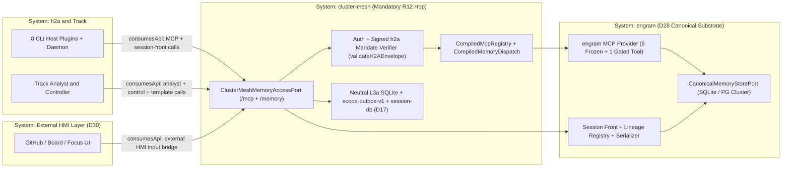

# SPEC — Engram `cluster-mesh` Memory Access and MCP Wiring (Spec 6A)

- **Spec ID:** `SPEC_ENGRAM_CLUSTER_MESH_MEMORY_ACCESS_AND_MCP_WIRING` (Spec 6A in `spec/memory/PLAN_SPEC_ENGRAM_FRONT.md:147-156`)
- **Stage:** `DESIGN`
- **Status:** `proposed`
- **Version:** `0.2.0` (`post-h2a + sentropic review fold`)
- **Date:** `2026-11-14`
- **Repository of Record:** `engram` (`@sentropic/engram`, branch `docs/memory-r15-sediment`)
- **Primary Owners:** `engram` + `sentropic` (boundary consumer: `h2a` / `Track`)
- **Dependencies:**
  - `spec/SPEC_ENGRAM_METAMODEL_AND_LINEAGE_REGISTRY.md` (`Spec 0`: `Sha256Digest` `:144`, `LineageId` `:147`, `OntologyTemplateEnvelopeRef` `:149-154`, `H2AMandateEnvelope` `:161-174`, travelling templates, domain-blind metamodel primitives)
  - **Unmerged `h2a` PR #455 (`OPEN` prerequisite for `MCP-L8` / `Point 2B`):** `fix(registry-bridge): re-bootstrap missing plugin lock on auto-upgrade and guard live locks`, branch `fix/registry-bridge-missing-lock`, head commit `844402eeae1161d74304e634790904785cbb602c` (against `origin/main` `1f57127de`) — atomic `BridgeLock` provisioning/re-bootstrap, live-lock quarantine, `mcp-central` protocol-2 attachment diagnostics, and `h2a-bridge-shim.mjs` / `handover` UID/mode guards (§1.2, §4.3, §6.3)
  - **Owner `chat-mesh` rulings of `2026-11-14 20:20` (relayed by sentropic, 14/11; `sentropic:spec/SPEC_EVOL_CHAT_MESH_PROPOSAL.md`):** neutral `session-db` + L3a storage/outbox layer in `@sentropic/cluster-mesh`, `@sentropic/llm-mesh` (`+ llm-mesh/decision`) as sole model/JEV path, and `@sentropic/chat-server` `G-FENCE` isolation (§2.1, §2.2, §2.4, §2.5, §3.3, §6.2)
- **Downstream Specs Unblocked by Spec 6A:**
  - `spec/SPEC_ENGRAM_SESSION_FRONT_AND_EXTRACTION.md` (`Spec 1`, `PLAN_SPEC_ENGRAM_FRONT.md:157-172`)
  - `spec/SPEC_ENGRAM_CONTEXTUAL_GRAPH_AND_PROMPT_LOOP.md` (`Spec 2`, `PLAN_SPEC_ENGRAM_FRONT.md:174-186`)
  - `spec/SPEC_ENGRAM_TRACK_ANALYST_CONTROL_AND_PR_SERIALIZATION.md` (`Spec 5`, `PLAN_SPEC_ENGRAM_FRONT.md:211-220`)
  - `spec/SPEC_ENGRAM_CLUSTER_MESH_TRANSACTIONAL_GRAPH_SYNC.md` (`Spec 6B`, `PLAN_SPEC_ENGRAM_FRONT.md:222-232`)
- **Binding Authorities:**
  - `spec/memory/OWNER-DECISIONS-2026-11-14.md:1-29` (`T-M-C`, Points `1B`, `2B`, `3C`, `4B`, `5B`, `6A`; `D28` kept)
  - `spec/memory/R15-SEDIMENT.md:1-141` (`D1`–`D34`, settled R15 architecture)
  - `spec/memory/PLAN_SPEC_ENGRAM_FRONT.md:134-156,236-245` (Spec 0, Spec 6A, and §4 Owner Review Points)
  - `spec/memory/ARCHITECTURE-RULES.md:1-13` (`R12` no-bypass invariant, `D30` separate system layers, `archi@1` relation rules)
  - `spec/memory/contracts/engram-cluster-mesh.md:1-181`
  - `spec/memory/contracts/engram-h2a.md:1-214`
  - `spec/memory/contracts/engram-track.md:1-247`
- **Amends:**
  - `spec/SPEC_MEMORY_MCP_V2.md:536-580` (`M7` Sentropic platform alignment; provider manifest example at `:553-575`; `MCP-L4`–`MCP-L8` qualification and cutover sequence at `:577-695,1096-1108`)
  - `plan/08-BRANCH_MEMORY_FINALIZATION.md:200-240` (`MCP-L4`–`MCP-L8` status ledger at `:214-220` and EVOL §10 host-integration gaps at `:224-240`)
- **Evidence Baseline Verified (Read-Only):**
  - `engram` (`@sentropic/engram` `0.28.0` at branch `docs/memory-r15-sediment`, `package.json:2-3`)
  - `sentropic` (`origin/main` commit `913e3bcbc`, `@sentropic/cluster-mesh` `0.26.0-dev.27`, `@sentropic/mcp-platform` `0.4.2`, `@sentropic/mcp-broker` `0.1.0`, `@sentropic/llm-mesh` `0.38.0`, `@sentropic/chat-server` `0.4.1`, plus owner `chat-mesh` rulings of `2026-11-14 20:20`, relayed by sentropic, 14/11)
  - `h2a` (`origin/main` commit `1f57127de` / tag `v0.98.10`, `@sentropic/h2a` `0.98.10`, `@sentropic/h2a-runtime` `0.98.10`, `@sentropic/track` `0.98.10`, plus **unmerged PR #455** on branch `fix/registry-bridge-missing-lock` at head commit `844402eeae1161d74304e634790904785cbb602c`)

---

## 0. Binding Governance, Scope Boundary, and Amendments

### 0.1 Binding Owner Decisions (`D1`–`D34`, `T-M-C`, Points `1B`–`6A`, `D28` Kept)

This specification executes the settled R15 and R16 owner directives without reopening any decision in `D1`–`D34` (`spec/memory/R15-SEDIMENT.md:42-80`) or Points `1B`–`6A` (`spec/memory/OWNER-DECISIONS-2026-11-14.md:1-29`).

1. **Templates / Metamodel / Control (`T-M-C`)** (`spec/memory/OWNER-DECISIONS-2026-11-14.md:6,9-18`):
   > « Les question sont pas assez detaillees. Pose les ici. On est en train de faire des modif coté track sjr les ontologies de son domaine, il fdoit en rester maitre au moins piur les templates et engram pour leur metamodel et application track pour leur controle. Mene un tour avec h2a rapide en fable 5.2 + carbon et repose les 6 quesfion a l issi »

2. **Owner Ratification of Points `1B`–`6A` and Retention of `D28`** (`spec/memory/OWNER-DECISIONS-2026-11-14.md:7,20-29`):
   > « Tout comme recommandé »

   | Point | Binding Decision | Impact on Spec 6A |
   | --- | --- | --- |
   | **T-M-C** | `Track` owns project domain ontology templates and project control; `engram` owns the domain-blind metamodel and lineage registry; `h2a` owns role/activity/harness templates and mandate authority (`OWNER-DECISIONS-2026-11-14.md:9-16`). | `cluster-mesh` transports records strictly by `OntologyTemplateEnvelopeRef` + `Sha256Digest` and verifies signed `h2a` mandates without embedding domain enums (§2, §5). |
   | **1B** | Engram-first ingestion and per-PR `.track/` projection (`D29=both`, `D34=engram`) produced by `engram` under `Track`'s published template version + digest; `Track` validates and replays before merge (refused, never repaired by `engram`); `engram` checks metamodel well-formedness only (`OWNER-DECISIONS-2026-11-14.md:21`). | `ClusterMeshMemoryAccessPort` exposes first-rank session-front ingestion and template-pinned PR serialization triggers over `R12` (§2.2, §5). |
   | **2B** | Spec 2 written now and seventh tool (`engram_memory_context`) built **disabled by default**; enabled only after `engram` + `sentropic` co-signature and `MCP-L5` qualification, then switched on per CLI host with a fixed end date; fixes only the template-reference + digest envelope (`OWNER-DECISIONS-2026-11-14.md:22`). | Spec 6A freezes only the 7th tool's outer wire envelope and three-gate rollout; internal query/prompt-loop semantics stay in Spec 2 (§4). |
   | **3C** | Dormant dreaming runs nightly/mid-day/saturation passes locally and weekly/monthly/cross-repo audit passes remotely after graph sync; dreamed `Track` template proposals go to `Track`, and typed `Track` writes pass `Track` control (`OWNER-DECISIONS-2026-11-14.md:23`). | Local `D10` context logs/summaries remain local unless mandate + repo policy allow transfer; dreaming writes respect `Point 5B` / `Point 6A` (§2.3, §5). |
   | **4B** | Sibling `h2a` and `Track` lineages under `engram`'s metamodel alongside unchanged `archi@1` (`D16`); version-pinned cross-lineage composition; Git-serialized `.h2a/` workspace overlays (`D31`, `D34`) never modify `Track` templates (`OWNER-DECISIONS-2026-11-14.md:24`). | `/memory/v1/templates/*` and MCP dispatch attribute `sentropic.h2a` vs `sentropic.track` distinctly and enforce sole-author lineage rights (§2.2, §3). |
   | **5B** | Split joint control (`D32`): `Track`'s rules and verdict (`verdictAuthority: 'track'`) are authoritative for the `Track` domain (`engram` records and never replaces them; unratified typed writes stay `proposed` while raw records are already in `engram`); `engram` enforces metamodel well-formedness and `D7` deny-lists (`OWNER-DECISIONS-2026-11-14.md:25`). | `cluster-mesh` routes distinctly attributed `sentropic.track` control verdicts and never promotes `proposed` `Track` nodes without a `Track` verdict (§2.2, §5.3). |
   | **6A** | One bidirectional workspace-scoped sync over `cluster-mesh`; template versions travel with the graph; `cluster-mesh` carries objects without knowing `Track` types, **never** overwrites a `Track`-controlled record, and refuses concurrent offline template versions so `Track` decides (`OWNER-DECISIONS-2026-11-14.md:26`). | Enforced at both the `cluster-mesh` memory access write gate and the local/remote `D17` outbox ingress (§5.1–§5.4). |
   | **`D28=engram`** | **Kept unchanged:** `engram`'s live registry remains the canonical fact reference; Git/PR files are serialized reviewable views (`OWNER-DECISIONS-2026-11-14.md:3,21`; `R15-SEDIMENT.md:73`). | `cluster-mesh` routes all canonical reads and writes to `engram` stores, never treating `.track/` files or shadow caches as canonical (§2, §3.5, §5.4). |

3. **`cluster-mesh` Mandatory MCP Registry & Access Hop (`R12`)** (`spec/memory/contracts/engram-cluster-mesh.md:170`; `spec/memory/ARCHITECTURE-RULES.md:5`):
   > « repose bien sur le mcp registry de cluster mesh »

4. **`engram` First-Rank Session Front, `D20` Seventh Tool, `D30` Separate HMI Layer, `D32` Split Control, and `D24` Integral Graph Sync** (`spec/memory/R15-SEDIMENT.md:12,26,31-32,65,69,75,77`):
   - > « Engram doit etee en premier front pour recup les donnes de session avant track, avec des analystes »
   - > « Attention track c juste pour les decision et gestion d evenement projet. Engram doit etre la premiere etape in fine. Cette assertion me smeble tres mauvaiss »
   - > « Attention car le premier rang doit etre engram (enregistrement pkur serialisarkkn eg tour de parole + regles + conrrole track si possible par agent). »
   - > « Je vois pas comment tu gere adapte sans outil memoire »
   - > « Attention tu confonds l outil track la memoire e tun outil ihm pour interagir avec - gh pourra donner de l input c une autre layer »
   - > « Donc part de engram - et de track » / « api type jev/decison »
   - > « De plus j ai demande un partage de graphe entre local et remote. Integral. Engram doit gere ca comme des transaction et synchro de cluster de db via cluster mesh. »

### 0.2 Scope Boundary Between Spec 6A, Spec 0, Spec 2, and Spec 6B

- **Spec 0 (`SPEC_ENGRAM_METAMODEL_AND_LINEAGE_REGISTRY.md`)** defines the shared metamodel grammar, `Sha256Digest` (`:144`), `OntologyTemplateEnvelopeRef` (`:149-154`), `H2AMandateEnvelope` (`:161-174`), and the domain-blind metamodel operation classes carried over `cluster-mesh` (`raw_event`, `typed_node`, `typed_edge`, `turn_text`, `ontology_template`, `control_verdict`, `context_log`, `context_summary` in `spec/memory/contracts/engram-cluster-mesh.md:74-82`). Spec 6A imports these types unchanged.
- **Spec 6A (this document)** owns:
  1. The `MCP-L4` → `MCP-L5` → `MCP-L6` → `MCP-L7` → `MCP-L8` delivery chain, qualification checkpoints, and exit gates (§1).
  2. `cluster-mesh` as the mandatory `R12` memory access hop for all `h2a`, `Track`, and external HMI (`D30`) reads and writes, including endpoints, dual-layer authentication + cryptographic `h2a` mandate verification, and `D17=degraded` local durability (§2).
  3. Provider registration, selection, configuration, compilation, catalog projection, and HTTP/JSON-RPC + stdio dispatch across `engram`, `cluster-mesh`, `mcp-platform`, `mcp-broker`, `sentropic/api`, and `h2a`, plus retirement of the legacy memory ports (§3).
  4. The outer wire envelope and `Point 2B` activation/rollout gating of the seventh MCP tool (`engram_memory_context`) (§4).
  5. Domain-blind `Track` record transport by `OntologyTemplateEnvelopeRef` + `Sha256Digest` and the `Point 6A` non-overwrite / concurrent-template refusal invariants at the `cluster-mesh` boundary (§5).
- **Spec 2 (`SPEC_ENGRAM_CONTEXTUAL_GRAPH_AND_PROMPT_LOOP.md`)** owns the internal execution semantics of `engram_memory_context`: graph ranking, fingerprint traversal, `D22` role-consciousness subgraph projection, `D23` durationless prompt assembly, and `D14` host text purge (`PLAN_SPEC_ENGRAM_FRONT.md:174-186`).
- **Spec 6B (`SPEC_ENGRAM_CLUSTER_MESH_TRANSACTIONAL_GRAPH_SYNC.md`)** owns the multi-node ACID replication protocol (`ClusterMeshGraphClusterSyncPort`), causal watermarks, and replacement of `MemoryReplicationPort` (`PLAN_SPEC_ENGRAM_FRONT.md:222-232`). Spec 6A defines the local `D17=degraded` outbox seam and `Point 6A` ingress guard that Spec 6B's replication engine drains.

### 0.3 Formal Amendments to `SPEC_MEMORY_MCP_V2.md` and `plan/08-BRANCH_MEMORY_FINALIZATION.md`

1. **Amendment A1 — `SPEC_MEMORY_MCP_V2.md` `M7` (`:536-580`, specifically `:553-575`):**
   - `SPEC_MEMORY_MCP_V2.md:554-556` originally illustrated the manifest with `appId: "engram"` and `providerId: "engram-memory"`.
   - Shipped P2 platform contracts in both `engram` (`src/mcp/memory/contracts.ts:143-146`, `src/mcp/memory/gates.ts:292-298`, `registry/entries.v1.json:8,268`) and `sentropic` (`packages/mcp-platform/src/memory/contracts.ts:30-33`, `packages/mcp-broker/src/memory/contracts.ts:36-37`, `h2a:packages/h2a/src/registry/memory-provider.ts:6`) standardize the identifier tuple as:
     - `appId`: `'engram'`
     - `providerId` (and registry entry `id`): `'sentropic.engram.memory'`
     - `connectorId`: `'engram-memory'`
     - `sourceId` (broker/catalog binding): `'mcp:engram-memory'`
     - storage neutral-handle `moduleId`: `'engram-memory'` (`sentropic:packages/cluster-mesh/src/engram-memory/neutral-handle.ts:85`)
   - Spec 6A formally amends `SPEC_MEMORY_MCP_V2.md:555` from `providerId: "engram-memory"` to `providerId: "sentropic.engram.memory"` while retaining `connectorId: "engram-memory"` (§3.1; aligned in `spec/memory/contracts/engram-cluster-mesh.md:140`), and locks `LineageId` across all Spec 6A wire and storage envelopes to Spec 0's 4-member union `'archi' | 'h2a' | 'track' | 'engram'` (`SPEC_ENGRAM_METAMODEL_AND_LINEAGE_REGISTRY.md:147`; aligned in `engram-cluster-mesh.md:67,84` and `engram-h2a.md:43`).
2. **Amendment A2 — `SPEC_MEMORY_MCP_V2.md` `M1` (`:164-198`) and `M7` (`:560-575`):**
   - The six `M1` tools remain frozen under profile `sentropic.engram.memory-tools/2020-12-v1` (`src/mcp/memory/schemas.ts:25`). Under `D20=seventh` and `Point 2B` (`OWNER-DECISIONS-2026-11-14.md:22`), a seventh read-only tool `engram_memory_context` is introduced **disabled by default** under co-signed profile `sentropic.engram.memory-tools/2020-12-v2` (`sentropic.engram.memory-wire/v2`), never mutating the `v1` 6-tool compatibility digest (§4).
3. **Amendment A3 — `plan/08-BRANCH_MEMORY_FINALIZATION.md` (`:214-220`):**
   - Updates `MCP-L4` from `todo` (`plan/08-BRANCH_MEMORY_FINALIZATION.md:214`) to `candidate_shipped_awaiting_L5_qualification` (`@sentropic/engram` `0.22.0`–`0.28.0`, `CHANGELOG.md:55-67`), updates `MCP-L5` (`:215`) to record Lot 1 shipped in `sentropic` (`packages/mcp-platform/src/memory/*`, `packages/mcp-broker/src/memory/*`) with Lot 2 durable workflow stores + #704 Postgres qualification pending, and binds `MCP-L6`–`MCP-L8` (`:216-220`) to the R15 `R12` access hop, signed `H2AMandateEnvelope` verification, `D17=degraded` mode, and `Point 6A` `Track` non-overwrite rules (§1).

---

## 1. The MCP Delivery Chain (`MCP-L4` → `MCP-L5` → `MCP-L6` → `MCP-L7` → `MCP-L8`)

### 1.1 End-to-End Dependency and Qualification Topology

`MCP-L0` through `MCP-L3` shipped in `@sentropic/engram` `0.20.0`–`0.23.0` (`CHANGELOG.md:55-112`), establishing the frozen L0 contracts (`src/mcp/memory/contracts.ts:1-615`), total M6 error sanitizer (`src/mcp/memory/errors.ts:1-721`), Option B in-process read/write facades (`src/memory-tools/index.ts:1-7`), and the injected neutral module-storage adaptation `openModuleStorageCanonicalMemoryStoreV1` (`src/memory-substrate/index.ts:19-50`).

The remaining delivery chain from `MCP-L4` to `MCP-L8` (`plan/08-BRANCH_MEMORY_FINALIZATION.md:214-222`; `spec/SPEC_MEMORY_MCP_V2.md:1096-1112`) follows a strict qualification order: **`MCP-L4` shipped as an optional, default-disabled candidate in `0.22.0`, but cannot exit `candidate` status until `MCP-L5` completes production qualification (`L5-MEMORY-V1`)**. `MCP-L6`, `MCP-L7`, and `MCP-L8` then advance in strict lockstep.


### 1.2 Code-Fact Matrix Across `MCP-L4` → `MCP-L8`

Every claim below is anchored to verified source lines in `engram` (`docs/memory-r15-sediment`), `sentropic` (`origin/main` `913e3bcbc`), and `h2a` (`origin/main` `1f57127de` / `v0.98.10` + unmerged PR #455 `fix/registry-bridge-missing-lock` at `844402eeae1161d74304e634790904785cbb602c`).

| Step & Owner | What Exists in Code Today (`file:line`) | What Is Missing | Mandatory Step Exit Gates |
| --- | --- | --- | --- |
| **`MCP-L4`** (`engram`) | 1. Optional subpath `./mcp-memory` (`package.json:35-38`, `src/mcp-memory/index.ts:1-92`) exporting `createEngramMemoryProviderV1` (`src/mcp-memory/provider.ts:648-965`), 9-step `invokeTool` (`provider.ts:661-891`), `createManifestMemoryDispatchPlanV1` (`provider.ts:197-229`), `MEMORY_FROZEN_PROFILE_BINDINGS_V1` (`src/mcp-memory/profiles.ts:19-31`), and `createEngramMemoryMcpServerV1` (`src/mcp-memory/server.ts:265-415`).<br/>2. Registry package subpaths `./registry/manifest` (`src/registry/manifest.ts:1-69`), `./registry/definitions` (`src/registry/definitions.ts:1-84`), `./registry/validator` (`src/registry/validator.ts:1-2`), and packed `registry/entries.v1.json:1-424` + `registry/publisher-assets.v1.json:1-212`.<br/>3. Optional peers `@sentropic/mcp-broker: "0.1.0"` and `@sentropic/mcp-platform: "0.4.0"` (`package.json:185-186,203-208`), `@modelcontextprotocol/sdk: "^1.31.0"` (`package.json:166-167`). | 1. `L5-MEMORY-V1` production qualification receipt (`CHANGELOG.md:64-67`, `plan/08-BRANCH_MEMORY_FINALIZATION.md:214`).<br/>2. Peer range widening in `package.json:186` from exact `"0.4.0"` to `">=0.4.0 <0.5.0"` to match `sentropic:packages/mcp-platform/package.json:3` (`0.4.2`) and `h2a:packages/h2a/package.json:87` (`0.4.1`), plus published `@sentropic/mcp-broker` (`6A-S0a` pure L0 contract co-freeze preceding `6A-E2` whenever compiled `@sentropic/engram` imports 7th-tool contracts from `@sentropic/mcp-broker/memory` at module evaluation, `sentropic:packages/cluster-mesh/tests/storage/cold-workspace.sh:49`).<br/>3. Update `src/mcp/memory/standard/PROVENANCE.json:3` from `97fe9f53e8079694e35771227c11544ce8658316` to the `L5-MEMORY-V1` commit.<br/>4. R15 mandate verification hook on `ReadAuthenticationV1` / `WriteAuthenticationV1` (`src/mcp-memory/provider.ts:55-96`) and default-disabled 7th tool envelope (§4). | - `validateMemoryPublisherAssetsV1` (`src/mcp/memory/receipts.ts:145-218`) passes on packed tarball.<br/>- Root import `@sentropic/engram` (`package.json:13-17`) loads zero MCP SDK, platform, or broker modules.<br/>- `mcp.createMemoryPortV2 === substrate.createMemoryPortV2` (`sentropic:packages/cluster-mesh/src/integrations/mcp/memory.ts:45-47`).<br/>- `L5-MEMORY-V1` and `GWRC-CI-V1` receipts committed (`SPEC_MEMORY_MCP_V2.md:656-693`). |
| **`MCP-L5`** (`sentropic`) | 1. **Lot 1 shipped:** `packages/mcp-platform/src/memory/contracts.ts:1-404` (`MEMORY_PROVIDER_ID = 'sentropic.engram.memory'` `:31`, `MEMORY_CONNECTOR_ID = 'engram-memory'` `:33`, `MEMORY_TOOL_NAMES` `:40-47`), `invocation-context.ts:41-112` (`requireTrustedInvocationContext`, `projectMemoryContext`, `validateMemoryProjection`), `mutation-guard.ts`, `confirmation-guard.ts`, and `packages/mcp-broker/src/memory/compiled-dispatch.ts:96-232` (`CompiledMemoryDispatch`).<br/>2. Draft PostgreSQL + stdio/HTTP qualification harness (`packages/cluster-mesh/docs/memory-mcp.md:86-104`, `docs/memory-mcp-candidate.md:3-46`) pinned to `@sentropic/engram` `0.22.0` (`packages/cluster-mesh/package.json:269,294`; `src/modules/catalog.ts:18`). | 1. **Shared neutral SQLite L3a kernel pre-lot (`6A-S0b`, coordinated with `chat-mesh` Lot `B2`):** `SqliteKernel` (`packages/cluster-mesh/src/storage/sqlite/index.ts:160,181-200`) currently enables `StagedKernelRoot` only for `moduleId === 'comments'` and lacks `fenced-writers-v1` (`ownership`), `immutable-boundaries-v1`, and `scope-outbox-v1`; `createMemoryNeutralHandle` (`src/engram-memory/neutral-handle.ts:57-58,85,99-130`, `neutral-contract.ts:6`) hardcodes `backend: 'postgres'`. Both `postgres` and `sqlite` must be supported on `MemoryNeutralHandle`.<br/>2. **Production durable workflow stores (`MCP-L5` Lot 2):** `SqliteMemoryWorkflowStoreV1` and `PostgresMemoryWorkflowStoreV1` implementing crash-window `MemoryReservationStorePortV1`, single-use `ConfirmationContinuationPortV1`, durable audit sink, and cursor store.<br/>3. Publishable `@sentropic/mcp-broker` (`packages/mcp-broker/package.json:4` `"private": false`) + Sentropic #704 durable Postgres backend qualification.<br/>4. Enrolled `sent-tech.ca` confirmation attestation (`docs/memory-mcp.md:33`), E2/P1 `lot2-manifest.json` handoff (`SPEC_MEMORY_MCP_V2.md:656-672`), and peer bump from `>=0.22.0 <0.23.0` (`catalog.ts:18`, `package.json:269,294`) to `>=0.28.0 <0.29.0`. | - Process-kill / crash-window recovery passes for all 4 mutating tools (`capture`, `request_admission`, `withdraw`, `forget`) on both SQLite and Postgres.<br/>- Replayed or cross-client `elicitation_ref` rejected before effect.<br/>- `make memory-mcp-qualify E2_LOCK=/tmp/sentropic-docker.lock ENV=test-memory-mcp` passes with zero skips against `@sentropic/engram` `0.28.0+` using production workflow stores.<br/>- `@sentropic/mcp-broker` published (`private: false`).<br/>- `L5-MEMORY-V1` checkpoint tag & `lot2-manifest.json` SHA-256 receipt issued. |
| **`MCP-L6`** (`sentropic/cluster-mesh`) | 1. `@sentropic/cluster-mesh/mcp/memory` (`packages/cluster-mesh/package.json:251-254`, `src/integrations/mcp/memory.ts:1-55`) exporting `createEngramMemoryBuiltin` (`:21-55`), `registerEngramMemoryTools` (`src/integrations/mcp/memory-transport.ts:21-59`), and `createEngramMemoryWireManifest` (`src/integrations/mcp/memory-manifest.ts:4-55`).<br/>2. Qualified peer loaders `loadEngramMemoryMcp` and `loadEngramMemorySubstrate` (`src/loaders/mcp/memory.ts:5-15`) over `PROVIDER_CATALOG['mcp/memory']` and `PROVIDER_CATALOG['engram-memory/substrate']` (`src/modules/catalog.ts:108-119`).<br/>3. Stateless `/mcp` router (`src/compose/mcp.ts:96-108,169-252`) and stateful wrapper (`src/compose/mcp-stateful.ts:23-95`).<br/>4. M1-only fenced storage bindings (`memory-binding-v1`, `src/engram-memory/{manifest,projection,binding,neutral-handle,sqlite,postgres}.ts`, `assets/storage/postgres/engram-memory/001-projections.sql:1-14`). | 1. **Foundational `memory-binding-v2` migration (`6A-S1a`):** `003-metamodel-records.sql` + generic metamodel key families in `manifest.ts:75-91,215-230`, `projection.ts:50-105`, and `sqlite.ts` indexed by `(scope_key, lineage, template_id, template_version, template_digest_sha256, record_id)` with storage-level `lineage = 'track'` non-overwrite defense-in-depth (§5.1, §5.3).<br/>2. Graduate `memory` (`namespace: '/memory'`) from `GATED_OWNERS` (`src/modules/catalog.ts:142,173-175`) to `PROVIDER_CATALOG` with subpaths `./memory`, `./loaders/memory`, `./compose/memory` (updating `packaging/types-and-bundlers.spec.ts:60-115` and `compose/disabled.ts:5`).<br/>3. Support both `embedded-local` (fenced SQLite + `D17=degraded` over neutral L3a `scope-outbox-v1` and `session-db`, never a memory-specific sidecar store — relayed by sentropic, 14/11) and `external-host` (fenced multi-node Postgres).<br/>4. Fix `compose/mcp.ts:106,208,248` (`claims: []` bug, `workspaceId`-as-`tenantRef` bug, missing `StpConnectorContext`, and `/mcp/mcp` double-mount bug), add `H2AMandateTrustRootPort` + real `H2AEnvelope<H2AMandate>` verifier (`runtime/h2a-mandate-verifier.ts`), and enforce `@sentropic/llm-mesh` + `llm-mesh/decision` as sole model/JEV path (§2.3–§2.5). | - `memory` graduated from `GATED_OWNERS` (`catalog.ts:142`) to `PROVIDER_CATALOG` and `disabledNamespaceModule('/memory')` returns `{ namespace: '/memory', enabled: false }`.<br/>- `memory-binding-v2` passes on both `embedded-local` (SQLite) and `external-host` (Postgres) over neutral L3a `scope-outbox-v1`.<br/>- `compose/mcp.ts` dispatches memory tools at `'/'` under `namespace: '/mcp'` with verified `['sub', 'tid']` claims and `StpConnectorContext`.<br/>- Real `H2AEnvelope<H2AMandate>` golden vector, `D17=degraded` banner/outbox, and `Point 6A` storage-level non-overwrite suites pass via `make test-cluster-mesh ... ENV=test-cluster-mesh`. |
| **`MCP-L7`** (`sentropic/api` + `cluster-mesh`) | 1. `compileAppMcpRegistry` (`api/src/services/mcp/cluster-registry.ts:29-56`) compiles `createMcpRegistry`, while `api/src/services/artifacts/transport.ts:16-25,45-56` (sole productive startup caller via `api/src/routes/namespaces/mcp.ts:32,37,226`) hardcodes `selection: ['sentropic.artifacts']` and routes all `invoke()` calls to `host.bind(...).mcp(...)`.<br/>2. `createRegistryDispatchRouter` (`api/src/services/mcp/registry-dispatch.ts:22-108`) restricts `POST /invoke` to `'sentropic.artifacts'` (`:34`), types `transport()` as `ArtifactTransport` (`:8`), and returns `{ error: 'artifact_request_refused' }` on catch (`:102`, asserted at `api/tests/api/registry-dispatch-terminal.test.ts:143,150`).<br/>3. `HostRegistryCatalogSource` (`api/src/services/catalog/sources/host-registry-source.ts:17-62`) hardcodes `claims: []` (`:29`) and delegates `invoke()` to `ArtifactTransport` (`:60`); `client-policy.ts:25-50` (`DEC-116`) restricts `sentropic-mcp` to `ARTIFACTS_TOOL_SPECS`.<br/>4. `api/src/routes/namespaces/memory.ts:1-75` (mounted in `api/src/app.ts:29,150-152`), `api/tests/api/cluster-mesh-memory.test.ts`, and `packages/cluster-mesh/tests/graphify-memory-adapter.spec.ts` import `GraphifyMemory*` / `H2aGraphifyMemoryPort` from `packages/cluster-mesh/src/memory.ts:18-151` (`src/index.ts:5`). | 1. Keep a **single** `compileAppMcpRegistry` (`cluster-registry.ts:13-56`) adding `memory?: EngramMemoryDefinitionOptions`, and extract a multi-provider host transport dispatcher above `artifacts/transport.ts:16-56` routing by `decision.providerId` (§3.3).<br/>2. Fix `claims: ['sub', 'tid', ...]` and `StpConnectorContext` projection in `host-registry-source.ts:28-30,55-61`, update `client-policy.ts:25-50` (`READ_ONLY_TOOL_ALLOWLIST` + `nonReadOnlyAllowlistEntries()`), preserve `chat-server` `G-FENCE` (§2.5), and discriminate REST `/invoke` catch (`'artifact_request_refused'` vs `'memory_request_refused'`, §3.4).<br/>3. Migrate `api/src/routes/namespaces/memory.ts` to `compose/memory` (`/api/v1/memory/v1/*` projection without touching RC2 `RECEIVER_ROUTE_TABLE`), then delete `H2aGraphifyMemoryPort` (`src/memory.ts:18-151`, `src/index.ts:5`) and migrate both test suites (§3.5).<br/>4. Re-pin L5/P3 `pre-candidate-manifest.json` + `.sha256` (`qualification.mk:14-15,49`) and keep the 22 `R2-MEMORY` / `R7a-MEMORY` (`P09`) suites green. | - Unopted-in tenants and agents receive zero `engram_memory_*` tools on `tools/list` and `HostRegistryCatalogSource.snapshot()`.<br/>- `POST /` (`tools/call`) and `POST /invoke` route `engram-memory` through `CompiledMemoryDispatch` with verified `StpConnectorContext`, preserving `{ error: 'artifact_request_refused' }` for `sentropic.artifacts` and returning `{ error: 'memory_request_refused' }` on last-resort REST memory catch.<br/>- Zero references to `H2aGraphifyMemoryPort` or `createGraphifyMemoryAdapter` remain in `cluster-mesh` or `api`, and `make test-api ... ENV=test-api` + `make typecheck ENV=test-typecheck` pass. |
| **`MCP-L8`** (`h2a` + `Track`) | 1. `packages/h2a/src/registry/memory-provider.ts:1-48` (`MEMORY_PROVIDER_ID = "sentropic.engram.memory"` `:6`, 6-tool `MEMORY_TOOL_NAMES` `:7`) and `sentropic-daemon.ts:325-499`, where `:365-371` hardcodes 6 tools and `:428-431` passes raw `options.attachment` (`{ context, participant }` from `mcp-central-attachment.ts:84,125` or `undefined` standalone) instead of `StpConnectorContext`.<br/>2. Unmerged **PR #455** (`fix/registry-bridge-missing-lock`, `844402eeae1161d74304e634790904785cbb602c`) hardens `bridge-lock.ts` (`linkSync`, live-lock quarantine), `host-bootstrap.ts` (`rebootstrapMissingPluginLock` `:1646-1775`), `hosts/installation-doctor.ts` (`:2432-2440`), `cli-registry.ts` (`:565-731`), `mcp-central-policy.ts`, `handover/{admission,authority}.js`, and `scripts/h2a-bridge-shim.mjs`, while `validateBridgeLock` (`bridge-lock.ts:187-221`) and `normalizeConfiguration` (`descriptors.ts:463-471`) still reject `v2` / `contextToolSwitchover` and `rebootstrapMissingPluginLock` omits `options.memory`.<br/>3. `SUPPORTED_HOSTS` (`host-bootstrap.ts:52`) covers 5 of 8 hosts; `mcp-central-qualification.ts:5` spells `"Muse"`; `hosts/plugin.ts:85-152` has no `Stop` hook on `agy`/`muse` and only `post_agent` on `vibe`; `operator-notices.ts:1-24` checks file digests on 5 hosts only.<br/>4. `d11-ceremony.ts:509-517`, 9 `test/memory-*.test.js` files, and `focus-kit/test/fixtures/evidence-corpus.v1.json:5659-5715,7267-7305` depend on `port-v1.ts` / `promote-client.ts`; `packages/track/package.json:1-45` sits in the `h2a` workspace. | 1. Land/rebase onto **PR #455** (`844402eeae1161d74304e634790904785cbb602c`), upgrade `@sentropic/cluster-mesh` (`>=0.26.0`) & `@modelcontextprotocol/sdk` (`^1.31.0`), harden `canonical.ts:11-49` (reject lone UTF-16 surrogates matching `descriptors.ts:141-170`), and construct valid `StpConnectorContext` + real `H2AEnvelope<H2AMandate>` (`'instance'` & `'quorum'`) in `sentropic-daemon.ts` / `mcp-central-attachment.ts` across `shared-central` and standalone fallback, targeting the local `cluster-mesh` daemon over loopback IPC/HTTP (§2.1, §2.3).<br/>2. Route `Point 2B` through `bridge-lock.ts`, `descriptors.ts`, `host-bootstrap.ts` + `hosts/installation-doctor.ts` (preserving `options.memory`), `mcp-central.ts`, `mcp-central-shim.ts`, and per-host `shim-bridge.js` / `catalogue.js` masking without breaking `bridgeLockDigest` / `contractDigest` or regressing PR #455's 4 incident guards (§4.3).<br/>3. Complete migration lot (`6A-H2`) deleting the 9 legacy `runtime/memory/*.ts` files while keeping `d11-ceremony.ts`, the 9 legacy `test/memory-*.test.js` suites + `memory-d11-ceremony.test.js`, and `evidence-corpus.v1.json` (`prepack`) green (§3.5, §6.3).<br/>4. Cover all 8 hosts in `host-bootstrap.ts`, `mcp-central-qualification.ts` (`"muse"`), `drumbeat` + `plugin.ts` session-front ingest, dedicated 8-host memory-health banner in `operator-notices.ts` / `status-surface.ts`, `registry-memory*.test.js` (6 & 7 tools), and `T-M-C` manifest guard on `packages/track/package.json`. | - Zero `@sentropic/engram` store/engine or `@sentropic/cluster-mesh` memory-store dependencies in `packages/track/package.json:1-45` (`T-M-C` CI gate) and zero direct store/engine imports in `packages/h2a` (`R12` CI gate).<br/>- All 9 legacy `runtime/memory/*.ts` files deleted; `d11-ceremony.ts`, `memory-d11-ceremony.test.js`, and `npm --workspace @sentropic/h2a run prepack` (`build-focus-dossier.mjs --check`) green.<br/>- Zero regression on PR #455 (`missing_lock`, `central_unavailable`, `prefix_owner_mismatch`, `tool_unavailable_on_generation`) across all 8 CLI hosts (`claude`, `codex`, `gemini`, `agy`, `hermes`, `opencode`, `muse`, `vibe`). |

### 1.3 Cross-Repository Handshake Checkpoints (`lot2-manifest.json`, `GWRC-CI-V1`, Writer Handoff, `chat-mesh` Lot `B2`, and `h2a` PR #455)

1. **`lot2-manifest.json` E2/P1 Handoff (`MCP-L5` → `MCP-L4` Exit) & L5/P3 Pre-Candidate Pin:**
   - Pursuant to `SPEC_MEMORY_MCP_V2.md:656-672`, `sentropic` emits a machine-verifiable `lot2-manifest.json` receipt recording the exact git commit SHA, npm tarball `sha512`, `PROVENANCE.json` SHA-256 digests for `manifest.ts` and `experimental/manifest-elicitation.ts` (`src/mcp/memory/standard/PROVENANCE.json:1-9`), and the reviewed wire manifest digest `computeManifestDigest(createEngramMemoryWireManifest(MEMORY_PROVIDER_MANIFEST))` (`sentropic:packages/cluster-mesh/docs/memory-mcp.md:58-60`), and re-pins `tools/memory-mcp-l5/artifacts/pre-candidate-manifest.json` + `.sha256` (`packages/cluster-mesh/tests/engram-memory/qualification.mk:14-15,49`) whenever the `v2` 7th-tool descriptor or exported subpaths change.
2. **`GWRC-CI-V1` Co-Freeze Gate & Pure L0 Contract Ordering (`6A-S0a` → `6A-E2`):**
   - Because compiled `@sentropic/engram` evaluates `@sentropic/mcp-broker/memory` at module load (`sentropic:packages/cluster-mesh/tests/storage/cold-workspace.sh:49`), pure L0 `v2` tool/context contract extensions in `@sentropic/mcp-platform/memory` and `@sentropic/mcp-broker/memory` (`6A-S0a`) land and co-freeze **before** `6A-E2` in `engram`, after which `validateMemoryPublisherAssetsV1` (`src/mcp/memory/receipts.ts:145-218`) and `composeEngramMemoryDefinition` (`packages/cluster-mesh/src/integrations/mcp/memory-compose.ts:22-24`) enforce zero unreviewed digest drift in CI.
3. **Shared-File Writer Handoff & Shared SQLite L3a Kernel Pre-Lot in `sentropic` (`SPEC_MEMORY_MCP_V2.md:629-639` + `chat-mesh` Lot `B2`, relayed by sentropic, 14/11):**
   - Both Spec 6A (`engram-memory`) and `chat-mesh` Lot `B2` (`session-db`, `sentropic:spec/SPEC_EVOL_CHAT_MESH_PROPOSAL.md:558-563`) add `immutable-boundaries-v1`, `scope-outbox-v1`, and `fenced-writers-v1` to `packages/cluster-mesh/src/storage/sqlite/index.ts` and touch `packages/cluster-mesh/package.json`, `src/storage/contracts.ts`, `src/modules/contracts.ts`, `src/modules/catalog.ts`, and `src/compose/disabled.ts`. Extracting the shared neutral SQLite L3a kernel pre-lot (`6A-S0b`) and respecting the writer sequence (`#679` → `#685` → `R2/R7a/R3` → `6A-S0b` / `B2` → `MCP-L5` → `MCP-L6` → `MCP-L7`) prevents merge and lockfile collisions.
4. **Explicit Unmerged `h2a` PR #455 Prerequisite (`MCP-L8`):**
   - `6A-H1` and `6A-H3` explicitly depend on unmerged `h2a` PR #455 (`fix/registry-bridge-missing-lock`, head commit `844402eeae1161d74304e634790904785cbb602c`) so `BridgeLock` re-bootstrap, live-lock quarantine, `mcp-central` protocol-2 attachment diagnostics, and `h2a-bridge-shim.mjs` / `handover` UID/mode protections are never regressed during memory cutover.

---

## 2. `cluster-mesh` Memory Access as the Mandatory Hop (`R12`)

### 2.1 Architectural Invariant (`R12` and `D30`)

Per `spec/memory/ARCHITECTURE-RULES.md:5-7`, `spec/memory/R15-SEDIMENT.md:31-32,75`, and `spec/memory/contracts/engram-cluster-mesh.md:9-15`:

1. **Zero Bypass (`R12`) and `@sentropic/chat-server` `G-FENCE`:** Neither `@sentropic/h2a`, `@sentropic/track` (`h2a:packages/track/package.json:1-45`), the 8 CLI host plugins (`h2a:packages/h2a/src/hosts/plugin.ts:85-152`), `@sentropic/chat-server` (`sentropic:packages/chat-server/package.json:35-38`, mounted in `/chat` under strict `G-FENCE` with zero imports of `@sentropic/cluster-mesh` or `@sentropic/engram` — relayed by sentropic, 14/11), nor the external GitHub/board HMI layer (`h2a:packages/h2a-runtime/src/gateway-host/live-github.ts:1-329`, `@sentropic/focus`, Sentropic web UI) may open an `engram` SQLite/PostgreSQL file, call `createMemoryPortV2` directly, or read/write `.graphify/` or `.track/` as an unmediated runtime store. Every runtime read and write transits `@sentropic/cluster-mesh`. On local developer machines where `h2a:packages/h2a/src/registry/sentropic-daemon.ts:333` runs either inside `mcp-central` or in standalone `registry-bridge` processes (`fallback_standalone` / plain shim route in `cli-registry.ts:629-649,730` and `mcp-central-attachment.ts:68-92`), `ClusterMeshMemoryPortAdapter` targets the single local `cluster-mesh` owner daemon over loopback IPC/HTTP so concurrent standalone bridge processes never contend on `SqliteEngine`'s `isolation: 'process'` / `lockingMode: 'EXCLUSIVE'` file lock (`sentropic:packages/cluster-mesh/src/engram-memory/sqlite.ts:60-68`).
2. **Four Separate System Layers Mediated by `cluster-mesh` (`D30`):**
   - `@sentropic/engram` (canonical graph substrate, metamodel & lineage registry, extraction, contextual query engine, dreaming, and `D34` Git serializer),
   - `@sentropic/h2a` + `@sentropic/track` (master harness, formal mandate authority, coordination, and project decision/event analyst & controller),
   - External HMI / Input Layer (`GitHub` issues/PRs/discussions, `@sentropic/focus`, board UIs — `D30`),
   - Git Repositories & PR Artifacts (serialized `.track/`, `.h2a/`, and `spec/` views — `D28`, `D29`, `D31`, `D34`),
   mediated exclusively by `@sentropic/cluster-mesh`.



### 2.2 Complete Endpoint and Port Surface (`ClusterMeshMemoryAccessPort`)

`cluster-mesh` exposes two complementary, non-bypassable surfaces over the same underlying `engram` canonical store and mandate guard:

1. **Agent-Facing MCP Tool Surface (`/mcp` HTTP JSON-RPC + `POST /invoke` + stdio bridge):**
   - Mounted via `createMcpNamespaceModule` (`sentropic:packages/cluster-mesh/src/compose/mcp.ts:169-252`, fixed at `:208` to mount `'/'` rather than doubling `/mcp/mcp`), `createStatefulMcpNamespace` (`src/compose/mcp-stateful.ts:23-95`), `createRegistryDispatchRouter` (`api/src/services/mcp/registry-dispatch.ts:22-108`), and `registerEngramMemoryTools` (`src/integrations/mcp/memory-transport.ts:21-59`).
   - Serves the **6 frozen `M1` tools** (`src/mcp/memory/contracts.ts:149-156`) and, only when unlocked by `Point 2B` (§4), the **7th tool** `engram_memory_context`.
2. **Host, Analyst, Control, and HMI Service Access Surface (`@sentropic/cluster-mesh/memory` + Hono namespace `/memory`):**
   - Graduated from `GATED_OWNERS['memory']` (`sentropic:packages/cluster-mesh/src/modules/catalog.ts:142`) into `PROVIDER_CATALOG['memory']` with subpaths `@sentropic/cluster-mesh/memory`, `@sentropic/cluster-mesh/loaders/memory`, and `@sentropic/cluster-mesh/compose/memory`, replacing the legacy `productMemoryModule` (`POST /api/v1/memory/query-intents` in `sentropic:api/src/routes/namespaces/memory.ts:1-75`, already mounted in production at `api/src/app.ts:29,150-152`).
   - **Normative Mount Path Projection:** `createMemoryNamespaceModule` registers sub-routes `/v1/*` inside `ClusterMeshHonoNamespaceModule` (`namespace: '/memory'`, matching `sentropic:packages/cluster-mesh/src/hono/session-router.ts:79-85`). Consequently, routes resolve to **`/memory/v1/*`** on direct embedded/local `cluster-mesh` mounts and to **`/api/v1/memory/v1/*`** when mounted under `/api/v1` in `sentropic:api/src/app.ts:150-152` (remaining strictly separate from inter-mesh `/mesh/v1/*` routes in `api/src/routes/session-content/route-table.ts:22-24`). In the table below, `/memory/v1/*` denotes the mesh-relative path (`/api/v1/memory/v1/*` on the hosted `api` app).
   - **Articulation with Frozen RC2 Session Receiver & Neutral `session-db` (relayed by sentropic, 14/11):** `api/src/routes/session-content/receiver.ts:62-106` and `route-table.ts:60-100` pin 38 capture routes by `CONTRACT_MANIFEST_SHA256` (`CONTENT_MOUNT = '/api/v1/auth/session/content'`, `INNER_MOUNT = '/mesh/v1/remote-sessions'`), and `cluster-mesh`'s neutral `session-db` module (§2.5) owns operational session entries, streams, and blobs. `POST /memory/v1/session-front/ingest` **never alters `RECEIVER_ROUTE_TABLE` and never duplicates raw operational session transcripts**: it records first-rank `engram` `raw_event` / `turn_text` anchors (`D19`, `Point 1B`, `D28` kept) citing `(session_id, entry_id, ordinal, content_digest)` (plus `branchEpoch` / `parentEntryId` on forks) in `session-db` (or RC2-admitted events) before `Track` runs.
   - Serves deterministic runtime host hooks (session-front turn recording, lineage template registration, `Track` analyst streams, `D32` control verdicts, `D30` HMI input ingestion, and `D34` PR serialization triggers) that **must execute deterministically on every turn/event rather than relying on optional LLM tool calls** (`R15-SEDIMENT.md:12-16,69`).

| Surface / Endpoint | Method / RPC | Caller(s) | Mutability & Required Right | Purpose & Spec Owner |
| --- | --- | --- | --- | --- |
| `/mcp` (`POST /`, `POST /invoke`) & stdio MCP | `engram_memory_search`, `engram_memory_get` | `h2a` agents, `Track` read queries, Sentropic chat turns (solely via `ChatPolicyPorts.tools` → `CatalogExecutionSeam` → `HostRegistryCatalogSource` under `chat-server` `G-FENCE`) | `read-only` (`memory:read`; refused when session lacks a memory identity per `D18=readonly`) | Frozen `M1` lexical/record reads (`src/mcp/memory/contracts.ts:150-151`). |
| `/mcp` (`POST /`, `POST /invoke`) & stdio MCP | `engram_memory_capture`, `engram_memory_request_admission`, `engram_memory_withdraw`, `engram_memory_forget` | Mandated `h2a` agents, enrolled host | `write` (signed `H2AEnvelope<H2AMandate>` with `memory:capture`, `memory:admit`, `memory:lifecycle` + confirmation on `withdraw`/`forget`, `D4`) | Frozen `M1` governed mutations (`src/mcp/memory/contracts.ts:152-155`; `src/mcp/memory/gates.ts:171-290`). |
| `/mcp` (`POST /`, `POST /invoke`) & stdio MCP | `engram_memory_context` (**disabled by default**, `Point 2B`) | `h2a` host prompt loop / mandated agents | `read-only` (`memory:context:assemble` + verified `h2a_context_mandate` claim; under `D18=readonly` non-memory slices only, zero memory content) | 7th tool envelope & gating in §4; internal query/prompt loop in **Spec 2**. |
| `/memory/v1/session-front/ingest` (in-process: `ingestSessionTurn`) | `POST` | `h2a` session/drumbeat runtime (`h2a:src/runtime/drumbeat/` & `packages/h2a-runtime`) + 8 `h2a` CLI host plugins (`h2a:src/hosts/plugin.ts:85-152`), host chat policy (`compose/chat` / `api`) | `write` (enrolled host attachment proof; `mandateEnvelope` optional on raw ingress per `engram-cluster-mesh.md:50`) | First-rank recording of `tour de parole`, tool outputs, harness rules, and `(session_id, entry_id, ordinal, content_digest)` citations (with `branchEpoch` / `parentEntryId` on forks) into `engram` before `Track` (`D19`, `Point 1B`, **Spec 1**); covers push-stop hosts (`claude`, `codex`, `gemini`, `hermes`, `opencode`), `post_agent` (`vibe`), and poll-path hosts (`agy`, `muse`). |
| `/memory/v1/templates/register` & `/memory/v1/templates/resolve` | `POST` / `GET` | `Track`, `h2a`, `archi`, `engram` | `write` (signed `H2AEnvelope<H2AMandate>` with `'engram:register-template:track'` \| `'engram:register-template:h2a'`, `Point 4B`) / `read-only` | Register and fetch travelling `ontology_template` envelopes by `(lineage, templateId, templateVersion, templateDigestSha256)` (`Point 4B`, `Point 6A`, **Spec 0**). |
| `/memory/v1/track/stream` & `/memory/v1/track/query` | `GET` (SSE/cursor) / `POST` | `Track` analyst (`@sentropic/track`), `h2a` | `read-only` (`track:analyze` or `memory:read`) | Causal cursor stream and typed lineage read for `Track` project event/decision analysis (`engram-track.md:77-94`, **Spec 5**). |
| `/memory/v1/track/annotations` & `/memory/v1/control/verdicts` | `POST` | `Track` controller (`sentropic.track`), `h2a` (`sentropic.h2a`) | `write` (signed `H2AEnvelope<H2AMandate>` with `track:control` or `h2a:control`) | Append `Track` typed nodes/edges (`trackControlled: true`) and authoritative `Point 5B` / `D32` control verdicts (`R15-SEDIMENT.md:26,77`, **Spec 5**). |
| `/memory/v1/hmi/input` | `POST` | GitHub bridge (`live-github.ts`), `@sentropic/focus`, board UI | `write` (enrolled service/user auth + source attestation) | `D30` external HMI input ingestion into `engram` first (`engram-cluster-mesh.md:23`, **Spec 1** / **Spec 5**). |
| `/memory/v1/serialization/export` | `POST` | `h2a` PR lifecycle / `Track` pre-merge gate | `read-only` / export (`serialization:export`) | Trigger `D34=engram` deterministic Git/PR serialization under `Track` or `h2a` template version + digest (`Point 1B`, `Point 4B`, **Spec 4** / **Spec 5**). |
| `/memory/v1/health` (in-process: `status()`) | `GET` | CLI hosts, `h2a` doctor, Sentropic UI | `read-only` | Reports `healthy` vs `degraded` (`D17`), outbox depth, and active store fence (`engram-cluster-mesh.md:20,169`). |

```typescript
// Normative TypeScript port contract for @sentropic/cluster-mesh/memory (Spec 6A)
import type {
  Sha256Digest,
  OntologyTemplateEnvelopeRef,
  H2AMandateEnvelope,
  LineageId,
} from '@sentropic/engram/metamodel'; // Spec 0 §1.4 (:144-174)

export type MemoryAccessMode = 'embedded-local' | 'external-host';

export type DegradedModeReason =
  | 'remote_unreachable'
  | 'context_service_unavailable'
  | 'remote_auth_expired'
  | 'replication_lag_exceeded';

export interface ClusterMeshMemoryHealthStatus {
  readonly state: 'healthy' | 'degraded';
  readonly mode: MemoryAccessMode;
  readonly degradedReason?: DegradedModeReason;
  readonly degradedSince?: string;          // RFC 3339 UTC
  readonly userVisibleBanner: string | null; // Non-null whenever state === 'degraded' (D17)
  readonly pendingOutboxUnits: number;
  readonly localFenceId: string;
}

export interface MandateBoundAccessContext {
  readonly invocationId: string;
  readonly correlationId: string;
  readonly tenantId: string;
  readonly workspaceId: string;
  readonly scopeRef: string;
  readonly derivedWorktreeId?: string;       // D21 derived Git worktree node ID
  readonly hasMemoryIdentity: boolean;       // False => D18=readonly (non-memory slices only, zero memory content)
  readonly providerAttribution: 'sentropic.engram.memory' | 'sentropic.h2a' | 'sentropic.track';
  /** Verified projection of signed H2AEnvelope<H2AMandate>; null ONLY on raw session ingress or unassigned-role reads (D16). */
  readonly mandateEnvelope: H2AMandateEnvelope | null;
}

export interface DomainBlindRecordEnvelope {
  readonly recordId: string;
  /** Stable engram metamodel classes (engram-cluster-mesh.md:74-82) — never a closed list of Track types. */
  readonly metamodelClass:
    | 'raw_event'
    | 'typed_node'
    | 'typed_edge'
    | 'turn_text'
    | 'ontology_template'
    | 'control_verdict'
    | 'context_log'
    | 'context_summary';
  readonly templateRef: OntologyTemplateEnvelopeRef | null;
  readonly entityTypeId: string | null;      // Opaque string interpreted by templateRef, never a mesh enum
  readonly payloadBytesUtf8Jcs: string;
  readonly payloadDigestSha256: Sha256Digest;
  readonly trackControlled: boolean;         // Point 6A: true => cluster-mesh never overwrites
  readonly idempotencyKey: string;
}
```

### 2.3 Authentication and Signed Mandate Verification (`H2AEnvelope<H2AMandate>` → `H2AMandateEnvelope`)

Every memory read or write crossing `cluster-mesh` passes a **two-layer fail-closed verification chain** before any `engram` read/write facet or storage transaction executes:

#### Layer 1 — Transport & Host Invocation Authentication (`StpConnectorContext`)
1. **Remote HTTP (`/mcp` and `/memory`):**
   - Verified through `@sentropic/mcp-auth` OIDC/DPoP bearer verification (`sentropic:packages/cluster-mesh/src/modules/catalog.ts:54-58`) and `verifyMcpInvocation` (`sentropic:packages/cluster-mesh/src/compose/mcp.ts:209-220,264-288`), returning HTTP `401` (`unverified_invocation`) on failure before touching any provider.
2. **Embedded-Local (`stdio` / in-process `h2a` daemon & standalone fallback):**
   - Verified out of band from the enrolled host attachment (`sentropic:packages/cluster-mesh/docs/memory-mcp.md:64-66`; `src/integrations/mcp/memory-transport.ts:42-44`), never from model-supplied tool arguments (`src/mcp-memory/provider.ts:668-691`).
   - In `h2a`, `configureSelectedRegistry` (`h2a:packages/h2a/src/runtime/mcp-central-attachment.ts:84-85,125,135-139`) currently passes raw `{ context, participant }` (or `undefined` on standalone fallback) into `sentropic-daemon.ts:428-431`, which would fail `requireTrustedInvocationContext` with `MemoryTrustedContextError`. Both `sentropic-daemon.ts:424-433` and `mcp-central-attachment.ts` MUST construct a complete `StpConnectorContext` (`principal.{sub,tenantRef,authTime}`, verified `auditId !== 'unverified'`, `memory.binding.{provider_id: 'sentropic.engram.memory', connector_id: 'engram-memory', selected_source_id: 'mcp:engram-memory'}`) plus the resolved `H2AEnvelope<H2AMandate>` from `packages/h2a/src/runtime/local-files/store.ts` on **both** the `shared-central` attached path and the standalone fallback path.
3. **Closed A03 Context Projection (`MemoryContextProjectionV1`) and Out-of-Band `h2aMandate` Carrier:**
   - `requireTrustedInvocationContext` and `projectMemoryContext` (`sentropic:packages/mcp-platform/src/memory/invocation-context.ts:41-112`) reject missing principals, synthetic audit IDs (`auditId === 'unverified'`, `:51-52`), missing `authTime` (`:66-68`), or `tenantRef` / `claims.tid` mismatches (`:69-74`) with JSON-RPC `-32603` (`MemoryTrustedContextError`).
   - Because `validateMemoryProjection` (`invocation-context.ts:86-98`) enforces `closed(p, [...])` on the exact 14 keys of `MemoryContextProjectionV1`, the verified `h2a` mandate MUST travel on `StpConnectorContext` **outside** `MemoryContextProjectionV1` (`h2aMandate?: VerifiedH2AMandateV1`).

#### Layer 2 — Cryptographic `h2a` Mandate Envelope Verification (`H2AEnvelope<H2AMandate>`, `Sha256Digest`, `H2AMandateTrustRootPort`)
Per `h2a:packages/h2a/src/types.ts:4-5,16-25,34,36-45,79-102,239-258`, `src/envelope.ts:58-169`, `src/authority.ts:55-102`, `src/signature.ts:11-48`, `src/canonical.ts:11-55`, `src/nhi-export.ts:89-151`, and Spec 0 (`spec/SPEC_ENGRAM_METAMODEL_AND_LINEAGE_REGISTRY.md:144,161-174`), **the `R12` hop carries the real `H2AEnvelope<H2AMandate>`**, verifies it with `validateH2AEnvelope`, and projects it after cryptographic verification into `H2AMandateEnvelope` (`Spec 0` `:161-174`; `engram-h2a.md:104-112`; `engram-cluster-mesh.md:50-58`). One `Sha256Digest` type (`\`sha256:${string}\``, `/^sha256:[0-9a-f]{64}$/`) is used everywhere across `engram`, `sentropic`, and `h2a`:

```typescript
// Real H2AEnvelope<H2AMandate> wire carrier verified at the cluster-mesh R12 gate
// Exact alignment with h2a/src/types.ts:4-5,16-25,34,36-45,79-102,239-258 & envelope.ts:58-169
import type { Sha256Digest } from '@sentropic/engram/metamodel'; // `sha256:${string}` (/^sha256:[0-9a-f]{64}$/)

export type H2AEnvelopeType =
  | 'register'
  | 'propose'
  | 'accept'
  | 'reject'
  | 'counter'
  | 'withdraw'
  | 'event'
  | 'escalate';

export type H2AAuthorityKind = 'instance' | 'quorum'; // Exact lowercase H2A_AUTHORITY_KINDS (types.ts:34)

export interface H2AMandateBody {
  readonly kind: 'MANDATE';                  // H2AMandate (types.ts:239-249)
  readonly id: string;                       // mandateId
  readonly instance: string;                 // Mandated agent/service instance
  readonly role: 'PRINCIPAL' | 'EXECUTIF' | 'CONDUCTOR' | 'AGENTS' | 'CONTROL' | 'MANDATAIRE';
  readonly scope: string;                    // Authorized workspace/project scope
  readonly rights: readonly string[];        // e.g. ['memory:read','memory:capture','memory:context:assemble','track:control']
  readonly authorityId?: string;             // Optional 'instance' or 'quorum' H2AAuthority ref (types.ts:251-258)
  readonly expiresAt?: string;               // RFC 3339 UTC
  readonly conditions?: Readonly<Record<string, unknown>>;
}

export interface SignedH2AMandateWireEnvelope {
  /** Real H2AEnvelope<H2AMandate> accepted verbatim by validateH2AEnvelope(wireEnvelope). */
  readonly wireEnvelope: {
    readonly protocol: 'sentropic.h2a';      // H2A_PROTOCOL (types.ts:4; envelope.ts:118)
    readonly version: '0.1';                 // H2A_VERSION (types.ts:5; envelope.ts:122)
    readonly id: string;                     // Envelope identifier
    readonly type: H2AEnvelopeType;          // H2A_ENVELOPE_TYPES (types.ts:36-45; envelope.ts:130)
    readonly artifactKind: 'MANDATE';        // H2A_ARTIFACT_KINDS (types.ts:21,86)
    readonly createdAt: string;              // RFC 3339 UTC
    readonly actor: {
      readonly instance: string;             // Issuing authority instance
      readonly role: 'PRINCIPAL' | 'EXECUTIF'; // Enforced by H2A_AUTHORITY_MATRIX.MANDATE (authority.ts:55-59)
      readonly scope: string;
      readonly mandate?: string;
    };
    readonly target?: Readonly<Partial<{ instance: string; role: string; scope: string; mandate: string }>>;
    readonly contractId?: string;
    readonly policyIds?: readonly string[];
    readonly engagementId?: string;
    readonly negotiationId?: string;
    readonly baseArtifactHash?: string;
    readonly causationId?: string;
    readonly correlationId?: string;
    readonly prevHash?: string;
    readonly threadId?: string;
    readonly replyTo?: string;
    readonly body: H2AMandateBody;
    readonly signatures: ReadonlyArray<{
      readonly by: string;                   // Signer key/instance ref resolved via H2AMandateTrustRootPort
      readonly alg: 'ed25519';
      readonly value: string;                // Standard base64 Ed25519 signature (signature.ts:18,39)
    }>;
  };
  /** Single Sha256Digest (`sha256:<64hex>`) = computeHash(envelopeSigningView(wireEnvelope)) over UTF-8 RFC 8785 JCS + NFC bytes. */
  readonly envelopeDigest: Sha256Digest;
}
```

**Locked Cross-Repo Cryptographic, Trust-Root, and Transport Carrier Profile (`6A-H1` ↔ `6A-S1b`):**
- **Canonicalization & Single `Sha256Digest`:** `envelopeSigningView(wireEnvelope)` (`h2a:packages/h2a/src/envelope.ts:58-63`, omitting `signatures`) is serialized as NFC-normalized UTF-8 RFC 8785 (JCS) bytes. `h2a:packages/h2a/src/canonical.ts:11-49` is hardened in `6A-H1` to reject lone UTF-16 surrogates (`[\uD800-\uDFFF]`) and serialize `-0` as `"0"`, matching `h2a:packages/h2a/src/registry/descriptors.ts:141-170` and `sentropic:packages/cluster-mesh/src/engram-memory/codec.ts`. `envelopeDigest(wireEnvelope)` equals `computeHash(envelopeSigningView(wireEnvelope))` (`sha256:<64 lowercase hex>`, `Sha256Digest`). Internal `cluster-mesh` verified-mandate cache/audit receipts prefix `'h2a-mandate-envelope/v1\0'` when hashing `VerifiedH2AMandateV1`, while Ed25519 signature verification runs directly over `Buffer.from(jcsCanonicalize(envelopeSigningView(wireEnvelope)), 'utf8')` (which embeds `"protocol":"sentropic.h2a"` and `"artifactKind":"MANDATE"`), preserving 100% compatibility with `signEnvelope` / `verifyEnvelopeSignature` (`envelope.ts:72-103`) and locked by a shared cross-repo golden test vector.
- **Public Key & Signature Format (`H2AMandateTrustRootPort`, Not `custody-crypto.ts`):** `sentropic:packages/cluster-mesh/src/runtime/custody-crypto.ts:51-69` (ephemeral `base64url` DER SPKI over `sentropic-json-v1` for `'drive' | 'wake' | 'relaunch'`) is **not** reused for mandates. Instead, `packages/cluster-mesh/src/runtime/h2a-mandate-verifier.ts` introduces **`H2AMandateTrustRootPort`** resolving `(trustDomain, spiffeId, kid)` to `{ publicKeyPem, status, revocationEpoch }` in **SPKI PEM** format (`H2ANhiTrustBundleKey.h2a_public_key_pem`, `kty: 'OKP'`, `h2a_use: 'h2a-envelope-signing'`, `nhi-export.ts:89-151`) and verifying **standard `base64`** Ed25519 signatures (`signature.ts:18,39`), strictly fail-closed:
  1. **Embedded-Local (`LOCAL_ONLY`, SQLite):** hydrated at startup (and refreshed per `spiffe_refresh_hint`) from `H2ANhiTrustBundle` exports (`sentropic:packages/cluster-mesh/src/nhi.ts:52` / `h2a:packages/h2a/src/runtime/local-files/store.ts:189-191,514-592` `findInstance` & `listInstanceKeys`, which already subtract revoked keys).
  2. **External-Host (`DURABLE`, PostgreSQL):** hydrated from the 39-auth enrolled `h2a` instance identity binding table (`h2a:packages/h2a/src/cli-contract.ts:734` enrollment ceremony), indexed by `(tenant_id, workspace_id, spiffe_id, kid)` with immediate epoch revocation.
- **Wire Transport Carriers (`stdio` & HTTP):**
  - **JSON-RPC MCP (`tools/call` over both `stdio` and Streamable HTTP):** carried canonically in `params._meta['sentropic.h2a.mandate']` (outside `params.arguments` / `inputSchema`, invisible to the LLM).
  - **HTTP REST (`POST /api/v1/mcp/invoke` and `/memory/v1/*`, plus optional HTTP JSON-RPC header):** carried in `X-Sentropic-H2A-Mandate` (`base64url`-encoded UTF-8 JSON `<= 8 KiB`). If both `X-Sentropic-H2A-Mandate` and `params._meta['sentropic.h2a.mandate']` are supplied on an HTTP JSON-RPC request, any byte-for-byte mismatch is refused immediately (`INVALID_DIGEST`, fail-closed).

`cluster-mesh`'s `verifyMandateEnvelopeForMemoryAccess` executes the following **7 deterministic checks** (invoked both on `/memory/v1/*` endpoints and inside `ReadAuthenticationV1` / `WriteAuthenticationV1` injected into `createEngramMemoryProviderV1` at `src/mcp-memory/provider.ts:55-96,704-727`):

1. **Structural & JCS `Sha256Digest` Check:** `validateH2AEnvelope(wireEnvelope)` (`h2a:packages/h2a/src/envelope.ts:109-163`) passes (`protocol === 'sentropic.h2a'`, `version === '0.1'`, valid `H2AEnvelopeType`), `wireEnvelope.artifactKind === 'MANDATE'`, `wireEnvelope.body.kind === 'MANDATE'`, and `envelopeDigest(wireEnvelope)` (`computeHash(envelopeSigningView(wireEnvelope))` over UTF-8 RFC 8785 JCS + NFC bytes) equals `envelopeDigest` (`/^sha256:[0-9a-f]{64}$/`).
2. **Issuer Role Matrix Check (`DEC-021` / `DEC-035`):** `wireEnvelope.actor.role` MUST be in `H2A_AUTHORITY_MATRIX.MANDATE.roles` (`['PRINCIPAL', 'EXECUTIF']`, `h2a:packages/h2a/src/authority.ts:55-59`). `MANDATAIRE`, `AGENTS`, `CONDUCTOR`, and `CONTROL` cannot issue self-signed mandates (`authority.ts:22-24`).
3. **Ed25519 Signature & `'instance'` / `'quorum'` Authority Verification (`DEC-073`):** Both `authorityKind: 'instance'` and `authorityKind: 'quorum'` (exact lowercase `H2A_AUTHORITY_KINDS`, `h2a:packages/h2a/src/types.ts:34,251-258`) are supported from `6A-H1` and `6A-S1b`. Signatures in `wireEnvelope.signatures` (`alg === 'ed25519'`, standard `base64`) verify via `crypto.verify(null, Buffer.from(jcsCanonicalize(envelopeSigningView(wireEnvelope)), 'utf8'), publicKeyPem, Buffer.from(sig.value, 'base64'))` against active, non-revoked SPKI PEM keys from `H2AMandateTrustRootPort`, enforcing `threshold` and `seenSigners` deduplication on `'quorum'` authorities (`h2a:packages/h2a/src/envelope.ts:86-103`, `src/authority.ts:74-102`).
4. **Temporal Freshness Check:** If `wireEnvelope.body.expiresAt` is present, `Date.parse(expiresAt) > Date.parse(hostClock.nowUtc())` (using numeric epoch comparison, matching `sentropic:packages/cluster-mesh/src/engram-memory/binding.ts:36-41`).
5. **Subject, Scope & `D10` Transfer-Policy Binding Check:** `wireEnvelope.body.instance` matches the authenticated caller's `agent_id` / `connectorInstanceId`, and `wireEnvelope.body.scope` covers the target `(tenantId, workspaceId, scopeRef)`. Cross-project reads require an explicit cross-scope grant in `rights` / `conditions` (`D3`, `D4`), and any cross-machine transfer of `context_log` or `context_summary` records requires an explicit transfer grant in `wireEnvelope.body` within the owner's `repoPolicyRef` (`D10=mandate`, `R15-SEDIMENT.md:55`; `engram-cluster-mesh.md:59,81-82`).
6. **Operation Rights, Claim Projection & Provider Attribution Check (`D4`, `Point 2B`, `Point 4B`, `Point 5B`):**
   - Mutating memory tools (`capture`, `request_admission`, `withdraw`, `forget`), lineage template registrations (`/memory/v1/templates/register`), `Track` annotations, and `Point 5B` / `D32` control verdicts **require** a valid signed `H2AEnvelope<H2AMandate>` carrying the corresponding right; for `engram_memory_context`, `cluster-mesh` injects `'h2a_context_mandate'` into `principal.claims` **if and only if** the mandate verifies with `'memory:context:assemble'` (§4.3). `providerAttribution` records `'sentropic.track'` for `Track` template/analyst/control calls and `'sentropic.h2a'` for `h2a` role/harness/coordination calls (`engram-cluster-mesh.md:22`).
7. **Sessions Without Memory Identity (`D18=readonly`) vs. Unassigned-Mandate Sessions (`D5`, `D16`):**
   - **No Memory Identity (`D18=readonly`, `R15-SEDIMENT.md:63`; `engram-h2a.md:204`):** When `hasMemoryIdentity === false`, the session receives **only** the non-memory slices (`Track`, `Git`, `architecture`, `rules`), read-only, under a recorded policy listing the allowed slices, and **receives zero memory content** (`engram_memory_search`, `engram_memory_get`, and all memory-content fields of `engram_memory_context` are refused/omitted; all memory mutations fail closed with M6 `'unauthorized'`, `src/mcp/memory/errors.ts:61`).
   - **Authenticated Memory Identity with `mandateEnvelope === null` (`D5`, `D16`, `engram-cluster-mesh.md:50`, `engram-h2a.md:61,104`):** First-rank raw session ingress (`/memory/v1/session-front/ingest`) is permitted so `engram` captures raw turns before role assignment and triggers `D16` proactive role proposal, and workspace-scoped reads obey `D5=same-agent` / `D6=refs`, while every durable canonical admission (`D4`), withdraw/forget, template registration, and `Track` control mutation is refused with `'unauthorized'` until a signed `H2AEnvelope<H2AMandate>` is bound.

### 2.4 Degraded Mode (`D17=degraded`) Over `cluster-mesh`'s Neutral Storage/Outbox Layer

Per `D17=degraded` (`spec/memory/R15-SEDIMENT.md:62`, `spec/memory/contracts/engram-cluster-mesh.md:105-133`) and the owner's `chat-mesh` rulings of `2026-11-14 20:20` (relayed by sentropic, 14/11; §2.5), `cluster-mesh` enforces graceful local degradation over its **neutral L3a storage/outbox adapter** whenever the remote Sentropic cluster, remote PostgreSQL pool, or remote context/sync endpoint is unreachable:

1. **Neutral SQLite Kernel Profiles & Non-Blocking Session Startup:**
   - Today `createSqliteKernel` (`sentropic:packages/cluster-mesh/src/storage/sqlite/index.ts:160,181-200`) activates `StagedKernelRoot` only for `moduleId === 'comments'`, lacks `ownership` (`fenced-writers-v1`), `immutable-boundaries-v1`, and `scope-outbox-v1`, and `createMemoryNeutralHandle` (`src/engram-memory/neutral-handle.ts:57-58,85,99-130`, `neutral-contract.ts:6`) hardcodes `backend: 'postgres'`.
   - After the shared neutral SQLite L3a pre-lot (`6A-S0b`) and `MemoryNeutralHandle` SQLite generalization (`backend: 'postgres' | 'sqlite'` in `neutral-contract.ts:6`, `6A-S1a`), `embedded-local` sessions open their fenced `SqliteKernel` store immediately (`isolation: 'process'`, `lockingMode: 'EXCLUSIVE'`, `src/engram-memory/sqlite.ts:60-68`) and transition health state to `state: 'degraded'` within a bounded probe budget (`<= 1500 ms`), **never blocking CLI startup or turn recording**.
2. **Mandatory Dual Signaling (Dedicated 8-Host On-Demand Cached Banner + Structured Log):**
   - Whenever `state === 'degraded'`, `ClusterMeshMemoryHealthStatus.userVisibleBanner` MUST be non-null (for example: `"[DEGRADED MEMORY] Remote cluster-mesh sync unreachable (remote_unreachable since 2026-11-14T20:00:00Z); operating on local fenced SQLite store with queued L3a outbox."`) and `cluster-mesh` emits structured audit event `memory.access.degraded_entered` (`{ auditId, tenantId, workspaceId, storeId, fenceId, degradedReason, degradedSince }`). Silent fallback is a contract violation.
   - Because `captureHostOperatorNotices()` in `h2a:packages/h2a/src/hosts/operator-notices.ts:1-24` is synchronous and only checks disk install digests for 5 hosts, `6A-H3` adds a **dedicated memory-health banner helper** in `operator-notices.ts` / `status-surface.ts` covering all **8** CLI hosts (`claude`, `codex`, `gemini`, `agy`, `hermes`, `opencode`, `muse`, `vibe`). Health state is refreshed **on demand** by `sentropic-daemon.ts` / `mcp-central.ts` (at session start and on any `MCP-L8` or `/memory/v1/session-front/ingest` error) and cached in the daemon's local state marker so short-lived CLI invocations read it synchronously with **zero periodic polling loops and zero blocking network calls**.
3. **Reads, Neutral L3a Outbox Writes, and `h2a` Fail-Closed Refusal on `503`:**
   - **Reads** (`engram_memory_search`, `engram_memory_get`, local `engram_memory_context`, `Track` local queries) serve committed local SQLite graph state and annotate structured tool receipts with `degraded: true` in host audit metadata (without breaking closed `M2` v1 schemas on the 6 frozen tools; for the 7th tool `degraded` is a typed envelope field in §4.2).
   - **Writes via Neutral L3a `scope-outbox-v1` (Zero Memory-Specific Sidecar Store — relayed by sentropic, 14/11):** A separate `cluster_mesh_memory_outbox` SQLite sidecar table is **prohibited** (it would violate `SqliteEngine`'s `lockingMode: 'EXCLUSIVE'` or bypass the L3a kernel). Instead, local writes commit atomically within a single `SqliteKernel.commit(...)` transaction to both the `engram-memory` entries and the neutral L3a `scope-outbox-v1` outbox (`memory-projection-outbox`, `src/engram-memory/manifest.ts:26,81`), keyed by `(store_id, fence_id, causal_seq, idempotency_key, intent_hash)`.
   - **`h2a` Behavior When Local `cluster-mesh` Returns `503 ClusterMeshMemoryDegradedError`:** If `/memory/v1/session-front/ingest` itself returns `503 ClusterMeshMemoryDegradedError`, the `h2a` runtime/plugin **fails closed immediately without writing any secondary JSONL queue in `~/.h2a/` or `.track/`** (which would create an ungoverned local memory store violating `T-M-C` and `Point 3C`) and surfaces `userVisibleBanner`. Post-recovery catch-up replays strictly from the existing neutral host/drumbeat session transcript (`session-db` / native session log).
   - **Operations Refused Closed While Degraded:** Cross-workspace remote reads not cached locally and destructive global purge/forget confirmations requiring remote `sent-tech.ca` enrollment attestation fail closed with M6 `'unavailable'` (`retriable: true`, `src/mcp/memory/errors.ts:69`), never fabricating a remote confirmation receipt.
4. **Recovery and Causal Drain Handoff to Spec 6B:**
   - When remote connectivity returns, `cluster-mesh` drains the neutral L3a `scope-outbox-v1` batches (`memory-projection-outbox`) in strict causal order through Spec 6B's `ClusterMeshGraphClusterSyncPort`, enforcing `Point 6A` (`Track`-controlled non-overwrite and concurrent offline template refusal, §5.3–§5.4) before clearing `state: 'degraded'` and emitting `memory.access.degraded_recovered`.

### 2.5 Neutral `session-db` / Storage Layer, `llm-mesh` Model Path, and `chat-server` `G-FENCE` (*relayed by sentropic, 14/11*)

Per the owner's `chat-mesh` rulings of `2026-11-14 20:20` (`sentropic:spec/SPEC_EVOL_CHAT_MESH_PROPOSAL.md:28,31-41,94-295,343-427,558-563`, **relayed by sentropic, 14/11**):

1. **Neutral Session & Outbox Layer in `cluster-mesh` (`session-db` + L3a Storage Adapter — relayed by sentropic, 14/11):**
   - `cluster-mesh` defines a **neutral `session-db` layer** (`STORAGE_MODULE_IDS` in `sentropic:packages/cluster-mesh/src/storage/contracts.ts:29` adding `'session-db'` alongside `sessions/registry.ts:67`) on top of `cluster-mesh`'s neutral L3a storage adapter (`PostgresKernel` / `SqliteKernel`), persisting operational sessions (`chat`, `agent`, `flow`), sealed `EntryRecord` entries ordered by `EntryRecord.ordinal` (`seq` is reserved for `EventRecord.seq` on `StreamMetaRecord`/`EventRecord` SSE stream pages), the unfenced `stop`/`steer` control inbox, chunked artifact blobs (`<= 1 MiB`), and fork/branch lineage (`branchEpoch` / `parentEntryId`) with **zero `engram` graph concepts**.
   - **Mandatory Spec 6A Invariant:** Any session persistence or outbox persistence in Spec 6A uses that **neutral `cluster-mesh` layer** (`session-db` for operational session logs and L3a `scope-outbox-v1` inside `kernel.commit(...)` for replication/degraded outboxes) — **never a memory-specific session or outbox store**. `engram`'s canonical cognitive graph (`D28=engram` kept) references operational turns by `(session_id, entry_id, ordinal, content_digest)` citations (with `branchEpoch` / `parentEntryId` for forks; `contentRef`, `engram-h2a.md:66`) rather than duplicating raw operational stream/blob tables.
2. **`@sentropic/llm-mesh` as the Model & JEV Decision Path (`llm-mesh` + `llm-mesh/decision` — relayed by sentropic, 14/11):**
   - `cluster-mesh` already registers `'llm-mesh'`, `'llm-mesh/decision'`, `'llm-mesh/decision/host'`, and `'llm-mesh/transport/jev'` in `PROVIDER_CATALOG` (`sentropic:packages/cluster-mesh/src/modules/catalog.ts:86-93`, `src/integrations/llm-mesh/decision.ts:1-3`, `src/compose/llm-mesh.ts:11-42`) over `@sentropic/llm-mesh` (`packages/llm-mesh/src/decision/index.ts:1-16`).
   - **Mandatory Spec 6A Invariant:** Every model inference or low-latency evaluator call triggered behind `cluster-mesh` on behalf of `engram` — including `D32` `fast-llm` / JEV control evaluations (`« api type jev/decison »`, `engram-track.md:117,135`), ingestion-time extraction (`R15-SEDIMENT.md:27`), optional `D7` reranking, and `D26` dreaming — transits **exclusively** through ports injected from `@sentropic/llm-mesh` (`DecisionClient` from `@sentropic/llm-mesh/decision` for `D32` JEV/`fast-llm`, and `LlmMeshPort` with optional configured `llm-gateway` agent-policy hop for extraction/`D7`/`D26`), propagating `VerifiedRoutingSubject` (`tenantId` seat/pool isolation `WP16 D0`) and `RouteMeteringSink` (`BR-47`). `@sentropic/engram` never imports provider LLM SDKs and never reads raw API keys or seats.
3. **`@sentropic/chat-server` Autonomy Under `G-FENCE` (relayed by sentropic, 14/11):**
   - `@sentropic/chat-server` (`sentropic:packages/chat-server/package.json:35-38`, mounted in `/chat` via `api/src/routes/namespaces/chat.ts:40-61` / `compose/chat`) depends only on `@sentropic/chat-core` and `hono` and is bound by `G-FENCE` (zero imports of `@sentropic/cluster-mesh` or `@sentropic/engram`). Memory tools are exposed to chat turns solely via `ChatPolicyPorts.tools` → `CatalogExecutionSeam` (`api/src/services/catalog/execution-seam.ts:112-153`) → `HostRegistryCatalogSource`, and any post-turn `/memory/v1/session-front/ingest` call executes in host policy (`compose/chat` / `sentropic-chat-policy.ts`).

---

## 3. MCP Platform Registry Wiring, Dispatch, and Legacy Port Retirement

### 3.1 Reconciling the Identifier Tuple (Amending `SPEC_MEMORY_MCP_V2.md:555`)

Across `SPEC_MEMORY_MCP_V2.md`, `PLAN_SPEC_ENGRAM_FRONT.md`, `engram`, `sentropic`, and `h2a`, two strings (`'sentropic.engram.memory'` and `'engram-memory'`) appear in distinct roles. Spec 6A locks the single authoritative mapping matching all shipped code:

| Identifier Field | Canonical Value | Verified Code Evidence (`file:line`) | Role |
| --- | --- | --- | --- |
| `appId` | `'engram'` | `engram:src/mcp/memory/contracts.ts:143`; `engram:src/mcp/memory/gates.ts:293` | Application namespace in `AppMcpProviderManifest`. |
| `providerId` / Registry `id` | `'sentropic.engram.memory'` | `engram:src/mcp/memory/contracts.ts:144`; `engram:src/registry/definitions.ts:74-75`; `engram:registry/entries.v1.json:8`; `sentropic:packages/mcp-platform/src/memory/contracts.ts:31`; `sentropic:packages/mcp-broker/src/memory/contracts.ts:36`; `h2a:packages/h2a/src/registry/memory-provider.ts:6` | Primary key in `ProviderRegistry` (`registry.ts:497`), `CompiledMcpRegistry.providers`, `compile({ compatibility })`, and `StpConnectorContext.memory.binding.provider_id` (`provider.ts:685`). *(Amends `SPEC_MEMORY_MCP_V2.md:555`; aligned with `engram-cluster-mesh.md:140`.)* |
| `connectorId` | `'engram-memory'` | `engram:src/mcp/memory/contracts.ts:145`; `engram:src/mcp-memory/provider.ts:654,686`; `engram:registry/entries.v1.json:268`; `sentropic:packages/mcp-platform/src/memory/contracts.ts:33`; `sentropic:packages/mcp-broker/src/memory/compiled-dispatch.ts:113,128` | Key in `AppConnectorProviderAdapter.connectorId`, `CompiledMemoryDispatch.adaptersByConnector`, and REST `POST /invoke` `params.connectorId`. |
| `sourceId` | `'mcp:engram-memory'` | `engram:src/mcp/memory/topology.ts:36-37,498-513`; `sentropic:packages/mcp-broker/src/memory/compiled-dispatch.ts:103-105,141-149` | Verified catalog/dispatch source binding (`selected_source_id`). |
| Storage `moduleId` | `'engram-memory'` | `sentropic:packages/cluster-mesh/src/storage/contracts.ts:29`; `src/engram-memory/binding.ts:107`; `src/engram-memory/neutral-handle.ts:85` | Fenced module-storage grant & PostgreSQL/SQLite projection namespace (sibling to neutral `'session-db'`, §2.5). |
| Sibling `h2a` & `Track` IDs | `providerId: 'sentropic.h2a'` (`connectorId: 'h2a-coordination'`), `providerId: 'sentropic.track'` (`connectorId: 'track-read'`) | `h2a:packages/h2a/registry/entries.v1.json:8,92`; `h2a:packages/track/registry/entries.v1.json:8,74`; `h2a:packages/h2a/src/registry/sentropic-daemon.ts:340-350` | Distinct MCP providers co-registered in `createMcpRegistry` so coordination, `Track` reads/control, and `engram` memory never share a provider identity. |

### 3.2 Wire-Manifest Projection, Context-Tool Exclusion, and L5/P3 Digest Pins (`memory-manifest.ts`)

1. **Producer vs. SDK Wire Schema Root & Conditional 7th-Tool Inclusion:**
   - `engram` authors closed JSON Schema Draft 2020-12 tool schemas (`src/mcp/memory/schemas.ts:24-26`, `src/mcp/memory/gates.ts:292-334`) that include top-level combinators (`oneOf`) while `createEngramMemoryProviderV1` (`src/mcp-memory/provider.ts:778-786`) enforces closed per-tool input validation.
   - Because `@modelcontextprotocol/sdk` (`^1.31.0`) tool discovery requires `type: 'object'` at the JSON Schema root, `createEngramMemoryWireManifest` in `sentropic:packages/cluster-mesh/src/integrations/mcp/memory-manifest.ts:4-55` projects `adapter.manifest` by prepending `type: 'object'` onto each tool's `inputSchema` and `outputSchema` while preserving every producer constraint (`additionalProperties: false`, `required`, `properties`, `oneOf`).
   - Today `memory-manifest.ts:47` iterates unconditionally over `MEMORY_TOOL_NAMES` and `BridgeKernel` (`sentropic:packages/mcp-platform/src/transport/bridge-kernel.ts:296`) exposes every `kernel.tools` entry on `ListToolsRequestSchema`. To prevent `engram_memory_context` from leaking into `tools/list` when disabled (§4.3), `createEngramMemoryWireManifest` and `createEngramMemoryBuiltin` take `{ contextToolsEnabled?: boolean }` (default `false`), excluding `engram_memory_context` from `manifest.tools` and the compiled dispatch plan unless `contextToolsEnabled === true`.
2. **Reviewed Compatibility Receipt & L5/P3 Qualification Pins:**
   - `composeEngramMemoryDefinition` (`sentropic:packages/cluster-mesh/src/integrations/mcp/memory-compose.ts:63-75`) wraps `adapter.manifest` with `createEngramMemoryWireManifest(adapter.manifest, { contextToolsEnabled })` and computes `manifestDigest: computeManifestDigest(manifest)` (`:74`).
   - `ProviderRegistry.compile` (`sentropic:packages/mcp-platform/src/registry.ts:389-396`) recomputes `computeManifestDigest(definition.manifest)` and compares it against `input.compatibility['sentropic.engram.memory'].manifestDigest` (`ENGRAM_MEMORY_MANIFEST_DIGEST` for `v1` 6-tool, or co-signed `v2` 7-tool digest), refusing with `missing_compatibility` (`:392`) or `compatibility_mismatch` (`:395`) before any lazy loader or tool binding runs.
   - Any update to the memory wire manifest or exported `cluster-mesh` subpaths (`./memory`, `./loaders/memory`, `./compose/memory`) MUST re-pin `tools/memory-mcp-l5/artifacts/pre-candidate-manifest.json` + `.sha256` (`sentropic:packages/cluster-mesh/tests/engram-memory/qualification.mk:14-15,49`), update `packages/cluster-mesh/tests/packaging/types-and-bundlers.spec.ts:60-115`, and keep all 22 `R2-MEMORY` / `R7a-MEMORY` (`P09`) suites green (`spec/evidence/memory-mcp-l5/p3-registry-v9-obligations.md:7-8`).

### 3.3 Mounting in `compose/mcp.ts`, `cluster-registry.ts`, Multi-Provider Transport, and `HostRegistryCatalogSource`

#### 3.3.1 Dual-Mode Builtin Composition (`packages/cluster-mesh/src/integrations/mcp/memory.ts` & `memory-compose.ts`)
To resolve the milestone-1 limitation in `sentropic:packages/cluster-mesh/src/integrations/mcp/memory.ts:28-33` and `memory-compose.ts:25-27`:
1. `parameterSchema.properties.mode` in `createEngramMemoryBuiltin` (`memory.ts:29`) widens from `enum: ['embedded-local']` to `enum: ['embedded-local', 'external-host']`, matching `engram:src/mcp/memory/topology.ts:62-84`.
2. `composeEngramMemoryDefinition` (`memory-compose.ts:13-80`) accepts a fenced `MemoryNeutralHandle` (`neutral-contract.ts:6` widened to `backend: 'postgres' | 'sqlite'`) backed by **either** fenced `SqliteKernel` (`mode === 'embedded-local'`, `packages/cluster-mesh/src/engram-memory/sqlite.ts` + `storage/sqlite/index.ts`) **or** fenced multi-node PostgreSQL (`mode === 'external-host'`, `packages/cluster-mesh/src/engram-memory/postgres.ts` + `neutral-handle.ts`), while keeping the ban on `allow_unfenced_memory_store` (`memory-compose.ts:25-27`) unconditional in both modes.
3. `ENGRAM_MEMORY_RANGE` in `packages/cluster-mesh/src/modules/catalog.ts:18` and `packages/cluster-mesh/package.json:269,294` updates from `'>=0.22.0 <0.23.0'` to `'>=0.28.0 <0.29.0'` (or the qualified Spec 6A minor range), preserving the shared factory identity guard `mcp.createMemoryPortV2 !== substrate.createMemoryPortV2` (`memory.ts:45-47`).

#### 3.3.2 Stateless `/mcp` Router Fixes (`packages/cluster-mesh/src/compose/mcp.ts`)
Three blockers in `sentropic:packages/cluster-mesh/src/compose/mcp.ts:96-108,208,245-252` are fixed in `6A-S2`:
1. **Verified Claim Projection (`compose/mcp.ts:106`):** Replace hardcoded `claims: []` passed to `authorizeDispatch` (which causes every memory tool's `requiredClaims: ['sub', 'tid']` in `packages/mcp-platform/src/memory/contracts.ts:369` to fail with `insufficient_claims` at `transport/dispatch.ts:49-54`) with verified principal claims `['sub', 'tid', ...(mandateVerifiedForContext ? ['h2a_context_mandate'] : [])]`.
2. **Authoritative `tenantId` & `StpConnectorContext` (`compose/mcp.ts:248`):** Fix `identityFromVerified` assigning `tenantRef: verified.workspace.workspaceId` (`workspaceId` instead of `tenantId`) to bind the authoritative `tenantId` and construct the full `StpConnectorContext` (with optional `h2aMandate?: VerifiedH2AMandateV1`) required by `memory-transport.ts:29` (`requireTrustedInvocationContext`).
3. **Single `/mcp` Segment (`compose/mcp.ts:192,208`):** Fix `router.all('/mcp', ...)` inside a module already prefixed by `namespace: '/mcp'` (which doubled the path to `/mcp/mcp`) so `createMcpNamespaceModule` mounts at `'/'` under `namespace: '/mcp'`.

#### 3.3.3 Single App Registry & Multi-Provider Host Transport (`cluster-registry.ts` & `artifacts/transport.ts`)
Per `sentropic`'s owner decision on `OQ-SENT-2` (§7.1):
1. **Single Compiled `CompiledMcpRegistry` (`api/src/services/mcp/cluster-registry.ts:13-56`):** Retain a **single** compiled registry via `compileAppMcpRegistry` (which already delegates to multi-builtin `createMcpRegistry` in `packages/mcp-platform/src/registry.ts:380-401,495-520` with per-provider `compatibility[providerId].manifestDigest` and atomic tool-name collision detection). `AppMcpRegistryOptions` (`cluster-registry.ts:13-22`) adds `memory?: EngramMemoryDefinitionOptions` (plus optional `sentropic.h2a` / `sentropic.track` registrations): when `memory` is supplied and selected in `options.selection` with `{ hostEnabled: true, tenantEnabled: true, persisted: true }` (`memory-definition.ts:9`), `compileAppMcpRegistry` builds `memoryBuiltin = await createEngramMemoryBuiltin({ modules, definition: options.memory })`, passes `builtins: [artifactsBuiltin, memoryBuiltin.definition]`, and requires `compatibility['sentropic.engram.memory'] = { manifestDigest: ENGRAM_MEMORY_MANIFEST_DIGEST }`. When omitted from `options.selection`, `builtin.load()` never runs and zero `engram_memory_*` tools exist.
2. **Multi-Provider Host Transport Dispatcher Above `ArtifactTransport` (`api/src/services/artifacts/transport.ts:16-25,45-56`):** Today `artifacts/transport.ts` is the sole productive startup caller of `compileAppMcpRegistry` (consumed by `api/src/routes/namespaces/mcp.ts:32,37,226`), hardcoding `selection: ['sentropic.artifacts']` (`:20`) and executing `profile.validate(tool, args)` + `(await host.bind(...)).mcp(...)` (`:53-54`). `6A-S2` extracts a multi-provider host transport dispatcher (`McpHostTransportDispatcher`) above `ArtifactTransport` that compiles the shared `CompiledMcpRegistry` and routes each permitted call by `decision.providerId` (`'sentropic.artifacts'` → `ArtifactTransport`; `'sentropic.engram.memory'` → `CompiledMemoryDispatch` with `StpConnectorContext`; `'sentropic.h2a'` / `'sentropic.track'` → hosted provider runners).
3. **Read-Only Client Policy (`DEC-116`, `api/src/services/mcp/client-policy.ts:25-50`):** Restricted read-only clients (`sentropic-mcp`, `READ_ONLY_CLIENT_IDS`) remain blocked from all 4 mutating memory tools; `engram_memory_search` and `engram_memory_get` enter `READ_ONLY_TOOL_ALLOWLIST` (subject to persisted tenant+agent memory opt-in and `D18=readonly`), while `nonReadOnlyAllowlistEntries()` (`:47-50`) resolves mutability from the union of `ARTIFACTS_TOOL_SPECS` and compiled memory tool specs rather than `ARTIFACTS_TOOL_SPECS` alone.

#### 3.3.4 Catalog Isolation, Claim Projection, and 9-Field Cache Key (`host-registry-source.ts` & `execution-seam.ts`)
In `sentropic:api/src/services/catalog/sources/host-registry-source.ts:17-62`:
1. `HostRegistryCatalogSource.snapshot(context)` (`:22-36`) replaces hardcoded `claims: []` (`:29`, which hid 100% of memory tools from the catalog) with verified context claims `['sub', 'tid', ...(context.h2aContextMandateVerified ? ['h2a_context_mandate'] : [])]`. For tools with `resolution.providerId === 'sentropic.engram.memory'`, `snapshot()` additionally enforces:
   - explicit persisted tenant **and** agent memory opt-in on `CatalogRequestContext` (`context.memoryOptIn?.tenantEnabled === true && context.memoryOptIn?.agentEnabled === true`), returning `[]` otherwise;
   - projection of `sourceId: 'mcp:engram-memory'` (`packages/mcp-broker/src/memory/compiled-dispatch.ts:103-105,147-149`);
   - zero caching across security boundaries unless keyed by all **9 fields** of `MemoryCatalogCacheKeyV1` (`engram:src/mcp/memory/topology.ts:515-560`; `SPEC_MEMORY_MCP_V2.md:602-615`): `(tenant_id, principal_id, agent_id, scope_ref, selected_source_id, active_generation, policy_epoch, trust_epoch, read_only)`.
2. `createHostRegistryCatalogSource` (`host-registry-source.ts:51-62`) shares `McpHostTransportDispatcher` (§3.3.3) instead of calling `ArtifactTransport.invoke()` directly (`:60`), keeping `@sentropic/chat-server` turns inside `ChatPolicyPorts.tools` → `CatalogExecutionSeam` → `HostRegistryCatalogSource` (`G-FENCE`, §2.5).

### 3.4 Multi-Provider Dispatch in `api/src/services/mcp/registry-dispatch.ts`

Today, `createRegistryDispatchRouter` (`sentropic:api/src/services/mcp/registry-dispatch.ts:22-108`) has three artifact-specific hardcodings:
1. Line `8`: `transport(): Promise<ArtifactTransport>;`
2. Line `34`: `const call = rpc ? body.method === 'tools/call' && typeof params?.name === 'string' : params?.connectorId === 'sentropic.artifacts';`
3. Line `102`: `: context.json({ error: 'artifact_request_refused' }, 403);`

Spec 6A (`MCP-L7`) replaces those three hardcodings with `McpHostTransportDispatcher` multi-provider dispatch while preserving 100% backward compatibility for `sentropic.artifacts` and `workspaces_list` (`:49-83`):

1. **Connector & Tool Resolution (`registry-dispatch.ts:32-35`):**
   - On JSON-RPC `POST /` (`rpc === true`), `body.method === 'tools/list'` discovers all permitted tools across the active `CompiledMcpRegistry` (`sentropic.artifacts`, `sentropic.engram.memory` when tenant+agent opted in, and selected `sentropic.h2a` / `sentropic.track` profiles) plus `WORKSPACES_LIST_TOOL` (`:85-89`).
   - On JSON-RPC `POST /` (`body.method === 'tools/call'`), `compiledRegistry.resolveTool(params.name)` resolves the owning `providerId` (`sentropic:packages/mcp-platform/src/registry.ts:634-636`).
   - On REST `POST /invoke` (`rpc === false`), `params?.connectorId` accepts `'sentropic.artifacts'`, `'engram-memory'` (and canonical alias `'sentropic.engram.memory'`), `'h2a-coordination'`, and `'track-read'`, verifying that `compiledRegistry.resolveTool(params.capabilityRef)?.providerId` matches the connector's bound `providerId` before invocation (`MemoryDispatchRefusal('source_binding_mismatch')` on mismatch, matching `mcp-broker/src/memory/compiled-dispatch.ts:168-172`).
2. **Memory Dispatch Pipeline (`engram-memory`):**
   - Authenticates principal with `mcp:tools:invoke` (`registry-dispatch.ts:51-53`).
   - Extracts out-of-band `idempotencyKey`, `elicitationRef`, and `SignedH2AMandateWireEnvelope` from `params._meta['sentropic.h2a.mandate']` (JSON-RPC) and/or `X-Sentropic-H2A-Mandate` (HTTP REST/JSON-RPC, enforcing byte-for-byte equality fail-closed with `INVALID_DIGEST` when both are present — §2.3, §7.1 `OQ-SENT-3`).
   - Projects `StpConnectorContext` (`MemoryInvocationBindingV1` with `provider_id: 'sentropic.engram.memory'`, `connector_id: 'engram-memory'`, `selected_source_id: 'mcp:engram-memory'`, `active_generation`, plus out-of-band `h2aMandate?: VerifiedH2AMandateV1`) and invokes `engramMemoryRuntime.server.callTool(...)` / `adapter.invokeTool(...)` (`memory-transport.ts:45-50`, `src/mcp-memory/provider.ts:661-891`).
3. **Connector-Discriminated REST Catch Refusal (`registry-dispatch.ts:98-103`, §7.1 `OQ-SENT-4`):**
   - Domain/protocol refusals from the memory provider already return a structured `MemoryToolFailureV1` envelope without throwing.
   - In the last-resort `catch` block of `registry-dispatch.ts:98-103`: JSON-RPC `POST /` (`rpc === true`) retains `{ jsonrpc: '2.0', id, error: { code: -32603, message: 'Internal error' } }`; REST `POST /invoke` (`!rpc`) **retains `{ error: 'artifact_request_refused' }` (`403`) for `params?.connectorId === 'sentropic.artifacts'`** (preserving `api/tests/api/registry-dispatch-terminal.test.ts:143,150`) and returns **`{ error: 'memory_request_refused' }` (`403`)** when `params?.connectorId === 'engram-memory'` (or `'sentropic.engram.memory'`).

### 3.5 Complete Retirement Migration of Legacy Memory Ports (`sentropic` & `h2a`)

1. **`sentropic` (`6A-S1d` + `6A-S3`) — Migrate `api/src/routes/namespaces/memory.ts` & Delete `H2aGraphifyMemoryPort` Without Breaking Build:**
   - First (`6A-S1d`), replace `sentropic:api/src/routes/namespaces/memory.ts:1-75` (mounted in `api/src/app.ts:29,150-152` and currently importing `GraphifyMemoryShadowAdapter` and `GraphifyMemoryShadowResult`) with the new `createMemoryNamespaceModule` (`@sentropic/cluster-mesh/compose/memory`, §2.2), and replace `api/tests/api/cluster-mesh-memory.test.ts:5-167` with `/api/v1/memory/v1/*` route integration tests.
   - Next (`6A-S3`), delete lines `18-151` of `sentropic:packages/cluster-mesh/src/memory.ts` (`GraphifyMemoryContractEvidence`, `H2aGraphifyMemoryPort`, `GraphifyMemoryAvailability`, `GraphifyMemoryShadowResult`, `GraphifyMemoryShadowInput`, `GraphifyMemoryShadowAdapter`, `isGraphifyMemoryProviderCompatible`, `createGraphifyMemoryAdapter`), clean `packages/cluster-mesh/src/index.ts:5`, and remove/replace `packages/cluster-mesh/tests/graphify-memory-adapter.spec.ts:5-176`.
   - Keep `MemoryReplicationPort` and `createGatedMemoryReplication` (`packages/cluster-mesh/src/memory.ts:1-16`, consumed by `packages/cluster-mesh/src/mesh.ts:3`) intact until replaced by `ClusterMeshGraphClusterSyncPort` in **Spec 6B** (`engram-cluster-mesh.md:145`).
2. **`h2a` (`6A-H2`) — Full Migration Lot Retiring `port-v1.ts` & `promote-client.ts` While Keeping `d11-ceremony`, 9 Test Suites, and `prepack` Corpus Green:**
   - Delete all 9 legacy direct memory files from `h2a:packages/h2a/src/runtime/memory/`:
     `admit-client.ts` (`:1-58`), `graphify-contracts-v2.vendored.ts` (`:1-945`), `note-builder.ts` (`:1-131`), `port-v1.ts` (`:1-322`), `port-v2-adapter.ts` (`:1-250`), `port-v2-compat.ts` (`:1-154`), `preflight.ts` (`:1-21`), `promote-client.ts` (`:1-288`), and `recall-client.ts` (`:1-138`).
   - Migrate `h2a:packages/h2a/src/runtime/memory/d11-ceremony.ts` (`:1-1573`, specifically replacing lines `509-517` importing `MemoryContext`, `MemoryProducerPort` from `./port-v1.js` and `checkDoubleConsensusPreconditions`, `promoteNoteWithDoubleConsensus`, `IndependenceAttestation`, `LegIdentity`, `MemoryVerdict`, `PromoteNoteResult` from `./promote-client.js`) onto `@sentropic/engram` V2 L0 contract types + thin `cluster-mesh` MCP invocation (`engram_memory_capture` with `purpose_ref: 'memory.capture.d11'` and `engram_memory_request_admission` with `purpose_ref: 'memory.admit.d11'`, zero `@sentropic/engram` engine/store runtime imports per `R12`).
   - Delete the 9 legacy unit test files `packages/h2a/test/memory-{admit-client,contracts-drift-guard,note-builder,port-v1,port-v2-adapter,port-v2-compat,preflight,promote-client,recall-client}.test.js` and migrate `packages/h2a/test/memory-d11-ceremony.test.js` onto V2 / `cluster-mesh` MCP.
   - Update `packages/h2a/focus-kit/test/fixtures/evidence-corpus.v1.json` (`:5659-5715, 7267-7305`) so `node ../../scripts/build-focus-dossier.mjs --check` in `packages/h2a/package.json:74` (`prepack`) stays green.

---

## 4. The Seventh Tool (`engram_memory_context`) — Envelope and Gating Only (`Point 2B`)

### 4.1 Strict Scope Boundary with Spec 2

Per `D20=seventh` (`spec/memory/R15-SEDIMENT.md:65`), `Point 2B` (`spec/memory/OWNER-DECISIONS-2026-11-14.md:22`), and `spec/memory/PLAN_SPEC_ENGRAM_FRONT.md:155,174-186`:
- **Spec 6A defines ONLY:**
  1. The exact public tool name (`engram_memory_context`), `CapabilityTool` / `CapabilityGates` descriptor, and closed outer JSON Schema Draft 2020-12 input/output wire envelopes (`EngramMemoryContextInputEnvelopeV1`, `MemoryToolSuccessV1<EngramMemoryContextValueV1>` / `EngramMemoryContextResultV1`);
  2. How template references (`OntologyTemplateEnvelopeRef` + `Sha256Digest`) and mandate bindings cross the wire without any closed list of `Track` or `h2a` domain types (`engram-h2a.md:121-146`);
  3. The build-time default-disabled flag, the `engram` + `sentropic` co-signature gate (`v2` tool/wire profile), `MCP-L5` production qualification requirement, and the host-by-host switchover mechanism with a fixed end date.
- **Spec 6A intentionally DOES NOT define** how `engram` scores, ranks, traverses, budgets tokens, projects role consciousness (`D22`), constructs durationless prompts (`D23`), or triggers host text purge (`D14`). Those internal semantics (including the internal `EngramMemoryContextToolInput` / `EngramMemoryContextToolOutput` query and projection fields sketched in `engram-h2a.md:100-155`) belong exclusively to **Spec 2** (`spec/SPEC_ENGRAM_CONTEXTUAL_GRAPH_AND_PROMPT_LOOP.md`). Inside `engram_memory_context`, the Spec 2 query/assembly payload is carried in `context_query` / `context_pack` bounded by closed byte limits, while any typed domain slices cross strictly through `domain_typed_envelopes` keyed by `OntologyTemplateEnvelopeRef` + `Sha256Digest`.

### 4.2 Closed Wire Envelope and `CapabilityTool` Descriptor

```typescript
// Outer MCP wire envelope for `engram_memory_context` (Spec 6A §4.2, aligned in lockstep with Spec 2 §2.2)
// Internal semantics of `context_query`, `BoundedContextDomainPayloadV1`, and `context_pack` are owned by Spec 2.
import type { Sha256Digest, OntologyTemplateEnvelopeRef } from '@sentropic/engram/metamodel';
import type { MemoryToolFailureV1, MemoryToolSuccessV1 } from '@sentropic/mcp-platform/memory';
import type { BoundedContextDomainPayloadV1, EngramMemoryContextPackV1, EngramMemoryContextQueryV1, JsonPointer } from '@sentropic/engram/mcp-memory';

export const ENGRAM_MEMORY_CONTEXT_TOOL_NAME = 'engram_memory_context' as const;
export const MEMORY_MCP_WIRE_PROFILE_ID_V2 = 'sentropic.engram.memory-wire/v2' as const;
export const MEMORY_MCP_TOOL_SCHEMA_PROFILE_ID_V2 =
  'sentropic.engram.memory-tools/2020-12-v2' as const;
export const CONTEXT_MAX_PACK_BYTES = 524_288 as const;

export interface EngramMemoryContextInputEnvelopeV1 {
  readonly schema_version: 1;
  /** Logical turn / step identifier in the caller's durationless prompt loop (D23). */
  readonly step_ref: string;
  /** Optional derived Git worktree node ID matching ^wt:[a-z0-9._:-]{1,124}$ (D21, engram-h2a.md:103). */
  readonly derived_worktree_id?: string;
  /**
   * Optional travelling ontology template filters (Point 2B, Point 6A, Spec 0 §1.4).
   * Passed strictly by (lineage, templateId, templateVersion, templateDigestSha256);
   * cluster-mesh never validates against a closed Track or h2a domain enum.
   */
  readonly template_refs?: readonly OntologyTemplateEnvelopeRef[];
  /**
   * Hard UTF-8 byte ceiling for the complete MemoryToolSuccessV1<EngramMemoryContextValueV1>
   * (4096..524288, default 65536; narrows single-record 1048576 in mcp-platform/src/memory/contracts.ts:149-151
   * so dual CallToolResult serialization stays below MEMORY_COMBINED_RESULT_CEILING_BYTES = 2097152 at :158).
   */
  readonly max_pack_bytes?: number;
  /**
   * Closed Spec 2 query selector envelope (EngramMemoryContextQueryV1, Spec 2 §2.2;
   * validated under sentropic.engram.memory-tools/2020-12-v2; opaque to cluster-mesh routing).
   * Mandate envelopes are NEVER accepted inside inputSchema / context_query.
   */
  readonly context_query: EngramMemoryContextQueryV1;
}

export interface EngramMemoryContextDomainEnvelopeV1 {
  readonly template_envelope: OntologyTemplateEnvelopeRef;
  readonly entity_type_id: string; // Open template-defined type identifier; never a closed list (Point 2B)
  readonly entity_id: string;
  /** Canonical pre-redaction RFC 8785 JCS SHA-256 of the stored domain record payload. */
  readonly payload_digest_sha256: Sha256Digest;
  /** RFC 8785 JCS SHA-256 of the exact `payload` object transmitted on the wire after D6/D7/D8 redaction. */
  readonly wire_payload_digest_sha256: Sha256Digest;
  /** Sorted RFC 6901 JSON Pointers of fields stripped from `payload` under D6=refs / D7 / D8 ([] when unredacted). */
  readonly redacted_fields: readonly JsonPointer[];
  readonly control_verdict_authority: 'track' | 'engram' | null;
  /** Finite-depth 0..8 unrolled closed JSON Schema (zero $defs/$ref, zero open objects; Spec 2 §2.2–§2.3). */
  readonly payload: BoundedContextDomainPayloadV1;
}

/** Inner output.value wrapped inside MemoryToolSuccessV1<EngramMemoryContextValueV1> (mcp-platform/src/memory/contracts.ts:169-177). */
export interface EngramMemoryContextValueV1 {
  readonly tool: 'engram_memory_context';
  /** Deterministic SHA-256 over UTF-8 JCS bytes of the entire EngramMemoryContextValueV1 excluding `envelope_digest_sha256`. */
  readonly envelope_digest_sha256: Sha256Digest;
  /** Travelling template references required to interpret typed items in `domain_typed_envelopes`. */
  readonly resolved_template_refs: readonly OntologyTemplateEnvelopeRef[];
  /** Envelope-only carrier for Track or h2a typed slices (Point 2B, engram-h2a.md:140-146). */
  readonly domain_typed_envelopes: readonly EngramMemoryContextDomainEnvelopeV1[];
  /** True when served from local fenced SQLite while remote sync is degraded (D17). */
  readonly degraded: boolean;
  readonly degraded_reason?: string;
  /** Spec 2 assembled context slices (Spec 2 §2.2 owns internal fields). */
  readonly context_pack: EngramMemoryContextPackV1;
}

export type EngramMemoryContextResultV1 =
  | MemoryToolSuccessV1<EngramMemoryContextValueV1>
  | MemoryToolFailureV1;
```

**`CapabilityTool`, `CapabilityGates`, and Transport Context Classification** (aligned with `engram:src/mcp/memory/gates.ts:95-145,292-334`, `sentropic:packages/mcp-platform/src/memory/contracts.ts:368-401`, and `src/transport/{bridge-kernel,bridge}.ts`):
- `name`: `'engram_memory_context'`
- `category`: `'read'` (`mutability: 'read-only'`, `mutatesExternalSystem: false`, **not** added to `MUTATING_MEMORY_TOOL_NAMES` in `sentropic:packages/mcp-platform/src/memory/contracts.ts:52-57`)
- `idempotency`: `{ required: false }`
- `redactionClass`: `'high'` (enforces `D7`/`D8`/`D33` PII armor and confidentiality blacklists before wire egress)
- `requiredScopes`: `['mcp:tools:invoke']` and **`requiredClaims`: `['sub', 'tid', 'h2a_context_mandate']`** (`sentropic:packages/mcp-platform/src/transport/dispatch.ts:49-54`; `packages/mcp-broker/src/memory/compiled-dispatch.ts:190-195`). Unlike the 6 `M1` tools (`requiredClaims: ['sub', 'tid']`), `'h2a_context_mandate'` is injected into `principal.claims` **if and only if** `cluster-mesh` has cryptographically verified `SignedH2AMandateWireEnvelope` carrying right `'memory:context:assemble'` (or an explicit recorded `D18=readonly` non-memory session policy), preventing an ordinary human OAuth token from bypassing `Point 2B` mandate gating.
- **Transport `_meta` / `headers` Propagation (`bridge-kernel.ts` & `bridge.ts`):** Today `BridgeKernel` (`sentropic:packages/mcp-platform/src/transport/bridge-kernel.ts:297-302`) drops `request.params._meta` and `extra.requestInfo?.headers`. `6A-S0a` extends `BridgeKernel.call` (`bridge-kernel.ts:10,34`) and `McpWireRunner.run` (`bridge.ts:32,70`) with `callContext: Readonly<{ signal: AbortSignal; meta?: Record<string, unknown>; headers?: unknown }>`, consumed exclusively by `memory-transport.ts` to verify `params._meta['sentropic.h2a.mandate']` / `X-Sentropic-H2A-Mandate`, attach `h2aMandate?: VerifiedH2AMandateV1` onto `StpConnectorContext` (`runtime.ts:210-268`) and `h2a_mandate?: VerifiedH2AMandateV1` onto `MemoryInvocationBindingV1` (`frozen-context.ts:35-74`), and project `verified_claims.claims: readonly string[]` plus optional `h2a_mandate?: VerifiedH2AMandateV1` into `MemoryContextProjectionV1` (`frozen-context.ts:75-105`, `context-projection.ts:6-36`, `invocation-context.ts:86-112`; aligned with `Spec 2 §2.6 :665-670`).
- `gates`: `{ requiresPolicy: true, requiresElicitation: false, requiresHumanConfirmation: false, requiresPrincipalGate: false }` — and, like `engram_memory_search` and `engram_memory_get`, `provider.ts:788-797` refuses any stray `elicitation_ref` on a read tool.
- **Result Wrapping:** Wrapped in the identical Sentropic `AppResultEnvelope` (`ok: true` structured content + `auditId` + `redactionClass: 'high'`, or sanitized `M6` `MemoryToolFailureV1` on refusal, `src/mcp-memory/provider.ts:864-890`).

### 4.3 Code Inventory of 6-Tool Freeze Guards and Three-Gate Rollout (`Point 2B` Through `BridgeLock`, `mcp-central`, and `shim-bridge` Hardened in `h2a` PR #455)

Eight explicit freeze/integrity guards across the three repositories govern tool count, configuration normalization, and catalogue digests today:
1. `engram:src/mcp/memory/contracts.ts:149-156` (`ENGRAM_MEMORY_TOOL_NAMES` 6-tuple).
2. `engram:src/mcp-memory/provider.ts:203-207` (`createManifestMemoryDispatchPlanV1` asserts `manifestTools.length === ENGRAM_MEMORY_TOOL_DESCRIPTORS.length`).
3. `engram:src/mcp-memory/provider.ts:391-406` (`isClosedToolInput` switch over 6 tool names) and `:458-465` (`preflight` asserts `ENGRAM_MEMORY_TOOL_DESCRIPTORS.length === 6` and `isMemoryToolName(descriptor.name)`).
4. `engram:src/mcp/memory/receipts.ts:100,124-126` (`MEMORY_PUBLISHER_ASSETS_V1_SCHEMA` enforces `minItems: 6, maxItems: 6` on `schemas`).
5. `sentropic:packages/mcp-platform/src/memory/contracts.ts:40-48,61-66` (`MEMORY_TOOL_NAMES` 6-tuple), `packages/mcp-broker/src/memory/compiled-dispatch.ts:156-158` (`!isMemoryToolName(input.toolName)` → `unknown_tool`), and `packages/cluster-mesh/src/integrations/mcp/memory-manifest.ts:47` + `bridge-kernel.ts:296` (`tools/list` surface).
6. `sentropic:packages/cluster-mesh/src/integrations/mcp/memory-compose.ts:22-24` (`JSON.stringify(mcp.MEMORY_TOOL_NAMES) !== JSON.stringify(MEMORY_TOOL_NAMES)` throws `'incompatible memory MCP tool inventory'`).
7. `h2a:packages/h2a/src/registry/bridge-lock.ts:187-221` (on unmerged PR #455 `844402eeae1161d74304e634790904785cbb602c`; `:159-165` on `origin/main` `1f57127de`, hardcoding `profile.id === "sentropic.engram.memory-wire/v1" && profile.mode === "in-process"`), `src/registry/descriptors.ts:463-471` (`normalizeConfiguration` rejecting keys other than `mode === "embedded-local"` and `hostBindingRef`), `src/registry/memory-provider.ts:7`, and `src/registry/sentropic-daemon.ts:365-371` (6-tool lock check).
8. `h2a:packages/h2a/src/runtime/mcp-central.ts:216,489-495,745-756`, `src/runtime/mcp-central-shim.ts:18-39`, `src/runtime/handover/shim-bridge.js:36,107-117,225-233,381-398`, and `src/runtime/handover/catalogue.js:31-66` (`shared-central` single `bridgeLockDigest`, `descriptorDigest`, and `contractDigest` across attached hosts; mismatches trigger `409 missing_binding`, `409 integrity_mismatch`, `DEGRADED_CATALOGUE`, or `tool_unavailable_on_generation`).

To honor `Point 2B` (`OWNER-DECISIONS-2026-11-14.md:22`) **without breaking `MCP-L4` → `MCP-L5` qualification of the 6 frozen tools or reintroducing any of the 4 MCP failure modes hardened in unmerged `h2a` PR #455** (`missing_lock`, `central_unavailable`, `prefix_owner_mismatch`, `tool_unavailable_on_generation`; branch `fix/registry-bridge-missing-lock`, head commit `844402eeae1161d74304e634790904785cbb602c`), activation is governed by three sequential gates:

1. **Gate 1 — Build-Time & Runtime Default-Disabled (`v1` Preserved in Both Dispatch and `tools/list`):**
   - `createEngramMemoryProviderV1` (`engram:src/mcp-memory/provider.ts:648`), `createEngramMemoryWireManifest` (`sentropic:packages/cluster-mesh/src/integrations/mcp/memory-manifest.ts:4-55`), and `EngramMemoryDefinitionOptions.activation` (`memory-definition.ts:9`) add `contextToolsEnabled?: boolean` / `enableContextTool?: boolean` **defaulting to `false`**.
   - When `contextToolsEnabled !== true`, `engram_memory_context` is **excluded from `manifest.tools`, `BridgeKernel` `tools/list` (`bridge-kernel.ts:296`), and `CompiledMemoryDispatch`**, emitting the exact 6-tool `v1` manifest (`MEMORY_MCP_WIRE_PROFILE_ID_V1`, `MEMORY_MCP_TOOL_SCHEMA_PROFILE_ID_V1`) byte-for-byte and refusing any call to `engram_memory_context` with `unknown_tool` before provider contact.
2. **Gate 2 — `engram` + `sentropic` Co-Signature & `MCP-L5` Qualification (`v2` Profile):**
   - Setting `contextToolsEnabled: true` requires a cryptographically verified `CoSignatureReceiptV2` (`{ payload: CoSignaturePayloadV2, payloadJcsSha256, engramOwnerAttestation, sentropicOwnerAttestation }`, canonicalized via RFC 8785 JCS and signed under Ed25519 by `'owner:engram-l4'` and `'owner:mcp-platform'` (`spec/evidence/memory-mcp-l5/l0-freeze.json:25,30`), verified against the pinned SPKI + `publicKeySha256` registry `CO_SIGNATURE_TRUSTED_OWNER_KEYS_V2` in `@sentropic/mcp-platform/memory` and `l0-freeze.json`; full contract in `Spec 2 §2.6`) checked at `composeEngramMemoryDefinition` startup (`memory-compose.ts:13-80`) against the compiled `EXPECTED_L5_CANDIDATE_MANIFEST_SHA256_V2` constant matching `tools/memory-mcp-l5/artifacts/pre-candidate-manifest.json.sha256` (`qualification.mk:14-15,49`) and `EXPECTED_L0_FREEZE_SHA256_V2`. Without valid dual Ed25519 signatures and exact SHA-256 matches, startup refuses atomically.
3. **Gate 3 — Staged Per-CLI-Host Switchover Routed Through `BridgeLock`, `mcp-central`, and `shim-bridge` (Hardened in Unmerged `h2a` PR #455, `fix/registry-bridge-missing-lock` @ `844402eeae1161d74304e634790904785cbb602c`):**
   - **`BridgeLock` & `descriptors.ts` Policy Carrier (`OQ-H2A-1`):** `validateBridgeLock` (`h2a:packages/h2a/src/registry/bridge-lock.ts:187-221`) and `normalizeConfiguration` (`src/registry/descriptors.ts:463-471`) admit both `sentropic.engram.memory-wire/v1` (6 tools) and `sentropic.engram.memory-wire/v2` (7 tools) and carry the signed `contextToolSwitchover` policy in the `sentropic.engram.memory` lock entry (never a hardcoded source-code calendar constant, while keeping `switchoverEndDateUtc` mandatory whenever `v2` is enabled per `Point 2B`):
     ```typescript
     export interface ContextToolHostSwitchoverPolicy {
       readonly enabledHosts: ReadonlyArray<
         'claude' | 'codex' | 'gemini' | 'agy' | 'hermes' | 'opencode' | 'muse' | 'vibe'
       >;
       /** Mandatory RFC 3339 UTC deadline carried in the signed BridgeLock config (Point 2B, OQ-H2A-1). */
       readonly switchoverEndDateUtc: string;
       /** Unqualified hosts stay on 6-tool search+get fallback until operator promotion. */
       readonly fallbackMode: 'search-plus-get';
       /** Set to true by explicit operator promotion once all 8 hosts qualify in mcp-central-qualification.ts. */
       readonly allHostsQualified: boolean;
     }
     ```
   - **Preserving `sentropic.engram.memory` Across PR #455 `missing_lock` Repair:** `rebootstrapMissingPluginLock` (`h2a:packages/h2a/src/registry/host-bootstrap.ts:1646-1775`, invoked by `cli-registry.ts:572-580` on `registry-bridge serve --auto-upgrade`) and `h2a doctor --repair` (`h2a:packages/h2a/src/hosts/installation-doctor.ts:2432-2440`) pass the opted-in `options.memory` (`{ entry, config }`) into `provisionBridgeLock` (`bridge-lock.ts:111-166`) so lock recovery never drops `sentropic.engram.memory`, while preserving PR #455's `linkSync` atomicity and live-lock `quarantineBridgeLock` protections.
   - **Per-Host `shim-bridge` Masking Over Shared `mcp-central` Generation:** When the `v2` binary and Gate 2 receipt are installed, `mcp-central.ts:216,489-495,745-756` and `ensureCentralForShim` (`mcp-central-shim.ts:18-39`, forwarding `options.registry`) load the full 7-tool memory registry once on the central generation. Per-host `Point 2B` gating (`enabledHosts`, backed by `SUPPORTED_CENTRAL_HOSTS` in `mcp-central-qualification.ts:5` normalized `"Muse"` → `"muse"`, `bridgeCentralAttachmentAdmitted` in `mcp-central-policy.ts:14`, and `SUPPORTED_HOSTS` / `REGISTRY_HOSTS` widened to all 8 hosts in `host-bootstrap.ts:28-52`) masks `engram_memory_context` in the **per-host `shim-bridge.js` / `catalogue.js` projection** (`shim-bridge.js:36,107-117,381-398`, `catalogue.js:56-66`) without altering the central's `bridgeLockDigest` or `contractDigest` — eliminating `409 missing_binding`, `409 integrity_mismatch`, `DEGRADED_CATALOGUE`, and `tool_unavailable_on_generation`.
   - **PR #455 Non-Regression & Standalone Fallback:** PR #455's checks on `central_unavailable`, `legacy_central_marker` (`protocol !== 2` in `mcp-central-policy.ts:109-116`), `prefix_owner_mismatch` (`handover/{admission,authority}.js`, `scripts/h2a-bridge-shim.mjs`), and standalone `MCP-L8` execution (`cli-registry.ts` / `mcp-central-attachment.ts:68-92` targeting the local `cluster-mesh` daemon via loopback IPC/HTTP) remain intact across all 8 hosts. After `switchoverEndDateUtc` (and `allHostsQualified: true`), legacy linear-transcript fallback on switched hosts is retired (`D23`).

---

## 5. `Track`-Domain Records Across `cluster-mesh` (`T-M-C`, `Point 1B`, `Point 5B`, `Point 6A`)

### 5.1 Domain-Blind Crossing by Template Reference and Digest (`Point 1B`, `Point 2B`, `Point 6A`)

Per `T-M-C` and Points `1B`, `2B`, `5B`, and `6A` (`spec/memory/OWNER-DECISIONS-2026-11-14.md:6,9-16,21-22,25-26`) and Spec 0 (`spec/SPEC_ENGRAM_METAMODEL_AND_LINEAGE_REGISTRY.md:144-158,289-293`):
1. **Zero Closed `Track` Type Lists in `cluster-mesh` or `mcp-platform`:**
   - Neither `packages/cluster-mesh`, `packages/mcp-platform`, `packages/mcp-broker`, nor `api/src/services/mcp` may declare a TypeScript union, JSON Schema `enum`, or SQL `CHECK` constraint enumerating `Track` domain entity or event kinds (such as work-package, lot, decision, blocker, or project-event subtypes).
   - Across `cluster-mesh`, every `Track`-domain record is transported as a `DomainBlindRecordEnvelope` (§2.2) keyed solely by:
     - `metamodelClass` (one of the 8 stable metamodel operation classes in `spec/memory/contracts/engram-cluster-mesh.md:74-82`),
     - `templateRef` (`OntologyTemplateEnvelopeRef` with `lineage: 'track'`, `templateId`, `templateVersion`, `templateDigestSha256: Sha256Digest`),
     - `entityTypeId: string | null` (an open UTF-8 identifier `1..128` bytes validated by `engram` against the referenced `ontology_template`, never against a `cluster-mesh` list), and
     - `payloadDigestSha256: Sha256Digest` over UTF-8 RFC 8785 JCS `payloadBytesUtf8Jcs`.
2. **One Foundational `memory-binding-v2` Migration in `6A-S1a`, Then Zero SQL DDL or `sentropic` Release When `Track` Evolves Templates:**
   - Today on `sentropic` `origin/main` (`913e3bcbc`), `memory-binding-v1` (`MEMORY_CONTRACT_DIGEST = 'sha256:dd0cccbd...'` in `packages/cluster-mesh/src/engram-memory/manifest.ts:16-20,75-91,215-230`, `src/engram-memory/projection.ts:50-105`, and `assets/storage/postgres/engram-memory/{001-projections,002-host-ledger}.sql`) is pinned exclusively to M1 record/aggregate keys (`memory-record-v1`, `memory-outbox-v1`) and lacks `(lineage, template_id, template_version, template_digest_sha256, record_id)` columns/indexes.
   - `sentropic` therefore ships **one foundational additive migration in `6A-S1a`**: **`memory-binding-v2`** (`003-metamodel-records.sql` + generic metamodel key families `['memory-metamodel-node-v1', ...]`, `['memory-metamodel-edge-v1', ...]`, `['memory-ontology-template-v1', ...]`, `['memory-control-verdict-v1', ...]` in `manifest.ts`, `projection.ts`, and `sqlite.ts`, indexed by `(scope_key, lineage, template_id, template_version, template_digest_sha256, record_id)` across all 4 `LineageId` values `'archi' | 'h2a' | 'track' | 'engram'` from Spec 0 `:147`).
   - **Once `memory-binding-v2` lands in `6A-S1a`**, whenever `Track` (or `h2a`) publishes a new or amended domain template through `/memory/v1/templates/register` (§2.2), it persists and replicates purely as data — requiring **zero subsequent PostgreSQL/SQLite DDL migration in `sentropic` and zero `engram` or `sentropic` package release** (`OWNER-DECISIONS-2026-11-14.md:11,26`).

### 5.2 Travelling Templates Causal Ordering

Every batch or transaction crossing `cluster-mesh` (on live `/memory/v1/track/*` writes, `D17=degraded` outbox drain, or Spec 6B cluster sync) enforces **causal template-first ordering** (`engram-cluster-mesh.md:66-71,168`):
1. If a `typed_node`, `typed_edge`, or `control_verdict` references `templateRef = (lineage: 'track', templateId, templateVersion, templateDigestSha256)` that is not yet committed in the target `engram` store, the matching `ontology_template` envelope **must** travel earlier in the same atomic `NeutralAtomicUnit[]` batch (`sentropic:packages/cluster-mesh/src/engram-memory/neutral-handle.ts:49,138-143`) or already exist in the store with the identical `templateDigestSha256`.
2. Any `DomainBlindRecordEnvelope` whose `templateRef` is absent from both the target store and the preceding items of the atomic batch is refused before commit with typed diagnostic `missing_travelling_template` (`retriable: true`).

### 5.3 Non-Overwrite Invariant on `Track`-Controlled Records (`Point 6A`)

Per `Point 6A` (`spec/memory/OWNER-DECISIONS-2026-11-14.md:26`) and `spec/memory/contracts/engram-cluster-mesh.md:90,125,169`, **`cluster-mesh` never overwrites a `Track`-controlled record**:

```typescript
export interface TrackControlWriteGuardResult {
  readonly committedRecordIds: readonly string[];
  /** Point 6A: authoritative Track-controlled records left untouched on collision/conflict. */
  readonly preservedTrackControlledIds: readonly string[];
  /** Proposed conflict candidates recorded for Track control resolution without mutating target records. */
  readonly stagedConflictProposalIds: readonly string[];
  /** Point 6A: concurrent offline template versions refused and routed to Track. */
  readonly refusedConcurrentTemplates: ReadonlyArray<{
    readonly templateRef: OntologyTemplateEnvelopeRef;
    readonly incumbentDigestSha256: Sha256Digest;
    readonly reason: 'divergent_digest_for_same_version' | 'concurrent_offline_template_head';
    readonly resolutionAuthority: 'track';
  }>;
}
```

**Normative Enforcement Rules in `cluster-mesh` (`embedded-local` and `external-host`):**
1. **Definition of a `Track`-Controlled Record:** Any committed record in `engram` with `trackControlled === true` (including `Track`-ratified `typed_node` / `typed_edge` project decisions/events and `control_verdict` records with `verdictAuthority === 'track'`).
2. **No Blind LWW or Upsert Overwrite — Engine + Storage-Kernel Defense in Depth:**
   - Neither `cluster-mesh` memory access endpoints (§2.2), `engram_memory_*` MCP write tools, nor `D17=degraded` L3a outbox replay may execute an `UPDATE` / `ON CONFLICT DO UPDATE` that overwrites, supersedes, or tombstones an incumbent `trackControlled: true` record unless the incoming operation is **itself** an authenticated `sentropic.track` control transition carrying:
     - a valid signed `H2AEnvelope<H2AMandate>` (§2.3) with `track:control` rights, **and**
     - an exact causal predecessor match (`expectedRevisionDigestSha256 === incumbent.payloadDigestSha256`).
   - **Storage-Layer Defense in Depth (`projection.ts:50-83` & `sqlite.ts`):** Because `cluster-mesh` is both the `R12` authority gate and the `D28` storage owner, `validateMemoryPgEffects` (`sentropic:packages/cluster-mesh/src/engram-memory/projection.ts:50-83`) and the equivalent `SqliteKernel` effect validator independently reject at storage-commit time any mutation of an existing `lineage = 'track'` (`trackControlled = true`) entry whose `NeutralAtomicUnit` lacks a `cluster-mesh`-verified `sentropic.track` authority witness, preventing any bypass via `session-front` or MCP code paths.
3. **Conflict Preservation Without Data Loss:**
   - When an agent session write, offline `D17` outbox unit, or remote sync batch collides with an incumbent `trackControlled: true` record (stale `expectedRevisionDigestSha256` or non-`Track` caller), `cluster-mesh`:
     1. **Preserves the incumbent `Track`-controlled record byte-for-byte untouched** and appends its ID to `preservedTrackControlledIds`;
     2. Persists the incoming payload as a separate, non-authoritative `proposed` candidate node (`status: 'conflict_pending_track_control'`, `trackControlled: false`) linked to the incumbent record so zero offline work is lost; and
     3. Emits a `track.control.conflict_routed` notification on `/memory/v1/track/stream` for `Track` (`resolutionAuthority: 'track'`).

### 5.4 Refusal of Concurrent Offline Template Versions (`Point 6A`) and `D28` Retention

1. **Digest Immutability & Concurrent Offline Template Refusal (`Point 6A`):**
   - If two offline or concurrent nodes register `Track` templates with the same `(lineage: 'track', templateId, templateVersion)` but different `templateDigestSha256`, or advance incompatible offline template branches from the same parent template without a linear supersedes chain, `cluster-mesh` **refuses** the incoming template registration (`refusedConcurrentTemplates`) rather than picking a winner or merging schemas, and routes the conflict to `Track` (`resolutionAuthority: 'track'`). Dependent records referencing the refused template remain quarantined as `proposed` until `Track` issues a superseding `templateVersion`.
2. **`D28=engram` Kept Unchanged:**
   - Throughout §5.1–§5.4, `engram`'s live graph store (`CanonicalMemoryStorePort` accessed via `cluster-mesh`) remains the **sole canonical fact reference** (`D28=engram`, `OWNER-DECISIONS-2026-11-14.md:3,21`). `Track` exercises template authorship and control authority *over* `engram` via `cluster-mesh` (`T-M-C`), never by resurrecting `.track/events.jsonl` (`h2a:packages/track/src/events/store.ts:39-66`) as a competing primary database.

---

## 6. Small Test-First Implementation Lots (`engram` / `sentropic` / `h2a`)

All lots follow strict `RED → GREEN → REFACTOR` discipline in **TypeScript / JavaScript only** (zero Python), beginning with failing tests (`RED`) before implementation code and honoring each repository's native build/test governance:
- **`engram` (`@sentropic/engram`):** `npm` + `vitest` (`npx vitest run ...`, `npm run lint`, `npm run build`).
- **`sentropic` (`mcp-platform`, `mcp-broker`, `cluster-mesh`, `api`):** strict `Make-Only` / `Docker-First` / `ENV=test-*` as last argument and atomic ~150-line commits per `sentropic:rules/MASTER.md:13-33,45` (`make scope-check` before every commit; direct host `pnpm`, `vitest`, or `tsc` invocations are forbidden in `sentropic`).
- **`h2a` (`@sentropic/h2a`, `@sentropic/h2a-runtime`, `@sentropic/track`):** `npm` workspaces (`node --test` over `packages/h2a/test/*.test.js`, `npm --workspace @sentropic/track test`, and `npm --workspace @sentropic/h2a run prepack` running `build-focus-dossier.mjs --check`).

### 6.1 Repository 1: `engram` (`@sentropic/engram`)

| Lot | Scope & Target Files | Test-First Suite (`RED` First) | Acceptance Gate (`GREEN`) |
| --- | --- | --- | --- |
| **`6A-E1`** | **Mandate Verification Hook & Domain-Blind `Track` Envelope Guards in MCP Provider**<br/>Deps: Spec 0 types.<br/>Targets: `src/mcp-memory/provider.ts` (`:55-96,698-727`), `src/mcp/memory/contracts.ts`, `src/mcp/memory/errors.ts`. | `tests/mcp-memory/mandate-and-track-guard.spec.ts`:<br/>1. Mutating tool call (`capture`, `request_admission`, `withdraw`, `forget`) without verified real `H2AEnvelope<H2AMandate>` (`D4`) fails at Step 2 (`authenticate`) with sanitized M6 `'unauthorized'` and zero store writes.<br/>2. Session without memory identity (`hasMemoryIdentity === false`, `D18=readonly`) receives zero memory content on `engram_memory_search` / `engram_memory_get` / `engram_memory_context`, while authenticated same-role workspace caller (`D5`) succeeds locally and fails on cross-scope read.<br/>3. Write colliding with `trackControlled: true` record preserves incumbent bytes and stages a `proposed` conflict candidate (`Point 6A`). | `npx vitest run tests/mcp-memory/mandate-and-track-guard.spec.ts` and `npm run lint` pass; existing 6-tool `v1` manifest digest is unchanged; CI guard verifies `package.json` and `h2a:packages/track/package.json:1-45` carry zero `@sentropic/engram` or `@sentropic/cluster-mesh` memory-store dependencies (`T-M-C`). |
| **`6A-E2`** | **Seventh Tool (`engram_memory_context`) Outer Envelope & Default-Disabled `Point 2B` Gate**<br/>Deps: `6A-E1`, `6A-S0a` (pure L0 `mcp-platform/memory` + `mcp-broker/memory` contract co-freeze, `cold-workspace.sh:49`).<br/>Targets: `src/mcp/memory/contracts.ts` (`:149-156`), `src/mcp/memory/schemas.ts`, `src/mcp/memory/gates.ts`, `src/mcp/memory/receipts.ts` (`:100-126`), `src/mcp-memory/provider.ts` (`:197-229,391-465`), `src/registry/definitions.ts`. | `tests/mcp-memory/context-tool-envelope-gating.spec.ts`:<br/>1. With default options (`enableContextTool` omitted/`false`), `adapter.manifest.tools` has length `6`, `validateMemoryPublisherAssetsV1` passes `v1` 6-tool schema, and invoking `engram_memory_context` refuses with `unknown_tool`.<br/>2. Enabling `enableContextTool: true` without a valid dual-Ed25519 `CoSignatureReceiptV2` (`owner:engram-l4` + `owner:mcp-platform` pinned SPKI + `l5CandidateManifestSha256`, `Spec 2 §2.6`) throws at provider preflight.<br/>3. With valid `v2` co-signature fixture + stubbed Spec 2 `ContextQueryPort`, `engram_memory_context` validates closed `EngramMemoryContextInputEnvelopeV1` (`max_pack_bytes` `4096..524288` default `65536`, open `OntologyTemplateEnvelopeRef` + `Sha256Digest`), rejects mandate fields inside `inputSchema`, refuses `elicitation_ref`, and wraps `EngramMemoryContextValueV1` in `ToolSuccessV1<EngramMemoryContextValueV1>` / `MemoryToolSuccessV1<EngramMemoryContextValueV1>` with `redactionClass: 'high'`. | `npx vitest run tests/mcp-memory/context-tool-envelope-gating.spec.ts` passes; root export `.` (`package.json:13-17`) still imports zero MCP peers and zero LLM provider SDKs. |
| **`6A-E3`** | **`MCP-L4` Exit Alignment (`PROVENANCE.json`, Peer Range, `lot2-manifest.json` Verifier)**<br/>Deps: `6A-E2` + `6A-S1a` (`MCP-L5` checkpoint).<br/>Targets: `package.json` (`:185-186`), `src/mcp/memory/standard/PROVENANCE.json` (`:1-9`), `scripts/gen-mcp-memory-assets.mjs`. | `tests/mcp-memory/l4-qualification-receipt.spec.ts`:<br/>1. Verifies `@sentropic/mcp-platform` peer range admits `0.4.x` (`>=0.4.0 <0.5.0`) and published `@sentropic/mcp-broker` resolves cleanly.<br/>2. Verifies `PROVENANCE.json` SHA-256 digests match `manifest.ts` and `experimental/manifest-elicitation.ts` and bind to the `L5-MEMORY-V1` `lot2-manifest.json` receipt.<br/>3. Verifies `mcp.createMemoryPortV2 === substrate.createMemoryPortV2` across packed `dist/` bundles. | `npm run build && npx vitest run tests/mcp-memory/` passes 100%; `validateMemoryPublisherAssetsV1` exits `0`. |

### 6.2 Repository 2: `sentropic` (`mcp-platform`, `mcp-broker`, `cluster-mesh`, `api`)

| Lot | Scope & Target Files (~150 LOC Atomic Commits) | Test-First Suite (`RED` First) | Acceptance Gate (`GREEN` — `Make-Only`, `ENV=test-*` Last) |
| --- | --- | --- | --- |
| **`6A-S0a`** | **Pure L0 `mcp-platform`/`mcp-broker` `v2` Contract Co-Freeze & `BridgeKernel` `callContext`**<br/>Deps: Spec 0.<br/>Targets: `packages/mcp-platform/src/memory/{contracts.ts,frozen-context.ts,invocation-context.ts,context-projection.ts,context-validation.ts}` (`contracts.ts:40-66,149-158,368-401`, `frozen-context.ts:35-105`, `invocation-context.ts:41-112`, `context-projection.ts:6-36`, `context-validation.ts:20-57`: `StpConnectorContext.h2aMandate` & `MemoryInvocationBindingV1.h2a_mandate` projected into `MemoryContextProjectionV1` carrying `verified_claims.claims` and `h2a_mandate?`, aligned with `Spec 2 §2.6 :665-670`), `src/transport/{bridge-kernel,bridge}.ts` (`bridge-kernel.ts:10,34,296-302`, `bridge.ts:32,70` `callContext: { signal, meta, headers }`), `packages/mcp-broker/src/memory/{compiled-dispatch.ts,context-projection.ts}` (`compiled-dispatch.ts:156-195`, `context-projection.ts:37-56`), `packages/mcp-broker/package.json` (`:4` `"private": false`). | `packages/mcp-platform/tests/memory-call-context-and-v2-claims.spec.ts`:<br/>1. `BridgeKernel` forwards `params._meta['sentropic.h2a.mandate']` (`stdio` & HTTP) and `X-Sentropic-H2A-Mandate` (HTTP) via `callContext`, and `MemoryContextProjectionV1` carries `verified_claims.claims` and optional `h2a_mandate?: VerifiedH2AMandateV1` under strict bi-implication with `'h2a_context_mandate'` (`Spec 2 §2.6 :665-670`).<br/>2. `engram_memory_context` requires `['sub', 'tid', 'h2a_context_mandate']` in `authorizeDispatch` and is omitted when `contextToolsEnabled === false`. | `make scope-check && make test-mcp-platform SCOPE="memory-call-context-and-v2-claims" ENV=test-mcp-platform && make typecheck ENV=test-typecheck` pass; unblocks `6A-E2`. |
| **`6A-S0b`** | **Shared Neutral SQLite L3a Kernel Pre-Lot (Coordinated with `chat-mesh` Lot `B2`, *relayed by sentropic, 14/11*)**<br/>Deps: Writer handoff `#679` → `#685` → `R2/R7a/R3`.<br/>Targets: `packages/cluster-mesh/src/storage/sqlite/index.ts` (`:160,181-200`), `src/storage/contracts.ts` (`:29`, adding `'session-db'`). | `packages/cluster-mesh/tests/storage/sqlite-fenced-outbox-profiles.spec.ts`:<br/>1. `SqliteKernel` provides `fenced-writers-v1` (`ownership`), `immutable-boundaries-v1`, and `scope-outbox-v1` for both `'session-db'` and `'engram-memory'` under `isolation: 'process'` / `lockingMode: 'EXCLUSIVE'` without sidecar table contention. | `make scope-check && make test-cluster-mesh SCOPE="sqlite-fenced-outbox-profiles" ENV=test-cluster-mesh && make typecheck ENV=test-typecheck` pass. |
| **`6A-S1a`** | **`memory-binding-v2` Foundational Migration, Dual-Backend `MemoryNeutralHandle` & `MCP-L5` Durable Qualification**<br/>Deps: `6A-S0a`, `6A-S0b`, `engram` `0.28.0+`.<br/>Targets: `packages/cluster-mesh/assets/storage/postgres/engram-memory/003-metamodel-records.sql`, `src/engram-memory/{manifest,projection,neutral-contract,neutral-handle,sqlite,postgres}.ts` (`manifest.ts:16-28,75-91,215-230`, `projection.ts:50-105`, `neutral-contract.ts:6`, `neutral-handle.ts:57-130`), `src/modules/catalog.ts` (`:18`), `packages/cluster-mesh/package.json` (`:269,294`). | `packages/cluster-mesh/tests/engram-memory/l5-v2-binding-and-qualification.spec.ts`:<br/>1. Generic metamodel keys (`memory-metamodel-node-v1`, `memory-metamodel-edge-v1`, `memory-ontology-template-v1`, `memory-control-verdict-v1`) index by `(scope_key, lineage, template_id, template_version, template_digest_sha256, record_id)` across all 4 `LineageId` values.<br/>2. Storage-level `validateMemoryPgEffects` & SQLite validator reject any overwrite of an existing `lineage = 'track'` record lacking a verified `sentropic.track` authority witness (§5.3).<br/>3. Crash-window recovery on `SqliteMemoryWorkflowStoreV1` and `PostgresMemoryWorkflowStoreV1` (#704) + single-use `elicitation_ref` replay rejection. | `make scope-check && make test-cluster-mesh SCOPE="l5-v2-binding-and-qualification" ENV=test-cluster-mesh && make memory-mcp-qualify E2_LOCK=/tmp/sentropic-docker.lock ENV=test-memory-mcp` pass with zero skips; `L5-MEMORY-V1` & `lot2-manifest.json` emitted. |
| **`6A-S1b`** | **`H2AMandateTrustRootPort`, Real `H2AEnvelope<H2AMandate>` Verifier & `llm-mesh` Port Invariant**<br/>Deps: `6A-S1a`.<br/>Targets: `packages/cluster-mesh/src/runtime/h2a-mandate-verifier.ts`, `src/nhi.ts` (`:13-57`), `src/integrations/llm-mesh/decision.ts` (`VerifiedRoutingSubject`, `RouteMeteringSink` injection port for `engram`). | `packages/cluster-mesh/tests/runtime/h2a-mandate-verifier.spec.ts`:<br/>1. Shared cross-repo golden vector (`protocol: 'sentropic.h2a'`, `version: '0.1'`, `artifactKind: 'MANDATE'`, `body.kind: 'MANDATE'`, JCS + NFC `Sha256Digest`, SPKI PEM `h2a_public_key_pem`, standard `base64` Ed25519 signature) passes for `'instance'` and `'quorum'` authorities and fails closed on `'AGENTS'`/`'MANDATAIRE'` self-signing, revoked `kid`, or `X-Sentropic-H2A-Mandate` vs `_meta` byte mismatch (`INVALID_DIGEST`).<br/>2. `D32` `fast-llm`/JEV and extraction calls route solely via `@sentropic/llm-mesh` / `llm-mesh/decision`. | `make scope-check && make test-cluster-mesh SCOPE="h2a-mandate-verifier" ENV=test-cluster-mesh && make typecheck ENV=test-typecheck` pass. |
| **`6A-S1c`** | **`MCP-L6` `/memory` Namespace Graduation, `D17=degraded` Over Neutral L3a Outbox & `session-db` Citation Seam**<br/>Deps: `6A-S1b`.<br/>Targets: `packages/cluster-mesh/src/modules/catalog.ts` (`:142,173-175`), `src/compose/disabled.ts` (`:5`), `src/compose/memory.ts`, `src/memory/{access-port,track-guard}.ts`, `packages/cluster-mesh/package.json`, `tests/packaging/types-and-bundlers.spec.ts` (`:60-115`). | `packages/cluster-mesh/tests/memory/r12-access-and-degraded.spec.ts`:<br/>1. Unreachable remote endpoint transitions `status()` to `state: 'degraded'`, sets non-null `userVisibleBanner`, commits atomically to `engram-memory` + neutral L3a `scope-outbox-v1` (`memory-projection-outbox`, zero sidecar SQLite table), and drains causally on recovery.<br/>2. `POST /memory/v1/session-front/ingest` cites `(session_id, entry_id, ordinal, content_digest)` (plus `branchEpoch` / `parentEntryId` on forks) in neutral `session-db` without duplicating raw transcripts.<br/>3. `Point 6A`: incoming write/outbox collision on `trackControlled: true` preserves incumbent bytes (`preservedTrackControlledIds`) and refuses concurrent offline `Track` templates (`refusedConcurrentTemplates`). | `make scope-check && make test-cluster-mesh SCOPE="r12-access-and-degraded|types-and-bundlers" ENV=test-cluster-mesh && make typecheck ENV=test-typecheck` pass. |
| **`6A-S1d`** | **Migrate `api/src/routes/namespaces/memory.ts` to `compose/memory` (`/api/v1/memory/v1/*` Projection)**<br/>Deps: `6A-S1c`.<br/>Targets: `api/src/routes/namespaces/memory.ts` (`:1-75`, mounted at `api/src/app.ts:29,150-152`), `api/tests/api/cluster-mesh-memory.test.ts` (`:5-167`). | `api/tests/api/cluster-mesh-memory.test.ts`:<br/>1. Verifies `/api/v1/memory/v1/*` product projection and `/memory/v1/*` direct mesh projection while proving RC2 `RECEIVER_ROUTE_TABLE` (`CONTRACT_MANIFEST_SHA256`, 38 routes in `session-content/route-table.ts:60-100`) is untouched. | `make scope-check && make test-api SCOPE="cluster-mesh-memory" ENV=test-api && make typecheck ENV=test-typecheck` pass. |
| **`6A-S2`** | **`MCP-L7` `compose/mcp.ts` Fixes, Single `compileAppMcpRegistry`, Multi-Provider Transport & `chat-server` `G-FENCE`**<br/>Deps: `6A-S1d`.<br/>Targets: `packages/cluster-mesh/src/compose/mcp.ts` (`:106,208,248`), `src/integrations/mcp/{memory,memory-compose,memory-manifest,memory-transport}.ts`, `api/src/services/mcp/{cluster-registry,registry-dispatch,client-policy}.ts`, `api/src/services/artifacts/transport.ts` (`:16-56`), `api/src/services/catalog/sources/host-registry-source.ts` (`:28-30,55-61`). | `api/tests/api/registry-dispatch-memory.test.ts`:<br/>1. `compose/mcp.ts` mounts `'/'` under `namespace: '/mcp'`, projects `['sub', 'tid']` claims and authoritative `tenantId` + `StpConnectorContext`.<br/>2. Single `compileAppMcpRegistry` + `McpHostTransportDispatcher` routes `sentropic.artifacts` and `sentropic.engram.memory`, hides memory tools from unopted-in tenants/agents, enforces 9-field `MemoryCatalogCacheKeyV1` & `DEC-116` `client-policy.ts`, preserves `{ error: 'artifact_request_refused' }` (`registry-dispatch-terminal.test.ts:143,150`) and returns `{ error: 'memory_request_refused' }` on `!rpc` memory catch, and keeps `packages/chat-server` under `G-FENCE`. | `make scope-check && make test-cluster-mesh SCOPE="compose/mcp|mcp/memory" ENV=test-cluster-mesh && make test-api SCOPE="registry-dispatch" ENV=test-api && make typecheck ENV=test-typecheck` pass. |
| **`6A-S3`** | **Delete Legacy `H2aGraphifyMemoryPort` & Shadow Adapter From `cluster-mesh`**<br/>Deps: `6A-S2`.<br/>Targets: `packages/cluster-mesh/src/memory.ts` (delete `:18-151`, retain `MemoryReplicationPort` at `:1-16`), `packages/cluster-mesh/src/index.ts` (`:5`), delete/replace `packages/cluster-mesh/tests/graphify-memory-adapter.spec.ts` (`:5-176`). | `packages/cluster-mesh/tests/memory/legacy-port-retired.spec.ts`:<br/>1. Static export/AST check proves `H2aGraphifyMemoryPort` and `GraphifyMemory*` are absent across `packages/cluster-mesh` and `api` while `MemoryReplicationPort` (`mesh.ts:3`) remains intact until Spec 6B. | `make scope-check && make test-cluster-mesh SCOPE="legacy-port-retired" ENV=test-cluster-mesh && make test-api SCOPE="cluster-mesh-memory" ENV=test-api && make typecheck ENV=test-typecheck` pass. |
| **`6A-S4`** | **Co-Signed `v2` 7th-Tool Activation, L5/P3 `pre-candidate-manifest.json` Re-Pin & 22 `P09` Suites**<br/>Deps: `6A-E2`, `6A-S3`.<br/>Targets: `packages/cluster-mesh/src/integrations/mcp/{memory-manifest,memory-compose}.ts`, `tools/memory-mcp-l5/artifacts/pre-candidate-manifest.json` (+ `.sha256` in `tests/engram-memory/qualification.mk:14-15,49`). | `packages/cluster-mesh/tests/engram-memory/v2-context-co-signature.spec.ts`:<br/>1. `contextToolsEnabled: false` excludes `engram_memory_context` from `tools/list` and `CompiledMemoryDispatch`; `contextToolsEnabled: true` requires `CoSignatureReceiptV2` + `h2a_context_mandate` claim.<br/>2. Re-pinned `pre-candidate-manifest.json` `.sha256` and all 22 `R2-MEMORY` / `R7a-MEMORY` (`P09`) suites pass. | `make scope-check && make memory-mcp-qualify E2_LOCK=/tmp/sentropic-docker.lock ENV=test-memory-mcp && make typecheck ENV=test-typecheck` pass. |

### 6.3 Repository 3: `h2a` (`@sentropic/h2a`, `@sentropic/h2a-runtime`, `@sentropic/track`)

| Lot | Scope & Target Files | Test-First Suite (`RED` First) | Acceptance Gate (`GREEN`) |
| --- | --- | --- | --- |
| **`6A-H1`** | **`MCP-L8` PR #455 Alignment, JCS Hardening, `StpConnectorContext` + Real `H2AEnvelope<H2AMandate>` & Local Daemon Binding**<br/>Deps: `6A-S3` + **unmerged `h2a` PR #455** (`fix/registry-bridge-missing-lock` @ `844402eeae1161d74304e634790904785cbb602c`).<br/>Targets: `packages/h2a/package.json` (`:80-88`), `packages/h2a-runtime/package.json` (`:27`), `packages/track/package.json` (`:1-45,70`), `packages/h2a/src/canonical.ts` (`:11-49` lone UTF-16 surrogate rejection matching `descriptors.ts:141-170`), `packages/h2a/src/registry/{memory-provider,sentropic-daemon,bridge-lock,descriptors,cli-registry,host-bootstrap}.ts`, `packages/h2a/src/hosts/installation-doctor.ts` (`:2432-2440`), `packages/h2a/src/runtime/{mcp-central,mcp-central-attachment,mcp-central-shim,mcp-central-policy}.ts`, `packages/h2a/test/{helpers/engram-memory-contract.js,registry-memory.test.js,registry-memory-round3.test.js}`. | `packages/h2a/test/registry-memory.test.js` & `packages/h2a/test/registry-bridge-lock-recovery.test.js`:<br/>1. `canonical.ts` rejects lone UTF-16 surrogates (`[\uD800-\uDFFF]`) and matches `sentropic` on the shared `H2AEnvelope<H2AMandate>` golden vector (`protocol: 'sentropic.h2a'`, `version: '0.1'`, `artifactKind: 'MANDATE'`, `envelopeDigest` `Sha256Digest`, `'instance'` & `'quorum'` authorities).<br/>2. `sentropic-daemon.ts:424-433` and `mcp-central-attachment.ts:84-85,125,135-139` build valid `StpConnectorContext` + `H2AEnvelope<H2AMandate>` (from `local-files/store.ts` `findInstance` / `listInstanceKeys`) on both `shared-central` and standalone fallback, targeting the local `cluster-mesh` daemon via loopback IPC/HTTP.<br/>3. `rebootstrapMissingPluginLock` (`host-bootstrap.ts:1646-1775`) and `h2a doctor --repair` (`hosts/installation-doctor.ts:2432-2440`) preserve `options.memory` in `default.lock.json` without regressing PR #455.<br/>4. CI manifest guard verifies `packages/track/package.json:1-45` has zero `@sentropic/engram` or `@sentropic/cluster-mesh` dependencies (`T-M-C`). | `npm test` (`node --test`), `npm --workspace @sentropic/track test`, and `npm --workspace @sentropic/h2a run build` pass with zero PR #455 regressions. |
| **`6A-H2`** | **Legacy Memory Port Migration Lot: Retire `port-v1.ts` & `promote-client.ts` While Keeping `d11-ceremony`, 9 Test Files & `prepack` Corpus Green**<br/>Deps: `6A-H1`.<br/>Targets: Delete 9 files in `packages/h2a/src/runtime/memory/` (`admit-client.ts`, `graphify-contracts-v2.vendored.ts`, `note-builder.ts`, `port-v1.ts`, `port-v2-adapter.ts`, `port-v2-compat.ts`, `preflight.ts`, `promote-client.ts`, `recall-client.ts`); migrate `packages/h2a/src/runtime/memory/d11-ceremony.ts` (`:509-517`) onto `@sentropic/engram` V2 L0 contracts + `cluster-mesh` MCP; delete `packages/h2a/test/memory-{admit-client,contracts-drift-guard,note-builder,port-v1,port-v2-adapter,port-v2-compat,preflight,promote-client,recall-client}.test.js` and migrate `packages/h2a/test/memory-d11-ceremony.test.js`; update `packages/h2a/focus-kit/test/fixtures/evidence-corpus.v1.json` (`:5659-5715,7267-7305`). | `packages/h2a/test/memory-d11-ceremony.test.js`:<br/>1. Asserts all 9 legacy `src/runtime/memory/*.ts` and 9 legacy `test/memory-*.test.js` files are removed and zero files in `packages/h2a` or `packages/track` import `@sentropic/engram` store/engine runtime subpaths (`R12`).<br/>2. `d11-ceremony.ts` executes capture (`purpose_ref: 'memory.capture.d11'`) and third-party double-consensus admission (`purpose_ref: 'memory.admit.d11'`) via `cluster-mesh` MCP, rejecting self-certified verdicts and purpose-mixed recall tokens (`D11=dedicated`).<br/>3. `build-focus-dossier.mjs --check` validates updated `evidence-corpus.v1.json`. | `npm test` and `npm --workspace @sentropic/h2a run prepack` (`check-focus-app.mjs`, `build-focus-dossier.mjs --check`, `check-publish-payload.mjs`) pass 100%. |
| **`6A-H3`** | **8 CLI Hosts `R12` Drumbeat + Plugin Session-Front Wiring, On-Demand 8-Host `D17` Banner & `Point 2B` Shim Switchover**<br/>Deps: `6A-H2`, `6A-S4`, **unmerged `h2a` PR #455** (`844402eeae1161d74304e634790904785cbb602c`).<br/>Targets: `packages/h2a/src/hosts/{plugin,operator-notices}.ts` (+ `status-surface.ts` dedicated 8-host memory-health banner helper), `packages/h2a/src/runtime/drumbeat/*` & `packages/h2a-runtime`, `packages/h2a/src/registry/{bridge-lock,descriptors,host-bootstrap,cli-registry}.ts`, `packages/h2a/src/runtime/{mcp-central,mcp-central-qualification,mcp-central-policy,mcp-central-shim}.ts`, `packages/h2a/src/runtime/handover/{shim-bridge,catalogue}.js`, `packages/track/src/ingest/ingest.ts`, `packages/h2a/test/{helpers/engram-memory-contract.js,registry-memory.test.js,registry-memory-round3.test.js}`. | `packages/h2a/test/mcp-central-hosts.test.js` & `packages/h2a/test/registry-memory-round3.test.js`:<br/>1. All 8 hosts (`claude`, `codex`, `gemini`, `agy`, `hermes`, `opencode`, `muse`, `vibe`; `"Muse"` normalized to `"muse"` in `mcp-central-qualification.ts:5` and all 8 admitted in `host-bootstrap.ts:52`) record turns via `drumbeat`/`h2a-runtime` + `plugin.ts` into `/memory/v1/session-front/ingest`, fail closed without local JSONL buffering on `503`, and render synchronous cached `userVisibleBanner` via the dedicated 8-host banner helper.<br/>2. `mcp-central` loads the 7-tool `v2` surface once while `shim-bridge.js` / `catalogue.js` masks `engram_memory_context` per host (`enabledHosts` + mandatory `switchoverEndDateUtc` in signed `BridgeLock` config) with zero `409 integrity_mismatch`, `DEGRADED_CATALOGUE`, or `tool_unavailable_on_generation`, and both 6-tool (`v1`) and 7-tool (`v2`) suites pass. | Full `h2a` + `h2a-runtime` + `track` test suites and `npm --workspace @sentropic/h2a run prepack` pass across all 8 host adapters. |

---

## 7. Boundary Questions — Resolved in `sentropic` and `h2a` Reviews (`2026-11-14`)

None of the resolutions below reopen `D1`–`D34`, `T-M-C`, Points `1B`–`6A`, or `D28`. Each resolution is marked with its review source (`sentropic` review `engram-6a-carbon.md` §3 and `h2a` review `rv-spec6a-h2a.md` « Réponses aux questions §7 »).

### 7.1 `sentropic` Boundary Questions (`OQ-SENT-1`–`OQ-SENT-4`)

1. **`OQ-SENT-1` — Trust-Root Discovery for `H2AEnvelope<H2AMandate>` Verification & Local Daemon Topology:**
   - **Resolution (*answered by sentropic, 2026-11-14*, with *complement answered by h2a, 2026-11-14*):**
     - **Dedicated `H2AMandateTrustRootPort` (*sentropic*):** Introduce `H2AMandateTrustRootPort` in `packages/cluster-mesh/src/runtime/h2a-mandate-verifier.ts` (never repurposing ephemeral `SignedCustodyToken` / `CustodyTrustRoot` in `custody-types.ts:7,24-43`), resolving `(trustDomain, spiffeId, kid)` to `{ publicKeyPem, status, revocationEpoch }` strictly fail-closed: (a) in **`embedded-local` (`LOCAL_ONLY`, SQLite)**, hydrated at startup and refreshed per `spiffe_refresh_hint` from `H2ANhiTrustBundle` exports (`packages/cluster-mesh/src/nhi.ts:13-21,52-57` / `h2a nhi export`); (b) in **`external-host` (`DURABLE`, PostgreSQL)**, hydrated from the 39-auth enrolled `h2a` instance identity table (`h2a:packages/h2a/src/cli-contract.ts:734` enrollment ceremony), indexed by `(tenant_id, workspace_id, spiffe_id, kid)` with immediate epoch revocation (§2.3).
     - **Local Loopback Daemon Target (*h2a complement*):** Because `sentropic-daemon.ts:333` runs in `mcp-central` or in standalone `registry-bridge` processes (`fallback_standalone` / plain shim), `ClusterMeshMemoryPortAdapter` targets the local `cluster-mesh` daemon over loopback IPC/HTTP so concurrent standalone processes share one fenced SQLite engine without `EXCLUSIVE` lock contention (§2.1).
2. **`OQ-SENT-2` — Single `compileAppMcpRegistry` vs. Second Registry & Release Baseline:**
   - **Resolution (*answered by sentropic, 2026-11-14*):**
     - **Retain a single compiled registry via `compileAppMcpRegistry`** (`api/src/services/mcp/cluster-registry.ts:13-56` over `createMcpRegistry` in `packages/mcp-platform/src/registry.ts:380-401,495-520`), adding `memory?: EngramMemoryDefinitionOptions` with `compatibility['sentropic.engram.memory'] = { manifestDigest: ENGRAM_MEMORY_MANIFEST_DIGEST }` and extracting a multi-provider host transport dispatcher (`McpHostTransportDispatcher`) above `api/src/services/artifacts/transport.ts:16-56` shared by `registry-dispatch.ts` and `HostRegistryCatalogSource` (`host-registry-source.ts:51-62`) (§3.3.3). Baseline is `sentropic` `origin/main` `913e3bcbc` (`@sentropic/cluster-mesh` `0.26.0-dev.27`, `@sentropic/mcp-platform` `0.4.2`, `@sentropic/mcp-broker` `0.1.0` flipped to `"private": false` in `6A-S0a`).
3. **`OQ-SENT-3` — Wire Transport Carrier for `H2AEnvelope<H2AMandate>` & Local Ed25519 Keyring:**
   - **Resolution (*answered by sentropic, 2026-11-14*, with *complement answered by h2a, 2026-11-14*):**
     - **Canonical JSON-RPC `_meta` + HTTP Header Equality Rule (*sentropic*):** Normalize `params._meta['sentropic.h2a.mandate']` as the mandatory canonical carrier on JSON-RPC MCP `tools/call` (works identically on `stdio` and Streamable HTTP while remaining invisible to the model), and admit `X-Sentropic-H2A-Mandate` (`base64url` JSON `<= 8 KiB`) on HTTP (`POST /api/v1/mcp/invoke` and `/memory/v1/*`, optional on `POST /api/v1/mcp`) with a fail-closed byte-for-byte equality rule (`INVALID_DIGEST`) whenever both are present. Extend `BridgeKernel.call` (`bridge-kernel.ts:10,34`) and `McpWireRunner.run` (`bridge.ts:32,70`) with `callContext: { signal, meta, headers }` (§2.3, §4.2).
     - **Local Keyring Source (*h2a complement*):** On local `h2a` hosts, `MandatePublicKeyResolver` resolves active Ed25519 SPKI PEM keys from `packages/h2a/src/runtime/local-files/store.ts` (`findInstance` and `listInstanceKeys`, `:189-191,514-592`, already consumed by `runtime/drive/index.ts:369-371,403-405`), failing closed on missing or revoked keys (§2.3).
4. **`OQ-SENT-4` — Preserving `{ error: 'artifact_request_refused' }` on REST `POST /invoke`:**
   - **Resolution (*answered by sentropic, 2026-11-14*):**
     - **Preserve `{ error: 'artifact_request_refused' }` (HTTP `403`) unconditionally for `params?.connectorId === 'sentropic.artifacts'`** (asserted by `api/tests/api/registry-dispatch-terminal.test.ts:143,150`). For `params?.connectorId === 'engram-memory'` (or `'sentropic.engram.memory'`), normal provider refusals return structured `MemoryToolFailureV1` without throwing, while the last-resort `!rpc` `catch` in `registry-dispatch.ts:98-103` discriminates by `params?.connectorId` and returns **`{ error: 'memory_request_refused' }` (HTTP `403`)**, keeping `{ jsonrpc: '2.0', id, error: { code: -32603, message: 'Internal error' } }` on RPC `POST /` (§3.4).

### 7.2 `h2a` (and `Track`) Boundary Questions (`OQ-H2A-1`–`OQ-H2A-4`)

1. **`OQ-H2A-1` — `switchoverEndDateUtc` Carrier and Per-Host Qualification Grid for `Point 2B`:**
   - **Resolution (*answered by h2a, 2026-11-14*):**
     - `switchoverEndDateUtc` MUST NOT be hardcoded as an arbitrary source-code calendar constant: it is carried inside the signed `sentropic.engram.memory` configuration entry of `BridgeLock` (`packages/h2a/src/registry/bridge-lock.ts` / `descriptors.ts`, where a valid non-empty RFC 3339 `switchoverEndDateUtc` remains mandatory whenever `v2` is enabled per `Point 2B`) and driven by the per-host qualification grid in `packages/h2a/src/runtime/mcp-central-qualification.ts`. Until a host is marked qualified in `enabledHosts`, its per-host shim retains `fallbackMode: 'search-plus-get'`; full switchover (`allHostsQualified: true`) is triggered by explicit operator promotion once all 8 hosts qualify one by one (§4.3).
2. **`OQ-H2A-2` — `h2a` Session-Front Behavior on `503 ClusterMeshMemoryDegradedError` (and `Track` Control Surface Note):**
   - **Resolution (*answered by h2a, 2026-11-14*):**
     - **Immediate fail-closed refusal without local disk queueing in `h2a` (`fail-closed` + `userVisibleBanner`):** Creating a secondary JSONL buffer in `~/.h2a/` or `.track/` when `/memory/v1/session-front/ingest` returns `503 ClusterMeshMemoryDegradedError` would establish an ungoverned local memory store violating `T-M-C` and `Point 3C`. The native host/drumbeat session transcript (`session-db` / host transcript) already exists; post-recovery catch-up replays from that existing transcript with zero memory storage inside `h2a` (§2.4). *(Note: `Track` `D32` control verdicts and template registrations invoke `/memory/v1/templates/register` and `/memory/v1/control/verdicts` in Spec 6A; any optional `track-control` MCP profile belongs to Spec 5.)*
3. **`OQ-H2A-3` — Refresh Mode of `/memory/v1/health` for `operator-notices.ts` Across All 8 Hosts:**
   - **Resolution (*answered by h2a, 2026-11-14*):**
     - **On-demand refresh cached by `sentropic-daemon.ts` / `mcp-central.ts`, with zero periodic polling in short-lived CLI processes:** The daemon refreshes `/memory/v1/health` on session start and whenever an `MCP-L8` tool call or `/memory/v1/session-front/ingest` call errors, caching the state in memory / its local state marker. A dedicated 8-host memory-health banner helper in `operator-notices.ts` / `status-surface.ts` (distinct from 5-host `captureHostOperatorNotices()`) reads that cached marker synchronously with zero blocking network calls per CLI command (§2.4, §6.3 `6A-H3`).
4. **`OQ-H2A-4` — Supporting `authorityKind: 'quorum'` Alongside `'instance'` in `H2AAuthority` From `6A-H1`:**
   - **Resolution (*answered by h2a, 2026-11-14*):**
     - **Support both `'instance'` AND `'quorum'` from Lot `6A-H1` (and `6A-S1b`)**, using the exact lowercase `'quorum'` literal from `H2A_AUTHORITY_KINDS` (`packages/h2a/src/types.ts:34,251-258`, never `'QUORUM'`). `packages/h2a/src/envelope.ts:86-97` (`hasValidSignatures`) and `packages/h2a/src/authority.ts:74-102` (`verifyMandateAuthority`) already implement threshold validation (`threshold`), signer deduplication (`seenSigners`), and `MANDATE` role checks end to end (§2.3).

## Pointer (2026-11-20)

**2026-11-20 pointer.** `spec/SPEC_ENGRAM_SESSION_JOURNAL_AND_CONTEXT_QUERY.md` (`v0.1.2`, owner GO of 2026-11-20) supersedes `spec/SPEC_ENGRAM_CONTEXTUAL_GRAPH_AND_PROMPT_LOOP.md`. Its §8 lists, row by row, the lines of this specification that change, each with a Before and an After. Until the author of this specification folds those rows into the text, a line named in §8 is read with its After. `plan/10-BRANCH_MEMORY_SESSION_JOURNAL.md` builds the lots of this specification with those rows applied. Nothing else in this specification changes.
