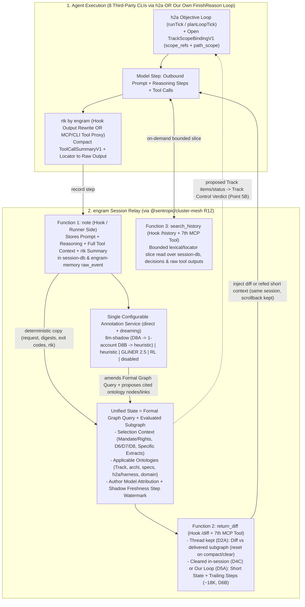

# Spec 2 — `engram` as Session Journal, Graph Diff, and Short-Context Relay (`SPEC_ENGRAM_CONTEXTUAL_GRAPH_AND_PROMPT_LOOP`)

- **Status:** `proposed` (`v0.4.1`, `2026-11-18` — `Stage: DESIGN (Gemini Carbon)`; applies Review Round 1 `engram-s2rw-opus.md`, `sha256:70dbaa30c69ce8c94f208a3934680045af14c518f6934830779fe0415bd3c2b1`, onto the `v0.4.0` full rewrite from the owner's `2026-11-15` decisions and ten binding comments on dossier `r7`)
- **Repository of Record:** `engram` (`@sentropic/engram`), coordinated across `sentropic` (`@sentropic/cluster-mesh`, `@sentropic/mcp-platform`, `@sentropic/mcp-broker`, `@sentropic/llm-mesh`, `api`) and `h2a` (`@sentropic/h2a`, `@sentropic/track`, plus the pure-TypeScript agentic-loop package governed with the agentic-loop dossier under `OQ-S2-4`)
- **Binding Authorities:**
  - [`spec/memory/OWNER-DECISIONS-2026-11-14.md`](memory/OWNER-DECISIONS-2026-11-14.md) (`:1-92` for `14/11` `T-M-C` and `Points 1B–6A` + early `15/11` `r5` decisions; `:94-261` « `2026-11-15 decisions` » for dossier `r7` decisions `D1 A · D2 A · D3 A · D4 C · D5 A · D6 B · D7 A · D8 A · D9 C` and all ten binding `ownerComments`)
  - [`spec/memory/dossiers/2026-11-15-contexte-court/DOSSIER-r7.fr.md`](memory/dossiers/2026-11-15-contexte-court/DOSSIER-r7.fr.md) (`:1-643`, verified `sha256:38b4179345608d5a3fdea5c0e742e013ce1b5a53ae602d1b29cc46ed52d06f4a`)
  - [`spec/memory/dossiers/2026-11-15-contexte-court/ANSWERS-r7.owner.yaml`](memory/dossiers/2026-11-15-contexte-court/ANSWERS-r7.owner.yaml) (`:1-113`, verified `sha256:e6874f033cb25319d9b731d9b448e9fe8728e70896b9bfbc4c0cfb51ae7767b5`)
  - [`spec/memory/R15-SEDIMENT.md`](memory/R15-SEDIMENT.md) (`:1-121` — Engram-First Principle and settled decision ledger `D1`–`D34`, specifically `D3`–`D8`, `D11`–`D26`, `D28`, `D31`–`D34`)
  - [`spec/memory/Q6-APPLICATION-LOG.md`](memory/Q6-APPLICATION-LOG.md) (`§19.3 :684-697`, `Rules 1–5` — code-grounding verification rules)
  - [`spec/memory/ARCHITECTURE-RULES.md`](memory/ARCHITECTURE-RULES.md) (`:1-13` — `R12` non-bypassable `@sentropic/cluster-mesh` hop)
- **Sibling Specifications & Cross-Program Dossiers:**
  - [`spec/SPEC_ENGRAM_METAMODEL_AND_LINEAGE_REGISTRY.md`](SPEC_ENGRAM_METAMODEL_AND_LINEAGE_REGISTRY.md) (**Spec 0** — `engram.metamodel/v1`, `LineageId`, `OntologyTemplateEnvelopeRef`, `composed_lineage_pins`)
  - [`spec/SPEC_ENGRAM_CLUSTER_MESH_MEMORY_ACCESS_AND_MCP_WIRING.md`](SPEC_ENGRAM_CLUSTER_MESH_MEMORY_ACCESS_AND_MCP_WIRING.md) (**Spec 6A** — `R12` `/memory/v1/*` and `/mcp` surfaces, `SignedH2AMandateWireEnvelope` verification, `D17` degraded banners; **amended inline via `Before → After` deltas in §8.2.1 below without editing Spec 6A on disk**)
  - [`spec/SPEC_ENGRAM_SESSION_FRONT_AND_EXTRACTION.md`](SPEC_ENGRAM_SESSION_FRONT_AND_EXTRACTION.md) (**Spec 1** — session-front ingestion and `0.24.0` extraction pipeline; **amended inline via `Before → After` deltas in §8.1 below without editing Spec 1 on disk**)
  - [`spec/SPEC_ENGRAM_DORMANT_DREAMING_SYNTHESIS.md`](SPEC_ENGRAM_DORMANT_DREAMING_SYNTHESIS.md) (**Spec 3** — dormant dreaming consolidation, sharing the single annotation service per `schema-10` and delivering recalls via `return_diff` per `D1 A`; §3.6 & §8.2.2)
  - [`spec/SPEC_ENGRAM_H2A_ROLE_ONTOLOGY_AND_HARNESS_OVERLAYS.md`](SPEC_ENGRAM_H2A_ROLE_ONTOLOGY_AND_HARNESS_OVERLAYS.md) (**Spec 4** — `lineage: 'h2a'` role/activity and harness/skill ontologies; §8.2.3)
  - [`spec/SPEC_ENGRAM_PROFILE_VIEW_MECHANISM.md`](SPEC_ENGRAM_PROFILE_VIEW_MECHANISM.md) (`§2.1.1 :850-868` / `:822-840` pre-round-2 — semantic-only responsibility; zero UI layout/fold state in `engram`)
  - **Agentic-Loop Dossier (`ownerComment D5A` & `schema-7`):** Working design & Focus dossier in `sentropic/.tmp/agent-loop-v2/design.md` (`:1-1569`, `v9` of `2026-11-11`, `sha256:caed8ca3242b99488075ac99b49543ecb127a75dd80b71ffbfd032263fc34268`), `sentropic/.tmp/agent-loop-v2/dossier.json` (`:1-6445`, `sha256:0a557fcb1d125a51cf6331430c66a6a41ce21cdab949fc78494bba68bc503f24`), and `sentropic/.tmp/agent-loop-v2/owner-brief.md` (`:1-102`, `sha256:9ca02ce4fa03b34d8d689bfb34160f538fabdc15962c381c898359bd819b0777`), cross-referenced in committed `sentropic:spec/SPEC_EVOL_T6_FASTLANE.md:94,192,380-415` (`Q1`–`Q14` at `design.md:831-964` remain open and `.tmp/` is gitignored; committed owner-ratification receipt is `source-gap` — §6.1 & `OQ-S2-4`).
- **Research Reference:** Peter Belcak, Saurav Muralidharan, Jindong Jiang, Yonggan Fu, Wonmin Byeon, Hanrong Ye, Ryan Angilly, Ali Taghibakhshi, Shih-Yang Liu, Siru Ouyang, Greg Heinrich, and Pavlo Molchanov, *You don't need long context* (`arXiv:2611.05306v1`, 3 Nov 2026), together with internal analyses `ANALYSIS-carbon.md` and `ANALYSIS-fable.md` and extracted text `source/2611.05306.txt` (`:1-1886`, gitignored `.graphify/scratch/design/memory-finalization/context-strategy-2611.05306/`, `.gitignore:60`).
- **Stack & Safety Rules:** Pure TypeScript / Node.js across `engram`, `sentropic`, and `h2a`. **Zero Python** anywhere in runtime code, hooks, model adapters, ONNX artifact build/provenance, tests, or build scripts (`h2a` `scripts/check-no-python.mjs:1-25` and `new` `engram` `scripts/check-no-python.mjs` in Lot `2-E0`).

---

## 1. Purpose, in Plain English

### 1.1 Why `engram` Becomes the Session Journal, Graph Diff, and Short-Context Relay

When a coding CLI runs for 30, 80, or 200 steps, appending every prompt, reasoning trace, file read, test log, and tool result into one growing conversation thread causes four compounding failures:
1. **Attention dilution:** old grep outputs, failed StackTraces, and superseded plans bury the owner's actual request and settled decisions.
2. **Compaction drift:** when the CLI hits its context window limit and summarizes its own summary, verbatim constraints, file digests, and negative constraints quietly vanish (`arXiv:2611.05306v1 §3.1`, `DOSSIER-r7.fr.md:31`).
3. **Repeated token billing:** every step re-sends tens of thousands of raw historical tokens (even with prefix caching, cache misses on compaction or tool edits re-bill the entire prefix).
4. **Opaque transcripts:** what the agent learned is trapped inside an unstructured chat log rather than structured into `Track` items, `h2a` harness rules, and `engram` architecture/fact graphs.

On `2026-11-15`, the owner set the direction in two steps (`OWNER-DECISIONS-2026-11-14.md:40,57,94-261`):

> « Deja engram doit devenir un loguer de session en // des outils. Dans notre outil cli a nous ce deviendra le loggeur principal. La session est loguée en graph. Et donc seul le diff est transmis a chaque fois. »

> « https://arxiv.org/pdf/2611.05306 inspire toi de ca j aimerais vraiment qu engram devienne le relai de ce type de strategie pour remplacé mecaniquemenr + appui par llm shadow la taille du contexte) dans toutes les cli en ooption + la notre uqi reposera exclusivement sur engeam pour le contexte. Analyse fable5.2 + carbon »

*(Scope note on `arXiv:2611.05306v1`: across six long-horizon benchmarks under threshold compaction `EoCC` at `6K–36K` tokens, `Claude Opus 4.5` and `GPT 5.6 Sol` move by `-3.7` to `+5.6` percentage points relative to full-history baselines, `arXiv:2611.05306v1` §3 & Appendix C Tables 3–8, `DOSSIER-r7.fr.md:29`. Under single-action compaction `SAC` at `7K–9K` median peak tokens, `Claude Opus 4.5` preserves or improves baseline accuracy — `70.2%` vs `70.0%` on `SWE-bench Verified` and `51.8%` vs `47.2%` on `Terminal-Bench 2.1` — whereas `GPT 5.6 Sol` loses `2.0` and `3.3` points — `82.4%` vs `84.4%` and `84.3%` vs `87.6%`, `arXiv:2611.05306v1` §5 Table 2 p. 14, `DOSSIER-r7.fr.md:29,212-218`, gitignored `source/2611.05306.txt:911-939` — and on five smaller locally quantized open models, all five lose `SWE-bench Verified` accuracy at the tightest `16K/12K` setting, with `Qwen 3 Coder Next` dropping from `53.0%` to `3.6%`, `arXiv:2611.05306v1` Appendix D Table 9 p. 24, `DOSSIER-r7.fr.md:31`, `source/2611.05306.txt:1450-1472`. Moreover, `2.2x–8.8x` cost-saving headlines rely on a **modeled** short-window serving discount, whereas at published retail API token prices total spend increases in `21/22` `EoCC` settings for `GPT 5.6 Sol` up to `+86%` while decreasing in `15/22` for `Claude Opus 4.5` up to `-43%`, `arXiv:2611.05306v1` Appendices B–C Tables 3–8, `DOSSIER-r7.fr.md:32`, `source/2611.05306.txt:1240-1420`, and the paper never uses a separate shadow model, `DOSSIER-r7.fr.md:31`. `engram` therefore pairs deterministic code extraction and prefix-cache-preserving short paliers under `D6 B` with a **configurable, disableable** shadow annotator under `D7 A` and gates every context-replacing notch behind measured session replay under `D9 C`.)*

### 1.2 The Three Plain Functions (`D1 A`) and How They Split Across Host Hooks and the 7th MCP Tool

`engram` exposes **one cohesive session-and-context relay** (`MemorySessionRelayPortV1` over `@sentropic/cluster-mesh` `R12`) with **exactly three plain functions** (`ANSWERS-r7.owner.yaml:18-19`, `DOSSIER-r7.fr.md:43,50`). Per `DOSSIER-r7.fr.md:466,496` and `OWNER-DECISIONS-2026-11-14.md:23`:
- **`note` is the hook-side / runner-side parallel journal** invoked on `/memory/v1/session-front/step` (keeping mutations off the read-only agent MCP surface);
- **The default-disabled 7th MCP tool in the registry replaces the retired nested 7th tool (`DOSSIER-r7.fr.md:466,496`) and exposes `return_diff` and `search_history` only** (`mutability: 'read-only'`). Its identifier `engram_memory_context` is **`proposed, not decided by the owner`** (`OWNER-DECISIONS-2026-11-14.md:23`).

The three functions are:

1. **`note` (Record the step — host/hook/runner side, `/memory/v1/session-front/step`):**
   At each step, `engram` records in the canonical journal **and** projects into the session graph:
   - the outbound **prompt** (and the formal graph query digest that produced it),
   - the model's ordered **reasoning steps**,
   - every **tool call and its full invocation & execution context** (arguments, MCP server/tool identity, working scope, exit code, touched files, full raw output citation in `session-db`),
   - a compact **tool-call summary (« rtk by engram »)** — produced deterministically and optionally via tool-call proxying (`ownerComment schema-1`),
   - and structured micro-notes from the main model (`plan` per `D7 A`, plus optional `dead_end`, `hypothesis`).
2. **`return_diff` (Return the diff — or the bounded state view — host `/diff` & MCP `engram_memory_context`):**
   `engram` tracks the exact subgraph watermark (`SessionDeliveryWatermarkV1`, §7.4) currently held by each `(session_id, branch_epoch, watermark_epoch)`:
   - **When the caller keeps its own conversation thread** (the default in third-party CLIs under `D2 A`), `return_diff` compares what the session *should* hold under the current `FormalContextGraphQueryV1` against `watermark.delivered_node_digests` (`DOSSIER-r7.fr.md:594`) and returns **only what changed or became newly relevant** since that watermark (including older unmutated nodes brought into focus by a query/scope shift, new owner/peer decisions, `Track` scope updates, newly matched architecture/spec/memory nodes, and dreaming recalls), plus `shadow_status.shadow_annotated_through_step` (`DOSSIER-r7.fr.md:294,347`). If nothing changed or entered scope, `engram` injects nothing (`0` tokens). Whenever the host compacts, clears, resumes, saturates, or restarts (or hits a periodic refresh bound on signal-less hosts, §5.1), `h2a` invalidates the watermark and requests `full_state_view`.
   - **When the caller has no growing thread** (our own loop under `D5 A`, a post-compaction/reset turn, or an in-session cleared-and-refed context under `D4 C` / `D6 B`), `return_diff` (`delivery_mode: 'full_state_view'`) returns the **complete bounded short-context view**: the pinned request & mandate, the evaluated **State** (which is itself a formal graph query across the applicable ontologies), `shadow_status`, and the short window of reprocessed/rtk-summarized recent steps.
3. **`search_history` (Search past turns, reasoning, decisions, and raw tool outputs — host `/history` & MCP `engram_memory_context`):**
   Because raw prompts, reasoning traces, overflow ratified-decision bodies (§3.3), and untruncated tool outputs stay in canonical `session-db` / `engram-memory` rather than bloating the active prompt, the agent can call `search_history` whenever it needs an exact past error line, command output, decision verbatim, or earlier discussion (`D23`, `arXiv:2611.05306v1` `RQ2`). `search_history` returns bounded, `D6`/`D7`/`D8`-filtered slices (`<= 8,192` UTF-8 bytes per match) with exact line/byte locators, and **never** copies raw transcripts into `.graphify/graph.json` (`M10`).

### 1.3 Retire the Nested Container Entirely: Data Are Graph Nodes and Links (`D1 A`)

Earlier drafts of `Spec 2` (`v0.3.0`) and `Spec 6A §4.2` wrapped domain items in a recursive-by-unrolling JSON container (`BoundedContextDomainPayloadV1` / `buildBoundedContextDomainPayloadSchemaV1`, unrolled to depth `0..8`) to work around `validateMemoryToolSchemaDialectV1`'s prohibition on `$ref`/`$defs`.

**That nested container — together with `EngramMemoryContextInputEnvelopeV1`, `EngramMemoryContextDomainEnvelopeV1`, and `EngramMemoryContextValueV1` in `Spec 6A §4.2` (§8.2.1) — is retired in full.** Under `D1 A` (« *données en nœuds et en liens* »), every piece of state, diff, ontology update, and recall crosses `engram` as two flat, closed arrays:
- **`nodes: readonly GraphNodeV1[]`** — each node has a stable `node_id`, an open `node_type`, an optional derived presentation `rubric` (§7.1, until `OQ-S2-1` is decided), an optional `template_envelope: OntologyTemplateEnvelopeRef` (`{ lineage, templateId, templateVersion, templateDigestSha256 }`, `Spec 0 §2.1`), `author_kind`, `author_model_ref` (mandatory on shadow/dreaming/main-model items per `DOSSIER-r7.fr.md:91,294`), `review_status`, `source_event_ids`, `payload_digest_sha256`, `wire_digest_sha256`, and a flat array of scalar attributes (`FlatGraphAttributeV1[]`).
- **`links: readonly GraphLinkV1[]`** — each link connects `source_id -> target_id` with an open `relation_type`, optional `template_envelope`, `author_kind`, `author_model_ref` (when model-authored), `source_event_ids`, and flat scalar attributes.

`engram` embeds **zero** closed list of `Track` or `h2a` entity types (`T-M-C`, `Point 2B`, `OWNER-DECISIONS-2026-11-14.md:11-16,23`). When `Track` or `h2a` adds a new class, hierarchy rank, or relation to its ontology template, `GraphNodeV1`, `GraphLinkV1`, and `TrackScopeBindingV1.scope_refs` (§3.2) carry it immediately without changing a single line of `engram` or `@sentropic/mcp-platform` wire schemas.

### 1.4 End-to-End Architecture Overview (`Schéma n° 1` Completed per `ownerComment schema-1`)



### 1.5 Three-Stage Rollout (`D3 A`) and Proof Gates (`D9 C`)

Per `D3 A` (`ANSWERS-r7.owner.yaml:23-25`, `OWNER-DECISIONS-2026-11-14.md:83`) and `D9 C` (`ANSWERS-r7.owner.yaml:58-62`):
1. **Stage 1 — Note in third-party CLIs + configurable shadow + « rtk by engram » summaries:** `h2a` hooks and the optional MCP tool proxy record prompts, reasoning steps, tool calls + full context, and `rtk` summaries into `engram`. Per `OWNER-DECISIONS-2026-11-14.md:83` (`r5:103`), **« built now, disabled » applies to the journal itself** (`sessionJournalEnabled: false` by default until workspace/tenant opt-in, tested in Lot `2-H1` & `2-S1a`). Zero prompt truncation is forced on any third-party CLI; opted-in multi-step sessions build the `D9 C` replay corpus, while shadow content disclosure remains `refs_only_d6` until the owner's separate commissioning act (`DOSSIER-r7.fr.md:273,490`, §7.3 & §11.3).
2. **Stage 2 — Return the diff, search history, and opt-in short-context cursor in third-party CLIs:** Enables `return_diff` (`D2 A` default diff injection with automatic watermark reset on compaction/clear) and `search_history` (opening the 7th MCP tool `v2` only after sibling spec reviews close, `MCP-L5` passes, and the dedicated post-review `engram` + `sentropic` co-signature dossier issues `CoSignatureReceiptV2`, `DOSSIER-r7.fr.md:496,589`, §7.4 & §11.3). Unlocks each opt-in short-context cursor notch (`D4 A` → `D4 B` → amended `D4 C`, `P1..P4`, §5) **only** after that notch and its shadow models pass **session replay (`D9 C` Gate A / Tier `T2`)**, all three zero-tolerance mechanical checks (§9.1), and owner-readable Gate A receipts (§9.4) — while **never** opening a « new » session (`D4C`, `schema-6`).
3. **Stage 3 — Our own `FinishReason` loop relying exclusively on `engram` (`D5 A`):** Built on the pure-TypeScript agentic-loop library governed with the agentic-loop dossier (`sentropic/.tmp/agent-loop-v2/design.md`, not `@sentropic/chat-core` as is, `D5A` + `schema-7`, `OQ-S2-4`), wired to `h2a`'s objective loop and `Track` scope (`schema-1`), with configurable `~18,000`-token paliers (`D6 B`). Unlocked as the default runner **only** after passing full `D9 C` Gate B proof (`T1` + `T2` + `T3`) with owner-readable Gate B receipts (§9.3–§9.4).

---

## 2. Observed Baseline Across Repositories (`origin/main` Grounding, `Rules 1–5`)

Every statement about existing code below was verified directly via `git show origin/main:<path>`, `git rev-parse`, `sha256sum`, and `npm view` against `origin/main` of the owning repository on `2026-11-18` (`Q6-APPLICATION-LOG.md §19.3 :684-697`, full ledger in `Q6-APPLICATION-LOG.md §23.2` & `§26`). Anything not present on `origin/main` is explicitly marked **`new`** with the lot that creates it.

> **Baseline Progression & Cross-Spec Drift Record (`M7`):**
> - **`sentropic`:** `Spec 6A:32` (`2026-11-14`) pinned `origin/main` `913e3bcbc` (`@sentropic/cluster-mesh@0.26.0-dev.27`, `@sentropic/llm-mesh@0.38.0`); `Spec 2 v0.4.0` (`2026-11-15`) verified `25ba09a6de` (`cluster-mesh@0.27.0-dev.1`, `llm-mesh@0.38.1`); on `2026-11-18`, `sentropic` `origin/main` is `ad8e685e5209f7b19ca818d31ae31f08cec42689` (`@sentropic/llm-mesh@0.38.2` in `packages/llm-mesh/package.json:3` and published on npm alongside `0.38.0` and `0.38.1`; `@sentropic/cluster-mesh@0.27.0-dev.1` in `packages/cluster-mesh/package.json:3`, while npm `latest` is `0.26.0`; `@sentropic/mcp-platform@0.4.2`). Note: the local `/home/antoinefa/src/sentropic` working-tree `HEAD` (`97fe9f53`) is an older unmerged checkout (`llm-mesh@0.17.0`, `cluster-mesh@0.1.0`) and is **never** used as baseline evidence.
> - **`h2a`:** `Spec 6A:33` pinned `origin/main` `1f57127de` plus then-unmerged PR #455 (`844402ee`); `Spec 2 v0.4.0` verified `32a87af963`; on `2026-11-18`, `h2a` `origin/main` is `1a99a88f6cb758be6e3a3e22faa3e3d67969204f` (`@sentropic/h2a@0.98.10`, `@sentropic/track@0.98.10`, merging PR #455 at `70c68a21c` and ETA owner-table columns at `fd067eea1`/`1a99a88f6`).

| Repository | Verified `origin/main` Pin (`2026-11-18`) | Exists Today on `origin/main` (`[FACT: path:line]`) | Does **NOT** Exist Yet (`new` + Owning Lot) |
| :--- | :--- | :--- | :--- |
| **`engram`** | `f75543a5c8b220a741924e8eeac6610e3808c8ce` (`@sentropic/engram@0.28.0`, `package.json:3`; zero `src/` or `engram-memory/` code diff vs PR #443 worktree `HEAD` `d79cd1d29fdfd77e7fc6b1d383d3a342ab336392`) | 6-tool `v1` MCP contract (`ENGRAM_MEMORY_MCP_CONTRACT_VERSION = '1.0.0'`, `ENGRAM_MEMORY_PROVIDER_ID = 'sentropic.engram.memory'`, `ENGRAM_MEMORY_CONNECTOR_ID = 'engram-memory'` in `src/mcp/memory/contracts.ts:142-156`; `ENGRAM_MEMORY_PROVIDER_MANIFEST` requiring `['sub', 'tid']` in `src/mcp/memory/gates.ts:292-312`; `ENGRAM_MEMORY_TOOL_DESCRIPTORS.length !== 6` guard in `src/mcp-memory/provider.ts:458-460`); strict closed JSON Schema validator `validateMemoryToolSchemaDialectV1` accepting `v1` profile IDs only (`src/mcp/memory/schemas.ts:3665-3682`), forbidding `$ref`/`$defs`, and requiring `additionalProperties: false` on every object (`:3606-3630,3657-3789`); publisher asset check `MEMORY_PUBLISHER_ASSETS_V1_SCHEMA` (`minItems: 6, maxItems: 6` in `src/mcp/memory/receipts.ts:94-106`); error catalog (`src/mcp/memory/errors.ts:30-70,437-454`); `package.json:152` currently depends on `"@sentropic/llm-mesh": "^0.19.0"` and pins `"@sentropic/mcp-platform": "0.4.0"` at `:186,257`; `0.24.0` extraction toolkit (`EXTRACTION_SCHEMA_V1`, `adaptTextJsonClient`, `processCitationsForItem`, `validateAndPruneChunkExtraction` in `src/extraction-batch.ts:251,751,1279-1290,1338-1348`) and `@sentropic/llm-mesh` bridge (`src/llm-mesh-bridge.ts:11-35`); L0 neutral recall (`BM25F` + `RRF` + `PPR` in `engram-memory/recall.ts:27-45`) and fenced profiles (`engram-memory/module-storage-neutral.ts:38-44,101-104,224-231`); `archi@1` immutable 11 kinds (`src/ontology-guardian/archi-profile.ts:38-50,160-166`) and `AdmissionFamily` including `'TRK'`, `'H2A'`, `'HRN'`, `'DIA'`, `'MEM'` (`src/ontology-guardian/admission.ts:40`). | Dependency upgrade `"@sentropic/llm-mesh": "^0.38.2"` (`>=0.38.0 <0.39.0`), widened `@sentropic/mcp-platform` `v2` peer range, & `new` `scripts/check-no-python.mjs` (`Lot 2-E0`); flat `GraphNodeV1` / `GraphLinkV1` (with `author_model_ref` & optional derived `rubric`), open `TrackScopeBindingV1`, `FormalContextGraphQueryV1`, `SessionStateAndQueryV1`, `SessionDeliveryWatermarkV1`, `ToolCallSummaryV1`, `StepExecutionRecordV1`, `TrailingStepSummaryV1`, `HistorySliceMatchV1`, `CoSignatureReceiptV2`, `ModelContentAuthorizationPolicyV1`, `validateMemoryToolSchemaDialectV2`, and `v2` 7th-tool schema (`new` `src/mcp/memory/context-contracts.ts`, Lot `2-E1`); deterministic « rtk by engram » compressor (`new` `src/session-relay/rtk-summary.ts`, Lot `2-E2`); watermark invalidation/diff engine, decision-overflow locator stubber, `shadow_annotated_through_step` status, & configurable `ContextRhythmPolicyV1` packer (`new` `src/memory-tools/context-relay.ts`, Lot `2-E3`); unified `EngramAnnotationServicePortV1` (`'llm-shadow' \| 'heuristic' \| 'finetuned-model' \| 'rl-policy' \| 'disabled'`, `direct` + `dreaming` profiles, `QueryAmendmentProposalV1` verifier, SHA-256-pinned Python-free `GLiNER 2.5` ONNX loader) (`new` `src/session-relay/annotation-service.ts`, Lot `2-E4`); L0-neutral `return_diff`, `search_history`, `D5` quarantine, & `D6` scrubber (`new` `engram-memory/contextual-relay.ts`, Lot `2-E5`); `provider.ts` `v2` read-branch wiring (`Lot 2-E6`). |
| **`sentropic`** | `ad8e685e5209f7b19ca818d31ae31f08cec42689` (ancestor `25ba09a6de` at `v0.4.0`; `@sentropic/llm-mesh@0.38.2`, `packages/llm-mesh/package.json:3`; `@sentropic/cluster-mesh@0.27.0-dev.1`, `packages/cluster-mesh/package.json:3`; `@sentropic/mcp-platform@0.4.2`, `packages/mcp-platform/package.json:3`; `@sentropic/mcp-broker@0.1.0`, `packages/mcp-broker/package.json:3`; `@sentropic/chat-core@0.3.2`, `packages/chat-core/package.json:3`) | `LlmMesh.generate`/`stream` (`packages/llm-mesh/src/mesh.ts:49-54,157-180`), `GenerateResponse.finishReason` & `toolCalls` (`packages/llm-mesh/src/generation.ts:66-78`), `FinishReason = 'stop' \| 'length' \| 'tool_calls' \| 'content_filter' \| 'error' \| 'cancelled' \| 'unknown'` & optional `DoneEvent.data.finishReason?` (`packages/llm-mesh/src/streaming.ts:18-25,87-91`; zero `stopReason` field), `VerifiedRoutingSubject`, `EligibleAccountDescriptor`, `RoutePlanInput`, `PreparedRouteAttempt.attemptRef`, `AccountDirectoryPort.listEligible` (`packages/llm-mesh/src/routing-contracts.ts:13-35,54-77,197-212`), `RouteStrategy` (`'ordered'` in `packages/llm-mesh/src/routing-policy.ts:14-18`), `ModelEquivalenceGroup` & `BenchmarkEvidence` (`packages/llm-mesh/src/equivalence-council.ts:15-35`), `GENERATED_MODEL_COUNCIL_SOURCE` with empty equivalence groups (`packages/llm-mesh/src/generated-model-council.ts:2-30`), `knownModelIds` / `knownModelIdsByProvider` (`packages/llm-mesh/src/providers.ts:13-115`); closed 8-key `DecisionRequest` (`packages/llm-mesh/src/decision/request.ts:40-53,70`); `MEMORY_WIRE_PROFILE_ID` (`packages/mcp-platform/src/memory/contracts.ts:25-35`), `isMemoryProfileTool` (`packages/mcp-platform/src/transport/bridge.ts:95-100`), `requireTrustedInvocationContext` & `validateMemoryProjection` (`packages/mcp-platform/src/memory/invocation-context.ts:41-112`); `compiled-dispatch.ts:156-198` claim checks; `composeEngramMemoryDefinition` (`packages/cluster-mesh/src/integrations/mcp/memory-compose.ts:13-45`); `ENGRAM_MEMORY_RANGE = '>=0.22.0 <0.23.0'` (blocks `0.28.0+` today) & `LLM_MESH_RANGE = '0.19.2 \|\| >=0.22.0 <0.39.0'` (`packages/cluster-mesh/src/modules/catalog.ts:18-20`); `DEC-116` `SENTROPIC_MCP_CLIENT_ID` & `READ_ONLY_TOOL_ALLOWLIST` (`api/src/services/mcp/client-policy.ts:9-30,40-42`) and `HostRegistryCatalogSource.snapshot` (`api/src/services/catalog/sources/host-registry-source.ts:22-36`); `l0-freeze.json` owner ids `'owner:engram-l4'` and `'owner:mcp-platform'` (`spec/evidence/memory-mcp-l5/l0-freeze.json:25,30`). **Absent on `origin/main`:** `packages/cli` does **not** exist on `origin/main`; `@sentropic/chat-core` (`packages/chat-core/src/context-budget.ts:1-45`) is migrating to the design system (`schema-7`). | `v2` flat node/link tool constants (`'memory:context:read'`), `VerifiedH2AMandateV1` projection bi-implication, & `verifyCoSignatureReceiptV2` in `packages/mcp-platform` (`new`, Lot `2-S0a`); `v2` non-mutating claim gate in `packages/mcp-broker` (`Lot 2-S0b`); `catalog.ts` `ENGRAM_MEMORY_RANGE` widening (`'>=0.28.0 <0.30.0'`) + `LLM_MESH_ANNOTATION_RANGE = '>=0.38.0 <0.39.0'` (`Lot 2-S0c`); `cluster-mesh` `MemorySessionRelayPortV1` routes (`/memory/v1/session-front/{step,diff,history}` with default-disabled journal gate & `ModelContentAuthorizationPolicyV1`) + `v2` `composeEngramMemoryDefinition` (`new` `packages/cluster-mesh/src/memory/session-relay-routes.ts`, Lot `2-S1a`); `cluster-mesh` `EngramAnnotationService` host adapter with `D8 A` ordered list + automatic 1-account `D8 B` same-provider fallback + `direct`/`dreaming` profiles (`new` `packages/cluster-mesh/src/memory/annotation-service-host.ts`, Lot `2-S1b`); `api/` `DEC-116` & catalog claim filter (`Lot 2-S2`); `MCP-L5` 5-gate freeze & Stage-B/E10 qualification (`Lot 2-S3`). |
| **`h2a`** | `1a99a88f6cb758be6e3a3e22faa3e3d67969204f` (ancestor `32a87af963` at `v0.4.0`; `@sentropic/h2a@0.98.10`, `packages/h2a/package.json:3`; `@sentropic/track@0.98.10`, `packages/track/package.json:3`; PR #455 merged at `70c68a21c`) | 8-host plugin targets (`claude`, `codex`, `gemini`, `agy`, `hermes`, `opencode`, `muse`, `vibe`) & `renderWorkspaceScope` (`packages/h2a/src/hosts/plugin.ts:22-44,85-152,200-212`); host qualification matrix (`docs/host-integration-matrix.md:14-48`); `vibe-post-agent.mjs:1-29`; 3-native-host (`vibe`, `muse`, `agy` in `native-paths.ts:3`) `captureHostOperatorNotices` (`packages/h2a/src/hosts/operator-notices.ts:8-24`); `H2ASession` (`pid`, `startedAt`, `workStatus` in `packages/h2a/src/session.ts:93-110`) & durable `recordStop` (`packages/h2a/src/runtime/drumbeat/registry.ts:22-65`); `createEnvelope` (`packages/h2a/src/envelope.ts:41-45`); `BridgeLock` & `validateBridgeLock` (`packages/h2a/src/registry/bridge-lock.ts:22-44,187-221`); objective-loop `H2ALoopStatus`, `H2ALoopAgentStatus`, `H2ALoopTrackRef` (`system: "track"`, `aggregateKind: "item" \| "decision" \| "blocker" \| "criterion" \| "evidence" \| "wp"`), pure `planLoopTick` (`TickInput`, `PresenceView.workStatus`, `TickOutcome` in `packages/h2a/src/runtime/loop/engine/decision.ts:39-120`), `adapters.ts:71-80`, and observation-first `runTick(root, loopId, opts)` taking no receipt (`packages/h2a/src/runtime/loop/index.ts:7-35,49-103`; `packages/h2a/src/runtime/loop/engine/tick.ts:9-17,36-55`); `Track` `ItemKind`, `ItemRole` (`'workpackage' \| 'spec-phase' \| 'stream'`), `ScopeDecl` (`packages/track/src/model/item.ts:17,32,39-45`), `DemandState` (`packages/track/src/model/demand.ts:15-48`), `DecisionKind`/`Outcome` (`packages/track/src/model/decision.ts:11-13`), 12 `REPORT_STAGES` & 8 `REPORT_STATUSES` (`packages/track/src/model/report-status.ts:10-24,55-65`, `src/report/stage-status.ts:12,24-48`), and `OWNER_TABLE_HEADERS` (`packages/track/src/report/owner-table.ts:28-38`); Zero-Python gate (`scripts/check-no-python.mjs:1-25`) & test inventory (`scripts/test-inventory.json:1-15`). | Default-disabled (`sessionJournalEnabled: false`) step prompt/reasoning/tool-context capture + MCP/CLI « rtk by engram » tool-call proxy (`new` `packages/h2a/src/runtime/context/step-note-and-rtk-proxy.ts`, Lot `2-H1`); `D2 A` diff injector with compaction/clear/restart watermark reset & signal-less periodic refresh, `D15` non-blocking slices, & `D18-B` local read-only guard (`new` `packages/h2a/src/runtime/context/diff-and-slice-injector.ts`, Lot `2-H2`); per-host opt-in short-context cursor (`P0..P4`, `D4 A`/`D4 B`/amended `D4 C`) with `HostScrollbackProbeReceiptV1` PTY verification, 8-host `status-surface.ts` banner (`6A-H3`), & automatic fallback (`new` `packages/h2a/src/runtime/context/short-context-cursor.ts`, Lot `2-H3`); `D9 C` session-replay harness & owner-readable Gate A/B receipt emitter (`new` `packages/h2a/src/runtime/context/replay-qualifier.ts`, Lot `2-H4`); pure-TS `FinishReason` burst-loop adapter subordinate to the agentic-loop dossier (`new`, Lot `2-L1`, `OQ-S2-4`) & `h2a` objective-loop + open `TrackScopeBindingV1` runner (`stp = h2a run stp` alias, `StepReceiptV1 -> PresenceView.workStatus / runTick` adapter, `new` `packages/h2a/src/runtime/loop/native-engram-runner.ts`, Lot `2-H5`). |

---

## 3. The State, the Formal Graph Query, Configurable Authors, and Unified Annotation Service

### 3.1 One Unified State Object (Merging `Spec 1` `session_summary`)

`Spec 1` (`:478`) originally defined a separate rolling `session_summary` (`context_summary` every `24` turns or `65_536` bytes). Following `DOSSIER-r7.fr.md:336` and `arXiv:2611.05306v1 §3.1`, **rolling prose `session_summary` is merged into `engram`'s single structured State (`SessionStateAndQueryV1`, §7.4)**. Maintaining a second free-text summary alongside the structured graph state would reintroduce summary-of-summary drift and conflicting sources of truth.

### 3.2 The State Is Also a Formal Graph Query (`ownerComment schema-1`, Open `TrackScopeBindingV1` Under `T-M-C`)

Per the owner's binding `schema-1` amendment (`ANSWERS-r7.owner.yaml:64-68`, `OWNER-DECISIONS-2026-11-14.md:165-169`):

> « L'état devrait aussi être une requête formelle au graphe
> - contexte de sélection (droits, extraits spécifiques pertinents) + ontolgies applicables (track, archi, specs, harnais, ontologies spécifiques...)
> Le shadow devrait :
> - amender cette requête
> - update relatif aux ontologies pertinentes (faits, décisions / track, harnais, architecture, statut - étapes track, scope track des demaindes/epic/feature/user stories/plans).
>
> Point d'attention: l'étape doit bien stocker le prompt, les étapes de réflexion, les appels outils et leur contexte complex. On pourra ainsi aussi faire un rtk par engram (résumé des appels outils, quitte a proxifier les appels outils).
>
> La notion de scope track doit aussi être rattachée a l'objective loop.
>
> Le schema devrait donc être complété : prompts/outils + ontologies et requête graphe. »

In `engram`, **the session State (`SessionStateAndQueryV1`, §7.4) is not a static blob of text — it is simultaneously a formal graph query (`FormalContextGraphQueryV1`) and the bounded subgraph (`GraphNodeV1[]` + `GraphLinkV1[]`) returned by evaluating that query at the current journal cursor**. Per `T-M-C` (`OWNER-DECISIONS-2026-11-14.md:11-16,23`), `TrackScopeBindingV1` carries an **open array of `TrackScopeRefV1` items** mirroring `H2ALoopTrackRef` (`h2a:packages/h2a/src/runtime/loop/index.ts:49-64`: `item`, `decision`, `blocker`, `criterion`, `evidence`, `wp`, plus any `Track`-authored template node type without requiring an `engram` release):

```ts
// new (Lot 2-E1: src/mcp/memory/context-contracts.ts; closed JSON Schemas in §7.4)
export interface TrackScopeRefV1 {
  /** Optional pinned Track template envelope (`lineage: 'track'`, Spec 0 §1.4); omitted only for untemplated bootstrap refs. */
  readonly template_envelope?: OntologyTemplateEnvelopeRef;
  /** Open Track aggregate or template node type (e.g. 'item', 'wp', 'decision', 'blocker', 'criterion', 'evidence', or any new Track-authored rank — zero closed enum in engram, T-M-C). */
  readonly node_type: string;
  readonly node_id: string;       // Mirrors H2ALoopTrackRef.aggregateId
  readonly repo_key: string;      // Mirrors H2ALoopTrackRef.repoKey
  readonly workspace: string;     // Mirrors H2ALoopTrackRef.workspace
  readonly role: string;          // Mirrors H2ALoopTrackRef.role (e.g. 'target', 'decision-gate', 'workpackage', 'stream', 'spec-phase')
  readonly baseline_commit?: string;
}

export interface TrackScopeBindingV1 {
  /** Bound h2a objective-loop identifier (`packages/h2a/src/runtime/loop/index.ts:7-20`), when running under an objective loop. */
  readonly objective_loop_id?: string;
  /** Open scope references mirroring H2ALoopTrackRef[] (`loop/index.ts:49-64`) and Track templates without hardcoding hierarchy levels in engram. */
  readonly scope_refs: readonly TrackScopeRefV1[];
  /** Declarative path-glob boundaries from Track `ScopeDecl` (`packages/track/src/model/item.ts:39-43`), enforced by harness scope guard. */
  readonly path_scope?: {
    readonly allowed: readonly string[];
    readonly forbidden: readonly string[];
    readonly conditional: readonly string[];
  };
}

export interface SelectionContextV1 {
  readonly tenant_id: string;
  readonly workspace_id: string;
  readonly derived_worktree_id: string;           // `^wt:[0-9a-f]{64}$` (D21)
  /** Verified out-of-band H2AEnvelope<H2AMandate> digest & role (D4, D22); omitted only under recorded D18 readonly posture. */
  readonly mandate_binding?: {
    readonly mandate_id: string;
    readonly mandate_digest_sha256: Sha256Digest;
    readonly role_id: string;
    readonly granted_capabilities: readonly string[];
  };
  readonly disclosure_posture: 'refs_only_d6' | 'content_authorized_d8' | 'readonly_non_memory_d18';
  readonly d5_same_role_pending_allowed: boolean;
  /** Pinned verbatim owner request & active steering amendments (copied word-for-word by code; §3.3 unpinning rule). */
  readonly pinned_request_event_ids: readonly string[];
  /** Explicit relevant extract selectors (files, symbols, graph node IDs, raw step citations) refined at each step. */
  readonly relevant_extract_selectors: readonly {
    readonly selector_kind: 'file_path_ref' | 'graph_node_id' | 'symbol_fqn' | 'session_step_citation';
    readonly ref: string;
    readonly line_start?: number;
    readonly line_end?: number;
    readonly added_by: 'code' | 'shadow' | 'main_model' | 'owner';
    readonly reason_code: string;
  }[];
}

export interface FormalContextGraphQueryV1 {
  readonly query_version: 'engram.formal-context-query/v1';
  readonly query_digest_sha256: Sha256Digest;     // RFC 8785 JCS SHA-256 of (selection_context, applicable_ontologies, track_scope, max_hops)
  readonly selection_context: SelectionContextV1;
  /**
   * Applicable ontologies (`schema-1`): Track (`lineage: 'track'`), architecture (`archi@1` / `archi@2` / `app-context`),
   * specifications (`specs`), h2a roles & harness (`lineage: 'h2a'`), memory, and repo/domain-specific ontologies.
   * Zero closed enum of domain entity types inside engram (T-M-C, Point 2B).
   */
  readonly applicable_ontologies: readonly OntologyTemplateEnvelopeRef[];
  /** Open Track scope bound to the h2a objective loop (`schema-1`, `T-M-C`). */
  readonly track_scope: TrackScopeBindingV1;
  readonly max_hops: 1 | 2 | 3;
}
```

### 3.3 Evaluated State Rubrics, Shadow Amendments, Unpinning Law, and Decision-Overflow Rule (`schema-1`, `D7 A`)

Evaluating `FormalContextGraphQueryV1` produces flat `GraphNodeV1[]` and `GraphLinkV1[]` covering **ten operational rubrics** (the 9 rubrics presented in `DOSSIER-r7.fr.md:93-105` plus the explicit ontological & `Track`-scope delta required by `ownerComment schema-1`; until `OQ-S2-1` / `schema-4` is decided by the owner, `rubric` on `GraphNodeV1` is optional derived presentation metadata — see §7.1 & §11.1):

| # | State Rubric | Who Writes It | Grounding, Budget & Lifecycle Rule |
| :--- | :--- | :--- | :--- |
| **1** | **Pinned Request & Mandate** | **Code** (word-for-word copy) | Exact owner prompt(s), steering remarks, and verified `H2AMandate` rights. **Never** summarized, paraphrased, or evicted by any model. Unpinned **only** by an explicit owner signal (`owner.answer` / `owner.request` supersession) or an authoritative `Track` acceptance/close verdict, transitioning to a settled `Decision` record (`DOSSIER-r7.fr.md:337`). |
| **2** | **Decisions (`Track` & `Harness`)** | **Code** (ratified) + **Shadow** (`proposed`) | Ratified `Track` (`Outcome: 'go' \| 'no-go'`, `decision.ts:12`) and `h2a` `harness_decision` records (`D3`, `D27`, `D31`) are included verbatim up to `pinned_decisions_inline_budget_tokens` (default `8_000` tokens inside the `24_000`-token ceiling, ordered deterministically: direct `track_scope` lineage decisions newest-first, then workspace-wide ratified decisions newest-first). **Overflow without loss or summarization (`M4`, §9.1):** any ratified decision beyond `pinned_decisions_inline_budget_tokens` travels in the State as a digest-pinned `verbatim_locator_stub` (`engram://decision/<node_id>` + `payload_digest_sha256`) redeemable byte-for-byte via `search_history` (`0` decisions omitted or paraphrased). Shadow-detected decisions enter `review_status: 'proposed'` (`Point 5B`) with mandatory `source_event_ids` and `author_model_ref`. |
| **3** | **Established Facts & Architecture** | **Shadow** + **`engram` Graph** | Verified codebase facts, symbol contracts, `archi@1` components/stores/APIs, and spec invariants discovered so far, each citing an existing `raw_event` or `D6FileOrPathRef` and stamping `author_model_ref` (`DOSSIER-r7.fr.md:91,294`). |
| **4** | **Applied Changes** | **Code** | Files created/edited/deleted in `derivedWorktreeId`, pre/post SHA-256 content fingerprints, git diff stat, and verification state (`verified` vs `unverified_since_last_edit`). |
| **5** | **Verifications** | **Code** (+ **Shadow** links) | Test/typecheck/lint commands run, exit codes, pass/fail counts, and witness links toward `Track` `EVIDENCE_REQUIRED_STAGES` (`stage-status.ts:12`). |
| **6** | **Dead Ends** | **Shadow** + **Main Model** | Approaches tried and falsified (with the failing `eventRecordId` / test citation and `author_model_ref`) so future paliers never repeat the same broken attempt. |
| **7** | **Forward Plan & Completion Condition** | **Main Model** | Numbered next actions and explicit stop/goal condition aligned with `track_scope` and `h2a` objective-loop predicates, written at each handover/compaction in third-party CLIs and at each step in our loop (`D7 A`, `DOSSIER-r7.fr.md:258`). |
| **8** | **Dreaming Recalls (`D19`, `D26`)** | **`engram` Dreaming** (`Spec 3`) | Forgotten cross-session permanent facts (immediate, deterministic) and `D26`-qualified lessons (only after threshold proof; shadow-only before), delivered as `GraphNodeV1` items via `return_diff` (§8.2.2, `DOSSIER-r7.fr.md:459`). |
| **9** | **Step & Tool Pointers (`rtk`)** | **Code** | Compact `ToolCallSummaryV1` digests and `engram://session-step/<eventRecordId>` locators redeemable via `search_history`. |
| **10** | **Ontological & `Track` Scope Updates (`schema-1`)** | **Code** + **Shadow** (`proposed`) | Updates to `FormalContextGraphQueryV1` (`QueryAmendmentProposalV1`, §7.4) and candidate nodes/links across `Track` (referencing `Track`'s published template envelope, `T-M-C`), `h2a` harness/roles, `archi`, and `specs`. Every `domain: 'project'` write stays `proposed` until `Track` control issues its verdict (`Point 5B`). |

**Deterministic Verification of Shadow Query Amendments (`schema-1`):**
At each step sweep, the shadow annotator emits:
1. **`QueryAmendmentProposalV1` (§7.4)** (`add_selectors`, `drop_stale_selectors`, `activate_ontology_pins`, `propose_track_scope_refs`): `engram`'s deterministic query gate verifies that (a) no pinned request, ratified decision, or objective-loop-locked `TrackScopeBindingV1.scope_refs` root is dropped, (b) every added selector belongs to the authorized `(tenantId, workspaceId)` and obeys `D6`/`D7`/`D8`, and (c) every activated `OntologyTemplateEnvelopeRef` is registered in `Spec 0`'s lineage registry.
2. **Ontology Node/Link Proposals (`SessionExtractionProposalBatch`):** validated through `Spec 1` (`:532-540`, `validateAndPruneChunkExtraction` + `processCitationsForItem` in `src/extraction-batch.ts:1279-1348`) so **zero uncited model claim ever enters the State**, and every model-authored item carries `author_model_ref` (`DOSSIER-r7.fr.md:91,294`). If the shadow and main model disagree on whether a sub-goal succeeded or hit a dead end, `engram` keeps **both** nodes linked by `conflicts_with` and flags `disagreement_flag: true` rather than silently overwriting either author (`DOSSIER-r7.fr.md:252`).

### 3.4 Configurable Authors (`D7 A` + `ownerComment D7A`)

Per `D7 A` (`ANSWERS-r7.owner.yaml:46-50`, `DOSSIER-r7.fr.md:258`) as amended by `ownerComment D7A` (`ANSWERS-r7.owner.yaml:99-103`, `OWNER-DECISIONS-2026-11-14.md:200-204`):

> « Réglable:
> shadow désactivable le cas échéant avec une heuristique le cas échéant ou un model finetuned/Gliner 2.5, ou  avec un  mécanisme d'apprentissage / RL »

Author participation is governed by a closed, runtime-configurable `StateAuthoringPolicyV1` (`new` in Lot `2-E4`, configurable per workspace, host, or user profile with precedence `workspace > host > user`):

```ts
// new (Lot 2-E4: src/session-relay/annotation-service.ts; closed JSON Schema in §7.4)
export type ShadowBackendMode =
  | 'llm-shadow'       // Default: qualified fast non-reasoning model via @sentropic/llm-mesh (D8A + 1-account D8B fallback)
  | 'disabled'         // Shadow completely off: zero extra model calls; deterministic code + main-model plan
  | 'heuristic'        // Zero-LLM deterministic AST/diff/exit-code/stacktrace/selector heuristic
  | 'finetuned-model'  // Compact fine-tuned span/relation extractor (e.g. GLiNER 2.5 via Node ONNX/Wasm or llm-mesh local endpoint — ZERO Python)
  | 'rl-policy';       // Learned / RL selector-amendment & node-salience policy scored under deterministic citation & rights checks

export interface PinnedOnnxArtifactManifestV1 {
  readonly adapter_id: string;                    // e.g. 'gliner-2.5-onnx-v1'
  readonly model_onnx_sha256: Sha256Digest;       // Verified before load; pre-built artifact produced with zero Python in CI
  readonly tokenizer_json_sha256: Sha256Digest;
  readonly python_free_build_verified: true;
}

export interface StateAuthoringPolicyV1 {
  readonly shadowMode: ShadowBackendMode;
  readonly fineTunedAdapterRef?: string;          // e.g. 'gliner-2.5-onnx-v1' or 'local:<modelId>' via @sentropic/llm-mesh
  readonly pinnedOnnxArtifact?: PinnedOnnxArtifactManifestV1;
  readonly rlPolicyRef?: string;                  // Registered policy bundle digest for query selector / salience scoring
  /**
   * Default per D7 A (`DOSSIER-r7.fr.md:258`):
   * - `'every-step'` in our own loop (Stage 3);
   * - `'on-palier-and-compaction'` in third-party CLI tools (Stages 1–2).
   * The `'optional'` value (omitting mandatory main-model plan, corresponding to D7 B at `DOSSIER-r7.fr.md:259,264`)
   * is `proposed, not decided by the owner` (source seat: Carbon) and disabled unless explicitly calibrated under D9 C.
   */
  readonly mainModelPlanCadence: 'every-step' | 'on-palier-and-compaction' | 'optional';
}
```

- **Zero-Python & Pinned Provenance Rule on `'finetuned-model'` (`GLiNER 2.5`) and `'rl-policy'` (`m12`):** Any local fine-tuned extractor (such as `GLiNER 2.5` for ontology entity/relation span extraction) or RL policy scorer MUST execute either in-process via pure TypeScript / WebAssembly / Node ONNX bindings or over HTTP/JSON through `@sentropic/llm-mesh`'s `'local'` / OpenAI-compatible provider (`packages/llm-mesh/src/providers.ts:65-69,107`), **and** any ONNX weight/tokenizer bundle MUST be consumed as an immutable pre-built artifact verified against `model_onnx_sha256` and `tokenizer_json_sha256` at load time, with **zero Python runtime, export step, quantization script, subprocess, or dependency anywhere in `engram`, `sentropic`, or `h2a` repositories or CI** (`h2a` `scripts/check-no-python.mjs:1-25`, `new` `engram` `scripts/check-no-python.mjs` in Lot `2-E0`).
- **Identical Safety Gate Across All Modes:** Regardless of whether `shadowMode` is `'llm-shadow'`, `'heuristic'`, `'finetuned-model'`, or `'rl-policy'`, its output passes through the exact same deterministic `source_event_ids` existence check, `ProfileBundleV1` metamodel check, `D7` confidentiality deny-list, `ModelContentAuthorizationPolicyV1` (`D6=refs` default, §7.3), and `Point 5B` `'proposed'` staging gate. When `shadowMode === 'disabled'`, `engram` still delivers full deterministic continuity with **`0` model calls between steps** (`DOSSIER-r7.fr.md:346`).

### 3.5 Shadow Model Routing, Qualification, and Single-Account Fallback (`D8 A` + `ownerComment D8A`)

Per `D8 A` (`ANSWERS-r7.owner.yaml:52-56`) as amended by `ownerComment D8A` (`:104-108`, `OWNER-DECISIONS-2026-11-14.md:206-209`):

> « B en fall back quand l'utilisateur h2a (ou sentropic) n'a qu'un compte disponible. »

All `'llm-shadow'` calls execute through `@sentropic/llm-mesh` (`>=0.38.0 <0.39.0`, aligned with `Spec 1 :500`; `0.38.2` on `sentropic` `origin/main` `ad8e685e52` and published on npm, bumped in `engram` `Lot 2-E0` and enforced in `cluster-mesh` `Lot 2-S0c`) under a verified `VerifiedRoutingSubject` (`routing-contracts.ts:13-17`):

1. **Multi-Account Primary Path (`D8 A` — Owner's Ordered & Qualified List):**
   - Uses `RouteStrategy: { kind: 'ordered', preferences }` (`packages/llm-mesh/src/routing-policy.ts:16`), bounded to `maxAttempts: 3` with automatic provider/account cooldown on `429` / `5xx` / timeout, validates structured JSON against the extraction/amendment schema before crediting an attempt (`adaptTextJsonClient` in `src/extraction-batch.ts:751-758`), and stamps `author_model_ref: { qualified_model_id: `${providerId}:${modelId}`, attempt_ref: attempt.attemptRef }` (`routing-contracts.ts:198`) onto every emitted `GraphNodeV1` and `GraphLinkV1` (`DOSSIER-r7.fr.md:91,294,347`).
   - **Catalog & Council Reality on `sentropic` `origin/main` (`ad8e685e52`):** `knownModelIds` (`packages/llm-mesh/src/providers.ts:13-110`) currently ships `'muse-ember-1.0'` (`:79`), `'gpt-6-luna'` (`:20,97`), `'gemini-3.8-flash'` (`:25,102`), `'gemini-3.1-flash-lite'` (`:29,102`), and `'mistral-small-2603'` (`:36,104`), whereas Anthropic `Haiku` is **not** yet registered in `knownModelIdsByProvider.anthropic` (`:103`, `new` catalog entry if added to the owner's list) and `GENERATED_MODEL_COUNCIL_SOURCE` (`generated-model-council.ts:2-30`) has **zero** equivalence groups (`"No pinned benchmark evidence authorizes automatic substitution."`).
   - **Hard Qualification Gate (`D8 A` + `D9 C`):** No model may author State items that replace active prompt context until its `BenchmarkEvidence` (`equivalence-council.ts:15-20`) from the `D9 C` replay benchmark (§9.2) is recorded. Unqualified models may run in Stage-1 dark/observation shadow only.
2. **Single-Account Automatic Fallback to `D8 B` (`ownerComment D8A`, `m7`):**
   - Before planning a shadow call, `annotation-service-host.ts` (`Lot 2-S1b`) inspects `AccountDirectoryPort.listEligible(subject)` (`routing-contracts.ts:208-209`).
   - **Decided Trigger (`ANSWERS-r7.owner.yaml:108`):** Whenever the `h2a` or `sentropic` user has **only one ready account available** (`eligible.filter(a => a.readiness === 'ready').length === 1`), routing **automatically activates `D8 B` fallback**: it selects the qualified small/fast model of **that account's `targetProviderId`** (`gpt-6-luna` / `gpt-5.4-nano` on OpenAI; `gemini-3.8-flash` / `gemini-3.1-flash-lite` on Gemini; `mistral-small-2603` on Mistral; `muse-ember-1.0` on Muse; or a registered Anthropic fast model once added to `providers.ts` on Anthropic). *(An optional host flag `singleProviderTriggersD8bFallback?: boolean`, defaulting to **`false`**, that also activates `D8 B` when `> 1` ready accounts all share a single `targetProviderId` is **`proposed, not decided by the owner`** — source seat: `Carbon`.)*
3. **Terminal Fallback (`D8 A` Tail — Zero Silent Upsell):**
   - If every qualified fast model in the ordered list (or in the single-account `D8 B` provider) is down, rate-limited, or unqualified — or if the single enrolled account only exposes a frontier reasoning model — `engram` **never** silently bills the expensive main session model as a shadow. It drops immediately to `'heuristic'` / deterministic code continuity, advances deterministic state while holding `shadow_status.shadow_annotated_through_step` at the last shadow-completed ordinal (`shadow_status.degraded_fallback_active = true`, §7.4), and surfaces a non-blocking status banner across all 8 CLI hosts via the dedicated 8-host helper in `packages/h2a/src/hosts/status-surface.ts` (`new` in `Spec 6A Lot 6A-H3`, `Spec 6A:410,761,796`, distinct from 3-native-host `captureHostOperatorNotices` in `operator-notices.ts:8-24` / `native-paths.ts:3`).

### 3.6 Single Annotation Service for `direct` and `dreaming` (`ownerComment schema-10`)

Per `ownerComment schema-10` (`ANSWERS-r7.owner.yaml:109-113`, `OWNER-DECISIONS-2026-11-14.md:210-214`):

> « oui ok ! la différence pour le dreaming, c'est qu'on utilisera potentiellement un modele plus frontière, peut être toujours non raisonnant »

`Spec 2` unifies live session annotation (`direct`) and `Spec 3` dormant consolidation (`dreaming`) behind **one single service**, `EngramAnnotationServicePortV1` (`new` in Lot `2-E4`, hosted in `cluster-mesh` Lot `2-S1b`):
- **Shared Core (100% reused):** `D7` `ConfidentialityDenyListV1` pre-call screening, `ModelContentAuthorizationPolicyV1` (`D6=refs` path-only redaction when content disclosure is off, `DOSSIER-r7.fr.md:273,490`), `ProfileBundleV1` metamodel validation, `CitationV1` / `source_event_ids` verbatim grounding (`src/extraction-batch.ts:1279-1348`), `author_model_ref` attribution, `Point 5B` `'proposed'` staging for `Track` objects, and `@sentropic/llm-mesh` ordered routing + single-account `D8 B` fallback + zero-LLM fallback.
- **Two Parameterized Profiles (`AnnotationProfileId`):**
  1. **`'direct'` (Live step sweep, `D12=turn`):** low-latency budget (`<= 2_500 ms` async sweep, never blocking prompt send per `D15`), routing to the owner's qualified fast non-reasoning models (`ReasoningTier: 'none' | 'light'` in `providers.ts:9`).
  2. **`'dreaming'` (`Spec 3` local `nightly`/`mid-day`/`context-saturation` and post-sync remote `weekly`/`monthly` Tier-1 passes, §8.2.2):** relaxed batch latency budget, configured with its own ordered `RouteSelector[]` list that **may select a higher-capacity / more frontier model — potentially still non-reasoning** (`ReasoningTier: 'none' | 'light'` on a larger frontier checkpoint), while preserving `Spec 3`'s `D26` independent cross-family Tier-2 `DecisionClient.decide` verification (`Spec 3 :437-462`) before any drafted lesson leaves shadow mode (`OWNER-DECISIONS-2026-11-14.md:24`).

---

## 4. Step Recording and « rtk by engram » Tool-Call Summaries / Proxy (`schema-1`)

### 4.1 Complete Step Record: Prompt, Reasoning Steps, and Tool Calls with Complex Context

Per `ownerComment schema-1` (`« Point d'attention: l'étape doit bien stocker le prompt, les étapes de réflexion, les appels outils et leur contexte complex. On pourra ainsi aussi faire un rtk par engram (résumé des appels outils, quitte a proxifier les appels outils). »`), `StepExecutionRecordV1` (`new` in Lot `2-E1`; full TypeScript interfaces and closed JSON Schemas in §7.4, amending `Spec 1` in §8.1) captures four linked facets for every step `(session_id, step_ordinal)`:

1. **Prompt Record (`StepPromptCaptureV1`, §7.4):**
   - `formal_query_digest_sha256` (exact `FormalContextGraphQueryV1` active when the prompt was assembled),
   - `delivered_watermark_cursor` (exact `engram` state/diff cursor injected into this step),
   - `prompt_session_citation: SessionDbCitationTuple` + `prompt_digest_sha256` (pointing to the full assembled prompt/user message in `session-db`, bounded inline text `<= 65_536` UTF-8 bytes when `D6`/`D8` permits),
   - `token_counts`: `{ state_prefix_tokens, trailing_steps_tokens, trigger_tokens, cached_prefix_tokens? }`.
2. **Reasoning Steps (`StepReasoningBlockV1[]`, §7.4):**
   - Ordered array of reasoning steps / thought summaries / pre-tool rationales emitted by the model (`step_index`, `visibility: 'summary' | 'full_trace' | 'redacted_by_provider'`, `session_citation: SessionDbCitationTuple`, `digest_sha256`, and bounded text when `ModelContentAuthorizationPolicyV1.content_authorized === true`).
3. **Tool Calls with Full Complex Context (`StepToolCallContextV1[]`, §7.4):**
   - `invocation_id`, `tool_name`, `transport_kind: 'native_cli_tool' | 'mcp_tool' | 'engram_rtk_proxy'`, `mcp_source_id?`,
   - `input_arguments_citation: SessionDbCitationTuple` + `input_arguments_digest_sha256` + bounded sanitized argument attributes (`sanitized_arguments_preview: readonly FlatGraphAttributeV1[]` — closed scalar array, zero open `Record<string, unknown>`, `D7`-screened and `D6` path-masked per `M9`),
   - `execution_context`: `{ derived_worktree_id, relative_cwd?, subagent_actor_ref?, timeout_ms?, env_posture_keys: readonly string[] }` (key names only, zero secret values),
   - `outcome`: `{ succeeded, exit_code?, duration_ms, raw_byte_length, significance: ToolResultSignificance, raw_output_citation: SessionDbCitationTuple, touched_files: readonly D6FileOrPathRef[] }`.
4. **« rtk by engram » Summary (`ToolCallSummaryV1`, §7.4) & Agent Micro-Signals:**
   - Every recorded tool call carries its `ToolCallSummaryV1` (with `structured_signals: readonly FlatGraphAttributeV1[]` passing the closed schema dialect, §4.2 & §7.4), and structured `plan` (`D7 A`), `dead_end`, or `hypothesis` notes emitted by the main model in that step are parsed, stamped with `author_model_ref`, and linked to the step's `eventRecordId`.

### 4.2 « rtk by engram »: Deterministic Compression + Optional Tool-Call Proxy

Raw CLI and MCP tool outputs (test suites, compiler logs, `git diff`, directory listings, broad searches) routinely dump `10 KB–200 KB` into the model's context when `300–1,200` bytes carry 100% of the actionable signal. « rtk by engram » (`new` `src/session-relay/rtk-summary.ts` in Lot `2-E2` + `packages/h2a/src/runtime/context/step-note-and-rtk-proxy.ts` in Lot `2-H1`) solves this natively inside `engram` + `h2a`:

1. **Write Full Raw Output First, Return Compact Signal + Recovery Locator:**
   - The untruncated raw tool output is **always** written first to `session-db` (`SessionDbCitationTuple`) and cited in `engram`'s `raw_event` (`D24`, `F-01`). Nothing is ever lost.
   - `computeDeterministicRtkSummaryV1` (`Lot 2-E2`, single-pass deterministic `O(n)` with zero LLM calls; `< 5 ms` p95 on `50 KB` tracked as a benchmark target rather than a machine-dependent unit assertion) classifies the tool family (`test_runner`, `typecheck_build`, `search_grep`, `file_read_diff`, `git_status_log`, `mcp_json`, `generic_command`) and extracts every high-signal element verbatim: exit status, pass/fail/skip counts, every error/diagnostic `path:line:col` + message, touched paths + SHA-256 digests, and bounded head/tail anchors — capping routine outputs at a configurable `rtkMaxInlineBytes` (default `1,536` UTF-8 bytes) and appending a deterministic recovery footer:
     `[rtk by engram: raw 48,312 B stored at event raw_... — call search_history(event_id="raw_...", line_start=..., line_end=...) if exact lines needed]`.
   - On the background `D12=turn` sweep, the shadow annotator (when enabled) may attach semantic ontology links (e.g., linking a failing test to a `DeadEnd` or `Verification` node), without blocking tool execution.
2. **Two Delivery Paths — Native Hook Rewrite OR Tool-Call Proxy (`ownerComment schema-1`):**
   - **Path A — Post-Tool Hook Output Replacement:** On hosts whose post-tool hook can replace the text returned to the model (`claude` `PostToolUse`, `codex` `PostToolUse` for MCP, `gemini` `AfterTool`, `vibe` `post_tool`, `opencode` message transform), the `h2a` hook records the full output in `engram` and returns `ToolCallSummaryV1` inline.
   - **Path B — Tool-Call Proxy (`engram_rtk_proxy`):** For MCP tools across **all 8 hosts** (via `h2a registry-bridge serve` / `mcp-central`, `packages/h2a/src/registry/bridge-lock.ts:35-36`) and for wrapped shell/tool commands on hosts whose `PostToolUse` hook is read-only or absent (`agy`, `muse`, `hermes`, and bash commands in `codex`), `h2a` proxies the tool call directly: the proxy executes the tool, commits the full complex context + raw output to `engram` (`note`), and returns `ToolCallSummaryV1` + the `search_history` locator as the tool result.

---

## 5. The Third-Party CLI Cursor, Watermark Reset Law, and Clear-and-Refeed Without New Session (`D2 A`, `D4 C`, `schema-6`)

### 5.1 Default Posture (`D2 A`), Dossier Option Mapping (`D4 A` / `D4 B` / Amended `D4 C`), and Watermark Reset Law

- **Default Posture Underneath Every Option (`D2 A`, Option Off):** Across all 8 third-party CLIs, when the short-context option is off, the third-party CLI keeps its native conversation thread and raw tool outputs untouched (`DOSSIER-r7.fr.md:44,109-115,349`). Once the journal is opted in (`Stage 1`, §1.5), `engram` journals every step in parallel (`note`) and, in `Stage 2`, injects **only the diff** (`return_diff` with `delivery_mode: 'diff_since_watermark'`) on prompt/turn hooks. Per `OWNER-DECISIONS-2026-11-14.md:23,82` and `DOSSIER-r7.fr.md:47,51`, **this retires the `14/11` fixed-end-date cutoff and mandatory transcript retirement on third-party CLIs** (carried into `Spec 6A` via §8.2.1).
- **Exact Mapping Between Dossier Fallback Letters (`DOSSIER-r7.fr.md:135,163-165`) and Runtime Cursor Notches (`P0`–`P4`, `m1`):**

| Dossier Option / Tier | Cursor Notch (`--context-mode`) | Normative Runtime Behavior |
| :--- | :--- | :--- |
| **`Stage 1` Baseline** | **`P0` (`journal-only`)** | Parallel step recording (`note`) + async shadow annotation (when `sessionJournalEnabled: true`); `0` prompt injection and `0` tool-output replacement. |
| **`D2 A` Default** *(option off in Stage 2)* | **`P0-diff` (`diff-default`)** | `P0` + `return_diff` (`diff_since_watermark`: `0` tokens when nothing changed or newly entered scope) + `search_history` MCP tool (`v2`). Native thread and tool outputs untouched. |
| **`D4 A`** *(`DOSSIER-r7.fr.md:163`)* | **`P1` (`compaction-takeover`)** | **Up to compaction only:** `D2 A` (`P0-diff`) + whenever the host's native thread saturates/compacts, `h2a` steers the compaction summary from `engram`'s State and immediately resets the watermark (`full_state_view`) afterwards so the active request and every ratified decision remain in the thread (`DOSSIER-r7.fr.md:354`). |
| **`D4 B`** *(`DOSSIER-r7.fr.md:164`)* | **`P2` (`hook-ceiling-and-rtk`)** | **`D4 A` plus everything the host's hooks/proxy allow without resetting the session:** `P1` (where compaction hooks exist) + « rtk by engram » tool-call shrinking (via post-tool hook or `engram_rtk_proxy` MCP/CLI proxy), earlier host compaction thresholds (`codex`), and non-clearing per-turn/per-request hook transforms. |
| **Amended `D4 C`** *(`ANSWERS-r7.owner.yaml:74-83`)* | **`P3` (`short-palier-clear-refeed`)** & **`P4` (`single-step-clear-refeed`)** | **`D4 B` plus in-session clear-and-refeed:** at configurable short paliers (`P3`, default `~18,000` active tokens, `D6 B`) or each step (`P4`, `max_trailing_steps = 1`), `h2a` **clears the outbound LLM context inside the exact same live session and refeeds `engram`'s `full_state_view`**, **strictly provided** user scrollback and session identity remain intact (§5.2). |

- **Compaction, Clear, Resume, Restart, and Signal-Less Host Watermark Reset Law (`M3`, `DOSSIER-r7.fr.md:594`):**
  Because `SessionDeliveryWatermarkV1` (§7.4) must reflect what the host **still holds** rather than merely what was once sent:
  1. **Event-Driven Watermark Reset (`full_state_view`):** On every third-party host (including under the `D2 A` `P0-diff` default), `diff-and-slice-injector.ts` (`Lot 2-H2`) **invalidates the current `watermark_epoch` and forces `delivery_mode: 'full_state_view'`** whenever any of the following occurs:
     - `SessionStart` with matcher `'compact'`, `'clear'`, or `'resume'`;
     - `PreCompact` or `context_saturation` (`Spec 1 :295-299`);
     - CLI host process restart or PID/start-timestamp change (`H2ASession.pid` / `startedAt` in `h2a:packages/h2a/src/session.ts:98-101`); or
     - explicit agent or hook re-baseline request (`delivery_mode: 'full_state_view'`).
  2. **Newly-Relevant Unmutated Nodes Included by Construction:** Within an unchanged `watermark_epoch`, `return_diff` compares the evaluated `FormalContextGraphQueryV1` subgraph against `watermark.delivered_node_digests`: any older node that was **not** mutated in storage but newly enters the query subgraph (because `track_scope` or `relevant_extract_selectors` shifted) is absent from `delivered_node_digests` and is deterministically emitted in the diff (`DOSSIER-r7.fr.md:594`).
  3. **Periodic Bounded Refresh on Hosts Without Compaction Signals (`agy`, `muse`, `vibe`, `hermes`):** On hosts lacking a native compaction hook (§5.3), `diff-and-slice-injector.ts` triggers a scheduled watermark reset (`full_state_view`) whenever turns since the last full baseline reach `ContextRhythmPolicyV1.unhooked_host_refresh_turn_interval` (default `20` turns) or estimated cumulative host tokens reach `unhooked_host_refresh_estimated_tokens` (default `64_000`), preventing silent vendor compaction from ever permanently dropping pinned constraints.

### 5.2 Hard Invariant: Keep the Same Session & Scrollback — NEVER Open a « New » Session (`D4C` + `schema-6`)

In `DOSSIER-r7.fr.md:165,381`, the raw wording of option `D4 C` had proposed opening a « new » `h2a` session where host hooks hit a ceiling. **The owner explicitly amended `D4 C` in two binding comments (`ANSWERS-r7.owner.yaml:74-83`, `OWNER-DECISIONS-2026-11-14.md:175-184,235-240`):**

- **`D4C`:**
  > « Si on arrive a garder la session mais juste "clear" le contexte et le nourrir, ca me va, mais a voir si l'expérience utilisateur peut être maintenue (ne l'utilisateur lui doit pouvoir remonter. Sinon fallback possible B ou même A. »
- **`schema-6`:**
  > « Vraiment, ce ne doit pas être une session "neuve" juste avec un contexte "vidé" (et complété par engram). si pas possible, l'UX sera affreuse, et le suivi des session meme en sécurité (trop de split pour suivre des pb). »

**Normative Same-Session, Scrollback Probe Observable, and Manual-`/clear` Linking Law (`m11`):**
1. **Absolute Prohibition on Hook-Driven Session Respawn / Split:** `h2a` MUST **NEVER** kill, close, background-replace, or split an interactive user session into a « new » session ID to shrink LLM context. Every session keeps one continuous `session_id` (`sessionPseudoId`), one security/audit trail, and one continuous terminal/UI scrollback buffer so the user can always scroll up (`remonter`).
2. **Automated Scrollback Probe Observable (`HostScrollbackProbeReceiptV1`, `Lot 2-H3`):** `P3` / `P4` (amended `D4 C`) may activate on a third-party CLI **if and only if** an automated `node-pty` host probe (`Lot 2-H3`) and `D9 C` replay (`Lot 2-H4`) verify **all three** mechanical observables across a multi-turn clear-and-refeed cycle:
   - **(a) Non-Decreasing PTY Scrollback & Zero Erase-Scrollback Sequences:** captured PTY scrollback line count (`capturedScrollbackLines` after normalizing single-line `\r` spinner updates) satisfies `linesAfterClear >= linesBeforeClear`, `0` ANSI clear-screen/clear-scrollback escape sequences (`\x1b[2J`, `\x1b[3J`, `\x1bc`) are emitted during the hook-driven context clear, and sentinel strings from turns `1..K` before the clear remain byte-present in the terminal scrollback buffer;
   - **(b) Identical Session & Process Identity:** `sessionIdAfter === sessionIdBefore` and `hostPidAfter === hostPidBefore`;
   - **(c) Verified Outbound Context Drop:** the subsequent model request carries `<= hard_ceiling_tokens` (`engram`'s refed `full_state_view` rather than the cleared raw history).
3. **Distinguishing User-Initiated Manual `/clear` From Hook Resets:** When the human operator explicitly types `/clear` in a host TUI (e.g., `claude` `SessionStart[clear]`; whether Claude Code rotates its internal `session_id` on manual `/clear` is **`unverified`** in live execution), `h2a` tags the event `trigger_origin: 'user_manual_clear'`: if the host rotated `session_id`, `h2a` records a deterministic `manual_clear_continuation` `GraphLinkV1` (`previous_session_pseudo_id -> current_session_pseudo_id`) and refeeds `full_state_view` **without** counting the user's explicit command as a Same-Session probe violation. By contrast, **any** hook-initiated action that rotates `session_id` or shrinks scrollback fails the probe immediately.
4. **Mandatory Fallback to `D4 B` (`P2`), `D4 A` (`P1`), or `D2 A` (`P0-diff`):** On any host where in-session clear-and-refeed preserving scrollback is impossible, blocked by Zero-Python, opted out (`OQ-S2-6`), or `unverified`, `h2a` **automatically caps the cursor at `D4 B` (`P2`), `D4 A` (`P1`), or `D2 A` (`P0-diff`)**, logs the effective ceiling, and displays a concise status banner via the dedicated 8-host helper in `packages/h2a/src/hosts/status-surface.ts` (`new` in `Spec 6A Lot 6A-H3`, `Spec 6A:410,761,796`).

### 5.3 Per-Host Clear-and-Refeed Feasibility Matrix (All 8 `h2a` CLI Hosts)

Every capability claim below distinguishes shipped `h2a` code on `origin/main` (`1a99a88f6c`), vendor CLI documentation, and live execution status (`grounded` vs **`unverified`**), using the consistent `D2 A` / `D4 A` / `D4 B` / amended `D4 C` mapping of §5.1 (`m1`, `m4`, `m5`):

| Host (`plugin.ts:85-150`) | In-Session Clear-and-Refeed While Keeping User Scrollback? | Grounding & Verification Status | Effective Max Cursor Under `D4C` + `schema-6` |
| :--- | :--- | :--- | :--- |
| **`opencode`** (`:121-127`) | **Yes in plugin API, `unverified` in live E2E** | OpenCode's TypeScript/JS plugin API documents `experimental.chat.messages.transform` (and v2 `session.hook("context")`) rewriting `output.messages` sent to the LLM before each call while the TUI session and user scrollback stay intact, plus `experimental.session.compacting`. Live binary E2E is pending (`docs/host-integration-matrix.md:21`). Status: **documented, `unverified` in live execution**. | **Amended `D4 C` (`P3`/`P4`)** once live `HostScrollbackProbeReceiptV1` + `D9 C` replay pass; **until verified, falls back to `D4 B` (`P2`)**. |
| **`gemini`** (`:100-106`) | **Yes in CLI hook spec, `unverified` in live E2E; retention open (`OQ-S2-6`)** | Installed Gemini CLI docs describe `AfterAgent` returning `hookSpecificOutput.clearContext: true` plus `BeforeModel` and `AfterTool` (`DOSSIER-r7.fr.md:144,157,514`), whereas Google replaced Gemini CLI with Antigravity CLI (`DOSSIER-r7.fr.md:529`). Live host E2E is **`unverified`** (`docs/host-integration-matrix.md:18`). | **Default `D2 A` (`P0-diff`) / `D4 B` (`P2` passive)** until the owner decides `OQ-S2-6` (`DOSSIER-r7.fr.md:157`); **Amended `D4 C` (`P3`/`P4`)** only if retained under `OQ-S2-6` Option B and live scrollback probe + `D9 C` pass. |
| **`codex`** (`:93-99`) | **Conditionally via in-session auto-compact threshold (`unverified` at `~18K`)** | Pre-request hook is diagnostic-only, and `PostToolUse` rewrites MCP tool outputs only (shell `rtk` uses `engram_rtk_proxy`). Codex config supports `model_auto_compact_token_limit` + `compact_prompt` performing **in-session** compaction (same session ID, reinjected via `SessionStart[compact]` / `UserPromptSubmit`). Whether `~18,000` tokens preserves TUI scrollback is **`unverified`** (`DOSSIER-r7.fr.md:142,552`). | **Amended `D4 C` (`P3`)** *if* `~18K` `model_auto_compact_token_limit` + scrollback probe pass; **otherwise falls back to `D4 B` (`P2`: `PostToolUse`/proxy `rtk` + `D4 A` compaction takeover)**. |
| **`claude`** (`:86-92`) | **Not at `~18K` via hooks (`unverified`); capped at `D4 B`** | Claude Code (`settings.json` hooks, `plugin.ts:86-92`) provides `UserPromptSubmit` injection, `PostToolUse` `updatedToolOutput` / `updatedMCPToolOutput` (`rtk by engram`), `PreCompact` (`stdout` steering), and `SessionStart` (`compact` / `clear` / `resume` matcher reinjection), **no** pre-model message-array rewrite hook, and an auto-compact floor around `~100K` tokens (`DOSSIER-r7.fr.md:141,528`). Hook-triggered `/clear` without wiping scrollback is **not supported / `unverified`**. | **Capped at `D4 B` (`P2`):** « rtk by engram » (`PostToolUse` + proxy) + `D4 A` `PreCompact`/`SessionStart[compact]` takeover (`P1`) inside the same session. Manual user `/clear` is linked & refed via `SessionStart[clear]` (§5.2). |
| **`vibe`** (`:135-150`) | **Impossible (no history-clear or compaction hook)** | Grounded in `packages/h2a/src/hosts/plugin.ts:135-150` and `hooks/vibe-post-agent.mjs:1-29`: Vibe ships `pre_tool`, `post_tool` (rewrites tool output for `rtk`), `pre_agent` (`additional_context`), and `post_agent`, with **no** message-history clear or compaction hook. | **Capped at `D4 B` (`P2` without compaction hook):** `post_tool` + MCP proxy « rtk by engram » + `pre_agent` diff injection (`D2 A`) + periodic watermark refresh (§5.1) + `search_history`. |
| **`agy`** (`:107-113`) | **Impossible (no history-clear or post-tool rewrite hook)** | Grounded in `packages/h2a/src/hosts/plugin.ts:38-43,107-113` and `docs/host-integration-matrix.md:19,45`: `agy` exposes `SessionStart` and `PreToolUse` in `~/.gemini/config/hooks.json` (plus `PreInvocation` injection where configured), **no** `PostToolUse` output replacement, and **no** compaction/clear hook. | **Capped at `D4 B` (`P2` MCP-proxy ceiling; `D2 A` default when off):** `D2 A` diff injection + periodic watermark refresh + MCP `engram_rtk_proxy` (`D4 B`) + `search_history`. |
| **`hermes`** (`:114-120`) | **Settled / Decided: stays at `D2 A` injection by default (Zero-Python rule, `m4`)** | Hermes's replaceable `ContextEngine.compress(messages)` (`~/.hermes/hermes-agent/agent/context_engine.py:1-26,86-99`, `DOSSIER-r7.fr.md:515`) is Python, which is **forbidden** by the standing Zero-Python rule (`scripts/check-no-python.mjs:1-25`). Per `DOSSIER-r7.fr.md:158,338,503` and `ANSWERS-r7.owner.yaml:1-113` (no Python exception granted), **this point is decided**. Shell hook E2E is `unverified` (`docs/host-integration-matrix.md:20`). | **Decided: `D2 A` (`P0-diff` injection + periodic refresh) by default**, with Node-only MCP `engram_rtk_proxy` available under `D4 B` opt-in (**zero Python**). *(Monitoring any future upstream non-Python hook in Hermes is an `h2a` engineering follow-up note only, not an open question.)* |
| **`muse`** (`:128-134`) | **`unverified` (no verified native clear/compaction hook)** | Grounded in `packages/h2a/src/hosts/plugin.ts:128-134` and `docs/host-integration-matrix.md:23,46`: lifecycle recording uses the poll path; native MCP/context and hook surfaces remain **`unverified`**. | **Falls back to `D2 A` (`P0`/`P0-diff` poll + periodic refresh; opportunistic `D4 B` MCP proxy once registry bootstrap lands).** |

**Startup Hook & Health Check (`m15`):** Before enabling any notch `>= P1` on a host, `short-context-cursor.ts` (`Lot 2-H3`) verifies `BridgeLock` integrity (`validateBridgeLock` in `packages/h2a/src/registry/bridge-lock.ts:187-221`), checks native manifest drift on the 3 native-file hosts (`vibe`, `muse`, `agy`) via `captureHostOperatorNotices` (`packages/h2a/src/hosts/operator-notices.ts:8-24`, `native-paths.ts:3`), and renders any degraded/fallback banner across **all 8 CLI hosts** via the dedicated 8-host helper in `packages/h2a/src/hosts/status-surface.ts` (`new` in `Spec 6A Lot 6A-H3`, `Spec 6A:410,761,796`). Any missing or failing hook automatically drops the session to `D2 A` (`P0`/`P0-diff`) with a visible banner — never silently dropping context without a journal.

---

## 6. Our Own Loop Exclusively on `engram` (`D5 A`, `D5A`, `schema-7`, `D6 B`, `schema-1`)

### 6.1 Program Identity, Subordination to the Agentic-Loop Dossier (`M10`), and `@sentropic/llm-mesh` `FinishReason` → `h2a` Objective-Loop Wiring (`M1`)

Per `D5 A` (`ANSWERS-r7.owner.yaml:33-38`) as amended by `ownerComment D5A` (`:84-88`) and `ownerComment schema-7` (`:89-93`, `OWNER-DECISIONS-2026-11-14.md:185-194,241-248`):

- **`D5A`:**
  > « stp ne doit être qu'un pretexte, pas un vrai binaire. stp = h2a run stp par exemple
  > Attention rejoint le dossier de boucle agentique - on souhaite se rapprocher d'une boucle davantage a la claude (stop-reason) qui serait probablemnt branchée sur l'objective loop. »
- **`schema-7`:**
  > « stp attention je pensais que c,était abandonné
  > chat-core attention ca migre sur le design system, mais y aura certainemetn une nouvelle lib pour la boucle agentique »

**Four Binding Architectural Rules for Stage 3 (`M1`, `M10`):**
1. **`stp` Is Only a Pretext / Alias, Never a Standalone Agent Binary:** On `sentropic` `origin/main` (`ad8e685e52`), `packages/cli` does not exist. No standalone `stp` agent binary is created. User-facing CLI invocation is owned by `h2a` (`h2a run native` / `h2a run stp` alias in `@sentropic/h2a`).
2. **Zero Dependency on `@sentropic/chat-core` As Is:** `@sentropic/chat-core` (`packages/chat-core/package.json:1-25`, `context-budget.ts:1-45`) is migrating to the design system (`schema-7`). Neither `engram` nor `h2a` builds the CLI agentic loop on `@sentropic/chat-core`.
3. **Explicit Subordination to the Agentic-Loop Dossier (`M10`, `OQ-S2-4`):**
   - The broader agentic-loop architecture is tracked in `sentropic/.tmp/agent-loop-v2/design.md` (`:1-1569`, `v9` of `2026-11-11`, `sha256:caed8ca3242b99488075ac99b49543ecb127a75dd80b71ffbfd032263fc34268`), `sentropic/.tmp/agent-loop-v2/dossier.json` (`:1-6445`, `sha256:0a557fcb1d125a51cf6331430c66a6a41ce21cdab949fc78494bba68bc503f24`), and `sentropic/.tmp/agent-loop-v2/owner-brief.md` (`:1-102`, `sha256:9ca02ce4fa03b34d8d689bfb34160f538fabdc15962c381c898359bd819b0777`), cross-referenced in committed `sentropic:spec/SPEC_EVOL_T6_FASTLANE.md:94,192,380-415` (where `.tmp/` is gitignored and `Q1`–`Q14` at `design.md:831-964` await owner ratification — committed owner answer receipt is `source-gap`).
   - **Boundary & Non-Pre-Emption Rule:** `Spec 2` owns and freezes **only `engram`'s session-relay and context-assembly contract** (`MemorySessionRelayPortV1`: `note`, `return_diff`, `search_history`, `FormalContextGraphQueryV1`, open `TrackScopeBindingV1`, and the `StepReceiptV1` relay boundary below). `Lot 2-L1`'s loop kernel (`AgentRuntimeLoop` / burst runner, placement, and package home across `sentropic` vs `h2a`) is **subordinate to `agent-loop-v2` `Q1`–`Q14`** (`OQ-S2-4`) and never hardcodes a conflicting loop contract.
4. **Grounded `@sentropic/llm-mesh` `FinishReason` Loop & Deterministic Mapping to `h2a` Objective Loop (`M1`):**
   - **Code Reality in `@sentropic/llm-mesh` (`ad8e685e52`) and `@sentropic/h2a` (`1a99a88f6c`):**
     - `@sentropic/llm-mesh` exposes **`finishReason: FinishReason`** (`'stop' | 'length' | 'tool_calls' | 'content_filter' | 'error' | 'cancelled' | 'unknown'` in `packages/llm-mesh/src/streaming.ts:18-25`; optional `DoneEvent.data.finishReason?: FinishReason` at `:87-91`; `GenerateResponse.finishReason` & `toolCalls` in `generation.ts:66-78`; `mesh.ts:33-37,161,175`) — **never** `stopReason`.
     - In `h2a`, `runTick(root, loopId, opts)` (`packages/h2a/src/runtime/loop/engine/tick.ts:41-45`) and `TickInput` (`packages/h2a/src/runtime/loop/engine/decision.ts:86-93`) **take no receipt parameter**: `runTick` gathers `AgentsSnapshot`, `PresenceSnapshot` (where `adapters.ts:71-80` folds durable `recordStop(root, { instance, workStatus, launchContext })` from `packages/h2a/src/runtime/drumbeat/registry.ts:50-65` into `PresenceView.workStatus` at `decision.ts:46-48`), `RefsRollup`, and `InboxSnapshot`, then calls pure `planLoopTick` returning `TickOutcome` (`'running' | 'waiting-human' | 'waiting-agent' | 'stalled' | 'degraded' | 'eligible-for-close' | 'stopped' | 'failed'`, `decision.ts:111-120`).
   - **Normative Inner-Burst Loop (`Lot 2-L1`) & Outer `h2a` Adapter (`native-engram-runner.ts`, `Lot 2-H5`):**
     - Inside a burst, the loop continues **if and only if** `finishReason === 'tool_calls' && response.toolCalls.length > 0` **and** no policy, scope, budget, or `D17` Mode B stop condition has fired — executing every tool call through « rtk by engram » (§4.2) and committing `note` (`StepExecutionRecordV1`) to `engram` **before** the next `@sentropic/llm-mesh` call.
     - Whenever the burst exits, `Lot 2-L1` emits a closed `StepReceiptV1` (§7.4), and `native-engram-runner.ts` (`Lot 2-H5`) translates `StepReceiptV1.stop_reason` (`LoopStopReasonV1`) into `h2a`'s existing durable drumbeat/loop stores **before** invoking `runTick(root, loopId, { execute: true })`:

| `@sentropic/llm-mesh` `finishReason` / Policy Trigger | `LoopStopReasonV1` (`StepReceiptV1.stop_reason`) | Intra-Burst Rule (`Lot 2-L1`) | `h2a` Objective-Loop Input Channel Written by `2-H5` Before `runTick` | Resulting `TickOutcome` (`decision.ts:111-120`) |
| :--- | :--- | :--- | :--- | :--- |
| `finishReason === 'tool_calls'` (`toolCalls.length > 0`, within budget) | *(Intra-burst step; no exit receipt yet)* | Execute tools via `rtk` proxy, commit `note` to `engram`, append `TrailingStepSummaryV1` (or rebuild at `target_rebuild_tokens`), continue burst. | Heartbeat / `lastMcpActivityAt` (`session.ts:142`) stays live (`workStatus: 'working'`). | `'running'` |
| `finishReason === 'stop'` | `'model_stop'` | Clean end of burst; commit final assistant turn + `plan` (`D7 A`) to `engram`. | Calls `recordStop(root, { instance, workStatus: allTargetRefsDone ? 'done' : 'paused' })` (`drumbeat/registry.ts:60-65`) + refreshes `RefsRollup` & `InboxSnapshot` (`decisionGate` if opened). | `'eligible-for-close'` (when all `H2ALoopTrackRef` done/accepted), `'waiting-human'` (when `decisionGate` pending), or `'running'` (schedules next wake). |
| `finishReason === 'length'` | `'output_length_exhausted'` *(after `<= 1` continuation)* | **Explicit continue-or-fail rule:** if `toolCalls` is partial/malformed, fail immediately as `'output_length_exhausted'`; if text-only and `lengthContinuationCount < 1` within palier/run budget, rebuild/continue **at most once**, else stop with `'output_length_exhausted'`. | Calls `recordStop(root, { instance, workStatus: 'out-of-tokens' })` + `appendLoopEvent` (`'burst.length_exhausted'`). | `'running'` (triggers fresh rebuilt-State wake if run budget remains) or `'stalled'` (once relance cap reached). |
| `finishReason === 'content_filter'` | `'failure_content_filter'` | Typed failure; commit step failure diagnostics to `engram`, halt burst immediately (`0` retries). | Calls `recordStop(root, { instance, workStatus: 'blocked' })` + `updateObjectiveLoopStatus('blocked')` (`tick.ts:19-22`). | `'stalled'` (terminal for auto-wake per `tick.ts:19-21`; requires explicit human `--confirm-human-resume`). |
| `finishReason === 'error'` | `'failure_provider_error'` | Typed failure after `@sentropic/llm-mesh` route attempts exhaust; commit step error to `engram`, halt burst. | Calls `recordStop(root, { instance, workStatus: 'blocked' })` (or `'paused'` on transient `rate-limited` cooldown). | `'degraded'` / `'stalled'` (or `'running'` after `retryAfterMs` cooldown on transient rate-limit). |
| `finishReason === 'cancelled'` (or `AbortSignal` aborted) | `'cancelled'` | Commit cancellation marker to `engram`, release attempt (`releaseCancelled()`), halt burst (`0` extra calls). | Calls `updateObjectiveLoopStatus('stopped')` (user stop) or `recordStop({ workStatus: 'paused' })` (steer interrupt). | `'stopped'` (or `'running'` on user steer relaunch). |
| `finishReason === 'unknown' \| undefined` (or `'tool_calls'` with `0` `toolCalls`) | `'failure_unknown_or_missing_finish_reason'` | Protocol-violation typed failure; commit diagnostic to `engram`, halt burst immediately (`0` retries). | Calls `recordStop(root, { instance, workStatus: 'blocked' })` + `updateObjectiveLoopStatus('failed')`. | `'failed'` |
| Run / burst token or step budget reached (`admitModelCallBudget`) | `'policy_budget_exhausted'` | Hard stop with **`0` extra provider calls** (`agent-loop-v2` `design.md:31`); commit deterministic checkpoint to `engram`. | Calls `recordStop(root, { instance, workStatus: 'out-of-tokens' })` + `appendLoopEvent` (`'burst.budget_exhausted'`). | `'stalled'` (awaits operator budget grant or close). |
| `TrackScopeBindingV1` or ratified owner decision changed mid-burst | `'policy_track_scope_changed'` | Clean boundary cut after current tool batch; forces immediate `full_state_view` rebuild on next burst. | Refreshes `H2ALoopTrackRef[]` (`loop/index.ts:49-64`) → updates `FormalContextGraphQueryV1.track_scope`; `recordStop({ workStatus: 'paused' })`. | `'waiting-human'` (if `decisionGate` opened) or `'running'` (immediate wake on rebuilt `track_scope`). |
| Local `engram` SQLite unavailable / `FENCE_LOST` (`D17` Mode B) | `'degraded_store_unavailable_d17_mode_b'` | **Immediate fail-closed stop (`DOSSIER-r7.fr.md:339`, `m11`):** blocks all mutations, writes `<= 64 KiB` non-memory ordinal replay marker, surfaces 8-host `status-surface.ts` banner, and **stops (`0` further model calls, `0` fallback thread)**. | Marks runtime `degraded: true` + `recordStop(root, { instance, workStatus: 'blocked' })`. | `'degraded'` (executes nothing per `tick.ts:39`: *"a `degraded` plan executes nothing"*). |

### 6.2 Configurable Short-Palier Reconstruction Rhythm & Precedence (`D6 B` + `ownerComment D6B`, `m18`)

Per `D6 B` (`ANSWERS-r7.owner.yaml:39-44`) and `ownerComment D6B` (`:94-98`: `« réglable ! »`), context reconstruction follows a **configurable short-palier rhythm** (`ContextRhythmPolicyV1`, `new` in Lot `2-E3`):

```ts
// new (Lot 2-E3: src/memory-tools/context-relay.ts; closed JSON Schema in §7.4)
export interface ContextRhythmPolicyV1 {
  /** Active prompt token threshold triggering State rebuild & trailing-tail reset (default: 18_000). Set 0 for N=1 SAC. */
  readonly target_rebuild_tokens: number;
  /** Hard active prompt ceiling including trailing steps (default: 24_000; must be <= 65_536). */
  readonly hard_ceiling_tokens: number;
  /** Reserved inline verbatim token budget for ratified decisions before verbatim_locator_stub overflow (§3.3, §9.1; default: 8_000). */
  readonly pinned_decisions_inline_budget_tokens: number;
  /** Maximum micro-steps appended behind the frozen State prefix before rebuild (default: 6; set 1 for strict SAC). */
  readonly max_trailing_steps: number;
  /** Maximum inline UTF-8 bytes per rtk tool-call summary in the trailing tail (default: 1_536). */
  readonly rtk_max_inline_bytes: number;
  /** Rebuild immediately when TrackScopeBindingV1 or ratified owner decisions change (default: true). */
  readonly rebuild_on_scope_or_decision_change: boolean;
  /** Periodic full_state_view refresh on third-party hosts lacking compaction hooks (§5.1, M3; defaults: 20 turns / 64_000 tokens). */
  readonly unhooked_host_refresh_turn_interval: number;
  readonly unhooked_host_refresh_estimated_tokens: number;
}
```

- **Configuration Scope & Deterministic Precedence (`m18`, `ANSWERS-r7.owner.yaml:98`):** `ContextRhythmPolicyV1` is runtime-configurable without code changes across four scopes resolved in strict precedence order:
  1. **Workspace policy** (`.h2a/overlays/repo/harness-overlay.json` / workspace `cluster-mesh` policy profile — sets the authoritative ceiling `hard_ceiling_tokens <= 65_536`) **>**
  2. **Host profile** (per-CLI host config in `BridgeLock` / `short-context-cursor.ts`, e.g., `opencode` vs `codex` vs our native loop) **>**
  3. **User profile** (`~/.h2a/` user defaults, falling back to `18_000` / `24_000` / `8_000` / `max_trailing_steps: 6`),
  with optional per-run CLI flags (`--palier-tokens`, `--max-trailing-steps` on `h2a run`) permitted **only within** the workspace's `hard_ceiling_tokens` (`Math.min(cliValue, workspacePolicy.hard_ceiling_tokens)`).
- **Why Short Paliers Beat Both Unbounded Threads and Naive Uncached `N=1`:** Inside a palier (`steps 1..K`, up to `target_rebuild_tokens`, default `18,000`), bytes `0..N` of the prompt (`System + Tools + Frozen Engram State Prefix`) stay **byte-for-byte identical**, hitting `90%+` provider prefix-cache discounts while `rtk by engram` keeps each appended tool result tiny (`<= 1.5 KB`). As soon as active tokens reach `target_rebuild_tokens` (or `max_trailing_steps`, or a `Track` scope change), `engram` folds the `K` recorded steps into a fresh `full_state_view`, drops the old `K`-step tail, and starts the next `~6K -> 18K` palier. Setting `max_trailing_steps: 1` (or `target_rebuild_tokens: 0`) recovers strict single-action (`SAC`, `D6 A`) reconstruction with zero code change.

### 6.3 Failure & Degraded Modes in Our Threadless Loop (`D17`, Explicit Stop Under Mode B)

Our loop has **no hidden growing conversation transcript**:
1. **Shadow models all unavailable (`D8 A` tail):** Loop continues without pause on deterministic code State (`0` shadow LLM calls: verbatim pinned request, ratified decisions, `Track` scope, touched file digests, test verdicts, deterministic `rtk` summaries of the last `N` steps, `shadow_status.degraded_fallback_active = true`) + user-visible banner via 8-host `status-surface.ts` (`Spec 6A Lot 6A-H3`).
2. **Remote Sentropic unreachable, local fenced SQLite healthy (`D17` Mode A):** `cluster-mesh` commits `session-db` + `engram-memory` + `memory-projection-outbox` locally (`engram-memory/module-storage-neutral.ts:42,103`) and sets `degradedBanner` on `status-surface.ts` (`6A-H3`). Zero capability loss for local session state.
3. **Local `engram` SQLite unavailable or writer fence lost (`D17` Mode B — `DOSSIER-r7.fr.md:339`, `m11`, `m17`):** Per `DOSSIER-r7.fr.md:339` (*« Magasin local en panne : l'agent ne modifie plus rien, garde de quoi rejouer, puis s'arrête. »*), workspace-mutating tools fail closed immediately (`STORE_UNAVAILABLE` / `FENCE_LOST`, `src/mcp/memory/errors.ts:44-45`), a prominent degraded banner is surfaced via `status-surface.ts` (`6A-H3`), `h2a` writes the lightweight non-memory ordinal replay marker defined in `Spec 1 §1.6 :492` (`(sessionId, branchEpoch, pendingFromOrdinal)` + `mandate_binding` + `context_saturation` metadata, capped at **`<= 64 KiB` / `65_536` UTF-8 bytes — byte cap `new` in Lot `2-L1` / `2-H5`**), **and the loop halts immediately (`stop_reason: 'degraded_store_unavailable_d17_mode_b'`, `0` further model steps, never spawning a fallback chat thread)**.

---

## 7. Closed Wire Contracts, Flat Nodes & Links Schema, Replacement Contracts, and Security Gates

### 7.1 Flat Graph Nodes and Links (`GraphNodeV1`, `GraphLinkV1` — Zero Nested Container, Author Attribution, Optional Derived `rubric`)

On `engram` `origin/main`, `validateMemoryToolSchemaDialectV1` (`src/mcp/memory/schemas.ts:3657-3789`) rejects any `wireProfileId` / `schemaProfileId` other than `v1` (`:3665-3682`) and enforces `additionalProperties: false` on every object (`:3743-3749`, forbidding open `Record<string, unknown>` maps). Lot `2-E1` therefore introduces `ENGRAM_MEMORY_WIRE_PROFILE_V2` (`wireProfileId: 'sentropic.engram.memory-wire/v2'`, `schemaProfileId: 'sentropic.engram.memory-tools/2020-12-v2'`) and **`validateMemoryToolSchemaDialectV2`** sharing the identical closed Draft 2020-12 keyword/object evaluator while leaving `validateMemoryToolSchemaDialectV1` untouched for the 6 `v1` tools (`M9`).

Every schema on the `v2` 7th tool passes `validateMemoryToolSchemaDialectV2`: Draft 2020-12, zero `$ref`/`$defs`, zero open records, explicit `type` on every typed assertion, and `additionalProperties: false` on every object. Because domain payloads are flat graph nodes and links (`D1 A`), **`BoundedContextDomainPayloadV1` (depth `0..8`) is deleted** and object nesting inside `EngramMemoryContextValueV2` is finite and shallow (`<= 4` levels; `<= 5` inside `MemoryToolSuccessV1.value`):

```ts
// new (Lot 2-E1: src/mcp/memory/context-contracts.ts)
export type Sha256Digest = `sha256:${string}`; // /^sha256:[0-9a-f]{64}$/ over UTF-8 RFC 8785 JCS bytes (Spec 0 §1.4)

export type FlatAttributeScalarKind =
  | 'string'
  | 'number'
  | 'integer'
  | 'boolean'
  | 'sha256_digest'
  | 'opaque_ref'
  | 'string_list';

export interface FlatGraphAttributeV1 {
  readonly key: string;                           // 1..128 NFC UTF-8 bytes
  readonly kind: FlatAttributeScalarKind;
  readonly string_value?: string;                 // <= 8_192 UTF-8 bytes; scrubbed when d6_disclosure !== 'refs_safe' under D6=refs
  readonly number_value?: number;                 // Finite IEEE-754 number
  readonly boolean_value?: boolean;
  readonly string_list_value?: readonly string[]; // <= 64 items, each <= 512 UTF-8 bytes
  /** Defaults fail-closed to 'prose_redacted'; 'refs_safe' requires template pattern + maxLength <= 256. */
  readonly d6_disclosure: 'refs_safe' | 'prose_redacted';
}

export type StateRubricTag =
  | 'pinned_request'
  | 'decision'
  | 'established_fact'
  | 'applied_change'
  | 'verification'
  | 'dead_end'
  | 'forward_plan'
  | 'dreaming_recall'
  | 'step_tool_pointer'
  | 'ontology_track_scope';

/** Mandatory on all shadow, main_model, and dreaming nodes/links (DOSSIER-r7.fr.md:91,294,347; M5). */
export interface AuthorModelAttributionV1 {
  /** Qualified '${providerId}:${modelId}' (providers.ts:87), 'finetuned:${adapterId}', or 'rl:${policyId}'. */
  readonly qualified_model_id: string;
  /** Verified PreparedRouteAttempt.attemptRef from @sentropic/llm-mesh (routing-contracts.ts:198), when LLM-served. */
  readonly attempt_ref?: string;
}

export interface GraphNodeV1 {
  readonly node_id: string;
  /** Open template-declared or built-in node type; zero closed Track/h2a enum in engram (T-M-C, Point 2B). */
  readonly node_type: string;
  /**
   * Optional, derived presentation metadata computed by the projection adapter for prompt grouping
   * until OQ-S2-1 (schema-4, ANSWERS-r7.owner.yaml:73) is decided by the owner (m8). Never a required ontology field.
   */
  readonly rubric?: StateRubricTag;
  /** Present on all lineage-typed nodes (track, h2a, archi, specs, domain). */
  readonly template_envelope?: OntologyTemplateEnvelopeRef;
  readonly author_kind: 'code' | 'shadow' | 'main_model' | 'dreaming' | 'ratified_authority';
  /** Mandatory iff author_kind is 'shadow' | 'main_model' | 'dreaming' (DOSSIER-r7.fr.md:91,294; M5). */
  readonly author_model_ref?: AuthorModelAttributionV1;
  readonly review_status: 'pinned' | 'accepted_current' | 'proposed' | 'accepted_harness_local' | 'same_role_pending_d5';
  /** Distinguishes inline verbatim decisions from overflow locator stubs redeemable via search_history (§3.3, §9.1; M4). */
  readonly decision_delivery?: 'inline_verbatim' | 'verbatim_locator_stub';
  readonly disagreement_flag?: boolean;
  readonly source_event_ids: readonly string[];   // Mandatory non-empty for shadow / main_model / dreaming nodes (zero uncited claim)
  readonly attributes: readonly FlatGraphAttributeV1[];
  readonly d6_redacted_keys: readonly string[];   // Sorted attribute keys stripped when disclosure_posture === 'refs_only_d6'
  readonly payload_digest_sha256: Sha256Digest;   // Pre-redaction canonical JCS digest
  readonly wire_digest_sha256: Sha256Digest;      // On-wire canonical JCS digest of this node
}

export interface GraphLinkV1 {
  readonly link_id: string;
  readonly relation_type: string;                 // Open relation type, e.g. 'blocks', 'verifies', 'amends_query', 'in_track_scope', 'conflicts_with', 'manual_clear_continuation'
  readonly source_id: string;
  readonly target_id: string;
  readonly template_envelope?: OntologyTemplateEnvelopeRef;
  readonly author_kind: 'code' | 'shadow' | 'main_model' | 'dreaming' | 'ratified_authority';
  /** Mandatory iff author_kind is 'shadow' | 'main_model' | 'dreaming' (DOSSIER-r7.fr.md:91,294; M5). */
  readonly author_model_ref?: AuthorModelAttributionV1;
  readonly source_event_ids: readonly string[];
  readonly attributes: readonly FlatGraphAttributeV1[];
  readonly wire_digest_sha256: Sha256Digest;
}
```

### 7.2 Cohesive Surface for the Three Functions (`R12` `cluster-mesh` + 7th MCP Tool Replacement, `m9`)

Per `D1 A` (`DOSSIER-r7.fr.md:43`), `DOSSIER-r7.fr.md:466,496` (*« Pas de 7e outil incompréhensible | D1 A le remplace »* while remaining a 7th tool in the MCP registry), and `SPEC_MEMORY_MCP_V2.md` `M1`/`M7` (`mutability: 'read-only'`), `MemorySessionRelayPortV1` (`new` in Lot `2-E3`/`2-S1a`) splits its three functions cleanly: **`note` runs exclusively on the host/hook/runner HTTP surface**, whereas **the default-disabled 7th MCP tool (identifier `engram_memory_context`, `proposed, not decided by the owner`, `OWNER-DECISIONS-2026-11-14.md:23`) exposes `return_diff` and `search_history` only**:

| Function (`D1 A`) | Host / Hook / Runner Transport (`/memory/v1/session-front/*`) | Agent-Facing 7th MCP Tool (`engram_memory_context` — *name `proposed, not decided by the owner`*, `v2` read-only, default-disabled) |
| :--- | :--- | :--- |
| **1. `note`** *(hook-side parallel journal)* | `POST /memory/v1/session-front/step` (commits `StepExecutionRecordV1` when `sessionJournalEnabled: true`: prompt provenance, reasoning steps, full tool-call context, `rtk` summary, and main-model `plan`/`dead_end` notes; returns receipt with `pending_proactive_role_proposal_id?` when `mandateRef === null`, §8.2.3). | **Not an MCP tool operation.** Main-model `plan` / `dead_end` notes are parsed by the host/loop from the step response into `note` with zero extra tool round-trip; keeping mutations off the 7th tool preserves `MCP-L5` read-only gates 100%. |
| **2. `return_diff`** | `POST /memory/v1/session-front/diff` (called by `h2a` hooks for `D2 A` diff injection, compaction/clear watermark resets, `D15` non-blocking slices, and `P3`/`P4` state refeed, advancing `SessionDeliveryWatermarkV1`). | `engram_memory_context({ schema_version: 2, operation: 'return_diff', delivery_mode: 'diff_since_watermark' \| 'full_state_view', watermark_cursor?, max_pack_tokens?, max_pack_bytes?, page_cursor? })` → returns `EngramMemoryContextValueV2` (`formal_query`, `nodes[]`, `links[]`, `trailing_steps[]`, `shadow_status`, `decisions_overflow_count`, `next_watermark_cursor`). |
| **3. `search_history`** | `POST /memory/v1/session-front/history` (host/loop diagnostic, decision-stub, & replay reader). | `engram_memory_context({ schema_version: 2, operation: 'search_history', query_text?, locator_uri?, event_id?, tool_name?, path_prefix?, line_start?, line_end?, max_pack_bytes?, page_cursor? })` → returns `EngramMemoryContextValueV2` carrying bounded `history_matches: HistorySliceMatchV1[]` (`<= 8,192` B per match). |

### 7.3 Privacy, Content-Authorization Policy (`M11`, `m5`), Quarantine, Co-Signature (`Point 2B`), and `DEC-116` Gates

1. **Out-of-Band Mandate Verification & `'memory:context:read'` Right (`D4`, `Spec 6A §2.3`, `m14`):** The 7th MCP tool requires verified claims `['sub', 'tid', 'h2a_context_mandate']` (`compiled-dispatch.ts:190-195`). `cluster-mesh` mints `'h2a_context_mandate'` **only** from a cryptographically verified `SignedH2AMandateWireEnvelope` carrying right **`'memory:context:read'`** (`new` in `6A-S1b`/`2-S0a`, replacing the retired full-pack name `'memory:context:assemble'` from `Spec 6A:223,333,394,615` for read-only `return_diff` + `search_history`, §8.2.1) or a recorded `D18-A` read-only non-memory policy; any mismatch between the claim and `StpConnectorContext.h2aMandate` throws `TrustedContextUnavailableProtocolError` (`-32603`, `src/mcp/memory/errors.ts:437-454`). Zero synthetic `(sub, tid)` is ever manufactured on local hosts (`D18-B` stays local/non-MCP).
2. **`D5=same-agent` Isolation & Prompt-Injection Quarantine:** Pre-admission `pending` items are returned **only** to successive sessions of the **exact same verified `h2a` role within the exact same `(tenantId, workspaceId)`**, stamped `review_status: 'same_role_pending_d5'`, and rendered inside sanitized `<untrusted_recalled_data>` delimiters (stripping closing tags, `<system>`, and Unicode bidi overrides `U+202A..U+202E`, `U+2066..U+2069`). Unratified `Track` `'proposed'` items remain explicitly marked `'proposed'` (`Point 5B`).
3. **`ModelContentAuthorizationPolicyV1`, `D6=refs` Default Scrubber, & `D7` Deny-List (`DOSSIER-r7.fr.md:273,490`, `M11`, `m5`):**
   - Per `R15-SEDIMENT.md:51` (`D6=refs`) and `DOSSIER-r7.fr.md:273,490` (*« Ton autorisation de contenu reste un acte séparé, à la mise en service ; sans elle, le shadow ne reçoit que des références. »*), external-model content disclosure is governed by **`ModelContentAuthorizationPolicyV1`** (§7.4, `new` in Lot `2-E1` / `2-S1a`, resolving the frozen symbol in `Spec 4:17,380` and `Spec 3:566,666,785`), which **defaults fail-closed to `content_authorized: false` (`disclosure_posture: 'refs_only_d6'`)** for every workspace, provider, and endpoint class until a `PRINCIPAL | EXECUTIF`-signed policy grants disclosure for the chosen `(workspace_id, provider_id, endpoint_class)` tuple at commissioning (§11.3).
   - Whenever `content_authorized !== true` (`'refs_only_d6'`), `engram` strips all turn prose, reasoning prose, raw tool excerpts, and every `FlatGraphAttributeV1` whose `d6_disclosure !== 'refs_safe'`, emitting only digests, exit codes, counts, and `D6FileOrPathRef` (`withheld-path:<sha256>` when path-sensitive). `D7` `ConfidentialityDenyListV1` and `D8` `PiiArmorStamp` screen every payload before any shadow, dreaming, or `D7` reranker call.
4. **`D14` Post-`D13` Host Purge vs `D23` Canonical Search:** After the declared `D13` host audit window closes, `h2a` purges local host transcript/pack caches and records a `PurgeAnnouncementReceiptV1`, while canonical `engram` history remains queryable via `search_history` (`D23`) under `ContentPolicyV1` retention.
5. **Default-Disabled Journal (`D3 A`, `m13`), Post-Review Co-Signature Gate (`Point 2B`, `DOSSIER-r7.fr.md:589`), & `DEC-116` Exclusion:**
   - **Journal Default-Off (`D3 A`):** `sessionJournalEnabled` defaults to **`false`** (`OWNER-DECISIONS-2026-11-14.md:83`, `DOSSIER-r7.fr.md:47,349`), performing zero step writes or shadow sweeps without explicit workspace/tenant opt-in.
   - **7th Tool Default-Off & Co-Signature (`Point 2B`):** `contextToolsEnabled` defaults to **`false`** (preserving the exact 6-tool `v1` manifest in `provider.ts:458`). Per `DOSSIER-r7.fr.md:496,589`, enabling `v2` awaits completion of the sibling spec reviews and a dedicated `engram` + `sentropic` co-signature dossier (§11.3), verified offline at startup via `CoSignatureReceiptV2` (§7.4) signed by pinned Ed25519 keys for `'owner:engram-l4'` and `'owner:mcp-platform'` (`sentropic:spec/evidence/memory-mcp-l5/l0-freeze.json:25,30`) plus `MCP-L5` manifest SHA-256 verification.
   - **`DEC-116` Permanent Exclusion:** `engram_memory_context` is permanently excluded from `READ_ONLY_TOOL_ALLOWLIST` in `api/src/services/mcp/client-policy.ts:25-30` (`SENTROPIC_MCP_CLIENT_ID = 'sentropic-mcp'` → HTTP `403`) and filtered out of `HostRegistryCatalogSource.snapshot()` (`host-registry-source.ts:22-36`) whenever `'h2a_context_mandate'` is absent.

### 7.4 Normative TypeScript Interfaces and Closed `v2` JSON Schemas (`M8`, `M9`)

Every replacement contract named across §§1–7 is normatively defined below (`new` in Lot `2-E1`: `src/mcp/memory/context-contracts.ts`, `src/mcp/memory/schemas.ts`, and `src/mcp/memory/receipts.ts`, mirrored in `sentropic` Lot `2-S0a`) together with its closed Draft 2020-12 JSON Schema builder passing `validateMemoryToolSchemaDialectV2` (`additionalProperties: false` on every object, explicit `type` on every typed assertion, zero `$ref`/`$defs`, zero open records):

```ts
// new (Lot 2-E1: src/mcp/memory/context-contracts.ts & src/mcp/memory/receipts.ts)
import type { OntologyTemplateEnvelopeRef } from '../../metamodel/contracts.js';

export interface SessionDbCitationTuple {
  readonly session_id: string;                    // D33 sessionPseudoId on engram wire
  readonly branch_epoch: number;                  // Non-negative integer
  readonly entry_id: string;
  readonly ordinal: number;                       // Non-negative step/entry ordinal
  readonly content_digest_sha256: Sha256Digest;
}

export interface D6FileOrPathRef {
  readonly path_ref: string;                      // Relative repo path or 'withheld-path:<sha256>' under D7
  readonly pre_edit_sha256?: Sha256Digest;
  readonly post_edit_sha256?: Sha256Digest;
  readonly mutation_kind: 'read' | 'created' | 'modified' | 'deleted';
}

export interface SessionDeliveryWatermarkV1 {
  readonly schema_version: 1;
  readonly watermark_cursor: string;              // Opaque cursor token 'wm_v1_<48hex>'
  readonly session_pseudo_id: string;
  readonly branch_epoch: number;
  /** Incremented whenever compaction, clear, resume, saturation, or host restart invalidates host memory (§5.1, M3). */
  readonly watermark_epoch: number;
  readonly through_journal_cursor: string;
  readonly query_digest_sha256: Sha256Digest;
  /** Sorted delivered node digests currently held by the host in this watermark_epoch (DOSSIER-r7.fr.md:594, M3). */
  readonly delivered_node_digests: readonly {
    readonly node_id: string;
    readonly wire_digest_sha256: Sha256Digest;
  }[];
}

export interface ShadowFreshnessStatusV1 {
  readonly shadow_mode: ShadowBackendMode;
  readonly latest_recorded_step_ordinal: number;
  /** Exact step ordinal through which shadow annotation is committed (DOSSIER-r7.fr.md:294,347; M5). */
  readonly shadow_annotated_through_step: number;
  readonly shadow_lag_steps: number;
  readonly active_shadow_model_id?: string;
  readonly degraded_fallback_active: boolean;
}

export interface SessionStateAndQueryV1 {
  readonly schema_version: 1;
  readonly state_digest_sha256: Sha256Digest;
  readonly formal_query: FormalContextGraphQueryV1;
  readonly nodes: readonly GraphNodeV1[];
  readonly links: readonly GraphLinkV1[];
  readonly shadow_status: ShadowFreshnessStatusV1;
  readonly decisions_overflow_count: number;
}

export interface QueryAmendmentProposalV1 {
  readonly schema_version: 1;
  readonly source_step_ordinal: number;
  readonly author_model_ref: AuthorModelAttributionV1;
  readonly source_event_ids: readonly string[];   // Non-empty raw_event citations
  readonly add_selectors: SelectionContextV1['relevant_extract_selectors'];
  readonly drop_stale_selector_refs: readonly string[];
  readonly activate_ontology_pins: readonly OntologyTemplateEnvelopeRef[];
  readonly propose_track_scope_refs: readonly TrackScopeRefV1[];
}

export interface ToolCallSummaryV1 {
  readonly summary_schema: 'engram.rtk-summary/v1';
  readonly tool_family: 'test_runner' | 'typecheck_build' | 'search_grep' | 'file_read_diff' | 'git_status_log' | 'mcp_json' | 'generic_command';
  readonly delivery_mechanism: 'post_tool_hook' | 'engram_rtk_proxy' | 'journal_only';
  readonly raw_byte_length: number;
  readonly summary_byte_length: number;
  readonly compact_text?: string;                 // Omitted under D6=refs when prose-bearing
  /** Closed scalar attribute array — NEVER an open Record<string, ...> (M9). */
  readonly structured_signals: readonly FlatGraphAttributeV1[];
  readonly raw_recovery_locator: string;          // e.g. 'engram://session-step/raw_...'
}

export interface StepPromptCaptureV1 {
  readonly formal_query_digest_sha256: Sha256Digest;
  readonly delivered_watermark_cursor?: string;
  readonly prompt_session_citation: SessionDbCitationTuple;
  readonly prompt_digest_sha256: Sha256Digest;
  readonly bounded_prompt_text?: string;          // <= 65_536 UTF-8 B when D6/D8 permits
  readonly state_prefix_tokens: number;
  readonly trailing_steps_tokens: number;
  readonly trigger_tokens: number;
  readonly cached_prefix_tokens?: number;
}

export interface StepReasoningBlockV1 {
  readonly step_index: number;
  readonly visibility: 'summary' | 'full_trace' | 'redacted_by_provider';
  readonly session_citation: SessionDbCitationTuple;
  readonly digest_sha256: Sha256Digest;
  readonly bounded_reasoning_text?: string;       // Omitted when content_authorized !== true
}

export interface StepToolCallContextV1 {
  readonly invocation_id: string;
  readonly tool_name: string;
  readonly transport_kind: 'native_cli_tool' | 'mcp_tool' | 'engram_rtk_proxy';
  readonly mcp_source_id?: string;
  readonly input_arguments_citation: SessionDbCitationTuple;
  readonly input_arguments_digest_sha256: Sha256Digest;
  /** Closed scalar attribute array — NEVER an open Record<string, ...> (M9). */
  readonly sanitized_arguments_preview: readonly FlatGraphAttributeV1[];
  readonly execution_context: {
    readonly derived_worktree_id: string;
    readonly relative_cwd?: string;
    readonly subagent_actor_ref?: string;
    readonly timeout_ms?: number;
    readonly env_posture_keys: readonly string[]; // Variable names only, zero secret values
  };
  readonly outcome: {
    readonly succeeded: boolean;
    readonly exit_code?: number;
    readonly duration_ms: number;
    readonly raw_byte_length: number;
    readonly significance: 'routine' | 'significant' | 'error' | 'security-gate';
    readonly raw_output_citation: SessionDbCitationTuple;
    readonly touched_files: readonly D6FileOrPathRef[];
  };
  readonly rtk_summary: ToolCallSummaryV1;
}

export interface StepExecutionRecordV1 {
  readonly schema_version: 1;
  readonly event_record_id: string;
  readonly session_pseudo_id: string;
  readonly branch_epoch: number;
  readonly step_ordinal: number;
  readonly host_id: 'claude' | 'codex' | 'gemini' | 'agy' | 'hermes' | 'opencode' | 'muse' | 'vibe' | 'native_engram_loop';
  readonly author_model_ref?: AuthorModelAttributionV1;
  readonly prompt_capture: StepPromptCaptureV1;
  readonly reasoning_steps: readonly StepReasoningBlockV1[];
  readonly tool_calls: readonly StepToolCallContextV1[];
  readonly agent_state_notes?: {
    readonly forward_plan?: readonly string[];
    readonly completion_condition?: string;
    readonly dead_ends?: readonly string[];
    readonly hypotheses?: readonly string[];
  };
}

export interface TrailingStepSummaryV1 {
  readonly step_ordinal: number;
  readonly event_record_id: string;
  readonly author_model_ref?: AuthorModelAttributionV1;
  readonly tool_summaries: readonly ToolCallSummaryV1[];
  readonly assistant_plan_digest?: string;        // Omitted under D6=refs unless refs_safe
}

export interface HistorySliceMatchV1 {
  readonly match_id: string;
  readonly source_kind: 'session_turn' | 'reasoning_step' | 'raw_tool_output' | 'ratified_decision';
  readonly event_or_node_id: string;
  readonly locator_uri: string;
  readonly line_start: number;
  readonly line_end: number;
  readonly byte_length: number;                   // <= 8_192 UTF-8 B
  readonly content_digest_sha256: Sha256Digest;
  readonly slice_text?: string;                   // Omitted when disclosure_posture === 'refs_only_d6' (except ratified_decision under authorized mandate)
}

export type LoopStopReasonV1 =
  | 'model_stop'
  | 'output_length_exhausted'
  | 'failure_content_filter'
  | 'failure_provider_error'
  | 'cancelled'
  | 'failure_unknown_or_missing_finish_reason'
  | 'policy_budget_exhausted'
  | 'policy_track_scope_changed'
  | 'degraded_store_unavailable_d17_mode_b';

export interface StepReceiptV1 {
  readonly schema_version: 1;
  readonly burst_id: string;
  readonly session_pseudo_id: string;
  readonly objective_loop_id?: string;
  readonly start_step_ordinal: number;
  readonly end_step_ordinal: number;
  readonly llm_mesh_finish_reason?: 'stop' | 'length' | 'tool_calls' | 'content_filter' | 'error' | 'cancelled' | 'unknown';
  readonly stop_reason: LoopStopReasonV1;
  readonly served_model_ref?: AuthorModelAttributionV1;
  readonly final_watermark_cursor?: string;
  readonly pending_proactive_role_proposal_id?: string; // Spec 4 F3 (§8.2.3): on-demand GET trigger when mandateRef === null
  readonly replay_marker_written?: boolean;
  readonly receipt_digest_sha256: Sha256Digest;
}

/** Separate commissioning content-authorization policy (DOSSIER-r7.fr.md:273,490; Spec 4:17,380; Spec 3:566,666,785). */
export interface ModelContentAuthorizationPolicyV1 {
  readonly schema_version: 1;
  readonly tenant_id: string;
  readonly workspace_id: string;
  /** Default false ('refs_only_d6') until signed PRINCIPAL | EXECUTIF commissioning policy grants provider access. */
  readonly content_authorized: boolean;
  readonly authorized_provider_ids: readonly string[];
  readonly authorized_endpoint_classes: readonly ('cloud_api' | 'subscription_seat' | 'local_on_device')[];
  readonly not_after_utc?: string;
  readonly authorizing_policy_digest_sha256?: Sha256Digest;
}

/** Full CoSignatureReceiptV2 contract delegated to Spec 2 by Spec 6A §4.3 (:638; M8). */
export interface CoSignaturePayloadV2 {
  readonly schema_version: 2;
  readonly provider_id: 'sentropic.engram.memory';
  readonly connector_id: 'engram-memory';
  readonly wire_profile_id: 'sentropic.engram.memory-wire/v2';
  readonly tool_schema_profile_id: 'sentropic.engram.memory-tools/2020-12-v2';
  readonly enabled_seventh_tool_name: string;     // 'engram_memory_context' (proposed, not decided by the owner)
  readonly engram_package_version: string;
  readonly mcp_platform_package_version: string;
  readonly l5_candidate_manifest_sha256: Sha256Digest;
  readonly l0_freeze_sha256: Sha256Digest;
  readonly input_schema_jcs_sha256: Sha256Digest;
  readonly output_schema_jcs_sha256: Sha256Digest;
  readonly issued_at_utc: string;
}

export interface CoSignatureOwnerAttestationV2 {
  readonly signer_owner_id: 'owner:engram-l4' | 'owner:mcp-platform'; // l0-freeze.json:25,30
  readonly public_key_spki_sha256: Sha256Digest;
  readonly alg: 'Ed25519';
  readonly signature_base64: string;              // Ed25519 over UTF-8 RFC 8785 JCS bytes of CoSignaturePayloadV2
  readonly signed_at_utc: string;
}

export interface CoSignatureReceiptV2 {
  readonly payload: CoSignaturePayloadV2;
  readonly payloadJcsSha256: Sha256Digest;
  readonly engramOwnerAttestation: CoSignatureOwnerAttestationV2 & { readonly signer_owner_id: 'owner:engram-l4' };
  readonly sentropicOwnerAttestation: CoSignatureOwnerAttestationV2 & { readonly signer_owner_id: 'owner:mcp-platform' };
}

/** v2 7th MCP tool input & output contracts (replacing Spec 6A §4.2 EngramMemoryContextInputEnvelopeV1 / ValueV1; B1, M8). */
export interface EngramMemoryContextInputV2 {
  readonly schema_version: 2;
  readonly operation: 'return_diff' | 'search_history';
  readonly derived_worktree_id?: string;          // ^wt:[0-9a-f]{64}$
  readonly template_refs?: readonly OntologyTemplateEnvelopeRef[];
  /** return_diff parameters (rejected if set on search_history): */
  readonly delivery_mode?: 'diff_since_watermark' | 'full_state_view';
  readonly watermark_cursor?: string;
  readonly max_pack_tokens?: number;              // 512..65_536 (default 18_000)
  /** search_history parameters (rejected if set on return_diff): */
  readonly query_text?: string;
  readonly locator_uri?: string;
  readonly event_id?: string;
  readonly tool_name?: string;
  readonly path_prefix?: string;
  readonly line_start?: number;
  readonly line_end?: number;
  /** Shared pagination & byte ceiling (4_096..524_288, default 65_536; CallToolResult <= 2_097_152 B): */
  readonly max_pack_bytes?: number;
  readonly page_cursor?: string;
}

export interface EngramMemoryContextValueV2 {
  readonly tool: string;                          // 'engram_memory_context' (proposed, not decided by the owner)
  readonly schema_version: 2;
  readonly operation: 'return_diff' | 'search_history';
  readonly envelope_digest_sha256: Sha256Digest;
  readonly degraded: boolean;
  readonly degraded_reason?: string;
  readonly resolved_template_refs: readonly OntologyTemplateEnvelopeRef[];
  readonly shadow_status: ShadowFreshnessStatusV1;
  /** Present when operation === 'return_diff': */
  readonly formal_query?: FormalContextGraphQueryV1;
  readonly nodes: readonly GraphNodeV1[];
  readonly links: readonly GraphLinkV1[];
  readonly trailing_steps: readonly TrailingStepSummaryV1[];
  readonly decisions_overflow_count: number;
  readonly next_watermark_cursor?: string;
  /** Present when operation === 'search_history': */
  readonly history_matches: readonly HistorySliceMatchV1[];
  readonly next_page_cursor?: string;
}
```

**Exact Closed Draft 2020-12 Tool Schemas (`ENGRAM_MEMORY_CONTEXT_INPUT_SCHEMA_V2` & `ENGRAM_MEMORY_CONTEXT_OUTPUT_SCHEMA_V2`, Verified Against `schemas.ts:3606-3789`):**

```ts
// new (Lot 2-E1: src/mcp/memory/schemas.ts — passes validateMemoryToolSchemaDialectV2)
const DIALECT_2020_12 = 'https://json-schema.org/draft/2020-12/schema' as const;
const sha256Prefixed = { type: 'string', pattern: '^sha256:[0-9a-f]{64}$', minLength: 71, maxLength: 71 } as const;
const boundedStr = (max = 512, min = 1) => ({ type: 'string', minLength: min, maxLength: max }) as const;
const nonNegInt = (max = 2_147_483_647) => ({ type: 'integer', minimum: 0, maximum: max }) as const;
const closedObj = <P extends Record<string, Record<string, unknown>>>(
  properties: P,
  required: readonly (keyof P & string)[],
) => ({ type: 'object', additionalProperties: false, required: [...required], properties }) as const;

const TEMPLATE_ENVELOPE_SCHEMA_V2 = closedObj({
  lineage: boundedStr(64),
  templateId: boundedStr(128),
  templateVersion: boundedStr(64),
  templateDigestSha256: sha256Prefixed,
}, ['lineage', 'templateId', 'templateVersion', 'templateDigestSha256']);

const AUTHOR_MODEL_ATTR_SCHEMA_V2 = closedObj({
  qualified_model_id: boundedStr(256),
  attempt_ref: boundedStr(256),
}, ['qualified_model_id']);

const FLAT_GRAPH_ATTRIBUTE_SCHEMA_V2 = closedObj({
  key: boundedStr(128),
  kind: { type: 'string', enum: ['string', 'number', 'integer', 'boolean', 'sha256_digest', 'opaque_ref', 'string_list'] },
  string_value: boundedStr(8192, 0),
  number_value: { type: 'number' },
  boolean_value: { type: 'boolean' },
  string_list_value: { type: 'array', maxItems: 64, items: boundedStr(512, 0) },
  d6_disclosure: { type: 'string', enum: ['refs_safe', 'prose_redacted'] },
}, ['key', 'kind', 'd6_disclosure']);

const GRAPH_NODE_SCHEMA_V2 = closedObj({
  node_id: boundedStr(256),
  node_type: boundedStr(128),
  rubric: { type: 'string', enum: ['pinned_request', 'decision', 'established_fact', 'applied_change', 'verification', 'dead_end', 'forward_plan', 'dreaming_recall', 'step_tool_pointer', 'ontology_track_scope'] },
  template_envelope: TEMPLATE_ENVELOPE_SCHEMA_V2,
  author_kind: { type: 'string', enum: ['code', 'shadow', 'main_model', 'dreaming', 'ratified_authority'] },
  author_model_ref: AUTHOR_MODEL_ATTR_SCHEMA_V2,
  review_status: { type: 'string', enum: ['pinned', 'accepted_current', 'proposed', 'accepted_harness_local', 'same_role_pending_d5'] },
  decision_delivery: { type: 'string', enum: ['inline_verbatim', 'verbatim_locator_stub'] },
  disagreement_flag: { type: 'boolean' },
  source_event_ids: { type: 'array', maxItems: 256, items: boundedStr(256) },
  attributes: { type: 'array', maxItems: 128, items: FLAT_GRAPH_ATTRIBUTE_SCHEMA_V2 },
  d6_redacted_keys: { type: 'array', maxItems: 128, items: boundedStr(128) },
  payload_digest_sha256: sha256Prefixed,
  wire_digest_sha256: sha256Prefixed,
}, ['node_id', 'node_type', 'author_kind', 'review_status', 'source_event_ids', 'attributes', 'd6_redacted_keys', 'payload_digest_sha256', 'wire_digest_sha256']);

const GRAPH_LINK_SCHEMA_V2 = closedObj({
  link_id: boundedStr(256),
  relation_type: boundedStr(128),
  source_id: boundedStr(256),
  target_id: boundedStr(256),
  template_envelope: TEMPLATE_ENVELOPE_SCHEMA_V2,
  author_kind: { type: 'string', enum: ['code', 'shadow', 'main_model', 'dreaming', 'ratified_authority'] },
  author_model_ref: AUTHOR_MODEL_ATTR_SCHEMA_V2,
  source_event_ids: { type: 'array', maxItems: 256, items: boundedStr(256) },
  attributes: { type: 'array', maxItems: 64, items: FLAT_GRAPH_ATTRIBUTE_SCHEMA_V2 },
  wire_digest_sha256: sha256Prefixed,
}, ['link_id', 'relation_type', 'source_id', 'target_id', 'author_kind', 'source_event_ids', 'attributes', 'wire_digest_sha256']);

const TOOL_CALL_SUMMARY_SCHEMA_V2 = closedObj({
  summary_schema: { type: 'string', const: 'engram.rtk-summary/v1' },
  tool_family: { type: 'string', enum: ['test_runner', 'typecheck_build', 'search_grep', 'file_read_diff', 'git_status_log', 'mcp_json', 'generic_command'] },
  delivery_mechanism: { type: 'string', enum: ['post_tool_hook', 'engram_rtk_proxy', 'journal_only'] },
  raw_byte_length: nonNegInt(),
  summary_byte_length: nonNegInt(65536),
  compact_text: boundedStr(8192, 0),
  structured_signals: { type: 'array', maxItems: 64, items: FLAT_GRAPH_ATTRIBUTE_SCHEMA_V2 },
  raw_recovery_locator: boundedStr(512),
}, ['summary_schema', 'tool_family', 'delivery_mechanism', 'raw_byte_length', 'summary_byte_length', 'structured_signals', 'raw_recovery_locator']);

export const ENGRAM_MEMORY_CONTEXT_INPUT_SCHEMA_V2 = {
  $schema: DIALECT_2020_12,
  ...closedObj({
    schema_version: { type: 'integer', const: 2 },
    operation: { type: 'string', enum: ['return_diff', 'search_history'] },
    derived_worktree_id: { type: 'string', pattern: '^wt:[0-9a-f]{64}$', minLength: 67, maxLength: 67 },
    template_refs: { type: 'array', maxItems: 64, items: TEMPLATE_ENVELOPE_SCHEMA_V2 },
    delivery_mode: { type: 'string', enum: ['diff_since_watermark', 'full_state_view'] },
    watermark_cursor: boundedStr(256),
    max_pack_tokens: { type: 'integer', minimum: 512, maximum: 65536 },
    query_text: boundedStr(1024),
    locator_uri: boundedStr(512),
    event_id: boundedStr(256),
    tool_name: boundedStr(128),
    path_prefix: boundedStr(512),
    line_start: nonNegInt(),
    line_end: nonNegInt(),
    max_pack_bytes: { type: 'integer', minimum: 4096, maximum: 524288 },
    page_cursor: boundedStr(256),
  }, ['schema_version', 'operation']),
} as const;

export const ENGRAM_MEMORY_CONTEXT_OUTPUT_SCHEMA_V2 = {
  $schema: DIALECT_2020_12,
  ...closedObj({
    ok: { type: 'boolean' },
    tool: boundedStr(128),
    schema_version: { type: 'integer', const: 2 },
    value: closedObj({
      tool: boundedStr(128),
      schema_version: { type: 'integer', const: 2 },
      operation: { type: 'string', enum: ['return_diff', 'search_history'] },
      envelope_digest_sha256: sha256Prefixed,
      degraded: { type: 'boolean' },
      degraded_reason: boundedStr(512),
      resolved_template_refs: { type: 'array', maxItems: 64, items: TEMPLATE_ENVELOPE_SCHEMA_V2 },
      shadow_status: closedObj({
        shadow_mode: { type: 'string', enum: ['llm-shadow', 'disabled', 'heuristic', 'finetuned-model', 'rl-policy'] },
        latest_recorded_step_ordinal: nonNegInt(),
        shadow_annotated_through_step: nonNegInt(),
        shadow_lag_steps: nonNegInt(),
        active_shadow_model_id: boundedStr(256),
        degraded_fallback_active: { type: 'boolean' },
      }, ['shadow_mode', 'latest_recorded_step_ordinal', 'shadow_annotated_through_step', 'shadow_lag_steps', 'degraded_fallback_active']),
      formal_query: closedObj({
        query_version: { type: 'string', const: 'engram.formal-context-query/v1' },
        query_digest_sha256: sha256Prefixed,
        selection_context: closedObj({
          tenant_id: boundedStr(128),
          workspace_id: boundedStr(128),
          derived_worktree_id: { type: 'string', pattern: '^wt:[0-9a-f]{64}$', minLength: 67, maxLength: 67 },
          mandate_binding: closedObj({
            mandate_id: boundedStr(128),
            mandate_digest_sha256: sha256Prefixed,
            role_id: boundedStr(64),
            granted_capabilities: { type: 'array', maxItems: 128, items: boundedStr(128) },
          }, ['mandate_id', 'mandate_digest_sha256', 'role_id', 'granted_capabilities']),
          disclosure_posture: { type: 'string', enum: ['refs_only_d6', 'content_authorized_d8', 'readonly_non_memory_d18'] },
          d5_same_role_pending_allowed: { type: 'boolean' },
          pinned_request_event_ids: { type: 'array', maxItems: 64, items: boundedStr(256) },
          relevant_extract_selectors: { type: 'array', maxItems: 256, items: closedObj({
            selector_kind: { type: 'string', enum: ['file_path_ref', 'graph_node_id', 'symbol_fqn', 'session_step_citation'] },
            ref: boundedStr(512),
            line_start: nonNegInt(),
            line_end: nonNegInt(),
            added_by: { type: 'string', enum: ['code', 'shadow', 'main_model', 'owner'] },
            reason_code: boundedStr(128),
          }, ['selector_kind', 'ref', 'added_by', 'reason_code']) },
        }, ['tenant_id', 'workspace_id', 'derived_worktree_id', 'disclosure_posture', 'd5_same_role_pending_allowed', 'pinned_request_event_ids', 'relevant_extract_selectors']),
        applicable_ontologies: { type: 'array', maxItems: 64, items: TEMPLATE_ENVELOPE_SCHEMA_V2 },
        track_scope: closedObj({
          objective_loop_id: boundedStr(128),
          scope_refs: { type: 'array', maxItems: 128, items: closedObj({
            template_envelope: TEMPLATE_ENVELOPE_SCHEMA_V2,
            node_type: boundedStr(128),
            node_id: boundedStr(256),
            repo_key: boundedStr(128),
            workspace: boundedStr(128),
            role: boundedStr(64),
            baseline_commit: boundedStr(64),
          }, ['node_type', 'node_id', 'repo_key', 'workspace', 'role']) },
          path_scope: closedObj({
            allowed: { type: 'array', maxItems: 128, items: boundedStr(256) },
            forbidden: { type: 'array', maxItems: 128, items: boundedStr(256) },
            conditional: { type: 'array', maxItems: 128, items: boundedStr(256) },
          }, ['allowed', 'forbidden', 'conditional']),
        }, ['scope_refs']),
        max_hops: { type: 'integer', minimum: 1, maximum: 3 },
      }, ['query_version', 'query_digest_sha256', 'selection_context', 'applicable_ontologies', 'track_scope', 'max_hops']),
      nodes: { type: 'array', maxItems: 1024, items: GRAPH_NODE_SCHEMA_V2 },
      links: { type: 'array', maxItems: 2048, items: GRAPH_LINK_SCHEMA_V2 },
      trailing_steps: { type: 'array', maxItems: 64, items: closedObj({
        step_ordinal: nonNegInt(),
        event_record_id: boundedStr(256),
        author_model_ref: AUTHOR_MODEL_ATTR_SCHEMA_V2,
        tool_summaries: { type: 'array', maxItems: 64, items: TOOL_CALL_SUMMARY_SCHEMA_V2 },
        assistant_plan_digest: boundedStr(2048, 0),
      }, ['step_ordinal', 'event_record_id', 'tool_summaries']) },
      decisions_overflow_count: nonNegInt(),
      next_watermark_cursor: boundedStr(256),
      history_matches: { type: 'array', maxItems: 64, items: closedObj({
        match_id: boundedStr(256),
        source_kind: { type: 'string', enum: ['session_turn', 'reasoning_step', 'raw_tool_output', 'ratified_decision'] },
        event_or_node_id: boundedStr(256),
        locator_uri: boundedStr(512),
        line_start: nonNegInt(),
        line_end: nonNegInt(),
        byte_length: nonNegInt(8192),
        content_digest_sha256: sha256Prefixed,
        slice_text: boundedStr(8192, 0),
      }, ['match_id', 'source_kind', 'event_or_node_id', 'locator_uri', 'line_start', 'line_end', 'byte_length', 'content_digest_sha256']) },
      next_page_cursor: boundedStr(256),
    }, ['tool', 'schema_version', 'operation', 'envelope_digest_sha256', 'degraded', 'resolved_template_refs', 'shadow_status', 'nodes', 'links', 'trailing_steps', 'decisions_overflow_count', 'history_matches']),
    error: closedObj({
      code: boundedStr(128),
      message: boundedStr(1024),
      retriable: { type: 'boolean' },
    }, ['code', 'message', 'retriable']),
  }, ['ok', 'tool', 'schema_version']),
} as const;
```
*(In `src/mcp/memory/context-contracts.ts` and `src/mcp/memory/receipts.ts`, `SESSION_DELIVERY_WATERMARK_V1_SCHEMA`, `SESSION_STATE_AND_QUERY_V1_SCHEMA`, `QUERY_AMENDMENT_PROPOSAL_V1_SCHEMA`, `STEP_EXECUTION_RECORD_V1_SCHEMA`, `STEP_RECEIPT_V1_SCHEMA`, `MODEL_CONTENT_AUTHORIZATION_POLICY_V1_SCHEMA`, and `CO_SIGNATURE_RECEIPT_V2_SCHEMA` are constructed with the exact same `closedObj` helper over the TypeScript fields above and verified in Lot `2-E1` against `validateMemoryToolSchemaDialectV2`.)*

---

## 8. Exact Amendments to Sibling Specifications (`Before → After` Deltas)

> **Scope Rule:** Sibling specification files are **not edited on disk** in this lot. The blocks below record the exact line-anchored `Before → After` amendments required by the owner's `2026-11-15` (`r7`) decisions (`ANSWERS-r7.owner.yaml:1-113`, `DOSSIER-r7.fr.md:1-643`, `OWNER-DECISIONS-2026-11-14.md:94-261`).

### 8.1 Amendments to `Spec 1` (`spec/SPEC_ENGRAM_SESSION_FRONT_AND_EXTRACTION.md`)

#### 8.1.1 Step Prompt, Reasoning Steps, Full Tool Context, and « rtk by engram » (`Spec 1`, lines `239–269`)

**Before (`spec/SPEC_ENGRAM_SESSION_FRONT_AND_EXTRACTION.md:239-269`):**
```ts
export type RawSessionEventPayload =
  | {
      readonly kind: 'speech_turn';
      readonly speakerRole: 'owner' | 'user' | 'assistant' | 'conductor' | 'system';
      readonly hostId: CliHostId;
      /**
       * Ingestion delivery path (M1, OQ-S1-4):
       * - `'push-hook'`: `UserPromptSubmit` / `Stop` on push-capable CLI hosts;
       * - `'post-agent-hook'`: `vibe-post-agent.mjs` / `h2a drumbeat record` turn-pair extraction;
       * - `'poll-scan'`: `SessionDbFallbackCursor` (`5_000 ms`, bounded `[1_000 ms, 30_000 ms]`) when `agy`/`muse` run inside an `h2a-runtime` PTY seat (`delegate.ts:758-810`) or on `h2a drumbeat scan`;
       * - `'mcp-opportunistic'`: immediate opportunistic flush on MCP tool calls (`h2a registry-bridge serve` / `mcp-central`) and `SessionStart` / `PreToolUse` (`plugin.ts:22-43`) for standalone `agy` / `muse` CLI sessions outside `h2a-runtime`;
       * - `'in-process'`: internal `cluster-mesh` host path.
       */
      readonly deliveryPath: 'push-hook' | 'post-agent-hook' | 'poll-scan' | 'mcp-opportunistic' | 'in-process';
      readonly sessionCitation: SessionDbCitationTuple;
      /** Bounded canonical UTF-8 text projection (`<= 65_536` bytes, F-02); omitted when ContentPolicyV1 withholds capture. */
      readonly boundedTurnText?: string;
      readonly truncatedInProjection?: boolean;
      readonly triggerTurnSweep: boolean; // True on outbound send per D12=turn
    }
  | {
      readonly kind: 'tool_result';
      readonly hostId: CliHostId;
      readonly toolName: string;
      readonly invocationId: string;
      readonly succeeded: boolean;
      readonly exitCode?: number;
      readonly significance: ToolResultSignificance;
      readonly sessionCitation: SessionDbCitationTuple;
      readonly touchedFiles: readonly D6FileOrPathRef[];
    }
```

**After (`spec/SPEC_ENGRAM_SESSION_FRONT_AND_EXTRACTION.md:239-269` amended per `2026-11-15` `ownerComment schema-1`, `D1 A`, & closed-schema invariant):**
```ts
export interface ToolCallSummaryV1 {
  readonly summarySchema: 'engram.rtk-summary/v1';
  readonly toolFamily: 'test_runner' | 'typecheck_build' | 'search_grep' | 'file_read_diff' | 'git_status_log' | 'mcp_json' | 'generic_command';
  readonly deliveryMechanism: 'post_tool_hook' | 'engram_rtk_proxy' | 'journal_only';
  readonly rawByteLength: number;
  readonly summaryByteLength: number;
  /** Compact high-signal summary (exit status, counts, file:line diagnostics); omitted under D6=refs when prose-bearing. */
  readonly compactText?: string;
  /** Closed bounded `{ key, value, refs_safe }` entries — never open `Record<string, ...>` (`schemas.ts:3743-3749`). */
  readonly structuredSignals: readonly FlatGraphAttributeV1[];
  /** Lossless recovery locator redeemable via `engram_memory_context(operation: 'search_history')` (`proposed, not decided by the owner`). */
  readonly rawRecoveryLocator: string;
}

export interface StepReasoningBlockV1 {
  readonly stepIndex: number;
  readonly visibility: 'summary' | 'full_trace' | 'redacted_by_provider';
  readonly sessionCitation: SessionDbCitationTuple;
  readonly digestSha256: Sha256Digest;
  readonly boundedReasoningText?: string;         // Omitted when D6=refs or ContentPolicyV1 withholds prose
}

export type RawSessionEventPayload =
  | {
      readonly kind: 'speech_turn';
      readonly speakerRole: 'owner' | 'user' | 'assistant' | 'conductor' | 'system';
      readonly hostId: CliHostId;
      readonly deliveryPath: 'push-hook' | 'post-agent-hook' | 'poll-scan' | 'mcp-opportunistic' | 'in-process';
      readonly sessionCitation: SessionDbCitationTuple;
      /** Mandatory model/provider attribution on assistant turns (`DOSSIER-r7.fr.md:274`). */
      readonly authorModelRef?: AuthorModelAttributionV1;
      /** Outbound prompt assembly provenance (`schema-1`): formal graph query & state/diff watermark seen by the model. */
      readonly promptContextProvenance?: {
        readonly formalQueryDigestSha256: Sha256Digest;
        readonly deliveredWatermarkCursor?: Cursor;
        readonly promptSessionCitation: SessionDbCitationTuple;
        readonly statePrefixTokens: number;
        readonly trailingStepsTokens: number;
        readonly triggerTokens: number;
        readonly cachedPrefixTokens?: number;
      };
      /** Ordered reasoning steps emitted on assistant turns (`schema-1`). */
      readonly reasoningSteps?: readonly StepReasoningBlockV1[];
      /** Structured micro-notes authored by the main model (`D7 A`: forward plan, dead ends, hypotheses). */
      readonly agentStateNotes?: {
        readonly forwardPlan?: readonly string[];
        readonly completionCondition?: string;
        readonly deadEnds?: readonly string[];
      };
      readonly boundedTurnText?: string;
      readonly truncatedInProjection?: boolean;
      readonly triggerTurnSweep: boolean; // True on outbound send per D12=turn
    }
  | {
      readonly kind: 'tool_result';
      readonly hostId: CliHostId;
      readonly toolName: string;
      readonly invocationId: string;
      readonly transportKind: 'native_cli_tool' | 'mcp_tool' | 'engram_rtk_proxy';
      readonly mcpSourceId?: string;
      /** Full invocation & execution context (`schema-1`), with raw input/output stored in session-db. */
      readonly inputArgumentsCitation: SessionDbCitationTuple;
      readonly inputArgumentsDigest: Sha256Digest;
      /** Closed bounded `{ key, value, refs_safe }` entries (`maxItems: 64`) — zero open dictionaries. */
      readonly sanitizedArgumentsPreview?: readonly FlatGraphAttributeV1[];
      readonly executionContext: {
        readonly relativeCwd?: string;
        readonly subagentActorRef?: string;
        readonly durationMs?: number;
        readonly timeoutMs?: number;
        readonly envPostureKeys?: readonly string[]; // Variable names only, zero secret values
      };
      readonly succeeded: boolean;
      readonly exitCode?: number;
      readonly significance: ToolResultSignificance;
      readonly sessionCitation: SessionDbCitationTuple;
      readonly touchedFiles: readonly D6FileOrPathRef[];
      /** Deterministic « rtk by engram » summary (`schema-1`), produced via hook or tool-call proxy. */
      readonly rtkSummary: ToolCallSummaryV1;
    }
```

#### 8.1.2 Merger of Rolling `session_summary` into Unified State + Configurable Rhythm (`Spec 1`, lines `476–478`)

**Before (`spec/SPEC_ENGRAM_SESSION_FRONT_AND_EXTRACTION.md:476-478`):**
```markdown
3. **Send-Time Promotion Sweep (`D12=turn`) and `session_summary` Thresholds (`OQ-S1-1`, *answered by sentropic, 2026-11-14; confirmed by h2a/Track, 2026-11-15*):**
   - Whenever `speech_turn.triggerTurnSweep === true` (every outbound send, superseding `per-mode`, `R15-SEDIMENT.md:57`), `engram` commits the `raw_event` immediately, returns `extractionSweepScheduled: true`, and enqueues the §2 extraction + `D4` mandate-gated admission sweep on `cluster-mesh`'s bounded async extraction queue (`F-08`) over all `'pending_extraction'` `raw_event` records through that cursor.
   - Rolling `session_summary` (`context_summary`) compaction triggers whenever uncompacted turns reach **`turnCountThreshold = 24` turns** or **`byteBudgetThreshold = 65_536` UTF-8 bytes** (matching the `64 KiB` frame ceiling), as well as immediately on `context_saturation` and at session close, with both thresholds configurable per `policyProfile`.
```

**After (`spec/SPEC_ENGRAM_SESSION_FRONT_AND_EXTRACTION.md:476-478` amended per `DOSSIER-r7.fr.md:471`, `D6 B` + `ownerComment D6B`, & `schema-1`):**
```markdown
3. **Send-Time Promotion Sweep (`D12=turn`) and Merger of `session_summary` into the Unified State (`Spec 2 §3`, `D6 B`, `schema-1`):**
   - Whenever `speech_turn.triggerTurnSweep === true` (every outbound send, superseding `per-mode`, `R15-SEDIMENT.md:57`), `engram` commits the `raw_event` immediately, returns `extractionSweepScheduled: true`, and enqueues the §2 annotation + `FormalContextGraphQueryV1` amendment + `D4` mandate-gated admission sweep on `cluster-mesh`'s bounded async queue (`F-08`) over all `'pending_extraction'` `raw_event` records through that cursor.
   - Separate rolling prose `session_summary` (`context_summary`) is **retired and merged** into `Spec 2`'s single structured State (`SessionStateAndQueryV1`: `FormalContextGraphQueryV1` + flat `GraphNodeV1[]` / `GraphLinkV1[]` + `TrackScopeBindingV1`), eliminating summary-of-summary drift. State reconstruction triggers according to `Spec 2 §6.2`'s configurable `ContextRhythmPolicyV1` (`target_rebuild_tokens = 18_000` default, `hard_ceiling_tokens = 24_000`, `pinned_decisions_inline_budget_tokens = 8_000`, `max_trailing_steps = 6`, governed by precedence `workspace > host > user > spec-default` per `ownerComment D6B`), as well as immediately on `context_saturation`, `Track` scope/decision changes, and session close.
```

#### 8.1.3 Configurable/Disableable Shadow & Single `direct` + `dreaming` Annotation Service (`Spec 1`, lines `498–530`)

**Before (`spec/SPEC_ENGRAM_SESSION_FRONT_AND_EXTRACTION.md:498-530`):**
````markdown
### 2.1 Pluggable Extraction Strategy Over `@sentropic/llm-mesh`

Per `comments-2026-11-08.md:19` (`« Il faut oeut etre en permanence un deuxiemme llm light d extraction ou reposer sur le llm de session pour les decisions a terme pkoi pas des modeles deeplearninf specialises. »`) and `Spec 6A §2.5` (`:424-426`), `engram` defines a neutral, model-agnostic `SessionExtractionStrategyPort` (*does not exist yet at `f9dc84f7`*; added in `src/session-extraction-adapter.ts` in Lot `1-E3`) whose runtime inference adapter on the `cluster-mesh` host (`Lot 1-S2`) routes **exclusively** through `@sentropic/llm-mesh` (`>=0.38.0 <0.39.0`: `LlmMesh.generate` in `sentropic:packages/llm-mesh/src/mesh.ts:49-54` with `VerifiedRoutingSubject` in `routing-contracts.ts:13-17` and `PreparedRouteAttempt` usage metering in `:190-222`, or `DecisionClient` from `@sentropic/llm-mesh/decision` in `sentropic:packages/llm-mesh/src/decision/index.ts:6-9`):

```ts
// status: proposed — Neutral extraction strategy port (@sentropic/engram/extraction-batch)
export interface SessionExtractionSliceInput {
  readonly tenantId: string;
  readonly workspaceId: string;
  readonly derivedWorktreeId: string;
  readonly sessionPseudoId: string;
  readonly rawEvents: readonly CommittedRawSessionEventView[]; // Resolved from engram + authorized session-db citations
  /** Active template bundles for this workspace: repo-pinned Track bundle (track.ontology.yaml) + h2a bundle. */
  readonly activeTemplateBundles: readonly {
    readonly domain: 'project' | 'harness';
    readonly templateRef: OntologyTemplateEnvelopeRef;
    readonly profileBundleJson: string;       // Canonical ProfileBundleV1 (schema: "engram.profile-bundle/v1")
  }[];
  readonly d6ContentAuthorized: boolean;      // False => model sees D6 path+fingerprint refs only, zero raw file excerpts
}

export interface SessionExtractionStrategyPort {
  readonly backendKind: ExtractionBackendKind; // 'light-permanent-llm' | 'session-llm' | 'specialized-model'
  readonly adapterId: string;
  extractSlice(input: SessionExtractionSliceInput): Promise<Result<SessionExtractionProposalBatch>>;
}
```

| `backendKind` | Execution Path & Horizon | How It Connects to `0.24.0` Toolkit & `@sentropic/llm-mesh` (`F-12`, `F-13`, `OQ-S1-1`) |
| :--- | :--- | :--- |
| `'light-permanent-llm'` | **Now (default asynchronous/turn worker):** dedicated low-latency model running alongside the session at each `D12=turn` sweep (`policyProfile: 'mesh-fast'`, `intent: 'fast'`). | Wraps `LlmMesh.generate` (`policyProfile: 'mesh-fast'`, `intent: 'fast'`, `routing-contracts.ts:59,70`) via pure `adaptTextJsonClient` (`src/extraction-batch.ts:751-828` over `src/llm-json-port.ts`) and executes `extractDocumentBatch` (`:2956`), stamping `PreparedRouteAttempt.attemptRef` (`:198`). |
| `'session-llm'` | **Now (`RoutePlanInput` model/affinity policy inside `cluster-mesh`, `F-13`):** reuses `requestedModel` and `affinityKey` in `RoutePlanInput` (`routing-contracts.ts:54-75`) under `VerifiedRoutingSubject` **solely inside `@sentropic/llm-mesh` on `cluster-mesh`** — never passing a host SDK client to `engram` and never importing `engram` in `chat-server` (`G-FENCE`). | Executes inside `cluster-mesh` (`1-S2`), emits a verifiable `PreparedRouteAttempt.attemptRef` (`routing-contracts.ts:197-206`), and feeds structured `EXTRACTION_SCHEMA_V1` (`"engram_extraction_v1"`, `src/extraction-batch.ts:251`) JSON through `validateAndPruneChunkExtraction` (`:1338-1608`), `processCitationsForItem` (`:1279-1336`), and `mergeExtractionsWithCitationsPrepared` (`:2724`). |
| `'specialized-model'` | **Later (evolution slot):** domain-tuned sequence/graph deep-learning extractors or `DecisionClient` (`@sentropic/llm-mesh/decision`) evaluators. | Implements `SessionExtractionStrategyPort` via `@sentropic/llm-mesh` / `@sentropic/llm-mesh/decision` and emits the exact same `EXTRACTION_SCHEMA_V1` + `CitationV1` bundle into `mergeExtractionsWithCitations` without altering `recordExtraction`, storage, or `Track`/`h2a` contracts. |
````

**After (`spec/SPEC_ENGRAM_SESSION_FRONT_AND_EXTRACTION.md:498-530` amended per `D7 A`, `ownerComment D7A`, `D8 A`, `ownerComment D8A`, `schema-1`, & `schema-10`):**
````markdown
### 2.1 Unified Configurable Annotation Service (`direct` + `dreaming`) Over `@sentropic/llm-mesh` (`>=0.38.0 <0.39.0`)

Per `OWNER-DECISIONS-2026-11-14.md:94-261` (`D7 A` + `ownerComment D7A`, `D8 A` + `ownerComment D8A`, `schema-1`, and `schema-10`), `SessionExtractionStrategyPort` is unified into `EngramAnnotationServicePortV1` (`Spec 2 §3.4–§3.6`, `new` in `src/session-relay/annotation-service.ts`, hosted in `cluster-mesh` over `@sentropic/llm-mesh` `>=0.38.0 <0.39.0`, upgraded from `^0.19.0` in `engram` Lot `2-E0`), serving **both** live step annotation (`profile: 'direct'`) and `Spec 3` dormant consolidation (`profile: 'dreaming'`):

```ts
export type AnnotationProfileId = 'direct' | 'dreaming';

export interface EngramAnnotationSliceInput extends SessionExtractionSliceInput {
  readonly profile: AnnotationProfileId;
  readonly currentFormalQuery: FormalContextGraphQueryV1; // Amended by shadow per schema-1
  readonly authoringPolicy: StateAuthoringPolicyV1;       // 'llm-shadow' | 'disabled' | 'heuristic' | 'finetuned-model' | 'rl-policy'
  readonly activeSessionProviderId?: ProviderId;          // Drives D8B fallback when eligibleReadyAccounts.length === 1 (ownerComment D8A)
}

export interface EngramAnnotationSliceOutput {
  readonly extractionBatch: SessionExtractionProposalBatch; // Facts, Track/harness decisions, archi, Track status/steps & scope
  readonly queryAmendment: QueryAmendmentProposalV1;        // Verified selector & ontology focus updates (schema-1)
  readonly authorModelRef: AuthorModelAttributionV1;        // Mandatory model/provider/attemptRef attribution (DOSSIER-r7.fr.md:274)
}

export interface EngramAnnotationServicePortV1 {
  annotateSlice(input: EngramAnnotationSliceInput): Promise<Result<EngramAnnotationSliceOutput>>;
}
```

- **Configurable & Disableable Backends (`ownerComment D7A`):** Supports `'llm-shadow'` (default), `'disabled'` (zero shadow calls), `'heuristic'` (deterministic AST/diff/log rules), `'finetuned-model'` (e.g. `GLiNER 2.5` via Node ONNX Runtime/Wasm verified against `PinnedOnnxArtifactManifestV1` SHA-256 with **zero Python** in repo, build, or CI — §3.4), and `'rl-policy'` (learned selector/salience policy).
- **Routing & Single-Account Fallback (`D8 A` + `ownerComment D8A`):** `'direct'` uses `RouteStrategy: { kind: 'ordered', preferences }` (`routing-policy.ts:16`) over the owner's `D9 C`-qualified fast models; when `AccountDirectoryPort.listEligible` (`routing-contracts.ts:208-209`) reports **exactly one eligible ready account** (`eligibleReadyAccounts.length === 1`, `ANSWERS-r7.owner.yaml:108`), it falls back automatically to `D8 B` (qualified fast model of that account's provider; widening to multiple accounts on a single provider via `singleProviderTriggersD8bFallback` is `proposed, not decided by the owner`, default `false`). When all shadow candidates fail or lag, `engram` falls back to `'heuristic'` / mechanical continuity and surfaces `ShadowFreshnessStatusV1` without silently billing the main frontier session model (`DOSSIER-r7.fr.md:274-275`).
- **`dreaming` Profile (`schema-10`):** Reuses the exact same service, validation, `ModelContentAuthorizationPolicyV1` gate (`DOSSIER-r7.fr.md:273,490`), and failover pipeline, with a `dreaming` preference list that may select a **more frontier model, potentially still non-reasoning**.
````

---

### 8.2 Exact `Before → After` Amendments on `Spec 6A`, `Spec 3`, and `Spec 4`

#### 8.2.1 Amendments to `Spec 6A` (`spec/SPEC_ENGRAM_CLUSTER_MESH_MEMORY_ACCESS_AND_MCP_WIRING.md`)

1. **Repository Baseline Progression Note (`Spec 6A:32-33`, `:629`, `:632`, `:639`, `:759`, `:761`, `:777`):**
   - **Before (`spec/SPEC_ENGRAM_CLUSTER_MESH_MEMORY_ACCESS_AND_MCP_WIRING.md:32-33`):** Pins `sentropic` `origin/main` `913e3bcbc` (`@sentropic/cluster-mesh` `0.26.0-dev.27`, `@sentropic/mcp-platform` `0.4.2`) and `h2a` `origin/main` `1f57127de` with unmerged PR #455 (`844402eeae`).
   - **After:** Records verified `origin/main` progression to `sentropic` `ad8e685e5209f7b19ca818d31ae31f08cec42689` (`@sentropic/cluster-mesh` `0.27.0-dev.1` on `origin/main`, `@sentropic/cluster-mesh` `0.26.0` on npm, `@sentropic/llm-mesh` `0.38.2` on `origin/main` and npm, `@sentropic/mcp-platform` `0.4.2`) and `h2a` `1a99a88f6cb758be6e3a3e22faa3e3d67969204f` (`@sentropic/h2a` `0.98.10`, PR #455 merged at `70c68a21cf8a545861a26c6244f6999732165213`), coordinated with `Spec 2` Lots `2-E0` and `2-S0c`.

2. **Mandate Capability Right Rename (`Spec 6A:223, 333, 394, 615`):**
   - **Before (`spec/SPEC_ENGRAM_CLUSTER_MESH_MEMORY_ACCESS_AND_MCP_WIRING.md:223,333,394,615`):** Uses legacy pack-assembly right `'memory:context:assemble'` (`requiredClaims: ['sub', 'tid', 'h2a_context_mandate']` injected when `SignedH2AMandateWireEnvelope` grants `'memory:context:assemble'`).
   - **After:** Replaces `'memory:context:assemble'` at `:223`, `:333`, `:394`, and `:615` with **`'memory:context:read'`** (reflecting `D1 A`'s read-only `return_diff` + `search_history` contract in `Spec 2 §7.1–§7.4`, with zero full-pack assembly semantics).

3. **Retirement of Nested `BoundedContextDomainPayloadV1` & `EngramMemoryContextInputEnvelopeV1` / `EngramMemoryContextValueV1` (`Spec 6A §0.1 :53`, `§4.1 :528-531`, `§4.2 :533-608, 616`):**

   **Before (`spec/SPEC_ENGRAM_CLUSTER_MESH_MEMORY_ACCESS_AND_MCP_WIRING.md:528-608,616`):**
   ```ts
   // Spec 6A §4.1 (:528-531) & §4.2 (:533-608, :616) — [retired Spec 2 v0.3 section anchors at :536,:567,:585,:601,:616]
   export const ENGRAM_MEMORY_CONTEXT_TOOL_NAME = 'engram_memory_context' as const;
   export const CONTEXT_MAX_PACK_BYTES = 524_288 as const;

   export interface EngramMemoryContextInputEnvelopeV1 {
     readonly schema_version: 1;
     readonly step_ref: string;
     readonly derived_worktree_id?: string;
     readonly template_refs?: readonly OntologyTemplateEnvelopeRef[];
     readonly max_pack_bytes?: number; // 4096..524288, default 65536
     readonly context_query: EngramMemoryContextQueryV1;
   }

   export interface EngramMemoryContextDomainEnvelopeV1 {
     readonly template_envelope: OntologyTemplateEnvelopeRef;
     readonly entity_type_id: string;
     readonly entity_id: string;
     readonly payload_digest_sha256: Sha256Digest;
     readonly wire_payload_digest_sha256: Sha256Digest;
     readonly redacted_fields: readonly JsonPointer[];
     readonly control_verdict_authority: 'track' | 'engram' | null;
     readonly payload: BoundedContextDomainPayloadV1; // Finite-depth 0..8 nested container
   }

   export interface EngramMemoryContextValueV1 {
     readonly tool: 'engram_memory_context';
     readonly envelope_digest_sha256: Sha256Digest;
     readonly resolved_template_refs: readonly OntologyTemplateEnvelopeRef[];
     readonly domain_typed_envelopes: readonly EngramMemoryContextDomainEnvelopeV1[];
     readonly degraded: boolean;
     readonly degraded_reason?: string;
     readonly context_pack: EngramMemoryContextPackV1;
   }
   ```

   **After (`spec/SPEC_ENGRAM_CLUSTER_MESH_MEMORY_ACCESS_AND_MCP_WIRING.md:53,528-608,616` amended per `D1 A`, `DOSSIER-r7.fr.md:43,466,496`, & `Spec 2 §7.1–§7.4`):**
   ```ts
   // Spec 6A §0.1 (:53), §4.1 (:528-531), & §4.2 (:533-608, :616), aligned in lockstep with Spec 2 §7.1–§7.4
   import type {
     EngramMemoryContextInputV2,
     EngramMemoryContextResultV2,
     EngramMemoryContextValueV2,
     GraphLinkV1,
     GraphNodeV1,
   } from '@sentropic/engram/mcp-memory';

   /** Tool identifier `engram_memory_context` is `proposed, not decided by the owner` (OWNER-DECISIONS-2026-11-14.md:23, DOSSIER-r7.fr.md:466,496). */
   export const ENGRAM_MEMORY_CONTEXT_TOOL_NAME = 'engram_memory_context' as const;
   export const MEMORY_MCP_WIRE_PROFILE_ID_V2 = 'sentropic.engram.memory-wire/v2' as const;
   export const MEMORY_MCP_TOOL_SCHEMA_PROFILE_ID_V2 = 'sentropic.engram.memory-tools/2020-12-v2' as const;

   // EngramMemoryContextInputEnvelopeV1, EngramMemoryContextDomainEnvelopeV1, BoundedContextDomainPayloadV1,
   // buildBoundedContextDomainPayloadSchemaV1, EngramMemoryContextPackV1, EngramMemoryContextValueV1, and
   // CONTEXT_MAX_PACK_BYTES are RETIRED in full.
   // Wire input/output are EngramMemoryContextInputV2 (`operation: 'return_diff' | 'search_history'`) and
   // EngramMemoryContextResultV2 = MemoryToolSuccessV1<EngramMemoryContextValueV2> | MemoryToolFailureV1
   // (Spec 2 §7.1 & §7.4, closed JSON Schema max object depth <= 4 inside value / <= 5 outer envelope, zero $ref/$defs, zero open dictionaries,
   // CallToolResult <= MEMORY_COMBINED_RESULT_CEILING_BYTES = 2_097_152 B).
   // Transport `_meta` / `X-Sentropic-H2A-Mandate` bi-implication at :616 aligns with Spec 2 §7.3–§7.4.
   ```

4. **Retirement of Fixed-End-Date Transcript Switchover & Re-Anchoring of Gate 2, Gate 3, Lots `6A-E2`, `6A-S0a`, `6A-H3`, and `OQ-H2A-1` (`Spec 6A §4.3 :638, :640-656`, `§6.1 :738`, `§6.2 :745`, `§6.3 :761`, `§7.2 :788-790`):**

   **Before (`spec/SPEC_ENGRAM_CLUSTER_MESH_MEMORY_ACCESS_AND_MCP_WIRING.md:638,640-656,738,745,761,788-790`):**
   ```ts
   // Spec 6A §4.3 Gate 2 (:638) & Gate 3 (:640-656), Lot 6A-E2 (:738), Lot 6A-S0a (:745), Lot 6A-H3 (:761), OQ-H2A-1 (:788-790)
   // [cites retired Spec 2 v0.3 section anchors at :638, :738, :745]
   export interface ContextToolHostSwitchoverPolicy {
     readonly enabledHosts: ReadonlyArray<'claude' | 'codex' | 'gemini' | 'agy' | 'hermes' | 'opencode' | 'muse' | 'vibe'>;
     readonly switchoverEndDateUtc: string;       // Mandatory RFC 3339 UTC deadline retiring legacy transcripts
     readonly fallbackMode: 'search-plus-get';
     readonly allHostsQualified: boolean;         // True once all 8 hosts qualify; retires linear transcripts (D23)
   }
   ```

   **After (`spec/SPEC_ENGRAM_CLUSTER_MESH_MEMORY_ACCESS_AND_MCP_WIRING.md:638,640-656,738,745,761,788-790` amended per `D2 A`, `D3 A`, `D4 C`, `D5 A`, `D9 C`, & `DOSSIER-r7.fr.md:455,468,487`):**
   ```ts
   // Gate 2 (:638) & Lot 6A-E2 test 2 (:738) re-anchor CoSignatureReceiptV2 to Spec 2 §7.4.
   // Lot 6A-E2 test 3 (:738) validates closed EngramMemoryContextInputV2 / EngramMemoryContextValueV2 (Spec 2 §7.1, §7.4)
   // instead of EngramMemoryContextInputEnvelopeV1 / EngramMemoryContextValueV1.
   // Lot 6A-S0a (:745) re-anchors VerifiedH2AMandateV1 bi-implication & MEMORY_MCP_TOOL_SCHEMA_PROFILE_ID_V2 to Spec 2 §7.3–§7.4.
   // Gate 3 (:640-656), Lot 6A-H3 test 2 (:761), and OQ-H2A-1 (:788-790) replace ContextToolHostSwitchoverPolicy with:
   export interface ContextToolHostActivationPolicyV2 {
     /** Hosts enabled in per-host `shim-bridge.js` / `catalogue.js` projection over shared `mcp-central` (PR #455 @ `70c68a21c`). */
     readonly enabledHosts: ReadonlyArray<'claude' | 'codex' | 'gemini' | 'agy' | 'hermes' | 'opencode' | 'muse' | 'vibe'>;
     /** `D2 A`: third-party CLI hosts KEEP their native conversation thread by default; zero global transcript retirement, zero `switchoverEndDateUtc`. */
     readonly defaultHostPosture: 'diff_parallel_keep_thread';
     /** Per-host opt-in short-context cursor ceiling (`D4 C` + `schema-6`, Spec 2 §5.2–§5.3); `P3`/`P4` require `HostScrollbackProbeReceiptV1` + `D9 C` Gate A. */
     readonly hostCursorCeilings: readonly {
       readonly hostId: 'claude' | 'codex' | 'gemini' | 'agy' | 'hermes' | 'opencode' | 'muse' | 'vibe';
       readonly maxQualifiedNotch: 'P0-diff' | 'P1-rtk-hook' | 'P1-proxy' | 'P2-compaction' | 'P3-palier-rebuild' | 'P4-sac';
     }[];
     /** Hosts excluded from `enabledHosts` keep 6-tool `v1` surface in `shim-bridge.js` without central digest mismatch. */
     readonly disabledHostSurface: 'v1-six-tools';
   }
   ```

#### 8.2.2 Amendments to `Spec 3` (`spec/SPEC_ENGRAM_DORMANT_DREAMING_SYNTHESIS.md`)

1. **Unified `EngramAnnotationServicePortV1` (`profile: 'dreaming'`) & `author_model_ref` (`Spec 3 :355-435, :763-803`; cadence/cursors at `:96, 224-255` unchanged):**
   - **Before (`spec/SPEC_ENGRAM_DORMANT_DREAMING_SYNTHESIS.md:355-435, 763-803`):** `ShadowLessonDrafterPortV1` (`src/dreaming/*`, `:771`) and `packages/cluster-mesh/src/integrations/llm-mesh/memory-dreaming-llm.ts` (`Lot 3-S1b`, `:772-786`, referencing retired `Spec 2` `ModelContentAuthorizationPolicyV1` anchor at `:785`) define a standalone Tier-1 synthesis client alongside Tier-2 `DecisionClient.decide` (`D26`), while `:96` and `:224-255` define dual consolidation cursors and local (`nightly`) / remote (`weekly`, `monthly`) scheduling.
   - **After (`spec/SPEC_ENGRAM_DORMANT_DREAMING_SYNTHESIS.md:355-435, 763-803` amended per `schema-10` & `DOSSIER-r7.fr.md:273-274,490`):** Dual cursors (`deterministicThroughCursor` / `modelSynthesisThroughCursor`, `:793-795`) and cadence (`:96, 224-255`) remain intact. Tier-1 candidate synthesis in `memory-dreaming-llm.ts` (`:772-786`) routes through `EngramAnnotationServicePortV1` with **`profile: 'dreaming'`** (`Spec 2 §3.4, §3.6`), allowing the `dreaming` preference list to select a **more frontier model (potentially still non-reasoning)** with automatic `@sentropic/llm-mesh` failover, stamping mandatory `author_model_ref` (`AuthorModelAttributionV1`), enforcing `ModelContentAuthorizationPolicyV1` (`Spec 2 §7.3–§7.4`, `DOSSIER-r7.fr.md:273,490`), and keeping `DreamingPassBudgetTracker` (`:779-782`) plus `D26` cross-family Tier-2 `Lesson` verification (`:376-462`) intact.

2. **Flat `GraphNodeV1` / `GraphLinkV1` Delivery of Dreaming Recalls Inside `return_diff` (`Spec 3 §0.2 :110, :131`, `§3.1 :505-570`):**
   - **Before (`spec/SPEC_ENGRAM_DORMANT_DREAMING_SYNTHESIS.md:110, 131, 505-570`):** Delivers dreaming recalls and `recall_boost` rows through nested `context_pack.mission_focus_context.dreaming_recalled_facts[]` (`DreamingRecallPayloadV1` inside `Spec 6A`'s retired `EngramMemoryContextValueV1`).
   - **After (`spec/SPEC_ENGRAM_DORMANT_DREAMING_SYNTHESIS.md:110, 131, 505-570` amended per `D1 A` & `DOSSIER-r7.fr.md:459`):** Retires `context_pack.mission_focus_context.dreaming_recalled_facts[]`. Recalled `accepted_current` consolidated facts and `D26`-verified `Lesson` records cross the wire as flat **`GraphNodeV1`** items (`lineage: 'engram'`, `node_type: 'engram:dreaming_recall'` or `'engram:lesson'`, optional derived `rubric: 'dreaming_recall'`, `author_kind: 'dreaming'`, mandatory `author_model_ref`, `review_status: 'accepted_current'`) and **`GraphLinkV1`** items (`relation_type: 'recalls_for_scope'` / `'derived_from'`) inside `engram_memory_context(operation: 'return_diff')` (`Spec 2 §7.1`), subject to `SessionDeliveryWatermarkV1` (`diff_since_watermark` vs `full_state_view`) and `D6=refs` attribute scrubbing.

#### 8.2.3 Amendments to `Spec 4` (`spec/SPEC_ENGRAM_H2A_ROLE_ONTOLOGY_AND_HARNESS_OVERLAYS.md`)

**Before (`spec/SPEC_ENGRAM_H2A_ROLE_ONTOLOGY_AND_HARNESS_OVERLAYS.md:17, 24-38, 294-298, 380, 438-447, 916, 932, 951-952, 967-968`):**
```markdown
> **FREEZE BANNER (`Spec 4:24-38`):** Cross-spec dependency on Spec 2 (`SPEC_ENGRAM_CONTEXTUAL_GRAPH_AND_PROMPT_LOOP.md`) is FROZEN pending `DOSSIER-r7` owner answers on 4 interaction points:
> 1. (`:32`) Whether `roleConsciousnessSlice` & `harnessEffectiveRules` are delivered as full snapshots or incremental diffs;
> 2. (`:33`) Whether `4-E2` proactive role detection (`D16`) consumes a flat `<= 32` `raw_event` window or a session-graph logger;
> 3. (`:34`) How full-envelope `mandate_binding` & `.h2a/overlays/**` snapshots interact with diff-based prompt state;
> 4. (`:35`) How `GET /memory/v1/h2a/proactive-role-proposals` (`F3`) avoids background CLI polling and anchors `supportingEventRecordIds`.
> Frozen symbols (`:17, :294-298, :380, :438-447, :916, :932, :951-952, :967-968`): `engram_memory_context`, `roleConsciousnessSlice`, `harnessEffectiveRules`, `D15`, `ModelContentAuthorizationPolicyV1`, `D18=readonly`, and `Lot 4-E4b`.
```

**After (`spec/SPEC_ENGRAM_H2A_ROLE_ONTOLOGY_AND_HARNESS_OVERLAYS.md:17, 24-38, 294-298, 380, 438-447, 916, 932, 951-952, 967-968` — Freeze Lifted per `2026-11-15` `r7` Decisions):**
1. **Interaction Point 1 (`Spec 4:32` — Snapshot vs Diff of `roleConsciousnessSlice` & `harnessEffectiveRules`):** Resolved technically by `D1 A` + `D2 A` + `D4 C`. Both slices are represented as `lineage: 'h2a'` `GraphNodeV1[]` (`h2a:role`, `h2a:mandate`, `h2a:harness_rule`, `h2a:overlay_decision`, `h2a:lesson`) and `GraphLinkV1[]` inside `engram_memory_context(operation: 'return_diff')` (`Spec 2 §7.1`): `delivery_mode: 'diff_since_watermark'` emits **only incremental node/link changes** (or `0` items when unchanged) under passive `D2 A`, while `delivery_mode: 'full_state_view'` emits the complete active slice on session start, compaction/clear watermark reset (§3.3), mandate/overlay epoch change, `ContextRhythmPolicyV1` palier rebuild (`D4 C`), or `D5 A` step rebuild.
2. **Interaction Point 2 (`Spec 4:33` — `<= 32` `raw_event` Window vs Session-Graph Logger for `D16`):** Resolved technically by `schema-1` (`Spec 2 §4.1`). `Spec 4 Lot 4-E2` (`proactive-role-detector.ts`) evaluates its deterministic `<= 32`-event sliding window directly over the committed `StepExecutionRecordV1` / `raw_event` activity records ingested via `/memory/v1/session-front/step` (`note`), reading their `touchedFiles`, closed `ToolCallSummaryV1.structuredSignals`, and `TrackScopeBindingV1` with zero duplicate event buffer.
3. **Interaction Point 3 (`Spec 4:34` — Full-Envelope `mandate_binding` & Overlay Snapshot vs Diff):** Resolved technically across `Spec 2 §7.1` and `§7.3`. Full Ed25519 verification of `SignedH2AMandateWireEnvelope` executes at the `cluster-mesh` boundary (`Lot 2-S1a`, caching verified `(mandate_id, mandate_digest_sha256, epoch)`), `SelectionContextV1.mandate_binding` binds that verified digest/role/capabilities in `FormalContextGraphQueryV1`, `return_diff` sends only incremental `lineage: 'h2a'` node/link deltas when the mandate or effective overlay digest changes, and full JCS file snapshots remain strictly for Git-committed `.h2a/overlays/**` (`D31`, `D34`) evaluated offline by `overlay-resolver.ts`.
4. **Interaction Point 4 (`Spec 4:35`, `F3` — Zero-Polling `proactive-role-proposals` Trigger & `supportingEventRecordIds`):** Resolved technically in alignment with `Spec 6A OQ-H2A-3 (:796)`. CLI processes run **zero background polling timers**; instead, when `mandateRef === null` (`callerAuth.mode = 'authenticated_unassigned_d16'`) and `4-E2` records a proactive role candidate during step ingestion, `POST /memory/v1/session-front/step` returns `StepReceiptV1.pending_proactive_role_proposal_id` (`Spec 2 §7.2`), prompting the hook/coach to call `GET /memory/v1/h2a/proactive-role-proposals` strictly on demand. `supportingEventRecordIds` stays canonical committed `raw_event` IDs matching `GraphNodeV1.source_event_ids`.
5. **Unfrozen Symbol Mapping (`Spec 4:17, 294-298, 380, 438-447, 916, 932, 951-952, 967-968`):**
   - `engram_memory_context` (`proposed, not decided by the owner`) → `Spec 2 §7.1, §7.4` (`EngramMemoryContextInputV2` / `EngramMemoryContextValueV2`);
   - `roleConsciousnessSlice` & `harnessEffectiveRules` → `lineage: 'h2a'` `GraphNodeV1[]` & `GraphLinkV1[]` (`Spec 2 §5.1, §7.1`);
   - `D15` non-blocking slice assembly (`150 ms` local / `500 ms` remote per-slice deadline, partial ready slices never blocked) → `Spec 2 §5.1` & `Lot 2-H2`;
   - `ModelContentAuthorizationPolicyV1` → `Spec 2 §7.3–§7.4` (`refs_only_d6` default until the owner's commissioning act, `DOSSIER-r7.fr.md:273,490`);
   - `D18=readonly` (`D18-A` authenticated non-memory session vs `D18-B` unauthenticated local session) → `Spec 2 §5.1`;
   - `Spec 4 Lot 4-E4b` (`:932, :951-952, :967-968`) is unblocked and depends on `Spec 2 Lots 2-E1, 2-S0a, 2-S1a, 2-H2`.

---

### 8.3 Amendments to `spec/SPEC_MEMORY_MCP_V2.md` (`M1`, `M7`, `M10`) and `spec/SPEC_MEMORY_FINALIZATION.md` (`§0–§2`)

1. **`spec/SPEC_MEMORY_MCP_V2.md` `M1` (`:47-76`):**
   - **Before:** *"The initial contract contains exactly six tools... The tools expose **current memory only**."* (`:52, 65`).
   - **After:** Preserves the 6-tool `v1` baseline unchanged when `contextToolsEnabled !== true`, and under co-signed & `MCP-L5`-qualified `v2` (`sentropic.engram.memory-wire/v2`, `Point 2B`, `DOSSIER-r7.fr.md:466,496`) adds the default-disabled 7th read-only tool `engram_memory_context` (*identifier `proposed, not decided by the owner`*, `OWNER-DECISIONS-2026-11-14.md:23`; `MemorySessionRelayPortV1`: `return_diff` + `search_history` over flat `GraphNodeV1[]` and `GraphLinkV1[]`, admitting `same_role_pending_d5` strictly within the same verified `h2a` role + `(tenantId, workspaceId)` and bounded `D23` session/tool history slices), while step `note` ingestion remains on host `/memory/v1/session-front/step` (`R12`).
2. **`spec/SPEC_MEMORY_MCP_V2.md` `M7` (`:536-580`, `:590-617`, `:624-695`):**
   - **Before:** Hardcodes `providerId: "engram-memory"`, `version: "1.0.0"`, and 6 tools (`:538-541, 596-612, 641-650`).
   - **After:** Reconciles canonical `providerId: "sentropic.engram.memory"` + `connectorId: "engram-memory"` (`src/mcp/memory/contracts.ts:143-144`), gates `version: "2.0.0"` / `engram_memory_context` (`proposed, not decided by the owner`; `mutability: "read-only"`, `requiredClaims: ["sub", "tid", "h2a_context_mandate"]`, mandate right `'memory:context:read'`) behind offline Ed25519 `CoSignatureReceiptV2` + `MCP-L5` manifest SHA-256 verification, excludes `engram_memory_context` from `DEC-116` `READ_ONLY_TOOL_ALLOWLIST` (`client-policy.ts:25-30`), and filters `HostRegistryCatalogSource.snapshot()` (`host-registry-source.ts:22-36`) on `'h2a_context_mandate'`. **Zero** `BoundedContextDomainPayloadV1` symbol is added to `exports-v1.json`; `exports-v1.json` exports flat `GraphNodeV1` / `GraphLinkV1` contracts instead.
3. **`spec/SPEC_MEMORY_MCP_V2.md` `M10` (`:884-910`):**
   - **Before:** Restored `7bc9baec` `D10` `.graphify/graph.json` projection (`accepted_current` only, `<= 52_428_800` B).
   - **After:** Keeps `EVOL D3` and `7bc9baec` `D10` 100% intact and explicitly forbids copying `Spec 1`/`Spec 2` prompts, reasoning steps, raw tool outputs, `ToolCallSummaryV1`, `same_role_pending_d5` nodes, or unratified `Track` `'proposed'` nodes into `.graphify/graph.json`.
4. **`spec/SPEC_MEMORY_FINALIZATION.md` (`§0–§2`, `:1-60`):**
   - **Before:** `0.20.0` closure summary (`E1`–`E5`, items `1`–`8` & `X`).
   - **After:** Preserves historical `c96fc01e` / `0.20.0` closure evidence untouched and appends `E6` + summary row `R15-C` referencing `Spec 0`, `Spec 6A`, `Spec 1`, and rewritten `Spec 2` (`FormalContextGraphQueryV1`, flat `GraphNodeV1`/`GraphLinkV1`, L0-neutral `contextual-relay.ts`, and `Point 2B` `engram_memory_context` — `proposed, not decided by the owner`).

---

## 9. Qualification and Proof Gates (`D9 C`)

Per `D9 C` (`ANSWERS-r7.owner.yaml:58-62`, `DOSSIER-r7.fr.md:300-327,403`: *« Rejeu pour l'option, preuve complète pour notre CLI »*), `engram` never replaces a single token of active model context without passing explicit automated gates:

### 9.1 Three Zero-Tolerance Mechanical Invariants (Every Replay & Production Build)
1. **Zero Request or Decision Loss (Reconciled with Hard Ceiling via `pinned_decisions_inline_budget_tokens`, §6.2):** 100% of active pinned owner requests/amendments and 100% of recorded ratified `Track`/`harness` decisions for the scope are represented in the assembled State (`0` silent omissions tolerated). Active pinned owner requests are **always inline verbatim**. Ratified decisions render inline verbatim up to `ContextRhythmPolicyV1.pinned_decisions_inline_budget_tokens` (`8_000` default, newest-first with active leaf `ItemId` decisions prioritized); when a long-lived workspace accumulates ratified decisions beyond that inline sub-budget (e.g., `500` ratified decisions), older decisions render as deterministic **`verbatim_locator_stub`** entries (`node_id`, `content_digest_sha256`, `source_event_ids`, and `search_history` locator) and increment `EngramMemoryContextValueV2.decisions_overflow_count` (`> 0`) while keeping every verbatim text 1-call redeemable via `search_history` (§6.2, §7.1).
2. **Hard Budget Ceiling:** Assembled active prompt tokens `<= hard_ceiling_tokens` (default `24,000`) and MCP `CallToolResult` UTF-8 bytes `<= 2_097_152` (`0` overflows tolerated; if pinned owner requests alone exceed `hard_ceiling_tokens`, context replacement refuses to drop text and emits an explicit operator notice via `status-surface.ts`).
3. **100% Citation Grounding & Model Attribution:** Every node/link with `author_kind` in `'shadow' | 'main_model' | 'dreaming'` carries mandatory `author_model_ref` (`AuthorModelAttributionV1`, `DOSSIER-r7.fr.md:274`) and cites at least one existing committed `eventRecordId` or `D6FileOrPathRef` in the same `(tenantId, workspaceId)` (`0` uncited or unattributed assertions tolerated).

### 9.2 Gate A — Session Replay Qualification (`T2`, Required for Opt-In Third-Party CLI Notches `P1..P4` & Shadow Models)
- Runs `replay-qualifier.ts` (`Lot 2-H4`) over a corpus of real Stage-1 recorded multi-step sessions (`>= 30` sessions spanning bugfix, multi-file feature, refactor, mid-session requirement change per `DOSSIER-r7.fr.md:625`, and `Track` spec/plan updates).
- Compares full-thread baseline vs `engram` short-context reconstruction at each step:
  1. `0` mechanical invariant violations (§9.1);
  2. Shadow model recall of ground-truth file edits, failing checks, and owner constraints meets the qualification bar and is recorded as `BenchmarkEvidence` (`sentropic:packages/llm-mesh/src/qualification/equivalence-council.ts:15-20`) before that model is eligible for `D8 A` / `D8 B` context-replacing State authorship;
  3. On `P3`/`P4`-candidate hosts (`opencode`, `codex`, and `gemini` if retained per `OQ-S2-6`), automated `HostScrollbackProbeReceiptV1` (§5.2) confirms **identical `session_id`, monotonically non-decreasing transcript/PTY scrollback byte and line counts (`post_clear_scrollback_lines >= pre_clear_scrollback_lines`), and zero terminal screen-erase sequences** (`D4 C` + `schema-6`, `DOSSIER-r7.fr.md:187-194`);
  4. Emits an **owner-readable verification witness** (§9.4): alongside machine `BenchmarkEvidence` JSON, `replay-qualifier.ts` records a `Track` stage witness (`EVIDENCE_REQUIRED_STAGES`, `h2a:packages/track/src/model/stage-status.ts:12`) and renders a plain-French summary table passing `OwnerTablePolicy` (`Ta demande | Fait | À faire (qui) | Décision`, `h2a:packages/track/src/report/owner-table.ts:28-38`).

### 9.3 Gate B — Full Proof (`T1` + `T2` + `T3`, Required Before Stage 3 Our Loop Default)
Before our own `stop_reason` loop (`D5 A`) becomes a default runner:
1. **`T1` (Public Benchmark Calibration):** Reproducible subset of multi-step repo tasks calibrating `ContextRhythmPolicyV1` (`~18K` palier vs `N=1` SAC vs baseline) on task pass rate and real cached/uncached token + shadow billing (`DOSSIER-r7.fr.md:308-311`).
2. **`T2` (Internal Session Replay):** Passes Gate A across `engram`, `sentropic`, and `h2a` session traces.
3. **`T3` (Real-Task End-to-End Suite + Live Pilot):** Paired runs on real repository tasks judged strictly by **automated test/typecheck/scope verdicts** (never LLM-as-judge alone, `DOSSIER-r7.fr.md:312-315`), demonstrating non-inferior task pass rate and measured net latency/cost within budget, followed by a supervised live pilot with immediate fallback to third-party CLI hosts via `h2a`, and recorded in a plain-French `OwnerTablePolicy` Gate B report (§9.4).

### 9.4 Owner Acceptance & Visibility Matrix (`DOSSIER-r7.fr.md:343-363`)

Every expectation row in `DOSSIER-r7.fr.md:343-363` (*« Comment on saura que c'est ce que tu as demandé »*) is enforced by named mechanical `RED` tests and surfaced in the plain-French `OwnerTablePolicy` Gate A / Gate B report (`replay-qualifier.ts`, `Lot 2-H4`):

| `DOSSIER-r7` Line & Verbatim Owner Words | Mechanical Verification & `RED` Test Coverage | Owner-Readable Surface |
| :--- | :--- | :--- |
| `:345` « engram devienne le relai de ce type de strategie » | `Lot 2-L1` (`burst-loop.test.js`): outbound prompt in our loop contains **only** pinned owner request + assembled State + latest step result (zero chat history). | Gate B report + `promptContextProvenance` token breakdown. |
| `:346` « remplacé mecaniquemenr » | `Lot 2-E3` & `Lot 2-E4`: with `authoringPolicy.mode = 'disabled'` or shadow unreachable, State + prompt assemble deterministically with `0` inter-step LLM calls. | `status-surface.ts` banner + Gate A mechanical check. |
| `:347` « appui par llm shadow » | `Lot 2-E1` & `Lot 2-E3`: every shadow node/link carries mandatory `author_model_ref` + `source_event_ids`, and `EngramMemoryContextValueV2.shadow_status` reports `shadow_annotated_through_step` vs `latest_recorded_step_ordinal`. | Session State inspector & `shadow_status` header. |
| `:348` « la taille du contexte » | `Lot 2-E3` (`context-watermark-and-rhythm.test.ts`): step `500` active prompt obeys the exact same `hard_ceiling_tokens` (`24,000` default) as step `1`. | Gate A / Gate B token-curve table (`step 1` vs `step 500`). |
| `:349` « dans toutes les cli en ooption » | `Lot 2-H2` & `Lot 2-H3`: per-session opt-in toggle across all 8 hosts; when off (`D2 A`), native host thread is untouched and `P0..P4` caps match §5.3. | `h2a` session status & host cursor table (§5.3). |
| `:350` « la notre uqi reposera exclusivement sur engeam pour le contexte » | `Lot 2-L1`: static AST import guard forbids `@sentropic/chat-core` and any in-memory/JSONL fallback thread; `D17` Mode B halts after replay marker (`<= 64 KiB`, `new`). | `status-surface.ts` degraded banner + Gate B audit. |
| `:351` « Il ne doit jamais y avkir de relve » | `Lot 2-E5` (`contextual-relay-and-history.test.ts`): fresh session with identical verified `h2a` role + `(tenantId, workspaceId)` resumes directly from `full_state_view` (`D5` + `Track`) with zero handwritten handover note. | Gate A cross-session resume witness. |
| `:352` « L envoi au llm ne devrait pas envoyer de vieux contexte » | `Lot 2-E3` & `Lot 2-L1`: our loop sends `0` turns older than the latest palier reconstruction (`D6 B`), and under `target_rebuild_tokens = 0` (`D6 A` / `N=1`) `0` turns older than the latest step result. | `promptContextProvenance` (`trailingStepsTokens`) in Gate B report. |
| `:353` « on garde l historique de texte en query via le graph memoire » | `Lot 2-E5`: `engram_memory_context(operation: 'search_history')` retrieves exact verbatim slices from a closed prior session via `BM25F` + line window. | `search_history` citation locator (`locator_uri`, `line_start..line_end`). |
| `:354` « un hook pour prendre la main sur le compactage » | `Lot 2-H2` & `Lot 2-H4`: post-compaction watermark reset (`watermark_epoch` advance, §5.1) re-injects `full_state_view` preserving 100% of active pinned requests and ratified decisions. | Gate A compaction-survival invariant (`0` omissions). |
| `:355` « un hook pour remplacer le contexte en option » | `Lot 2-H3`: on qualified `P3`/`P4` hosts with option enabled, step `500` obeys step `1` ceiling with `HostScrollbackProbeReceiptV1.passed === true`; option off changes nothing. | Gate A `HostScrollbackProbeReceiptV1` + token ceiling check. |
| `:356` « resumé graph des faits marquants » | `Lot 2-E4` & `Lot 2-H4`: `replay-qualifier.ts` renders a human-readable State view grouped by derived presentation section with clickable `source_event_ids` / `file_refs` provenance on every item. | Plain-French session State view (`OwnerTablePolicy`-clean). |
| `:357` « de base l annotation tierce » | `Lot 2-H1` & `Lot 2-S1b`: once `sessionJournalEnabled: true` in Stage 1, every committed step triggers async annotation stamped with `author_model_ref.qualified_model_id`. | Stage-1 step receipt & node attribution. |
| `:358` « aussi bien pour le mode dreaming que direct » | `Lot 2-E4` & `Lot 2-S1b`: `EngramAnnotationServicePortV1` executes both `profile: 'direct'` and `profile: 'dreaming'` through one shared validation/attribution pipeline. | Unified service contract (§3.4, §8.2.2). |
| `:359` « bascule auto llm mesh » | `Lot 2-S1b` (`annotation-service-host`): cutting the primary ordered shadow model fails over automatically to candidate #2 in `@sentropic/llm-mesh` with zero operator intervention. | `@sentropic/llm-mesh` `PreparedRouteAttempt` audit trail. |
| `:360` « ce qu engram extrait en plus des faits » | `Lot 2-E2` & `Lot 2-E4`: verifies extraction of decisions, `archi` entities/links, `Track` status/scope bindings, reasoning blocks, and `ToolCallSummaryV1` (§4.1–§4.2). | Gate A extraction coverage report. |
| `:361` « seul le diff est transmis » | `Lot 2-E3` & `Lot 2-H2`: with option off (`D2 A`) and unchanged graph/watermark, `return_diff` returns `nodes: []`, `links: []` (`0` injected tokens beyond the step result). | `Lot 2-H2` zero-byte injection test & telemetry counter. |
| `:362` « copier mes decision en kit a la fin » | Preserved verbatim in `DOSSIER-r7.fr.md:365-611` & `ANSWERS-r7.owner.yaml:1-113` (`sha256` pinned at `:7-8`). | Pinned owner dossier & answer file. |
| `:363` « Si je comprends pas c est une merde » | `Lot 2-H4` enforces `OwnerTablePolicy` (`owner-table.ts:28-38`, zero English status jargon from `report-status.ts:55-65`) on every owner-facing Gate A / Gate B & State summary report. | Plain-French `Ta demande \| Fait \| À faire (qui) \| Décision` report. |

---

## 10. Small Test-First Implementation Lots per Repository (`~150 LOC` Each)

Every lot follows strict `RED → GREEN → REFACTOR` discipline, targets **`~150 LOC`** (`<= 150 LOC` hard atomic single-package rule in `sentropic`), contains **zero Python** (enforced mechanically in **every** lot verification command across `engram`, `sentropic`, and `h2a`), and maps onto `D3 A`'s three stages.

### 10.1 `engram` Repository Lots (`vitest` + `tsc --noEmit` + `check-no-python.mjs`)

| Lot (`Stage`) | Scope & Target Files (`new` marked; `~150 LOC` each) | First Failing (`RED`) Tests Written Before Code | Verification Command |
| :--- | :--- | :--- | :--- |
| **`2-E0`** (`S1`) | **Peer/Dependency Alignment (`@sentropic/llm-mesh` `^0.38.2`, `@sentropic/mcp-platform` `>=0.4.0 <0.5.0`) & Repo Zero-Python Guard:** `package.json` (`:152,186,257`), `new` `scripts/check-no-python.mjs` | 1. Resolves `@sentropic/llm-mesh` `>=0.38.0 <0.39.0` (`FinishReason`, `AccountDirectoryPort.listEligible`, `RouteStrategy: { kind: 'ordered' }`) and `@sentropic/mcp-platform` `0.4.2`, retiring stale `^0.19.0`.<br>2. `scripts/check-no-python.mjs` fails immediately on any tracked/untracked `*.py`, `pyproject.toml`, `requirements*.txt`, or `python`/`uv`/`pip` invocation in `scripts/` or `src/`. | `npx vitest run tests/repo-no-python-and-peers.test.ts && npx tsc --noEmit && node scripts/check-no-python.mjs` |
| **`2-E1`** (`S1`) | **Flat `GraphNodeV1` / `GraphLinkV1` Contracts, `validateMemoryToolSchemaDialectV2`, Open `TrackScopeBindingV1`, `ModelContentAuthorizationPolicyV1`, & `CoSignatureReceiptV2`:** `new` `src/mcp/memory/context-contracts.ts`, `src/mcp/memory/schemas.ts`, `src/mcp/memory/receipts.ts` | 1. `ENGRAM_MEMORY_CONTEXT_INPUT_SCHEMA_V2` & `OUTPUT_SCHEMA_V2` pass `validateMemoryToolSchemaDialectV2` (`schemas.ts:3657` sibling for `sentropic.engram.memory-tools/2020-12-v2`) with **zero** `$ref`/`$defs`, **zero** open `Record<string, ...>` (`additionalProperties: false` everywhere), max object depth `<= 4` inside `value` (`<= 5` outer envelope), mandatory `author_model_ref`, and optional derived `rubric?`.<br>2. Arbitrary `Track` / `h2a` `node_type`, `relation_type`, and `TrackScopeBindingV1.scope_refs` validate via `OntologyTemplateEnvelopeRef` with zero `engram` enum (`T-M-C`).<br>3. `ModelContentAuthorizationPolicyV1` defaults `content_authorized: false` (`refs_only_d6`), and Ed25519 `CoSignatureReceiptV2` rejects 1-byte tamper or unpinned SPKI key. | `npx vitest run tests/context-flat-graph-contracts.test.ts && npx tsc --noEmit && node scripts/check-no-python.mjs` |
| **`2-E2`** (`S1`) | **Step Record Extensions & Deterministic « rtk by engram » Compressor (`schema-1`):** `new` `src/session-relay/rtk-summary.ts`, `src/session-relay/step-record.ts` | 1. `StepExecutionRecordV1` round-trips prompt provenance, mandatory assistant `author_model_ref`, ordered `StepReasoningBlockV1[]`, and closed `FlatGraphAttributeV1[]` tool signals/previews.<br>2. `computeDeterministicRtkSummaryV1` compresses `50 KB` vitest/tsc/grep outputs to `<= 1_536 B` keeping 100% of failing `path:line` diagnostics, exit code, and `rawRecoveryLocator` with zero LLM calls *(wall-clock `< 5 ms` tracked as a non-gating benchmark metric, never a flaky CI unit assertion)*. | `npx vitest run tests/rtk-summary-and-step-record.test.ts && npx tsc --noEmit && node scripts/check-no-python.mjs` |
| **`2-E3`** (`S2`) | **Subgraph-Aware Watermarks (`SessionDeliveryWatermarkV1`), Configurable `ContextRhythmPolicyV1` (`D6 B`), & Overflow-Safe Token/Byte Packer:** `new` `src/memory-tools/context-relay.ts` | 1. `diff_since_watermark` returns `0` nodes when `(through_journal_cursor, query_digest_sha256, delivered_node_digests)` is unchanged, and **emits pre-existing unmutated nodes** absent from `delivered_node_digests` (§5.1) when `FormalContextGraphQueryV1` expands to an older file/component.<br>2. `ContextRhythmPolicyV1` enforces `workspace > host > user > spec-default` precedence, keeps step `500` `<= hard_ceiling_tokens` (`24,000` default, matching step `1`), and under `500` ratified decisions emits `verbatim_locator_stub` + `decisions_overflow_count > 0` without dropping pinned requests or overflowing `2_097_152 B`.<br>3. When `shadow_annotated_through_step < latest_recorded_step_ordinal`, sets `shadow_status.shadow_lag_steps > 0` and serves mechanical continuity (`trailing_steps`) with zero LLM calls. | `npx vitest run tests/context-watermark-and-rhythm.test.ts && npx tsc --noEmit && node scripts/check-no-python.mjs` |
| **`2-E4`** (`S1/S2`) | **Unified Configurable `EngramAnnotationServicePortV1` (`D7 A`, `schema-1`, `schema-10`, Pinned ONNX Manifest):** `new` `src/session-relay/annotation-service.ts` | 1. Supports `'llm-shadow'`, `'disabled'`, `'heuristic'`, `'finetuned-model'` (`GLiNER 2.5` ONNX verified against `PinnedOnnxArtifactManifestV1` SHA-256 + `python_free_build_verified: true`), and `'rl-policy'`, sharing `direct` and `dreaming` profiles and defaulting `mainModelPlanCadence` to `'every-step'` (our loop) / `'on-palier-and-compaction'` (third-party CLIs).<br>2. Deterministic query-amendment gate rejects any `QueryAmendmentProposalV1` that drops a pinned owner request, ratified decision, or objective-loop `Track` root, or cites a missing/cross-scope `eventRecordId`.<br>3. Stamps `author_model_ref` on every output and sets `disagreement_flag: true` on shadow vs main-model contradiction without overwriting either node. | `npx vitest run tests/annotation-service-and-query-gate.test.ts && npx tsc --noEmit && node scripts/check-no-python.mjs` |
| **`2-E5`** (`S2`) | **L0-Neutral `return_diff`, `search_history` (`BM25F` + Exact Window), Cross-Session Zero-Handover Resume, & `D6=refs` Scrubber:** `new` `engram-memory/contextual-relay.ts`, `tests/memory-neutrality.test.ts` | 1. `D5` admits `same_role_pending_d5` only on identical verified `h2a` role + `(tenantId, workspaceId)`, enables a fresh same-role session to resume from `full_state_view` with zero handwritten handover note (`DOSSIER-r7.fr.md:351`), and sanitizes `<untrusted_recalled_data>` breakouts.<br>2. `D6=refs` strips all prose and non-`refs_safe` attributes (`wire_digest_sha256` verified).<br>3. `search_history` retrieves verbatim slices from closed prior sessions (`DOSSIER-r7.fr.md:353`) without touching `.graphify/graph.json` (`M10`), and `engram-memory/**` keeps zero `@sentropic/*` imports. | `npx vitest run tests/contextual-relay-and-history.test.ts tests/memory-neutrality.test.ts && npx tsc --noEmit && node scripts/check-no-python.mjs` |
| **`2-E6`** (`S2`) | **Default-Disabled `v2` MCP Provider Wiring (`engram_memory_context`, `proposed, not decided by the owner`):** `src/mcp-memory/{profiles.ts,provider.ts,server.ts}` | 1. Default `contextToolsEnabled: false` preserves 6-tool `v1` manifest (`provider.ts:458`) and rejects `engram_memory_context` as `unknown_tool`.<br>2. Co-signed `v2` exposes only read-only `return_diff` & `search_history` via `readHost.authenticate` (zero `writeHost`, `note` excluded per `R12`) and enforces `-32603` / `'UNAUTHORIZED'` / `D17` local execution. | `npx vitest run tests/mcp-memory-provider-v2-context.test.ts && npx tsc --noEmit && node scripts/check-no-python.mjs` |

### 10.2 `sentropic` Repository Lots (`Make-Only` + Trailing `ENV=` + `check-no-python`, Single-Package Atomic `~150 LOC`)

*(Note: As in `Spec 6A`, bumping `@sentropic/engram`, `Makefile` `check-no-python`, and `MCP-L5` lock artifacts uses explicit bounded scope exceptions `BRS2-EX1` and `BRS2-EX2` with `package-lock.json` committed prior to `make memory-l5-pack`.)*

| Lot (`Stage`) | Single-Package Scope & Target Files (`new` marked; `~150 LOC` each) | First Failing (`RED`) Tests Written Before Code | Verification Command (`ENV=` Last) |
| :--- | :--- | :--- | :--- |
| **`2-S0a`** (`S2`) | **`packages/mcp-platform` (`v2` Flat Node/Link Tool Constants, `'memory:context:read'` Bi-Implication, `verifyCoSignatureReceiptV2`, & `check-no-python` Target):** `packages/mcp-platform/src/memory/{contracts.ts,invocation-context.ts,tool-schemas.ts}`, `src/transport/bridge.ts`, `Makefile`, `new` `tools/check-no-python.mjs` (+ lockstep `exports-v1.json` / `.api.md` / `l0-freeze.json`) | 1. `MEMORY_TOOL_NAMES` stays 6-tool `v1`; `MEMORY_TOOL_NAMES_V2` adds `engram_memory_context` (`proposed, not decided by the owner`) with flat `GraphNodeV1`/`GraphLinkV1` schema (`validateMemoryToolSchemaDialectV2`, zero `BoundedContextDomainPayloadV1`).<br>2. `'h2a_context_mandate'` without matching `ctx.h2aMandate` granting `'memory:context:read'` (or `D18-A`) throws `MemoryTrustedContextError` (`-32603`, `invocation-context.ts:41-112`).<br>3. `verifyCoSignatureReceiptV2` verifies `'owner:engram-l4'` + `'owner:mcp-platform'` (`l0-freeze.json:25,30`), and `make check-no-python` rejects any `*.py` or Python tooling. | `make typecheck-mcp-platform ENV=test-mcp && make test-mcp-platform ENV=test-mcp && make api-extract-mcp-platform ENV=test-mcp && make memory-l5-lint ENV=test-mcp && make check-no-python ENV=test-mcp && make scope-check ENV=test-mcp` |
| **`2-S0b`** (`S2`) | **`packages/mcp-broker` (`v2` Non-Mutating Claim Dispatch):** `packages/mcp-broker/src/memory/{compiled-dispatch.ts,context-projection.ts}` | 1. `contextToolsEnabled: false` refuses `engram_memory_context` with `unknown_tool` (`compiled-dispatch.ts:156-162`).<br>2. Missing `'h2a_context_mandate'` throws `MemoryDispatchRefusal('insufficient_claims')` (`:190-195`). | `make typecheck-mcp-broker ENV=test-mcp && make test-mcp-broker ENV=test-mcp && make memory-l5-lint ENV=test-mcp && make check-no-python ENV=test-mcp && make scope-check ENV=test-mcp` |
| **`2-S0c`** (`S1`) | **`packages/cluster-mesh` Module Catalog Range Alignment (`@sentropic/engram` `>=0.28.0 <0.30.0`, `@sentropic/llm-mesh` `>=0.38.0 <0.39.0`):** `packages/cluster-mesh/src/modules/catalog.ts` (`:18-20`), `packages/cluster-mesh/package.json` (`BRS2-EX1`) | 1. `ENGRAM_MEMORY_RANGE` advances from `'>=0.22.0 <0.23.0'` (`catalog.ts:18`) to `'>=0.28.0 <0.30.0'` and annotation host requires `@sentropic/llm-mesh` `>=0.38.0 <0.39.0` (`0.38.2` verified), rejecting `0.19.x` at module composition. | `make build-cluster-mesh ENV=test-cm-cat && make typecheck-cluster-mesh ENV=test-cm-cat && make test-cluster-mesh SCOPE="tests/modules" ENV=test-cm-cat && make check-no-python ENV=test-cm-cat && make scope-check ENV=test-cm-cat` |
| **`2-S1a`** (`S1/S2`) | **`packages/cluster-mesh` Default-Off Session-Relay Routes (`step`, `diff`, `history`), `ModelContentAuthorizationPolicyV1`, & `v2` `composeEngramMemoryDefinition`:** `new` `packages/cluster-mesh/src/memory/session-relay-routes.ts`, `src/integrations/mcp/{memory-compose.ts,memory-manifest.ts}` | 1. With default `sessionJournalEnabled: false` (`OWNER-DECISIONS-2026-11-14.md:83`), `/memory/v1/session-front/{step,diff,history}` stay disabled and commit zero rows; when enabled, enforce `SignedH2AMandateWireEnvelope` / `D18-A`, `ModelContentAuthorizationPolicyV1` (`refs_only_d6` default until commissioned), `StepReceiptV1.pending_proactive_role_proposal_id?`, two-kernel local outbox under `D17` Mode A, and `503` under Mode B.<br>2. `composeEngramMemoryDefinition` (`memory-compose.ts:13-45`) verifies `CoSignatureReceiptV2` + `L5` manifest SHA-256 offline. | `make build-cluster-mesh ENV=test-cm && make typecheck-cluster-mesh ENV=test-cm && make test-cluster-mesh SCOPE="tests/engram-memory" ENV=test-cm && make check-no-python ENV=test-cm && make scope-check ENV=test-cm` |
| **`2-S1b`** (`S1/S2`) | **`packages/cluster-mesh` Unified `EngramAnnotationService` Host (`D8 A` + Strict 1-Account `D8 B` Fallback + `direct`/`dreaming` Profiles):** `new` `packages/cluster-mesh/src/memory/annotation-service-host.ts` | 1. Multi-account subject uses `RouteStrategy: { kind: 'ordered' }` (`routing-policy.ts:16`) over `D9 C`-qualified models; cutting candidate #1 mid-session fails over automatically to candidate #2 (`DOSSIER-r7.fr.md:359`).<br>2. Triggers automatic `D8 B` fallback strictly when `eligibleReadyAccounts.length === 1` (`ANSWERS-r7.owner.yaml:108`; `singleProviderTriggersD8bFallback` defaults `false`, `proposed, not decided by the owner`), and falls back to zero-LLM `'heuristic'` + `ShadowFreshnessStatusV1` when all candidates fail.<br>3. `profile: 'dreaming'` routes to configured frontier non-reasoning selector (`schema-10`). | `make build-cluster-mesh ENV=test-cm-ann && make typecheck-cluster-mesh ENV=test-cm-ann && make test-cluster-mesh SCOPE="tests/engram-memory" ENV=test-cm-ann && make typecheck-llm-mesh ENV=test-llm && make test-llm-mesh ENV=test-llm && make check-no-python ENV=test-cm-ann && make scope-check ENV=test-cm-ann` |
| **`2-S2`** (`S2`) | **`api/` `DEC-116` Guard & Catalog Claim Filter (Isolated from `packages/*`):** `api/src/services/mcp/{registry-dispatch.ts,client-policy.ts}`, `api/src/services/catalog/sources/host-registry-source.ts`, `new` `api/tests/api/mcp-context-policy.test.ts` | 1. `isToolPermitted('sentropic-mcp', 'engram_memory_context') === false` (`client-policy.ts:40-41`, HTTP `403`).<br>2. `HostRegistryCatalogSource.snapshot()` (`host-registry-source.ts:22-36`) hides `engram_memory_context` without `'h2a_context_mandate'`. | `make up-api-test ENV=test-api && make typecheck-api ENV=test-api && make test-api-endpoints SCOPE="tests/api/mcp-context-policy.test.ts" API_TEST_WORKERS=1 ENV=test-api && make check-no-python ENV=test-api && make scope-check ENV=test-api` |
| **`2-S3`** (`S2`) | **`MCP-L5` Final Freeze & Stage-B / E10 Qualification (`BRS2-EX2`):** `tools/memory-mcp-l5/*`, `spec/evidence/memory-mcp-l5/{l0-freeze.json,co-signature-v2.json}`, `packages/cluster-mesh/tests/engram-memory/{qualification.mk,v2-context-co-signature.spec.ts}` | 1. 1-byte tamper in `pre-candidate-manifest.json`, `l0-freeze.json`, or `co-signature-v2.json` fails both `memory-l5-verify` and offline startup.<br>2. All 22 `R2-MEMORY` `v1` suites + `v2` Postgres Stage-B and E10 installed-consumer suites pass. | `make memory-l5-verify ARTIFACT_MANIFEST=tools/memory-mcp-l5/artifacts/pre-candidate-manifest.json ENV=test-mcp && make -f Makefile -f packages/cluster-mesh/tests/engram-memory/qualification.mk memory-stage-b E2_LOCK=/tmp/sentropic-docker.lock ENV=test-mem-b && make check-no-python ENV=test-mcp && make scope-check ENV=test-mcp` |

### 10.3 `h2a` Repository & Agentic-Loop Lots (`node --test` + `scripts/test-inventory.json` + `check-no-python.mjs`)

| Lot (`Stage`) | Scope & Target Files (`new` marked; `~150 LOC` each; zero `@sentropic/engram` dep in `packages/track`) | First Failing (`RED`) Tests Written Before Code | Verification Command |
| :--- | :--- | :--- | :--- |
| **`2-H1`** (`S1`) | **Default-Off Step Recorder & « rtk by engram » MCP/CLI Proxy (`schema-1`, `OWNER-DECISIONS-2026-11-14.md:83`):** `new` `packages/h2a/src/runtime/context/step-note-and-rtk-proxy.ts`, `packages/h2a/src/hosts/plugin.ts` | 1. **Default-off Stage-1 gate:** without explicit workspace/tenant `sessionJournalEnabled: true` opt-in, hook/proxy makes **zero** `/memory/v1/session-front/step` calls and alters zero host tool outputs.<br>2. When enabled, captures prompt provenance, assistant `author_model_ref`, reasoning blocks, and closed `FlatGraphAttributeV1[]` tool context across push/poll hosts, and triggers on-demand `GET /memory/v1/h2a/proactive-role-proposals` only when `StepReceiptV1.pending_proactive_role_proposal_id` is present (`Spec 4 F3`, zero background polling).<br>3. `engram_rtk_proxy` commits raw `50 KB` output to `session-db`/`engram` first and returns `<= 1.5 KB` `ToolCallSummaryV1` + `search_history` locator on `agy`, `muse`, and `hermes`. | `node --test packages/h2a/test/step-note-and-rtk-proxy.test.js && node scripts/check-no-python.mjs` |
| **`2-H2`** (`S2`) | **`D2 A` Graph Diff Injector, Compaction/Resume Watermark Reset, `D15` Non-Blocking Slices, `D18-B` Local Guard, & `D14` Host Cache Purge:** `new` `packages/h2a/src/runtime/context/diff-and-slice-injector.ts` | 1. Default `D2 A` injects `0` bytes when watermark has no diff (`DOSSIER-r7.fr.md:361`), resets watermark to `full_state_view` on `PreCompact`/`SessionStart[compact]`, user `/clear`, resume, daemon restart, or signal-less periodic checkpoint (§5.1, `DOSSIER-r7.fr.md:354`), and sanitizes `<untrusted_recalled_data>` (`D5`).<br>2. Slow slice (`> 150 ms` local) never blocks ready slices (`D15`); `D18-B` makes zero MCP calls without `(sub, tid)`; `D14` purges expired host caches while preserving `engram` `search_history`. | `node --test packages/h2a/test/diff-and-slice-injector.test.js && node scripts/check-no-python.mjs` |
| **`2-H3`** (`S2`) | **Opt-In Short-Context Cursor (`P0..P4`), `HostScrollbackProbeReceiptV1`, & 8-Host `status-surface.ts` Banner (`D4 C` + `schema-6`):** `new` `packages/h2a/src/runtime/context/short-context-cursor.ts`, `packages/h2a/src/hosts/status-surface.ts`, `packages/h2a/src/registry/bridge-lock.ts` | 1. **Zero new-session invariant:** attempting any context reset that rotates `session_id`, decreases PTY scrollback lines/bytes, or emits screen-erase sequences fails `HostScrollbackProbeReceiptV1` and falls back automatically to `D4 B` (`P2`), `D4 A` (`P1`), or `D2 A` (`P0-diff`, `DOSSIER-r7.fr.md:163-165,385`) with a synchronous 8-host `status-surface.ts` banner (`Spec 6A Lot 6A-H3 :761,796`).<br>2. User-initiated `/clear` that rotates `session_id` records a `manual_clear_continuation` `GraphLinkV1` instead of a false violation (§5.2).<br>3. `claude`/`vibe` cap at `D4 B`; `agy`/`hermes`/`muse` stay decided at `D2 A`/`D4 B` MCP proxy; `opencode`/`codex` (and `gemini` only if selected in `OQ-S2-6`) unlock `P3` only when `HostScrollbackProbeReceiptV1` + `D9 C` Gate A pass. | `node --test packages/h2a/test/short-context-cursor-same-session.test.js && node scripts/check-no-python.mjs` |
| **`2-H4`** (`S2/S3`) | **`D9 C` Session Replay, Mechanical Invariant Qualifier, & Plain-French `OwnerTablePolicy` Witness:** `new` `packages/h2a/src/runtime/context/replay-qualifier.ts` | 1. Fails gate immediately on 1 missing verbatim owner request/decision (or missing `verbatim_locator_stub` on `> 8_000`-token overflow), 1 byte/token ceiling overflow, or 1 uncited/unattributed shadow/model node (§9.1).<br>2. Emits machine `BenchmarkEvidence` JSON plus a `Track` stage witness and plain-French `OwnerTablePolicy` Gate A / Gate B table (`owner-table.ts:28-38`, zero English status literals from `report-status.ts:55-65`). | `node --test packages/h2a/test/replay-qualifier-d9c.test.js && node scripts/check-no-python.mjs` |
| **`2-L1`** (`S3`) | **`engram` Context Adapter Plugging Into `agent-loop-v2` `stop_reason` Burst Loop (Zero `@sentropic/chat-core` Dep, `D5 A` + `schema-7`):** `new` `packages/agent-loop/src/{index.ts,burst-loop.ts,contracts.ts}` *(home repo governed by `OQ-S2-4` & `sentropic/.tmp/agent-loop-v2/design.md`, `~150 LOC`)* | 1. Loops `while (response.finishReason === 'tool_calls')` over `@sentropic/llm-mesh` (`streaming.ts:18-25`), exhaustively testing all 7 `FinishReason` values (`'tool_calls'`, `'stop'`, `'length'`, `'content_filter'`, `'cancelled'`, `'error'`, `'unknown'`) and preserving byte-identical State prefix inside a `ContextRhythmPolicyV1` palier (`~18K` default, `0` for `N=1`).<br>2. Zero `@sentropic/chat-core` import; commits every step to `engram` (`note`) before next call; under `D17` Mode B (`503`), refuses mutations, writes bounded `<= 64 KiB` (`new`) local replay marker, surfaces `status-surface.ts` banner, **and stops immediately** (`DOSSIER-r7.fr.md:339`) with zero fallback transcript. | `node --test packages/agent-loop/test/burst-loop.test.js && node scripts/check-no-python.mjs` |
| **`2-H5`** (`S3`) | **`h2a` Objective-Loop + Open `Track` Scope Runner & `stp = h2a run stp` Pretext Alias (`D5 A`, `schema-1`):** `new` `packages/h2a/src/runtime/loop/native-engram-runner.ts`, `packages/h2a/src/runtime/loop/engine/adapters.ts` | 1. Binds `H2ALoopTrackRef[]` (`loop/index.ts:49-64`) + `Track` `ScopeDecl` (`item.ts:39-43`) into open `TrackScopeBindingV1.scope_refs` (zero `engram` `ItemKind` enum, `T-M-C`), maps every `StepReceiptV1.stop_reason` (`llm_mesh_finish_reason`) row through durable `recordStop` (`drumbeat/registry.ts:60-65`) → `PresenceView.workStatus` (`adapters.ts:71-80`) → `runTick` (`tick.ts:41-45`), and asserts all `TickOutcome` transitions (§6.1).<br>2. `h2a run stp` dispatches to the `h2a` loop runner (no standalone `stp` binary) and refuses default activation without a passing `D9 C` Gate B (`T1+T2+T3`) receipt. | `node --test packages/h2a/test/native-engram-objective-loop.test.js && node scripts/check-no-python.mjs` |

---

## 11. Opinion Requested by the Owner (`schema-4`), Open Questions, and Commissioning Gates

### 11.1 `engram`'s Position on Mapping State Rubrics to the Main `Track` and `engram` Ontologies (`ownerComment schema-4` — Opinion Only, Not Decided)

On `Schéma n° 4 — L'état et ses auteurs` (`DOSSIER-r7.fr.md:93-105, 634`), the owner asked (`ANSWERS-r7.owner.yaml:69-73`, `OWNER-DECISIONS-2026-11-14.md:170-174`):

> « Les notions sont un peu décorrélées des ontologies principales track / engram, ca me semblerait bien d'avoir un avis »

#### Diagnosis: Why the 9 Paper-Derived Rubrics Felt Decoupled
The 9 rubrics in `DOSSIER-r7.fr.md:97-105` (`Demande épinglée`, `Décisions`, `Faits établis`, `Changements`, `Vérifications`, `Impasses`, `Plan`, `Rappels du dreaming`, `Renvois`) were translated from `arXiv:2611.05306v1`'s generic coding-agent state template so they would be immediately readable in plain French. However, **almost all of those concepts already exist as first-class objects in `Track`, `h2a`, and `engram`** — and if `engram` were to store them as a separate 9-type « session state ontology », every session would create duplicate shadow concepts alongside `Track`'s `OWNER_TABLE_HEADERS` (`Ta demande | Fait | À faire (qui) | Décision` in `packages/track/src/report/owner-table.ts:28-38` on `h2a` `origin/main` `1a99a88f6c`):

| State Rubric in `DOSSIER-r7.fr.md:97-105` | Native Counterpart Already in `Track` / `h2a` / `engram` Ontologies | Truly Missing or Tactical-Only? |
| :--- | :--- | :--- |
| **1. `Demande épinglée` (Pinned Request & Scope)** | `Track` `DemandState` (`demand.ts:40-45`, *"Ta demande"* in `owner-table.ts:33`) + `ItemState` hierarchy (`stream`/epic → `workpackage`/feature → `spec-phase`/story → leaf `ItemKind`, `item.ts:17-32`) + `ScopeDecl` (`item.ts:39-43`) + `H2AMandate` (`h2a` lineage). | **Already native** (`track` + `h2a`). |
| **2. `Décisions` (Decisions)** | `Track` `DecisionState` (`decision.ts:11-13`, *"Décision"* in `owner-table.ts:36`, `proposed` → settled under `Point 5B`) + `h2a` `HarnessDecision` (`Spec 4`, `D3`, `D31`). | **Already native** (`track` + `h2a`). |
| **3. `Faits établis` (Established Facts)** | `engram` `accepted_current` / `same_role_pending_d5` contextualized memory facts + `archi@1` (`archi-profile.ts:38-50`: `repo`, `package`, `component`, `service`, `api`, `store`, `artifact`) + `specs` lineage nodes. | **Already native** (`engram` + `archi` + `specs`). |
| **4. `Changements` (Applied Changes)** | `engram-live` `derived_worktree` (`D21`) file-mutation links + `Track` realization (`'in-progress' \| 'done'`, *"Fait"* in `owner-table.ts:34`) & delivery links. | **Already native** (`engram-live` + `track`). |
| **5. `Vérifications` (Verifications)** | `h2a` harness `VerificationRun` (`Spec 4 §1.1`) + `Track` stage witnesses (`EVIDENCE_REQUIRED_STAGES`, `stage-status.ts:12`). | **Already native** (`h2a` + `track`). |
| **6. `Rappels du dreaming` (Dreaming Recalls)** | `engram` `Spec 3` recalled `accepted_current` facts & `D26`-verified `Lesson` nodes (§8.2.2). | **Already native** (`engram`). |
| **7. `Renvois` (Pointers / `rtk`)** | `engram` `raw_event` + `ToolCallSummaryV1` citations (`Spec 1` / §4.2). | **Already native** (`engram` journal). |
| **8. `Impasses` (Dead Ends)** | *Partial:* a real external obstacle is a `Track` `Blocker` (`item.ts:6`, `stage-status.ts:22`), **but** a micro-tactical false start inside a 20-minute coding burst (e.g., *"tried regex parser X, failed on nested quotes at `raw_01J...` — don't retry"*) is noisy if turned into a project-level `Track` `Blocker` serialized to `.track/`. | **Tactical session residue** (unless promoted to `track:Blocker`). |
| **9. `Plan` (Forward Step Plan)** | *Partial:* lot/task breakdown is `Track` (`spec-phase` / leaf `task`, *"À faire (qui)"* in `owner-table.ts:35`), **but** the model's 3-bullet micro-action scratchpad for the next 5 tool calls (e.g., *"1. read `schemas.ts:3700`; 2. run `vitest`; 3. inspect diff"*) is finer-grained than a `Track` backlog item. | **Tactical session residue** (subordinate to `track_scope` leaf `ItemId`). |

#### Three Structural Options (For Owner Decision — Not Decided Here)

- **Option A — Pure Ontology Projection + Minimal Tactical Residue (`engram`'s Recommended Position):**
  - **Rule:** Do **not** invent a parallel 9-class « State ontology ». Under `schema-1` (where State *is* a formal graph query), **rubrics 1–7 are simply named query projections (views)** over the real `Track`, `h2a`, `archi`, `specs`, and `engram` ontologies! The optional `rubric?: StateRubricTag` field on `GraphNodeV1` (§7.1) is strictly **optional, derived presentation metadata** computed by the prompt packer/renderer when grouping native `track:*`, `h2a:*`, `archi:*`, and `engram:*` nodes — never a required ontological node class.
  - **Minimal Tactical Profile (`engram.session-tactics@1`):** Only the **two** genuinely session-ephemeral micro-concepts — `TacticalStepPlan` (linked via `advances_track_item -> track:Item`) and `TacticalDeadEnd` (linked via `falsified_by -> raw_event`, optionally promotable to `track:Blocker` when it actually blocks the task) — live in a tiny `engram` session-tactics profile that stays out of `.track/` Git exports (`D29`).
  - **Pros:** Zero duplication with `Track` or `archi`; 1-to-1 alignment with `Track`'s `Ta demande / Fait / À faire (qui) / Décision` owner table; `.track/` stays clean of micro-step churn; respects `T-M-C` 100% (`Track` stays sole author of `Demand`, `Item`, `Decision`, `Blocker`).
  - **Cons:** Prompt rendering groups heterogeneous lineage nodes into readable sections via projection rules rather than reading one homogeneous `SessionState` table.
- **Option B — Explicit `engram.session-state@1` Bridge Ontology Composed via `composed_lineage_pins`:**
  - **Rule:** Define all 9 rubrics as explicit node classes inside an `engram`-authored `engram.session-state@1` ontology, with cross-lineage links (`mirrors_demand -> track:Demand`, `mirrors_decision -> track:Decision`, `touches_component -> archi:component`) pinned via `Spec 0`'s `composed_lineage_pins`.
  - **Pros:** Uniform schema for the prompt packer and easy standalone inspection of a session's snapshot even when no `Track` template is loaded (`D18` / unbound repository).
  - **Cons:** Creates systematic 1-to-1 wrapper/mirror nodes around `Track` demands, items, and decisions — risking semantic drift between *"what the session state says"* and *"what `Track` says"*.
- **Option C — Zero Session-Tactical Classes; Everything Including Micro-Plans & Dead Ends Enters `Track` (`proposed`) + `engram-memory`:**
  - **Rule:** Even 3-step micro-plans become `'proposed'` sub-tasks in `lineage: 'track'` and every failed tool hypothesis becomes a `'proposed'` `track:Blocker` or `engram-memory` pending candidate.
  - **Pros:** Zero new profile of any kind.
  - **Cons:** Floods `Track` control (`Point 5B`) and `.track/` PR projections with ephemeral agent scratchpad retries that have no product/backlog value.

> **`engram` Recommendation (Open — Awaiting Owner Choice):** `engram` recommends **Option A** (with automatic fallback to `engram.session-tactics@1` anchors when a workspace has no `.track/` initialized), because `schema-1` already makes the State a **formal graph query** over `Track`, `archi`, `specs`, `h2a`, and `engram`: treating the rubrics as **derived views over those native ontologies** plus only `TacticalStepPlan` and `TacticalDeadEnd` eliminates ontological decoupling without polluting `.track/`. **This specification leaves Option A vs B vs C open for the owner's decision** (`GraphNodeV1` in §7.1 keeps `rubric?` optional and derived so all three options work without wire changes).

---

### 11.2 Remaining Open Questions

*(Note: Former `v0.4.0` `OQ-S2-5` on Hermes CLI is **closed as decided** in §5.3 per `DOSSIER-r7.fr.md:338`, `ANSWERS-r7.owner.yaml:1-113`, and the standing Zero-Python rule: Hermes stays at Node-only `D2 A` / `P1-proxy`.)*

| ID | Open Question | Default / Non-Pre-Emptive Posture Until Decided |
| :--- | :--- | :--- |
| **`OQ-S2-1`** *(Owner)* | **Mapping of State rubrics onto `Track` & `engram` ontologies (`schema-4`):** Choose **Option A** (recommended projection over native `Track`/`h2a`/`archi`/`engram` + 2 tactical classes `TacticalStepPlan` & `TacticalDeadEnd`), **Option B** (`engram.session-state@1` bridge ontology), or **Option C** (all micro-plans/dead-ends in `Track` `proposed`). | `GraphNodeV1.rubric?` is optional, derived presentation metadata (`GraphNodeV1` + `OntologyTemplateEnvelopeRef` require zero rubric tag); Lot `2-E4` ships behind a pluggable projection mapping until the owner selects A, B, or C. |
| **`OQ-S2-2`** *(Owner)* | **Exact ordered model lists for `D8 A` (`direct` profile) and `schema-10` (`dreaming` profile):** Confirm the exact priority order among cataloged fast models (`muse-ember-1.0`, `gpt-6-luna`, `gemini-3.8-flash`, `mistral-small-2603`, plus Anthropic `Haiku` once registered in `sentropic:packages/llm-mesh/src/providers.ts:103`) and which frontier (potentially non-reasoning) model heads the `dreaming` list. | Configured in `cluster-mesh` policy data (zero hardcoded rank in `engram`); no model enters context-replacing `direct` duty until its `D9 C` replay `BenchmarkEvidence` passes (§3.5, §9.2). |
| **`OQ-S2-3`** *(Owner / Calibration)* | **Numeric pass thresholds for `D9 C` (`T1`/`T2`/`T3`):** Exact maximum cost overhead and minimum recall / task-completion delta after initial Stage-1 replay measurements. | Mechanical invariants (§9.1) are **zero-tolerance (`100%`)** immediately; empirical cost/accuracy cutoffs are proposed to the owner from the first Stage-1 replay report before any Stage-2 `P3` or Stage-3 gate opens. |
| **`OQ-S2-4`** *(`sentropic` / `h2a` / Owner)* | **Alignment with the agentic-loop dossier (`D5A`: *« rejoint le dossier de boucle agentique »*, `ANSWERS-r7.owner.yaml:93`): contracts and home repository:** Reconcile `Lot 2-L1`'s `engram` context adapter with the unratified 14-question `agent-loop-v2` dossier in `/home/antoinefa/src/sentropic/.tmp/agent-loop-v2/design.md:1-120,825-890` (`sha256:caed8ca3242b99488075ac99b49543ecb127a75dd80b71ffbfd032263fc34268`, cross-referenced in `sentropic:spec/SPEC_EVOL_T6_FASTLANE.md:94,192,380-415`) — including home repo/package (`sentropic` vs `h2a` vs dedicated repo, `Q1`) and shared loop kernel/tool/budget contracts (`Q2`–`Q14`). | `Spec 2` defines **only** the `engram` context-assembly, `FinishReason` → `StepReceiptV1` → `h2a` objective-loop seam, and `D17` Mode B stop contract (§6.1), keeping `Lot 2-L1` a pure zero-`chat-core`, zero-Python TypeScript adapter (`<= ~150 LOC`) that plugs into `agent-loop-v2` once `Q1`–`Q14` are ratified. |
| **`OQ-S2-6`** *(Owner — surfaced from `DOSSIER-r7.fr.md:157,529`)* | **Retention and short-context qualification tier of Gemini CLI (`gemini`) now that Antigravity CLI (`agy`) is installed alongside it:** Choose **Option A** (recommended: keep `gemini` in the 8-host matrix at passive `D2 A` / `D4 B` `P0-diff`..`P2` with zero `P3`/`P4` clear-and-refeed qualification/maintenance investment), **Option B** (invest in qualifying `gemini` `AfterAgent` `clearContext: true` up to `P3`/`P4` alongside `opencode` and `codex`), or **Option C** (retire `gemini` from `Spec 2`'s host matrix, leaving 7 third-party CLIs with `agy` as the sole Google CLI). | Defaults to **Option A**: `gemini` remains supported at passive `D2 A` / `D4 B` (`P0-diff`..`P2`, zero regressions on `Spec 6A`'s 8-host `mcp-central` baseline), while `P3`/`P4` clear-and-refeed qualification on `gemini` is held off unless the owner selects Option B. |

---

### 11.3 Sequenced Commissioning & Governance Acts (Decided Rules, Separate Go-Live Sign-Offs)

Per `DOSSIER-r7.fr.md:273,490,496,589`, two commissioning acts remain deliberately sequenced **after** specification review rather than pre-authorized by code merge:

| Gate | Source Anchor | Default Fail-Closed Posture Until Signed | What Unlocks It |
| :--- | :--- | :--- | :--- |
| **1. Shadow & Dreaming Content-Authorization Act (`ModelContentAuthorizationPolicyV1`)** | `DOSSIER-r7.fr.md:273, 490` (*« Autoriser cet envoi sera un acte séparé, à la mise en service, en nommant le modèle et le fournisseur »*) | `ModelContentAuthorizationPolicyV1.content_authorized === false` (`SelectionContextV1.disclosure_posture = 'refs_only_d6'`): neither `'direct'` shadow nor `'dreaming'` synthesis receives raw prompt/code/tool prose — only `D6` path+hash references and `refs_safe: true` structural metadata (§7.3–§7.4). | Separate owner commissioning record at go-live naming the exact `(provider_id, model_id)` pairs, `authorized_profiles` (`'direct'` and/or `'dreaming'`), and workspace scope. |
| **2. Post-Spec-Review `engram` + `sentropic` `v2` Co-Signature Dossier (`CoSignatureReceiptV2`)** | `DOSSIER-r7.fr.md:496, 589` (*« Une fois cette spec relue, un dossier séparé préparera la cosignature suivante entre engram et sentropic »*) | `contextToolsEnabled: false` across `engram`, `mcp-platform`, `mcp-broker`, `cluster-mesh`, and `h2a` (`BridgeLock` stays on 6-tool `sentropic.engram.memory-wire/v1`). | Dedicated post-review co-signature dossier producing dual Ed25519 `CoSignatureReceiptV2` (`'owner:engram-l4'` + `'owner:mcp-platform'`) bound to `MCP-L5` `pre-candidate-manifest.json` SHA-256 (`Lots 2-E6, 2-S0a, 2-S3`). |
