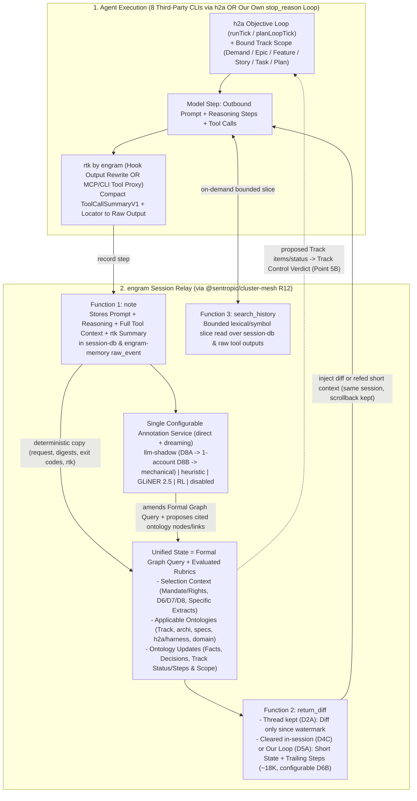

# Spec 2 — `engram` as Session Journal, Graph Diff, and Short-Context Relay (`SPEC_ENGRAM_CONTEXTUAL_GRAPH_AND_PROMPT_LOOP`)

- **Status:** `proposed` (`v0.4.0`, `2026-11-15` — `Stage: DESIGN (Gemini Carbon)`; full rewrite of Spec 2 from the owner's `2026-11-15` decisions and ten binding comments on dossier `r7`)
- **Repository of Record:** `engram` (`@sentropic/engram`), coordinated across `sentropic` (`@sentropic/cluster-mesh`, `@sentropic/mcp-platform`, `@sentropic/mcp-broker`, `@sentropic/llm-mesh`, `api`) and `h2a` (`@sentropic/h2a`, `@sentropic/track`, plus the new pure-TypeScript agentic-loop package)
- **Binding Authorities:**
  - [`spec/memory/OWNER-DECISIONS-2026-11-14.md`](memory/OWNER-DECISIONS-2026-11-14.md) (`:1-92` for `14/11` `T-M-C` and `Points 1B–6A` + early `15/11` `r5` decisions; `:94-261` « `2026-11-15 decisions` » for dossier `r7` decisions `D1 A · D2 A · D3 A · D4 C · D5 A · D6 B · D7 A · D8 A · D9 C` and all ten binding `ownerComments`)
  - [`spec/memory/dossiers/2026-11-15-contexte-court/DOSSIER-r7.fr.md`](memory/dossiers/2026-11-15-contexte-court/DOSSIER-r7.fr.md) (`:1-643`, `sha256:38b4179345608d5a3fdea5c0e742e013ce1b5a53ae602d1b29cc46ed52d06f4a`)
  - [`spec/memory/dossiers/2026-11-15-contexte-court/ANSWERS-r7.owner.yaml`](memory/dossiers/2026-11-15-contexte-court/ANSWERS-r7.owner.yaml) (`:1-113`, `sha256:e6874f033cb25319d9b731d9b448e9fe8728e70896b9bfbc4c0cfb51ae7767b5`)
  - [`spec/memory/R15-SEDIMENT.md`](memory/R15-SEDIMENT.md) (`:1-121` — Engram-First Principle and settled decision ledger `D1`–`D34`, specifically `D3`–`D8`, `D11`–`D26`, `D28`, `D31`–`D34`)
  - [`spec/memory/Q6-APPLICATION-LOG.md`](memory/Q6-APPLICATION-LOG.md) (`§19.3 :684-697`, `Rules 1–5` — code-grounding verification rules)
  - [`spec/memory/ARCHITECTURE-RULES.md`](memory/ARCHITECTURE-RULES.md) (`:1-13` — `R12` non-bypassable `@sentropic/cluster-mesh` hop)
- **Sibling Specifications:**
  - [`spec/SPEC_ENGRAM_METAMODEL_AND_LINEAGE_REGISTRY.md`](SPEC_ENGRAM_METAMODEL_AND_LINEAGE_REGISTRY.md) (**Spec 0** — `engram.metamodel/v1`, `LineageId`, `OntologyTemplateEnvelopeRef`, `composed_lineage_pins`)
  - [`spec/SPEC_ENGRAM_CLUSTER_MESH_MEMORY_ACCESS_AND_MCP_WIRING.md`](SPEC_ENGRAM_CLUSTER_MESH_MEMORY_ACCESS_AND_MCP_WIRING.md) (**Spec 6A** — `R12` `/memory/v1/*` and `/mcp` surfaces, `SignedH2AMandateWireEnvelope` verification, `D17` degraded banners)
  - [`spec/SPEC_ENGRAM_SESSION_FRONT_AND_EXTRACTION.md`](SPEC_ENGRAM_SESSION_FRONT_AND_EXTRACTION.md) (**Spec 1** — session-front ingestion and `0.24.0` extraction pipeline; **amended inline via `Before → After` deltas in §8.1 below without editing Spec 1 on disk**)
  - [`spec/SPEC_ENGRAM_DORMANT_DREAMING_SYNTHESIS.md`](SPEC_ENGRAM_DORMANT_DREAMING_SYNTHESIS.md) (**Spec 3** — dormant dreaming consolidation, sharing the single annotation service per `schema-10`; §3.6 & §8.2)
  - [`spec/SPEC_ENGRAM_H2A_ROLE_ONTOLOGY_AND_HARNESS_OVERLAYS.md`](SPEC_ENGRAM_H2A_ROLE_ONTOLOGY_AND_HARNESS_OVERLAYS.md) (**Spec 4** — `lineage: 'h2a'` role/activity and harness/skill ontologies; §8.2)
  - [`spec/SPEC_ENGRAM_PROFILE_VIEW_MECHANISM.md`](SPEC_ENGRAM_PROFILE_VIEW_MECHANISM.md) (`§2.1.1 :822-840` — semantic-only responsibility; zero UI layout/fold state in `engram`)
- **Research Reference:** Peter Belcak, Saurav Muralidharan, Jindong Jiang, Yonggan Fu, Wonmin Byeon, Hanrong Ye, Ryan Angilly, Ali Taghibakhshi, Shih-Yang Liu, Siru Ouyang, Greg Heinrich, and Pavlo Molchanov, *You don't need long context* (`arXiv:2611.05306v1`, 3 Nov 2026), together with internal analyses `ANALYSIS-carbon.md` and `ANALYSIS-fable.md` (gitignored `.graphify/scratch/design/memory-finalization/context-strategy-2611.05306/`, `.gitignore:60`).
- **Stack & Safety Rules:** Pure TypeScript / Node.js across `engram`, `sentropic`, and `h2a`. **Zero Python** anywhere in runtime code, hooks, model adapters, tests, or build scripts (`h2a` `scripts/check-no-python.mjs:1-25`).

---

## 1. Purpose, in Plain English

### 1.1 Why `engram` Becomes the Session Journal, Graph Diff, and Short-Context Relay

When a coding CLI runs for 30, 80, or 200 steps, appending every prompt, reasoning trace, file read, test log, and tool result into one growing conversation thread causes four compounding failures:
1. **Attention dilution:** old grep outputs, failed StackTraces, and superseded plans bury the owner's actual request and settled decisions.
2. **Compaction drift:** when the CLI hits its context window limit and summarizes its own summary, verbatim constraints, file digests, and negative constraints quietly vanish (`arXiv:2611.05306v1 §3.1`).
3. **Repeated token billing:** every step re-sends tens of thousands of raw historical tokens (even with prefix caching, cache misses on compaction or tool edits re-bill the entire prefix).
4. **Opaque transcripts:** what the agent learned is trapped inside an unstructured chat log rather than structured into `Track` items, `h2a` harness rules, and `engram` architecture/fact graphs.

On `2026-11-15`, the owner set the direction in two steps (`OWNER-DECISIONS-2026-11-14.md:40,57,94-261`):

> « Deja engram doit devenir un loguer de session en // des outils. Dans notre outil cli a nous ce deviendra le loggeur principal. La session est loguée en graph. Et donc seul le diff est transmis a chaque fois. »

> « https://arxiv.org/pdf/2611.05306 inspire toi de ca j aimerais vraiment qu engram devienne le relai de ce type de strategie pour remplacé mecaniquemenr + appui par llm shadow la taille du contexte) dans toutes les cli en ooption + la notre uqi reposera exclusivement sur engeam pour le contexte. Analyse fable5.2 + carbon »

*(Methodological honesty note on `arXiv:2611.05306v1`: in the paper, bounded-context single-action agents (`SAC`, `<= 16K–24K` active tokens) with structured state and selective history search match or exceed unbounded transcripts on `SWE-bench Pro` and `ContextBench` (`54.7%` vs `51.8%` on `GLM-5`; `56.7%` vs `54.0%` on `Qwen3.5-397B`), while `EORC` dollar figures are **modeled retail-API estimates** assuming a `10:1` uncached-to-cached price ratio and the paper uses **no** background shadow LLM. `engram` therefore pairs deterministic code extraction and prefix-cache-friendly short paliers (`D6 B`) with a **configurable, disableable** shadow annotator (`D7 A`) and gates every context-replacing notch behind measured session replay (`D9 C`).)*

### 1.2 The Three Plain Functions (`D1 A`)

`engram` exposes **one simple session-and-context relay** (`MemorySessionRelayPortV1` over `@sentropic/cluster-mesh` `R12`, surfaced to hosts on `/memory/v1/session-front/*` and to agents via the default-disabled 7th MCP tool `engram_memory_context` under `Point 2B`) with **exactly three plain functions** (`ANSWERS-r7.owner.yaml:18-19`, `DOSSIER-r7.fr.md:83-95`):

1. **`note` (Record the step):**
   At each step, `engram` records in the canonical journal **and** projects into the session graph:
   - the outbound **prompt** (and the formal graph query digest that produced it),
   - the model's ordered **reasoning steps**,
   - every **tool call and its full invocation & execution context** (arguments, MCP server/tool identity, working scope, exit code, touched files, full raw output citation in `session-db`),
   - a compact **tool-call summary (« rtk by engram »)** — produced deterministically and optionally via tool-call proxying (`ownerComment schema-1`),
   - and optional structured micro-notes from the main model (`plan`, `dead_end`, `hypothesis`).
2. **`return_diff` (Return the diff — or the bounded state view):**
   `engram` remembers the exact graph watermark (`SessionDeliveryWatermarkV1`) last delivered to each `(session_id, branch_epoch)`:
   - **When the caller keeps its own conversation thread** (the default in third-party CLIs under `D2 A`), `return_diff` returns **only what changed or became newly relevant** since that watermark (new owner/peer decisions, `Track` scope or stage updates, newly matched architecture/spec/memory nodes, dreaming recalls). If nothing changed, `engram` injects nothing (`0` tokens).
   - **When the caller has no growing thread** (our own loop under `D5 A`, or an in-session cleared-and-refed context under `D4 C` / `D6 B`), `return_diff` (`delivery_mode: 'full_state_view'`) returns the **complete bounded short-context view**: the pinned request & mandate, the evaluated **State** (which is itself a formal graph query across the applicable ontologies), and the short window of reprocessed/rtk-summarized recent steps.
3. **`search_history` (Search past turns, reasoning, and raw tool outputs):**
   Because raw prompts, reasoning traces, and untruncated tool outputs stay in canonical `session-db` / `engram-memory` rather than bloating the active prompt, the agent can call `search_history` whenever it needs an exact past error line, command output, or earlier discussion (`D23`, `arXiv:2611.05306v1` `RQ2`). `search_history` returns bounded, `D6`/`D7`/`D8`-filtered slices (`<= 8,192` UTF-8 bytes per match) with exact line/byte locators, and **never** copies raw transcripts into `.graphify/graph.json` (`M10`).

### 1.3 Retire the Nested Container Entirely: Data Are Graph Nodes and Links (`D1 A`)

Earlier drafts of `Spec 2` (`v0.3.0`) and `Spec 6A §4.2` wrapped domain items in a recursive-by-unrolling JSON container (`BoundedContextDomainPayloadV1` / `buildBoundedContextDomainPayloadSchemaV1`, unrolled to depth `0..8`) to work around `validateMemoryToolSchemaDialectV1`'s prohibition on `$ref`/`$defs`.

**That nested container is retired in full.** Under `D1 A` (« *données en nœuds et en liens* »), every piece of state, diff, ontology update, and recall crosses `engram` as two flat, closed arrays:
- **`nodes: readonly GraphNodeV1[]`** — each node has a stable `node_id`, an open `node_type`, an optional `template_envelope: OntologyTemplateEnvelopeRef` (`{ lineage, templateId, templateVersion, templateDigestSha256 }`, `Spec 0 §2.1`), `author_kind`, `review_status`, `source_event_ids`, `payload_digest_sha256`, `wire_digest_sha256`, and a flat array of scalar attributes (`FlatGraphAttributeV1[]`, nesting depth `1`).
- **`links: readonly GraphLinkV1[]`** — each link connects `source_id -> target_id` with an open `relation_type`, optional `template_envelope`, `source_event_ids`, and flat scalar attributes.

`engram` embeds **zero** closed list of `Track` or `h2a` entity types (`T-M-C`, `Point 2B`, `OWNER-DECISIONS-2026-11-14.md:11-16,23`). When `Track` or `h2a` adds a new class or relation to its ontology template, `GraphNodeV1` and `GraphLinkV1` carry it immediately without changing a single line of `engram` or `@sentropic/mcp-platform` wire schemas.

### 1.4 End-to-End Architecture Overview (`Schéma n° 1` Completed per `ownerComment schema-1`)



### 1.5 Three-Stage Rollout (`D3 A`) and Proof Gates (`D9 C`)

Per `D3 A` (`ANSWERS-r7.owner.yaml:23-25`) and `D9 C` (`:58-62`):
1. **Stage 1 — Note in third-party CLIs + configurable shadow + « rtk by engram » summaries:** `h2a` hooks and the optional MCP tool proxy record prompts, reasoning steps, tool calls + full context, and `rtk` summaries into `engram` (built disabled by default behind feature/tenant opt-in per `Point 2B`, `OWNER-DECISIONS-2026-11-14.md:83`). Zero prompt truncation is forced on any third-party CLI yet; real multi-step sessions build the `D9 C` replay corpus.
2. **Stage 2 — Return the diff, search history, and opt-in short-context cursor in third-party CLIs:** Enables `return_diff` (`D2 A` default diff injection) and `search_history` (`engram_memory_context` `v2` after `Point 2B` co-signature + `MCP-L5`), then unlocks each opt-in short-context cursor notch (`P1..P4`, §5) **only** after that notch and its shadow models pass **session replay (`D9 C` Tier `T2`)** and all three zero-tolerance mechanical checks (§9.1) — while **never** opening a « new » session (`D4C`, `schema-6`).
3. **Stage 3 — Our own `stop_reason` loop relying exclusively on `engram` (`D5 A`):** Built on the new pure-TypeScript agentic-loop library (not `@sentropic/chat-core` as is, `schema-7`), wired to `h2a`'s objective loop and `Track` scope (`D5A`, `schema-1`), with configurable `~18,000`-token paliers (`D6 B`). Unlocked as the default runner **only** after passing full `D9 C` proof: public benchmark calibration (`T1`) + session replay (`T2`) + real-task suite with automated test/build verdicts and live pilot (`T3`).

---

## 2. Observed Baseline Across Repositories (`origin/main` Grounding, `Rules 1–5`)

Every statement about existing code below was verified directly against `origin/main` of the owning repository at the exact commit SHA named below (`Q6-APPLICATION-LOG.md §19.3 :684-697`, full command-and-output ledger in `Q6-APPLICATION-LOG.md §23.2`). Anything not present on `origin/main` is explicitly marked **`new`** with the lot that creates it.

| Repository | Verified `origin/main` Pin | Exists Today on `origin/main` (`[FACT: path:line]`) | Does **NOT** Exist Yet (`new` + Owning Lot) |
| :--- | :--- | :--- | :--- |
| **`engram`** | `f75543a5c8b220a741924e8eeac6610e3808c8ce` (`@sentropic/engram@0.28.0`, `package.json:3`; zero `src/` or `engram-memory/` code diff vs branch `HEAD` `583947e7904512f32372ae404f40f3047ce0ff1b`) | 6-tool `v1` MCP contract (`ENGRAM_MEMORY_MCP_CONTRACT_VERSION = '1.0.0'`, `ENGRAM_MEMORY_PROVIDER_ID = 'sentropic.engram.memory'`, `ENGRAM_MEMORY_CONNECTOR_ID = 'engram-memory'` in `src/mcp/memory/contracts.ts:142-145`; `ENGRAM_MEMORY_PROVIDER_MANIFEST` requiring `['sub', 'tid']` in `src/mcp/memory/gates.ts:292-312`; `ENGRAM_MEMORY_TOOL_DESCRIPTORS.length !== 6` guard in `src/mcp-memory/provider.ts:458-460`); strict closed JSON Schema validator `validateMemoryToolSchemaDialectV1` forbidding `$ref`/`$defs` and requiring `additionalProperties: false` on every object (`src/mcp/memory/schemas.ts:3657-3789`); error catalog (`src/mcp/memory/errors.ts:30-70,437-454`); `0.24.0` extraction toolkit (`EXTRACTION_SCHEMA_V1`, `adaptTextJsonClient`, `processCitationsForItem`, `validateAndPruneChunkExtraction` in `src/extraction-batch.ts:251,751,1279-1290,1338-1348`) and `@sentropic/llm-mesh` bridge (`src/llm-mesh-bridge.ts:11-35`); L0 neutral recall (`BM25F` + `RRF` + `PPR` in `engram-memory/recall.ts:27-45`) and fenced profiles (`engram-memory/module-storage-neutral.ts:38-44,101-104,224-231`); `archi@1` immutable 11 kinds (`src/ontology-guardian/archi-profile.ts:38-50,160-166`) and `AdmissionFamily` including `'TRK'`, `'H2A'`, `'HRN'`, `'DIA'`, `'MEM'` (`src/ontology-guardian/admission.ts:40`). | Flat `GraphNodeV1` / `GraphLinkV1`, `FormalContextGraphQueryV1`, `TrackScopeBindingV1`, `ToolCallSummaryV1`, `StepExecutionRecordV1`, `CoSignatureReceiptV2`, and `v2` 7th-tool schema (`new` `src/mcp/memory/context-contracts.ts`, Lot `2-E1`); deterministic « rtk by engram » compressor (`new` `src/session-relay/rtk-summary.ts`, Lot `2-E2`); `SessionDeliveryWatermarkV1`, configurable `ContextRhythmPolicyV1`, & dual token/byte packer (`new` `src/memory-tools/context-relay.ts`, Lot `2-E3`); unified `EngramAnnotationServicePortV1` (`'llm-shadow' \| 'heuristic' \| 'finetuned-model' \| 'rl-policy' \| 'disabled'`, `direct` + `dreaming` profiles, `QueryAmendmentProposalV1` verifier) (`new` `src/session-relay/annotation-service.ts`, Lot `2-E4`); L0-neutral `return_diff`, `search_history`, `D5` quarantine, & `D6` attribute scrubber (`new` `engram-memory/contextual-relay.ts`, Lot `2-E5`); `provider.ts` `v2` read-branch wiring (`Lot 2-E6`). |
| **`sentropic`** | `25ba09a6de138c43c69b9418b30df635f8f0e805` (`@sentropic/llm-mesh@0.38.1`, `packages/llm-mesh/package.json:3`; `@sentropic/cluster-mesh@0.27.0-dev.1`, `packages/cluster-mesh/package.json:3`; `@sentropic/mcp-platform@0.4.2`, `packages/mcp-platform/package.json:3`; `@sentropic/mcp-broker@0.1.0`, `packages/mcp-broker/package.json:3`; `@sentropic/chat-core@0.3.2`, `packages/chat-core/package.json:3`) | `LlmMesh.generate`/`stream` (`packages/llm-mesh/src/mesh.ts:49-54`), `VerifiedRoutingSubject`, `EligibleAccountDescriptor`, `RoutePlanInput`, `PreparedRouteAttempt.attemptRef`, `AccountDirectoryPort.listEligible` (`packages/llm-mesh/src/routing-contracts.ts:13-28,54-77,197-212`), `RouteStrategy` (`'ordered'` in `packages/llm-mesh/src/routing-policy.ts:14-18`), `ModelEquivalenceGroup` & `BenchmarkEvidence` (`packages/llm-mesh/src/equivalence-council.ts:15-35`), `GENERATED_MODEL_COUNCIL_SOURCE` with empty equivalence groups (`packages/llm-mesh/src/generated-model-council.ts:2-30`), `knownModelIds` / `knownModelIdsByProvider` (`packages/llm-mesh/src/providers.ts:13-110`); closed 8-key `DecisionRequest` (`packages/llm-mesh/src/decision/request.ts:40-53,70`); `MEMORY_WIRE_PROFILE_ID` (`packages/mcp-platform/src/memory/contracts.ts:25-35`), `isMemoryProfileTool` (`packages/mcp-platform/src/transport/bridge.ts:95-100`), `requireTrustedInvocationContext` & `validateMemoryProjection` (`packages/mcp-platform/src/memory/invocation-context.ts:41-112`); `compiled-dispatch.ts:156-198` claim checks; `composeEngramMemoryDefinition` (`packages/cluster-mesh/src/integrations/mcp/memory-compose.ts:13-45`) & `LLM_MESH_RANGE = '0.19.2 \|\| >=0.22.0 <0.39.0'` (`packages/cluster-mesh/src/modules/catalog.ts:18-20`); `DEC-116` `SENTROPIC_MCP_CLIENT_ID` & `READ_ONLY_TOOL_ALLOWLIST` (`api/src/services/mcp/client-policy.ts:9-30,40-42`) and `HostRegistryCatalogSource.snapshot` (`api/src/services/catalog/sources/host-registry-source.ts:22-36`); `l0-freeze.json` owner ids `'owner:engram-l4'` and `'owner:mcp-platform'` (`spec/evidence/memory-mcp-l5/l0-freeze.json:25,30`). **Absent on `origin/main`:** `packages/cli` does **not** exist on `origin/main` (`stp` standalone CLI is not an `origin/main` package); `@sentropic/chat-core` (`packages/chat-core/src/context-budget.ts:1-45`) is migrating to the design system (`schema-7`). | `v2` flat node/link tool constants, `VerifiedH2AMandateV1` projection bi-implication, & `verifyCoSignatureReceiptV2` in `packages/mcp-platform` (`new`, Lot `2-S0a`); `v2` non-mutating claim gate in `packages/mcp-broker` (`Lot 2-S0b`); `cluster-mesh` `MemorySessionRelayPortV1` routes (`/memory/v1/session-front/{step,diff,history}`) + `v2` `composeEngramMemoryDefinition` (`new` `packages/cluster-mesh/src/memory/session-relay-routes.ts`, Lot `2-S1a`); `cluster-mesh` `EngramAnnotationService` host adapter with `D8 A` ordered list + automatic 1-account `D8 B` same-provider fallback + `direct`/`dreaming` profiles (`new` `packages/cluster-mesh/src/memory/annotation-service-host.ts`, Lot `2-S1b`); `api/` `DEC-116` & catalog claim filter (`Lot 2-S2`); `MCP-L5` 5-gate freeze & Stage-B/E10 qualification (`Lot 2-S3`). |
| **`h2a`** | `32a87af963684f2317c41ce3c3bcd96192db41e7` (`@sentropic/h2a@0.98.10`, `packages/h2a/package.json:3`; `@sentropic/track@0.98.10`, `packages/track/package.json:3`) | 8-host plugin targets (`claude`, `codex`, `gemini`, `agy`, `hermes`, `opencode`, `muse`, `vibe`) & `renderWorkspaceScope` (`packages/h2a/src/hosts/plugin.ts:22-44,85-152,200-212`); host qualification matrix (`docs/host-integration-matrix.md:14-48`); `vibe-post-agent.mjs:1-29`; `captureHostOperatorNotices` (`packages/h2a/src/hosts/operator-notices.ts:8-24`); `createEnvelope` (`packages/h2a/src/envelope.ts:41-45`); `BridgeLock` (`packages/h2a/src/registry/bridge-lock.ts:21-43`); objective-loop `H2ALoopStatus`, `H2ALoopTrackRef` (`system: "track"`, `aggregateKind: "item" \| "decision" \| "blocker" \| "criterion" \| "evidence" \| "wp"`), and `runTick` / `planLoopTick` (`packages/h2a/src/runtime/loop/index.ts:7-20,49-64`; `packages/h2a/src/runtime/loop/engine/tick.ts:9-17,41-45`); `Track` `ItemKind`, `ItemRole` (`'workpackage' \| 'spec-phase' \| 'stream'`), `ScopeDecl` (`packages/track/src/model/item.ts:17,32,39-45`), `DemandState` (`packages/track/src/model/demand.ts:15-45`), `DecisionKind`/`Outcome` (`packages/track/src/model/decision.ts:11-13`), 12 `REPORT_STAGES` & 8 `REPORT_STATUSES` (`packages/track/src/model/report-status.ts:10-45`, `src/report/stage-status.ts:24-45`), and `OWNER_TABLE_HEADERS` (`packages/track/src/report/owner-table.ts:22-31`); Zero-Python gate (`scripts/check-no-python.mjs:1-25`) & test inventory (`scripts/test-inventory.json:1-15`). | Step prompt/reasoning/tool-context capture + MCP/CLI « rtk by engram » tool-call proxy (`new` `packages/h2a/src/runtime/context/step-note-and-rtk-proxy.ts`, Lot `2-H1`); `D2 A` diff injector, `D15` non-blocking slices, & `D18-B` local read-only guard (`new` `packages/h2a/src/runtime/context/diff-and-slice-injector.ts`, Lot `2-H2`); per-host opt-in short-context cursor (`P0..P4`) enforcing **same-session scrollback** & automatic `B`/`A` fallback (`new` `packages/h2a/src/runtime/context/short-context-cursor.ts`, Lot `2-H3`); `D9 C` session-replay harness (`new` `packages/h2a/src/runtime/context/replay-qualifier.ts`, Lot `2-H4`); new dedicated pure-TS `stop_reason` agentic-loop package (`new` `packages/agent-loop/`, Lot `2-L1`) & `h2a` objective-loop + `Track` scope wiring (`stp = h2a run stp` alias, `new` `packages/h2a/src/runtime/loop/native-engram-runner.ts`, Lot `2-H5`). |

---

## 3. The State, the Formal Graph Query, Configurable Authors, and Unified Annotation Service

### 3.1 One Unified State Object (Merging `Spec 1` `session_summary`)

`Spec 1` (`:478`) originally defined a separate rolling `session_summary` (`context_summary` every `24` turns or `65_536` bytes). Following `DOSSIER-r7.fr.md:336` and `arXiv:2611.05306v1 §3.1`, **rolling prose `session_summary` is merged into `engram`'s single structured State (`SessionStateAndQueryV1`)**. Maintaining a second free-text summary alongside the structured graph state would reintroduce summary-of-summary drift and conflicting sources of truth.

### 3.2 The State Is Also a Formal Graph Query (`ownerComment schema-1`)

Per the owner's binding `schema-1` amendment (`ANSWERS-r7.owner.yaml:64-68`, `OWNER-DECISIONS-2026-11-14.md:165-169`):

> « L'état devrait aussi être une requête formelle au graphe
> - contexte de sélection (droits, extraits spécifiques pertinents) + ontolgies applicables (track, archi, specs, harnais, ontologies spécifiques...)
> Le shadow devrait :
> - amender cette requête
> - update relatif aux ontologies pertinentes (faits, décisions / track, harnais, architecture, statut - étapes track, scope track des demaindes/epic/feature/user stories/plans).
>
> Point d'attention: l'étape doit bien stocker le prompt, les étapes de réflexion, les appels outils et leur contexte complex. On pourra ainsi aussi faire un rtk par engram (résumé des appels outils, quitte a proxifier les appels outils).
>
> La notion de scope track doit aussi être rattachée a l'objective loop.
>
> Le schema devrait donc être complété : prompts/outils + ontologies et requête graphe. »

In `engram`, **the session State is not a static blob of text — it is simultaneously a formal graph query (`FormalContextGraphQueryV1`) and the bounded subgraph (`GraphNodeV1[]` + `GraphLinkV1[]`) returned by evaluating that query at the current journal cursor**:

```ts
// new (Lot 2-E1: src/mcp/memory/context-contracts.ts)
export interface TrackScopeBindingV1 {
  /** Bound h2a objective-loop identifier (`packages/h2a/src/runtime/loop/index.ts:7-20`), when running under an objective loop. */
  readonly objective_loop_id?: string;
  /** Mirrors H2ALoopTrackRef (`packages/h2a/src/runtime/loop/index.ts:49-64`) + Track hierarchy (`SPEC_EVOL_TRACK_ONTOLOGY` / `item.ts:17-45`). */
  readonly demand_ids: readonly string[];         // Active Track DemandIds / owner requests
  readonly epic_or_stream_ids: readonly string[]; // Track epic (`sentropic.agile-product@1`) or `role: 'stream'` (`item.ts:32`)
  readonly feature_or_wp_ids: readonly string[];  // Track feature or `role: 'workpackage'` (`item.ts:32`)
  readonly story_or_phase_ids: readonly string[]; // Track user-story or `role: 'spec-phase'` (`item.ts:32`)
  readonly task_or_item_ids: readonly string[];   // Active leaf task / ItemIds (`item.ts:17`)
  readonly plan_refs: readonly string[];          // Plan artifact / spec-phase locators
  /** Declarative path-glob boundaries from Track `ScopeDecl` (`item.ts:39-43`), enforced by harness scope guard. */
  readonly path_scope?: {
    readonly allowed: readonly string[];
    readonly forbidden: readonly string[];
    readonly conditional: readonly string[];
  };
}

export interface SelectionContextV1 {
  readonly tenant_id: string;
  readonly workspace_id: string;
  readonly derived_worktree_id: string;           // `^wt:[0-9a-f]{64}$` (D21)
  /** Verified out-of-band H2AEnvelope<H2AMandate> digest & role (D4, D22); omitted only under recorded D18 readonly posture. */
  readonly mandate_binding?: {
    readonly mandate_id: string;
    readonly mandate_digest_sha256: string;
    readonly role_id: string;
    readonly granted_capabilities: readonly string[];
  };
  readonly disclosure_posture: 'refs_only_d6' | 'content_authorized_d8' | 'readonly_non_memory_d18';
  readonly d5_same_role_pending_allowed: boolean;
  /** Pinned verbatim owner request & active steering amendments (copied word-for-word by code; §3.3 unpinning rule). */
  readonly pinned_request_event_ids: readonly string[];
  /** Explicit relevant extract selectors (files, symbols, graph node IDs, raw step citations) refined at each step. */
  readonly relevant_extract_selectors: readonly {
    readonly selector_kind: 'file_path_ref' | 'graph_node_id' | 'symbol_fqn' | 'session_step_citation';
    readonly ref: string;
    readonly line_start?: number;
    readonly line_end?: number;
    readonly added_by: 'code' | 'shadow' | 'main_model' | 'owner';
    readonly reason_code: string;
  }[];
}

export interface FormalContextGraphQueryV1 {
  readonly query_version: 'engram.formal-context-query/v1';
  readonly query_digest_sha256: string;           // RFC 8785 JCS SHA-256 of (selection_context, applicable_ontologies, track_scope, max_hops)
  readonly selection_context: SelectionContextV1;
  /**
   * Applicable ontologies (`schema-1`): Track (`lineage: 'track'`), architecture (`archi@1` / `archi@2` / `app-context`),
   * specifications (`specs`), h2a roles & harness (`lineage: 'h2a'`), memory, and repo/domain-specific ontologies.
   * Zero closed enum of domain entity types inside engram (T-M-C, Point 2B).
   */
  readonly applicable_ontologies: readonly OntologyTemplateEnvelopeRef[];
  /** Track scope bound to the h2a objective loop (`schema-1`). */
  readonly track_scope: TrackScopeBindingV1;
  readonly max_hops: 1 | 2 | 3;
}
```

### 3.3 Evaluated State Rubrics, Shadow Amendments, and Unpinning Law (`schema-1`, `D7 A`)

Evaluating `FormalContextGraphQueryV1` produces flat `GraphNodeV1[]` and `GraphLinkV1[]` covering **ten operational rubrics** (the 9 rubrics presented in `DOSSIER-r7.fr.md:107-149` plus the explicit ontological & `Track`-scope delta required by `ownerComment schema-1`; see §11.1 for `engram`'s requested `schema-4` opinion on how these rubrics map onto `Track` and `engram` ontologies):

| # | State Rubric | Who Writes It | Grounding & Lifecycle Rule |
| :--- | :--- | :--- | :--- |
| **1** | **Pinned Request & Mandate** | **Code** (word-for-word copy) | Exact owner prompt(s), steering remarks, and verified `H2AMandate` rights. **Never** summarized, paraphrased, or evicted by any model. Unpinned **only** by an explicit owner signal (`owner.answer` / `owner.request` supersession) or an authoritative `Track` acceptance/close verdict. |
| **2** | **Decisions (`Track` & `Harness`)** | **Code** (ratified) + **Shadow** (`proposed`) | Ratified `Track` (`Outcome: 'go' \| 'no-go'`, `decision.ts:12`) and `h2a` `harness_decision` records (`D3`, `D27`, `D31`) are pinned verbatim. Shadow-detected decisions enter `review_status: 'proposed'` (`Point 5B`) with mandatory `source_event_ids`. |
| **3** | **Established Facts & Architecture** | **Shadow** + **`engram` Graph** | Verified codebase facts, symbol contracts, `archi@1` components/stores/APIs, and spec invariants discovered so far, each citing an existing `raw_event` or `D6FileOrPathRef`. |
| **4** | **Applied Changes** | **Code** | Files created/edited/deleted in `derivedWorktreeId`, pre/post SHA-256 content fingerprints, git diff stat, and verification state (`verified` vs `unverified_since_last_edit`). |
| **5** | **Verifications** | **Code** (+ **Shadow** links) | Test/typecheck/lint commands run, exit codes, pass/fail counts, and witness links toward `Track` `EVIDENCE_REQUIRED_STAGES` (`stage-status.ts:12`). |
| **6** | **Dead Ends** | **Shadow** + **Main Model** | Approaches tried and falsified (with the failing `eventRecordId` / test citation) so future paliers never repeat the same broken attempt. |
| **7** | **Forward Plan & Completion Condition** | **Main Model** | Numbered next actions and explicit stop/goal condition aligned with `track_scope` and `h2a` objective-loop predicates. |
| **8** | **Dreaming Recalls (`D19`, `D26`)** | **`engram` Dreaming** (`Spec 3`) | Forgotten cross-session facts (immediate) and `D26`-qualified lessons (only after threshold proof; shadow-only before). |
| **9** | **Step & Tool Pointers (`rtk`)** | **Code** | Compact `ToolCallSummaryV1` digests and `engram://session-step/<eventRecordId>` locators redeemable via `search_history`. |
| **10** | **Ontological & `Track` Scope Updates (`schema-1`)** | **Code** + **Shadow** (`proposed`) | Updates to `FormalContextGraphQueryV1` (`QueryAmendmentProposalV1`) and candidate nodes/links across `Track` (`Demand`, `epic`/`stream`, `feature`/`workpackage`, `user-story`/`spec-phase`, `task`, `ReportStage`/`ReportStatus` transitions), `h2a` harness/roles, `archi`, and `specs`. Every `domain: 'project'` write stays `proposed` until `Track` control issues its verdict (`Point 5B`). |

**Deterministic Verification of Shadow Query Amendments (`schema-1`):**
At each step sweep, the shadow annotator emits:
1. **`QueryAmendmentProposalV1`** (`add_selectors`, `drop_stale_selectors`, `activate_ontology_pins`, `propose_track_scope_refs`): `engram`'s deterministic query gate verifies that (a) no pinned request, ratified decision, or objective-loop-locked `TrackScopeBindingV1` root is dropped, (b) every added selector belongs to the authorized `(tenantId, workspaceId)` and obeys `D6`/`D7`/`D8`, and (c) every activated `OntologyTemplateEnvelopeRef` is registered in `Spec 0`'s lineage registry.
2. **Ontology Node/Link Proposals (`SessionExtractionProposalBatch`):** validated through `Spec 1 §2.2` (`validateAndPruneChunkExtraction` + `processCitationsForItem` in `src/extraction-batch.ts:1279-1348`) so **zero uncited model claim ever enters the State**. If the shadow and main model disagree on whether a sub-goal succeeded or hit a dead end, `engram` keeps **both** nodes linked by `conflicts_with` and flags `disagreement: true` rather than silently overwriting either author (`DOSSIER-r7.fr.md:461`).

### 3.4 Configurable Authors (`D7 A` + `ownerComment D7A`)

Per `D7 A` (`ANSWERS-r7.owner.yaml:46-50`) as amended by `ownerComment D7A` (`:99-103`, `OWNER-DECISIONS-2026-11-14.md:200-204`):

> « Réglable:
> shadow désactivable le cas échéant avec une heuristique le cas échéant ou un model finetuned/Gliner 2.5, ou  avec un  mécanisme d'apprentissage / RL »

Author participation is governed by a closed, runtime-configurable `StateAuthoringPolicyV1` (`new` in Lot `2-E4`, configurable per workspace, host, or user profile without code changes):

```ts
// new (Lot 2-E4: src/session-relay/annotation-service.ts)
export type ShadowBackendMode =
  | 'llm-shadow'       // Default: qualified fast non-reasoning model via @sentropic/llm-mesh (D8A + D8B fallback)
  | 'disabled'         // Shadow completely off: zero extra model calls; deterministic code + main-model plan
  | 'heuristic'        // Zero-LLM deterministic AST/diff/exit-code/stacktrace/selector heuristic
  | 'finetuned-model'  // Compact fine-tuned span/relation extractor (e.g. GLiNER 2.5 via Node ONNX/Wasm or llm-mesh local endpoint — ZERO Python)
  | 'rl-policy';       // Learned / RL selector-amendment & node-salience policy scored under deterministic citation & rights checks

export interface StateAuthoringPolicyV1 {
  readonly shadowMode: ShadowBackendMode;
  readonly fineTunedAdapterRef?: string;          // e.g. 'gliner-2.5-onnx-v1' or 'local:<modelId>' via @sentropic/llm-mesh
  readonly rlPolicyRef?: string;                  // Registered policy bundle digest for query selector / salience scoring
  readonly mainModelPlanCadence: 'every-step' | 'on-palier-and-compaction' | 'optional';
}
```

- **Zero-Python Constraint on `'finetuned-model'` (`GLiNER 2.5`) and `'rl-policy'`:** Any local fine-tuned extractor (such as `GLiNER 2.5` for zero-shot ontology entity/relation span extraction) or RL policy scorer MUST execute either in-process via pure TypeScript / WebAssembly / Node ONNX bindings or over HTTP/JSON through `@sentropic/llm-mesh`'s `'local'` / OpenAI-compatible provider (`packages/llm-mesh/src/providers.ts:65-69,107`), with **zero Python runtime, subprocess, or script** (`scripts/check-no-python.mjs:1-25`).
- **Identical Safety Gate Across All Modes:** Regardless of whether `shadowMode` is `'llm-shadow'`, `'heuristic'`, `'finetuned-model'`, or `'rl-policy'`, its output passes through the exact same deterministic `source_event_ids` existence check, `ProfileBundleV1` metamodel check, `D7` confidentiality deny-list, and `Point 5B` `'proposed'` staging gate. When `shadowMode === 'disabled'`, `engram` still delivers full deterministic continuity (verbatim pinned request, touched file digests, test verdicts, deterministic `rtk` tool summaries, and main-model plans).

### 3.5 Shadow Model Routing, Qualification, and Single-Account Fallback (`D8 A` + `ownerComment D8A`)

Per `D8 A` (`ANSWERS-r7.owner.yaml:52-56`) as amended by `ownerComment D8A` (`:104-108`, `OWNER-DECISIONS-2026-11-14.md:206-209`):

> « B en fall back quand l'utilisateur h2a (ou sentropic) n'a qu'un compte disponible. »

All `'llm-shadow'` calls execute through `@sentropic/llm-mesh` (`>=0.38.1 <0.39.0`, `packages/llm-mesh/package.json:3`) under a verified `VerifiedRoutingSubject` (`routing-contracts.ts:13-17`):

1. **Multi-Account Primary Path (`D8 A` — Owner's Ordered & Qualified List):**
   - Uses `RouteStrategy: { kind: 'ordered', preferences }` (`packages/llm-mesh/src/routing-policy.ts:16`), bounded to `maxAttempts: 3` with automatic provider/account cooldown on `429` / `5xx` / timeout, and **validates the structured JSON output against the extraction/amendment schema before crediting an attempt** (`adaptTextJsonClient` in `src/extraction-batch.ts:751-758`, stamping `PreparedRouteAttempt.attemptRef` from `routing-contracts.ts:198`).
   - **Catalog & Council Reality on `sentropic` `origin/main` (`25ba09a6de`):** `knownModelIds` (`packages/llm-mesh/src/providers.ts:13-110`) currently ships `'muse-ember-1.0'` (`:79`), `'gpt-6-luna'` (`:20`), `'gemini-3.8-flash'` (`:25`), `'gemini-3.1-flash-lite'` (`:29`), and `'mistral-small-2603'` (`:36`), whereas Anthropic `Haiku` is **not** yet registered in `knownModelIdsByProvider.anthropic` (`:103`, `new` catalog entry if added to the owner's list) and `GENERATED_MODEL_COUNCIL_SOURCE` (`generated-model-council.ts:2-30`) has **zero** equivalence groups (`"No pinned benchmark evidence authorizes automatic substitution."`).
   - **Hard Qualification Gate (`D8 A` + `D9 C`):** No model may author State items that replace active prompt context until its `BenchmarkEvidence` (`equivalence-council.ts:15-20`) from the `D9 C` replay benchmark (§9.2) is recorded. Unqualified models may run in Stage-1 dark/observation shadow only.
2. **Single-Account Automatic Fallback to `D8 B` (`ownerComment D8A`):**
   - Before planning a shadow call, `annotation-service-host.ts` (`Lot 2-S1b`) inspects `AccountDirectoryPort.listEligible(subject)` (`routing-contracts.ts:208-209`).
   - Whenever the `h2a` or `sentropic` user has **only one eligible account** (`eligible.filter(a => a.readiness === 'ready').length === 1`, or all ready accounts belong to a single `targetProviderId`), routing **automatically activates `D8 B` fallback**: it selects the qualified small/fast model of **that same provider** as the active session tool (e.g., `gpt-6-luna` / `gpt-5.4-nano` on an OpenAI-only Codex account; `gemini-3.8-flash` / `gemini-3.1-flash-lite` on a Gemini-only account; `mistral-small-2603` on a Mistral-only Vibe account; `muse-ember-1.0` on a Muse-only account; or a registered Anthropic fast model once added to `providers.ts` on a Claude-only account).
3. **Terminal Fallback (`D8 A` Tail — Zero Silent Upsell):**
   - If every qualified fast model in the ordered list (or in the single-account `D8 B` provider) is down, rate-limited, or unqualified — or if the single enrolled account only exposes a frontier reasoning model — `engram` **never** silently bills the expensive main session model as a shadow. It drops immediately to `'heuristic'` / deterministic code continuity and surfaces a non-blocking status notice via `operator-notices.ts` (`packages/h2a/src/hosts/operator-notices.ts:8-24`).

### 3.6 Single Annotation Service for `direct` and `dreaming` (`ownerComment schema-10`)

Per `ownerComment schema-10` (`ANSWERS-r7.owner.yaml:109-113`, `OWNER-DECISIONS-2026-11-14.md:210-214`):

> « oui ok ! la différence pour le dreaming, c'est qu'on utilisera potentiellement un modele plus frontière, peut être toujours non raisonnant »

`Spec 2` unifies live session annotation (`direct`) and `Spec 3` dormant consolidation (`dreaming`) behind **one single service**, `EngramAnnotationServicePortV1` (`new` in Lot `2-E4`, hosted in `cluster-mesh` Lot `2-S1b`):
- **Shared Core (100% reused):** `D7` `ConfidentialityDenyListV1` pre-call screening, `D6=refs` path-only redaction when content disclosure is off, `ProfileBundleV1` metamodel validation, `CitationV1` / `source_event_ids` verbatim grounding (`src/extraction-batch.ts:1279-1348`), `Point 5B` `'proposed'` staging for `Track` objects, and `@sentropic/llm-mesh` ordered routing + single-account `D8 B` fallback + zero-LLM fallback.
- **Two Parameterized Profiles (`AnnotationProfileId`):**
  1. **`'direct'` (Live step sweep, `D12=turn`):** low-latency budget (`<= 2_500 ms` async sweep, never blocking prompt send per `D15`), routing to the owner's qualified fast non-reasoning models (`ReasoningTier: 'none' | 'light'` in `providers.ts:9`).
  2. **`'dreaming'` (`Spec 3` local `nightly` and post-sync remote `weekly`/`monthly` passes):** relaxed batch latency budget, configured with its own ordered `RouteSelector[]` list that **may select a higher-capacity / more frontier model — potentially still non-reasoning** (`ReasoningTier: 'none' | 'light'` on a larger frontier checkpoint, avoiding runaway reasoning-token costs on cross-session graph synthesis), while preserving `Spec 3`'s `D26` cross-family verification rule before any drafted lesson leaves shadow mode (`OWNER-DECISIONS-2026-11-14.md:24`).

---

## 4. Step Recording and « rtk by engram » Tool-Call Summaries / Proxy (`schema-1`)

### 4.1 Complete Step Record: Prompt, Reasoning Steps, and Tool Calls with Complex Context

Per `ownerComment schema-1` (`« Point d'attention: l'étape doit bien stocker le prompt, les étapes de réflexion, les appels outils et leur contexte complex. On pourra ainsi aussi faire un rtk par engram (résumé des appels outils, quitte a proxifier les appels outils). »`), a session step is no longer split into disconnected text snippets that omit what prompt the model actually saw or how a tool was invoked. `StepExecutionRecordV1` (`new` in Lot `2-E1`, amending `Spec 1` in §8.1) captures four linked facets for every step `(session_id, step_ordinal)`:

1. **Prompt Record (`StepPromptCaptureV1`):**
   - `formal_query_digest_sha256` (exact `FormalContextGraphQueryV1` active when the prompt was assembled),
   - `delivered_watermark_cursor` (exact `engram` state/diff cursor injected into this step),
   - `prompt_session_citation: SessionDbCitationTuple` + `prompt_digest_sha256` (pointing to the full assembled prompt/user message in `session-db`, bounded inline text `<= 65_536` UTF-8 bytes when `D6`/`D8` permits),
   - `token_counts`: `{ state_prefix_tokens, trailing_steps_tokens, trigger_tokens, cached_prefix_tokens? }`.
2. **Reasoning Steps (`StepReasoningBlockV1[]`):**
   - Ordered array of reasoning steps / thought summaries / pre-tool rationales emitted by the model (`step_index`, `visibility: 'summary' | 'full_trace' | 'redacted_by_provider'`, `session_citation: SessionDbCitationTuple`, `digest_sha256`, and bounded text when `contentDisclosureAuthorized === true`).
3. **Tool Calls with Full Complex Context (`StepToolCallContextV1[]`):**
   - `invocation_id`, `tool_name`, `transport_kind: 'native_cli_tool' | 'mcp_tool' | 'engram_rtk_proxy'`, `mcp_source_id?`,
   - `input_arguments_citation: SessionDbCitationTuple` + `input_arguments_digest_sha256` + bounded sanitized structured arguments (`D7`-screened, `D6` path-masked),
   - `execution_context`: `{ derived_worktree_id, relative_cwd?, subagent_actor_ref?, timeout_ms?, env_posture_keys: readonly string[] }` (key names only, zero secret values),
   - `outcome`: `{ succeeded, exit_code?, duration_ms, raw_byte_length, significance: ToolResultSignificance, raw_output_citation: SessionDbCitationTuple, touched_files: readonly D6FileOrPathRef[] }`.
4. **« rtk by engram » Summary (`ToolCallSummaryV1`) & Agent Micro-Signals:**
   - Every recorded tool call carries its `ToolCallSummaryV1` (§4.2), and any structured `plan`, `dead_end`, or `hypothesis` emitted by the model in that step is parsed and linked to the step's `eventRecordId`.

### 4.2 « rtk by engram »: Deterministic Compression + Optional Tool-Call Proxy

Raw CLI and MCP tool outputs (test suites, compiler logs, `git diff`, directory listings, broad searches) routinely dump `10 KB–200 KB` into the model's context when `300–1,200` bytes carry 100% of the actionable signal. « rtk by engram » (`new` `src/session-relay/rtk-summary.ts` in Lot `2-E2` + `packages/h2a/src/runtime/context/step-note-and-rtk-proxy.ts` in Lot `2-H1`) solves this natively inside `engram` + `h2a`:

1. **Write Full Raw Output First, Return Compact Signal + Recovery Locator:**
   - The untruncated raw tool output is **always** written first to `session-db` (`SessionDbCitationTuple`) and cited in `engram`'s `raw_event` (`D24`, `F-01`). Nothing is ever lost.
   - `computeDeterministicRtkSummaryV1` (`Lot 2-E2`, zero LLM latency, `< 5 ms`) classifies the tool family (`test_runner`, `typecheck_build`, `search_grep`, `file_read_diff`, `git_status_log`, `mcp_json`, `generic_command`) and extracts every high-signal element verbatim: exit status, pass/fail/skip counts, every error/diagnostic `path:line:col` + message, touched paths + SHA-256 digests, and bounded head/tail anchors — capping routine outputs at a configurable `rtkMaxInlineBytes` (default `1,536` UTF-8 bytes) and appending a deterministic recovery footer:
     `[rtk by engram: raw 48,312 B stored at event raw_... — call engram_memory_context(search_history, event_id="raw_...", line_start=..., line_end=...) if exact lines needed]`.
   - On the background `D12=turn` sweep, the shadow annotator (when enabled) may attach semantic ontology links (e.g., linking a failing test to a `DeadEnd` or `Verification` node), without blocking tool execution.
2. **Two Delivery Paths — Native Hook Rewrite OR Tool-Call Proxy (`ownerComment schema-1`):**
   - **Path A — Post-Tool Hook Output Replacement:** On hosts whose post-tool hook can replace the text returned to the model (`claude` `PostToolUse`, `codex` `PostToolUse` for MCP, `gemini` `AfterTool`, `vibe` `post_tool`, `opencode` message transform), the `h2a` hook records the full output in `engram` and returns `ToolCallSummaryV1` inline.
   - **Path B — Tool-Call Proxy (`engram_rtk_proxy`):** For MCP tools across **all 8 hosts** (via `h2a registry-bridge serve` / `mcp-central`, `packages/h2a/src/registry/bridge-lock.ts:35`) and for wrapped shell/tool commands on hosts whose `PostToolUse` hook is read-only or absent (`agy`, `muse`, `hermes`, and bash commands in `codex`), `h2a` proxies the tool call directly: the proxy executes the tool, commits the full complex context + raw output to `engram` (`note`), and returns `ToolCallSummaryV1` + the `search_history` locator as the tool result.

---

## 5. The Third-Party CLI Cursor and Clear-and-Refeed Without New Session (`D2 A`, `D4 C`, `schema-6`)

### 5.1 Default Posture (`D2 A`) vs Opt-In Short-Context Cursor (`P0`–`P4`)

- **Default Posture Across All 8 Third-Party CLIs (`D2 A`):** The third-party CLI keeps its native conversation thread untouched. `engram` journals every step in parallel (`note`) and injects **only the diff** (`return_diff` with `delivery_mode: 'diff_since_watermark'`) on prompt/turn hooks. Per `OWNER-DECISIONS-2026-11-14.md:23,82`, this retires the `14/11` fixed-end-date cutoff for third-party CLI threads.
- **Opt-In Short-Context Cursor (`--context-mode` / workspace `h2a` setting):** When a user opts into bounded context on a third-party CLI, `h2a` advances only up to the highest notch **qualified on that host by `D9 C` replay** and **permitted by the Same-Session Law (§5.2)**:
  - **`P0` (`journal-only`):** Stage-1 parallel recording (`note`) + shadow annotation; zero prompt injection.
  - **`P1` (`diff-and-rtk`):** `D2 A` diff injection + « rtk by engram » tool-call summaries (via hook or MCP/CLI proxy) + `search_history` MCP tool.
  - **`P2` (`compaction-takeover`):** `P1` + whenever the host triggers compaction, `h2a` steers compaction from `engram`'s State and immediately reinjects the exact `SessionStateAndQueryV1` view afterwards so compaction never loses the verbatim owner request, decisions, or `Track` scope.
  - **`P3` (`short-palier-clear-refeed`, `D6 B`):** `P2` + at configurable short paliers (default `~18,000` active tokens, `ownerComment D6B`), `h2a` **clears the LLM context in-place inside the exact same live session and refeeds `engram`'s `full_state_view`**, **strictly provided** user scrollback and session identity are preserved (§5.2).
  - **`P4` (`single-step-clear-refeed`):** `P3` with `maxTrailingSteps = 1` (rebuilding the active LLM context from `engram` before each new step inside the same live session).

### 5.2 Hard Invariant: Keep the Same Session & Scrollback — NEVER Open a « New » Session (`D4C` + `schema-6`)

In `DOSSIER-r7.fr.md:278-281`, the raw wording of option `D4 C` had proposed opening a « new » `h2a` session where host hooks hit a ceiling. **The owner explicitly amended `D4 C` in two binding comments (`ANSWERS-r7.owner.yaml:74-83`, `OWNER-DECISIONS-2026-11-14.md:175-184,235-240`):**

- **`D4C`:**
  > « Si on arrive a garder la session mais juste "clear" le contexte et le nourrir, ca me va, mais a voir si l'expérience utilisateur peut être maintenue (ne l'utilisateur lui doit pouvoir remonter. Sinon fallback possible B ou même A. »
- **`schema-6`:**
  > « Vraiment, ce ne doit pas être une session "neuve" juste avec un contexte "vidé" (et complété par engram). si pas possible, l'UX sera affreuse, et le suivi des session meme en sécurité (trop de split pour suivre des pb). »

**Normative Same-Session & Scrollback Law:**
1. **Absolute Prohibition on Session Respawn / Split:** `h2a` MUST **NEVER** kill, close, background-replace, or split an interactive user session into a « new » session ID to shrink LLM context. Every session keeps one continuous `session_id` (`sessionPseudoId`), one security/audit trail, and one continuous terminal/UI scrollback buffer so the user can always scroll up (`remonter`).
2. **In-Session Clear-and-Refeed Gate:** `P3` / `P4` may activate on a third-party CLI **if and only if** that host exposes an in-session mechanism that resets or rewrites the outbound LLM message array (feeding `engram`'s `full_state_view`) **without** wiping the user's UI scrollback or rotating the session identity, **and** that mechanism has been verified in an automated host probe (`Lot 2-H3`) and `D9 C` replay (`Lot 2-H4`).
3. **Mandatory Fallback to `B` (`P1`/`P2`) or `A` (`D2 A` / compaction-only):** On any host where in-session clear-and-refeed preserving scrollback is impossible, blocked by Zero-Python, or `unverified`, `h2a` **automatically caps the cursor at `B` (`P1`/`P2`) or `A` (`D2 A`)**, logs the effective ceiling, and displays a concise status notice (`operator-notices.ts:8-24`).

### 5.3 Per-Host Clear-and-Refeed Feasibility Matrix (All 8 `h2a` CLI Hosts)

Every capability claim below distinguishes shipped `h2a` code on `origin/main` (`32a87af963`), vendor CLI documentation, and live execution status (`grounded` vs **`unverified`**):

| Host (`plugin.ts:85-150`) | In-Session Clear-and-Refeed While Keeping User Scrollback? | Grounding & Verification Status | Effective Max Cursor Under `D4C` + `schema-6` |
| :--- | :--- | :--- | :--- |
| **`opencode`** (`:121-127`) | **Yes in plugin API, `unverified` in live E2E** | OpenCode's TypeScript/JS plugin API documents `experimental.chat.messages.transform` (and v2 `session.hook("context")`) rewriting `output.messages` sent to the LLM before each call while the TUI session and user scrollback stay intact, plus `experimental.session.compacting`. Live binary E2E is pending (`docs/host-integration-matrix.md:21`). Status: **documented, `unverified` in live execution**. | **`P3`/`P4` (`C` in-session)** once live plugin probe + `D9 C` replay pass; **until verified, falls back to `B` (`P1`/`P2`)**. |
| **`gemini`** (`:100-106`) | **Yes in CLI hook spec, `unverified` in live E2E** | Gemini CLI hooks document `AfterAgent` returning `hookSpecificOutput.clearContext: true` (clearing LLM conversation memory while preserving UI display) plus `BeforeModel` (`llm_request`) and `AfterTool` output replacement. Live host E2E is pending (`docs/host-integration-matrix.md:18`). Status: **documented, `unverified` in live execution**. | **`P3`/`P4` (`C` in-session)** once live scrollback probe + `D9 C` replay pass; **until verified, falls back to `B` (`P1`/`P2`)**. |
| **`codex`** (`:93-99`) | **Conditionally via in-session auto-compact threshold (`unverified` at `~18K`)** | Pre-request hook is diagnostic-only, and `PostToolUse` rewrites MCP tool outputs only (shell `rtk` uses `engram_rtk_proxy`). However, Codex config supports `model_auto_compact_token_limit` + `compact_prompt` performing **in-session** compaction (same session ID, reinjected via `SessionStart[compact]` / `UserPromptSubmit`). Whether `model_auto_compact_token_limit` accepts `~18,000` tokens without degrading TUI scrollback is **`unverified`**. | **`P3` (`C` in-session)** *if* `~18K` `model_auto_compact_token_limit` + scrollback probe passes; **otherwise falls back to `B` (`P2`: MCP/proxy `rtk` + native compaction takeover)**. |
| **`claude`** (`:86-92`) | **Not at `~18K` via hooks (`unverified`); capped at `B`** | Claude Code (`settings.json` hooks, `plugin.ts:86-92`) provides `UserPromptSubmit` injection, `PostToolUse` `updatedToolOutput` / `updatedMCPToolOutput` (`rtk by engram`), `PreCompact` (`stdout` steering), and `SessionStart` (`compact` / `clear` matcher reinjection), **no** pre-model message-array rewrite hook, and an auto-compact floor around `~100K` tokens. Programmatic `/clear` from a hook without wiping TUI scrollback is **not supported / `unverified`**. | **Falls back to `B` (`P2`):** aggressive « rtk by engram » tool shrinking (`PostToolUse` + proxy) keeps context compact longer, plus `PreCompact`/`SessionStart[compact]` takeover inside the same session. Manual user `/clear` is refed via `SessionStart[clear]`. |
| **`vibe`** (`:135-150`) | **Impossible (no history-clear or compaction hook)** | Grounded in `packages/h2a/src/hosts/plugin.ts:135-150` and `hooks/vibe-post-agent.mjs:1-29`: Vibe ships `pre_tool`, `post_tool` (can rewrite tool output for `rtk`), `pre_agent` (`additional_context`), and `post_agent`, with **no** message-history clear or compaction hook. | **Falls back to `B` (`P1`):** `post_tool` + MCP proxy « rtk by engram » + `pre_agent` diff injection (`D2 A`) + `search_history`. |
| **`agy`** (`:107-113`) | **Impossible (no history-clear or output-rewrite hook)** | Grounded in `packages/h2a/src/hosts/plugin.ts:38-43,107-113` and `docs/host-integration-matrix.md:19,45`: `agy` exposes `SessionStart` and `PreToolUse` in `~/.gemini/config/hooks.json` (plus `PreInvocation` step injection where configured), **no** `PostToolUse` output replacement, and **no** in-session context-clear hook. | **Falls back to `A` / `P1-proxy`:** `D2 A` diff injection + MCP `engram_rtk_proxy` tool-call summaries + `search_history`. |
| **`hermes`** (`:114-120`) | **Blocked by standing Zero-Python rule** | Hermes natively supports in-session `ContextEngine.compress(messages)` without losing the UI session, **but** its plugin SDK is Python, which is **forbidden** by the standing Zero-Python rule (`scripts/check-no-python.mjs:1-25`). Shell hook E2E is `unverified` (`docs/host-integration-matrix.md:20`). | **Falls back to `A` / `P1-proxy`:** Node-only `D2 A` diff injection + MCP `engram_rtk_proxy` + `search_history` (unless a non-Python hook path is later added upstream). |
| **`muse`** (`:128-134`) | **`unverified` (no verified native clear/compaction hook)** | Grounded in `packages/h2a/src/hosts/plugin.ts:128-134` and `docs/host-integration-matrix.md:23,46`: lifecycle recording uses the poll path; native MCP/context and hook surfaces remain **`unverified`**. | **Falls back to `A` (`P0`/`D2 A` poll + opportunistic MCP proxy once registry bootstrap lands).** |

**Startup Hook Health Check:** Before enabling any notch `>= P1` on a host, `short-context-cursor.ts` (`Lot 2-H3`) verifies that the required hook files and `BridgeLock` generation match (`captureHostOperatorNotices` in `operator-notices.ts:10-23`). Any missing or failing hook automatically drops the session to `D2 A` (`P0`/`P1`) with a visible banner — never silently dropping context without a journal.

---

## 6. Our Own Loop Exclusively on `engram` (`D5 A`, `schema-7`, `D6 B`, `schema-1`)

### 6.1 Program Identity, `stp` Pretext, `chat-core` Exclusion, and `stop_reason` + Objective-Loop Architecture

Per `D5 A` (`ANSWERS-r7.owner.yaml:33-38`) as amended by `ownerComment D5A` (`:84-88`) and `ownerComment schema-7` (`:89-93`, `OWNER-DECISIONS-2026-11-14.md:185-194,241-248`):

- **`D5A`:**
  > « stp ne doit être qu'un pretexte, pas un vrai binaire. stp = h2a run stp par exemple
  > Attention rejoint le dossier de boucle agentique - on souhaite se rapprocher d'une boucle davantage a la claude (stop-reason) qui serait probablemnt branchée sur l'objective loop. »
- **`schema-7`:**
  > « stp attention je pensais que c,était abandonné
  > chat-core attention ca migre sur le design system, mais y aura certainemetn une nouvelle lib pour la boucle agentique »

**Three Binding Architectural Rules for Stage 3:**
1. **`stp` Is Only a Pretext / Alias, Never a Standalone Agent Binary:** On `sentropic` `origin/main` (`25ba09a6de`), `packages/cli` does not exist. No standalone `stp` agent binary is created. User-facing invocation is owned by `h2a` (e.g., `h2a run` / `h2a loop`, with `stp` at most a thin shell/CLI alias `stp = h2a run stp` in `@sentropic/h2a`).
2. **Zero Dependency on `@sentropic/chat-core` As Is:** `@sentropic/chat-core` (`packages/chat-core/package.json:1-25`, `context-budget.ts:1-45`) is migrating to the design system for UI stream/checkpoint state (`schema-7`). Neither `engram` nor `h2a` builds the CLI agentic loop on `@sentropic/chat-core`.
3. **Dedicated Pure-TypeScript `stop_reason` Agentic-Loop Library Wired to `h2a`'s Objective Loop & `Track` Scope:**
   - **Inner Execution Loop (`new` pure-TS agentic-loop library, Lot `2-L1`):** Implements a minimal, provider-neutral **Claude-like `stop_reason` loop** over `@sentropic/llm-mesh` (`LlmMesh.stream` / `generate` in `packages/llm-mesh/src/mesh.ts:52-53`):
     - Sends `(System + Harness Rules + Tool Schemas) + Engram State Prefix + Trailing Palier Steps + Trigger`;
     - Collects ordered assistant parts (`reasoning` blocks, `text`, `tool_use` requests) and loops `while (response.stopReason === 'tool_use')` inside the step/palier budget, executing tools through the « rtk by engram » proxy (§4.2) and recording every turn in `engram` (`note`) **before** the next model call;
     - Terminates the burst cleanly on `stopReason` in `'end_turn' | 'max_tokens' | 'stop_sequence'` (or policy/scope/budget interrupt), emitting a deterministic `StepReceipt`.
   - **Outer Governance Wiring (`h2a` Objective Loop + `Track` Scope, Lot `2-H5`):** `native-engram-runner.ts` wires each burst receipt into `h2a`'s objective-loop engine (`runTick` / `planLoopTick` in `packages/h2a/src/runtime/loop/engine/tick.ts:9-17,41-45`) and binds `H2ALoopTrackRef[]` (`packages/h2a/src/runtime/loop/index.ts:49-64`: `item`, `wp`, `decision`, `blocker`, `criterion`, `evidence`) directly to `FormalContextGraphQueryV1.track_scope` (§3.2). When a `Track` scope transitions (e.g., leaf task `done`, new blocker, or `decisionGate` opened at `:87-103`), the objective loop updates `track_scope` and triggers an immediate `engram` State rebuild for the next burst while preserving full terminal scrollback for the human operator.

### 6.2 Configurable Short-Palier Reconstruction Rhythm (`D6 B` + `ownerComment D6B`)

Per `D6 B` (`ANSWERS-r7.owner.yaml:39-44`) and `ownerComment D6B` (`:94-98`: `« réglable ! »`), context reconstruction follows a **configurable short-palier rhythm** (`ContextRhythmPolicyV1`, `new` in Lot `2-E3`):

```ts
// new (Lot 2-E3: src/memory-tools/context-relay.ts)
export interface ContextRhythmPolicyV1 {
  /** Active prompt token threshold triggering State rebuild & trailing-tail reset (default: 18_000). Set 0 for N=1 SAC. */
  readonly target_rebuild_tokens: number;
  /** Hard active prompt ceiling including trailing steps (default: 24_000; must be <= 65_536). */
  readonly hard_ceiling_tokens: number;
  /** Maximum micro-steps appended behind the frozen State prefix before rebuild (default: 6; set 1 for strict SAC). */
  readonly max_trailing_steps: number;
  /** Maximum inline UTF-8 bytes per rtk tool-call summary in the trailing tail (default: 1_536). */
  readonly rtk_max_inline_bytes: number;
  /** Rebuild immediately when TrackScopeBindingV1 or ratified owner decisions change (default: true). */
  readonly rebuild_on_scope_or_decision_change: boolean;
}
```

- **Why Short Paliers Beat Both Unbounded Threads and Naive Uncached `N=1`:** Inside a palier (`steps 1..K`, up to `target_rebuild_tokens`, default `18,000`), bytes `0..N` of the prompt (`System + Tools + Frozen Engram State Prefix`) stay **byte-for-byte identical**, hitting `90%+` provider prefix-cache discounts while `rtk by engram` keeps each appended tool result tiny (`<= 1.5 KB`). As soon as active tokens reach `target_rebuild_tokens` (or `max_trailing_steps`, or a `Track` scope change), `engram` folds the `K` recorded steps into a fresh `full_state_view`, drops the old `K`-step tail, and starts the next `~6K -> 18K` palier. Setting `max_trailing_steps: 1` (or `target_rebuild_tokens: 0`) recovers strict single-action (`SAC`) reconstruction with zero code change.

### 6.3 Failure & Degraded Modes in Our Threadless Loop (`D17`, Zero Hidden Transcript)

Our loop has **no hidden growing conversation transcript**:
1. **Shadow models all unavailable (`D8 A` tail):** Loop continues without pause on deterministic code State (pinned request verbatim, ratified decisions, `Track` scope, touched file digests, test verdicts, deterministic `rtk` summaries of the last `N` steps) + user-visible degraded notice.
2. **Remote Sentropic unreachable, local fenced SQLite healthy (`D17` Mode A):** `cluster-mesh` commits `session-db` + `engram-memory` + `memory-projection-outbox` locally (`engram-memory/module-storage-neutral.ts:42,103`) and sets `degradedBanner`. Zero capability loss for local session state.
3. **Local `engram` SQLite unavailable or writer fence lost (`D17` Mode B):** Workspace-mutating tools fail closed immediately (`STORE_UNAVAILABLE` / `FENCE_LOST`, `src/mcp/memory/errors.ts:44-45`), a prominent degraded banner is surfaced, and `h2a` holds at most a fixed-size non-memory ordinal replay marker (`<= 64 KiB`, `Spec 1 §1.6 :492`) for recovery — **never** spawning an unbounded fallback chat thread.

---

## 7. Closed Wire Contracts, Flat Nodes & Links Schema, and Security Gates

### 7.1 Flat Graph Nodes and Links (`GraphNodeV1`, `GraphLinkV1` — Zero Nested Container)

Every schema on `engram_memory_context` (`sentropic.engram.memory-tools/2020-12-v2`) passes `validateMemoryToolSchemaDialectV1` (`src/mcp/memory/schemas.ts:3657-3789`: Draft 2020-12, zero `$ref`/`$defs`, explicit `type`, `additionalProperties: false` on every object). Because domain payloads are now flat graph nodes and links (`D1 A`), **maximum object nesting depth is `3` (`value -> nodes[] -> attributes[]`), and `BoundedContextDomainPayloadV1` is deleted**:

```ts
// new (Lot 2-E1: src/mcp/memory/context-contracts.ts)
export type FlatAttributeScalarKind =
  | 'string'
  | 'number'
  | 'integer'
  | 'boolean'
  | 'sha256_digest'
  | 'opaque_ref'
  | 'string_list';

export interface FlatGraphAttributeV1 {
  readonly key: string;                           // 1..128 NFC UTF-8 bytes
  readonly kind: FlatAttributeScalarKind;
  readonly string_value?: string;                 // <= 8_192 UTF-8 bytes; scrubbed when d6_disclosure !== 'refs_safe' under D6=refs
  readonly number_value?: number;                 // Finite IEEE-754 number
  readonly boolean_value?: boolean;
  readonly string_list_value?: readonly string[]; // <= 64 items, each <= 512 UTF-8 bytes
  /** Defaults fail-closed to 'prose_redacted'; 'refs_safe' requires template pattern + maxLength <= 256. */
  readonly d6_disclosure: 'refs_safe' | 'prose_redacted';
}

export type StateRubricTag =
  | 'pinned_request'
  | 'decision'
  | 'established_fact'
  | 'applied_change'
  | 'verification'
  | 'dead_end'
  | 'forward_plan'
  | 'dreaming_recall'
  | 'step_tool_pointer'
  | 'ontology_track_scope';

export interface GraphNodeV1 {
  readonly node_id: string;
  /** Open template-declared or built-in node type; zero closed Track/h2a enum in engram (T-M-C, Point 2B). */
  readonly node_type: string;
  readonly rubric: StateRubricTag;
  /** Present on all lineage-typed nodes (track, h2a, archi, specs, domain). */
  readonly template_envelope?: OntologyTemplateEnvelopeRef;
  readonly author_kind: 'code' | 'shadow' | 'main_model' | 'dreaming' | 'ratified_authority';
  readonly review_status: 'pinned' | 'accepted_current' | 'proposed' | 'accepted_harness_local' | 'same_role_pending_d5';
  readonly disagreement_flag?: boolean;
  readonly source_event_ids: readonly string[];   // Mandatory for shadow / main_model / dreaming nodes (zero uncited claim)
  readonly attributes: readonly FlatGraphAttributeV1[];
  readonly d6_redacted_keys: readonly string[];   // Sorted attribute keys stripped when disclosure_posture === 'refs_only_d6'
  readonly payload_digest_sha256: string;         // Pre-redaction canonical JCS digest
  readonly wire_digest_sha256: string;            // On-wire canonical JCS digest of this node
}

export interface GraphLinkV1 {
  readonly link_id: string;
  readonly relation_type: string;                 // e.g. 'blocks', 'verifies', 'amends_query', 'in_track_scope', 'conflicts_with'
  readonly source_id: string;
  readonly target_id: string;
  readonly template_envelope?: OntologyTemplateEnvelopeRef;
  readonly author_kind: 'code' | 'shadow' | 'main_model' | 'dreaming' | 'ratified_authority';
  readonly source_event_ids: readonly string[];
  readonly attributes: readonly FlatGraphAttributeV1[];
  readonly wire_digest_sha256: string;
}
```

### 7.2 Cohesive Surface for the Three Functions (`R12` `cluster-mesh` + `v2` MCP Tool)

To honor both `D1 A` (one cohesive 3-function session capability) and `SPEC_MEMORY_MCP_V2.md` `M1`/`M7` (`engram_memory_context` is a `mutability: 'read-only'` MCP tool requiring zero write-elicitation ceremony), `MemorySessionRelayPortV1` (`new` in Lot `2-E3`/`2-S1a`) exposes its three functions across `@sentropic/cluster-mesh` (`R12`) as follows:

| Function (`D1 A`) | Host / Hook / Proxy Transport (`/memory/v1/session-front/*`) | Agent-Facing MCP Tool (`engram_memory_context`, `v2` read-only, default-disabled) |
| :--- | :--- | :--- |
| **1. `note`** | `POST /memory/v1/session-front/step` (extends `Spec 1` `/ingest` with `StepExecutionRecordV1`: prompt, reasoning steps, full tool-call context, deterministic `rtk` summary, and parsed agent `plan`/`dead_end` notes). | Agent writes its `plan` / `dead_end` inline in its structured step response (parsed by the host/loop into `note` with zero extra tool round-trip); raw mutations stay off the read-only MCP tool so `MCP-L5` read-only gates stay 100% intact. |
| **2. `return_diff`** | `POST /memory/v1/session-front/diff` (called by `h2a` hooks for `D2 A` diff injection, `D15` non-blocking slices, and `P2`/`P3`/`P4` state refeed, advancing `SessionDeliveryWatermarkV1`). | `engram_memory_context({ operation: 'return_diff', delivery_mode: 'diff_since_watermark' \| 'full_state_view', watermark_cursor?, max_pack_tokens, max_pack_bytes, page_cursor? })` → returns `FormalContextGraphQueryV1` + `GraphNodeV1[]` + `GraphLinkV1[]` + `TrailingStepSummaryV1[]` + `next_watermark_cursor`. |
| **3. `search_history`** | `POST /memory/v1/session-front/history` (host/loop diagnostic & replay reader). | `engram_memory_context({ operation: 'search_history', query_text?, event_id?, tool_name?, path_prefix?, line_start?, line_end?, max_pack_bytes })` → returns bounded `HistorySliceMatchV1[]` from `session-db` / `engram-memory` (`BM25F` lexical + exact event/line window, `<= 8,192` B per match). |

### 7.3 Privacy, Quarantine, Co-Signature (`Point 2B`), and `DEC-116` Gates

1. **Out-of-Band Mandate Verification & Bi-Implication (`D4`, `Spec 6A §2.3`):** `engram_memory_context` requires verified claims `['sub', 'tid', 'h2a_context_mandate']` (`compiled-dispatch.ts:190-195`). `cluster-mesh` mints `'h2a_context_mandate'` **only** from a cryptographically verified `SignedH2AMandateWireEnvelope` (`memory:context:assemble`) or a recorded `D18-A` read-only non-memory policy; any mismatch between the claim and `StpConnectorContext.h2aMandate` throws `TrustedContextUnavailableProtocolError` (`-32603`, `src/mcp/memory/errors.ts:437-454`). Zero synthetic `(sub, tid)` is ever manufactured on local hosts (`D18-B` stays local/non-MCP).
2. **`D5=same-agent` Isolation & Prompt-Injection Quarantine:** Pre-admission `pending` items are returned **only** to successive sessions of the **exact same verified `h2a` role within the exact same `(tenantId, workspaceId)`**, stamped `review_status: 'same_role_pending_d5'`, and rendered inside sanitized `<untrusted_recalled_data>` delimiters (stripping closing tags, `<system>`, and Unicode bidi overrides `U+202A..U+202E`, `U+2066..U+2069`). Unratified `Track` `'proposed'` items remain explicitly marked `'proposed'` (`Point 5B`).
3. **`D6=refs` Deterministic Scrubber & `D7` Deny-List:** When `disclosure_posture === 'refs_only_d6'` (fail-closed default), `engram` strips all turn prose, reasoning prose, raw tool excerpts, and every `FlatGraphAttributeV1` whose `d6_disclosure !== 'refs_safe'`, emitting only digests, exit codes, counts, and `D6FileOrPathRef` (`withheld-path:<sha256>` when path-sensitive). `D7` `ConfidentialityDenyListV1` screens every event before any shadow or `D7` reranker model call.
4. **`D14` Post-`D13` Host Purge vs `D23` Canonical Search:** After the declared `D13` host audit window closes, `h2a` purges local host transcript/pack caches and records a `PurgeAnnouncementReceiptV1`, while canonical `engram` history remains queryable via `search_history` (`D23`) under `ContentPolicyV1` retention.
5. **Default-Disabled `Point 2B` Co-Signature & `DEC-116` Exclusion:** `contextToolsEnabled` defaults to `false` (preserving the exact 6-tool `v1` manifest in `provider.ts:458`). Enabling `v2` requires offline Ed25519 verification of `CoSignatureReceiptV2` signed by pinned keys for `'owner:engram-l4'` and `'owner:mcp-platform'` (`spec/evidence/memory-mcp-l5/l0-freeze.json:25,30`) plus `MCP-L5` manifest SHA-256 verification. `engram_memory_context` is **permanently excluded** from `READ_ONLY_TOOL_ALLOWLIST` in `api/src/services/mcp/client-policy.ts:25-30` (`SENTROPIC_MCP_CLIENT_ID = 'sentropic-mcp'` → HTTP `403`, `DEC-116`) and filtered out of `HostRegistryCatalogSource.snapshot()` (`host-registry-source.ts:22-36`) whenever `'h2a_context_mandate'` is absent.

---

## 8. Exact Amendments to Sibling Specifications (`Before → After` Deltas)

> **Scope Rule:** Sibling specification files are **not edited on disk** in this lot. The blocks below record the exact line-anchored `Before → After` amendments required by the owner's `2026-11-15` (`r7`) decisions.

### 8.1 Amendments to `Spec 1` (`spec/SPEC_ENGRAM_SESSION_FRONT_AND_EXTRACTION.md`)

#### 8.1.1 Step Prompt, Reasoning Steps, Full Tool Context, and « rtk by engram » (`Spec 1`, lines `239–269`)

**Before (`spec/SPEC_ENGRAM_SESSION_FRONT_AND_EXTRACTION.md:239-269`):**
```ts
export type RawSessionEventPayload =
  | {
      readonly kind: 'speech_turn';
      readonly speakerRole: 'owner' | 'user' | 'assistant' | 'conductor' | 'system';
      readonly hostId: CliHostId;
      /**
       * Ingestion delivery path (M1, OQ-S1-4):
       * - `'push-hook'`: `UserPromptSubmit` / `Stop` on push-capable CLI hosts;
       * - `'post-agent-hook'`: `vibe-post-agent.mjs` / `h2a drumbeat record` turn-pair extraction;
       * - `'poll-scan'`: `SessionDbFallbackCursor` (`5_000 ms`, bounded `[1_000 ms, 30_000 ms]`) when `agy`/`muse` run inside an `h2a-runtime` PTY seat (`delegate.ts:758-810`) or on `h2a drumbeat scan`;
       * - `'mcp-opportunistic'`: immediate opportunistic flush on MCP tool calls (`h2a registry-bridge serve` / `mcp-central`) and `SessionStart` / `PreToolUse` (`plugin.ts:22-43`) for standalone `agy` / `muse` CLI sessions outside `h2a-runtime`;
       * - `'in-process'`: internal `cluster-mesh` host path.
       */
      readonly deliveryPath: 'push-hook' | 'post-agent-hook' | 'poll-scan' | 'mcp-opportunistic' | 'in-process';
      readonly sessionCitation: SessionDbCitationTuple;
      /** Bounded canonical UTF-8 text projection (`<= 65_536` bytes, F-02); omitted when ContentPolicyV1 withholds capture. */
      readonly boundedTurnText?: string;
      readonly truncatedInProjection?: boolean;
      readonly triggerTurnSweep: boolean; // True on outbound send per D12=turn
    }
  | {
      readonly kind: 'tool_result';
      readonly hostId: CliHostId;
      readonly toolName: string;
      readonly invocationId: string;
      readonly succeeded: boolean;
      readonly exitCode?: number;
      readonly significance: ToolResultSignificance;
      readonly sessionCitation: SessionDbCitationTuple;
      readonly touchedFiles: readonly D6FileOrPathRef[];
    }
```

**After (`spec/SPEC_ENGRAM_SESSION_FRONT_AND_EXTRACTION.md:239-269` amended per `2026-11-15` `ownerComment schema-1` & `D1 A`):**
```ts
export interface ToolCallSummaryV1 {
  readonly summarySchema: 'engram.rtk-summary/v1';
  readonly toolFamily: 'test_runner' | 'typecheck_build' | 'search_grep' | 'file_read_diff' | 'git_status_log' | 'mcp_json' | 'generic_command';
  readonly deliveryMechanism: 'post_tool_hook' | 'engram_rtk_proxy' | 'journal_only';
  readonly rawByteLength: number;
  readonly summaryByteLength: number;
  /** Compact high-signal summary (exit status, counts, file:line diagnostics); omitted under D6=refs when prose-bearing. */
  readonly compactText?: string;
  readonly structuredSignals: Readonly<Record<string, string | number | boolean>>;
  /** Lossless recovery locator redeemable via engram_memory_context(operation: 'search_history'). */
  readonly rawRecoveryLocator: string;
}

export interface StepReasoningBlockV1 {
  readonly stepIndex: number;
  readonly visibility: 'summary' | 'full_trace' | 'redacted_by_provider';
  readonly sessionCitation: SessionDbCitationTuple;
  readonly digestSha256: Sha256Digest;
  readonly boundedReasoningText?: string;         // Omitted when D6=refs or ContentPolicyV1 withholds prose
}

export type RawSessionEventPayload =
  | {
      readonly kind: 'speech_turn';
      readonly speakerRole: 'owner' | 'user' | 'assistant' | 'conductor' | 'system';
      readonly hostId: CliHostId;
      readonly deliveryPath: 'push-hook' | 'post-agent-hook' | 'poll-scan' | 'mcp-opportunistic' | 'in-process';
      readonly sessionCitation: SessionDbCitationTuple;
      /** Outbound prompt assembly provenance (`schema-1`): formal graph query & state/diff watermark seen by the model. */
      readonly promptContextProvenance?: {
        readonly formalQueryDigestSha256: Sha256Digest;
        readonly deliveredWatermarkCursor?: Cursor;
        readonly promptSessionCitation: SessionDbCitationTuple;
        readonly statePrefixTokens: number;
        readonly trailingStepsTokens: number;
        readonly triggerTokens: number;
        readonly cachedPrefixTokens?: number;
      };
      /** Ordered reasoning steps emitted on assistant turns (`schema-1`). */
      readonly reasoningSteps?: readonly StepReasoningBlockV1[];
      /** Structured micro-notes authored by the main model (`D7 A`: forward plan, dead ends, hypotheses). */
      readonly agentStateNotes?: {
        readonly forwardPlan?: readonly string[];
        readonly completionCondition?: string;
        readonly deadEnds?: readonly string[];
      };
      readonly boundedTurnText?: string;
      readonly truncatedInProjection?: boolean;
      readonly triggerTurnSweep: boolean; // True on outbound send per D12=turn
    }
  | {
      readonly kind: 'tool_result';
      readonly hostId: CliHostId;
      readonly toolName: string;
      readonly invocationId: string;
      readonly transportKind: 'native_cli_tool' | 'mcp_tool' | 'engram_rtk_proxy';
      readonly mcpSourceId?: string;
      /** Full invocation & execution context (`schema-1`), with raw input/output stored in session-db. */
      readonly inputArgumentsCitation: SessionDbCitationTuple;
      readonly inputArgumentsDigest: Sha256Digest;
      readonly sanitizedArgumentsPreview?: Readonly<Record<string, string | number | boolean>>;
      readonly executionContext: {
        readonly relativeCwd?: string;
        readonly subagentActorRef?: string;
        readonly durationMs?: number;
        readonly timeoutMs?: number;
        readonly envPostureKeys?: readonly string[]; // Variable names only, zero secret values
      };
      readonly succeeded: boolean;
      readonly exitCode?: number;
      readonly significance: ToolResultSignificance;
      readonly sessionCitation: SessionDbCitationTuple;
      readonly touchedFiles: readonly D6FileOrPathRef[];
      /** Deterministic « rtk by engram » summary (`schema-1`), produced via hook or tool-call proxy. */
      readonly rtkSummary: ToolCallSummaryV1;
    }
```

#### 8.1.2 Merger of Rolling `session_summary` into Unified State + Configurable Rhythm (`Spec 1`, lines `476–478`)

**Before (`spec/SPEC_ENGRAM_SESSION_FRONT_AND_EXTRACTION.md:476-478`):**
```markdown
3. **Send-Time Promotion Sweep (`D12=turn`) and `session_summary` Thresholds (`OQ-S1-1`, *answered by sentropic, 2026-11-14; confirmed by h2a/Track, 2026-11-15*):**
   - Whenever `speech_turn.triggerTurnSweep === true` (every outbound send, superseding `per-mode`, `R15-SEDIMENT.md:57`), `engram` commits the `raw_event` immediately, returns `extractionSweepScheduled: true`, and enqueues the §2 extraction + `D4` mandate-gated admission sweep on `cluster-mesh`'s bounded async extraction queue (`F-08`) over all `'pending_extraction'` `raw_event` records through that cursor.
   - Rolling `session_summary` (`context_summary`) compaction triggers whenever uncompacted turns reach **`turnCountThreshold = 24` turns** or **`byteBudgetThreshold = 65_536` UTF-8 bytes** (matching the `64 KiB` frame ceiling), as well as immediately on `context_saturation` and at session close, with both thresholds configurable per `policyProfile`.
```

**After (`spec/SPEC_ENGRAM_SESSION_FRONT_AND_EXTRACTION.md:476-478` amended per `DOSSIER-r7.fr.md:336`, `D6 B` + `ownerComment D6B`, & `schema-1`):**
```markdown
3. **Send-Time Promotion Sweep (`D12=turn`) and Merger of `session_summary` into the Unified State (`Spec 2 §3`, `D6 B`, `schema-1`):**
   - Whenever `speech_turn.triggerTurnSweep === true` (every outbound send, superseding `per-mode`, `R15-SEDIMENT.md:57`), `engram` commits the `raw_event` immediately, returns `extractionSweepScheduled: true`, and enqueues the §2 annotation + `FormalContextGraphQueryV1` amendment + `D4` mandate-gated admission sweep on `cluster-mesh`'s bounded async queue (`F-08`) over all `'pending_extraction'` `raw_event` records through that cursor.
   - Separate rolling prose `session_summary` (`context_summary`) is **retired and merged** into `Spec 2`'s single structured State (`SessionStateAndQueryV1`: `FormalContextGraphQueryV1` + flat `GraphNodeV1[]` / `GraphLinkV1[]` + `TrackScopeBindingV1`), eliminating summary-of-summary drift. State reconstruction triggers according to `Spec 2 §6.2`'s configurable `ContextRhythmPolicyV1` (`target_rebuild_tokens = 18_000` default, `hard_ceiling_tokens = 24_000`, `max_trailing_steps = 6`, all configurable per `ownerComment D6B`), as well as immediately on `context_saturation`, `Track` scope/decision changes, and session close.
```

#### 8.1.3 Configurable/Disableable Shadow & Single `direct` + `dreaming` Annotation Service (`Spec 1`, lines `498–530`)

**Before (`spec/SPEC_ENGRAM_SESSION_FRONT_AND_EXTRACTION.md:498-530`):**
````markdown
### 2.1 Pluggable Extraction Strategy Over `@sentropic/llm-mesh`

Per `comments-2026-11-08.md:19` (`« Il faut oeut etre en permanence un deuxiemme llm light d extraction ou reposer sur le llm de session pour les decisions a terme pkoi pas des modeles deeplearninf specialises. »`) and `Spec 6A §2.5` (`:424-426`), `engram` defines a neutral, model-agnostic `SessionExtractionStrategyPort` (*does not exist yet at `f9dc84f7`*; added in `src/session-extraction-adapter.ts` in Lot `1-E3`) whose runtime inference adapter on the `cluster-mesh` host (`Lot 1-S2`) routes **exclusively** through `@sentropic/llm-mesh` (`>=0.38.0 <0.39.0`: `LlmMesh.generate` in `sentropic:packages/llm-mesh/src/mesh.ts:49-54` with `VerifiedRoutingSubject` in `routing-contracts.ts:13-17` and `PreparedRouteAttempt` usage metering in `:190-222`, or `DecisionClient` from `@sentropic/llm-mesh/decision` in `sentropic:packages/llm-mesh/src/decision/index.ts:6-9`):

```ts
// status: proposed — Neutral extraction strategy port (@sentropic/engram/extraction-batch)
export interface SessionExtractionSliceInput {
  readonly tenantId: string;
  readonly workspaceId: string;
  readonly derivedWorktreeId: string;
  readonly sessionPseudoId: string;
  readonly rawEvents: readonly CommittedRawSessionEventView[]; // Resolved from engram + authorized session-db citations
  /** Active template bundles for this workspace: repo-pinned Track bundle (track.ontology.yaml) + h2a bundle. */
  readonly activeTemplateBundles: readonly {
    readonly domain: 'project' | 'harness';
    readonly templateRef: OntologyTemplateEnvelopeRef;
    readonly profileBundleJson: string;       // Canonical ProfileBundleV1 (schema: "engram.profile-bundle/v1")
  }[];
  readonly d6ContentAuthorized: boolean;      // False => model sees D6 path+fingerprint refs only, zero raw file excerpts
}

export interface SessionExtractionStrategyPort {
  readonly backendKind: ExtractionBackendKind; // 'light-permanent-llm' | 'session-llm' | 'specialized-model'
  readonly adapterId: string;
  extractSlice(input: SessionExtractionSliceInput): Promise<Result<SessionExtractionProposalBatch>>;
}
```

| `backendKind` | Execution Path & Horizon | How It Connects to `0.24.0` Toolkit & `@sentropic/llm-mesh` (`F-12`, `F-13`, `OQ-S1-1`) |
| :--- | :--- | :--- |
| `'light-permanent-llm'` | **Now (default asynchronous/turn worker):** dedicated low-latency model running alongside the session at each `D12=turn` sweep (`policyProfile: 'mesh-fast'`, `intent: 'fast'`). | Wraps `LlmMesh.generate` (`policyProfile: 'mesh-fast'`, `intent: 'fast'`, `routing-contracts.ts:59,70`) via pure `adaptTextJsonClient` (`src/extraction-batch.ts:751-828` over `src/llm-json-port.ts`) and executes `extractDocumentBatch` (`:2956`), stamping `PreparedRouteAttempt.attemptRef` (`:198`). |
| `'session-llm'` | **Now (`RoutePlanInput` model/affinity policy inside `cluster-mesh`, `F-13`):** reuses `requestedModel` and `affinityKey` in `RoutePlanInput` (`routing-contracts.ts:54-75`) under `VerifiedRoutingSubject` **solely inside `@sentropic/llm-mesh` on `cluster-mesh`** — never passing a host SDK client to `engram` and never importing `engram` in `chat-server` (`G-FENCE`). | Executes inside `cluster-mesh` (`1-S2`), emits a verifiable `PreparedRouteAttempt.attemptRef` (`routing-contracts.ts:197-206`), and feeds structured `EXTRACTION_SCHEMA_V1` (`"engram_extraction_v1"`, `src/extraction-batch.ts:251`) JSON through `validateAndPruneChunkExtraction` (`:1338-1608`), `processCitationsForItem` (`:1279-1336`), and `mergeExtractionsWithCitationsPrepared` (`:2724`). |
| `'specialized-model'` | **Later (evolution slot):** domain-tuned sequence/graph deep-learning extractors or `DecisionClient` (`@sentropic/llm-mesh/decision`) evaluators. | Implements `SessionExtractionStrategyPort` via `@sentropic/llm-mesh` / `@sentropic/llm-mesh/decision` and emits the exact same `EXTRACTION_SCHEMA_V1` + `CitationV1` bundle into `mergeExtractionsWithCitations` without altering `recordExtraction`, storage, or `Track`/`h2a` contracts. |
````

**After (`spec/SPEC_ENGRAM_SESSION_FRONT_AND_EXTRACTION.md:498-530` amended per `D7 A`, `ownerComment D7A`, `D8 A`, `ownerComment D8A`, `schema-1`, & `schema-10`):**
````markdown
### 2.1 Unified Configurable Annotation Service (`direct` + `dreaming`) Over `@sentropic/llm-mesh`

Per `OWNER-DECISIONS-2026-11-14.md:94-261` (`D7 A` + `ownerComment D7A`, `D8 A` + `ownerComment D8A`, `schema-1`, and `schema-10`), `SessionExtractionStrategyPort` is unified into `EngramAnnotationServicePortV1` (`Spec 2 §3.4–§3.6`, `new` in `src/session-relay/annotation-service.ts` and hosted in `cluster-mesh`), serving **both** live step annotation (`profile: 'direct'`) and `Spec 3` dormant consolidation (`profile: 'dreaming'`):

```ts
export type AnnotationProfileId = 'direct' | 'dreaming';

export interface EngramAnnotationSliceInput extends SessionExtractionSliceInput {
  readonly profile: AnnotationProfileId;
  readonly currentFormalQuery: FormalContextGraphQueryV1; // Amended by shadow per schema-1
  readonly authoringPolicy: StateAuthoringPolicyV1;       // 'llm-shadow' | 'disabled' | 'heuristic' | 'finetuned-model' | 'rl-policy'
  readonly activeSessionProviderId?: ProviderId;          // Drives D8B fallback when user has only 1 account available (ownerComment D8A)
}

export interface EngramAnnotationSliceOutput {
  readonly extractionBatch: SessionExtractionProposalBatch; // Facts, Track/harness decisions, archi, Track status/steps & scope
  readonly queryAmendment: QueryAmendmentProposalV1;        // Verified selector & ontology focus updates (schema-1)
}

export interface EngramAnnotationServicePortV1 {
  annotateSlice(input: EngramAnnotationSliceInput): Promise<Result<EngramAnnotationSliceOutput>>;
}
```

- **Configurable & Disableable Backends (`ownerComment D7A`):** Supports `'llm-shadow'` (default), `'disabled'` (zero shadow calls), `'heuristic'` (deterministic AST/diff/log rules), `'finetuned-model'` (e.g. `GLiNER 2.5` via Node ONNX/Wasm or `@sentropic/llm-mesh` `'local'` endpoint — **zero Python**), and `'rl-policy'` (learned selector/salience policy).
- **Routing & Single-Account Fallback (`D8 A` + `ownerComment D8A`):** `'direct'` uses `RouteStrategy: { kind: 'ordered', preferences }` (`routing-policy.ts:16`) over the owner's `D9 C`-qualified fast models; when `AccountDirectoryPort.listEligible` (`routing-contracts.ts:208-209`) reports **only one eligible account/provider**, it falls back automatically to `D8 B` (qualified fast model of that same provider), and if none is available, falls back to `'heuristic'` / mechanical continuity (never silently billing the main frontier session model).
- **`dreaming` Profile (`schema-10`):** Reuses the exact same service, validation, and failover pipeline, with a `dreaming` preference list that may select a **more frontier model, potentially still non-reasoning**.
````

---

### 8.2 Coordinated Delta Notes on `Spec 6A`, `Spec 3`, and `Spec 4`

1. **`Spec 6A §4.2` (`spec/SPEC_ENGRAM_CLUSTER_MESH_MEMORY_ACCESS_AND_MCP_WIRING.md:537-587`):** Retires `BoundedContextDomainPayloadV1` and `buildBoundedContextDomainPayloadSchemaV1` (the depth-`0..8` nested container at `:574-587`); `engram_memory_context` (`v2`) carries all domain and state records as flat `GraphNodeV1[]` and `GraphLinkV1[]` (§7.1, `D1 A`).
2. **`Spec 3` (`spec/SPEC_ENGRAM_DORMANT_DREAMING_SYNTHESIS.md:96,224-255`):** Dormant dreaming (`nightly` local, `weekly`/`monthly` remote post-sync) invokes `EngramAnnotationServicePortV1` with `profile: 'dreaming'` (`schema-10`), allowing a more frontier (potentially non-reasoning) model with automatic `@sentropic/llm-mesh` failover, while keeping `D26` cross-family lesson verification unchanged.
3. **`Spec 4` (`spec/SPEC_ENGRAM_H2A_ROLE_ONTOLOGY_AND_HARNESS_OVERLAYS.md:17,24-37`):** The `2026-11-15` `r7` decisions (`OWNER-DECISIONS-2026-11-14.md:94-261`) lift the Spec 2 freeze banner: `roleConsciousnessSlice` and `harnessEffectiveRules` are delivered as `lineage: 'h2a'` `GraphNodeV1[]` and `GraphLinkV1[]` inside `return_diff` (diff-only when `delivery_mode === 'diff_since_watermark'` under `D2 A`, full slice on `full_state_view` under `D4 C` / `D5 A`).

---

### 8.3 Amendments to `spec/SPEC_MEMORY_MCP_V2.md` (`M1`, `M7`, `M10`) and `spec/SPEC_MEMORY_FINALIZATION.md` (`§0–§2`)

1. **`spec/SPEC_MEMORY_MCP_V2.md` `M1` (`:47-76`):**
   - **Before:** *"The initial contract contains exactly six tools... The tools expose **current memory only**."* (`:52, 65`).
   - **After:** Preserves the 6-tool `v1` baseline unchanged when `contextToolsEnabled !== true`, and under co-signed & `MCP-L5`-qualified `v2` (`sentropic.engram.memory-wire/v2`, `Point 2B`) adds the default-disabled 7th read-only tool `engram_memory_context` (`MemorySessionRelayPortV1`: `return_diff` + `search_history` over flat `GraphNodeV1[]` and `GraphLinkV1[]`, admitting `same_role_pending_d5` strictly within the same verified `h2a` role + `(tenantId, workspaceId)` and bounded `D23` session/tool history slices), while step `note` ingestion remains on host `/memory/v1/session-front/step` (`R12`).
2. **`spec/SPEC_MEMORY_MCP_V2.md` `M7` (`:536-580`, `:590-617`, `:624-695`):**
   - **Before:** Hardcodes `providerId: "engram-memory"`, `version: "1.0.0"`, and 6 tools (`:538-541, 596-612, 641-650`).
   - **After:** Reconciles canonical `providerId: "sentropic.engram.memory"` + `connectorId: "engram-memory"` (`src/mcp/memory/contracts.ts:143-144`), gates `version: "2.0.0"` / `engram_memory_context` (`mutability: "read-only"`, `requiredClaims: ["sub", "tid", "h2a_context_mandate"]`) behind offline Ed25519 `CoSignatureReceiptV2` + `MCP-L5` manifest SHA-256 verification, excludes `engram_memory_context` from `DEC-116` `READ_ONLY_TOOL_ALLOWLIST` (`client-policy.ts:25-30`), and filters `HostRegistryCatalogSource.snapshot()` (`host-registry-source.ts:22-36`) on `'h2a_context_mandate'`. **Zero** `BoundedContextDomainPayloadV1` symbol is added to `exports-v1.json`; `exports-v1.json` exports flat `GraphNodeV1` / `GraphLinkV1` contracts instead.
3. **`spec/SPEC_MEMORY_MCP_V2.md` `M10` (`:884-910`):**
   - **Before:** Restored `7bc9baec` `D10` `.graphify/graph.json` projection (`accepted_current` only, `<= 52_428_800` B).
   - **After:** Keeps `EVOL D3` and `7bc9baec` `D10` 100% intact and explicitly forbids copying `Spec 1`/`Spec 2` prompts, reasoning steps, raw tool outputs, `ToolCallSummaryV1`, `same_role_pending_d5` nodes, or unratified `Track` `'proposed'` nodes into `.graphify/graph.json`.
4. **`spec/SPEC_MEMORY_FINALIZATION.md` (`§0–§2`, `:1-60`):**
   - **Before:** `0.20.0` closure summary (`E1`–`E5`, items `1`–`8` & `X`).
   - **After:** Preserves historical `c96fc01e` / `0.20.0` closure evidence untouched and appends `E6` + summary row `R15-C` referencing `Spec 0`, `Spec 6A`, `Spec 1`, and rewritten `Spec 2` (`FormalContextGraphQueryV1`, flat `GraphNodeV1`/`GraphLinkV1`, L0-neutral `contextual-relay.ts`, and `Point 2B` `engram_memory_context`).

---

## 9. Qualification and Proof Gates (`D9 C`)

Per `D9 C` (`ANSWERS-r7.owner.yaml:58-62`, `DOSSIER-r7.fr.md:534-559`: *« Rejeu pour l'option, preuve complète pour notre CLI »*), `engram` never replaces a single token of active model context without passing explicit automated gates:

### 9.1 Three Zero-Tolerance Mechanical Invariants (Every Replay & Production Build)
1. **Zero Request or Decision Loss:** 100% of active pinned owner requests/amendments and 100% of recorded ratified `Track`/`harness` decisions for the scope are present verbatim in the assembled State (`0` omissions tolerated).
2. **Hard Budget Ceiling:** Assembled active prompt tokens `<= hard_ceiling_tokens` (default `24,000`) and MCP `CallToolResult` UTF-8 bytes `<= 2_097_152` (`0` overflows tolerated).
3. **100% Citation Grounding:** Every node/link with `author_kind` in `'shadow' | 'main_model' | 'dreaming'` cites at least one existing committed `eventRecordId` or `D6FileOrPathRef` in the same `(tenantId, workspaceId)` (`0` uncited assertions tolerated).

### 9.2 Gate A — Session Replay Qualification (`T2`, Required for Opt-In Third-Party CLI Notches `P1..P4` & Shadow Models)
- Runs `replay-qualifier.ts` (`Lot 2-H4`) over a corpus of real Stage-1 recorded multi-step sessions (`>= 30` sessions spanning bugfix, multi-file feature, refactor, and `Track` spec/plan updates).
- Compares full-thread baseline vs `engram` short-context reconstruction at each step:
  1. `0` mechanical invariant violations (§9.1);
  2. Shadow model recall of ground-truth file edits, failing checks, and owner constraints meets the qualification bar and is recorded as `BenchmarkEvidence` (`equivalence-council.ts:15-20`) before that model is eligible for `D8 A` / `D8 B` context-replacing State authorship;
  3. On `P3`/`P4`-candidate hosts (`opencode`, `gemini`, `codex`), automated host UI/session probe confirms **identical `session_id` and intact user scrollback** (`D4C` + `schema-6`).

### 9.3 Gate B — Full Proof (`T1` + `T2` + `T3`, Required Before Stage 3 Our Loop Default)
Before our own `stop_reason` loop (`D5 A`) becomes a default runner:
1. **`T1` (Public Benchmark Calibration):** Reproducible subset of multi-step repo tasks calibrating `ContextRhythmPolicyV1` (`~18K` palier vs `N=1` SAC vs baseline) on task pass rate and real cached/uncached token + shadow billing.
2. **`T2` (Internal Session Replay):** Passes Gate A across `engram`, `sentropic`, and `h2a` session traces.
3. **`T3` (Real-Task End-to-End Suite + Live Pilot):** Paired runs on real repository tasks judged strictly by **automated test/typecheck/scope verdicts** (never LLM-as-judge alone), demonstrating non-inferior task pass rate and measured net latency/cost within budget, followed by a supervised live pilot with immediate fallback to third-party CLI hosts via `h2a`.

---

## 10. Small Test-First Implementation Lots per Repository (`~150 LOC` Each)

Every lot follows strict `RED → GREEN → REFACTOR` discipline, targets **`~150 LOC`** (`<= 150 LOC` hard atomic single-package rule in `sentropic`), contains **zero Python**, and maps onto `D3 A`'s three stages.

### 10.1 `engram` Repository Lots (`vitest` + `tsc --noEmit`)

| Lot (`Stage`) | Scope & Target Files (`new` marked; `~150 LOC` each) | First Failing (`RED`) Tests Written Before Code | Verification Command |
| :--- | :--- | :--- | :--- |
| **`2-E1`** (`S1`) | **Flat `GraphNodeV1` / `GraphLinkV1` Contracts, `FormalContextGraphQueryV1`, `TrackScopeBindingV1`, & `CoSignatureReceiptV2` (Retires `BoundedContextDomainPayloadV1`):** `new` `src/mcp/memory/context-contracts.ts`, `src/mcp/memory/schemas.ts`, `src/mcp/memory/receipts.ts` | 1. Schema passes `validateMemoryToolSchemaDialectV1` (`schemas.ts:3657`) with **zero** `$ref`/`$defs`, max object depth `3`, and **zero** `BoundedContextDomainPayloadV1`.<br>2. Arbitrary new `Track` / `h2a` `node_type` & `relation_type` validate via `OntologyTemplateEnvelopeRef` (`Point 2B`).<br>3. Ed25519 `CoSignatureReceiptV2` rejects 1-byte tamper or unpinned SPKI key. | `npx vitest run tests/context-flat-graph-contracts.test.ts && npx tsc --noEmit` |
| **`2-E2`** (`S1`) | **Step Record Extensions & Deterministic « rtk by engram » Compressor (`schema-1`):** `new` `src/session-relay/rtk-summary.ts`, `src/session-relay/step-record.ts` | 1. `StepExecutionRecordV1` round-trips prompt provenance, ordered `StepReasoningBlockV1[]`, and full `StepToolCallContextV1`.<br>2. `computeDeterministicRtkSummaryV1` compresses `50 KB` vitest/tsc/grep outputs to `<= 1_536 B` keeping 100% of failing `path:line` diagnostics, exit code, and `rawRecoveryLocator` in `< 5 ms` with zero LLM calls. | `npx vitest run tests/rtk-summary-and-step-record.test.ts && npx tsc --noEmit` |
| **`2-E3`** (`S2`) | **Delivery Watermarks (`SessionDeliveryWatermarkV1`), Configurable `ContextRhythmPolicyV1` (`D6 B`), & Dual Token/Byte Packer:** `new` `src/memory-tools/context-relay.ts` | 1. `diff_since_watermark` returns `0` nodes when journal cursor is unchanged and exact delta nodes/links on advance.<br>2. `ContextRhythmPolicyV1` triggers `full_state_view` rebuild at configurable `target_rebuild_tokens` (`18_000` default, `0` for `N=1` SAC), `max_trailing_steps`, or `TrackScopeBindingV1` change.<br>3. `CallToolResult <= 2_097_152 B` checked before cursor commit. | `npx vitest run tests/context-watermark-and-rhythm.test.ts && npx tsc --noEmit` |
| **`2-E4`** (`S1/S2`) | **Unified Configurable `EngramAnnotationServicePortV1` (`D7 A`, `schema-1`, `schema-10`):** `new` `src/session-relay/annotation-service.ts` | 1. Supports `'llm-shadow'`, `'disabled'`, `'heuristic'`, `'finetuned-model'` (`GLiNER 2.5` ONNX/local stub, zero Python), and `'rl-policy'`, sharing `direct` and `dreaming` profiles.<br>2. Deterministic query-amendment gate rejects any `QueryAmendmentProposalV1` that drops a pinned owner request, ratified decision, or objective-loop `Track` root, or cites a missing/cross-scope `eventRecordId`.<br>3. Disagreement between shadow and main model sets `disagreement_flag: true` without overwriting either node. | `npx vitest run tests/annotation-service-and-query-gate.test.ts && npx tsc --noEmit` |
| **`2-E5`** (`S2`) | **L0-Neutral `return_diff`, `search_history` (`BM25F` + Exact Window), `D5` Quarantine, & `D6=refs` Attribute Scrubber:** `new` `engram-memory/contextual-relay.ts`, `tests/memory-neutrality.test.ts` | 1. `D5` admits `same_role_pending_d5` only on identical verified `h2a` role + `(tenantId, workspaceId)` and sanitizes `<untrusted_recalled_data>` breakouts.<br>2. `D6=refs` strips all prose and non-`refs_safe` attributes (`wire_digest_sha256` verified).<br>3. `search_history` retrieves bounded raw tool/turn slices without touching `.graphify/graph.json` (`M10`), and `engram-memory/**` keeps zero `@sentropic/*` imports. | `npx vitest run tests/contextual-relay-and-history.test.ts tests/memory-neutrality.test.ts && npx tsc --noEmit` |
| **`2-E6`** (`S2`) | **Default-Disabled `v2` MCP Provider Wiring (`engram_memory_context`):** `src/mcp-memory/{profiles.ts,provider.ts,server.ts}` | 1. Default `contextToolsEnabled: false` preserves 6-tool `v1` manifest (`provider.ts:458`) and rejects `engram_memory_context` as `unknown_tool`.<br>2. Co-signed `v2` routes `return_diff` & `search_history` through `readHost.authenticate` (zero `writeHost`) and enforces `-32603` / `'UNAUTHORIZED'` / `D17` local execution. | `npx vitest run tests/mcp-memory-provider-v2-context.test.ts && npx tsc --noEmit` |

### 10.2 `sentropic` Repository Lots (`Make-Only` + Trailing `ENV=`, Single-Package Atomic `~150 LOC`)

*(Note: As in `Spec 6A`, bumping `@sentropic/engram` and `MCP-L5` lock artifacts uses explicit bounded scope exceptions `BRS2-EX1` and `BRS2-EX2` with `package-lock.json` committed prior to `make memory-l5-pack`.)*

| Lot (`Stage`) | Single-Package Scope & Target Files (`new` marked; `~150 LOC` each) | First Failing (`RED`) Tests Written Before Code | Verification Command (`ENV=` Last) |
| :--- | :--- | :--- | :--- |
| **`2-S0a`** (`S2`) | **`packages/mcp-platform` (`v2` Flat Node/Link Tool Constants, `VerifiedH2AMandateV1` Bi-Implication, `verifyCoSignatureReceiptV2`):** `packages/mcp-platform/src/memory/{contracts.ts,invocation-context.ts,tool-schemas.ts}`, `src/transport/bridge.ts` (+ lockstep `exports-v1.json` / `.api.md` / `l0-freeze.json`) | 1. `MEMORY_TOOL_NAMES` stays 6-tool `v1`; `MEMORY_TOOL_NAMES_V2` adds `engram_memory_context` with flat `GraphNodeV1`/`GraphLinkV1` schema (zero `BoundedContextDomainPayloadV1`).<br>2. `'h2a_context_mandate'` without matching `ctx.h2aMandate` throws `MemoryTrustedContextError` (`-32603`, `invocation-context.ts:41-112`).<br>3. `verifyCoSignatureReceiptV2` verifies `'owner:engram-l4'` + `'owner:mcp-platform'` (`l0-freeze.json:25,30`). | `make typecheck-mcp-platform ENV=test-mcp && make test-mcp-platform ENV=test-mcp && make api-extract-mcp-platform ENV=test-mcp && make memory-l5-lint ENV=test-mcp && make scope-check ENV=test-mcp` |
| **`2-S0b`** (`S2`) | **`packages/mcp-broker` (`v2` Non-Mutating Claim Dispatch):** `packages/mcp-broker/src/memory/{compiled-dispatch.ts,context-projection.ts}` | 1. `contextToolsEnabled: false` refuses `engram_memory_context` with `unknown_tool` (`compiled-dispatch.ts:156-162`).<br>2. Missing `'h2a_context_mandate'` throws `MemoryDispatchRefusal('insufficient_claims')` (`:190-195`). | `make typecheck-mcp-broker ENV=test-mcp && make test-mcp-broker ENV=test-mcp && make memory-l5-lint ENV=test-mcp && make scope-check ENV=test-mcp` |
| **`2-S1a`** (`S1/S2`) | **`packages/cluster-mesh` Session-Relay Routes (`step`, `diff`, `history`) & `v2` `composeEngramMemoryDefinition`:** `new` `packages/cluster-mesh/src/memory/session-relay-routes.ts`, `src/integrations/mcp/{memory-compose.ts,memory-manifest.ts}` | 1. `/memory/v1/session-front/{step,diff,history}` enforce `SignedH2AMandateWireEnvelope` / `D18-A`, two-kernel local outbox under `D17` Mode A, and `503` under Mode B.<br>2. `composeEngramMemoryDefinition` (`memory-compose.ts:13-45`) verifies `CoSignatureReceiptV2` + `L5` manifest SHA-256 offline. | `make build-cluster-mesh ENV=test-cm && make typecheck-cluster-mesh ENV=test-cm && make test-cluster-mesh SCOPE="tests/engram-memory" ENV=test-cm && make scope-check ENV=test-cm` |
| **`2-S1b`** (`S1/S2`) | **`packages/cluster-mesh` Unified `EngramAnnotationService` Host (`D8 A` + 1-Account `D8 B` Fallback + `direct`/`dreaming` Profiles):** `new` `packages/cluster-mesh/src/memory/annotation-service-host.ts` | 1. Multi-account subject uses `RouteStrategy: { kind: 'ordered' }` (`routing-policy.ts:16`) over `D9 C`-qualified models only.<br>2. When `AccountDirectoryPort.listEligible` (`routing-contracts.ts:208-209`) returns `1` ready account/provider, automatically switches to `D8 B` same-provider fast model, and falls back to zero-LLM `'heuristic'` when unavailable (zero silent main-model billing).<br>3. `profile: 'dreaming'` routes to configured frontier non-reasoning selector (`schema-10`). | `make build-cluster-mesh ENV=test-cm-ann && make typecheck-cluster-mesh ENV=test-cm-ann && make test-cluster-mesh SCOPE="tests/engram-memory" ENV=test-cm-ann && make typecheck-llm-mesh ENV=test-llm && make test-llm-mesh ENV=test-llm && make scope-check ENV=test-cm-ann` |
| **`2-S2`** (`S2`) | **`api/` `DEC-116` Guard & Catalog Claim Filter (Isolated from `packages/*`):** `api/src/services/mcp/{registry-dispatch.ts,client-policy.ts}`, `api/src/services/catalog/sources/host-registry-source.ts`, `new` `api/tests/api/mcp-context-policy.test.ts` | 1. `isToolPermitted('sentropic-mcp', 'engram_memory_context') === false` (`client-policy.ts:40-41`, HTTP `403`).<br>2. `HostRegistryCatalogSource.snapshot()` (`host-registry-source.ts:22-36`) hides `engram_memory_context` without `'h2a_context_mandate'`. | `make up-api-test ENV=test-api && make typecheck-api ENV=test-api && make test-api-endpoints SCOPE="tests/api/mcp-context-policy.test.ts" API_TEST_WORKERS=1 ENV=test-api && make scope-check ENV=test-api` |
| **`2-S3`** (`S2`) | **`MCP-L5` Final Freeze & Stage-B / E10 Qualification (`BRS2-EX2`):** `tools/memory-mcp-l5/*`, `spec/evidence/memory-mcp-l5/{l0-freeze.json,co-signature-v2.json}`, `packages/cluster-mesh/tests/engram-memory/{qualification.mk,v2-context-co-signature.spec.ts}` | 1. 1-byte tamper in `pre-candidate-manifest.json`, `l0-freeze.json`, or `co-signature-v2.json` fails both `memory-l5-verify` and offline startup.<br>2. All 22 `R2-MEMORY` `v1` suites + `v2` Postgres Stage-B and E10 installed-consumer suites pass. | `make memory-l5-verify ARTIFACT_MANIFEST=tools/memory-mcp-l5/artifacts/pre-candidate-manifest.json ENV=test-mcp && make -f Makefile -f packages/cluster-mesh/tests/engram-memory/qualification.mk memory-stage-b E2_LOCK=/tmp/sentropic-docker.lock ENV=test-mem-b && make scope-check ENV=test-mcp` |

### 10.3 `h2a` Repository & Agentic-Loop Lots (`node --test` + `scripts/test-inventory.json` + `check-no-python.mjs`)

| Lot (`Stage`) | Scope & Target Files (`new` marked; `~150 LOC` each; zero `@sentropic/engram` dep in `packages/track`) | First Failing (`RED`) Tests Written Before Code | Verification Command |
| :--- | :--- | :--- | :--- |
| **`2-H1`** (`S1`) | **Step Prompt/Reasoning/Tool-Context Recorder & « rtk by engram » MCP/CLI Proxy (`schema-1`):** `new` `packages/h2a/src/runtime/context/step-note-and-rtk-proxy.ts`, `packages/h2a/src/hosts/plugin.ts` | 1. Captures prompt provenance, reasoning blocks, and full tool context across push/poll hosts.<br>2. `engram_rtk_proxy` commits raw `50 KB` output to `session-db`/`engram` first and returns `<= 1.5 KB` `ToolCallSummaryV1` + `search_history` locator even on hosts without `PostToolUse` output rewrite (`agy`, `muse`, `hermes`). | `node --test packages/h2a/test/step-note-and-rtk-proxy.test.js && node scripts/check-no-python.mjs` |
| **`2-H2`** (`S2`) | **`D2 A` Graph Diff Injector, `D15` Non-Blocking Slices, `D18-B` Local Guard, & `D14` Host Cache Purge:** `new` `packages/h2a/src/runtime/context/diff-and-slice-injector.ts` | 1. Default `D2 A` injects `0` bytes when watermark has no diff and sanitizes `<untrusted_recalled_data>` (`D5`).<br>2. Slow slice (`> 150 ms` local) never blocks ready slices (`D15`); `D18-B` makes zero MCP calls without `(sub, tid)`; `D14` purges expired host caches while preserving `engram` `search_history`. | `node --test packages/h2a/test/diff-and-slice-injector.test.js` |
| **`2-H3`** (`S2`) | **Opt-In Short-Context Cursor (`P0..P4`) Enforcing Same-Session Scrollback (`D4C` + `schema-6`):** `new` `packages/h2a/src/runtime/context/short-context-cursor.ts`, `packages/h2a/src/registry/bridge-lock.ts` | 1. **Zero new-session invariant:** attempting any context reset that rotates `session_id` or drops UI scrollback is refused by construction and falls back automatically to `B` (`P1`/`P2`) or `A` (`D2 A`) with an `operator-notices.ts` banner.<br>2. `claude`/`vibe` cap at `B`; `agy`/`hermes`/`muse` cap at `A`/`P1-proxy`; `opencode`/`gemini`/`codex` unlock `P3` only when startup probe + `D9 C` receipt pass. | `node --test packages/h2a/test/short-context-cursor-same-session.test.js && node scripts/check-no-python.mjs` |
| **`2-H4`** (`S2/S3`) | **`D9 C` Session Replay & Mechanical Invariant Qualifier:** `new` `packages/h2a/src/runtime/context/replay-qualifier.ts` | 1. Fails gate immediately on 1 missing verbatim owner constraint/decision, 1 byte/token ceiling overflow, or 1 uncited shadow/model node (§9.1).<br>2. Emits `BenchmarkEvidence` JSON consumable by `@sentropic/llm-mesh` qualification. | `node --test packages/h2a/test/replay-qualifier-d9c.test.js` |
| **`2-L1`** (`S3`) | **Dedicated Pure-TS `stop_reason` Agentic-Loop Library (Zero `@sentropic/chat-core` Dep, `D5A` + `schema-7`):** `new` `packages/agent-loop/src/{index.ts,burst-loop.ts,contracts.ts}` *(or standalone repo per `OQ-S2-4`, `~150 LOC`)* | 1. Loops `while (stopReason === 'tool_use')` over `@sentropic/llm-mesh`, preserving byte-identical State prefix across micro-steps inside a `ContextRhythmPolicyV1` palier (`~18K` default, configurable to `1` step).<br>2. Zero `@sentropic/chat-core` import; commits every step to `engram` (`note`) before next call; fails mutations closed under `D17` Mode B with zero fallback transcript. | `node --test packages/agent-loop/test/burst-loop.test.js && node scripts/check-no-python.mjs` |
| **`2-H5`** (`S3`) | **`h2a` Objective-Loop + `Track` Scope Runner & `stp = h2a run stp` Pretext Alias (`D5A`, `schema-1`):** `new` `packages/h2a/src/runtime/loop/native-engram-runner.ts`, `packages/h2a/src/runtime/loop/engine/tick.ts` | 1. Binds `H2ALoopTrackRef[]` (`loop/index.ts:49-64`) + `Track` `ScopeDecl` (`item.ts:39-43`) into `FormalContextGraphQueryV1.track_scope` and feeds `StepReceipt` back into `runTick` (`tick.ts:41-45`).<br>2. `h2a run stp` dispatches to the `h2a` loop runner (no standalone `stp` binary) and refuses default activation without a passing `D9 C` Gate B (`T1+T2+T3`) receipt. | `node --test packages/h2a/test/native-engram-objective-loop.test.js` |

---

## 11. Opinion Requested by the Owner (`schema-4`) and Open Questions

### 11.1 `engram`'s Position on Mapping State Rubrics to the Main `Track` and `engram` Ontologies (`ownerComment schema-4` — Opinion Only, Not Decided)

On `Schéma n° 4 — L'état et ses auteurs` (`DOSSIER-r7.fr.md:107-134`), the owner asked (`ANSWERS-r7.owner.yaml:69-73`, `OWNER-DECISIONS-2026-11-14.md:170-174`):

> « Les notions sont un peu décorrélées des ontologies principales track / engram, ca me semblerait bien d'avoir un avis »

#### Diagnosis: Why the 9 Paper-Derived Rubrics Felt Decoupled
The 9 rubrics in `DOSSIER-r7` (`Demande épinglée`, `Décisions`, `Faits établis`, `Changements faits`, `Vérifications`, `Impasses`, `Plan`, `Rappels du dreaming`, `Pointeurs`) were translated from `arXiv:2611.05306v1`'s generic coding-agent state template so they would be immediately readable in plain French. However, **almost all of those concepts already exist as first-class objects in `Track`, `h2a`, and `engram`** — and if `engram` were to store them as a separate 9-type « session state ontology », every session would create duplicate shadow concepts alongside `Track`'s `OWNER_TABLE_HEADERS` (`Ta demande | Fait | À faire (qui) | Décision` in `packages/track/src/report/owner-table.ts:22-31`):

| State Rubric in `r7` | Native Counterpart Already in `Track` / `h2a` / `engram` Ontologies | Truly Missing or Tactical-Only? |
| :--- | :--- | :--- |
| **1. Pinned Request & Scope** | `Track` `DemandState` (`demand.ts:40-45`, *"Ta demande"* in `owner-table.ts:27`) + `ItemState` hierarchy (`stream`/epic → `workpackage`/feature → `spec-phase`/story → leaf `ItemKind`, `item.ts:17-32`) + `ScopeDecl` (`item.ts:39-43`) + `H2AMandate` (`h2a` lineage). | **Already native** (`track` + `h2a`). |
| **2. Decisions** | `Track` `DecisionState` (`decision.ts:11-13`, *"Décision"* in `owner-table.ts:30`, `proposed` → settled under `Point 5B`) + `h2a` `HarnessDecision` (`Spec 4`, `D3`, `D31`). | **Already native** (`track` + `h2a`). |
| **3. Established Facts** | `engram` `accepted_current` / `same_role_pending_d5` contextualized memory facts + `archi@1` (`archi-profile.ts:38-50`: `repo`, `package`, `component`, `service`, `api`, `store`, `artifact`) + `specs` lineage nodes. | **Already native** (`engram` + `archi` + `specs`). |
| **4. Applied Changes** | `engram-live` `derived_worktree` (`D21`) file-mutation links + `Track` realization (`'in-progress' \| 'done'`, *"Fait"* in `owner-table.ts:28`) & delivery links. | **Already native** (`engram-live` + `track`). |
| **5. Verifications** | `h2a` harness `VerificationRun` (`Spec 4 §1.1`) + `Track` stage witnesses (`EVIDENCE_REQUIRED_STAGES`, `stage-status.ts:12`). | **Already native** (`h2a` + `track`). |
| **6. Dreaming Recalls** | `engram` `Spec 3` recalled `accepted_current` facts & `D26`-verified `Lesson` nodes. | **Already native** (`engram`). |
| **7. Pointers (`rtk`)** | `engram` `raw_event` + `ToolCallSummaryV1` citations (`Spec 1` / §4.2). | **Already native** (`engram` journal). |
| **8. Dead Ends (`Impasses`)** | *Partial:* a real external obstacle is a `Track` `Blocker` (`item.ts:6`, `stage-status.ts:22`), **but** a micro-tactical false start inside a 20-minute coding burst (e.g., *"tried regex parser X, failed on nested quotes at `raw_01J...` — don't retry"*) is noisy if turned into a project-level `Track` `Blocker` serialized to `.track/`. | **Tactical session residue** (unless promoted to `track:Blocker`). |
| **9. Forward Step Plan (`Plan`)** | *Partial:* lot/task breakdown is `Track` (`spec-phase` / leaf `task`, *"À faire"* in `owner-table.ts:29`), **but** the model's 3-bullet micro-action scratchpad for the next 5 tool calls (e.g., *"1. read `schemas.ts:3700`; 2. run `vitest`; 3. inspect diff"*) is finer-grained than a `Track` backlog item. | **Tactical session residue** (subordinate to `track_scope` leaf `ItemId`). |

#### Three Structural Options (For Owner Decision — Not Decided Here)

- **Option A — Pure Ontology Projection + Minimal Tactical Residue (`engram`'s Recommended Position):**
  - **Rule:** Do **not** invent a parallel 9-class « State ontology ». Under `schema-1` (where State *is* a formal graph query), **rubrics 1–5, 8, and 9 are simply named query projections (views)** over the real `Track`, `h2a`, `archi`, `specs`, and `engram` ontologies! The `rubric` tag on `GraphNodeV1` (§7.1) is only a **presentation section header** grouping native `track:*`, `h2a:*`, `archi:*`, and `engram:*` nodes for the prompt packer.
  - **Minimal Tactical Profile (`engram.session-tactics@1`):** Only the **two** genuinely session-ephemeral micro-concepts — `TacticalStepPlan` (linked via `advances_track_item -> track:Item`) and `TacticalDeadEnd` (linked via `falsified_by -> raw_event`, optionally promotable to `track:Blocker` when it actually blocks the task) — live in a tiny `engram` session-tactics profile that stays out of `.track/` Git exports (`D29`).
  - **Pros:** Zero duplication with `Track` or `archi`; 1-to-1 alignment with `Track`'s `Ta demande / Fait / À faire / Décision` owner table; `.track/` stays clean of micro-step churn; respects `T-M-C` 100% (`Track` stays sole author of `Demand`, `Item`, `Decision`, `Blocker`).
  - **Cons:** Prompt rendering groups heterogeneous lineage nodes into readable sections via projection rules rather than reading one homogeneous `SessionState` table.
- **Option B — Explicit `engram.session-state@1` Bridge Ontology Composed via `composed_lineage_pins`:**
  - **Rule:** Define all 9 rubrics as explicit node classes inside an `engram`-authored `engram.session-state@1` ontology, with cross-lineage links (`mirrors_demand -> track:Demand`, `mirrors_decision -> track:Decision`, `touches_component -> archi:component`) pinned via `Spec 0`'s `composed_lineage_pins`.
  - **Pros:** Uniform schema for the prompt packer and easy standalone inspection of a session's snapshot even when no `Track` template is loaded (`D18` / unbound repository).
  - **Cons:** Creates systematic 1-to-1 wrapper/mirror nodes around `Track` demands, items, and decisions — risking semantic drift between *"what the session state says"* and *"what `Track` says"*.
- **Option C — Zero Session-Tactical Classes; Everything Including Micro-Plans & Dead Ends Enters `Track` (`proposed`) + `engram-memory`:**
  - **Rule:** Even 3-step micro-plans become `'proposed'` sub-tasks in `lineage: 'track'` and every failed tool hypothesis becomes a `'proposed'` `track:Blocker` or `engram-memory` pending candidate.
  - **Pros:** Zero new profile of any kind.
  - **Cons:** Floods `Track` control (`Point 5B`) and `.track/` PR projections with ephemeral agent scratchpad retries that have no product/backlog value.

> **`engram` Recommendation (Open — Awaiting Owner Choice):** `engram` recommends **Option A** (with automatic fallback to `engram.session-tactics@1` anchors when a workspace has no `.track/` initialized), because `schema-1` already makes the State a **formal graph query** over `Track`, `archi`, `specs`, `h2a`, and `engram`: treating the rubrics as **views over those native ontologies** plus only `TacticalStepPlan` and `TacticalDeadEnd` eliminates ontological decoupling without polluting `.track/`. **This specification leaves Option A vs B vs C open for the owner's decision** (`GraphNodeV1` in §7.1 supports all three without wire changes).

---

### 11.2 Remaining Open Questions

| ID | Open Question | Default / Non-Pre-Emptive Posture Until Decided |
| :--- | :--- | :--- |
| **`OQ-S2-1`** *(Owner)* | **Mapping of State rubrics onto `Track` & `engram` ontologies (`schema-4`):** Choose **Option A** (recommended projection over native `Track`/`h2a`/`archi`/`engram` + 2 tactical classes `TacticalStepPlan` & `TacticalDeadEnd`), **Option B** (`engram.session-state@1` bridge ontology), or **Option C** (all micro-plans/dead-ends in `Track` `proposed`). | Wire format (`GraphNodeV1` + `OntologyTemplateEnvelopeRef`) is agnostic; Lot `2-E4` ships behind a pluggable projection mapping until the owner selects A, B, or C. |
| **`OQ-S2-2`** *(Owner)* | **Exact ordered model lists for `D8 A` (`direct` profile) and `schema-10` (`dreaming` profile):** Confirm the exact priority order among cataloged fast models (`muse-ember-1.0`, `gpt-6-luna`, `gemini-3.8-flash`, `mistral-small-2603`, plus Anthropic `Haiku` once registered in `sentropic:packages/llm-mesh/src/providers.ts:103`) and which frontier (potentially non-reasoning) model heads the `dreaming` list. | Configured in `cluster-mesh` policy data (zero hardcoded rank in `engram`); no model enters context-replacing `direct` duty until its `D9 C` replay `BenchmarkEvidence` passes (§3.5, §9.2). |
| **`OQ-S2-3`** *(Owner / Calibration)* | **Numeric pass thresholds for `D9 C` (`T1`/`T2`/`T3`):** Exact maximum cost overhead and minimum recall / task-completion delta after initial Stage-1 replay measurements. | Mechanical invariants (§9.1) are **zero-tolerance (`100%`)** immediately; empirical cost/accuracy cutoffs are proposed to the owner from the first Stage-1 replay report before any Stage-2 `P3` or Stage-3 gate opens. |
| **`OQ-S2-4`** *(`sentropic` / `h2a`)* | **Home repository and package name of the new pure-TypeScript agentic-loop library (`schema-7`, Lot `2-L1`):** Standalone package in `h2a` (`packages/agent-loop`), in `sentropic` (`packages/agent-loop` alongside `@sentropic/llm-mesh`), or dedicated repo? | Specified as a pure zero-`chat-core`, zero-Python TypeScript package (`<= ~150 LOC` core `stop_reason` burst loop over `@sentropic/llm-mesh`) so it can live in either `sentropic` or `h2a` without changing `Spec 2` contracts. |
| **`OQ-S2-5`** *(`h2a`)* | **Hermes CLI under standing Zero-Python rule (§5.3):** Keep Hermes permanently at `A` / `P1-proxy` (Node-only `D2 A` diff + MCP `engram_rtk_proxy`), or pursue an upstream non-Python hook path in Hermes? | Kept strictly at Node-only `A` / `P1-proxy` (**zero Python** written or executed anywhere). |
