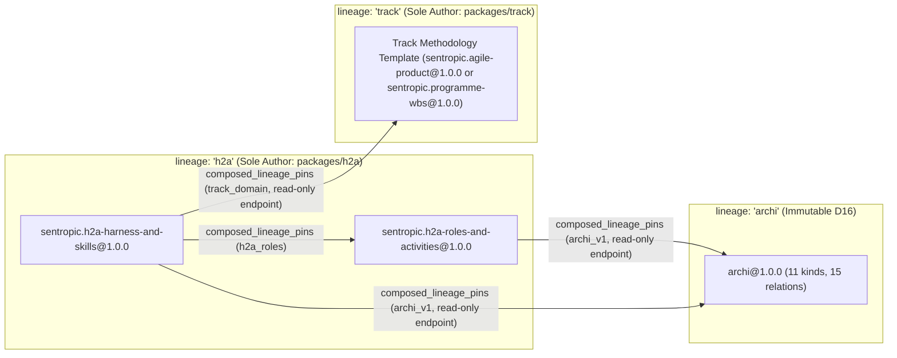

# Spec 4 — `h2a` Role & Activity Ontology, Proactive Role Analysis, and Harness Overlays (`SPEC_ENGRAM_H2A_ROLE_ONTOLOGY_AND_HARNESS_OVERLAYS`)

- **Status:** `proposed` (`v0.3.0`, `2026-11-15` — `DESIGN` Gemini Carbon; Spec 4 of [`spec/memory/PLAN_SPEC_ENGRAM_FRONT.md`](memory/PLAN_SPEC_ENGRAM_FRONT.md) §3 `:200-209` and §4 `:243`; folds `h2a` & `Track` review `rv-spec4-h2a.md` at `97504c0d` and `sentropic` review `engram-s4-carbon.md`)
- **Repository of Record:** `engram` (`@sentropic/engram`, master of the shared ontology metamodel, multi-lineage registry, live session/decision registry `D28=engram`, and deterministic Git/PR serializer `D34=engram`; governed jointly with `h2a` under [`spec/memory/contracts/engram-h2a.md`](memory/contracts/engram-h2a.md)) `[FACT: spec/memory/OWNER-DECISIONS-2026-11-14.md:13,21,24; spec/memory/PLAN_SPEC_ENGRAM_FRONT.md:202]`
- **Sole Author of the `h2a` Lineage (`Point 4B`, `D4`, `D16`, `D31`):** `h2a` (`h2a` repository: `packages/h2a`, the `h2a` mandate-and-role manager and master-harness owner; `engram` validates metamodel well-formedness and holds the `D7` deny-list, may **propose** role changes, and **never** writes, repairs, or mutates `h2a` or `Track` templates) `[FACT: spec/memory/OWNER-DECISIONS-2026-11-14.md:13,24-25; spec/memory/R15-SEDIMENT.md:49,61,76]`
- **Binding Authorities:**
  - [`spec/memory/OWNER-DECISIONS-2026-11-14.md`](memory/OWNER-DECISIONS-2026-11-14.md) (`:1-31` — T-M-C ownership rule, `Point 4B`, `Point 3C`, `Point 5B`, `Point 6A`, `D28` explicitly kept, `14/11` owner-confirmed decisions vs `proposed, not decided by the owner` seat extensions, and `15/11` direction-supersession banners)
  - [`spec/memory/R15-SEDIMENT.md`](memory/R15-SEDIMENT.md) (`:9-80` — Engram-First Principle and settled decision ledger `D1`–`D34`, specifically `D3`, `D4`, `D16`, `D31`, `D34`, plus `D5`–`D8`, `D10`, `D15`, `D17`, `D18`, `D21`, `D22`, `D28`, `D32`, `D33`)
  - [`spec/memory/Q6-APPLICATION-LOG.md`](memory/Q6-APPLICATION-LOG.md) (`§19.3 :683-685` — five code-grounding verification rules formerly held in `spec/memory/DESIGN-NOTE-CODE-GROUNDING.md:1-15` at `97504c0d`, plus `§18.4` & `§20` pending owner dossier log)
  - [`spec/SPEC_ENGRAM_PROFILE_VIEW_MECHANISM.md`](SPEC_ENGRAM_PROFILE_VIEW_MECHANISM.md) (`§2.1.1` / `:921-943` — view-projection boundary rules formerly duplicated in `spec/memory/DESIGN-NOTE-VIEW-PROJECTION-BOUNDARY.md:1-35` at `97504c0d`)
  - [`spec/memory/ARCHITECTURE-RULES.md`](memory/ARCHITECTURE-RULES.md) (`:1-13`)
  - [`spec/memory/contracts/engram-h2a.md`](memory/contracts/engram-h2a.md) (`:1-326`), [`spec/memory/contracts/engram-track.md`](memory/contracts/engram-track.md) (`:1-273`), [`spec/memory/contracts/engram-cluster-mesh.md`](memory/contracts/engram-cluster-mesh.md) (`:1-200`)
- **Dependencies:**
  - [`spec/SPEC_ENGRAM_METAMODEL_AND_LINEAGE_REGISTRY.md`](SPEC_ENGRAM_METAMODEL_AND_LINEAGE_REGISTRY.md) (**Spec 0** — `engram.metamodel/v1`, `LineageId`, `OntologyTemplateEnvelopeRef`, `composed_lineage_pins`, `H2aOverlayFileProjectionDecl`, `MM_*` diagnostic catalog, and §7.2 `h2a`/`Track` boundary answers)
  - [`spec/SPEC_ENGRAM_CLUSTER_MESH_MEMORY_ACCESS_AND_MCP_WIRING.md`](SPEC_ENGRAM_CLUSTER_MESH_MEMORY_ACCESS_AND_MCP_WIRING.md) (**Spec 6A** — `R12` `@sentropic/cluster-mesh` non-bypassable `/memory/v1/*` and `/mcp` surfaces, `CanonicalMemoryStorePort` / `memory-binding-v2` in `6A-S0b`/`6A-S1a`, two-layer `H2AEnvelope<H2AMandate>` verification in `6A-S1b`, `compose/memory.ts` in `6A-S1c`, and `/api/v1/memory/v1/*` forwarding in `6A-S1d`)
  - [`spec/SPEC_ENGRAM_SESSION_FRONT_AND_EXTRACTION.md`](SPEC_ENGRAM_SESSION_FRONT_AND_EXTRACTION.md) (**Spec 1** — `EngramSessionIngestFrontPort`, `RawSessionEventEnvelope` with `mandateRef: H2AMandateEnvelope | null`, `RawSessionEventReceipt.h2aProactiveRoleAnalysisQueued`, `D21` `derivedWorktreeId`, `domain: 'harness'` extraction; *session-front transport subject to `15/11` pending owner dossier below*)
  - [`spec/SPEC_ENGRAM_CONTEXTUAL_GRAPH_AND_PROMPT_LOOP.md`](SPEC_ENGRAM_CONTEXTUAL_GRAPH_AND_PROMPT_LOOP.md) (**Spec 2 — Blocked on the owner's dossier (Spec 2 frozen):** `engram_memory_context`, `roleConsciousnessSlice`, `harnessEffectiveRules`, `D15` slices, `ModelContentAuthorizationPolicyV1`, and Spec 2 `D18=readonly` MCP slice consumption are **frozen** until the owner answers his decision dossier « journal de session en graphe et outil mémoire »; Spec 4 defines **zero** implicit or phantom contracts against Spec 2)
  - **`sentropic` `SPEC_EVOL_CHAT_MESH_PROPOSAL.md` (`Lot C2a`):** Required upstream prerequisite for Stage-2 `@sentropic/llm-mesh/decision` caller attribution and metering (`VerifiedRoutingSubject.tenantRef` and `RouteMeteringSink` extraction into `@sentropic/llm-mesh`, `Lot 4-S1b`).
  - **Interface with Spec 3 & Spec 6B:** Remote post-sync multi-repository master-harness auditing (`MasterHarnessAuditProposalV1` vs per-repository `RepoOverlayEvolutionProposalV1`) is specified in [`spec/SPEC_ENGRAM_DORMANT_DREAMING_SYNTHESIS.md`](SPEC_ENGRAM_DORMANT_DREAMING_SYNTHESIS.md) §4 (`:459-497`) and gated on **Spec 6B** integral DB-cluster graph sync (`Point 3C`).
- **Amendments to Existing `engram` Specifications (Inline `Before → After` Deltas Only — Target File Unmodified on Disk):**
  - **Amends [`spec/SPEC_EVOL_ARCHI_CARDS.md`](SPEC_EVOL_ARCHI_CARDS.md) (`§1` and `§2.1–2.3`, lines `33–111`; §4 below):** Registers the `h2a`-authored role, activity, and harness-skill profile lineage (`lineage: 'h2a'`) as a sibling to `Track`'s domain lineage (`lineage: 'track'`) in `engram`'s multi-lineage registry (`Spec 0`), composed with `archi@1` via version-pinned `composed_lineage_pins` while keeping `archi@1`'s eleven kinds, fifteen relations, and 55 matrix tuples completely unchanged (`D16`, `Point 4B`), and notes the separate untracked working study `.graphify/scratch/design/archi-card-semantics/STUDY_ARCHI_ONTOLOGY_V2.md` (`.gitignore:60`) `[FACT: spec/SPEC_EVOL_ARCHI_CARDS.md:33-111; .gitignore:60; spec/memory/PLAN_SPEC_ENGRAM_FRONT.md:209]`.
- **Stack Rule:** Pure TypeScript / Node.js across `engram`, `sentropic`, and `h2a` (`SPEC_EVOL_ARCHI_CARDS.md:9`).

> [!IMPORTANT]
> **Pending owner dossier — « journal de session en graphe et outil mémoire » (`2026-11-15`) & Spec 2 Freeze (`§0`, `F1`, `F2`, `F3`)**
>
> On `2026-11-15`, the owner stated the following architectural direction (`spec/memory/OWNER-DECISIONS-2026-11-14.md:22`, `spec/memory/Q6-APPLICATION-LOG.md §18.4:623`):
>
> > « Deja engram doit devenir un loguer de session en // des outils. Dans notre outil cli a nous ce deviendra le loggeur principal. La session est loguée en graph. Et donc seul le diff est transmis a chaque fois. »
>
> Until the owner answers his decision dossier **« journal de session en graphe et outil mémoire »**, **none of the four open interaction points below is resolved or redesigned in this specification** (see [`spec/memory/Q6-APPLICATION-LOG.md`](memory/Q6-APPLICATION-LOG.md) `§18.4` and `§20`):
> 1. **Per-turn full contextual slice snapshots vs session-as-graph with diff-only transmission (`Q6-APPLICATION-LOG.md §18.4` item 1):** Returning full `roleConsciousnessSlice` and `harnessEffectiveRules` snapshots per turn via `engram_memory_context` (`Spec 2`) vs transmitting incremental session-graph diffs.
> 2. **Uniform external-host flat `<= 32` `raw_event` window ingestion vs parallel session-graph logger alongside third-party tools + primary logger in our own CLI (`Q6-APPLICATION-LOG.md §18.4` item 2):** Scoring `D16` proactive roles over flat `POST /memory/v1/session-front/ingest` windows vs native session-graph diff consumption.
> 3. **Full-envelope `mandate_binding` and full-snapshot overlay transport across session boundaries vs incremental graph-diff propagation (`Q6-APPLICATION-LOG.md §18.4` item 3):** Reserving full JCS file snapshots strictly for Git-committed `.h2a/overlays/**` (`D31`, `D34`).
> 4. **Pull polling on `GET /memory/v1/h2a/proactive-role-proposals` and flat `supportingEventRecordIds` (`F3`):** The pull HTTP endpoint `GET /memory/v1/h2a/proactive-role-proposals` and `ProactiveRoleProposalV1.supportingEventRecordIds` (flat `raw_event` IDs, §2.3 & §3.5) interact directly with the owner's pending « session logger / graph diff » direction (`2026-11-15`). They are recorded here as open and **not resolved**; execution of proactive-role polling slices in `Lots 4-S1a`, `4-S1b`, `4-S2`, and `4-H3` is gated on that dossier, whereas `lineage: 'h2a'` template registration (`4-E1`, `4-S1a`, `4-H1`, `4-H2`) and first-rank `harness_decision` + `.h2a/overlays/*` JCS export (`4-E3`, `4-E4a`, `4-S1c`, `4-S2`, `4-H4`) are unaffected.
>
> **Hard Spec 2 Freeze Rule (`F1`, `F2`):** `Spec 2` (`spec/SPEC_ENGRAM_CONTEXTUAL_GRAPH_AND_PROMPT_LOOP.md`) is **frozen**. Every place in Spec 4 that touches Spec 2 (`engram_memory_context`, `ModelContentAuthorizationPolicyV1`, `Lot 2-E1`, `Lot 2-S0a`, `Lot 2-S1a`, `Lot 2-H2`) is marked explicitly **`Blocked on the owner's dossier (Spec 2 frozen)`**; all phantom `VerifiedH2AMandateV1` unassigned-role variants are removed, and executable `engram`, `sentropic`, and `h2a` lots carry zero implicit dependency on Spec 2.

---

## Observed Baseline Across Repositories (`origin/main` Grounding)

Every code claim in this specification was verified directly against `origin/main` in the owning repository (`git show origin/main:<path>` and `git grep` on `origin/main` per [`spec/memory/Q6-APPLICATION-LOG.md`](memory/Q6-APPLICATION-LOG.md) `§19.3 :683-685`, preserving Rules 1–5 of `DESIGN-NOTE-CODE-GROUNDING.md`; full command-and-output ledger in §7):

| Repository | Verified Pin | Exists Today on `origin/main` (`[FACT: file:line]`) | Does **NOT** Exist Yet (`proposed` / `new` + Owning Lot) |
| :--- | :--- | :--- | :--- |
| **`engram`** | `origin/main` `f75543a5c8b220a741924e8eeac6610e3808c8ce` (`@sentropic/engram@0.28.0`, `package.json:3`; zero `src/` or `engram-memory/` code diff vs branch `HEAD` `532c0bee5688d0bcae50a20f77e100706f485cc2`, `h2a` fold commit `97504c0d4591eb93b5d3babf5ed11714b295c3ad`, Spec 4 initial commit `fc0437b20e974f6a1e4424e7def20deb9857c16a`) | `ARCHI1_DECLARATION`, `ARCHI_V1`, `ARCHI_V1_PIN`, `RECORD_ARCHI_V1` (`src/ontology-guardian/archi-profile.ts:38-125,160-195`); G0 `AdmissionFamily` including `'TRK'`, `'H2A'`, `'HRN'`, `'DIA'`, `'MEM'` and non-fallback pin check (`src/ontology-guardian/admission.ts:1-2,40,108-112`); `NonComposableFamily` `D-B7` guard (`src/ontology-guardian/types.ts:333-334`, `diagnostics.ts:795-805`); RFC 8785 JCS `canonicalBytes`, `sha256Hex`, `digestOfPreimage` (`src/ontology-guardian/canonical.ts:60-72`); `package.json` `exports` (`:12-63`) & `test:substrate-tarball` (`:96`) and `tsup.config.ts` (`:55-57`) with **zero** `"./h2a-lineage"` subpath entry; `.graphify/scratch/` gitignored (`.gitignore:60`). | Runtime `lineage: 'h2a'` template validator & role/skill graph projection (`new` `src/h2a-lineage/`, Lot `4-E1`); proactive role/scope analyzer & `ProactiveRoleProposalV1` store (`new` `src/h2a-lineage/proactive-role-analyzer.ts`, Lot `4-E2`); first-rank `harness_decision` ledger, self-contained `.h2a/policies/d18-readonly-slices.v1.json` schema check, & `tighten-only` `.h2a/overlays/*` serializer (`new` `src/h2a-lineage/harness-overlay-serializer.ts`, Lot `4-E3`); `./h2a-lineage` subpath export in `package.json` + `tsup.config.ts` & coordinated `Spec 6A §2.2` / `engram-cluster-mesh.md` route mirror (`new` `src/h2a-lineage/index.ts`, Lot `4-E4a`); `roleConsciousnessSlice` & `harnessEffectiveRules` `engram_memory_context` wiring (`new` `src/h2a-lineage/context-slice-provider.ts`, Lot `4-E4b` — **Blocked on the owner's dossier (Spec 2 frozen)**). |
| **`h2a`** | `origin/main` `1f57127dee0bf671e559c347cd86960180cd64c9` (`@sentropic/h2a@0.98.10`, `packages/h2a/package.json:3`; `@sentropic/track@0.98.10`, `packages/track/package.json:3`) | `H2A_ROLES` (`6` roles), `H2A_ARTIFACT_KINDS` (`8` kinds), `H2AEnvelope`, `H2AActorRegistration` (`capabilities` vs cosmetic `declaredCapabilities`), `H2APolicy` (`types.ts:180-190`), `H2AEngagement` (`aval`, `finaliteAmont`), `H2AMandate` (`packages/h2a/src/types.ts:4-150,180-258`); `H2A_AUTHORITY_MATRIX`, `H2A_ATTESTER_COMPREHENSION_RIGHT`, exported `canSignArtifactKind` (`packages/h2a/src/authority.ts:8-102`, vs unexported `canIssueMandate(reg)` in `src/runtime/drive/index.ts:331-337`); pure coach/org model `H2AOrgInstance`, `H2AOrgManifest`, `validateOrgManifest`, `org-proposal` / `PRINCIPAL`-only `org-ratified`, keyed-only `effectiveOrgInstances` (`packages/h2a/src/org.ts:1-66,87-185,301-340`); `LocalStore` authority isolation (`src/runtime/local-files/{paths.ts:54-76,schema.ts:4,33,store.ts:187-196,606-624,1375-1405,1861-1915}`, `src/cli.ts:3771-3828,3843-3945`); `SUBAGENT_ADDRESS_SEPARATOR = "~"`, `H2ASubagentBinding`, `parseSubagentAddress` (`src/subagents.ts:8-47,74-84`); `H2A_MULTI_HUMAN_MODE_IDS` & `H2AMultiHumanModeDescriptor` (`src/multi-human.ts:3-33`); `H2A_POLICY_PRECEDENCE_TIERS` & `"escalate-not-resolve"` (`src/policy-precedence.ts:3-18`); `ConductorCandidate` / `ConductorResolution.claimedBy` (`src/runtime/governance/conductor.ts:19-57`); 13 `SKILL.md` files in `packages/h2a/skills/**` + 4 `SKILL.md` files in `packages/track/skills/**` + `src/hosts/native-skills.ts:6-61`; `src/vendor/harness/{profile,scope,checks,skills,artifacts,cli}` & `schema/harness/verification-run.schema.json:1-154`; `.h2a/` runtime subtrees (`hooks/workspace-scope-state.mjs:5,18-35,48`, `hooks/workspace-scope-guard.mjs:77,108,121,137`, `src/runtime/mcp/agent-launch.ts:453`, `packages/h2a-runtime/src/delegate.ts:690`) & current `.h2a` directory checks (`src/cli.ts:747-771,6366-6385,6551-6605`, `src/runtime/mcp-http/serve.ts:57`, `packages/h2a-runtime/src/status-projection.ts:1327-1343`, `.gitignore:17`); `Track` `Item` RACI & WBS fields (`packages/track/src/model/item.ts:17-33,171-176,206-208`). | Authored v1 lineage templates `sentropic.h2a-roles-and-activities@1.0.0` & `sentropic.h2a-harness-and-skills@1.0.0` packaged at `packages/h2a/ontology/templates/` + `"ontology"` in `packages/h2a/package.json#files` (`new`, Lot `4-H1`); template publisher over `cluster-mesh` (`new` `packages/h2a/src/ontology/publish.ts`, Lot `4-H2`); `h2a` proactive role proposal consumer, `sessionPseudoId -> instance` resolver, `PRINCIPAL`-only `org-ratified` (`cli.ts:3896-3902`), & `MANDATE` bridge (`new` `packages/h2a/src/runtime/governance/proactive-role-bridge.ts`, Lot `4-H3` — *proactive HTTP polling gated on pending owner dossier `F3`; Spec 2 MCP slice Blocked on the owner's dossier (Spec 2 frozen)*); `isInitializedH2aBusRoot` sentinel guard (`paths.ts`, `cli.ts`, `mcp-http/serve.ts`, `status-projection.ts`), `.gitignore` `.h2a/*` unignore rules, & 100% offline `.h2a/overlays/*` resolver (`new` `packages/h2a/src/runtime/harness/overlay-resolver.ts`, Lot `4-H4`, self-contained without frozen `Spec 2 Lot 2-H2`). |
| **`sentropic`** | `origin/main` `913e3bcbc9dec9ff5f9db36eb3a1ef5a3dd11b7a` | Zero `@sentropic/h2a` dependency in `packages/cluster-mesh/package.json:258-297`; `PROVIDER_CATALOG` limited to `'mcp/memory'` & `'engram-memory/substrate'` (`ENGRAM_MEMORY_RANGE = '>=0.22.0 <0.23.0'`), `'harness'` in `CLUSTER_MESH_GATED_MODULE_IDS` (`packages/cluster-mesh/src/modules/{contracts.ts:1-65,catalog.ts:18,53-54,108-145}`); 5 closed named queries in `src/engram-memory/{manifest.ts:58-92,226,projection.ts:50-116,sqlite-queries.ts:1-46,postgres-queries.ts:1-39}`; `loadLlmMeshDecision` (`src/loaders/llm-mesh/decision.ts:1-10`), `src/compose/llm-mesh.ts:7-8`, & `src/integrations/llm-mesh/decision.ts:1-3`; packaging topology guard (`tests/packaging/types-and-bundlers.spec.ts:57-125`), cold workspace (`tests/storage/cold-workspace.sh:122-173`) & Postgres harness (`tests/storage/postgres.mk:30-54`), `MCP-L5` lock closure (`tests/engram-memory/qualification.mk:14-15,37,49,71,83,90`, `tools/memory-mcp-l5/lock-closure.mjs:1-36`); `@sentropic/llm-mesh/decision` contracts (`packages/llm-mesh/src/{routing-contracts.ts:13-17,decision/{request.ts:26-92,criterion.ts:11-35,validation.ts:15-18,request-policy.ts:3-17,policy.ts:11-34,descriptor.ts:63-89,openai-descriptor.ts:8-28,qualification.ts:42-88,receipt.ts:24-77,verdict.ts:17-44,host-options.ts:16-29,service.ts:90-108}}`, unqualified in `'production'`); `RouteMeteringSink` in `packages/llm-gateway/src/route-flow-core.ts:49-51`; `api` `/api/v1/memory` mount (`api/src/app.ts:150-154`, `api/src/routes/namespaces/memory.ts:1-75` mounting only `/query-intents` at `:10`), MCP-only `DEC-116` `'sentropic-mcp'` filter (`api/src/services/mcp/{client-policy.ts:9-20,38-42,registry-dispatch.ts:22-45,75,88}`), `decision-host.ts:23-64` & `decision-runtime.ts:25-54` (`productionReady: false` at `:47,51`), and `api/package.json:34` (`"test:endpoints": "VITEST_MAX_WORKERS=1 vitest run tests/api --no-file-parallelism"`). | `PROVIDER_CATALOG['engram/h2a-lineage']` + `loadEngramH2aLineage`, `lineage: 'h2a'` registration guard, & `GET /memory/v1/h2a/proactive-role-proposals` (`new` `packages/cluster-mesh/src/memory/h2a-lineage-routes.ts`, Lot `4-S1a`, extending `src/compose/memory.ts` from `6A-S1c`; *proactive-role route gated on pending owner dossier `F3`*); autonomous `verifyH2APolicyEnvelopeV1` (`artifactKind === 'POLICY'`, `PRINCIPAL \| EXECUTIF`) in `src/runtime/h2a-mandate-verifier.ts` (extending `6A-S1b`) + `POST /memory/v1/h2a/harness-decisions` + `kind: 'h2a-harness-overlay'` export (`Lot 4-S1c`); Stage-2 `@sentropic/llm-mesh/decision` tie-break adapter outside `integrations/mcp/` (`new` `packages/cluster-mesh/src/memory/h2a-role-decision.ts`, Lot `4-S1b`, gated on `chat-mesh Lot C2a` & pending owner dossier `F3`); hosted `/api/v1/memory/v1/h2a/*` forwarding + `DEC-116` `'sentropic-mcp'` → `403` guard & `new api/tests/api/memory-h2a-lineage.test.ts` (`Lot 4-S2`, extending `6A-S1d`). |

---

## 0. Binding Governance, Settled Verbatims, Transport (`R12`), and View Boundary

### 0.1 Settled Owner Verbatims & Decisions (Never Reopened)

1. **T-M-C Ownership Rule (`spec/memory/OWNER-DECISIONS-2026-11-14.md:6-7,9-15`):**
   > « Les question sont pas assez detaillees. Pose les ici. On est en train de faire des modif coté track sjr les ontologies de son domaine, il fdoit en rester maitre au moins piur les templates et engram pour leur metamodel et application track pour leur controle. Mene un tour avec h2a rapide en fable 5.2 + carbon et repose les 6 quesfion a l issi »
   >
   > « Tout comme recommandé ».
2. **Point 4B — Two Sibling Lineages, Sole Authorship, Proactive Role Proposal Only, and `archi@1` Unchanged (`spec/memory/OWNER-DECISIONS-2026-11-14.md:24`):**
   > « Two sibling lineages under engram's metamodel. The h2a role, activity and harness profile has h2a as sole author. The Track domain templates have Track as sole author. Cross-references go by composition with version pinning. engram may propose role changes, never write them. `archi@1` stays unchanged (D16). »
3. **`D3=mandated` — Project vs Harness Decisions & Distinct Serialization Destinations (`spec/memory/R15-SEDIMENT.md:48`):**
   > « quoi qu'il arrive engram doit modéliser toute décision: décision de projet, décision de harnais, mais avec des destination de sérialisation différentes. »
4. **`D4=mandate` — `h2a` Mandate-and-Role Registry in `engram` Managed by `h2a` (`spec/memory/R15-SEDIMENT.md:49`):**
   > « les rôles h2a devrait êter aussi dans engram mais en tant que registre managé par le gestionnaire de mandats et role h2a. »
5. **`D16=roles` — Role, Scope, Multi-Actor, & Typical-Activity Ontology + Proactive Role Analysis (`spec/memory/R15-SEDIMENT.md:61`):**
   > « Quand il n y a pas de role, h2a devrait etre proactif en analyse et proposition. Un role devrait d ailleurs eyre modelise dans un scope et ses relation multi acteur. Donc un role devrait etre gere sous forme de graph engram lui aussi autour de roles standard h2a et pour les humains autour de roles classiques. Les activité types doivent etee modelises pour chacun dans une ontologie h2a geree par h2a, derivable selon les mkdeles de derivation engram pour composition des graphes et gestion »
6. **Harness Skills & Roles as `engram` Graphs + Multi-Repo Audit vs Per-Repo Overlay Evolution (`spec/memory/R15-SEDIMENT.md:35-36`):**
   > « typiquement le harnais h2a devrait être revue a l'oree d'une audition multi repo (dreaming agent) la ou l'évolution du harnais devrait être pour le repo lui meme » (`comments-2026-11-08.md:24`)
   >
   > « une skill de harnais h2a pourrait être un graph » + « de meme pour les rôles h2a » (`comments-2026-11-08.md:25`)
7. **`D21` — Derived Git Worktree Entities (`spec/memory/R15-SEDIMENT.md:66`):**
   > « J ai demande un [nom retiré à ta demande] like et c est cette merde que j ai les donmees sont pas modelisees »
8. **`D31` & `D34=engram` — First-Rank Harness Decisions, `h2a` Master Harness, and Git-Committed `.h2a/` Overlays (`spec/memory/R15-SEDIMENT.md:76,79`):**
   > « C est tres mauvais tu confonds bcp de concepts. Engram est la memoire et enregistre les decisions de harnais. H2a a le master harnais et chaque dev a sa surouche. Engram tien le premker rang et tout comme on serialise les spec du engram et le track on serialise la surcouche de chque workspace / repo qu on va aussi commiter »
9. **`D32` — First-Rank Recording & Non-Agent Control Engines (`spec/memory/R15-SEDIMENT.md:77`):**
   > « Attention car le premier rang doit etre engram (enregistrement pkur serialisarkkn eg tour de parole + regles + conrrole track si possible par agent). L usage d agent en controle pour track iu engrame devrai etre possible mais potentiellement reposer plutot sur des api type jev/decison ou llm tres rapides. Je ne sais pas si ce seront des "agents" » / « Donc part de engram - et de track »

### 0.2 Non-Bypassable `@sentropic/cluster-mesh` Transport (`R12`) and L0 Neutrality

1. **`R12` Exclusive Hop (`spec/memory/ARCHITECTURE-RULES.md:7-8`, `spec/memory/contracts/engram-h2a.md:31,206`):** Every runtime interaction between `h2a` and `engram` specified here—registering `lineage: 'h2a'` templates, reading or computing `D16` proactive role proposals, recording first-rank `harness_decision` records, and exporting `.h2a/overlays/*` files—transits `@sentropic/cluster-mesh` (`/memory/v1/*` and `packages/mcp-platform` `/mcp`, Spec 6A §2.2 `:206-231`). `h2a` **never** opens `engram`'s SQLite/Postgres files directly, and `@sentropic/track` (`packages/track/package.json:1-60`) adds **zero** dependency on `@sentropic/engram` or `@sentropic/cluster-mesh`.
2. **L0 `engram-memory` Neutrality (`spec/SPEC_MEMORY_FINALIZATION.md:32`):** All `h2a` lineage validators, proactive role analyzers, and `.h2a/` overlay serializers in the `engram` repository live under `src/h2a-lineage/` (and `src/lineage-registry/` from Spec 0), **never** inside `engram-memory/**`, which preserves zero `@sentropic/*`, `h2a`, `Track`, or LLM SDK imports (`tests/memory-neutrality.test.ts`).

### 0.3 Semantic-Only Responsibility (`SPEC_ENGRAM_PROFILE_VIEW_MECHANISM.md §2.1.1`)

Per [`spec/SPEC_ENGRAM_PROFILE_VIEW_MECHANISM.md`](SPEC_ENGRAM_PROFILE_VIEW_MECHANISM.md) `§2.1.1` (`:921-943`, preserving the boundary rules formerly in `spec/memory/DESIGN-NOTE-VIEW-PROJECTION-BOUNDARY.md:11-35` at `97504c0d`):
- **Inside `engram` (`Spec 4`):** `engram` validates `lineage: 'h2a'` templates against `engram.metamodel/v1`, stores canonical role, scope, activity, harness-skill, and harness-decision graph records, executes pure semantic queries (`ProactiveRoleProposalV1`, plus `roleConsciousnessSlice` and `harnessEffectiveRules` — *MCP slice projection Blocked on the owner's dossier (Spec 2 frozen)*), and deterministically serializes `.h2a/overlays/*` JSON files.
- **Strictly Outside `engram` (`Focus` & `@sentropic/design-system`):** `engram` **never** computes, stores, caches, or serves fold state (`collapsed`), visual group / zone membership (`VisualGroup`), card faces, aggregate edge summaries (`summaryLabels`), or X/Y geometry for role, org, or harness-skill graphs. When `Focus` renders an `h2a` role topology or skill graph, `engram` (via `cluster-mesh`) returns the raw semantic graph + `OntologyTemplateEnvelopeRef` pin, and `Focus` / `@sentropic/design-system` performs all view projection, folding, and layout client-side.

---

## 1. The `h2a`-Authored Role, Activity, and Harness-Skill Profile Lineage (`lineage: 'h2a'`)

### 1.1 Two-Stream Partitioning Inside `lineage: 'h2a'` (`Spec 0 §7.2.2`)

Per the settled `h2a` boundary decision recorded in [`spec/SPEC_ENGRAM_METAMODEL_AND_LINEAGE_REGISTRY.md`](SPEC_ENGRAM_METAMODEL_AND_LINEAGE_REGISTRY.md) §7.2.2 (`:965-970`, `answered by h2a/Track, 2026-11-14`), `h2a` authors and versions two `MetamodelTemplateDocument` streams (`metamodel_version: 'engram.metamodel/v1'`, `lineage: 'h2a'`) inside the `h2a` repository under `packages/h2a/ontology/templates/` (`new`, shipped in `"files"` of `packages/h2a/package.json:43-65` alongside `schema/`, `skills/`, and `registry/`, Lot `4-H1`):

| `templateId` | Initial Version | G0 Family (`admission.ts:40,110`) | Normative Scope | `composed_lineage_pins` | `file_projections` |
| :--- | :--- | :--- | :--- | :--- | :--- |
| **`sentropic.h2a-roles-and-activities`** | `1.0.0` | `H2A` | Standard `h2a` agent/governance roles (`H2A_ROLES`), subagent bindings (`DEC-068`), classic human roles (`D16`), scopes & org manifests (`H2AOrgManifest`), `H2A_ARTIFACT_KINDS` & `H2A_AUTHORITY_MATRIX`, multi-actor & multi-human relations, and typical activities (`activité types`). | Optional `archi_v1` (`archi@1.0.0`, `ARCHI_V1_PIN`) for binding roles/scopes to `archi_v1:actor` and `archi_v1:repo`; **zero** `lineage: 'track'` pin so role semantics evolve independently of `Track` methodologies. | None (org manifests remain `h2a`'s `org.h2a.yaml`, `org.ts:8-9`). |
| **`sentropic.h2a-harness-and-skills`** | `1.0.0` | `HRN` | Master-harness rules, `HarnessProfile` (`id: 'sentropic'`), `ScopeBoundary` (`PathClass`) boundaries, `@sentropic/h2a`-owned harness & runtime skill graphs (`packages/h2a/skills/**`) plus external anchor references to `@sentropic/track`-owned skills (`packages/track/skills/**`), mechanical & method verbs, `VerificationRun` gates, and `.h2a/` tighten-only overlay projection rules (`D31`, `D34`). | 1. `h2a_roles` → `sentropic.h2a-roles-and-activities@1.0.0`<br>2. `archi_v1` → `archi@1.0.0` (`ARCHI_V1_PIN`)<br>3. Optional `track_domain` → repository-selected `lineage: 'track'` methodology template (`sentropic.agile-product@1.0.0` **or** `sentropic.programme-wbs@1.0.0` + `Sha256Digest`, §1.3–§1.4). | `default_harness_overlay` (`kind: 'h2a-harness-overlay'`, `root_dir: '.h2a'`, `precedence: 'tighten-only'`, `link_fingerprint_sidecar: '.h2a/engram-harness-link.json'`, §3.2). |



### 1.2 Stream 1 — `sentropic.h2a-roles-and-activities@1.0.0`: Classes, Grounded Constants, and Relations

Every node and relation type in `sentropic.h2a-roles-and-activities@1.0.0` is grounded in existing `packages/h2a/src/` and `packages/track/src/` constructs on `h2a` `origin/main` (`1f57127dee0bf671e559c347cd86960180cd64c9`):

#### 1.2.1 Node Types (`node_types`)

| `TypeId` (`id_prefix`) | Grounding in `packages/h2a/src/` & `packages/track/src/` (`[FACT: file:line]`) | Key Modeled Attributes (`AttributeDecl`) | Invariants & Exclusive Semantic Rules |
| :--- | :--- | :--- | :--- |
| **`H2aStandardRole`** (`h2a_role:`) | `H2A_ROLES` (`types.ts:7-14`): `'PRINCIPAL'`, `'EXECUTIF'`, `'CONDUCTOR'`, `'AGENTS'`, `'CONTROL'`, `'MANDATAIRE'`; `H2A_AUTHORITY_MATRIX` & exported `canSignArtifactKind(role, 'MANDATE')` (`authority.ts:27-80,90-94`; note `canIssueMandate` in `runtime/drive/index.ts:331-337` is an unexported `H2AActorRegistration` helper). | `roleCode` (`enum`: exact 6 `H2A_ROLES`, `required: true`), `actorClass` (`enum`: `['h2a-standard']`), `allowedArtifactKinds` (`collection` of `H2A_ARTIFACT_KINDS`), `nativeComprehensionAttestation` (`boolean`, `authority.ts:75-79`), `canSignMandateArtifact` (`boolean`: `true` iff `canSignArtifactKind(roleCode, 'MANDATE')`, i.e. `PRINCIPAL \| EXECUTIF`), `summary` (`string`, `d6Disclosure: 'refs_safe'`). | Closed 6-member standard set in `1.0.0`. Adding or removing a canonical `H2ARole` is a `MAJOR` bump (`2.0.0`) authored solely by `h2a`. `MANDATAIRE` signs `SIGNATURE` only (presenter of decisions, never binder, `authority.ts:22-23`). |
| **`HumanClassicRole`** (`hum_role:`) | `D16` (`R15-SEDIMENT.md:61`: *« pour les humains autour de roles classiques »*); `Spec 0 §7.2.2` (`:968`: `accountable`, `responsible`, `uatOwner`, `riskOwner`); `Item` RACI slots (`packages/track/src/model/item.ts:174-175,206-208`) + classical human organizational functions (`11` ratified entries in `1.0.0`, `OQ-S4-1`). | `classicRoleId` (`string`, `d6Disclosure: 'refs_safe'`), `actorClass` (`enum`: `['human-classic']`), `governanceTrackSlot` (`enum`: `['accountable', 'responsible', 'uatOwner', 'riskOwner', 'none']`), `trackSlotCardinality` (`enum`: `['0..1', '0..*', 'n/a']`: `'0..1'` for `accountable`, `uatOwner`, `riskOwner`; `'0..*'` for `responsible`, `item.ts:174-175`), `domainFunction` (`enum`: `['product-owner', 'engineering-lead', 'enterprise-architect', 'security-officer', 'quality-acceptance-lead', 'platform-operator', 'stakeholder-reviewer']`), `nonDelegableOwnActs` (`collection` of `['uat-acceptance-by-uat-owner', 'direct-human-decision-select', 'external-sync-binding-enrollment']`), `defaultAssetRiskOwnerSource` (`enum`: `['explicit-risk-owner', 'archi-asset-ownedBy']`). | Models human organizational responsibilities **without** widening `H2A_ROLES` (`types.ts:7-14`). Aligns with `Track`'s three non-delegable human **Own Acts** (`acceptance.uat-recorded` with `by === item.uatOwner`, direct non-relayed human `decision.select`, and external sync binding enrollment), `Mandated Acts` (`demand.agree` against AI self-mandating, rank `0..1` `create`/`level-assign`/`reparent`/`set-role`/`importBranch`, `quickTask` creation, `committed` `ETA`, and `high`/`critical` risk `accept`/`transfer`), and default asset-risk ownership under `epic[mode='run']` derived from `ownedBy` on `ArchiAssetRef`. Every `HumanClassicRole` binds via `mapsToH2aAuthorityRole` to the `H2aStandardRole`(s) through which the human signs `H2AEnvelope` artifacts. |
| **`H2aActorInstance`** (`h2a_inst:`) | `H2AActorRegistration` (`types.ts:104-150`), `H2AOrgInstance` (`org.ts:31-37`), `ConductorCandidate` & `ConductorResolution` (`runtime/governance/conductor.ts:19-57`). | `instanceKey` (`string` / `D33` pseudonym when exported), `agentUuid` (`string`, optional per `DEC-114` `types.ts:137-142`), `actorKind` (`enum`: `['human', 'nhi-agent', 'service']`), `capabilities` (`collection` of `string` — **authoritative rights ceiling**, `types.ts:111-119`), `declaredCapabilities` (`collection` of `string` — **cosmetic display-only**, `types.ts:120-128`), `mandateRights` (`collection` of `string`, `org.ts:36`), `isClaimedConductor` (`boolean`, derived from `ConductorResolution.claimedBy === instance` at `conductor.ts:49`; `ConductorCandidate` `:19-35` has no `conductorClaimed` field). | **Privilege-ceiling firewall (`types.ts:111-128`):** `declaredCapabilities` is stored under `authorizationInput: false` and **MUST NEVER** be merged into `capabilities`, `mandateRights`, `allowedActivities` (`roleConsciousnessSlice` projection **Blocked on the owner's dossier (Spec 2 frozen)**), or `D16` authorization checks. |
| **`H2aSubagentBinding`** (`h2a_sub:`) | `SUBAGENT_ADDRESS_SEPARATOR = "~"` (`subagents.ts:25`), `H2ASubagentBinding` (`{ id, parentInstance, name, capabilities?, createdAt }`, `subagents.ts:32-47`), `parseSubagentAddress` (`subagents.ts:74-84`, `DEC-068` `:8-17`). | `id` (`string`, canonical address matching `^[^/\\<>"\|?*]+~[^~/\\<>"\|?*]+$` because `parseSubagentAddress` at `:81` splits on `lastIndexOf("~")`: `parentInstance` may contain `"~"` while leaf `name` may not), `parentInstance` (`ref` → `H2aActorInstance`), `name` (`string`, leaf segment without `"~"`), `capabilities` (`collection` of `string`, optional subset of parent), `createdAt` (`string`, RFC 3339 UTC). | **Not a new role (`DEC-068`):** acts strictly under its parent's `AGENTS` role; `capabilities` MUST be a subset of `parent.capabilities` (`capabilities-exceed-parent`, `subagents.ts:11-13`). |
| **`H2aScope`** (`h2a_scope:`) | `H2AOrgManifest.scope` & `H2AOrgInstance.scopes` (`org.ts:11-13,34,50-57`); `H2APolicyPrecedenceTier` (`policy-precedence.ts:3-8`). | `scopeId` (`string`, `d6Disclosure: 'refs_safe'`), `isOrgRoot` (`boolean`), `precedenceTier` (`enum`: `['public-authority', 'contractual', 'federated', 'local']`), `precedenceProfile` (`enum`: `['A_ENTERPRISE', 'B_ECOSYSTEM', 'C_GOVERNMENT_CITIZEN', 'D_SAFE']`, `policy-precedence.ts:37-94`). | **Topology = scope membership (`org.ts:11-13`):** who-may-message-whom and mandate jurisdiction are gated exclusively by `inScope` edges; `commEdges` (`commHintTo`) never grant scope access. |
| **`H2aArtifactAuthorityRule`** (`h2a_auth:`) | `H2A_ARTIFACT_KINDS` (`types.ts:16-25`), `H2A_POLICY_ADOPTION_MODES` (`:27-32`), `H2A_AUTHORITY_KINDS` (`:34`), `H2A_AUTHORITY_MATRIX` (`authority.ts:27-80`). | `authorityKey` (`enum`: `CONTRACT`, `POLICY`, `ENGAGEMENT`, `AMENDMENT`, `MANDATE`, `AUTHORITY`, `SIGNATURE`, `ENFORCEMENT_PLAN`, `attester-comprehension`), `authorityKind` (`enum`: `['instance', 'quorum']`), `adoptionModes` (`collection` of `H2A_POLICY_ADOPTION_MODES`), `requiresMandateRight` (`string`, optional — e.g. `'attester-comprehension'` for `AGENTS`, `authority.ts:77-78`). | Encodes the exact 9-row `H2A_AUTHORITY_MATRIX` (`authority.ts:27-80`) as queryable graph nodes for active-role signing-right queries (`D22`; `engram_memory_context` projection **Blocked on the owner's dossier (Spec 2 frozen)**). |
| **`H2aMultiHumanMode`** (`h2a_mh:`) | `H2A_MULTI_HUMAN_MODE_IDS`, `H2AMultiHumanChannel`, & `H2AMultiHumanModeDescriptor` (`multi-human.ts:3-33`); `H2AEngagement` (`aval?: string`, `finaliteAmont?: string`, `types.ts:192-221`, `:214,220`). | `modeId` (`enum`: `PEER_DIALOGUE`, `DELEGATED_COORDINATION`, `SHARED_ENGAGEMENT`, `FEDERATED_EXECUTIF`, `CONSORTIUM_QUORUM`, `PUBLIC_AUTHORITY`), `primaryChannel` (`enum`: `principal-principal`, `conductor-conductor`, `shared-engagement`, `executif-scope`, `quorum-governance`, `public-authority`, `multi-human.ts:15-21,26`), `primaryAuthorityKind` (`enum` of `H2A_ARTIFACT_KINDS`, `:27`), `requiresSharedEngagement` (`boolean`, `:28`), `requiresExecutiveScope` (`boolean`, `:29`), `requiresQuorumGovernance` (`boolean`, `:30`), `requiresExternalAuthority` (`boolean`, `:31`). | Models multi-human governance topologies (`D16` *« ses relation multi acteur »*) across peers, federated executives, and consortium quorums. Engagement-level upstream purpose (`finaliteAmont`) and external endorsement (`aval`) live on `H2AEngagement` (`types.ts:214,220`), not on `H2AMultiHumanModeDescriptor`. |
| **`H2aTypicalActivity`** (`h2a_act:`) | `D16` (`R15-SEDIMENT.md:61`: *« Les activité types doivent etee modelises pour chacun dans une ontologie h2a geree par h2a »*). | `activityId` (`string`, `d6Disclosure: 'refs_safe'`), `activityFamily` (`enum`: `['governance-ratification', 'mandate-issuance', 'org-coaching', 'architecture-and-spec-design', 'scoped-code-implementation', 'test-and-verification', 'adversarial-review', 'security-and-policy-audit', 'decision-presentation', 'uat-acceptance', 'risk-governance', 'operations-and-incident']`), `observableToolPatterns` (`collection` of `string`), `activityArtifactClasses` (`collection` of `['allowed-source', 'test', 'spec-doc', 'governance-config', 'forbidden-protected']` — semantic activity classes, distinct from mechanical `PathClass` in `vendor/harness/scope/scope-boundary.d.ts:2`), `requiresMandateRight` (`string`, optional), `mutatesRepo` (`boolean`). | Provides the canonical activity taxonomy connecting roles (`performsTypicalActivity`, `prohibitedActivity`), harness skills (`realizesActivity`), `allowedActivities` (`engram_memory_context` projection **Blocked on the owner's dossier (Spec 2 frozen)**), and the §2 `D16` proactive role analyzer. |

#### 1.2.2 Canonical Typical Activities (`activité types`) Seeded in `1.0.0`

| Role (`H2aStandardRole` / `HumanClassicRole`) | Typical Activities (`performsTypicalActivity`) | Explicitly Prohibited Activities (`prohibitedActivity`) |
| :--- | :--- | :--- |
| **`PRINCIPAL`** (`h2a-standard`) / `accountable` (`0..1`), `uatOwner` (`0..1`), `riskOwner` (`0..1`), `product-owner` (`human-classic`) | `ratify-contract-and-engagement` (`CONTRACT`, `ENGAGEMENT`, `AMENDMENT`, `authority.ts:30-54`), `adopt-owner-policy-and-enforcement-plan` (`POLICY`, `ENFORCEMENT_PLAN`, `authority.ts:35-39,70-74`, including repo `D10`/`D18` policies), `issue-and-revoke-mandate` (`MANDATE`, `AUTHORITY`, `:55-64`), `ratify-org-manifest` (**sole** signer of `org-ratified`, `org.ts:18-19,133,158`), `perform-human-own-acts` (`human-classic` only: `acceptance.uat-recorded` with `by === item.uatOwner`, direct human `decision.select` / `D27`, and external sync binding enrollment), `authorize-track-mandated-acts` (`demand.agree`, rank `0..1` `create`/`level-assign`/`reparent`/`set-role`/`importBranch`, `quickTask` creation, `committed` `ETA`, and `high`/`critical` risk `accept`/`transfer`; default asset-risk owner via `ArchiAssetRef` `ownedBy` under `epic[mode='run']`). | Unaudited silent bypass of `D2=review` on mechanical `spec/` amendments (`R15-SEDIMENT.md:47`). |
| **`EXECUTIF`** (`h2a-standard`) / `engineering-lead` (`human-classic`, `responsible` `0..*` or delegated `accountable` `0..1`) | `issue-scoped-mandate` (`MANDATE`, `AUTHORITY`, `authority.ts:55-64`), `adopt-policy-and-enforcement-plan` (`POLICY`, `AMENDMENT`, `ENFORCEMENT_PLAN`, `:35-39,45-54,70-74`, including repo `D10`/`D18` policies), `register-lineage-template` (when carrying `'engram:register-template:h2a'` or `'engram:register-template:track'`, `Spec 0 §2.2`), `approve-repo-harness-overlay`, `authorize-delegated-track-mandated-acts` (`human-classic` when holding human mandate). | Signing `org-ratified` (`PRINCIPAL` exclusively, `org.ts:18-19,133,158`); self-approving own `D1=borne-review` promotion draft (`R15-SEDIMENT.md:46`). |
| **`CONDUCTOR`** (`h2a-standard`) / `enterprise-architect` (`human-classic`) | `propose-org-topology` (`org-proposal` coach mode, `org.ts:15-23,135`), `sign-engagement-and-amendment` (`CONTRACT`, `ENGAGEMENT`, `AMENDMENT`, `authority.ts:30-54`), `orchestrate-lot-plan-and-workpackages` (`harness/plan`, `propose-workpackages`), `reconcile-multi-peer-review` (`harness/review`). | Issuing `MANDATE` or `AUTHORITY` (`authority.ts:55-64`), signing `org-ratified` (`org.ts:15-20`), or imposing `POLICY` (`authority.ts:35-39`). |
| **`AGENTS`** (`h2a-standard`) & `H2aSubagentBinding` | `scoped-code-and-test-execution` (`harness/test`, `harness/debug`, `harness/plan` on `BRANCH.md`), `author-design-and-spec-draft` (`harness/brainstorm`), `emit-typed-extraction-and-overlay-proposals` (`proposed` state), `attest-comprehension` (only with `'attester-comprehension'` mandate right, `authority.ts:75-79`), `delegate-bounded-subagent` (`subagents.ts:32-47`). | Signing `CONTRACT`, `POLICY`, `ENGAGEMENT`, `AMENDMENT`, `MANDATE`, `AUTHORITY`, `ENFORCEMENT_PLAN`, or `org-ratified` (`authority.ts:30-74`, `org.ts:158`); applying own `D1=borne-review` promotion draft; performing any of the 3 `Own Acts` (`acceptance.uat-recorded`, direct `decision.select`, external sync enrollment) or unmandated `Mandated Acts` (`demand.agree`, rank `0..1` mutations, `quickTask` creation, `committed` `ETA`, `high`/`critical` risk `accept`/`transfer`). |
| **`CONTROL`** (`h2a-standard`) / `security-officer`, `quality-acceptance-lead` (`human-classic`) | `impose-and-audit-control-policy` (`POLICY`, `AMENDMENT`, `ENFORCEMENT_PLAN`, `authority.ts:35-39,45-54,70-74` — restricted on `.h2a/overlays/repo/` to tightening `forbid-paths` and `require-verification-categories`, §3.4), `execute-security-and-compliance-verification` (`harness/security`, `VerificationRun`), `third-party-promotion-review` (`D1=borne-review`), `escalate-precedence-conflict` (`policy-precedence.ts:10-12`). | Issuing `MANDATE` or `AUTHORITY` (`authority.ts:55-64`), signing `org-ratified`, modifying repo `D10` transfer or `D18` slice-visibility policies (`PRINCIPAL \| EXECUTIF` only, §3.4), or authoring product code outside control/audit scope without separate mandate. |
| **`MANDATAIRE`** (`h2a-standard`) / `stakeholder-reviewer` (`human-classic`) | `present-decision-dossier` (`present-decision`, `D27`), `relay-comprehension-attestation` (`attester-comprehension`, `authority.ts:75-79`), `facilitate-multi-human-channel` (`multi-human.ts:15-21`). | Binding any normative artifact (`authority.ts:22-23`: admissible on `SIGNATURE` and `attester-comprehension` only). |

#### 1.2.3 Relation Types (`relation_types`) in `sentropic.h2a-roles-and-activities@1.0.0`

| Relation ID | `source_types` → `target_types` | Cardinality (`out` / `in`) | Grounded Semantics |
| :--- | :--- | :--- | :--- |
| `holdsStandardRole` | `H2aActorInstance` → `H2aStandardRole` | `0..many` / `0..many` | Registered or grant-augmented role assignment (`effectiveOrgInstances`, `org.ts:318-340`); `0` outgoing edges = unassigned session (`D16` trigger). |
| `holdsClassicHumanRole` | `H2aActorInstance` → `HumanClassicRole` | `0..many` / `0..many` | Human actor's organizational/governance role (`D16`). |
| `mapsToH2aAuthorityRole` | `HumanClassicRole` → `H2aStandardRole` | `1..many` / `0..many` | Maps a classic human role onto the `H2A_ROLES` signing authority under which its cryptographic acts execute. |
| `boundToParentAgent` | `H2aSubagentBinding` → `H2aActorInstance` | `1..1` / `0..many` | Acyclic tree (`hierarchy: { id: 'subagent-tree', shape: 'tree', parent_role: 'target', child_role: 'source' }`); enforces `DEC-068` (`subagents.ts:8-38`). |
| `inScope` | `H2aActorInstance`, `H2aStandardRole`, `HumanClassicRole` → `H2aScope` | `1..many` / `0..many` | **Authoritative scope gate** (`org.ts:11-13,64`: `instance-no-scope` forbidden for valid org instances). |
| `parentScope` | `H2aScope` → `H2aScope` | `0..1` / `0..many` | Acyclic scope hierarchy (`hierarchy: { id: 'h2a-scope-tree', shape: 'tree', parent_role: 'target', child_role: 'source' }`). |
| `commHintTo` | `H2aActorInstance` → `H2aActorInstance` | `0..many` / `0..many` | Models `H2AOrgCommEdge` (`org.ts:40-43`); carries fixed attribute `authoritativeGate: false` (`org.ts:13`). |
| `authorizedToSign` | `H2aStandardRole` → `H2aArtifactAuthorityRule` | `1..9` / `2..6` | Exact graph encoding of `H2A_AUTHORITY_MATRIX` (`authority.ts:27-80`). |
| `participatesInMultiHumanMode` | `H2aStandardRole`, `HumanClassicRole` → `H2aMultiHumanMode` | `0..many` / `1..many` | Multi-actor relationship edges across `H2A_MULTI_HUMAN_MODE_IDS` (`multi-human.ts:3-21`). |
| `performsTypicalActivity` | `H2aStandardRole`, `HumanClassicRole` → `H2aTypicalActivity` | `1..many` / `1..many` | Positive activity profile (`D16`; `roleConsciousnessSlice.allowedActivities` MCP projection **Blocked on the owner's dossier (Spec 2 frozen)**). |
| `prohibitedActivity` | `H2aStandardRole`, `HumanClassicRole` → `H2aTypicalActivity` | `0..many` / `0..many` | Explicit negative boundary checked by control gates and `D16` role scoring. |
| `actsAsArchiActor` | `H2aStandardRole`, `HumanClassicRole`, `H2aActorInstance` → `archi_v1:actor` | `0..1` / `0..many` | Read-only cross-lineage endpoint binding into `archi@1` (`actor`, `SPEC_EVOL_ARCHI_CARDS.md:55`) without mutating `archi@1`. |

### 1.3 Stream 2 — `sentropic.h2a-harness-and-skills@1.0.0`: Harness-Skill Graphs and Master Harness

Grounded in `comments-2026-11-08.md:25` (`« une skill de harnais h2a pourrait être un graph »`), `packages/h2a/skills/harness/SKILL.md:1-43`, `packages/h2a/src/hosts/native-skills.ts:6-61` (where `agy` and `gemini` compile `.toml` command files at `:21,24,42-55` while the remaining CLI hosts install `SKILL.md`, whereas `packages/h2a/src/vendor/harness/skills/manifest.d.ts:1-13` defines the 3 manifest `HostId`s `'claude' | 'codex' | 'gemini'`), `packages/track/skills/**`, and `packages/h2a/src/vendor/harness/*` on `h2a` `origin/main` (`1f57127dee0bf671e559c347cd86960180cd64c9`), each skill is modeled not as an opaque Markdown blob, but as a **typed directed workflow graph** (or external `@sentropic/track` skill anchor) in `engram`:

1. **Node Types in `sentropic.h2a-harness-and-skills@1.0.0`:**
   - **`H2aMasterHarnessProfile` (`h2a_prof:`):** Models `HarnessProfile` (`vendor/harness/profile/profile.d.ts:1-12` and `profile/sentropic.js:3-11`): `id` (`'sentropic'`, `profile.d.ts:3` — never `profileId`), `forbiddenPathDefaults` (`string[]`), `exceptionIdPattern` (`string` regex), `conditionalRequiresException` (`boolean`), `branchMatch` (`'exact' | 'prefix'`), and `immutableSecurityInvariants` (`['mandate-ed25519-verify', 'r12-cluster-mesh-only', 'd6-d7-d8-d33-privacy-gates', 'tmc-sole-author']`).
   - **`H2aHarnessSkillGraph` (`h2a_skill:`):** Inventories separately by `packageOwner` (`'@sentropic/h2a' | '@sentropic/track'`) all **13 `SKILL.md` files in `packages/h2a/skills/`** and all **4 `SKILL.md` files in `packages/track/skills/`**:
     - **`@sentropic/h2a` Umbrella & Generic `Track`-Independent Harness Skills (`1` umbrella + `8` generic skills, `requiresTrackPin: false`):** `harness/SKILL.md` (`umbrella`), `harness/using-harness`, `harness/brainstorm`, `harness/plan` (`BRANCH.md` planning — strictly generic, executable without `Track`), `harness/debug`, `harness/test`, `harness/review`, `harness/security`, and `harness/adopt`.
     - **`@sentropic/h2a` Runtime / Operations Skills (`3` skills, `requiresTrackPin: false`):** `h2a`, `h2a-run`, and `model-eval` (`packages/h2a/skills/{h2a,h2a-run,model-eval}/SKILL.md`).
     - **`@sentropic/h2a` `Track`-Coupled Harness Skill (`1` skill, `requiresTrackPin: true`):** `harness/track-report` (`packages/h2a/skills/harness/track-report/SKILL.md`).
     - **`@sentropic/track` External Skill Anchors (`4` distinct skills in `packages/track/skills/`, `packageOwner: '@sentropic/track'`, `requiresTrackPin: true`):** `propose-workpackages`, `present-decision`, `branch-lifecycle`, and `track-operation` (`packages/track/skills/{branch-lifecycle,present-decision,propose-workpackages,track-operation}/SKILL.md`, `packages/track/src/cli/install-skills.test.ts:23`).
     - **Editorial Ownership Boundary (`m2`):** `sentropic.h2a-harness-and-skills` freezes `skillArtifactDigest` (`digest`, required iff `packageOwner === '@sentropic/h2a'`) and internal `H2aSkillStepNode` execution DAGs **only** for `packages/h2a/skills/**` (`13` skills). The `4` `@sentropic/track` skills are modeled as external anchor nodes (`packageOwner: '@sentropic/track'`, `skillArtifactDigest: null`, zero internal `H2aSkillStepNode` children in `lineage: 'h2a'`) so routine `@sentropic/track` skill edits never force an `h2a` template republication.
     - Attributes: `skillNamespaceId` (`string`), `packageOwner` (`enum`: `['@sentropic/h2a', '@sentropic/track']`), `installFormatByHost` (`'skill-md-with-toml-on-agy-gemini'`, `src/hosts/native-skills.ts:21,24,42-55`), `methodVerb` (`enum` from `METHOD_VERBS` at `vendor/harness/cli/method-verbs.d.ts:4` plus `'none'`: `'brainstorm' | 'debug' | 'review' | 'plan' | 'test' | 'branch' | 'skills' | 'none'`), `mechanicalVerbs` (`collection` from `MECHANICAL_VERBS` at `vendor/harness/cli/mechanical-verbs.d.ts:2`: `'verify' | 'init' | 'audit'`), `manifestHostIds` (`collection` of `'claude' | 'codex' | 'gemini'`, `manifest.d.ts:1`), `supportedPluginHosts` (`collection` of the 8 CLI hosts `claude`, `codex`, `gemini`, `agy`, `hermes`, `opencode`, `muse`, `vibe`, `src/hosts/plugin.ts:85-152`), `requiresTrackPin` (`boolean`), `skillArtifactDigest` (`digest`, optional — present iff `packageOwner === '@sentropic/h2a'`).
   - **`H2aSkillStepNode` (`h2a_step:`):** Individual phases inside an `@sentropic/h2a`-owned skill's execution DAG (e.g., for `harness/debug`: `capture-reproducer-evidence` → `isolate-root-cause` → `write-red-test` → `apply-minimal-fix` → `run-scoped-verification`; for `harness/review`: `peer-1-adversarial-pass` + `peer-2-adversarial-pass` → `consensus-reconciliation`), carrying `stepOrder` (`integer`), `gateKind` (`'evidence-required' | 'red-test-required' | 'multi-peer-consensus' | 'human-decision-gate' | 'mechanical-verify'`), and `emitsWorkEventVerb` (`WorkEventVerb`, `vendor/harness/artifacts/work-event.d.ts:1-27`).
   - **`H2aMasterHarnessRule` (`h2a_rule:`):** Declarative rules enforced by the master harness (e.g., `rule:red-before-green`, `rule:scope-boundary-c2`, `rule:two-peer-consensus-review`, `rule:r12-no-direct-store`, `rule:d2-mechanical-spec-review`), with `overridableInOverlay` (`'never' | 'tighten-only'`), `severity` (`ViolationSeverity` from `vendor/harness/artifacts/verification-run.d.ts:2` & `schema/harness/verification-run.schema.json:7,80-83`: `'advisory' | 'blocking'`, required by `DEC-S3` verdict derivation), and `verificationCategory` (`VerificationCategory` from `verification-run.d.ts:1` & `verification-run.schema.json:67-79`: `'none' | 'static' | 'unit' | 'integration' | 'e2e' | 'ci' | 'uat' | 'security'`, where mechanical `C1` branch and `C2` scope checks emit under `'static'` at `vendor/harness/cli/mechanical-verbs.js:49,57`).
   - **`H2aDevScopeBoundary` (`h2a_devscope:`):** Models `ScopeBoundary` (`{ allowed: string[]; forbidden: string[]; conditional: string[] }` with `classifyPath` returning `PathClass = 'allowed' | 'forbidden' | 'conditional' | 'unknown'`, `vendor/harness/scope/scope-boundary.d.ts:2-8,24`), keeping check-invocation inputs `declaredExceptions?: string[]` (`vendor/harness/checks/scope-check.d.ts:9`) and `expectedBranch: string` (`vendor/harness/checks/branch-check.d.ts:6`) as separate invocation parameters rather than fields of `ScopeBoundary`.
   - **`H2aHarnessOverlayRuleNode` (`h2a_ovl:`):** Typed overlay node projected into `.h2a/overlays/*` by `H2aOverlayFileProjectionDecl` (§3.2), carrying `tier` (`'repo' | 'workspace' | 'worktree'`), `targetRuleOrScopeRef`, `tightenedConstraint`, `mandateDigest` (`digest`), and `decisionRecordId`.

2. **Key Relation Types in `sentropic.h2a-harness-and-skills@1.0.0`:**
   - Intra-template: `hasEntryStep` (from `H2aHarnessSkillGraph[packageOwner='@sentropic/h2a']` only), `precedesStep` (`shape: 'dag'` — skill steps form a verified acyclic graph), `enforcesMasterRule`, `tightensMasterRule` (`H2aHarnessOverlayRuleNode` → `H2aMasterHarnessRule` | `H2aDevScopeBoundary`).
   - Cross-template (`h2a_roles:*` pin to `sentropic.h2a-roles-and-activities@1.0.0`): `invocableByRole` (`H2aHarnessSkillGraph` → `h2a_roles:H2aStandardRole` | `h2a_roles:HumanClassicRole`), `realizesActivity` (`H2aHarnessSkillGraph` → `h2a_roles:H2aTypicalActivity`).
   - Cross-lineage (`archi_v1:*` pin to `archi@1.0.0`): `packagedAsSkillArtifact` (`H2aHarnessSkillGraph` → `archi_v1:artifact`, form `skill` at `SPEC_EVOL_ARCHI_CARDS.md:65`), `guardedByHookRuntime` (`H2aMasterHarnessRule` → `archi_v1:runtime`, form `hook` at `:61`), `scopedToArchiRepo` (`H2aHarnessOverlayRuleNode` → `archi_v1:repo` at `:58`).
   - Cross-lineage (`track_domain:*` pin to `lineage: 'track'`, **restricted to `harness/track-report`, the 4 external `@sentropic/track` skill anchors, & `H2aDevScopeBoundary`**; supports pinning **either** `sentropic.agile-product` **or** `sentropic.programme-wbs` while `engram`'s metamodel stays 100% domain-blind on `<TypeId>` per `T-M-C`):
     1. **`governsTrackWbsScope`** (`H2aDevScopeBoundary` → `track_domain:<WbsContainerTypeId>`): models `VerificationTarget.scope.wpRef` (`vendor/harness/artifacts/verification-run.d.ts:34-37`) targeting a cross-cutting WBS container (`role: 'workpackage'` / `wbsRef?: ItemId` with `code: 'WPn'` `ScopeDecl`, distinct from `role: 'stream'` and `role: 'spec-phase'`, `packages/track/src/model/item.ts:19-33`);
     2. **`governsTrackHierarchyTarget`** (`H2aDevScopeBoundary` → `track_domain:<Rank0To3ItemTypeId>`): binds a scope boundary to rank `0..3` hierarchy items in the repository's pinned `Track` template — either `sentropic.agile-product` (`epic` [rank `0`] → `feature` [rank `1`] → `user-story` [rank `2`, canonical kebab-case] → `task` [rank `3`]) or `sentropic.programme-wbs` (`programme-stream` [rank `0`] → `work-package` [rank `1`] → `deliverable` [rank `2`] → `activity` [rank `3`]); and
     3. **`projectsTrackDecisionOrReport`** (`H2aHarnessSkillGraph` → `track_domain:<DecisionOrItemTypeId>`).

### 1.4 Preserving `archi@1` Unchanged (`D16`, `Point 4B`) and Version-Pinned `Track` Composition (`T-M-C`)

1. **`archi@1` Immutability (`D16`, `Point 4B`, `src/ontology-guardian/archi-profile.ts:38-125`):**
   - `ARCHI_V1` (`ARCHI_V1_PIN`: `11` entity kinds, `15` relations, `55` matrix tuples) receives **zero** new kinds, **zero** new forms, **zero** new attributes, and **zero** new relations.
   - `sentropic.h2a-roles-and-activities` and `sentropic.h2a-harness-and-skills` reference `archi_v1:actor`, `archi_v1:artifact`, `archi_v1:runtime`, and `archi_v1:repo` solely as **read-only external endpoints** via `composed_lineage_pins` (`Spec 0 §2.5 :545-575`). Existing `checkArchi` and `checkArchiView` (`SPEC_EVOL_ARCHI_CARDS.md:108`: *"The checks read only records whose `profile` is `archi@1`"* ) continue to operate over `archi@1` records with zero behavioral change.
2. **Harmonization With G0 `D-B7` (`NonComposableFamily`) and Zero `Track` Redefinition (`Spec 0 §2.5`):**
   - G0 `composeApplicability` / `deriveApplicability` (`src/ontology-guardian/types.ts:333-334`, `diagnostics.ts:795-805`) remains intact: `H2A`, `HRN`, and `TRK` **never** use inheritance stacking (`compose` / `derive`), so `h2a` never inherits `Track`'s node types or state machines and `Track` never inherits `h2a`'s roles.
   - Cross-references from `sentropic.h2a-harness-and-skills` to `lineage: 'track'` use **only** `composed_lineage_pins` with exact `MAJOR.MINOR.PATCH` SemVer and `Sha256Digest` (`/^[0-9]+\.[0-9]+\.[0-9]+$/` + `/^sha256:[0-9a-f]{64}$/`), supporting either `sentropic.agile-product` or `sentropic.programme-wbs` without hardcoding `Track` vocabulary inside `engram` (`T-M-C`).
   - All **8** generic harness skills (`using-harness`, `brainstorm`, `plan`, `debug`, `test`, `review`, `security`, `adopt`), the `harness/SKILL.md` umbrella, and the **3** runtime/ops skills (`h2a`, `h2a-run`, `model-eval`) carry `requiresTrackPin: false` and zero `track_domain:*` edges, so repositories without `Track` (or during a `Track` major migration) execute generic harness skills including `harness/plan` (`BRANCH.md`) uninterrupted.
   - Any attempt by an `h2a` template to declare a `track_domain:*` key in `node_types`, attach attributes or state transitions to a `Track` type, modify `D1` admission bounds, or declare a `.track/` `file_projections` entry is deterministically refused by `engram` with `MM_COMPOSE_EXTERNAL_TYPE_REDEFINITION` or `MM_FILE_SHAPE_LINEAGE_FORBIDDEN` (`Spec 0 §3.2 :635,643`).
   - When `Track` publishes a breaking `MAJOR` template bump (e.g., `1.x.x → 2.0.0`), `engram` keeps `1.x.x` registered and readable (`Spec 0 §3.3 :647-653`), and `h2a` publishes the matching `sentropic.h2a-harness-and-skills` bump updating `composed_lineage_pins` in the same migration PR that updates `track.ontology.yaml`, guided by `Track`'s G0 `MappingFile` (`Spec 0 §7.2.3 :975`).

### 1.5 Sole-Author Registration Gate (`D4`, `Point 4B`, Reconciliation With `engram-h2a.md:160-179`)

[`spec/memory/contracts/engram-h2a.md`](memory/contracts/engram-h2a.md) (`:160-179`) sketched `upsertRoleOntologyGraph` with `writerMandateId: string`. Per `Spec 0 §2.2` (`:508-520`, `MM_AUTH_MANDATE_MISSING_OR_INVALID`) and `Spec 6A §2.3` (`:307-335`), a bare string ID is insufficient at the `R12` boundary: registration requires the full Ed25519-signed `H2AEnvelope<H2AMandate>` (`SignedH2AMandateWireEnvelope`) alongside the authored `MetamodelTemplateDocument`:

```ts
// status: proposed — Normative refinement of EngramHarnessAndOntologyPort.upsertRoleOntologyGraph
// (engram-h2a.md:160-179 harmonized with Spec 0 §2.2 & Spec 6A §2.2 POST /memory/v1/templates/register)
import type {
  MetamodelDiagnostic,
  MetamodelTemplateDocument,
  OntologyTemplateEnvelopeRef,
  Sha256Digest,
} from '../metamodel/types.js'; // Spec 0 §1.4 & §3.2
import type { SignedH2AMandateWireEnvelope } from '@sentropic/cluster-mesh/memory'; // Spec 6A §2.3

export interface UpsertH2aOntologyGraphInput {
  /** Must equal writerMandate.body.id; retained for structural traceability with engram-h2a.md:161. */
  readonly writerMandateId: string;
  /**
   * Cryptographically signed H2AEnvelope<H2AMandate> (types.ts:79-102,239-249; authority.ts:55-59):
   * - actor.role in ['PRINCIPAL', 'EXECUTIF'] (canSignArtifactKind(actor.role, 'MANDATE') === true)
   * - Ed25519 signature verified over RFC 8785 JCS envelopeSigningView(envelope) (envelope.ts:58-63,89-103)
   * - body.rights includes 'engram:register-template:h2a' (Spec 0 §2.2 :519, §7.2.1 :963)
   * - verified MCP provider attribution === 'sentropic.h2a'
   */
  readonly writerMandate: SignedH2AMandateWireEnvelope;
  readonly metamodelVersion: 'engram.metamodel/v1';
  readonly templateEnvelope: OntologyTemplateEnvelopeRef & { readonly lineage: 'h2a' };
  readonly composedLineagePins: readonly OntologyTemplateEnvelopeRef[];
  /** Verbatim UTF-8 YAML/JSON template authored in h2a (packages/h2a/ontology/templates/). */
  readonly rawTemplateUtf8: string;
  /** Optional canonical seed instances (e.g. the 6 H2A_ROLES, 9 H2A_AUTHORITY_MATRIX rules, skill DAGs). */
  readonly seedGraphNodes?: ReadonlyArray<{
    readonly entityId: string;
    readonly entityTypeId: string;
    readonly payload: Readonly<Record<string, unknown>>;
  }>;
  readonly seedGraphEdges?: ReadonlyArray<{
    readonly edgeId: string;
    readonly relationTypeId: string;
    readonly sourceEntityId: string;
    readonly targetEntityId: string;
    readonly attributes?: Readonly<Record<string, unknown>>;
  }>;
}

export type UpsertH2aOntologyGraphResult =
  | {
      readonly status: 'accepted';
      readonly graphCommitId: string;
      readonly templateEnvelope: OntologyTemplateEnvelopeRef & { readonly lineage: 'h2a' };
      readonly presentationDigest: Sha256Digest;
      readonly pinsDigest: Sha256Digest;
      readonly bundleDigest: Sha256Digest;
      readonly warnings: readonly MetamodelDiagnostic[];
    }
  | {
      readonly status: 'refused-metamodel-invalid' | 'refused-unauthorized';
      readonly diagnostics: readonly MetamodelDiagnostic[]; // Structured MM_* codes (Spec 0 §3.2); zero state mutation
    };
```

**Enforcement Invariants:**
1. Any call from `engram` itself, from Dormant Dreaming (`Spec 3`), from `Track`, or from a session carrying only `'session:write'` / `'memory:capture'` is refused with `status: 'refused-unauthorized'` and code `MM_AUTH_LINEAGE_SOLE_AUTHOR_VIOLATION` (`Spec 0 :519,614`).
2. `engram` recomputes `rawSha256`, `templateDigestSha256` (`S-ENGRAMHASH v1` over RFC 8785 JCS `canonicalBytes`, `src/ontology-guardian/canonical.ts:60-72`), `presentationDigest`, `pinsDigest`, and `bundleDigest`, screens literals against `ConfidentialityDenyListV1` (`D7`, `MM_PRIVACY_DENYLIST_VIOLATION`), validates all `seedGraphNodes` and `seedGraphEdges` against the normalized `ProfileBundleV1`, and **never** alters, defaults, or repairs the submitted template (`T-M-C`).

---

## 2. Proactive Role & Rule Scope Analysis Hook (`D16`, `Point 4B`)

### 2.1 Trigger Condition, `LocalStore` Authority Isolation, and Engram-First Execution Flow

Grounded in `D16` (`« Quand il n y a pas de role, h2a devrait etre proactif en analyse et proposition. »`, `R15-SEDIMENT.md:61`), `Point 4B` (`« engram may propose role changes, never write them »`, `OWNER-DECISIONS-2026-11-14.md:24`), `packages/h2a/src/org.ts:15-23` (*« KEY CONSTRAINT — the coach **proposes, does not impose** »*), `packages/h2a/src/runtime/local-files/{paths.ts:54-76,store.ts:187-196,606-624,1375-1405,1861-1915}`, and `Spec 1` (`RawSessionEventEnvelope.mandateRef`, `SPEC_ENGRAM_SESSION_FRONT_AND_EXTRACTION.md:277-284,336-337,368-369`):

0. **Verified `LocalStore` Authority Boundary (`engram` Never Writes Into `h2a` Authority):**
   - In `packages/h2a`, all authoritative role, key, contract, policy, engagement, and mandate stores reside exclusively inside `LocalStore` (`runtime/local-files/paths.ts:54-76`, protected by single-writer lock `withWriterMutation` in `store.ts:1861-1915`: `registry/{instances,keys,org-membership}.jsonl`, `contracts/`, `policies/`, `engagements/`, `artifacts/`).
   - `cmdCoach` (`cli.ts:3843-3945`) enforces three distinct cryptographic steps: (i) `CONDUCTOR` proposes `org-proposal` (`org.ts:17-18,135`), (ii) **`PRINCIPAL` alone** signs `org-ratified` (`org.ts:18-19,133,158`) via Ed25519 `signEnvelope` (`cli.ts:3926-3935`), and (iii) `cmdOrg` `provision` (`cli.ts:3771-3828`) commits membership via `store.grantOrgMembership` (`store.ts:606-624`), which `effectiveOrgInstances` (`org.ts:318-340`) activates only for instances registered with a public key in `keys.jsonl` (`:331`). `engram` holds **zero** Ed25519 private signing keys and **zero** access to `LocalStore`, emitting exclusively advisory `status: 'proposed-advisory-only'` records.
1. **Unassigned-Role Detection on Live Ingress:**
   - When `EngramSessionIngestFrontPort.recordSessionEvent` (`POST /memory/v1/session-front/ingest`, `R12`) receives an event for `(tenantId, workspaceId, derivedWorktreeId, sessionPseudoId)` whose `mandateRef === null` (or whose `mandateRef.role === null`, or an explicit `payload.kind === 'mandate_binding'` with `mandate: null` and `unboundRoleAnalysisRequested: true`), `engram`:
     1. Commits the `raw_event` to the canonical journal **first** (`D24`, `D32`);
     2. Sets `RawSessionEventReceipt.h2aProactiveRoleAnalysisQueued = true` (`engram-h2a.md:69`); and
     3. Enqueues an idempotent analysis pass keyed by `deriveSessionFrontIdempotencyKey({ sourceKind: 'h2a.proactive-role', sourceId: \`${sessionPseudoId}:${windowEpoch}\` })` (coalesced per turn send `D12=turn`, never blocking hook return beyond the `D15` slice budget).
2. **Role-Drift Advisory Trigger (Assigned Session Acting Outside Role Typical Activities):**
   - When a session already holds a mandate with role $R$, if `>= 3` consecutive `significant` / `security-gate` tool or file events match `prohibitedActivity` of $R$ or exclusively match `performsTypicalActivity` of a narrower/different role $R'$, `engram` may emit an advisory `proposalKind: 'role-change-suggestion'` (`Point 4B`: *« engram may propose role changes, never write them »*), while keeping active mandate $R$ untouched until `h2a` acts.

> [!WARNING]
> **Pending owner dossier (`F3`) & Spec 2 Freeze (`F1`, `F2`) on §2:**
> - **Session logger / graph diff interaction (`F3`):** Flat `<= 32` `raw_event` window scoring, `ProactiveRoleProposalV1.supportingEventRecordIds`, and pull polling via `GET /memory/v1/h2a/proactive-role-proposals` interact directly with the owner's pending `2026-11-15` direction (« journal de session en graphe et outil mémoire », [`spec/memory/Q6-APPLICATION-LOG.md`](memory/Q6-APPLICATION-LOG.md) `§18.4` & `§20`). They are recorded here without resolution; execution of proactive-role HTTP polling in `Lots 4-S1a`, `4-S1b`, `4-S2`, and `4-H3` is gated on that dossier.
> - **Spec 2 frozen (`F1`, `F2`):** Delivery of `roleConsciousnessSlice` over `engram_memory_context` (`Spec 2`) and coupling to Spec 2's `ModelContentAuthorizationPolicyV1` (`Lot 2-S1a`) are **`Blocked on the owner's dossier (Spec 2 frozen)`**. All phantom unassigned-role `VerifiedH2AMandateV1.mode` variants are removed.

```mermaid
sequenceDiagram
    participant Host as "h2a CLI Host / Session (mandate === null)"
    participant Mesh as "cluster-mesh (/memory/v1, R12)"
    participant Engram as "engram (Journal + Proactive Analyzer)"
    participant LlmMesh as "@sentropic/llm-mesh/decision (Optional Stage 2)"
    participant H2AGov as "h2a Coach (CONDUCTOR), PRINCIPAL (org-ratified), & PRINCIPAL/EXECUTIF (MANDATE)"

    Host->>Mesh: POST /memory/v1/session-front/ingest (mandateRef: null; pending owner dossier)
    Mesh->>Engram: 1. Commit raw_event first (D24, D32)
    Engram-->>Mesh: RawSessionEventReceipt { h2aProactiveRoleAnalysisQueued: true }
    Engram->>Engram: 2. Stage 1 deterministic scoring ("api type jev/decison") over H2aTypicalActivity + ScopeBoundary
    opt Stage 1 top1 >= 4500 bps AND 0 < top1 - top2 < 1500 bps AND workspace opt-in AND online
        Engram->>Mesh: Request Stage 2 tie-break (D6/D7/D8 screened via MemoryModelContentAuthGateV1)
        Mesh->>LlmMesh: DecisionClient.decide (valid DecisionRequest: choice + inputs.state + budget, timeoutMs: 300)
        LlmMesh-->>Mesh: DecisionResult (verdict.label.value; zero retry on PROVIDER_UNAVAILABLE / started / unknown)
        Mesh-->>Engram: Selected candidate roleId (or immediate fallback to Stage 1 / "AGENTS")
    end
    Engram->>Engram: 3. Store untrusted ProactiveRoleProposalV1 via CanonicalMemoryStorePort (status: "proposed-advisory-only")
    Host->>Mesh: GET /memory/v1/h2a/proactive-role-proposals (callerAuth.mode = "authenticated_unassigned_d16"; pending owner dossier F3; Spec 2 MCP slice Blocked on the owner's dossier (Spec 2 frozen))
    Mesh-->>Host: { items: [ProactiveRoleProposalV1], nextCursor }
    Host->>H2AGov: Resolve sessionPseudoId -> keyed instance & surface advisory proposal
    H2AGov->>H2AGov: CONDUCTOR signs org-proposal -> PRINCIPAL alone signs org-ratified (grantOrgMembership) -> PRINCIPAL/EXECUTIF signs MANDATE
    H2AGov->>Mesh: POST /memory/v1/session-front/ingest (kind: "mandate_binding", signed H2AEnvelope<H2AMandate>)
    Mesh->>Engram: Record verified mandate binding (D4, D22)
```

### 2.2 Evidence Signals and Two-Stage Analysis Engine (`D32` — Rules First, Fast `llm-mesh/decision` Optional)

Per `D32` (`« api type jev/decison ou llm tres rapides. Je ne sais pas si ce seront des "agents" »`, `R15-SEDIMENT.md:77`), proactive role analysis requires **zero autonomous conversational agent**:

1. **Authorized Input Signals (Read Strictly From `engram` Journal & Registered Templates):**
   - Latest bounded window (`<= 32` raw events in the current `sessionPseudoId` within `(tenantId, workspaceId, derivedWorktreeId)` — *flat-window framing subject to the `15/11` pending owner dossier*):
     - `tool_result` tool names, exit statuses, and `touchedFiles` (`D6FileOrPathRef`, evaluated mechanically via `classifyPath` from `sentropic.h2a-harness-and-skills` `H2aDevScopeBoundary` into `PathClass = 'allowed' | 'forbidden' | 'conditional' | 'unknown'`, `vendor/harness/scope/scope-boundary.d.ts:2,24`, and separately bucketed into semantic `H2aTypicalActivity.activityArtifactClasses`: `'allowed-source' | 'test' | 'spec-doc' | 'governance-config' | 'forbidden-protected'`);
     - `file_ref` paths and `derivedWorktreeId` branch metadata (`D21`, `/^wt:[0-9a-f]{64}$/`);
     - Observed `H2AEnvelope` drafts or CLI subcommands (`h2a org`, `h2a drive`, `track`, `vitest`, `make`, `node --test`);
     - Registered repository `.h2a/overlays/repo/harness-overlay.json` (`D31`) and committed `H2AOrgManifest` (`org.h2a.yaml` scopes and `H2AOrgInstance` entries when present in the workspace, `org.ts:50-57`); on the product `chat-mesh` wire `v1` path (`SPEC_EVOL_CHAT_MESH_PROPOSAL.md:132-195`), `sessionPseudoId` is deterministically derived from `chat-mesh`'s canonical `SessionId` via `sessionPseudoId = 'sess_' + HMAC_SHA256_HEX(K_tenant_d33, 'engram.d33.session/v1:' + sessionId)` so raw `SessionId` never leaks into `engram` journals or Stage-2 payloads under `D6=refs` / `D33`;
     - Registered `sentropic.h2a-roles-and-activities` (`H2aStandardRole`, `HumanClassicRole`, `H2aTypicalActivity`, `H2aScope`).
   - **Forbidden Inputs (Hard Security Guards):**
     - `H2AActorRegistration.declaredCapabilities` (`types.ts:120-128`) is **ignored** (`weight = 0`) so a self-declared cosmetic tag can never bias `engram` toward proposing a higher-privilege role (`PRINCIPAL`, `EXECUTIF`, `CONTROL`);
     - If the actor address contains `SUBAGENT_ADDRESS_SEPARATOR` (`"~"`, parsed via `lastIndexOf("~")` at `subagents.ts:25,74-84`), `proposedRoleId` is hard-clamped to `'AGENTS'` with `proposedScopes ⊆ parent.scopes` (`DEC-068`, `subagents.ts:8-13`);
     - Under `D18=readonly` (`hasMemoryIdentity === false`, `R15-SEDIMENT.md:63`), the analyzer reads **only** the current session's in-flight non-memory structural telemetry (`tool_result` `PathClass` + `activityArtifactClasses` + repo `.h2a/` rules) and **zero** cross-session durable `engram-memory` bodies.

2. **Stage 1 — Deterministic Activity-Vector & Scope Matcher (`engineKind: 'deterministic-rules-v1'`, Always Runs, `< 25 ms`):**
   - Computes integer basis-point scores (`0..10_000` bps) for each candidate `(roleId, scopeId)` pair using exact feature weights declared in `sentropic.h2a-roles-and-activities` (`observableToolPatterns`, `activityArtifactClasses`, `mutatesRepo`):
     - Code/test edits + test-runner invocations inside a feature branch/worktree → scores highest for `'AGENTS'` (with narrowed `ScopeBoundary.allowed` matching touched package globs);
     - Multi-instance orchestration, `BRANCH.md` / workpackage planning, or multi-peer review reconciliation without code edits → scores `'CONDUCTOR'`;
     - Pure security/compliance/scope-audit runs (`VerificationRun` `VerificationCategory` values `'security'`, `'static'` for `C1`/`C2` branch/scope checks at `vendor/harness/cli/mechanical-verbs.js:49,57`, `'ci'`, or `'uat'`, `verification-run.d.ts:1`) → scores `'CONTROL'`;
     - Decision-dossier presentation (`present-decision`, comprehension attestation) without signing normative artifacts → scores `'MANDATAIRE'`;
     - **Conservative Executive Ceiling:** Stage 1 **never** proposes `'PRINCIPAL'` or `'EXECUTIF'` solely from unauthenticated CLI tool activity unless the actor's verified host principal already matches an existing human `PRINCIPAL`/`EXECUTIF` entry in the workspace's ratified `H2AOrgManifest` (`org.ts:136,318-340`).

3. **Stage 2 — Optional Fast Tie-Break via `@sentropic/llm-mesh/decision` (`engineKind: 'llm-mesh-decision-v1'`, `<= 300 ms`, Opt-In per Workspace — `F2`, `F4`, `F5`, `OQ-S4-2`):**
   - **Activation Gate & Immediate Zero-Retry Fallback (`F5.3`, `OQ-S4-2`):** Invoked **only** when the workspace explicitly opts into Stage 2 (`OQ-S4-2`), Stage 1 satisfies `top1 >= 4_500` bps **and** `0 < top1 - top2 < 1_500` bps (`2 <= candidates.length <= 6`), and `cluster-mesh` is online (`state === 'healthy'`). Whenever `D17=degraded` is active, `timeoutMs: 300` elapses, `DecisionConnectionFailure` occurs (`packages/llm-mesh/src/decision/receipt.ts:69-77`), `validateDecisionPolicy` returns `'PROVIDER_UNAVAILABLE'` (`packages/llm-mesh/src/decision/policy.ts:17` when `!canExecuteDecisionCandidate(descriptor)` at `qualification.ts:86-88` — the current `'production'` behavior on `origin/main` while `jevDescriptor` at `descriptor.ts:76` and `openAiDecisionsDescriptor` at `openai-descriptor.ts:11` have `servedIdentity: 'unqualified'` and `api/src/services/decision-runtime.ts:47,51` reports `productionReady: false`), or `receipt.dispatch` is `'started' | 'unknown'` (`receipt.ts:48`, prohibiting retry on ambiguous billing state), `cluster-mesh` performs **zero retries** and immediately emits Stage 1's deterministic winner (defaulting exact ties to `'AGENTS'`).
   - **Topology-Safe Module Placement & Host-Injected `DecisionClient` Port (`F5.1`–`F5.2`):** Implemented in **`packages/cluster-mesh/src/memory/h2a-role-decision.ts`** (`new`, Lot `4-S1b` — **never** under `packages/cluster-mesh/src/integrations/mcp/`, which is locked to MCP leaf shapes without `@sentropic/llm-mesh` externals by `packages/cluster-mesh/tests/packaging/types-and-bundlers.spec.ts:57-125`), importing only `import type` declarations from `@sentropic/llm-mesh/decision` and acquiring runtime helpers exclusively via `loadLlmMeshDecision(modules)` (`packages/cluster-mesh/src/loaders/llm-mesh/decision.ts:8-10`, matching `packages/cluster-mesh/src/compose/llm-mesh.ts:7-8`). Because `DecisionClient.decide(request, options?: { signal?: AbortSignal })` (`receipt.ts:65-67`) does not accept `VerifiedRoutingSubject` or `RouteMeteringSink` directly, `cluster-mesh` accepts an injected host port:
     `resolveCallerDecisionClient(ctx: { tenantId: string; workspaceId: string; subject: VerifiedRoutingSubject }): Promise<DecisionClient | RemoteDecisionClient | undefined>`
     where the host (`api/src/services/decision-runtime.ts:25-54` / `api/src/services/decision-host.ts:39-64`) instantiates `createDecisionService` (`packages/llm-mesh/src/decision/host-options.ts:16-29`) wired with `authorize`, `budget: DecisionBudgetPort`, `receipts: DecisionReceiptSink`, `resolveAuth` (`'environment-token'` in `packages/llm-mesh/src/decision/service.ts:90-108`), and `resolvePrice`. Consuming `VerifiedRoutingSubject.tenantRef` (`packages/llm-mesh/src/routing-contracts.ts:13-17` omits `tenantRef` on `origin/main`) and `RouteMeteringSink` inside `@sentropic/llm-mesh` (currently in `packages/llm-gateway/src/route-flow-core.ts:49-51`) explicitly requires **`chat-mesh Lot C2a`** (`SPEC_EVOL_CHAT_MESH_PROPOSAL.md:576-596,860`) as an upstream prerequisite.
   - **Runtime-Valid `DecisionRequest` Envelope (`F4`):** Constructs a `DecisionRequest` conforming strictly to `parseDecisionRequest` and `validateDecisionPolicy` (`packages/llm-mesh/src/decision/request.ts:26-92`, `criterion.ts:18-35`, `validation.ts:15-18`, `request-policy.ts:3-17`, `policy.ts:11-33`, `descriptor.ts:80`, `openai-descriptor.ts:14`):
     ```ts
     const decisionRequest: DecisionRequest = {
       schemaVersion: 1,
       evaluator, // Host-configured EvaluatorRef ({ providerId, evaluatorId, revision })
       criterion: {
         kind: 'choice',
         instructions: 'Select the single H2A standard role id whose declared typical activities best match the structured session telemetry summary.',
         // criterion.ts:28-30 enforces hasOnlyKeys(entry, ['id', 'description']) && isText(entry.description);
         // 2 <= options.length <= 6; option.id in H2A_ROLES (never '__proto__' | 'constructor' | 'prototype', policy.ts:20).
         options: candidates.map(({ roleId, description }) => ({ id: roleId, description })),
       },
       // 'state' key required by request.ts:76 (!has(inputs, 'output') && !has(inputs, 'state')),
       // bounded by descriptor.maxStateQuestionBytes (32 KiB) & maxRequestBytes (256 KiB).
       inputs: { state: stage2StructuredSummary },
       policy: {
         timeoutMs: 300,
         budget: { maxCostMicroUsd }, // Canonical integer decimal MicroUsd string /^(0|[1-9][0-9]*)$/ (validation.ts:16)
         explanation: contentAuthGate.contentAuthorized ? 'if-available' : 'none', // Never 'brief' (REQUEST_INVALID) or 'required' (CAPABILITY_UNSUPPORTED, policy.ts:18)
       },
       raw: { mode: 'none' }, // RawPolicy object (request-policy.ts:12-17), never boolean false
       correlationId, // Matches /^[A-Za-z0-9._:-]{1,128}$/ (validation.ts:18)
     };
     ```
     When `result.ok === true` and `result.receipt.dispatch === 'completed'`, the chosen `H2ARole` is extracted from `result.verdict.label?.value` (`packages/llm-mesh/src/decision/verdict.ts:17-28`) and validated against `candidates`.
   - **Spec-2-Independent `D6=refs` / `D7` / `D8` Content Gate (`F2.1`):** Any dependency on Spec 2's `ModelContentAuthorizationPolicyV1` (`packages/cluster-mesh/src/integrations/mcp/memory-content-auth.ts`, `Lot 2-S1a`) is **`Blocked on the owner's dossier (Spec 2 frozen)`**. Instead, `packages/cluster-mesh` defines the minimal Spec-2-independent gate `MemoryModelContentAuthGateV1` (`{ readonly contentAuthorized: boolean; readonly policyDigestSha256?: Sha256Digest }`, defaulting fail-closed to `{ contentAuthorized: false }`) in `packages/cluster-mesh/src/memory/h2a-role-decision.ts` (`Lot 4-S1b`). When `contentAuthorized !== true` (`D6=refs` strict), `stage2StructuredSummary` carries **only** integer event counters, mechanical `PathClass` / `activityArtifactClasses` counts, `Sha256Digest` fingerprints, and candidate `roleId`/`scopeId` IDs (zero turn prose or file content), `options[i].description` uses only static `d6Disclosure: 'refs_safe'` summaries from registered `sentropic.h2a-roles-and-activities`, `policy.explanation` is forced to `'none'` so zero model-generated prose enters the `engram` journal, and `ConfidentialityDenyListV1` (`D7`) + `PiiArmorStamp` (`D8`) execute before `decide()`.

### 2.3 Normative `ProactiveRoleProposalV1` Contract and Strict `h2a` Decision Boundary

```ts
// status: proposed — Advisory role & rule-scope proposal emitted by engram (D16, Point 4B)
import type { H2ARole } from '@sentropic/h2a'; // 'PRINCIPAL' | 'EXECUTIF' | 'CONDUCTOR' | 'AGENTS' | 'CONTROL' | 'MANDATAIRE'
import type { OntologyTemplateEnvelopeRef, Sha256Digest } from '../metamodel/types.js';

export interface ProposedRuleScopeV1 {
  readonly masterHarnessPin: OntologyTemplateEnvelopeRef & { readonly lineage: 'h2a' };
  readonly recommendedScopes: readonly string[];            // H2aScope IDs (org.ts:34)
  readonly recommendedAllowedPathGlobs: readonly string[];  // Narrowed ScopeBoundary.allowed globs
  readonly recommendedSkillGraphIds: readonly string[];     // e.g. ['harness/using-harness', 'harness/test']
  readonly applicableOverlayPaths: readonly string[];       // Existing .h2a/overlays/* files in effect
}

export interface ProactiveRoleProposalV1 {
  readonly schemaVersion: 'engram.h2a-proactive-role-proposal/v1';
  readonly proposalId: string;                              // 'prp_' + 32 lowercase hex
  readonly proposalKind: 'unassigned-session-role' | 'role-change-suggestion';
  /** Immutable marker: engram NEVER promotes this status to 'active' or 'ratified' (Point 4B). */
  readonly status: 'proposed-advisory-only';
  readonly authoritativeDecisionOwner: 'h2a';
  readonly tenantId: string;
  readonly workspaceId: string;
  readonly derivedWorktreeId: string;                       // D21 (/^wt:[0-9a-f]{64}$/)
  readonly sessionPseudoId: string;                         // D33 pseudonym
  readonly actorPseudoId: string;                           // D33 pseudonym
  readonly proposedActorClass: 'h2a-standard' | 'human-classic';
  readonly proposedRoleId: H2ARole;                         // Standard H2A_ROLES code
  readonly proposedClassicHumanRoleId?: string;             // Optional HumanClassicRole ID when human session
  readonly proposedRuleScope: ProposedRuleScopeV1;
  readonly rationale: string;                               // D6/D7/D8 scrubbed rationale (refs-only when D6=refs)
  readonly confidenceBps: number;                           // Integer 0..10000
  readonly engineKind: 'deterministic-rules-v1' | 'llm-mesh-decision-v1';
  readonly roleTemplateEnvelope: OntologyTemplateEnvelopeRef & { readonly lineage: 'h2a' };
  /** Pending owner dossier (F3): flat raw_event citation IDs interact with the 15/11 session-logger / graph-diff direction (logged, not resolved). */
  readonly supportingEventRecordIds: readonly string[];     // Citations into engram raw_event journal
  /**
   * Instance-free candidate role/scope delta returned by engram (`B3`).
   * Because engram knows only D33 pseudonyms (`sessionPseudoId`, `actorPseudoId`) and holds ZERO h2a keys,
   * h2a's `proactive-role-bridge.ts` (Lot 4-H3) resolves `sessionPseudoId -> H2AActorRegistration.instance`
   * locally and merges the workspace's existing PRINCIPAL entry to build a complete `H2AOrgManifest`
   * passing `validateOrgManifest` (org.ts:87-129, avoiding `"no-principal"` at :118-120).
   */
  readonly candidateInstanceRoleDelta: {
    readonly rootScope: string;
    readonly role: H2ARole;
    readonly scopes: readonly string[];
    readonly mandateRights?: readonly string[];
  };
  readonly createdAt: string;                               // RFC 3339 UTC
  readonly proposalDigest: Sha256Digest;
}
```

**Access Surface (`F1`, `F3`, `F7.3`) and `h2a` Ratification (`B3`):**
1. **`engram_memory_context` (`Spec 2`) Frozen vs Direct `cluster-mesh` HTTP Access (`F1`, `F3`, `F7.3`):**
   - **Spec 2 MCP slice projection — `Blocked on the owner's dossier (Spec 2 frozen)` (`F1`):** Projecting `roleConsciousnessSlice.proactiveRoleProposal` into `engram_memory_context` (`Spec 2`) is **`Blocked on the owner's dossier (Spec 2 frozen)`**. Spec 4 does **not** design against frozen `Spec 2` (`Lots 2-S0a` / `2-S1a`), and all phantom unassigned-role `VerifiedH2AMandateV1.mode` variants (absent from `Spec 2 §4.4:896` and `Spec 6A:1-799`) are removed.
   - **`cluster-mesh` HTTP unassigned `D16` authentication (`F1.2`, §3.5):** On the `cluster-mesh` HTTP boundary (`Spec 6A §2.3` `MandateBoundAccessContext` with `mandateEnvelope: null` at `Spec 6A:268-269,397`), unassigned `D16` sessions authenticate directly via verified host OAuth/IPC claims `(sub, tid)` as `callerAuth: { readonly mode: 'authenticated_unassigned_d16'; readonly sub: string; readonly tenantId: string; readonly workspaceId: string }` (`mandateEnvelope === null`), without mutating `VerifiedH2AMandateV1`.
   - **Pending owner dossier interaction (`F3`):** Both the pull-polling endpoint `GET /memory/v1/h2a/proactive-role-proposals` and `ProactiveRoleProposalV1.supportingEventRecordIds` interact with the owner's pending « session logger / graph diff » direction (`2026-11-15`, `Q6-APPLICATION-LOG.md §18.4` & `§20`). This interaction is recorded here without resolution; execution of proactive-role polling slices in `Lots 4-S1a`, `4-S1b`, `4-S2`, and `4-H3` is gated on that dossier.
   - **Canonical storage contract (`F7.3`):** Persistence and reads of `ProactiveRoleProposalV1` execute exclusively via `CanonicalMemoryStorePort` / `MemoryNeutralHandle` (`memory-binding-v2` from `Spec 6A` `Lots 6A-S0b` & `6A-S1a`: `memory-metamodel-node-v1` indexed by `(scope_key, lineage: 'h2a', template_id, template_version, template_digest_sha256, record_id)` plus the closed `manifest.ts:58-64` queries `memory-accepted-snapshot` and `scope-chain-index`), introducing **zero** unregistered SQL query names and preserving `MEMORY_CONTRACT_DIGEST` (`manifest.ts:226`, `projection.ts:100-102`).
2. **How `h2a` Decides (`org.ts:15-23,87-185,318-340`, `authority.ts:55-59,90-94`, `cli.ts:3771-3828,3843-3945`):**
   - **Local Correlation & Coach Proposal (`CONDUCTOR` in `proactive-role-bridge.ts`, Lot `4-H3`):** Resolves `sessionPseudoId -> H2AActorRegistration.instance` against `LocalStore` (verifying that `instance` is registered in `registry/instances.jsonl` and holds a public key in `registry/keys.jsonl`, otherwise `effectiveOrgInstances` at `org.ts:331` ignores the grant), merges the workspace's existing `PRINCIPAL` entry (`org.ts:118-120`) plus `candidateInstanceRoleDelta` (`{ instance, role, scopes, mandateRights }`, `org.ts:31-37`) into a complete `H2AOrgManifest`, validates it via `validateOrgManifest` (`org.ts:87-129`), wraps it in `H2AOrgAssignmentBody` (`{ kind: 'org-proposal', manifest }`, `org.ts:142-145`) via `orgAssignmentEnvelope` (`org.ts:162-185`), and signs it with the `CONDUCTOR` Ed25519 key.
   - **Step (a) — Org Ratification (`PRINCIPAL` Exclusively):** `orgAssignmentEnvelope({ manifest, actor, kind: 'org-ratified' })` is signed **exclusively by `PRINCIPAL`** (`org.ts:18-19,133,158` — never `EXECUTIF`; Lot `4-H3` also hardens `cmdCoach` `ratify` at `cli.ts:3896-3902` to accept `--role PRINCIPAL` only), then provisioned into `registry/org-membership.jsonl` via `store.grantOrgMembership` (`cli.ts:3771-3828`, `store.ts:606-624`).
   - **Step (b) — `MANDATE` Issuance (`PRINCIPAL` or `EXECUTIF`):** Separately from `org-ratified`, a cryptographically signed `H2AEnvelope<H2AMandate>` (`artifactKind: 'MANDATE'`) is signed by `PRINCIPAL` or `EXECUTIF` verified via the public export `canSignArtifactKind(role, 'MANDATE')` (`authority.ts:55-59,90-94` — never via the unexported `canIssueMandate(reg)` helper in `runtime/drive/index.ts:331-337`).
   - **Binding Back Into `engram`:** `h2a` submits `recordSessionEvent({ kind: 'mandate_binding', mandate, unboundRoleAnalysisRequested: false })` (`Spec 1 §1.4 :277-284`; *session-boundary transport subject to `15/11` pending owner dossier*). Only upon verifying that signed `H2AEnvelope<H2AMandate>` does `engram` record the active role and `allowedActivities` (`D22`; `engram_memory_context` slice projection **Blocked on the owner's dossier (Spec 2 frozen)**). If `h2a` rejects the proposal, `h2a` posts a rejection verdict to `/memory/v1/control/verdicts` (`verdictAuthority: 'h2a'`), suppressing repeat identical proposals for that session window.

---

## 3. The Two-Tier Harness Model & Template-Driven `.h2a/` Overlay Serialization (`D3`, `D31`, `D34`)

### 3.1 Architectural Split: Tier 1 (`h2a` Master Harness) vs Tier 2 (Git-Committed `.h2a/` Overlays)

Grounded in `D3=mandated` (`R15-SEDIMENT.md:48`), `D31` (`R15-SEDIMENT.md:76`), `D34=engram` (`R15-SEDIMENT.md:79`), `comments-2026-11-08.md:24` (`R15-SEDIMENT.md:35`), `Point 3C` (`OWNER-DECISIONS-2026-11-14.md:23`), and `Point 4B` (`:24`):

| Dimension | Tier 1 — `h2a` Master Harness | Tier 2 — Repository, Workspace/Developer, & Worktree Overlays (`surcouches`) |
| :--- | :--- | :--- |
| **Owner / Author** | **`h2a`** (`packages/h2a`, sole author of `sentropic.h2a-harness-and-skills`). | Mandated developer / conductor / repository owner acting under a valid signed `H2AEnvelope<H2AMandate>` (`D3=mandated`, `D4=mandate`). |
| **Canonical First-Rank Record** | Registered `ontology_template` + seed graph in `engram`'s lineage registry (`D4`, `Point 4B`). | First-rank `harness_decision` typed nodes & edges in **`engram`'s live registry** (`D28=engram` kept, `D31`). |
| **Git Serialization Producer & Target (`D34=engram`)** | Authored in `h2a` repo (`packages/h2a/ontology/templates/` + `packages/h2a/skills/`). | Deterministically serialized by **`engram`** (`D34=engram`) into **`.h2a/overlays/**` + `.h2a/engram-harness-link.json`** inside each target Git repository and committed alongside `spec/`, `.track/`, and `.h2a/policies/`. |
| **Runtime Execution Master (`D17=degraded`, `M1`)** | **`h2a` local runtime** (`vendor/harness` + `hooks/workspace-scope-guard.mjs` + `h2a harness verify`). | **`h2a` local runtime (`overlay-resolver.ts`):** evaluates `MasterHarness ⊓ repo ⊓ workspace ⊓ worktree` **100% locally offline with zero synchronous network call to `engram`** (nominal under `D17=degraded`) and locally re-verifies `tighten-only` + `linkFingerprint` before every hook or `VerificationRun`, failing closed on any tampered or relaxing local file. |
| **Evolution & Dreaming Audit Loop (`Point 3C`)** | Audited **remotely after `Spec 6B` sync** across `>= 3` enrolled repositories (`<= 30` projects, `6` months, `D9`) by Dormant Dreaming (`MasterHarnessAuditProposalV1` → `h2a` review under `D2=review`, `Spec 3 §4.2`). | Evolves **locally within that repository** (`RepoOverlayEvolutionProposalV1` or direct mandated `harness_decision`, `comments-2026-11-08.md:24`): e.g., `h2a`'s single-writer `Track` rule stays `h2a`-only; `sentropic`'s `Make-Only` + trailing `ENV=` + single-package scope stays `sentropic`-only; `engram`'s `engram-memory` L0 neutrality closure stays `engram`-only. |
| **Relationship to `Track` (`Point 4B`)** | References `lineage: 'track'` solely via version-pinned `composed_lineage_pins` on `harness/track-report`, the 4 external `@sentropic/track` skill anchors, & `H2aDevScopeBoundary` (§1.3–§1.4). | **Strictly isolated from `Track`:** never modifies a `Track` template, never writes `.track/` or `track.ontology.yaml`, and composes `aiAutonomyCeiling` strictly as a lower bound under `verdictAuthority: 'track'` (`MM_OVERLAY_CROSS_LINEAGE_MUTATION_FORBIDDEN`). |

### 3.2 Canonical `.h2a/` Directory Layout, Bus-Root Disambiguation (`B1`), and `H2aOverlayFileProjectionDecl` (`m1`)

Per `Spec 0 §2.2` (`:459-473`), `Spec 0 §4.4` (`:824-827`), and `Spec 0 §7.2.4` (`:977-982`, `answered by h2a/Track, 2026-11-14`), `sentropic.h2a-harness-and-skills@1.0.0` declares the exact `file_projections.default_harness_overlay` block below (`kind: 'h2a-harness-overlay'`), cleanly separating **Git-committed `engram`-serialized overlays and signed `h2a` policies** from **gitignored local runtime state** (`packages/h2a/hooks/workspace-scope-state.mjs:5,18-35,48`, `hooks/workspace-scope-guard.mjs:77,108,121,137`, `src/runtime/mcp/agent-launch.ts:453`, `packages/h2a-runtime/src/delegate.ts:690`):

```yaml
# Normative file_projections block in packages/h2a/ontology/templates/h2a-harness-and-skills.v1.yaml
# Validated against Spec 0 §2.2 H2aOverlayFileProjectionDecl & MM_FILE_SHAPE_* (Spec 0 §3.2 :635-636)
file_projections:
  default_harness_overlay:
    kind: h2a-harness-overlay
    root_dir: .h2a
    link_fingerprint_sidecar: .h2a/engram-harness-link.json
    relative_path_templates:
      repo: overlays/repo/harness-overlay.json
      workspace: overlays/workspaces/{workspaceScopeSlug}/{developerPseudoId}.json
      worktree: overlays/worktrees/{derivedWorktreeHex}.json
    precedence: tighten-only
    format: json
    include_node_types:
      - H2aHarnessOverlayRuleNode
    order_by:
      - entity_id
    projected_fields:
      - entityId
      - ruleKind
      - summary
      - constraint
      - mandateDigest
      - recordedInEngramTxId
```

```text
<repo-root>/
├── .h2a/
│   ├── engram-harness-link.json                                        # Git-committed JCS sidecar link fingerprint (D34=engram)
│   ├── overlays/                                                       # Git-committed overlays serialized ONLY by engram (D31, D34)
│   │   ├── repo/
│   │   │   └── harness-overlay.json                                    # Tier 2a: Shared repository overlay (versioned on main)
│   │   ├── workspaces/
│   │   │   └── {workspaceScopeSlug}/                                   # Safe slug matching ^[a-z0-9._-]{1,64}$
│   │   │       └── {developerPseudoId}.json                            # Tier 2b: Developer/workspace overlay (D33 ^dev_[0-9a-f]{32,64}$)
│   │   └── worktrees/
│   │       └── {derivedWorktreeHex}.json                               # Tier 2c: Derived-worktree overlay (D21 wt:<64hex> -> <64hex>.json; pruned on merge to main per OQ-S4-3)
│   ├── policies/                                                       # Git-committed signed H2AEnvelope POLICY files (PRINCIPAL | EXECUTIF)
│   │   └── d18-readonly-slices.v1.json                                 # Canonical signed D18=readonly slice policy (self-contained in 4-E3/4-S1c/4-H4; Spec 2 MCP consumption Blocked on the owner's dossier (Spec 2 frozen))
│   ├── workspace-scope/                                                # GITIGNORED local runtime state (hooks/workspace-scope-state.mjs:5,48; workspace-scope-guard.mjs:77,108,121,137)
│   │   ├── grants.jsonl                                                # Local 0o600 Ed25519 tool-scope grant log
│   │   ├── sessions.jsonl                                              # Active hook session scope bindings
│   │   ├── baselines.jsonl                                             # Pre-turn dirty-worktree baselines
│   │   └── audit.jsonl                                                 # Scope guard enforcement audit log
│   ├── runs/                                                           # GITIGNORED local h2a run / agent-launch receipts (<launchName>/launch.json, runtime/mcp/agent-launch.ts:453)
│   └── jobs/                                                           # GITIGNORED local headless delegate worktrees & logs (<jobId>/, h2a-runtime/src/delegate.ts:690)
```

**Mandatory `.h2a` Bus-Root Disambiguation, `.gitignore` Rules, and Identifier Grammars (`B1`, `m1`):**
1. **Preventing `<repo>/.h2a` Destruction & `splitBrain` / `status-projection` Hijacking (`B1.1`):**
   - Today on `h2a` `origin/main`, `h2a doctor --scan <dir> --prune` (`src/cli.ts:6551-6605`) checks bare `existsSync(join(flags.scan, child, ".h2a"))` (`:6557`) and `listPresence(candidateBus)` (`:6570`), which marks any repository `.h2a/` holding committed `overlays/` without live bus heartbeats as `orphan: true` and executes `rmSync(busPath, { recursive: true, force: true })` (`:6600`); likewise `warnIfCwdRootFallback` (`cli.ts:756-758`), `h2a doctor` `splitBrain` (`cli.ts:6369-6376`), `buildHostedConfigFromEnv` (`src/runtime/mcp-http/serve.ts:57`), and `status-projection.ts:1327-1343` (`:1330`) treat any `<cwd>/.h2a` directory as an initialized `LocalStore` bus.
   - Lot `4-H4` introduces the shared predicate `isInitializedH2aBusRoot(dir: string): boolean` (`new` in `packages/h2a/src/runtime/local-files/paths.ts`) returning `true` **iff** `dir` contains an actual `LocalStore` bus sentinel — `.h2a-schema.json` (`H2A_STORE_SCHEMA_FILE`, `local-files/schema.ts:4,33`) or `registry/instances.jsonl` (`local-files/paths.ts:58`) — replaces bare `existsSync(join(..., ".h2a"))` in `cli.ts:756-758,6369-6376,6557`, `status-projection.ts:1330`, and `mcp-http/serve.ts:57`, and **hard-forbids `doctor --prune` (`cli.ts:6598-6602`) from ever deleting a non-bus `.h2a` directory or any `.h2a` directory containing `overlays/` or `policies/`**.
2. **`.gitignore` Unignore Pattern (`B1.2`):** Because `.h2a/` with a trailing slash (`.gitignore:17` in `h2a`, `.gitignore:43` in `engram`) prevents Git from descending into `.h2a/` even when `!` rules follow, repositories adopting `.h2a/` overlays replace `.h2a/` with:
   ```gitignore
   .h2a/*
   !.h2a/overlays/
   !.h2a/overlays/**
   !.h2a/engram-harness-link.json
   !.h2a/policies/
   !.h2a/policies/**
   ```
   keeping `workspace-scope/`, `runs/`, `jobs/`, and any initialized local bus untracked while tracking `overlays/**`, `engram-harness-link.json`, and `policies/**`.
3. **Cross-Spec Token Grammars & Filename Portability (`m1`):**
   - `derivedWorktreeId` is uniformly bounded to **`/^wt:[0-9a-f]{64}$/`** in `Spec 4` (with `Spec 2` alignment **Blocked on the owner's dossier (Spec 2 frozen)**; replacing `:`, which is invalid in `safePathSegment` at `packages/h2a/src/subagents.ts:15-16` and on NTFS/Windows, via bijective stripping to `{derivedWorktreeHex}` matching `/^[0-9a-f]{64}$/` on disk while preserving `"wt:<64hex>"` inside the JSON payload);
   - `workspaceScopeSlug` is bounded to **`/^[a-z0-9._-]{1,64}$/`** (rejecting `.` and `..`);
   - `developerPseudoId` (`D33` HMAC-SHA256 token) is bounded to **`/^dev_[0-9a-f]{32,64}$/`** (never `:` or raw email/login).
   - *(Note: `Spec 0 §2.2` `H2aOverlayFileProjectionDecl` adds `link_fingerprint_sidecar` in Lot `0.5`, and `Spec 3 §4.2`'s canonical paths align onto `.h2a/overlays/repo/harness-overlay.json` and `.h2a/overlays/workspaces/{workspaceScopeSlug}/{developerPseudoId}.json`.)*
4. **Symlink & Path-Escape Hardening (`hooks/workspace-scope-state.mjs:18-33` + `Spec 0 :636`):** Both `engram`'s projection validator (`MM_FILE_SHAPE_PATH_ESCAPE`) and `overlay-resolver.ts` verify that `.h2a` and every parent segment under `.h2a/overlays` and `.h2a/policies` are real directories (`fs.lstatSync(p).isSymbolicLink() === false`, opened with `O_NOFOLLOW`), refusing any `..`, leading `/`, `\`, or symlink escape.

#### Normative JSON Wire Schema of a Serialized `.h2a/overlays/**.json` File

```ts
// status: proposed — Deterministic RFC 8785 JCS-serialized overlay file produced by engram (D31, D34)
export interface SerializedH2aHarnessOverlayV1 {
  readonly schema: 'h2a.harness-overlay/v1';
  readonly tier: 'repo' | 'workspace' | 'worktree';
  readonly precedence: 'tighten-only';
  readonly repositoryId: string;                                        // Stable repo identifier / slug (D6-safe)
  readonly workspaceScopeSlug?: string;                                 // Present when tier === 'workspace' | 'worktree' (/^[a-z0-9._-]{1,64}$/)
  readonly developerPseudoId?: `dev_${string}`;                         // Present when tier === 'workspace' (D33 /^dev_[0-9a-f]{32,64}$/)
  readonly derivedWorktreeId?: `wt:${string}`;                          // Present when tier === 'worktree' (D21 /^wt:[0-9a-f]{64}$/)
  readonly harnessTemplateEnvelope: OntologyTemplateEnvelopeRef & {     // Pinned sentropic.h2a-harness-and-skills version + Sha256Digest
    readonly lineage: 'h2a';
  };
  readonly masterHarnessProfileId: string;                              // e.g. 'sentropic' (vendor/harness/profile/sentropic.js:4)
  /** Ordered lexicographically by entityId (order_by: ['entity_id'], Spec 0 :471). */
  readonly decisions: ReadonlyArray<{
    readonly entityId: string;                                          // Canonical engram harness_decision node ID
    readonly ruleKind:
      | 'forbid-paths'
      | 'narrow-dev-scope'
      | 'require-verification-categories'
      | 'lower-ai-autonomy-ceiling'
      | 'require-command-wrapper'
      | 'd18-non-memory-slice-policy'
      | 'd10-context-transfer-policy';
    readonly summary: string;                                           // D7-screened, D6-safe declarative rule statement
    readonly constraint: Readonly<Record<string, unknown>>;             // Structured tighten-only parameters (§3.3)
    readonly mandateDigest: Sha256Digest;                               // D3 / D4 authorizing H2AEnvelope<H2AMandate> digest
    readonly recordedInEngramTxId: string;
  }>;
  /**
   * Optional repo/workspace D18=readonly slice policy (`OQ-S4-4`, `M1`, `F2.2`).
   * On tier === 'repo', deterministically projected from the single signed H2AEnvelope<H2APolicy> (`PRINCIPAL | EXECUTIF`)
   * at `.h2a/policies/d18-readonly-slices.v1.json` (`types.ts:79-102,180-190`: `body: { kind: 'POLICY', id, scope,
   * rule: 'd18-readonly-slices/v1', sourceAuthority, adoptionMode, parameters: { allowedSlices } }`).
   * Envelope schema & verification are self-contained in Lots `4-E3`, `4-S1c`, and `4-H4` without requiring frozen
   * `Spec 2 Lot 2-H2`; runtime MCP slice consumption in `engram_memory_context` is Blocked on the owner's dossier (Spec 2 frozen).
   */
  readonly nonMemorySlicePolicyD18?: {
    readonly allowedSlices: ReadonlyArray<'track' | 'git' | 'architecture' | 'rules'>; // 'memory' statically excluded (D18)
    readonly policyEnvelopePath: '.h2a/policies/d18-readonly-slices.v1.json';
    readonly policySignatureDigest: Sha256Digest;
  };
  /** Optional repo-level D10 context-log transfer ceiling (R15-SEDIMENT.md:55: "propriétaire peut avoir une polituqe par repo"; PRINCIPAL | EXECUTIF only). */
  readonly repoContextTransferPolicyD10?: {
    readonly allowRemoteContextLogsWhenMandated: boolean;
  };
}

// Sidecar .h2a/engram-harness-link.json (symmetric with .track/engram-link.json in Spec 0 §4.1 :759)
export interface H2aEngramHarnessLinkSidecarV1 {
  readonly schema: 'engram.h2a-harness-link-fingerprint/v1';
  readonly harnessTemplateEnvelope: OntologyTemplateEnvelopeRef & { readonly lineage: 'h2a' };
  readonly overlays: ReadonlyArray<{
    readonly tier: 'repo' | 'workspace' | 'worktree';
    readonly relativePath: string;
    readonly contentSha256: Sha256Digest;
    readonly decisionCount: number;
  }>;
  /** sha256(JCS({ harnessTemplateEnvelope, overlays })) */
  readonly linkFingerprint: Sha256Digest;
}
```

### 3.3 The `tighten-only` Precedence Lattice, 100% Local `h2a` Execution (`M1`), and Conflict Escalation

**Offline Execution Mastery Invariant (`M1`, `D17=degraded`):** While `engram` records `harness_decision` provenance first-rank and serializes `.h2a/overlays/**` (`D28`, `D31`, `D34`), **the `h2a` runtime (`overlay-resolver.ts`, `workspace-scope-guard.mjs`, `h2a harness verify`) is the sole runtime execution master of the harness**. It evaluates `EffectiveHarness` **100% locally from disk with zero synchronous network call to `engram`** (operating identically when `engram` or `cluster-mesh` is unreachable under `D17=degraded`), and **re-validates locally on every read** both `.h2a/engram-harness-link.json` (`linkFingerprint` + per-file `contentSha256`) and the monotonic `tighten-only` lattice against `HarnessProfile` (`vendor/harness`), failing closed before any hook execution or `VerificationRun` if a local overlay is tampered with or attempts to relax a parent rule.

Both `engram` (when validating candidate overlays in `Lot 4-E3`; `EngramMemoryContextToolOutput.harnessEffectiveRules` projection in `Spec 2` is **`Blocked on the owner's dossier (Spec 2 frozen)`**) and `h2a` (`overlay-resolver.ts` in Lot `4-H4`) fold the four layers in strict monotonic order:

$$\text{EffectiveHarness} = \text{MasterHarness} \;\sqcap\; \text{Overlay}_{\text{repo}} \;\sqcap\; \text{Overlay}_{\text{workspace}} \;\sqcap\; \text{Overlay}_{\text{worktree}}$$

where the meet operator $\sqcap$ is defined dimension by dimension and **any relaxation attempt is rejected fail-closed**:

| Policy Dimension | Master Baseline (`T_0`) | Child Overlay Tier (`T_k`, $k \in \{1,2,3\}$) Valid iff | Effective Folded Result | Violation Diagnostic |
| :--- | :--- | :--- | :--- | :--- |
| **`forbiddenPaths`** (`profile.d.ts:5`) | $F_0$ | $F_k \supseteq F_{k-1}$ (may add forbidden globs, never remove or un-forbid $F_{k-1}$) | $\bigcup_{i=0}^{3} F_i$ | `MM_OVERLAY_RELAXATION_FORBIDDEN` |
| **`allowedDevScopeGlobs`** (`scope-boundary.d.ts:5`) | $S_0$ | $\text{match}(S_k) \subseteq \text{match}(S_{k-1})$ (may narrow `ScopeBoundary.allowed` globs, never widen outside parent scope) | $\bigcap_{i=0}^{3} S_i$ | `MM_OVERLAY_RELAXATION_FORBIDDEN` |
| **`aiAutonomyCeiling`** (`Spec 0 :323-332`, `M2`) | `(minRank_0: 2 \| 3, stageCeiling_0)` | **`minRank: 2 \| 3` only** (`0` `epic`/`programme-stream` and `1` `feature`/`work-package` are permanently excluded by meta-governance floor `V9`/`I2`), `minRank_k >= minRank_{k-1}`, `stageCeiling_k <= stageCeiling_{k-1}`; **`quickTask: true` stays permanently excluded from unmandated AI creation regardless of `minRank` (`I3`, and `kind: 'feature'` is forbidden under `epic[mode='run']`)**, and `user-story` (`acceptanceStatus === 'pass'`) vs standard `task` (`acceptanceStatus !== 'fail'`) acceptance floors remain intact | Strict lower bound across `.h2a/` tiers **intersected with `track.ontology.yaml#harnessAutonomyOverrides` (`I15`)** under `verdictAuthority: 'track'` (`Point 5B`) | `MM_OVERLAY_RELAXATION_FORBIDDEN` |
| **`requiredVerificationCategories`** (`verification-run.d.ts:1`) | $V_0 \subseteq \text{VerificationCategory}$ | $V_k \supseteq V_{k-1}$ over `VerificationCategory` (`'none' \| 'static' \| 'unit' \| 'integration' \| 'e2e' \| 'ci' \| 'uat' \| 'security'`: may add required categories such as `'security'`, `'e2e'`, or `'uat'`, never drop `'static'`, `'unit'`, or `'ci'`) | $\bigcup_{i=0}^{3} V_i$ | `MM_OVERLAY_RELAXATION_FORBIDDEN` |
| **`commandWrapperRules`** (e.g. `sentropic` `Make-Only` + trailing `ENV=`) | $W_0$ | Additive mandatory wrapper predicates; if two tiers mandate mutually incompatible command wrappers (e.g. `make`-only vs direct `npm` required), **escalate, never guess** | Conjunction $\bigwedge_i W_i$, or **`"escalate-not-resolve"`** (`policy-precedence.ts:10-12`) | `H2A_OVERLAY_PRECEDENCE_CONFLICT_ESCALATED` |
| **`nonMemorySlicePolicyD18`** (`OQ-S4-4`, `F2.2`) | `['track','git','architecture','rules']` (from signed `.h2a/policies/d18-readonly-slices.v1.json`, self-contained in `4-E3`/`4-S1c`/`4-H4`) | Subset of parent (`'memory'` statically forbidden in every tier per `D18=readonly`; repo tier derived from `PRINCIPAL \| EXECUTIF`-signed `.h2a/policies/d18-readonly-slices.v1.json`) | $\text{Overlay}_{\text{eff}} \cap \text{BridgeLock.d18ReadonlySlices}$ (fail-closed to `[]`; *Spec 2 MCP consumption Blocked on the owner's dossier (Spec 2 frozen)*) | `MM_OVERLAY_RELAXATION_FORBIDDEN` |
| **`repoContextTransferPolicyD10`** (`D10`, `M1`) | `false` (local by default) | Repo tier (`PRINCIPAL \| EXECUTIF` only) sets owner's repo ceiling (`true \| false`); workspace/worktree tiers may set `false` when repo is `true`, **never** `true` when repo is `false` (`R15-SEDIMENT.md:55`) | $\text{RepoPolicy} \land \text{MandatePolicy} \land \text{Overlay}_{\text{ws/wt}}$ | `MM_OVERLAY_RELAXATION_FORBIDDEN` |
| **`Track` Lineage & `.track/` Files (`Point 4B`)** | Read-only `composed_lineage_pins` | **Zero keys touching `lineage: 'track'`, `.track/`, `track.ontology.yaml`, or `Track` `D1` control verdicts** | Untouched (`Track` is sole master) | `MM_OVERLAY_CROSS_LINEAGE_MUTATION_FORBIDDEN` |

**Conflict Disposition (`packages/h2a/src/policy-precedence.ts:10-12`):** Whenever two active overlay rules produce an unsatisfiable or incomparable constraint (for instance, an empty `allowedDevScopeGlobs` intersection or contradictory `require-command-wrapper` predicates), neither `engram` nor `h2a` silently drops a rule: evaluation returns `disposition: 'escalate-not-resolve'` (`H2A_POLICY_PRECEDENCE_CONFLICT_DISPOSITIONS`), blocking autonomous mutation until a `CONDUCTOR` or `PRINCIPAL`/`EXECUTIF` records a superseding `harness_decision` in `engram`.

### 3.4 First-Rank Recording & Deterministic Serialization Contract (`D3`, `D28`, `D31`, `D34`, `M1`, `F6`, `F7.3`)

Refining `EngramHarnessAndOntologyPort.recordHarnessDecisionAndSerializeOverlay` ([`spec/memory/contracts/engram-h2a.md`](memory/contracts/engram-h2a.md) `:266-283`):

```ts
// status: proposed — Normative contract for first-rank harness decision recording + .h2a/ serialization
export interface RecordHarnessDecisionAndSerializeOverlayInput {
  readonly idempotencyKey: string;                              // 16..256 ASCII bytes
  readonly tenantId: string;
  readonly workspaceId: string;
  readonly repositoryId: string;
  readonly tier: 'repo' | 'workspace' | 'worktree';
  readonly workspaceScopeSlug?: string;                         // Required when tier === 'workspace' (/^[a-z0-9._-]{1,64}$/)
  readonly developerPseudoId: `dev_${string}`;                  // D33 pseudonymized author (/^dev_[0-9a-f]{32,64}$/)
  readonly derivedWorktreeId?: `wt:${string}`;                  // Required when tier === 'worktree' (D21 /^wt:[0-9a-f]{64}$/)
  readonly mandateId: string;                                   // Matches writerMandate.body.id (D3, D4)
  readonly writerMandate: SignedH2AMandateWireEnvelope;         // Verified H2AEnvelope<H2AMandate> carrying 'harness:decision:write'
  /**
   * Required when overlayDelta.ruleKind === 'd18-non-memory-slice-policy' on tier === 'repo' (M1, F2.2, F6).
   * Verified autonomously in cluster-mesh via verifyH2APolicyEnvelopeV1 (Lot 4-S1c; self-contained without Spec 2 Lot 2-H2).
   */
  readonly signedD18PolicyEnvelopeUtf8?: string;                // Canonical H2AEnvelope<H2APolicy> at .h2a/policies/d18-readonly-slices.v1.json (PRINCIPAL | EXECUTIF)
  readonly harnessTemplateEnvelope: OntologyTemplateEnvelopeRef & { readonly lineage: 'h2a' };
  readonly masterHarnessRef: string;                            // e.g. 'sentropic'
  readonly parentOverlays?: {                                   // Existing ancestor tiers for synchronous tighten-only check
    readonly repoOverlay?: SerializedH2aHarnessOverlayV1;
    readonly workspaceOverlay?: SerializedH2aHarnessOverlayV1;
  };
  readonly overlayDelta: {
    readonly ruleKind: SerializedH2aHarnessOverlayV1['decisions'][number]['ruleKind'];
    readonly summary: string;
    readonly constraint: Readonly<Record<string, unknown>>;
    readonly supersedesDecisionNodeId?: string;
  };
}

export type RecordHarnessDecisionAndSerializeOverlayResult =
  | {
      readonly status: 'recorded-and-serialized';
      readonly decisionNodeId: string;
      readonly serializedOverlayPath: string;                   // Exact relative path under .h2a/overlays/
      readonly serializedOverlayUtf8Jcs: string;                // Canonical RFC 8785 JSON + trailing "\n"
      readonly serializedOverlaySha256: Sha256Digest;
      readonly linkSidecarPath: '.h2a/engram-harness-link.json';
      readonly linkSidecarUtf8Jcs: string;
      readonly linkFingerprint: Sha256Digest;
    }
  | {
      readonly status: 'refused';
      readonly diagnosticCode:
        | 'MM_AUTH_MANDATE_MISSING_OR_INVALID'
        | 'MM_COMPOSE_TARGET_NOT_REGISTERED'
        | 'MM_DIGEST_MISMATCH'
        | 'MM_FILE_SHAPE_PATH_ESCAPE'
        | 'MM_OVERLAY_CROSS_LINEAGE_MUTATION_FORBIDDEN'
        | 'MM_OVERLAY_RELAXATION_FORBIDDEN'
        | 'MM_PRIVACY_DENYLIST_VIOLATION'
        | 'H2A_OVERLAY_PRECEDENCE_CONFLICT_ESCALATED';
      readonly message: string;
    };
```

**Execution, Autonomous `POLICY` Verification (`F6`), Repo-Policy Authority (`M1`), Canonical Store (`F7.3`), & `D28` Regeneration Rules:**
1. **Engram-First Commit, Autonomous `verifyH2APolicyEnvelopeV1` (`F6`), & `PRINCIPAL | EXECUTIF` Repo-Policy Gate (`D3`, `D31`, `D32`, `M1`):**
   - `cluster-mesh` verifies `writerMandate` via `verifyH2AMandateEnvelopeV1` (`Spec 6A Lot 6A-S1b`, requiring `D3=mandated` right `'harness:decision:write'`) with strict role gating on `tier === 'repo'`:
     - Any rule with `ruleKind` in `['d18-non-memory-slice-policy', 'd10-context-transfer-policy']` on `tier === 'repo'` **requires `actor.role` strictly in `['PRINCIPAL', 'EXECUTIF']`** (never `'CONTROL'` alone, because `D10` is a repository-owner transfer policy and `D18` slice visibility is governed by `PRINCIPAL | EXECUTIF` per `OQ-S4-4`; any `'CONTROL'` attempt fails closed with `MM_AUTH_MANDATE_MISSING_OR_INVALID`);
     - Furthermore, because `@sentropic/cluster-mesh` carries **zero** npm dependency on `@sentropic/h2a` (`packages/cluster-mesh/package.json:258-297`) and `Spec 6A Lot 6A-S1b` (`Spec 6A:388,748`) rejects `artifactKind !== 'MANDATE'`, `Lot 4-S1c` extends `packages/cluster-mesh/src/runtime/h2a-mandate-verifier.ts` with the dedicated autonomous verifier **`verifyH2APolicyEnvelopeV1`** (`F6`). Using RFC 8785 JCS + NFC + Node `node:crypto` Ed25519 against `H2AMandateTrustRootPort` (zero `@sentropic/h2a` import and zero dependency on frozen `Spec 2 Lot 2-H2`), `verifyH2APolicyEnvelopeV1` verifies `signedD18PolicyEnvelopeUtf8` committed at `.h2a/policies/d18-readonly-slices.v1.json`: `protocol === 'sentropic.h2a'`, `version === '0.1'`, `artifactKind === 'POLICY'`, `body.kind === 'POLICY'` (`h2a:packages/h2a/src/types.ts:180-190`), `body.rule === 'd18-readonly-slices/v1'`, tenant/repository scope binding, and **`actor.role` strictly in `['PRINCIPAL', 'EXECUTIF']`** (a deliberate strict subset of `H2A_AUTHORITY_MATRIX.POLICY.roles = ['PRINCIPAL', 'EXECUTIF', 'CONTROL']` at `h2a:packages/h2a/src/authority.ts:35-39`), projecting `nonMemorySlicePolicyD18` deterministically from that single signed policy envelope;
     - `'CONTROL'` is admitted on `tier === 'repo'` solely to tighten control constraints (`'forbid-paths'` and `'require-verification-categories'`, `authority.ts:35-39`), while `tier: 'workspace' | 'worktree'` admits any mandated developer/agent role tightening its own scope.
   - `engram` validates `harnessTemplateEnvelope`, checks `D7` `ConfidentialityDenyListV1` + `D6`/`D33` path/identity hygiene (`workspaceScopeSlug`, `developerPseudoId`, `derivedWorktreeId`), verifies `tighten-only` monotony against `MasterHarness` and `parentOverlays`, and commits the `harness_decision` node to `engram`'s canonical journal **before** emitting file bytes.
2. **Byte-Deterministic Serialization & `CanonicalMemoryStorePort` Queries (`D34=engram`, `F7.3`):** Persistence and reads of registered `lineage: 'h2a'` templates, `harness_decision` nodes/edges, and `h2a-harness-overlay` exports execute **exclusively** through `CanonicalMemoryStorePort` / `MemoryNeutralHandle` (`memory-binding-v2` from `Spec 6A` `Lots 6A-S0b` & `6A-S1a`: `memory-ontology-template-v1`, `memory-metamodel-node-v1`, and `memory-metamodel-edge-v1` indexed by `(scope_key, lineage, template_id, template_version, template_digest_sha256, record_id)`, plus the closed `manifest.ts:58-64` queries `memory-accepted-snapshot` and `scope-chain-index`), introducing **zero** unregistered SQL query names and preserving `MEMORY_CONTRACT_DIGEST` (`manifest.ts:226`, `projection.ts:100-102`). `engram` sorts active (non-superseded) `harness_decision` records by `entityId` (`order_by: ['entity_id']`), formats `SerializedH2aHarnessOverlayV1` + `.h2a/engram-harness-link.json` via `canonicalBytes` + `"\n"` (`src/ontology-guardian/canonical.ts:60-72`), and returns the exact files over `/memory/v1/serialization/export` (§3.5; *session-boundary overlay transport subject to `15/11` pending owner dossier, while Git `.h2a/overlays/**` file serialization remains full deterministic JCS*) for `h2a` to write atomically (`O_NOFOLLOW`) and stage in Git (with `.h2a/overlays/worktrees/<64hex>.json` auto-pruned on integration to `main` unless promoted to `workspaces/` or `repo/harness-overlay.json`, `OQ-S4-3`).
3. **`D28=engram` Live-Registry Precedence Kept (`OWNER-DECISIONS-2026-11-14.md:21`, `R15-SEDIMENT.md:73`):** If a `.h2a/overlays/*.json` file in a checkout is manually edited out of band so its SHA-256 diverges from `.h2a/engram-harness-link.json` or `engram`'s live registry, `overlay-resolver.ts` fails closed locally on hash/monotony mismatch (`M1`), and `engram`'s live registry wins by regenerating the canonical `.h2a/overlays/*.json` file on the next serialization pass.

### 3.5 Canonical Mesh HTTP Route Surface (`/memory/v1/h2a/*` & `/memory/v1/serialization/export` — `F3`, `F7.2`, `F8`)

1. **Mount Prefixes (`Spec 6A §2.2:219`, `api/src/app.ts:150-154`, `api/src/routes/namespaces/memory.ts:10`):**
   - **Direct `@sentropic/cluster-mesh` daemon (`packages/cluster-mesh/src/compose/memory.ts`, `6A-S1c`):** Mounted at `/memory/v1/...`.
   - **Hosted `api` (`api/src/routes/namespaces/memory.ts` `MEMORY_PATHS`, `6A-S1d` + `Lot 4-S2`):** Because `api/src/app.ts:150-154` mounts `memoryRoutes` under `/api/v1/memory`, every `/v1/...` sub-path in `MEMORY_PATHS` resolves externally as **`/api/v1/memory/v1/...`** (`/api/v1/memory/v1/h2a/proactive-role-proposals`, `/api/v1/memory/v1/h2a/harness-decisions`, `/api/v1/memory/v1/serialization/export`), leaving RC2 `RECEIVER_ROUTE_TABLE` (`38` routes) untouched.
2. **Mandatory `DEC-116` Read-Only MCP Client Rejection (`F8.2`):**
   - On `sentropic` `origin/main`, `READ_ONLY_CLIENT_IDS` (`SENTROPIC_MCP_CLIENT_ID = 'sentropic-mcp'` in `api/src/services/mcp/client-policy.ts:9-20,38-42` and `api/src/services/mcp/registry-dispatch.ts:75,88`) guards only MCP tool dispatch on `/api/v1/mcp`, **never** HTTP routes under `/api/v1/memory/*`.
   - Both `packages/cluster-mesh/src/memory/h2a-lineage-routes.ts` (`Lots 4-S1a`, `4-S1c`) and `api/src/routes/namespaces/memory.ts` (`Lot 4-S2`) **MUST** reject any OAuth token carrying `client_id === 'sentropic-mcp'` with **`403 Forbidden`** (`{ error: 'forbidden_mcp_readonly_client' }`), matching `Spec 3 §3.4:643`.
3. **`PROVIDER_CATALOG` Isolation (`F7.2`):**
   - `packages/cluster-mesh/src/compose/memory.ts` and `packages/cluster-mesh/src/memory/h2a-lineage-routes.ts` **MUST NOT** import `@sentropic/engram/h2a-lineage` directly from the root module graph (`packages/cluster-mesh/src/modules/catalog.ts:53-54`). Lot `4-S1a` registers provider ID `'engram/h2a-lineage'` (`subpath: './h2a-lineage'`) in `packages/cluster-mesh/src/modules/{contracts.ts,catalog.ts}` (bumping `ENGRAM_MEMORY_RANGE` at `catalog.ts:18` while keeping `'harness'` in `CLUSTER_MESH_GATED_MODULE_IDS` at `contracts.ts:45` untouched) and acquires it via `loadEngramH2aLineage(modules)` (`new` `packages/cluster-mesh/src/loaders/engram/h2a-lineage.ts`).

| Route (Direct Mesh / Hosted `api`) | Owning Lot & Pending Dossier Status | Request Parameters / Body & Byte Ceilings | Idempotency & `H2AMandateBody.rights` (`DEC-116` `'sentropic-mcp'` → `403` on all) | Deterministic HTTP Status Codes |
| :--- | :--- | :--- | :--- | :--- |
| **`GET /memory/v1/h2a/proactive-role-proposals`**<br>*(Hosted: `GET /api/v1/memory/v1/h2a/proactive-role-proposals`)* | `4-S1a` / `4-S2`<br>**Pending owner dossier (`F3`):** pull polling & `supportingEventRecordIds` interact with `15/11` session-logger / graph-diff direction (logged, not resolved; execution gated on owner dossier). | Query (`<= 2 KiB`): `workspaceId` (required `1..128`), `derivedWorktreeId?` (`/^wt:[0-9a-f]{64}$/`), `sessionPseudoId?` (`1..128`), `cursor?` (opaque `<= 256` ASCII), `limit?` (`integer 1..32`, default `16`).<br>Response (`<= 64 KiB`): `{ items: readonly ProactiveRoleProposalV1[]; nextCursor: string \| null }`. | Read-only; verified `(sub, tid)` with either `callerAuth.mode === 'authenticated_unassigned_d16'` (`mandateEnvelope === null`, scoped to caller's `(tenantId, workspaceId)`) or verified `H2AEnvelope<H2AMandate>` carrying `'memory:read'` or `'h2a:proactive-role:read'`. | `200` (page), `400` (invalid query/cursor/`limit > 32`), `401` (unauthenticated), `403` (cross-tenant, missing scope/right, or `'sentropic-mcp'`), `413` (query `> 2 KiB`), `503` (`D17` store unavailable). |
| **`POST /memory/v1/h2a/harness-decisions`**<br>*(Hosted: `POST /api/v1/memory/v1/h2a/harness-decisions`)* | `4-S1c` / `4-S2`<br>*(Unblocked by `Spec 2` freeze or `F3`)* | Body (`<= 256 KiB`): `RecordHarnessDecisionAndSerializeOverlayInput` JSON.<br>Response (`<= 512 KiB`): `RecordHarnessDecisionAndSerializeOverlayResult`. | Mandatory `Idempotency-Key` header (`16..256` ASCII `=== body.idempotencyKey`; identical-digest replay → `200`, mutated-digest replay → `409`).<br>Requires verified `H2AEnvelope<H2AMandate>` with `'harness:decision:write'` in `body.rights` + `verifyH2APolicyEnvelopeV1` (`PRINCIPAL \| EXECUTIF`) when `ruleKind === 'd18-non-memory-slice-policy'` on `tier === 'repo'`. | `201` (recorded & serialized), `200` (idempotent replay), `400` (invalid schema / `MM_FILE_SHAPE_*` / `MM_DIGEST_MISMATCH` / `MM_PRIVACY_DENYLIST_VIOLATION`), `401` (unauthenticated), `403` (`MM_AUTH_MANDATE_MISSING_OR_INVALID`, `'CONTROL'` on repo `D10`/`D18`, cross-tenant, or `'sentropic-mcp'`), `409` (idempotency mismatch, `MM_OVERLAY_RELAXATION_FORBIDDEN`, `MM_OVERLAY_CROSS_LINEAGE_MUTATION_FORBIDDEN`, or `H2A_OVERLAY_PRECEDENCE_CONFLICT_ESCALATED`), `413` (`> 256 KiB`), `503` (store unavailable). |
| **`POST /memory/v1/serialization/export`** (`kind: 'h2a-harness-overlay'` branch)<br>*(Hosted: `POST /api/v1/memory/v1/serialization/export`)* | `4-S1c` / `4-S2`<br>*(Extends `Spec 6A §2.2:229`; unblocked by `Spec 2` freeze or `F3`)* | Body (`<= 64 KiB`): `{ kind: 'h2a-harness-overlay'; workspaceId: string; repositoryId: string; tier?: 'repo' \| 'workspace' \| 'worktree'; workspaceScopeSlug?: string; developerPseudoId?: \`dev_${string}\`; derivedWorktreeId?: \`wt:${string}\`; writerMandate: SignedH2AMandateWireEnvelope }`.<br>Response (`<= 512 KiB`): `{ kind: 'h2a-harness-overlay'; files: ReadonlyArray<{ relativePath: string; utf8Jcs: string; sha256: Sha256Digest }>; linkSidecar: { relativePath: '.h2a/engram-harness-link.json'; utf8Jcs: string; linkFingerprint: Sha256Digest } }`. | Optional `Idempotency-Key` (`16..256` ASCII; deterministic JCS export is naturally idempotent at a pinned journal head).<br>Requires verified `H2AEnvelope<H2AMandate>` with `'serialization:export'` or `'harness:decision:write'` in `body.rights`. | `200` (JCS files + sidecar), `400` (invalid filter/grammar), `401` (unauthenticated), `403` (invalid mandate, cross-tenant, or `'sentropic-mcp'`), `409` (unresolved precedence conflict), `413` (`> 64 KiB` req or `> 512 KiB` resp), `503` (store unavailable). |

---

## 4. Amendments to `spec/SPEC_EVOL_ARCHI_CARDS.md` (`Before → After` Deltas)

Per the prompt rules and `D2=review` (`R15-SEDIMENT.md:47`), [`spec/SPEC_EVOL_ARCHI_CARDS.md`](SPEC_EVOL_ARCHI_CARDS.md) is **not edited on disk** by this specification. Below are the exact character-for-character `Before → After` deltas to `§1` (`lines 33–42`) and `§2.1–2.4` (`lines 44–111`, covering `§2.1–2.3` at `:44-90` and the active-tree / profile-filter rules in `:92-111`), harmonized with `Spec 0`'s header (`SPEC_ENGRAM_METAMODEL_AND_LINEAGE_REGISTRY.md:13`) and `PLAN_SPEC_ENGRAM_FRONT.md:209`. Note that **`§2.2` (`:52-68`, all 11 kinds) and `§2.3` (`:70-90`, all 15 relations and 55 matrix tuples) remain 100% verbatim unchanged (`D16`, `Point 4B`)**.

### 4.1 Amendment 1 — `spec/SPEC_EVOL_ARCHI_CARDS.md` `§1` (`lines 33–42`)

**Before (`spec/SPEC_EVOL_ARCHI_CARDS.md:33-42` verbatim):**
```markdown
[FACT] Engram owns profile definitions, versions and contracts as data; the DS owns rendering and layout; Focus owns readability (G0:55-62). Table authorship is assigned to engram (DSM3:21). Engram imports no design-system library and takes injected ports (I-4, G0:77).

| Party | Owns here | Never does |
|---|---|---|
| Owning repo (h2a, engram…) | Authors its description: manifest, SemanticDocument, view specs (§5.2) | Writes faces, occurrences, digests or acceptance records |
| Engram | archi@1, archi-cards@1, closed input/output shapes, pure checks, projection and summaries, ingestion, canonical acceptance records, `ARCHI_DIAGNOSTIC_CODES` | Layout, geometry, rendering; importing the DS (the executor is an injected port) |
| DS | Native validation, fold projection, layout, measurement execution, rendering (DSR `./diagram-render`, `./diagram-icons`), executor bindings, packaged presentation catalog | Kind, slot, footer or label semantics |
| Focus | Stores one binding Pin, verifies, renders, folds | Writes or corrects a face, label, tint or summary (passing `text.title ?? name` to `./diagram-render`, §3.2, applies the DS canvas rule at render time to the accepted document; the stored face, and the `archi-slot-drift` comparison, keep the accepted bytes); reuses another fold state's summaries; derives a kicker from the parent zone or a footer from the root zone; truncates, ellipsises or widens (PJ §8) |

Non-goals: no change to diagram-semantic-schema@1, diagram-view-schema@2 or diagram-presentation@1 (§2.5); no new DS feature; no publication, corpus receipt or catalog admission (records stay draft, as ENG `diagram-registry.ts:1-4`); no extraction of architecture from code (descriptions are authored and validated deterministically, I-5); no tint meaning derived by archi; no C4, Backstage or ArchiMate conformance claim (§2.8); no text serialization format, whose invariants alone are fixed here (§5.6); no browser render proof (§8 O2).
```

**After (`spec/SPEC_EVOL_ARCHI_CARDS.md:33-42` amended per `Spec 0`, `Spec 4`, `D16`, and `Point 4B`):**
```markdown
[FACT] Engram owns the shared ontology metamodel (`engram.metamodel/v1`), multi-lineage registry (`Spec 0`: `spec/SPEC_ENGRAM_METAMODEL_AND_LINEAGE_REGISTRY.md`), and `archi` profile definitions, versions and contracts as data; `h2a` (`packages/h2a`) is sole author of the sibling `h2a` role, activity, and harness-skill profile lineage (`Spec 4`: `spec/SPEC_ENGRAM_H2A_ROLE_ONTOLOGY_AND_HARNESS_OVERLAYS.md`, `D4`, `D16`, `D31`, `Point 4B`); `Track` (`packages/track`) is sole author of the sibling `track` domain template lineage (`Spec 0`, `Spec 5`, `T-M-C`); the DS owns rendering and layout; Focus owns readability (G0:55-62). Table authorship for `archi@1` is assigned to engram (DSM3:21). Engram imports no design-system library and takes injected ports (I-4, G0:77).

| Party | Owns here | Never does |
|---|---|---|
| Owning repo (h2a, engram…) | Authors its architecture description (manifest, SemanticDocument, view specs, §5.2); in addition, `h2a` alone authors `lineage: 'h2a'` templates (`sentropic.h2a-roles-and-activities`, `sentropic.h2a-harness-and-skills`) and `Track` alone authors `lineage: 'track'` templates (`Point 4B`) | Writes faces, occurrences, digests or acceptance records; redefines a sibling lineage's types (`MM_COMPOSE_EXTERNAL_TYPE_REDEFINITION`) |
| Engram | Shared metamodel (`engram.metamodel/v1`) and multi-lineage registry (`Spec 0`), immutable `archi@1`, `archi-cards@1`, closed `archi@1` input/output shapes, pure checks, `archi@1` projection and summaries, ingestion, canonical acceptance records, `ARCHI_DIAGNOSTIC_CODES`, and template-driven `.track/` & `.h2a/` Git serialization (`D34=engram`) | Layout, geometry, rendering; importing the DS (the executor is an injected port); authoring, mutating, or repairing a `Track` or `h2a` template (`T-M-C`); writing active `h2a` roles (`engram` may propose role changes only, `Point 4B`); computing fold/layout/view state for non-diagram semantic graphs (`SPEC_ENGRAM_PROFILE_VIEW_MECHANISM.md` §2.1.1) |
| DS | Native validation, fold projection, layout, measurement execution, rendering (DSR `./diagram-render`, `./diagram-icons`), executor bindings, packaged presentation catalog | Kind, slot, footer or label semantics |
| Focus | Stores one binding Pin, verifies, renders, folds | Writes or corrects a face, label, tint or summary (passing `text.title ?? name` to `./diagram-render`, §3.2, applies the DS canvas rule at render time to the accepted document; the stored face, and the `archi-slot-drift` comparison, keep the accepted bytes); reuses another fold state's summaries; derives a kicker from the parent zone or a footer from the root zone; truncates, ellipsises or widens (PJ §8) |

Non-goals: no change to diagram-semantic-schema@1, diagram-view-schema@2 or diagram-presentation@1 (§2.5); no change to `archi@1`'s eleven kinds or fifteen relations (`D16`, `Point 4B` — `h2a` roles, typical activities, and harness skills live in the sibling `lineage: 'h2a'` under `Spec 4`, while broader architectural ontology extensions such as `process`, `session`, `businessObject`, `controlPolicy`, and plateaus are tracked separately in the archi ontology v2 study in progress at `.graphify/scratch/design/archi-card-semantics/STUDY_ARCHI_ONTOLOGY_V2.md`, currently an untracked working note under `.gitignore:60`, to be cited by commit pin once committed); no new DS feature; no publication, corpus receipt or catalog admission (records stay draft, as ENG `diagram-registry.ts:1-4`); no extraction of architecture from code (descriptions are authored and validated deterministically, I-5); no tint meaning derived by archi; no C4, Backstage or ArchiMate conformance claim (§2.8); no text serialization format, whose invariants alone are fixed here (§5.6); no browser render proof (§8 O2).
```

### 4.2 Amendment 2 — `spec/SPEC_EVOL_ARCHI_CARDS.md` `§2.1–2.4` (`lines 44–111`)

**Before (`spec/SPEC_EVOL_ARCHI_CARDS.md:44-111` verbatim):**
```markdown
## 2. The archi@1 profile

### 2.1 Identity and common attributes

- [JUDGMENT] `archi@1` (`proposed`) is a native diagram-core Profile, `completeness: complete`, with an independent lineage like generic@2 (ENG `diagram-profiles.ts:71`): a child of generic@2 would inherit `node`, `link` and `association`, which S-2 forbids removing (G0:458), so the vocabulary would not be closed.
- [FACT] Every kind carries name (text ≤200, required), shortName (≤40), role (≤400, required except actor), lifecycle (enum current, proposed, retired; required), evidence (collection of text ≤200, 1..8, required) and category (key grammar 1..40, ENG `diagram-profiles.ts:21-30`) (PROF:12-13). Every relation carries lifecycle and evidence (required) and label (≤120) (PROF:14). `facts` and a system `form` do not exist (EV:116-117).
- [JUDGMENT] Step 0 of every classification: name the referent. One box designates one thing; one source may yield several entities (a `package.json` yields a package plus one runtime per bin); a bare name without evidence of its referent is not modelled (`unknown`) (PE §3.2, PJ §2).

### 2.2 Eleven kinds, closed forms, exclusive tests

| Kind (fr kicker) | Container | Forms, closed (required?) | Extra attribute | Exclusive test |
|---|---|---|---|---|
| actor (Acteur) | no | human, agent, team, org (optional) | — | decides or acts under an identity; the program running an agent is a runtime |
| system (Système) | yes | — | — | named product without its own manifest, carrying a responsibility |
| repo (Repo) | yes | — | url ≤200 | a Git repository: remote, PR, CI |
| package (Paquet) | yes | library, plugin, app (yes) | version ≤40 | installable distribution with a name + version manifest |
| component (Composant) | no | — | — | code inside a package, without entry point, run in another process |
| runtime (Exécution) | no | cli, mcp-server, daemon, job, hook (yes) | — | entry point executed in its own process; hook = command a host launches on an event |
| service (Service) | no | — | — | deployed, addressable, operated instance running without an open session |
| api (API) | no | mcp, http, cli (yes) | access: read-only, read-write (required) | contract: a named list of operations |
| store (Stockage) | no | jsonl, file, database, object-store, graph (yes) | writerPolicy: single-writer, multi-writer (required) | data a runtime writes while running |
| artifact (Artefact) | no | skill, manifest, schema, doc (yes) | — | authored file changed by commit, loaded or read by a host |
| host (Hôte) | yes | workstation, cluster, cloud-project (yes) | — | place of execution without its own entry point |

[FACT] These rows are PROF:17-30; the four containers are EV:6. [JUDGMENT] Exclusive pairs (PE §3.2, PJ §2): store or artifact — does a runtime write it while running; runtime or host — is there an executed entry point; package or runtime — a distribution and each of its bins are distinct, joined by `deployedAs`; system or package — product or distribution; service or store — the operated process and its data are two referents. A hook that only launches an existing runtime is an `invokes{trigger: hook}` arrow; a hook with its own script is a runtime with form hook.

### 2.3 Fifteen relations, one encoding each

[FACT] All relations are directed and binary, roles source and target 1..1, declared in that order (PROF:53, :65); the native matrix `archi-1` holds 55 tuples, `partOf` limited to 8 pairs (PROF:33-55, EV:2). The encoding E is a function of (type, source kind, mode) with exactly one value (PROTO:84-96):

| Relation | Source → target | Native tree | Own attributes | E and rendering |
|---|---|---|---|---|
| partOf | component, artifact → package; package, runtime, service, api, store, system → system | archi-composition | — | tree: nests in composition views |
| managedIn | system, package, component, runtime, service, api, store, artifact → repo | archi-source | — | tree: footer « repo: R »; nests in source views, a repo always root |
| runsOn | runtime, service → host | archi-deployment | — | tree: detail « sur: H »; nests in deployment views |
| ownedBy | every kind but actor → actor | archi-ownership | — | owner: footer « propriétaire: O » |
| operatedBy | service, host → actor, system | archi-operation | — | owner: footer « opéré par: X » |
| executedBy | component → runtime / package → runtime | — | — | detail « exécuté par: » / arrow « exécuté par » |
| loadedBy | artifact → runtime / package → runtime | — | — | detail « chargé par: » / arrow « chargé par » |
| providesApi | runtime, service → api | — | — | detail « fourni par: » of the API |
| uses | actor → runtime, service, system | — | — | detail « utilise: » of the actor |
| accesses | runtime, service, component → store | — | mode: read, append, write (required) | read: detail « lu par: »; append or write to a single-writer store: footer « écrit par: »; otherwise arrow « ajoute à » / « écrit » |
| invokes | runtime → runtime | — | trigger: hook, poll, mcp-stdio, command, schedule (required); event ≤80 | arrow « lance », or « sondage » when trigger = poll (HD:28) |
| consumesApi | runtime, service, actor → api | — | — | arrow « appelle » |
| deployedAs; dependsOn; documents | package → runtime, service; package → package; artifact → runtime, api, component, package | — | — | arrows « déployé comme », « dépend de », « documente » |

[JUDGMENT] Rules (PJ §3): a relation whose E is not `arrow` never has a relation occurrence (`archi-edge-policy`, EV:120); an arrow label is its verb, or the verb, « · » and an object (« lance · hooks de session »); the verb is a function of the relation instance: `invokes` reads « sondage » when its trigger is `poll`, else « lance », and the host mechanism stays in `event` (HD:28); a footer or kicker may *name* an entity reached through a relation (the delivering package through partOf or deployedAs, the root system through partOf): naming is text, the relation keeps its single encoding; there is no `sends` or `calls`, a question and its answer go through one `consumesApi`. Widening any closed list after publication is archi@2 (PJ §9.6, PJ:272).

### 2.4 Consistency rules

| # | Rule | Executor | Code |
|---|---|---|---|
| N | five trees with one parent per hierarchy; acyclic composition; component requires a package parent; matrix; required attributes; closed enums and types (PROF:69-75) | DS, native | `hierarchy-multiple-parents`, `legend-key-parent-invalid` (name inherited, PE §4.3), `relationship-matrix-violation`, `endpoint-target-not-allowed`, `attribute-required-missing`, `attribute-not-in-schema`, `enum-value-not-allowed`, `unknown-entity-type`, `unknown-relation-type` |
| A1 | a direct managedIn equals the effective repo of its partOf ancestor | checkArchi | `archi-source-conflict` |
| A2 | the footer is derivable (§3.4) | checkArchi | `archi-footer-missing` |
| A3 | a single-writer store has exactly one distinct writer | checkArchi | `archi-single-writer` |
| A4 | executedBy(x, r) needs deployedAs(p, r) from x's package p, or a package deployed as r whose dependsOn chain reaches p | checkArchi | `archi-execution-unbound` |
| A6 | an arrow label equals its verb or starts with the verb and « · », in the description language; the verb is the instance's (§2.3) | checkArchi | `archi-edge-verb` |
| V1 | one occurrence per archi entity and view | checkArchiView | `archi-occurrence-duplicate` |
| V2 | expected = occurrence of the nearest drawn ancestor in the active tree, or none; actual = `groups[group].occurrence`, or none without `group`; expected = actual, both « none » cases included: a root placed in a zone refuses (N25), a child left at root refuses (N14b) | checkArchiView | `archi-zone-mismatch` |
| V3 | only arrow-encoded relations have occurrences | checkArchiView | `archi-edge-policy` |
| V4 | strokeStyle dashed ⇔ relation lifecycle ≠ current (the DS checks only its value, ds:presentation-validate.ts:244-246) | checkArchiView | `archi-stroke-status` |
| V5 | every projected DS aggregate of the fold state has an active summary | checkArchiView | `archi-summary-missing` |

[FACT] Effective repo: repo(e) = target of managedIn(e), else repo(parent of e by partOf), else none (PROTO:64-73). The checks read only records whose `profile` is `archi@1`: with a generic@2 legend in the document, the r1 prototype threw, r2 returns `[]` (EV:152-153). The r2 prototype compares expected and actual parents in both cases (PROTO:318-321). `checkArchi(document, cards, language)` and `checkArchiView(document, view, binding)` are `proposed`, pure.

[JUDGMENT] Active trees, one parent per entity each: `archi-composition` (partOf); `archi-deployment` (runsOn); `archi-source`: e sits under its partOf parent while that parent has the same effective repo, else under the repo (PROTO:225-238); `archi-dossier-hosts` (HD:15; KR7 `joint-proto.mjs:150-159`): the composition parent, except that an entity with no partOf parent, of kind runtime and form cli, sits in its runsOn host when that host is drawn. partOf never means runsOn; source composition and deployment stay distinct; visual grouping is engram's rule, not DS containment (ds:view.ts:40).

```

**After (`spec/SPEC_EVOL_ARCHI_CARDS.md:44-111` amended — `§2.1` records sibling lineages and composition while `§2.2`, `§2.3`, and `§2.4` table stay verbatim unchanged):**
```markdown
## 2. The archi@1 profile

### 2.1 Identity, sibling lineages under `engram.metamodel/v1`, and common attributes

- [FACT] `archi@1` (`ARCHI_V1_PIN`, ENG `src/ontology-guardian/archi-profile.ts:88-125`) is a native diagram-core Profile, `completeness: complete`, registered as an immutable entry in `lineage: "archi"` (`version: "1.0.0"`) inside `engram`'s multi-lineage registry (`Spec 0`: `spec/SPEC_ENGRAM_METAMODEL_AND_LINEAGE_REGISTRY.md` §2.1), with an independent lineage like generic@2 (ENG `diagram-profiles.ts:71`): a child of generic@2 would inherit `node`, `link` and `association`, which S-2 forbids removing (G0:458), so the vocabulary would not be closed.
- [JUDGMENT] **Sibling lineages and version-pinned composition (`D16`, `Point 4B`, `Spec 0` §2.5, `Spec 4` §1):** Alongside `lineage: "archi"`, `engram`'s shared metamodel (`engram.metamodel/v1`) hosts two sibling domain lineages that never alter `archi@1`'s eleven kinds or fifteen relations: (1) `lineage: "h2a"` (`sentropic.h2a-roles-and-activities` and `sentropic.h2a-harness-and-skills`, sole author: `packages/h2a`, modelling `H2A_ROLES`, classic human roles, scopes, multi-actor relations, typical activities, harness-skill DAGs, and `.h2a/` tighten-only overlays per `Spec 4`), and (2) `lineage: "track"` (sole author: `packages/track`, modelling project templates and `.track/` PR projections per `Spec 0` and `Spec 5`). Cross-references between `h2a`, `track`, and `archi@1` use read-only version-and-digest-pinned external endpoints (`composed_lineage_pins`, preserving G0 `D-B7` `NonComposableFamily` against inheritance stacking) or dedicated `engram` bridge profiles (`track-archi2-bridge@1`). Separate architectural vocabulary extensions (`process`, `session`, `businessObject`, `controlPolicy`, plateaus) belong exclusively to a distinct `archi@2` (`2.0.0`) registration (`src/ontology-guardian/diagram-registry.ts:47`, studied in the untracked working note `.graphify/scratch/design/archi-card-semantics/STUDY_ARCHI_ONTOLOGY_V2.md`, `.gitignore:60`), leaving `archi@1` frozen.
- [FACT] Every `archi@1` kind carries name (text ≤200, required), shortName (≤40), role (≤400, required except actor), lifecycle (enum current, proposed, retired; required), evidence (collection of text ≤200, 1..8, required) and category (key grammar 1..40, ENG `diagram-profiles.ts:21-30`) (PROF:12-13). Every `archi@1` relation carries lifecycle and evidence (required) and label (≤120) (PROF:14). `facts` and a system `form` do not exist (EV:116-117).
- [JUDGMENT] Step 0 of every classification: name the referent. One box designates one thing; one source may yield several entities (a `package.json` yields a package plus one runtime per bin); a bare name without evidence of its referent is not modelled (`unknown`) (PE §3.2, PJ §2).

### 2.2 Eleven kinds, closed forms, exclusive tests

| Kind (fr kicker) | Container | Forms, closed (required?) | Extra attribute | Exclusive test |
|---|---|---|---|---|
| actor (Acteur) | no | human, agent, team, org (optional) | — | decides or acts under an identity; the program running an agent is a runtime |
| system (Système) | yes | — | — | named product without its own manifest, carrying a responsibility |
| repo (Repo) | yes | — | url ≤200 | a Git repository: remote, PR, CI |
| package (Paquet) | yes | library, plugin, app (yes) | version ≤40 | installable distribution with a name + version manifest |
| component (Composant) | no | — | — | code inside a package, without entry point, run in another process |
| runtime (Exécution) | no | cli, mcp-server, daemon, job, hook (yes) | — | entry point executed in its own process; hook = command a host launches on an event |
| service (Service) | no | — | — | deployed, addressable, operated instance running without an open session |
| api (API) | no | mcp, http, cli (yes) | access: read-only, read-write (required) | contract: a named list of operations |
| store (Stockage) | no | jsonl, file, database, object-store, graph (yes) | writerPolicy: single-writer, multi-writer (required) | data a runtime writes while running |
| artifact (Artefact) | no | skill, manifest, schema, doc (yes) | — | authored file changed by commit, loaded or read by a host |
| host (Hôte) | yes | workstation, cluster, cloud-project (yes) | — | place of execution without its own entry point |

[FACT] These rows are PROF:17-30; the four containers are EV:6. [JUDGMENT] Exclusive pairs (PE §3.2, PJ §2): store or artifact — does a runtime write it while running; runtime or host — is there an executed entry point; package or runtime — a distribution and each of its bins are distinct, joined by `deployedAs`; system or package — product or distribution; service or store — the operated process and its data are two referents. A hook that only launches an existing runtime is an `invokes{trigger: hook}` arrow; a hook with its own script is a runtime with form hook.

### 2.3 Fifteen relations, one encoding each

[FACT] All relations are directed and binary, roles source and target 1..1, declared in that order (PROF:53, :65); the native matrix `archi-1` holds 55 tuples, `partOf` limited to 8 pairs (PROF:33-55, EV:2). The encoding E is a function of (type, source kind, mode) with exactly one value (PROTO:84-96):

| Relation | Source → target | Native tree | Own attributes | E and rendering |
|---|---|---|---|---|
| partOf | component, artifact → package; package, runtime, service, api, store, system → system | archi-composition | — | tree: nests in composition views |
| managedIn | system, package, component, runtime, service, api, store, artifact → repo | archi-source | — | tree: footer « repo: R »; nests in source views, a repo always root |
| runsOn | runtime, service → host | archi-deployment | — | tree: detail « sur: H »; nests in deployment views |
| ownedBy | every kind but actor → actor | archi-ownership | — | owner: footer « propriétaire: O » |
| operatedBy | service, host → actor, system | archi-operation | — | owner: footer « opéré par: X » |
| executedBy | component → runtime / package → runtime | — | — | detail « exécuté par: » / arrow « exécuté par » |
| loadedBy | artifact → runtime / package → runtime | — | — | detail « chargé par: » / arrow « chargé par » |
| providesApi | runtime, service → api | — | — | detail « fourni par: » of the API |
| uses | actor → runtime, service, system | — | — | detail « utilise: » of the actor |
| accesses | runtime, service, component → store | — | mode: read, append, write (required) | read: detail « lu par: »; append or write to a single-writer store: footer « écrit par: »; otherwise arrow « ajoute à » / « écrit » |
| invokes | runtime → runtime | — | trigger: hook, poll, mcp-stdio, command, schedule (required); event ≤80 | arrow « lance », or « sondage » when trigger = poll (HD:28) |
| consumesApi | runtime, service, actor → api | — | — | arrow « appelle » |
| deployedAs; dependsOn; documents | package → runtime, service; package → package; artifact → runtime, api, component, package | — | — | arrows « déployé comme », « dépend de », « documente » |

[JUDGMENT] Rules (PJ §3): a relation whose E is not `arrow` never has a relation occurrence (`archi-edge-policy`, EV:120); an arrow label is its verb, or the verb, « · » and an object (« lance · hooks de session »); the verb is a function of the relation instance: `invokes` reads « sondage » when its trigger is `poll`, else « lance », and the host mechanism stays in `event` (HD:28); a footer or kicker may *name* an entity reached through a relation (the delivering package through partOf or deployedAs, the root system through partOf): naming is text, the relation keeps its single encoding; there is no `sends` or `calls`, a question and its answer go through one `consumesApi`. Widening any closed list after publication is archi@2 (PJ §9.6, PJ:272).

### 2.4 Consistency rules

| # | Rule | Executor | Code |
|---|---|---|---|
| N | five trees with one parent per hierarchy; acyclic composition; component requires a package parent; matrix; required attributes; closed enums and types (PROF:69-75) | DS, native | `hierarchy-multiple-parents`, `legend-key-parent-invalid` (name inherited, PE §4.3), `relationship-matrix-violation`, `endpoint-target-not-allowed`, `attribute-required-missing`, `attribute-not-in-schema`, `enum-value-not-allowed`, `unknown-entity-type`, `unknown-relation-type` |
| A1 | a direct managedIn equals the effective repo of its partOf ancestor | checkArchi | `archi-source-conflict` |
| A2 | the footer is derivable (§3.4) | checkArchi | `archi-footer-missing` |
| A3 | a single-writer store has exactly one distinct writer | checkArchi | `archi-single-writer` |
| A4 | executedBy(x, r) needs deployedAs(p, r) from x's package p, or a package deployed as r whose dependsOn chain reaches p | checkArchi | `archi-execution-unbound` |
| A6 | an arrow label equals its verb or starts with the verb and « · », in the description language; the verb is the instance's (§2.3) | checkArchi | `archi-edge-verb` |
| V1 | one occurrence per archi entity and view | checkArchiView | `archi-occurrence-duplicate` |
| V2 | expected = occurrence of the nearest drawn ancestor in the active tree, or none; actual = `groups[group].occurrence`, or none without `group`; expected = actual, both « none » cases included: a root placed in a zone refuses (N25), a child left at root refuses (N14b) | checkArchiView | `archi-zone-mismatch` |
| V3 | only arrow-encoded relations have occurrences | checkArchiView | `archi-edge-policy` |
| V4 | strokeStyle dashed ⇔ relation lifecycle ≠ current (the DS checks only its value, ds:presentation-validate.ts:244-246) | checkArchiView | `archi-stroke-status` |
| V5 | every projected DS aggregate of the fold state has an active summary | checkArchiView | `archi-summary-missing` |

[FACT] Effective repo: repo(e) = target of managedIn(e), else repo(parent of e by partOf), else none (PROTO:64-73). The checks read only records whose `profile` is `archi@1`: with a generic@2 legend or sibling `lineage: "h2a"` / `lineage: "track"` records in the registry, the r1 prototype threw on foreign records, r2 returns `[]` (EV:152-153). The r2 prototype compares expected and actual parents in both cases (PROTO:318-321). `checkArchi(document, cards, language)` and `checkArchiView(document, view, binding)` are `proposed` (`src/ontology-guardian/archi-check.ts`), pure.

[JUDGMENT] Active trees, one parent per entity each: `archi-composition` (partOf); `archi-deployment` (runsOn); `archi-source`: e sits under its partOf parent while that parent has the same effective repo, else under the repo (PROTO:225-238); `archi-dossier-hosts` (HD:15; KR7 `joint-proto.mjs:150-159`): the composition parent, except that an entity with no partOf parent, of kind runtime and form cli, sits in its runsOn host when that host is drawn. partOf never means runsOn; source composition and deployment stay distinct; visual grouping is engram's rule for `archi@1` diagram views only, not DS containment (ds:view.ts:40) and never applied by `engram` to `lineage: "h2a"` or `lineage: "track"` semantic graphs (`SPEC_ENGRAM_PROFILE_VIEW_MECHANISM.md` §2.1.1).

```

---

## 5. Small Test-First Implementation Lots per Repository

Every lot follows strict `RED → GREEN → REFACTOR` discipline, stays atomic (`<= ~150 LOC` per PR in `sentropic`, `<= ~150–250 LOC` in `engram` and `h2a`), and runs its repository's native verification kernel.

### 5.1 `engram` Repository Lots (`vitest run` + `tsc --noEmit` + `test:substrate-tarball`)

| Lot | Scope & Target Files (`new` marked; depends on Spec 0 `0.1–0.5`) | First Failing (`RED`) Tests Written Before Implementation | Verification Command |
| :--- | :--- | :--- | :--- |
| **`4-E1`** | **`lineage: 'h2a'` Registration Gate, Seed Graph Validator, & `archi@1` / `Track` Composition Guards (`D4`, `D16`, `Point 4B`, `B2`, `m2`):** `new` `src/h2a-lineage/{contracts.ts,upsert-role-ontology.ts}`, `new` `tests/h2a-lineage-registration.test.ts` | 1. Accepts `sentropic.h2a-roles-and-activities@1.0.0` and `sentropic.h2a-harness-and-skills@1.0.0` when signed by `PRINCIPAL` or `EXECUTIF` (`canSignArtifactKind(role, 'MANDATE')`, `authority.ts:90-94`) carrying `'engram:register-template:h2a'` (`providerAttribution: 'sentropic.h2a'`); refuses `CONDUCTOR`/`AGENTS`, `engram` self-writes, or `Track` callers with `MM_AUTH_LINEAGE_SOLE_AUTHOR_VIOLATION`.<br>2. Verifies `archi@1` (`ARCHI_V1_PIN`) stays byte-identical before and after registration, accepts read-only `track_domain:*` pins (`sentropic.agile-product` or `sentropic.programme-wbs`) on `harness/track-report`, the 4 external `@sentropic/track` skill anchors (`packageOwner: '@sentropic/track'`, `skillArtifactDigest: null`), and `H2aDevScopeBoundary` (`governsTrackWbsScope` vs `governsTrackHierarchyTarget`), keeps `harness/plan` (`BRANCH.md`) free of `track_domain:*` pins (`requiresTrackPin: false`), and refuses any `Track` type redefinition (`MM_COMPOSE_EXTERNAL_TYPE_REDEFINITION`) or cyclic skill step graph.<br>3. Enforces `declaredCapabilities` non-authority guard (`types.ts:120-128`) and `lastIndexOf("~")` subagent `AGENTS` role inheritance (`^[^/\\<>"\|?*]+~[^~/\\<>"\|?*]+$`, `subagents.ts:32-47,74-84`). | `npx vitest run tests/h2a-lineage-registration.test.ts tests/memory-neutrality.test.ts && npm run test:g0 && npm run lint` |
| **`4-E2`** | **Proactive Role & Rule Scope Analyzer (`D16`, `D32`, `Point 4B`, `B3`, `F3`, `OQ-S4-2`):** `new` `src/h2a-lineage/{proactive-role-analyzer.ts,role-decision-port.ts}`, `new` `tests/h2a-proactive-role-analyzer.test.ts` *(depends on `4-E1`, Spec 1 `1-E1`; session-window / `supportingEventRecordIds` wire shape subject to pending owner dossier `F3`)* | 1. Raw session event with `mandateRef === null` commits `raw_event` first, sets `h2aProactiveRoleAnalysisQueued: true`, and emits `ProactiveRoleProposalV1` (`status: 'proposed-advisory-only'`, `candidateInstanceRoleDelta` without `instance`) via Stage-1 deterministic scoring (`PathClass` + `activityArtifactClasses`) in `< 25 ms` with zero LLM calls.<br>2. Self-reported `declaredCapabilities` has zero effect on score; `parent~child` subagent sessions (including nested `a~b~c` via `lastIndexOf("~")`) clamp strictly to `'AGENTS'` and `⊆ parent.scopes`; unauthenticated CLI activity never proposes `'PRINCIPAL'` or `'EXECUTIF'`.<br>3. When workspace Stage-2 opt-in is enabled (`OQ-S4-2`), ambiguous top-2 margin (`top1 >= 4_500` bps and `0 < top1 - top2 < 1_500` bps) invokes injected `H2aRoleTieBreakPortV1` when healthy and falls back deterministically with zero retries to Stage 1 (`'AGENTS'` on tie) under `D17=degraded`, `PROVIDER_UNAVAILABLE`, `> 300 ms` timeout, or ambiguous dispatch.<br>4. Proves `engram` **never** mutates active role bindings, `LocalStore`, mandates, or `D18=readonly` access on proposal creation. | `npx vitest run tests/h2a-proactive-role-analyzer.test.ts tests/memory-neutrality.test.ts && npm run lint` |
| **`4-E3`** | **First-Rank `harness_decision` Ledger, Self-Contained `D18` Policy Schema Check, `tighten-only` Lattice Evaluator, & `.h2a/overlays/*` JCS Serializer (`D3`, `D28`, `D31`, `D34`, `Point 4B`, `M1`, `M2`, `m1`, `F2.2`):** `new` `src/h2a-lineage/{harness-overlay-serializer.ts,precedence-lattice.ts}`, `new` `tests/h2a-harness-overlay-serializer.test.ts` *(depends on `4-E1`, Spec 0 `0.5`; zero dependency on frozen `Spec 2 Lot 2-H2`)* | 1. Valid mandated `harness_decision` records first in `engram`'s live registry (`D3`, `D31`) and emits byte-deterministic RFC 8785 JCS JSON for `.h2a/overlays/repo/harness-overlay.json`, `.h2a/overlays/workspaces/{workspaceScopeSlug}/{developerPseudoId}.json` (`^[a-z0-9._-]{1,64}$` / `^dev_[0-9a-f]{32,64}$`, `D33`), `.h2a/overlays/worktrees/{derivedWorktreeHex}.json` (`^wt:[0-9a-f]{64}$` → `<64hex>.json`, `D21`), plus `.h2a/engram-harness-link.json`.<br>2. Rejects any relaxation of `forbiddenPaths`, `allowedDevScopeGlobs`, `aiAutonomyCeiling` (enforcing `minRank: 2 \| 3`, `V9`/`I2`, and `quickTask` exclusion `I3`), `requiredVerificationCategories` (`VerificationCategory` enum `verification-run.d.ts:1`), `D18` (self-contained `.h2a/policies/d18-readonly-slices.v1.json` `H2APolicy` schema check), or `D10` with `MM_OVERLAY_RELAXATION_FORBIDDEN`; rejects `CONTROL` attempting `d18-non-memory-slice-policy` or `d10-context-transfer-policy` on `tier === 'repo'` (`PRINCIPAL \| EXECUTIF` only, `M1`); and escalates contradictory `require-command-wrapper` rules with `H2A_OVERLAY_PRECEDENCE_CONFLICT_ESCALATED` (`policy-precedence.ts:10-12`).<br>3. Rejects any delta or path referencing `.track/`, `track.ontology.yaml`, or `lineage: 'track'` with `MM_OVERLAY_CROSS_LINEAGE_MUTATION_FORBIDDEN`, rejects `..` / symlink escapes with `MM_FILE_SHAPE_PATH_ESCAPE`, screens `D7` deny-list, and proves `D28=engram` regeneration overwrites out-of-band file tampering. | `npx vitest run tests/h2a-harness-overlay-serializer.test.ts && npm run lint` |
| **`4-E4a`** | **`@sentropic/engram/h2a-lineage` Package Subpath Export, Tarball Gate, & Coordinated `Spec 6A` / `engram-cluster-mesh.md` Route Mirror (`F7.1`, `F8.4` — Unblocked by Spec 2 Freeze):** `new` `src/h2a-lineage/index.ts`, `package.json` (`exports["./h2a-lineage"]` at `:12-63`), `tsup.config.ts` (`entry["h2a-lineage"]` at `:55-57`), `new` `tests/h2a-lineage-subpath-export.test.ts`, plus coordinated documentation mirror in `spec/SPEC_ENGRAM_CLUSTER_MESH_MEMORY_ACCESS_AND_MCP_WIRING.md` (`§2.2`) and `spec/memory/contracts/engram-cluster-mesh.md` *(depends on `4-E1`, `4-E2`, `4-E3`; zero `Spec 2` dependency)* | 1. Packed `@sentropic/engram` tarball exports `./h2a-lineage` (`types` + ESM `import`) cleanly while keeping `engram-memory` L0 substrate closure 100% free of `src/h2a-lineage/*` imports (`test:substrate-tarball`, `package.json:96`) and zero fold/layout/geometry fields (`SPEC_ENGRAM_PROFILE_VIEW_MECHANISM.md` §2.1.1).<br>2. Mirrors `GET /memory/v1/h2a/proactive-role-proposals` *(marked pending owner dossier `F3`)*, `POST /memory/v1/h2a/harness-decisions`, and `POST /memory/v1/serialization/export` (`kind: 'h2a-harness-overlay'`) into `Spec 6A §2.2` and `engram-cluster-mesh.md`. | `npm run build && npx vitest run tests/h2a-lineage-subpath-export.test.ts tests/memory-neutrality.test.ts && npm run test:substrate-tarball && npm run lint` |
| **`4-E4b`** | **`Blocked on the owner's dossier (Spec 2 frozen)` — `engram_memory_context` Slice Wiring (`roleConsciousnessSlice` & `harnessEffectiveRules`, `F1`):** `new` `src/h2a-lineage/context-slice-provider.ts`, `new` `tests/h2a-context-slices.test.ts` *(Blocked on frozen `Spec 2` `Lot 2-E1` and the owner's decision dossier « journal de session en graphe et outil mémoire »; phantom unassigned-role `VerifiedH2AMandateV1.mode` variant removed — do **not** design or implement against `Spec 2` while frozen)* | **Blocked on the owner's dossier (Spec 2 frozen):** Do not author tests or code against `Spec 2`'s frozen `engram_memory_context` / `VerifiedH2AMandateV1` contracts until the owner's dossier resolves session-graph diff delivery vs per-turn contextual slice snapshots (`Q6-APPLICATION-LOG.md §18.4` & `§20`). | *Blocked on the owner's dossier (Spec 2 frozen)* |

*(Note: After `Spec 0` and `Spec 4` complete review under `D2=review`, a dedicated documentation-only fold lot applies §4's `Before → After` deltas to `spec/SPEC_EVOL_ARCHI_CARDS.md`.)*

### 5.2 `sentropic` Repository Lots (`Make-Only` Kernel + Trailing `ENV=`, Single-Package Atomic `<= ~150 LOC`, `packages/*` Isolated From `api/` — `F1`–`F10`)

> **Mandatory `sentropic` Scope Exceptions (`rules/MASTER.md:32-33`, `F10.2`), Pre-Lot Release Pin, & Pending Owner Dossier Gate (`F3`):**
> - **Pre-Lot Package Release:** Requires `@sentropic/engram` published from `4-E1..4-E4a` (exposing `@sentropic/engram/h2a-lineage`) before `4-S1a`, with **zero** dependency on frozen `4-E4b` / `Spec 2`.
> - **`BRS4-EX1` (Peer `@sentropic/engram` Version Pin & Cold-Workspace Lock Update):**
>   - *Touched Protected Files:* `Makefile` (`:1282` `CLUSTER_MESH_PEER_TOOLS`), `packages/cluster-mesh/tests/engram-memory/qualification.mk` (`:37,58,71,83,90`), `scripts/ci/tool-locks.json`, `scripts/ci/consumer-locks.json`, `package-lock.json`.
>   - *Rationale & Bounded Impact:* Advancing the `@sentropic/engram` peer version for `./h2a-lineage` inside `sentropic`'s cold-workspace (`cold-workspace.sh:122-173`) and `MCP-L5` qualification harnesses requires updating the pinned peer version and deterministic lock manifests in lockstep; zero runtime code outside `packages/cluster-mesh` is modified.
>   - *Rollback:* `git checkout -- Makefile packages/cluster-mesh/tests/engram-memory/qualification.mk scripts/ci/tool-locks.json scripts/ci/consumer-locks.json package-lock.json` to restore the prior `@sentropic/engram` pin and lock closure.
> - **`BRS4-EX2` (`@sentropic/cluster-mesh` SemVer Bump, Packaging Leaf Inventory, & `MCP-L5` Lock-Closure Re-Pin):**
>   - *Touched Protected Files:* `packages/cluster-mesh/package.json` (`version` bump mandated by `.github/workflows/ci.yml:120-132` `enforce-package-bump`), `package-lock.json` (committed to `HEAD` prior to `make memory-l5-pack` per `tools/memory-mcp-l5/lock-closure.mjs:1-36`), `tools/memory-mcp-l5/artifacts/pre-candidate-manifest.json` (verified at `packages/cluster-mesh/tests/engram-memory/qualification.mk:14-15,49`), and `packages/cluster-mesh/tests/packaging/types-and-bundlers.spec.ts` (`:57-73` `.d.ts` leaf count updated for the `'engram/h2a-lineage'` loader leaf while keeping `mcp/memory*` leaves untouched).
>   - *Rationale & Bounded Impact:* CI enforces a `packages/cluster-mesh/package.json` version bump on any `packages/cluster-mesh/**` diff, which deterministically invalidates the `HEAD`-bound `MCP-L5` pre-candidate manifest digest until re-pinned via `make memory-l5-pack` + `make memory-l5-lint`.
>   - *Rollback:* Revert `packages/cluster-mesh/package.json`, `package-lock.json`, `tools/memory-mcp-l5/artifacts/pre-candidate-manifest.json`, and `tests/packaging/types-and-bundlers.spec.ts` in one atomic commit.
> - **Pending Owner Dossier Execution Gate (`F3`):** Template registration (`4-S1a`), `verifyH2APolicyEnvelopeV1` + `POST /memory/v1/h2a/harness-decisions` + `h2a-harness-overlay` export (`4-S1c`), and their hosted `api` forwarding (`4-S2`) have **zero** dependency on frozen `Spec 2` or `F3` and may execute as soon as their upstream `Spec 0` / `Spec 6A` / `4-E4a` lots land. Execution of the `GET /memory/v1/h2a/proactive-role-proposals` slice in `4-S1a`/`4-S2` and of `Lot 4-S1b` is **gated on the owner's decision dossier « journal de session en graphe et outil mémoire » (`F3`)**.

| Lot | Single-Package Scope (`<= ~150 LOC`), Upstream Dependencies, & Target Files (`new` marked) | First Failing (`RED`) Tests Written Before Implementation | Verification Command (`ENV=` Mandatory Last Arg) |
| :--- | :--- | :--- | :--- |
| **`4-S1a`** | **`packages/cluster-mesh` `PROVIDER_CATALOG` Loader, `lineage: 'h2a'` Registration Guard, & `GET proactive-role-proposals` (`R12`, `F1.2`, `F3`, `F7`, `F8`, `F10`; `<= ~150 LOC`; depends on `Spec 0 Lot 0.4`, `Spec 1 Lot 1-E2`, `Spec 6A Lots 6A-S0b, 6A-S1a, 6A-S1c`, published `4-E4a`, `BRS4-EX1`, `BRS4-EX2`; *proactive-role route gated on pending owner dossier `F3`*):** `packages/cluster-mesh/package.json`, `packages/cluster-mesh/src/modules/{contracts.ts,catalog.ts}` (`PROVIDER_CATALOG['engram/h2a-lineage']` + `ENGRAM_MEMORY_RANGE` `:18`), `new` `packages/cluster-mesh/src/loaders/engram/h2a-lineage.ts`, `packages/cluster-mesh/src/compose/memory.ts` (extending `6A-S1c`), `new` `packages/cluster-mesh/src/memory/h2a-lineage-routes.ts`, `packages/cluster-mesh/tests/packaging/types-and-bundlers.spec.ts` (`:57-73`), `new` `packages/cluster-mesh/tests/engram-memory/h2a-lineage-and-overlays.spec.ts` *(zero `api/` edits)* | 1. `loadEngramH2aLineage` acquires `@sentropic/engram/h2a-lineage` strictly via `PROVIDER_CATALOG` (`catalog.ts:53-54`), and `POST /memory/v1/templates/register` (`lineage: 'h2a'`) enforces `StpConnectorContext` + Ed25519 `H2AEnvelope<H2AMandate>` (`'engram:register-template:h2a'`) over `CanonicalMemoryStorePort` (`6A-S0b`/`6A-S1a`, zero unregistered SQL query names; `MEMORY_CONTRACT_DIGEST` intact), rejecting `Track` or unmandated callers (`403`).<br>2. *(Gated on pending owner dossier `F3`):* `GET /memory/v1/h2a/proactive-role-proposals` enforces `callerAuth.mode === 'authenticated_unassigned_d16'` (`mandateEnvelope === null`, zero `VerifiedH2AMandateV1` mutation), `limit <= 32`, and `<= 64 KiB` ceiling across both `embedded-local` SQLite and real PostgreSQL (`postgres.mk`).<br>3. Any OAuth token with `client_id === 'sentropic-mcp'` (`DEC-116`) fails `403 Forbidden`. | `make lint-cluster-mesh ENV=test-cm-s4 && make typecheck-cluster-mesh ENV=test-cm-s4 && make pack-cluster-mesh ENV=test-cm-s4 && make test-cluster-mesh SCOPE="tests/packaging/types-and-bundlers.spec.ts" ENV=test-cm-s4 && make test-cluster-mesh SCOPE="tests/engram-memory/h2a-lineage-and-overlays.spec.ts" ENV=test-cm-s4 && make -f Makefile -f packages/cluster-mesh/tests/storage/postgres.mk cluster-mesh-pg-test SCOPE="tests/engram-memory/h2a-lineage-and-overlays.spec.ts" ENV=test-cm-s4 && make -f Makefile -f packages/cluster-mesh/tests/storage/postgres.mk cluster-mesh-pg-down ENV=test-cm-s4 && make memory-l5-lint ENV=test-cm-s4 && make scope-check ENV=test-cm-s4` |
| **`4-S1c`** | **`packages/cluster-mesh` Autonomous `verifyH2APolicyEnvelopeV1`, `POST harness-decisions`, & `h2a-harness-overlay` Export (`F2.2`, `F6`, `F7.3`, `F8`, `F10`; `<= ~150 LOC`; depends on `4-S1a`, `Spec 6A Lot 6A-S1b`, `BRS4-EX2`; unblocked by `Spec 2` freeze or `F3`):** `packages/cluster-mesh/src/runtime/h2a-mandate-verifier.ts` (extending `6A-S1b` with `new` `verifyH2APolicyEnvelopeV1`), `packages/cluster-mesh/src/memory/h2a-lineage-routes.ts`, `packages/cluster-mesh/src/compose/memory.ts`, `packages/cluster-mesh/tests/runtime/h2a-mandate-verifier.spec.ts`, `packages/cluster-mesh/tests/engram-memory/h2a-lineage-and-overlays.spec.ts` *(zero `api/` edits, zero `@sentropic/h2a` dependency)* | 1. `verifyH2APolicyEnvelopeV1` autonomously verifies RFC 8785 JCS + NFC + Node `node:crypto` Ed25519 `H2AEnvelope<H2APolicy>` (`artifactKind === 'POLICY'`, `body.kind === 'POLICY'`, `body.rule === 'd18-readonly-slices/v1'`) and restricts `actor.role` strictly to `['PRINCIPAL', 'EXECUTIF']` (rejecting `'CONTROL'`, `'CONDUCTOR'`, `'AGENTS'`, `'MANDATAIRE'` with `403`, `F6`).<br>2. `POST /memory/v1/h2a/harness-decisions` (`Idempotency-Key` `201`/`200`/`409`, `<= 256 KiB`, `'harness:decision:write'`) and `POST /memory/v1/serialization/export` (`kind: 'h2a-harness-overlay'`, `<= 512 KiB`, `'serialization:export'`) round-trip deterministically via `CanonicalMemoryStorePort` on both SQLite and real PostgreSQL (`postgres.mk`) without touching `RECEIVER_ROUTE_TABLE`.<br>3. Any OAuth token with `client_id === 'sentropic-mcp'` (`DEC-116`) fails `403 Forbidden`. | `make lint-cluster-mesh ENV=test-cm-s4c && make typecheck-cluster-mesh ENV=test-cm-s4c && make pack-cluster-mesh ENV=test-cm-s4c && make test-cluster-mesh SCOPE="tests/packaging/types-and-bundlers.spec.ts" ENV=test-cm-s4c && make test-cluster-mesh SCOPE="tests/runtime/h2a-mandate-verifier.spec.ts" ENV=test-cm-s4c && make test-cluster-mesh SCOPE="tests/engram-memory/h2a-lineage-and-overlays.spec.ts" ENV=test-cm-s4c && make -f Makefile -f packages/cluster-mesh/tests/storage/postgres.mk cluster-mesh-pg-test SCOPE="tests/engram-memory/h2a-lineage-and-overlays.spec.ts" ENV=test-cm-s4c && make -f Makefile -f packages/cluster-mesh/tests/storage/postgres.mk cluster-mesh-pg-down ENV=test-cm-s4c && make memory-l5-lint ENV=test-cm-s4c && make scope-check ENV=test-cm-s4c` |
| **`4-S1b`** | **`packages/cluster-mesh` Stage-2 `@sentropic/llm-mesh/decision` Tie-Break Adapter (`D16`, `D32`, `F2.1`, `F3`, `F4`, `F5`, `F10`; `<= ~150 LOC`; depends on `4-S1a`, `chat-mesh Lot C2a`, `BRS4-EX2`; zero dependency on frozen `Spec 2 Lot 2-S1a`; *execution gated on pending owner dossier `F3`*):** `new` `packages/cluster-mesh/src/memory/h2a-role-decision.ts` (acquiring runtime helpers via `loadLlmMeshDecision` at `packages/cluster-mesh/src/loaders/llm-mesh/decision.ts:8-10` + `import type` from `@sentropic/llm-mesh/decision`; **never** placed under `src/integrations/mcp/`), `new` `packages/cluster-mesh/tests/engram-memory/h2a-role-decision-adapter.spec.ts` *(keeps `packages/llm-mesh/src/decision/request.ts` untouched)* | 1. Enforces Spec-2-independent `MemoryModelContentAuthGateV1` (`contentAuthorized: false` default → strict `D6=refs` counters/digests only in `inputs.state` and `policy.explanation: 'none'`), `ConfidentialityDenyListV1` (`D7`), and `PiiArmorStamp` (`D8`) *before* calling host-injected `resolveCallerDecisionClient` (`DecisionBudgetPort` + `DecisionReceiptSink` aligned with `chat-mesh Lot C2a`).<br>2. Constructs a runtime-valid `DecisionRequest` passing `parseDecisionRequest` and `validateDecisionPolicy` (`schemaVersion: 1`, `criterion: { kind: 'choice', instructions, options: [{ id, description }] }`, `inputs: { state }`, `policy: { timeoutMs: 300, budget: { maxCostMicroUsd }, explanation }`, `raw: { mode: 'none' }`) and extracts `verdict.label?.value`.<br>3. Performs **zero retries** and immediately falls back to Stage-1 score (`'AGENTS'` on tie) on `PROVIDER_UNAVAILABLE` (`!canExecuteDecisionCandidate` in `'production'`), `DecisionConnectionFailure`, `> 300 ms` timeout, `D17=degraded`, or `receipt.dispatch === 'started' \| 'unknown'`, while keeping `types-and-bundlers.spec.ts` green. | `make lint-cluster-mesh ENV=test-cm-s4b && make typecheck-cluster-mesh ENV=test-cm-s4b && make pack-cluster-mesh ENV=test-cm-s4b && make test-cluster-mesh SCOPE="tests/packaging/types-and-bundlers.spec.ts" ENV=test-cm-s4b && make test-cluster-mesh SCOPE="tests/engram-memory/h2a-role-decision-adapter.spec.ts" ENV=test-cm-s4b && make typecheck-llm-mesh ENV=test-llm && make test-llm-mesh ENV=test-llm && make memory-l5-lint ENV=test-cm-s4b && make scope-check ENV=test-cm-s4b` |
| **`4-S2`** | **`api/` Hosted `/api/v1/memory/v1/h2a/*` Forwarding & `DEC-116` Policy Guard (`F3`, `F8`, `F9`, `F10.4`; `<= ~150 LOC`, Isolated From `packages/*`; depends on `Spec 6A Lot 6A-S1d`, `4-S1c`, and `4-S1b` — *proactive-role forwarding gated on pending owner dossier `F3`*):** `api/src/routes/namespaces/memory.ts` (extending `MEMORY_PATHS` at `:10` beyond **`6A-S1d`** under `/api/v1/memory` at `api/src/app.ts:150-154`), `new` **`api/tests/api/memory-h2a-lineage.test.ts`** *(inside `api/tests/api/` so CI `test:endpoints` at `api/package.json:34` runs it without `SCOPE=`; zero `registry-dispatch.ts` or `RECEIVER_ROUTE_TABLE` changes)* | 1. Unauthenticated requests to `/api/v1/memory/v1/h2a/*` fail `401`; OAuth caller with `client_id === 'sentropic-mcp'` (`DEC-116`, `api/src/services/mcp/client-policy.ts:9-20`) fails `403 Forbidden` on `/api/v1/memory/v1/h2a/*` and `/api/v1/memory/v1/serialization/export`.<br>2. Cross-tenant, missing-mandate, or `'CONTROL'`-signed repo `D10`/`D18` writes to `/api/v1/memory/v1/h2a/harness-decisions` fail `403`, mutated `Idempotency-Key` replay fails `409`, oversized payload fails `413`, and valid signed `PRINCIPAL`/`EXECUTIF` `H2AEnvelope<H2AMandate>` returns `201` with canonical JCS `.h2a/overlays/*` payload and `linkFingerprint`. | `make up-api-test API_PORT=<free> UI_PORT=<free> MAILDEV_UI_PORT=<free> ENV=test-api-s4 && make typecheck-api ENV=test-api-s4 && make test-api-endpoints SCOPE="tests/api/memory-h2a-lineage.test.ts" API_PORT=<free> ENV=test-api-s4 && make scope-check ENV=test-api-s4 ; make down ENV=test-api-s4` |

### 5.3 `h2a` Repository Lots (Cold-Start Build + Isolated `<lane-tmpdir>`, `node --test` + `h2a-runtime` Vitest + `scripts/test-inventory.json`, `packages/track` Dependency-Free)

> **Mandatory `h2a` Build, Packaging, & Isolated `<lane-tmpdir>` Rules (`B1`, `M3`):**
> - **YAML Asset Packaging Outside `src/` (`M3.1`):** Because `tsc -b` (`packages/h2a/package.json:73`, `packages/h2a/tsconfig.json:5-12`) compiles only `src/` TypeScript/JS into `dist/` without copying `.yaml` files, authored ontology templates live at **`packages/h2a/ontology/templates/*.yaml`** (matching `packages/h2a/{schema,skills,registry}/`) and `"ontology"` is added to `packages/h2a/package.json#files` (`:43-65`, copied into closed release payloads by `scripts/mh-l1-package-prototype.mjs:242-244` and verified by `scripts/check-publish-payload.mjs:8-52` — wired in `packages/h2a/package.json:74` `prepack` and executed end-to-end from a raw workspace via `npm run pack:h2a` / `node scripts/package-release.mjs --package @sentropic/h2a`, `package.json:14`, alongside fast `npm pack --dry-run --ignore-scripts --workspace @sentropic/h2a`).
> - **Cold-Start Build & Isolated `<lane-tmpdir>` (`scripts/run-test-gates.mjs:78-115,219-243`, `M3.2`–`M3.3`):** `packages/h2a/test/*.test.js` imports compiled `../dist/...`, and `restart-lab.js` / `native-isolation.js` require `TMPDIR`/`TMP`/`TEMP` isolated under `<lane-tmpdir>` (`$HOME/.cache-tmp/h2a-test/run-<id>`, never `/tmp`). Every `4-H1`..`4-H4` gate builds `@sentropic/h2a` first under `<lane-tmpdir>`, registers every new test in `scripts/test-inventory.json` (`scripts/test-inventory.mjs:43,71-85`), and runs `packages/h2a-runtime/src/*.test.ts` via `./node_modules/.bin/vitest run --config packages/h2a-runtime/vitest.config.ts` (`run-test-gates.mjs:228-229`).

| Lot | Scope, Upstream Dependencies, & Target Files (`new` marked; `packages/track` keeps zero `@sentropic/engram` / `@sentropic/cluster-mesh` deps) | First Failing (`RED`) Tests Written Before Implementation | Verification Command |
| :--- | :--- | :--- | :--- |
| **`4-H1`** | **Authored `sentropic.h2a-roles-and-activities@1.0.0` & `sentropic.h2a-harness-and-skills@1.0.0` Templates (`Point 4B`, `D16`, `D31`, `B2`, `M2`, `M3.1`, `m2`):** `new` `packages/h2a/ontology/templates/{h2a-roles-and-activities.v1.yaml,h2a-harness-and-skills.v1.yaml}`, `packages/h2a/package.json` (`"ontology"` added to `"files"` at `:43-65`), `new` `packages/h2a/src/ontology/index.ts`, `new` `packages/h2a/test/h2a-ontology-templates.test.js`, `scripts/test-inventory.json` | 1. Bijection test asserting every member of `H2A_ROLES` (`types.ts:7-14`), `H2A_ARTIFACT_KINDS` (`:16-25`), `H2A_AUTHORITY_MATRIX` (`authority.ts:27-80`), `H2A_MULTI_HUMAN_MODE_IDS` & `H2AMultiHumanModeDescriptor.requiresExternalAuthority` (`multi-human.ts:3-33`), `VerificationCategory` & `ViolationSeverity` (`verification-run.d.ts:1-2`), `PathClass` & `ScopeBoundary` (`scope-boundary.d.ts:2-8,24`), `HarnessProfile.id` (`profile.d.ts:3`), `METHOD_VERBS`, and `MECHANICAL_VERBS` is represented accurately with deterministic RFC 8785 JCS `Sha256Digest`.<br>2. Inventories separately all **13** `SKILL.md` files in `packages/h2a/skills/**` (`packageOwner: '@sentropic/h2a'`, freezing `skillArtifactDigest` & step DAGs; `harness/plan` + 7 other generic harness skills + umbrella + 3 ops skills have `requiresTrackPin: false`, `harness/track-report` has `requiresTrackPin: true`) and all **4** `SKILL.md` files in `packages/track/skills/**` (`packageOwner: '@sentropic/track'`, external anchors with `skillArtifactDigest: null`, `m2`), verifies `packages/track/package.json` has zero `@sentropic/engram` / `cluster-mesh` deps, and proves `ontology/templates/*.yaml` resolves from `dist/` and ships in the `@sentropic/h2a` package payload (`package.json#files` / `prepack` / `pack:h2a`). | `TMPDIR=<lane-tmpdir> TMP=<lane-tmpdir> TEMP=<lane-tmpdir> npm --workspace @sentropic/h2a run build && TMPDIR=<lane-tmpdir> TMP=<lane-tmpdir> TEMP=<lane-tmpdir> npm run typecheck && TMPDIR=<lane-tmpdir> TMP=<lane-tmpdir> TEMP=<lane-tmpdir> npm pack --dry-run --ignore-scripts --workspace @sentropic/h2a && TMPDIR=<lane-tmpdir> TMP=<lane-tmpdir> TEMP=<lane-tmpdir> node --test packages/h2a/test/h2a-ontology-templates.test.js && TMPDIR=<lane-tmpdir> TMP=<lane-tmpdir> TEMP=<lane-tmpdir> npm run pack:h2a` |
| **`4-H2`** | **Signed `lineage: 'h2a'` Template Publisher Over `cluster-mesh` (`D4`, `R12`; depends on `4-H1`, `Spec 0` Lot `0.4`, `Spec 6A` `6A-H1..6A-H3`, published `4-E1`/`4-E4a` & `4-S1a`):** `new` `packages/h2a/src/ontology/publish.ts` (`h2a ontology publish`), `new` `packages/h2a/test/h2a-ontology-publish.test.js`, `scripts/test-inventory.json` | 1. Signs `H2AEnvelope<H2AMandate>` (`PRINCIPAL` \| `EXECUTIF` checked via `canSignArtifactKind(role, 'MANDATE')` at `authority.ts:90-94`, `'engram:register-template:h2a'`) via `signEnvelope` (`envelope.ts:72-81`) and registers both v1 templates from `packages/h2a/ontology/templates/` idempotently over `cluster-mesh` (`R12`), surfacing structured `MM_*` diagnostics on refusal without local store bypass. | `TMPDIR=<lane-tmpdir> TMP=<lane-tmpdir> TEMP=<lane-tmpdir> npm --workspace @sentropic/h2a run build && TMPDIR=<lane-tmpdir> TMP=<lane-tmpdir> TEMP=<lane-tmpdir> npm run typecheck && TMPDIR=<lane-tmpdir> TMP=<lane-tmpdir> TEMP=<lane-tmpdir> node --test packages/h2a/test/h2a-ontology-publish.test.js` |
| **`4-H3`** | **Proactive Role Proposal Coach Bridge, Local `sessionPseudoId -> instance` Resolver, & `PRINCIPAL`-Only `org-ratified` + `MANDATE` Flow (`D16`, `B3`, `F1`, `F3`; depends on `4-H2`, `Spec 0` Lot `0.4`, `Spec 1` `1-H1`, `Spec 6A` `6A-H1..6A-H3`, published `4-E2`/`4-E4a` & `4-S1a`; *HTTP proactive-proposal polling gated on pending owner dossier `F3`; `engram_memory_context` MCP slice projection Blocked on the owner's dossier (Spec 2 frozen), with phantom unassigned-role `VerifiedH2AMandateV1` variant removed*):** `packages/h2a/src/cli.ts:3896-3902` *(hardening `cmdCoach` `ratify` `--role` to `"PRINCIPAL"` exclusively)*, `new` `packages/h2a/src/runtime/governance/proactive-role-bridge.ts`, `new` `packages/h2a/test/proactive-role-bridge.test.js`, `scripts/test-inventory.json` | 1. Unassigned session (`mandate === null`, `callerAuth.mode === 'authenticated_unassigned_d16'` over `cluster-mesh` HTTP — *polling gated on pending owner dossier `F3`; `Spec 2` MCP slice Blocked on the owner's dossier (Spec 2 frozen)*) receives `ProactiveRoleProposalV1` (`candidateInstanceRoleDelta`), resolves `sessionPseudoId -> H2AActorRegistration.instance` (requiring a registered public key in `keys.jsonl` per `effectiveOrgInstances` at `org.ts:331`), merges the existing `PRINCIPAL` entry to pass `validateOrgManifest` (`org.ts:87-129`), and surfaces a non-binding coach prompt (`CONDUCTOR` signs `org-proposal`).<br>2. Enforces strict separation: **(a)** `org-ratified` is accepted **exclusively** when signed by `PRINCIPAL` (`org.ts:18-19,133,158`; `EXECUTIF` rejected both in `proactive-role-bridge.ts` and `cli.ts:3896-3902`) and applied via `store.grantOrgMembership`; **(b)** `H2AEnvelope<H2AMandate>` (`artifactKind: 'MANDATE'`) is signed by `PRINCIPAL` or `EXECUTIF` via `canSignArtifactKind(role, 'MANDATE')` (`authority.ts:90-94`) and bound via `mandate_binding` to `engram`.<br>3. Rejecting a proposal posts a `verdictAuthority: 'h2a'` rejection verdict and suppresses duplicate prompts for the window. | `TMPDIR=<lane-tmpdir> TMP=<lane-tmpdir> TEMP=<lane-tmpdir> npm --workspace @sentropic/h2a run build && TMPDIR=<lane-tmpdir> TMP=<lane-tmpdir> TEMP=<lane-tmpdir> npm run typecheck && TMPDIR=<lane-tmpdir> TMP=<lane-tmpdir> TEMP=<lane-tmpdir> node --test packages/h2a/test/proactive-role-bridge.test.js` |
| **`4-H4`** | **`.h2a` Bus-Sentinel Guard (`isInitializedH2aBusRoot`), `.gitignore` Unignore Rules, Self-Contained `D18` Policy Check, 100% Offline `.h2a/overlays/*` Resolver, & Pre-Merge Link Verifier (`D31`, `D34`, `Point 4B`, `B1`, `M1`, `M3.2`, `F2.2`; depends on `Spec 0` Lot `0.5`, published `4-E3`/`4-E4a` & `4-S1c`; zero dependency on frozen `Spec 2 Lot 2-H2` — *Spec 2 MCP slice consumption Blocked on the owner's dossier (Spec 2 frozen)*):** `packages/h2a/src/runtime/local-files/paths.ts` (`new` `isInitializedH2aBusRoot`), `packages/h2a/src/cli.ts:756-758,6369-6376,6557-6602`, `packages/h2a/src/runtime/mcp-http/serve.ts:57`, `packages/h2a-runtime/src/status-projection.ts:1327-1343`, `.gitignore:17` (`.h2a/*` + `!` unignore rules for `overlays/`, `engram-harness-link.json`, `policies/`), `new` `packages/h2a/src/runtime/harness/overlay-resolver.ts`, `new` `packages/h2a/test/harness-overlay-resolver.test.js`, `new` `packages/h2a-runtime/src/status-projection-overlay.test.ts`, `scripts/test-inventory.json` | 1. Repository with `.h2a/overlays/**`, `.h2a/engram-harness-link.json`, `.h2a/policies/**`, `.h2a/workspace-scope/*.jsonl`, `.h2a/runs/`, and `.h2a/jobs/` (and zero `.h2a-schema.json` / `registry/instances.jsonl`) triggers **zero** `doctor --scan --prune` deletion (`cli.ts:6598-6602`), **zero** false `splitBrain` warning (`cli.ts:756-758,6369-6376`, `mcp-http/serve.ts:57`), and **zero** `status-projection` hijack away from `~/h2a-workspace/.h2a` (`status-projection.ts:1327-1343`), while Git tracks `overlays/`, `engram-harness-link.json`, and `policies/`.<br>2. Writes `engram`-serialized `.h2a/overlays/{repo,workspaces,worktrees}/*.json` + `.h2a/engram-harness-link.json` with `O_NOFOLLOW` / symlink refusal (`hooks/workspace-scope-state.mjs:18-33`), and auto-prunes `.h2a/overlays/worktrees/<64hex>.json` on merge to `main` unless promoted (`OQ-S4-3`).<br>3. Evaluates `MasterHarness ⊓ repo ⊓ workspace ⊓ worktree` **100% locally offline with zero network call to `engram`** (`D17=degraded`), locally re-verifies `tighten-only` + `linkFingerprint` fail-closed (`M1`), escalates incomparable wrappers with `'escalate-not-resolve'` (`policy-precedence.ts:10-12`), and verifies `nonMemorySlicePolicyD18` matches the self-contained `PRINCIPAL \| EXECUTIF`-signed `H2AEnvelope<H2APolicy>` at `.h2a/policies/d18-readonly-slices.v1.json` without requiring `Lot 2-H2`. | `TMPDIR=<lane-tmpdir> TMP=<lane-tmpdir> TEMP=<lane-tmpdir> npm --workspace @sentropic/h2a run build && TMPDIR=<lane-tmpdir> TMP=<lane-tmpdir> TEMP=<lane-tmpdir> npm run typecheck && TMPDIR=<lane-tmpdir> TMP=<lane-tmpdir> TEMP=<lane-tmpdir> node --test packages/h2a/test/harness-overlay-resolver.test.js && TMPDIR=<lane-tmpdir> TMP=<lane-tmpdir> TEMP=<lane-tmpdir> ./node_modules/.bin/vitest run --config packages/h2a-runtime/vitest.config.ts packages/h2a-runtime/src/status-projection-overlay.test.ts` |

---

## 6. Open Questions

None of the items below reopen `D1`–`D34` ([`spec/memory/R15-SEDIMENT.md`](memory/R15-SEDIMENT.md)) or `Points 1B–6A` / `T-M-C` ([`spec/memory/OWNER-DECISIONS-2026-11-14.md`](memory/OWNER-DECISIONS-2026-11-14.md)), nor do they reopen the four `h2a` boundary answers already settled on `2026-11-14` in `Spec 0 §7.2`:

1. **`OQ-S4-1` — Closed Seed List of `HumanClassicRole` Identifiers in `sentropic.h2a-roles-and-activities@1.0.0` (`D16`) — `answered by h2a/Track, 2026-11-15 (closed)`:**
   - *Resolution (`rv-spec4-h2a.md:115`):* Ratified on the **11 `HumanClassicRole` entries** (`4` `Track` governance slots `accountable`, `responsible`, `uatOwner`, `riskOwner` + `7` classical organizational functions `product-owner`, `engineering-lead`, `enterprise-architect`, `security-officer`, `quality-acceptance-lead`, `platform-operator`, `stakeholder-reviewer`) in `1.0.0`, incorporating the `M2` alignments (§1.2.1–§1.2.2): all **3** non-delegable human `Own Acts` (`acceptance.uat-recorded` with `by === item.uatOwner`, direct human `decision.select`, and external sync binding enrollment), RACI cardinalities `accountable` (`0..1`) vs `responsible` (`0..*`), and default `ownedBy` asset-risk ownership under `epic[mode='run']`. Additional classic roles remain additive via `1.x.0` `MINOR` bumps (`Spec 0 §2.3`).
2. **`OQ-S4-2` — Stage-1 Ambiguity Margin (`1_500` bps), Minimum Score Floor (`4_500` bps), & Stage-2 `300 ms` Timeout for `D16` Proactive Role Tie-Break (`D32`) — `positions recorded by h2a and sentropic, 2026-11-15; open — not yet decided (and interacts with pending owner dossier via F3)`:**
   - *`h2a` position (`rv-spec4-h2a.md:116`, `2026-11-15`):* Validated on the `h2a` side: Stage-1 deterministic rules (`engineKind: 'deterministic-rules-v1'`) run active by default, and Stage-2 `@sentropic/llm-mesh/decision` tie-breaking (`Lot 4-S1b`) is opt-in per workspace with `marginBps = 1_500`, `timeoutMs = 300`, and immediate fallback to Stage 1 under `D17=degraded` (§2.2).
   - *`sentropic` position (`engram-s4-carbon.md §3 :100-114`, `@sentropic/cluster-mesh` / `@sentropic/llm-mesh` OWNER, `2026-11-15` — recommendation recorded, not yet decided):* Recommends ratifying §2.2's two-stage architecture — Stage 1 deterministic graph-overlap rules active by default (zero model calls) + Stage 2 optional per-workspace explicit opt-in exclusively via `@sentropic/llm-mesh/decision` when **`0 < top1 - top2 < 1_500` bps and `top1 >= 4_500` bps** — strictly conditioned on the §2.2 and `Lot 4-S1b` contract fixes: (i) runtime-valid `DecisionRequest` (`F4`: `criterion: { kind: 'choice', instructions, options: [{ id, description }] }`, `inputs: { state }`, `policy: { timeoutMs: 300, budget: { maxCostMicroUsd }, explanation: contentAuthorized ? 'if-available' : 'none' }`, `raw: { mode: 'none' }`), (ii) host `createDecisionService` wiring via `resolveCallerDecisionClient` (`DecisionBudgetPort` / `DecisionReceiptSink` aligned with `chat-mesh Lot C2a`, `F5`), and (iii) immediate **zero-retry** fallback to Stage 1 (`proposedRoleId: 'AGENTS'` on tie) while no `decision` evaluator is `productionReady: true` on `origin/main` (`jevDescriptor` at `descriptor.ts:76` and `openAiDecisionsDescriptor` at `openai-descriptor.ts:11` are `'unqualified'`, `validateDecisionPolicy` at `policy.ts:17` returns `'PROVIDER_UNAVAILABLE'`, `decision-runtime.ts:47,51` exposes `productionReady: false`, and `receipt.dispatch === 'started' | 'unknown'` at `receipt.ts:48` forbids retry).
3. **`OQ-S4-3` — Git Branch Promotion Lifecycle for `.h2a/overlays/worktrees/{derivedWorktreeHex}.json` (`D21`, `D31`) — `answered by h2a, 2026-11-15 (closed)`:**
   - *Resolution (`rv-spec4-h2a.md:117`):* Validated: keep `.h2a/overlays/worktrees/<64hex>.json` committed on the worktree/PR branch for review (`D31`), and automatically prune the worktree overlay file upon integration into `main` unless explicitly promoted to `.h2a/overlays/workspaces/...` or `.h2a/overlays/repo/harness-overlay.json`, while retaining first-rank `harness_decision` provenance in `engram`'s live registry (`D28=engram`).
4. **`OQ-S4-4` — Cross-Reference With `RecordedNonMemorySlicePolicyV1` Hosting & `BridgeLock` Intersection (`F2.2`) — `answered by h2a, 2026-11-15 (closed on .h2a/ schema; Spec 2 MCP consumption Blocked on the owner's dossier (Spec 2 frozen))`:**
   - *Resolution (`rv-spec4-h2a.md:118`, `M1`, `engram-s4-carbon.md F2.2` & `F6`):* Validated on strict intersection (`allowed_slices = overlay.nonMemorySlicePolicyD18.allowedSlices ∩ bridgeLock.d18ReadonlySlices`, failing closed to `[]` if either is absent, revoked, or invalid), with `M1` & `F6` enforced (§3.2, §3.4): signing authority is reserved strictly to `PRINCIPAL | EXECUTIF` (never `CONTROL` alone), `nonMemorySlicePolicyD18` in `.h2a/overlays/repo/harness-overlay.json` is deterministically projected from the single signed `H2AEnvelope<H2APolicy>` (`artifactKind: 'POLICY'`, verified in `cluster-mesh` via `verifyH2APolicyEnvelopeV1`) at `.h2a/policies/d18-readonly-slices.v1.json` without depending on frozen `Spec 2 Lot 2-H2`, and runtime `engram_memory_context` consumption in `Spec 2` remains **`Blocked on the owner's dossier (Spec 2 frozen)`**.

---

## 7. Code Grounding Ledger (`Q6-APPLICATION-LOG.md §19.3`)

Every factual claim about existing code or missing symbols across `engram`, `h2a`, and `sentropic` was verified against `origin/main` as recorded below:

| Claim in This Spec | Verification Command Executed | Observed Result | Grounded Anchor (`origin/main` SHA + `file:line`) or `"new"` |
| :--- | :--- | :--- | :--- |
| `engram` `origin/main` is `@sentropic/engram@0.28.0`, has zero `src/` or `engram-memory/` code diff vs `HEAD` (`532c0bee`), and has zero `"./h2a-lineage"` subpath export today (`F7.1`) | `git -C /home/antoinefa/src/graphify-wt-memfinal rev-parse HEAD origin/main && git -C /home/antoinefa/src/graphify-wt-memfinal diff --stat origin/main HEAD -- src engram-memory && git -C /home/antoinefa/src/graphify-wt-memfinal show origin/main:package.json && git -C /home/antoinefa/src/graphify-wt-memfinal show origin/main:tsup.config.ts` | `HEAD=532c0bee56...` (`h2a` fold `97504c0d45...`), `origin/main=f75543a5c8...`, empty diff on `src/` & `engram-memory/`; `package.json:3` `"version": "0.28.0"`, `exports` (`:12-63`) & `tsup.config.ts` (`:55-57`) omit `./h2a-lineage`; `test:substrate-tarball` at `package.json:96` | `engram` `origin/main` (`f75543a5c8`): `package.json:1-4,12-63,81-102`; `tsup.config.ts:55-57`; `./h2a-lineage` `"new"` (Lot `4-E4a`) |
| `archi@1` (`ARCHI_V1`, `ARCHI_V1_PIN`, `RECORD_ARCHI_V1`) defines 11 kinds, 15 relations, and 55 matrix tuples | `git -C /home/antoinefa/src/graphify-wt-memfinal show origin/main:src/ontology-guardian/archi-profile.ts` | `ARCHI1_DECLARATION` (`11` entity types `:38-50`, `15` relation types `:52-85`), `ARCHI_V1` (`:88-110`), `ARCHI_V1_PIN` (`:125`), `RECORD_ARCHI_V1` (`:160-195`) | `engram` `origin/main` (`f75543a5c8`): `src/ontology-guardian/archi-profile.ts:38-125,160-195` |
| G0 `admission.ts` defines `AdmissionFamily` (`TRK`, `H2A`, `HRN`, `DIA`, `MEM`) & non-fallback pin check; `D-B7` marks `TRK` & `H2A` `NonComposableFamily` for inheritance | `git -C /home/antoinefa/src/graphify-wt-memfinal show origin/main:src/ontology-guardian/admission.ts` & `types.ts` & `diagnostics.ts` | Refuses unresolved/mismatching evidence (`admission.ts:1-2`), `AdmissionFamily` (`:40,108-112`), `NonComposableFamily` (`types.ts:333-334`, `diagnostics.ts:795-805`) | `engram` `origin/main` (`f75543a5c8`): `src/ontology-guardian/admission.ts:1-2,40,108-112`; `types.ts:333-334`; `diagnostics.ts:795-805` |
| `engram` provides RFC 8785 JCS `canonicalBytes`, `sha256Hex`, and `digestOfPreimage` | `git -C /home/antoinefa/src/graphify-wt-memfinal show origin/main:src/ontology-guardian/canonical.ts` | Exports `canonicalBytes`, `sha256Hex`, `digestOfPreimage` | `engram` `origin/main` (`f75543a5c8`): `src/ontology-guardian/canonical.ts:60-72` |
| `.graphify/scratch/` is gitignored in `engram`, so `STUDY_ARCHI_ONTOLOGY_V2.md` is an untracked working note | `git -C /home/antoinefa/src/graphify-wt-memfinal show origin/main:.gitignore` | Line `60`: `.graphify/scratch/` | `engram` `origin/main` (`f75543a5c8`): `.gitignore:60` |
| Zero Spec 4 `h2a` lineage/proactive-role/overlay serializer modules exist in `engram` code today | `git -C /home/antoinefa/src/graphify-wt-memfinal grep -n 'upsertRoleOntologyGraph\|proactiveRoleProposal\|recordHarnessDecisionAndSerializeOverlay\|H2aOverlayFileProjectionDecl' origin/main -- src engram-memory` | `0` matches in `src/` and `engram-memory/` | `"new"` (`src/h2a-lineage/*`, Lots `4-E1`–`4-E4a`; `4-E4b` Blocked on frozen Spec 2) |
| `h2a` `origin/main` defines the 6 `H2A_ROLES`, 8 `H2A_ARTIFACT_KINDS`, `H2AEnvelope`, `H2AActorRegistration` (`capabilities` vs cosmetic `declaredCapabilities`), `H2APolicy`, `H2AEngagement` (`aval`, `finaliteAmont`), and `H2AMandate` | `git -C /home/antoinefa/src/h2a show origin/main:packages/h2a/src/types.ts` | `H2A_ROLES` (`:7-14`), `H2A_ARTIFACT_KINDS` (`:16-25`), `H2A_POLICY_ADOPTION_MODES` (`:27-32`), `H2A_AUTHORITY_KINDS` (`:34`), `H2AEnvelope` (`:79-102`), `capabilities` (`:111-119`), `declaredCapabilities` (`:120-128`), `H2APolicy` (`:180-190`), `H2AEngagement` (`:192-221`, `aval` `:214`, `finaliteAmont` `:220`), `H2AMandate` (`:239-249`) | `h2a` `origin/main` (`1f57127dee`): `packages/h2a/src/types.ts:4-150,180-258` |
| `H2A_AUTHORITY_MATRIX` & exported `canSignArtifactKind(role, 'MANDATE')` gate artifact signing, whereas `canIssueMandate(reg)` in `runtime/drive/index.ts` is unexported (`B3.2`, `F6`) | `git -C /home/antoinefa/src/h2a show origin/main:packages/h2a/src/authority.ts` & `runtime/drive/index.ts` | 9-entry frozen `H2A_AUTHORITY_MATRIX` (`authority.ts:27-80`, `POLICY` `:35-39` `['PRINCIPAL', 'EXECUTIF', 'CONTROL']`, `MANDATE` `:55-59`), exported `canSignArtifactKind` (`:90-94`), `assertCanSignArtifactKind` (`:96-102`); private `function canIssueMandate(reg: H2AActorRegistration)` (`runtime/drive/index.ts:331-337`) | `h2a` `origin/main` (`1f57127dee`): `packages/h2a/src/authority.ts:8-102`; `packages/h2a/src/runtime/drive/index.ts:331-337` |
| `org.ts` & `LocalStore` isolate authority mutations (`PRINCIPAL`-only `org-ratified`, `validateOrgManifest` `"no-principal"`, keyed-only `effectiveOrgInstances`, `withWriterMutation` in `store.ts`, `cmdCoach` & `cmdOrg` in `cli.ts`) (`B3`) | `git -C /home/antoinefa/src/h2a show origin/main:packages/h2a/src/org.ts` & `runtime/local-files/{paths.ts,schema.ts,store.ts}` & `cli.ts` | `org-proposal` (`CONDUCTOR`) vs `PRINCIPAL`-only `org-ratified` (`org.ts:15-23,133,158`), `H2AOrgInstance` (`:31-37`), `validateOrgManifest` (`:87-129`, `"no-principal"` `:118-120`), `H2AOrgAssignmentBody` (`:142-145`), `effectiveOrgInstances` (`:318-340`, `keys.has` `:331`); `LocalStore` paths (`paths.ts:54-76`, `.h2a-schema.json` `schema.ts:4,33`), `grantOrgMembership` (`store.ts:606-624`), `withWriterMutation` (`:1861-1915`), `cmdOrg` `provision` (`cli.ts:3771-3828`), `cmdCoach` (`cli.ts:3843-3945`, `ratify` `--role` at `:3896-3902`) | `h2a` `origin/main` (`1f57127dee`): `packages/h2a/src/org.ts:1-66,87-185,301-340`; `src/runtime/local-files/{paths.ts:54-76,schema.ts:4,33,store.ts:187-196,606-624,1375-1405,1861-1915}`; `src/cli.ts:3771-3828,3843-3945` |
| `ConductorCandidate` vs `ConductorResolution.claimedBy`, `H2ASubagentBinding` + `parseSubagentAddress` (`lastIndexOf("~")`), `H2AMultiHumanModeDescriptor.requiresExternalAuthority`, and `"escalate-not-resolve"` (`B2.4`) | `git -C /home/antoinefa/src/h2a show origin/main:packages/h2a/src/runtime/governance/conductor.ts` & `subagents.ts` & `multi-human.ts` & `policy-precedence.ts` | `ConductorCandidate` (`conductor.ts:19-35`, no `conductorClaimed`) vs `ConductorResolution.claimedBy` (`:49`); `H2ASubagentBinding` (`{ id, parentInstance, name, capabilities?, createdAt }`, `subagents.ts:32-47`) & `parseSubagentAddress` (`lastIndexOf("~")`, `:74-84`); `H2AMultiHumanModeDescriptor.requiresExternalAuthority` (`multi-human.ts:23-33`, `:31`); `"escalate-not-resolve"` (`policy-precedence.ts:10-12`) | `h2a` `origin/main` (`1f57127dee`): `packages/h2a/src/{runtime/governance/conductor.ts:19-57,subagents.ts:8-47,74-84,multi-human.ts:3-33,policy-precedence.ts:3-18}` |
| `vendor/harness` defines exact `VerificationCategory`, `ViolationSeverity`, `VerificationTarget.scope.wpRef`, `PathClass`, `ScopeBoundary`, `ScopeCheckInput`, `BranchCheckInput`, & `HarnessProfile.id`; 13 `packages/h2a/skills/**` vs 4 `packages/track/skills/**` & `src/hosts/native-skills.ts` (`B2.1`–`B2.3`, `m2`) | `git -C /home/antoinefa/src/h2a show origin/main:packages/h2a/src/vendor/harness/...` & `src/hosts/native-skills.ts` & `ls-tree` on `skills/` | `VerificationCategory` (`'none'\|'static'\|'unit'\|'integration'\|'e2e'\|'ci'\|'uat'\|'security'`) & `ViolationSeverity` (`'advisory'\|'blocking'`) (`verification-run.d.ts:1-2`, `verification-run.schema.json:7,67-83`, `wpRef` `:34-37`, `C1`/`C2` `'static'` at `mechanical-verbs.js:49,57`); `PathClass` & `ScopeBoundary` (`scope-boundary.d.ts:2-8,24`), `ScopeCheckInput.declaredExceptions` (`scope-check.d.ts:9`), `BranchCheckInput.expectedBranch` (`branch-check.d.ts:6`), `HarnessProfile.id` (`profile.d.ts:3`, `sentropic.js:4`); `src/hosts/native-skills.ts:6-61` (`.toml` on `agy`/`gemini` `:21,24,42-55`); 13 `SKILL.md` in `packages/h2a/skills/` + 4 `SKILL.md` in `packages/track/skills/` (`install-skills.test.ts:23`) | `h2a` `origin/main` (`1f57127dee`): `packages/h2a/{src/vendor/harness/{artifacts/verification-run.d.ts:1-2,34-37,cli/mechanical-verbs.js:49,57,cli/mechanical-verbs.d.ts:2,cli/method-verbs.d.ts:4,scope/scope-boundary.d.ts:2-8,24,checks/scope-check.d.ts:9,checks/branch-check.d.ts:6,profile/profile.d.ts:3,profile/sentropic.js:4,skills/manifest.d.ts:1-13},schema/harness/verification-run.schema.json:7,67-83,src/hosts/native-skills.ts:6-61,skills/harness/SKILL.md:1-43}` & `packages/track/{skills/*/SKILL.md,src/cli/install-skills.test.ts:23}` |
| Current `<repo>/.h2a` directory checks (`doctor --prune`, `splitBrain`, `status-projection`, `mcp-http/serve.ts`), `.gitignore:17`, and `.h2a/{workspace-scope,runs,jobs}` runtime paths (`B1`) | `git -C /home/antoinefa/src/h2a show origin/main:packages/h2a/src/cli.ts` & `packages/h2a-runtime/src/status-projection.ts` & `mcp-http/serve.ts` & `agent-launch.ts` & `delegate.ts` & `hooks/workspace-scope-*.mjs` & `.gitignore` | Bare `existsSync(... ".h2a")` in `cli.ts:756-758`, `:6369-6376`, `:6557` (`rmSync` `:6600`), `status-projection.ts:1330`, `mcp-http/serve.ts:57`; `.h2a/` in `.gitignore:17`; `.h2a/workspace-scope/{grants,sessions,baselines,audit}.jsonl` (`workspace-scope-state.mjs:5,18-35,48`, `workspace-scope-guard.mjs:77,108,121,137`); `.h2a/runs/<name>/launch.json` (`agent-launch.ts:453`); `.h2a/jobs/<jobId>` (`delegate.ts:690`); `0` hits for `isInitializedH2aBusRoot` or `d18-readonly-slices` | `h2a` `origin/main` (`1f57127dee`): `packages/h2a/{src/cli.ts:747-771,6366-6385,6551-6605,src/runtime/mcp-http/serve.ts:57,src/runtime/mcp/agent-launch.ts:453,hooks/workspace-scope-state.mjs:5,18-35,48,hooks/workspace-scope-guard.mjs:77,108,121,137}`, `packages/h2a-runtime/src/{status-projection.ts:1327-1343,delegate.ts:690}`, `.gitignore:17`; `isInitializedH2aBusRoot` & `overlay-resolver.ts` `"new"` (Lot `4-H4`) |
| `h2a` build/packaging (`packages/h2a/package.json#files`, `mh-l1-package-prototype.mjs`, `check-publish-payload.mjs`, `package-release.mjs`), `<lane-tmpdir>` test gates (`run-test-gates.mjs`, `test-inventory.mjs`), `Track` `Item` RACI/WBS model, and zero `@sentropic/engram`/`cluster-mesh` deps in `packages/track` (`M2`, `M3`) | `git -C /home/antoinefa/src/h2a show origin/main:packages/h2a/package.json` & `scripts/{mh-l1-package-prototype.mjs,check-publish-payload.mjs,package-release.mjs,run-test-gates.mjs,test-inventory.mjs}` & `packages/track/{package.json,src/model/item.ts}` | `packages/h2a/package.json` `"files"` (`:43-65`), `"build"` (`:73`, `tsconfig.json:5-12` `src` → `dist`), `"prepack"` (`:74`), `mh-l1-package-prototype.mjs:242-244` (`original.files`), `check-publish-payload.mjs:6-10,48-52` + `package-release.mjs:52-56` (`pack:h2a` `package.json:14`); `run-test-gates.mjs:78-115,219-243` (`$HOME/.cache-tmp/h2a-test/run-*` + `./node_modules/.bin/vitest run --config packages/h2a-runtime/vitest.config.ts`); `test-inventory.mjs:43,71-85`; `packages/track/src/model/item.ts:17-33,171-176,206-208` (`role: 'workpackage'`, `accountable?: ActorId`, `responsible?: ActorId[]`); zero `@sentropic/engram` / `cluster-mesh` in `packages/track/package.json:1-79` | `h2a` `origin/main` (`1f57127dee`): `package.json:14,26,29`, `packages/h2a/{package.json:43-75,tsconfig.json:5-12}`, `scripts/{mh-l1-package-prototype.mjs:242-244,check-publish-payload.mjs:6-10,48-52,package-release.mjs:52-56,run-test-gates.mjs:78-115,219-243,test-inventory.mjs:43,71-85}`, `packages/track/{package.json:1-79,src/model/item.ts:17-33,171-176,206-208}`; `"new"` (Lots `4-H1`–`4-H4`) |
| `cluster-mesh` `package.json` has zero `@sentropic/h2a` dependency, `PROVIDER_CATALOG` exposes only `'mcp/memory'` & `'engram-memory/substrate'`, `engram-memory/manifest.ts` freezes 5 named queries, and `types-and-bundlers.spec.ts` guards `.d.ts` leaves (`F5`, `F6`, `F7`) | `git -C /home/antoinefa/src/sentropic show origin/main:packages/cluster-mesh/{package.json,src/modules/contracts.ts,src/modules/catalog.ts,src/engram-memory/manifest.ts,src/engram-memory/projection.ts,tests/packaging/types-and-bundlers.spec.ts}` | Zero `@sentropic/h2a` in `package.json:258-297`; `'harness'` in `CLUSTER_MESH_GATED_MODULE_IDS` (`contracts.ts:45`), `ENGRAM_MEMORY_RANGE = '>=0.22.0 <0.23.0'` & 2-entry `PROVIDER_CATALOG` (`catalog.ts:18,53-54,108-145`); 5 closed queries & `MEMORY_CONTRACT_DIGEST` (`manifest.ts:58-92,226`, `projection.ts:68,100-102`); 18 `.d.ts` leaves & `mcp/memory*` external check (`types-and-bundlers.spec.ts:57-125`) | `sentropic` `origin/main` (`913e3bcbc9`): `packages/cluster-mesh/{package.json:258-297,src/modules/{contracts.ts:1-65,catalog.ts:18,53-54,108-145},src/engram-memory/{manifest.ts:58-92,226,projection.ts:50-116,sqlite-queries.ts:1-46,postgres-queries.ts:1-39},tests/packaging/types-and-bundlers.spec.ts:57-125}`; `loadEngramH2aLineage`, `h2a-lineage-routes.ts`, & `verifyH2APolicyEnvelopeV1` `"new"` (Lots `4-S1a`, `4-S1c`) |
| `@sentropic/llm-mesh/decision` `DecisionRequest`, `choice` option `{ id, description }`, `validateDecisionPolicy`, unqualified production descriptors, `DecisionClient.decide`, `loadLlmMeshDecision`, & `RouteMeteringSink` (`F4`, `F5`, `OQ-S4-2`) | `git -C /home/antoinefa/src/sentropic show origin/main:packages/llm-mesh/src/{routing-contracts.ts,decision/{request.ts,criterion.ts,validation.ts,request-policy.ts,policy.ts,descriptor.ts,openai-descriptor.ts,qualification.ts,receipt.ts,verdict.ts,host-options.ts,service.ts}}` & `api/src/services/{decision-host.ts,decision-runtime.ts}` & `packages/cluster-mesh/src/loaders/llm-mesh/decision.ts` | `criterion.ts:28-30` (`request.ts:31-32`) requires `{ id, description }`; `request.ts:76` requires `inputs.output` or `inputs.state`; `request-policy.ts:3-17` requires `budget: { maxCostMicroUsd }`, `explanation: 'none'\|'if-available'\|'required'` (`'required'` → `'CAPABILITY_UNSUPPORTED'` at `policy.ts:18`), and `raw?: RawPolicy`; `jevDescriptor` (`descriptor.ts:76`) & `openAiDecisionsDescriptor` (`openai-descriptor.ts:11`) are `'unqualified'` (`policy.ts:17` → `'PROVIDER_UNAVAILABLE'`, `qualification.ts:86-88`, `decision-runtime.ts:47,51` `productionReady: false`); `verdict.label?.value` (`verdict.ts:17-28`); `DecisionClient.decide(req, { signal? })` & `dispatch: 'started'\|'unknown'` (`receipt.ts:48,65-77`); `VerifiedRoutingSubject` lacks `tenantRef` (`routing-contracts.ts:13-17`) and `RouteMeteringSink` is in `packages/llm-gateway/src/route-flow-core.ts:49-51` pending `chat-mesh Lot C2a` | `sentropic` `origin/main` (`913e3bcbc9`): `packages/llm-mesh/src/{routing-contracts.ts:13-17,decision/{request.ts:26-92,criterion.ts:11-35,validation.ts:15-18,request-policy.ts:3-17,policy.ts:11-34,descriptor.ts:63-89,openai-descriptor.ts:8-28,qualification.ts:42-88,receipt.ts:24-77,verdict.ts:17-44,host-options.ts:16-29,service.ts:90-108}}`, `packages/llm-gateway/src/route-flow-core.ts:49-51`, `packages/cluster-mesh/src/{loaders/llm-mesh/decision.ts:1-10,compose/llm-mesh.ts:7-8,integrations/llm-mesh/decision.ts:1-3}`, `api/src/services/{decision-host.ts:23-64,decision-runtime.ts:25-54}`; `src/memory/h2a-role-decision.ts` `"new"` (Lot `4-S1b`) |
| `api` `/api/v1/memory` mount, MCP-only `DEC-116` `'sentropic-mcp'` filter, `api/tests/api` CI runner, `postgres.mk` / `cold-workspace.sh`, `qualification.mk` / `lock-closure.mjs`, & `Makefile` / `rules/*` gates (`F8`, `F9`, `F10`) | `git -C /home/antoinefa/src/sentropic show origin/main:api/{package.json,src/app.ts,src/routes/namespaces/memory.ts,src/services/mcp/client-policy.ts,src/services/mcp/registry-dispatch.ts}` & `packages/cluster-mesh/tests/{storage/cold-workspace.sh,storage/postgres.mk,engram-memory/qualification.mk}` & `tools/memory-mcp-l5/lock-closure.mjs` & `Makefile` & `.github/workflows/ci.yml` & `rules/{MASTER.md,workflow.md,testing.md}` | `api/src/app.ts:150-154` mounts `memory.ts:1-75` (`MEMORY_PATHS` `:10`) at `/api/v1/memory`; `client-policy.ts:9-20,38-42` (`'sentropic-mcp'`) guards only `/api/v1/mcp` (`registry-dispatch.ts:75,88`); `api/package.json:34` `test:endpoints` runs `tests/api` only (`Makefile:4067-4096`); `cold-workspace.sh:122-173` has empty `CM_PG_URL` vs `postgres.mk:30-54` (`cluster-mesh-pg-test`/`cluster-mesh-pg-down`); `Makefile:1261-1305,1422,2460,2887,3284,3379-3385,4986`, `.github/workflows/ci.yml:120-132`, `qualification.mk:14-15,37,49,71,83,90`, `lock-closure.mjs:1-36`, `rules/MASTER.md:27-33,54`, `rules/workflow.md:84`, `rules/testing.md:57` | `sentropic` `origin/main` (`913e3bcbc9`): `api/{package.json:34,src/app.ts:150-154,src/routes/namespaces/memory.ts:1-75,src/services/mcp/{client-policy.ts:9-20,38-42,registry-dispatch.ts:22-45,75,88}}`, `packages/cluster-mesh/tests/{storage/{cold-workspace.sh:122-173,postgres.mk:30-54},engram-memory/qualification.mk:14-15,37,49,71,83,90}`, `tools/memory-mcp-l5/lock-closure.mjs:1-36`, `Makefile:1261-1305,1422-1425,2459-2468,2886-2889,3283-3287,3379-3392,4065-4097,4985-5025`, `.github/workflows/ci.yml:120-132`, `rules/{MASTER.md:27-33,54,workflow.md:84,testing.md:57}`; `api/tests/api/memory-h2a-lineage.test.ts` `"new"` (Lot `4-S2`) |
