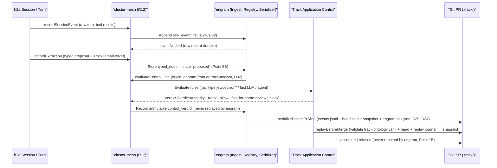

# Spec 0 — Shared Ontology Metamodel and Multi-Lineage Registry (`SPEC_ENGRAM_METAMODEL_AND_LINEAGE_REGISTRY`)

- **Status:** `proposed` (`DESIGN` — Spec 0 of [`spec/memory/PLAN_SPEC_ENGRAM_FRONT.md`](memory/PLAN_SPEC_ENGRAM_FRONT.md), §3 `:134-145` and §4 `:236-245`)
- **Repository of Record:** `engram` (`@sentropic/engram`, master of the shared ontology metamodel and lineage registry) `[FACT: spec/memory/OWNER-DECISIONS-2026-11-14.md:13,16; spec/memory/PLAN_SPEC_ENGRAM_FRONT.md:4,136]`
- **Binding Authorities:**
  - [`spec/memory/OWNER-DECISIONS-2026-11-14.md`](memory/OWNER-DECISIONS-2026-11-14.md) (`:1-29` — T-M-C ownership rule, decisions `1B`, `2B`, `3C`, `4B`, `5B`, `6A`, and `D28` explicitly kept)
  - [`spec/memory/R15-SEDIMENT.md`](memory/R15-SEDIMENT.md) (`:40-80` — settled decision ledger `D1`–`D34`, never reopened)
  - [`spec/memory/PLAN_SPEC_ENGRAM_FRONT.md`](memory/PLAN_SPEC_ENGRAM_FRONT.md) (`:134-145`, `:236-245`)
  - [`spec/memory/contracts/engram-track.md`](memory/contracts/engram-track.md) (`:1-247`), [`spec/memory/contracts/engram-h2a.md`](memory/contracts/engram-h2a.md) (`:1-214`), [`spec/memory/contracts/engram-cluster-mesh.md`](memory/contracts/engram-cluster-mesh.md) (`:1-181`)
- **Consumers:** `Track` (`h2a` repository: `packages/track`, sole author of the `track` domain template lineage and master of `Track`-domain control), `h2a` (`h2a` repository: `packages/h2a`, sole author of the `h2a` role, activity, and harness-skill profile lineage), and `sentropic/cluster-mesh` (`R12` mandatory memory access and `D24` integral transactional graph synchronization) `[FACT: spec/memory/OWNER-DECISIONS-2026-11-14.md:12-14,24,26; spec/memory/PLAN_SPEC_ENGRAM_FRONT.md:137]`
- **Dependencies:** None. Authored first, in parallel with Spec 6A (`spec/SPEC_ENGRAM_CLUSTER_MESH_MEMORY_ACCESS_AND_MCP_WIRING.md`) and ahead of Specs 1–5 and 6B `[FACT: spec/memory/OWNER-DECISIONS-2026-11-14.md:16; spec/memory/PLAN_SPEC_ENGRAM_FRONT.md:138]`.
- **Amendments to Existing `engram` Specifications:**
  - **Amends [`spec/SPEC_EVOL_ARCHI_CARDS.md`](SPEC_EVOL_ARCHI_CARDS.md) (`§1` and `§2.1–2.3`, `:31-91`):** Extracts the shared multi-lineage metamodel and runtime registry layer while preserving `archi@1` (`11` entity kinds, `15` relations, `55` closed matrix tuples) unchanged (`D16`, Point 4B) and allowing `archi@2` (`2.0.0`) as a distinct versioned registration in `lineage: "archi"` `[FACT: spec/SPEC_EVOL_ARCHI_CARDS.md:52-90; src/ontology-guardian/archi-profile.ts:38-85,88-110; src/ontology-guardian/diagram-registry.ts:47; spec/memory/PLAN_SPEC_ENGRAM_FRONT.md:145,209]`.
  - **Amends [`spec/SPEC_EVOL_AGENT_MEMORY_SUBSTRATE.md`](SPEC_EVOL_AGENT_MEMORY_SUBSTRATE.md) (`§4`, `:145-250`):** Anchors domain-typed graph nodes, edges, projections, and control verdicts on neutral `(lineage, templateId, templateVersion, templateDigestSha256)` references (`Sha256Digest` = `sha256:` + 64 lowercase hex over UTF-8 RFC 8785 JCS bytes) so `engram` and `cluster-mesh` never carry a closed list of `Track` or `h2a` domain types `[FACT: spec/SPEC_EVOL_AGENT_MEMORY_SUBSTRATE.md:145-250; spec/memory/PLAN_SPEC_ENGRAM_FRONT.md:143,145]`.
  - **Specifies the format, canonicalization, and digest amendment over `src/ontology-profile.ts` and `src/profile-bundle.ts`:** Moves relation `cardinality` into the semantic `profile_hash` (`contentDigest`), splits `visual_encoding` presentation out of `profile_hash` into its own `presentation_hash` (`presentationDigest`), standardizes v1 semantic hashing on UTF-8 RFC 8785 (JCS) `canonicalBytes` without pre-hash default injection, and adds generic `domain_policies` and multi-axis `state_machines` to the consumed metamodel grammar (§1.3, §1.4).

---

## 0. Binding Governance: Owner Verbatims, T-M-C Rule, and Review Decisions

### 0.1 Owner Verbatims (`2026-11-14`)

- On separating template mastery, metamodel mastery, and control mastery while `Track` refactors its domain ontologies (`spec/memory/OWNER-DECISIONS-2026-11-14.md:6`):
  > « Les question sont pas assez detaillees. Pose les ici. On est en train de faire des modif coté track sjr les ontologies de son domaine, il fdoit en rester maitre au moins piur les templates et engram pour leur metamodel et application track pour leur controle. Mene un tour avec h2a rapide en fable 5.2 + carbon et repose les 6 quesfion a l issi »
- On the six consolidated review recommendations (`spec/memory/OWNER-DECISIONS-2026-11-14.md:7`):
  > « Tout comme recommandé ».

### 0.2 The T-M-C Ownership Rule (`spec/memory/OWNER-DECISIONS-2026-11-14.md:9-15`)

| Term | Master | Normative Scope |
| :--- | :--- | :--- |
| **Template** | `Track` (for the `track` lineage); `h2a` (for the `h2a` lineage, Point 4B `:24`) | Domain object types, attributes, relations, allowed states, `D1` bounded-list membership (for `Track`), and Git/PR file shapes. Evolved by the lineage's sole author alone, with **no `engram` release** and **no `cluster-mesh` SQL migration** `[FACT: spec/memory/OWNER-DECISIONS-2026-11-14.md:12,24,26]`. |
| **Metamodel** | `engram` | The shared grammar (type, attribute, relation, cardinality, allowed state, file-shape declaration, semantic version, SHA-256 digest, lineage, intra-lineage version+mapping succession, and version-pinned cross-lineage composition) and the lineage registry. `engram` accepts or refuses a submitted template on metamodel well-formedness (plus the `D7` confidentiality deny-list); **`engram` never writes, mutates, or repairs a template** `[FACT: spec/memory/OWNER-DECISIONS-2026-11-14.md:13,21,24-25]`. |
| **Control** | the `Track` application (for the `track` domain); `h2a` (for master harness / role mutations, `D4`, `D31`); `engram` (for metamodel well-formedness and `D7` deny-list) | For the `Track` domain, the `Track` application writes and executes its rules, and its verdict (`verdictAuthority: 'track'`) is authoritative over template conformance, `D1` bounded-list admission and third-party promotion review, `D4` mandate scope, and `D34` pre-merge replay. `engram` records the verdict and never replaces it; without a verdict, a typed project write stays `proposed`, while the raw event is already recorded in `engram` `[FACT: spec/memory/OWNER-DECISIONS-2026-11-14.md:14,21,25]`. |

### 0.3 Binding Decisions Preserved Without Reopening (`D1`–`D34` and `1B`, `2B`, `3C`, `4B`, `5B`, `6A`)

All settled decisions `D1`–`D34` in `spec/memory/R15-SEDIMENT.md:40-80` remain untouched:
- **`1B` (`OWNER-DECISIONS-2026-11-14.md:21`):** `engram` produces the per-PR `.track/` projection (event journal + state snapshot linked by fingerprint, `D29=both`, `D34=engram`) by applying the `Track` domain template version published by `Track` and cited with its digest. `Track` validates and replays before merge; a non-conforming projection is refused, never repaired by `engram`. **`D28` is kept:** `engram`'s live registry stays the canonical reference for recorded facts (`spec/memory/R15-SEDIMENT.md:73`).
- **`2B` (`OWNER-DECISIONS-2026-11-14.md:22`):** The seventh MCP tool (`engram_memory_context`, `D20=seventh`, built disabled by default until `engram` + `sentropic` co-signature and `MCP-L5` qualification) fixes only the neutral template-reference envelope (`OntologyTemplateEnvelopeRef`), never a closed list of `Track` or `h2a` types.
- **`3C` (`OWNER-DECISIONS-2026-11-14.md:23`):** Local dreaming passes (nightly, mid-day, context saturation) and remote post-sync passes (weekly, monthly, cross-repo harness audit) never mutate a `Track` template; any dreamed proposal touching a `Track` template is a request to `Track` alone, and any typed write in the `Track` domain passes `Track` control on top of `D1=borne-review`.
- **`4B` (`OWNER-DECISIONS-2026-11-14.md:24`):** Two sibling lineages (`h2a` and `track`) coexist under `engram`'s metamodel alongside `archi@1` unchanged (`D16`). Cross-references go strictly by composition with version pinning, never redefining `Track` types. `engram` may propose role changes, never write them. `.h2a/` workspace/repo harness overlays (`D31`) never modify a `Track` template.
- **`5B` (`OWNER-DECISIONS-2026-11-14.md:25`):** Split control originating from both sides (`D32`: `« Donc part de engram - et de track »`, `spec/memory/R15-SEDIMENT.md:77`), executed via a deterministic rules/decision engine (`« api type jev/decison »`, `spec/memory/R15-SEDIMENT.md:26,77`), fast low-latency LLMs, or control agents. `Track`'s verdict is authoritative for the `Track` domain; `engram` records it and never replaces it.
- **`6A` (`OWNER-DECISIONS-2026-11-14.md:26`):** Integral bidirectional workspace-by-workspace sync over `cluster-mesh` (`D24`). Every typed object cites its template version + digest, template versions travel with the graph, `cluster-mesh` is blind to `Track` types, sync never overwrites a `Track`-controlled record, and concurrent template versions published offline are refused so `Track` decides (for `track`) or `h2a` decides (for `h2a`).

---

## 1. The Shared Metamodel and Existing Code-Fact Mapping

### 1.1 Metamodel Concepts (`metamodelVersion: "engram.metamodel/v1"`)

In `engram`, an **ontology template** (also called an ontology profile in existing corpus machinery) is an immutable, versioned data document authored by its lineage's sole author and validated deterministically against `engram`'s shared metamodel grammar (`metamodelVersion: "engram.metamodel/v1"`). The metamodel defines eight first-class constructs:

1. **Type (`NodeTypeDecl`):** A named domain entity class within a lineage (`^[A-Za-z][A-Za-z0-9_-]{0,63}$`). Declares human definition, optional `id_prefix`, `aliases`, `source_backed`, optional `registry` binding, attribute map (`attributes`), single or orthogonal per-axis lifecycle state machines (`state_machine` and/or `state_machines`), `D1` admission disposition (`admission_policy`, used by `Track` templates to declare `bounded-auto`, `mandated-act`, `own-act-human`, `mandate-gated`, or `promotion-third-party-review` per type, hierarchy rank, operation, or transition), entity-linking rules (`linking`), and optional presentation hints (`visual_encoding`, hashed separately from semantics per §1.3).
2. **Attribute (`AttributeDecl`):** A typed, named property carried by either a **node type** (`node_types.<type>.attributes.<name>`, accepting legacy alias `properties` from `src/profile-bundle.ts:113,947`) or a **relation type** (`relation_types.<rel>.attributes.<name>`, matching `archi@1` relation attributes in `src/ontology-guardian/archi-profile.ts:36,62,66`). Supports closed scalar and structural kinds (`"string" | "number" | "integer" | "boolean" | "enum" | "timestamp" | "digest" | "ref" | "collection" | "record"`), `required: boolean`, `values` (for `"enum"`), `pattern` / `minLength` / `maxLength` / `min` / `max`, `item` / `minItems` / `maxItems` (for `"collection"`), `targetTypes` (for `"ref"`), and human `description` (documentation-only).
3. **Relation (`RelationTypeDecl`):** A directed binary association (`^[a-zA-Z][a-zA-Z0-9_-]{0,63}$`) between non-empty sets of allowed `source_types` and `target_types` (each resolving either to a local `node_types` key or to a version-pinned cross-lineage `<importAlias>:<TypeId>` endpoint per §2.5). Declares endpoint **cardinality** (`cardinality: { out?: CardinalityBound; in?: CardinalityBound }`), `requires_evidence`, `assertion_basis`, `derivation_methods`, optional relation `attributes`, and optional acyclic/tree/DAG `hierarchy` constraint (`"tree" | "dag"`).
4. **Allowed State (`StateMachineDecl` & Multi-Axis `state_machines`):** Deterministic finite state vocabularies and transition relations. A template may declare a profile-wide default lifecycle (`hardening`), a single per-node-type state machine (`node_types.<type>.state_machine`), **or** multiple orthogonal state axes on a single node type (`node_types.<type>.state_machines`, e.g., specification readiness alongside work realization and derived reporting axes), each with closed `states: string[]`, `initial_state: string`, `terminal_states: string[]`, and typed `transitions: Array<{ from: string[]; to: string[]; requires?: string[]; authority?: "author" | "track-control" | "third-party-reviewer" | "h2a-mandate" | "mandated-act" | "own-act-human" }>`. For `track` templates, this encodes multi-axis lifecycles, human mandated vs non-delegable own acts, and `D1=borne-review` third-party promotion gates (`spec/memory/R15-SEDIMENT.md:46`) without hardcoding `Track` state names in `engram`.
5. **File-Shape / Serialization Declaration (`FileProjectionDecl`):** A declarative projection contract (`file_projections`) telling `engram`'s deterministic Git/PR serializer (`D34=engram`) how to materialize accepted graph records of that lineage into Git files without bespoke per-type serializer code in `engram`. Supports two target families:
   - `kind: "track-pr-slice"` (valid only in the `track` lineage, `D29=both`): declares the exact `.track/` artifacts `Track` reads and replays—(a) the framed append-only `events.jsonl` stream (`TrackEvent` lines only, zero header lines), (b) `head.json` (`{ streamLength, lastContentHash }`), (c) both `Track` snapshot schemas (`track.state-snapshot/v1` folded `Snapshot` and `track.snapshot/v1` report `SnapshotV1`), (d) the folded-state, event-lookback, option, and confidentiality inputs required by `Track`'s owner-table and stage-derivation projections, and (e) the sidecar `.track/engram-link.json` carrying `templateRef` and `linkFingerprint` (§4.1).
   - `kind: "h2a-harness-overlay"` (valid only in the `h2a` lineage, `D31`): declares the relative `.h2a/` repository, workspace, and derived-worktree overlay path patterns, tighten-only precedence, canonical JSON/YAML projection keys, and non-interference boundary (§4.4).
6. **Version (`TemplateSemVer` & `MetamodelVersion`):** Every template declares:
   - `metamodel_version`: pinned `engram` metamodel grammar identifier (`"engram.metamodel/v1"`; legacy profiles omitting it normalize under `"engram.metamodel/legacy-v0"` for backward readability).
   - `version`: pinned exact Semantic Version `MAJOR.MINOR.PATCH` (matching `isExactVersion` in `src/ontology-guardian/admission.ts:104-106`, restricted to three numeric dot segments plus optional prerelease/build for `track` and `h2a` templates; legacy single-integer versions such as `version: 1` in `profiles/app-context/v1/profile.yaml:2` remain readable in `engram` profiles). Floating ranges (`^`, `~`, `*`, `latest`) are refused.
7. **Lineage (`LineageDecl`):** The ownership and evolution stream (`lineage: "archi" | "h2a" | "track" | "engram"`) binding a `templateId` to exactly one **sole author**, one **verdict authority**, an optional predecessor `parent_pin` (`Pin`) + `MappingFile` pin (`mapping_pin`) for intra-lineage version succession, and optional `composed_lineage_pins` (`CrossLineageCompositionPin[]`) for version-pinned cross-lineage endpoint references (§2).
8. **Domain Governance Policies (`DomainPoliciesDecl`):** An optional, modeled top-level `domain_policies` grammar block consumed natively by `engram`'s validator, canonical hasher, and SemVer compatibility engine (`MINOR` for additive extensions, `MAJOR` for narrowing or destructive changes). Provides domain-neutral structural primitives—parameterized strictly by open template-defined strings, never by closed `Track` lists in `engram`—for ranked **hierarchical levels** and conditional parent-child nesting matrices, **stage/status refinements**, **autonomy bounds** (`mandated-act` vs `own-act-human` and per-rank ceilings), non-delegable human **acceptance/UAT gates**, **timeboxes**, **ETA journals** (with slip history and measured-velocity provenance rules), **risk matrices** (likelihood × impact bands, categories, responses, actor restrictions, and review/expiry ceilings), read-time **legacy role remapping**, and named **invariants**. Concrete domain profiles (for example, `Track`'s `sentropic.agile-product` and `sentropic.programme-wbs`) live exclusively in their author's templates and instantiate these generic constructs without `engram` holding any closed list of `Track` types (`T-M-C`).

### 1.2 Code-Fact Mapping Against Existing `engram` Profile Machinery

Every statement below about existing `engram` code is verified against the current worktree on `docs/memory-r15-sediment`:

| Metamodel Construct | What Existing Code Already Supports (`[FACT: file:line]`) | Exact Missing Pieces for Spec 0 (`[FACT]` Gap Analysis) |
| :--- | :--- | :--- |
| **Parsing & Bundle Envelope** | `parseOntologyProfile` (`src/ontology-profile.ts:289-296`) parses JSON (`.json` or `{` prefix) and YAML (`yaml` package). `bundleProfile` (`src/profile-bundle.ts:560-565`, internal `:237-558`) projects plain JSON (`toJsonValue`, `:265-278`), rejects `__proto__` keys (`findProtoPaths`, `:151-165, 280-296`), rejects runtime `linking.normalize.fn` (`:316-337`), snapshots registries (`:430-521`), preserves unknown top-level blocks in `extensions` (`CONSUMED_KEYS`, `:105-110, 523-526`), and seals RFC 8785 `ProfileBundleV1` (`schema: "engram.profile-bundle/v1"`, `:14, 30-41, 171-192`). | `CONSUMED_KEYS` (`src/profile-bundle.ts:105-110`) does not consume `metamodel_version`, `lineage`, `composed_lineage_pins`, `domain_policies`, or `file_projections`, routing them into `extensions` where any minor edit triggers breaking `changed_unmodeled_block` (`src/profile-bundle.ts:1174-1193`). `ProfileBundleV1` (`:30-41`) carries `profileHash` (`contentDigest`) but no `presentationHash` or `lineage`. |
| **1. Type (`node_types`)** | `OntologyNodeType` (`src/types.ts:856-868`) defines `aliases`, `registry`, `source_backed`, `status_policy`, `linking`, and `visual_encoding`. `normalizeNodeType` (`src/ontology-profile.ts:114-132`) spreads `...nodeType` and compiles `linking` via `normalizeNodeTypeLinking` (`src/entity-normalizer.ts:305-355`). `validateOntologyProfile` (`src/ontology-profile.ts:319-377`) checks `knownNodeTypes.size > 0`, `registry` cross-references (`:329-339`), and `visual_encoding` enums/hex (`:341-376`). `class_hierarchies` (`src/ontology-profile.ts:214-251`) supports `subclass_of` / `has_instance` groupings (`profiles/app-context/v1/profile.yaml:459-491`). | `OntologyNodeType` (`src/types.ts:856-868`) has no typed `attributes` (`properties`), `id_prefix`, `definition`, `state_machine` / `state_machines`, or `admission_policy` (`D1` bounded-list / rank / operation / transition markers). `status_policy` (`profiles/app-context/v1/profile.yaml:9,36`) is an unvalidated `string` (`src/types.ts:860`). |
| **2. Attribute (`attributes` / `properties`)** | `src/profile-bundle.ts` anticipates `properties`, `id_prefix`, and `definition` in `MODELED_NODE_KEYS` (`:111-114`) and diffs `node_types.<t>.properties.<p>` (`type`, `format`, `description`) in `checkProfileCompatibility` (`:947-969`). `archi-profile.ts` models typed entity/relation `attributes` (`text`, `enum`, `collection`) for diagram profiles only (`src/ontology-guardian/archi-profile.ts:20-36, 90-99`). | **Zero attribute validation or normalization in `src/ontology-profile.ts` (`:298-503`) and `src/profile-validate.ts` (`:223-380`).** On `node_types`, raw `properties` pass through `normalizeNodeType` (`src/ontology-profile.ts:120-125`) unvalidated. On `relation_types`, `normalizeRelation` (`src/ontology-profile.ts:92-100`) **strips all unknown keys**, dropping relation attributes completely. |
| **3. Relation & Cardinality (`relation_types`)** | `OntologyRelationType` (`src/types.ts:875-884`) and `NormalizedOntologyRelationType` (`src/types.ts:1205-1211`) model `source_types`, `target_types`, `requires_evidence`, `assertion_basis`, and `derivation_methods`. `validateOntologyProfile` (`src/ontology-profile.ts:379-398`) checks non-empty endpoints in `knownNodeTypes`. `validateEdge` (`src/profile-validate.ts:358-378`) checks endpoint node types. `hierarchies` (`src/ontology-profile.ts:194-212, 430-457`) models registry-backed parent/child columns. | **Relation `cardinality` is missing and silently dropped from `profile_hash`:** `normalizeRelation` (`src/ontology-profile.ts:92-100`) returns a closed 5-field object, dropping any `cardinality` or `description` field before `hashOntologyProfile` (`src/ontology-profile.ts:505-511, 552`) runs. `MODELED_REL_KEYS` (`src/profile-bundle.ts:115-118`) omits `cardinality`. `validateEdge` (`src/profile-validate.ts:292-379`) enforces no min/max degree bounds. Cross-lineage endpoint prefixes (`<alias>:<TypeId>`) are rejected by `knownNodeTypes.has(...)` (`src/ontology-profile.ts:389, 394`). |
| **4. Allowed State & Domain Policies (`hardening` vs `state_machine` / `state_machines` / `domain_policies`)** | `OntologyHardeningPolicy` (`src/types.ts:903-922`; `src/ontology-profile.ts:35, 145-172`) defines **one profile-wide** `statuses` list (defaulting to `DEFAULT_STATUSES` at `:35`), one `default_status`, global `promotion_requires`, and untyped `status_transitions` (`from_statuses`, `to_statuses`, `requires` validated for membership at `:400-411`, enforced globally on `status`/`previous_status` in `src/profile-validate.ts:89-130`, and diffed in `src/profile-bundle.ts:1058-1095`). | **No per-node-type or multi-axis state machines and no generic domain-policy grammar:** every node and edge shares one flat `hardening.statuses` pool (`src/profile-validate.ts:97, 247, 305`). Cannot express orthogonal state axes (`state_machines`), `"mandated-act"` vs `"own-act-human"` transition/admission authorities, ranked hierarchical levels & conditional nesting, autonomy bounds, non-delegable human UAT gates, timeboxes, ETA journals, or risk matrices without falling into unmodeled `extensions`. |
| **5. File-Shape Declaration (`outputs` vs `file_projections`)** | `OntologyProfileOutputs` (`src/types.ts:1164-1184`; `src/ontology-profile.ts:264-287, 476-500`) configures corpus extraction exports only (`engram_ontology_outputs_v1`: `canonical_node_types`, `source_node_types`, `occurrence_node_types`, `alias_fields`, `relation_exports`, and `wiki` booleans/page types). | **Zero Git/PR serialization grammar:** no way for a `Track` template to declare the framed `TrackEvent` `events.jsonl` envelope (`packages/track/src/events/types.ts:182-213`), `head.json` (`events/head.ts:22-25`), both snapshot schemas (`state/snapshot.ts:19-37`, `report/snapshot.ts:86-101`), owner-table inputs (`report/owner-table.ts:849-933`), and `.track/engram-link.json` sidecar, or for an `h2a` template to declare `.h2a/` overlay file shapes (`D31`). |
| **6. Version & Hashing (`version`, `profile_hash`, `presentation_hash`, `Sha256Digest`)** | `OntologyProfile.version` is `string \| number` (`src/types.ts:1188`), coerced via `String(profile.version)` (`src/ontology-profile.ts:525`) with non-empty check (`:316-318`). `isExactVersion` (`src/ontology-guardian/admission.ts:104-106`) checks pinned numeric/SemVer strings. `hashOntologyProfile` (`src/ontology-profile.ts:505-511`) hashes `JSON.stringify(stableForHash(profile))`, skipping only `sourcePath`, `profile_hash`, `bound_source_path`, and `linking.normalize.fn` (`:69-83`; replicated in `src/ontology-guardian/digests.ts:88-100`). `checkProfileCompatibility` (`src/profile-bundle.ts:847-1223`) classifies breaking vs non-breaking changes. | **1.** `visual_encoding` is included in `stableForHash` (`src/ontology-profile.ts:69-83`) and flagged as breaking `changed_modeled_field` in `checkProfileCompatibility` (`src/profile-bundle.ts:977`). **2.** `hashOntologyProfile` (`src/ontology-profile.ts:505-553`) uses `JSON.stringify` after mutating/injecting absent corpus defaults (`default_language: "en"`, `citation_policy`, `hardening`) and returns bare 64-hex `Digest` (`src/ontology-guardian/types.ts:8`), diverging from RFC 8785 JCS `canonicalBytes` (`src/ontology-guardian/canonical.ts:60-72`) and cross-package `Sha256Digest` (`sha256:<64 hex>`, `engram-track.md:37`). **3.** `checkProfileCompatibility` (`:918`) does not verify `MAJOR` vs `MINOR` SemVer ordering. |
| **7. Lineage & Registry (`ontology-guardian`)** | `RegistryKind = "skill" \| "mcp" \| "ontology"` (`src/ontology-guardian/catalog.ts:18`), `RegistryEnvelope` (`:146-184`), and `OntologyPayload` (`:287-340`) define G0 static catalog envelopes with `profilePin: Pin` (`{ id, version, contentDigest }`, `src/ontology-guardian/types.ts:14-18`), `stack: PinList`, `PublicLineage` / `PrivateLineage` (`:44-49, 143-151`), `DeltaOperation` / `MappingEntry` (`:173-229`), and `checkAdmission` (`src/ontology-guardian/admission.ts:445-499`) over `AdmissionFamily` (`"TRK"`, `"H2A"`, `"ENG"`, `"DIA"`, etc., `:40, 108-112`). `app-context-registry.ts` (`:1-458`) and `archi-profile.ts` (`:1-195`) provide compile-time frozen registrations. | **1.** Registrations in `app-context-registry.ts` (`:387-399`) and `archi-profile.ts` (`:160-195`) are hardcoded TypeScript constants loaded from disk at module import; there is **no runtime multi-lineage registry store** accepting dynamic `Track` or `h2a` template registrations (or `archi@2` / bridge profiles) without an `engram` release. **2.** `profiles/app-context/v1/profile.yaml:33-59` embeds static `TrackWorkpackage`, `TrackItem`, `TrackDecision` inside `engram`'s `app-context@1`. **3.** G0 `composeApplicability` / `deriveApplicability` (`src/ontology-guardian/diagnostics.ts:795-805`) forbid inheritance stacking on `TRK` and `H2A`, leaving cross-lineage version-pinned endpoint composition (`Point 4B`) unmodeled in `ontology-profile.ts`. |

### 1.3 Pending Format, Canonicalization, and Digest Amendment (`cardinality` In, `presentation` Split Out, RFC 8785 `Sha256Digest`)

Spec 0 mandates three coupled amendments to `engram`'s profile normalization, canonical hashing, and compatibility engine:

#### 1.3.1 Relation Cardinality Into Semantic `profile_hash` (`contentDigest`)

1. **Data Contract (`proposed` extension to `src/types.ts:875-884, 1205-1211`):**
   ```ts
   // status: proposed — Endpoint cardinality bounds hashed into profile_hash (contentDigest)
   export interface OntologyCardinalityBound {
     readonly min: number;            // Integer >= 0 (default: 0)
     readonly max: number | "many";   // Integer >= min, or "many" for unbounded (default: "many")
   }

   export interface OntologyRelationCardinality {
     /** Number of outgoing edges of this relation allowed per source instance. */
     readonly out?: OntologyCardinalityBound;
     /** Number of incoming edges of this relation allowed per target instance. */
     readonly in?: OntologyCardinalityBound;
   }
   ```
   When omitted on a relation, runtime evaluation treats `cardinality` as `{ out: { min: 0, max: "many" }, in: { min: 0, max: "many" } }` (and for `archi@1` role-based declarations in `src/ontology-guardian/archi-profile.ts:74-76`, preserves `{ min: 1, max: 1 }` per relation role), while `S-ENGRAMHASH v1` (§1.3.3) hashes explicit semantic declarations without injecting unauthored defaults.
2. **Hash Inclusion:** Because `NormalizedOntologyRelationType` retains `cardinality` (and `attributes` when declared), `stableForHash` (`src/ontology-profile.ts:69-83`) and `hashOntologyProfile` (`src/ontology-profile.ts:505-511`) deterministically include relation cardinality in `profile_hash` (`contentDigest` / `templateDigestSha256`).
3. **Compatibility vs Refinement Direction (`src/profile-bundle.ts:1001-1026` vs `src/ontology-guardian/types.ts:271, 292`):**
   - **Intra-lineage version evolution (`checkProfileCompatibility`):** Evaluates whether existing graph instances valid under `oldProfile` remain valid under `newProfile`:
     - *Tightening/narrowing* (`newBound.min > oldBound.min` or `newBound.max < oldBound.max`, with `"many" > k` for all finite `k`) invalidates existing instances and emits **breaking** `narrowed_relation_cardinality` (requires `MAJOR` bump).
     - *Relaxing/widening* (`newBound.min < oldBound.min` or `newBound.max > oldBound.max`) keeps all existing instances valid and emits **non-breaking** `widened_relation_cardinality` (requires at least `MINOR` bump).
   - **Child-profile refinement (`G0` `S-2`, `src/ontology-guardian/types.ts:271, 292`):** Where G0 inheritance derivation applies (diagram/engram base profiles, never `TRK` or `H2A` per `D-B7`), a child subtype may only *narrow* its parent's invariant (`cardinality-widening` remains refused on child derivation). Keeping these two directions distinct prevents conflating version succession with subtype refinement.

#### 1.3.2 Presentation Split Out Into `presentation_hash` (`presentationDigest`)

1. **Semantic Hash Exclusion (`src/ontology-profile.ts:69-83`, `src/ontology-guardian/digests.ts:88-100`):**
   `stableForHash` is amended to skip:
   - `key === "visual_encoding"` when `path.length === 2 && path[0] === "node_types"`,
   - top-level `key === "presentation"` and `key === "presentation_hash"`.
   Consequently, `profile_hash` (`hashOntologyProfile`) and `ProfileBundleV1.profileHash` (`contentDigest`) depend exclusively on semantic ontology declarations (identity, lineage, types, attributes, relations, cardinalities, state machines, domain policies, file projections, registries, policies, hierarchies, outputs, and cross-lineage pins).
2. **Dedicated Presentation Digest (`proposed`):**
   ```ts
   // status: proposed — Separate presentation digest (Studio glyphs, colors, layout hints)
   export function hashOntologyPresentation(profile: NormalizedOntologyProfile): Sha256Digest;
   ```
   `hashOntologyPresentation` extracts `{ node_visual_encoding: { [nodeTypeId]: normalized.node_types[nodeTypeId].visual_encoding ?? null }, presentation: profile.presentation ?? null }`, serializes it through RFC 8785 `canonicalBytes` (`src/ontology-guardian/canonical.ts:60-72`), and returns the `Sha256Digest` (`sha256:<64 lowercase hex>`, stored as `presentation_hash` on `NormalizedOntologyProfile` and stripped to bare 64-hex `Digest` only when sealing internal G0 `ProfileBundleV1` fields). This aligns `engram-profile` hashing with G0 `theme-invariance` (`src/ontology-guardian/catalog.ts:470-483`), where styling changes leave `contentDigest`, `pinsDigest`, and `resultDigest` invariant.
3. **Compatibility Classification (`src/profile-bundle.ts:977`):**
   `checkProfileCompatibility` replaces `checkResidual("node_types.<t>.visual_encoding", ...)` (`:977`) with a dedicated non-breaking emission `changed_node_visual_encoding` (`ProfileNonBreakingChange`), permitting `PATCH` version bumps when a template author updates Studio glyph shapes or colors without altering domain semantics.

#### 1.3.3 Unified RFC 8785 (JCS) Canonicalization and `Sha256Digest` Wire Format (`S-ENGRAMHASH v1`)

1. **Single Canonicalizer Without Pre-Hash Default Injection:**
   Today `normalizeOntologyProfile` (`src/ontology-profile.ts:513-553`) injects corpus-specific defaults onto omitted fields (`default_language: "en"`, `citation_policy`, `hardening`) and `hashOntologyProfile` (`:505-511`) hashes `JSON.stringify(stableForHash(profile))`. Under `metamodel_version: "engram.metamodel/v1"` (`S-ENGRAMHASH v1`), `hashOntologyProfile` serializes `stableForHash(authoredSemanticProjection)` directly through RFC 8785 (JCS) `canonicalBytes` (`src/ontology-guardian/canonical.ts:60-72`, UTF-8 bytes, rejecting lone UTF-16 surrogates and non-finite numbers) **without** `JSON.stringify` and **without** mutating or injecting absent optional blocks prior to hashing. `Track` (`packages/track/src/events/canonical.ts:98-152`), `h2a` (`packages/h2a/src/canonical.ts:10-58`), and `engram` therefore compute the exact same SHA-256 digest over an authored template document.
2. **`Sha256Digest` Across All Inter-Package Boundaries (`sha256:` + 64 Lowercase Hex):**
   Every cross-package digest field (`templateDigestSha256`, `eventJournalSha256`, `stateSnapshotSha256`, `head.lastContentHash`, `linkFingerprint`, `envelopeDigest`, `mappingDigestSha256`) uses `Sha256Digest = \`sha256:${string}\`` matching `/^sha256:[0-9a-f]{64}$/` (`spec/memory/contracts/engram-track.md:37`, `engram-h2a.md:39`, `engram-cluster-mesh.md:41`, `packages/track/src/events/types.ts:7`, `packages/h2a/src/canonical.ts:54`). At `engram`'s internal G0 boundary (`Pin.contentDigest`, `DIGEST_RE = /^[0-9a-f]{64}$/` in `src/ontology-guardian/types.ts:6-11`), `engram` converts losslessly via explicit helper pair `toInternalDigest(sha256Digest)` / `fromInternalDigest(digest)`.
3. **Cutover Rule for Pinned `app-context@1` (`src/ontology-guardian/app-context-registry.ts:39-49`):**
   `profiles/app-context/v1/profile.yaml:10-140` declares `visual_encoding` on 14 of its 19 node types, which is baked into `APP_CONTEXT_PINNED_CONTENT_DIGEST` (`"f04ea89ae549471fe0dc62460dccd5b3c87204717b98ea7f4235cbf0d835819a"`, `src/ontology-guardian/app-context-registry.ts:41-42`). Under the backward-readability invariant (§3.3), legacy profiles with `metamodel_version: "engram.metamodel/legacy-v0"` (including the frozen `app-context@1` v1 registration) retain `S-ENGRAMHASH v0` verification so existing receipts never break, while `metamodel_version: "engram.metamodel/v1"` profiles (all `track`, `h2a`, `archi@2.0.0`, `track-archi2-bridge@1.0.0`, and `app-context@2.0.0` registrations) use `S-ENGRAMHASH v1`.

### 1.4 Normative Metamodel v1 TypeScript Schema (`proposed`)

```ts
// status: proposed — Shared Engram Metamodel v1 declarations (Spec 0)
import type { Pin } from "./ontology-guardian/types.js";
import type { OntologyVisualEncoding, OntologyNodeTypeLinking } from "./types.js";

/** "sha256:" + 64 lowercase hex characters over UTF-8 RFC 8785 (JCS) canonical bytes (/^sha256:[0-9a-f]{64}$/). */
export type Sha256Digest = `sha256:${string}`;

export type MetamodelVersion = "engram.metamodel/legacy-v0" | "engram.metamodel/v1";
export type LineageId = "archi" | "h2a" | "track" | "engram";

export interface OntologyTemplateEnvelopeRef {
  readonly lineage: LineageId;
  readonly templateId: string;
  readonly templateVersion: string;              // Exact SemVer (e.g. "1.0.0")
  readonly templateDigestSha256: Sha256Digest;   // Semantic contentDigest over RFC 8785 JCS bytes
}

export interface CrossLineageCompositionPin extends OntologyTemplateEnvelopeRef {
  readonly importAlias: string;                  // Local prefix used in endpoint refs, e.g. "archi_v2" -> "archi_v2:capability"
}

/** Signed h2a mandate envelope verified at lineage registration and boundary gates (packages/h2a/src/types.ts:79-102, 239-249). */
export interface H2AMandateEnvelope {
  readonly mandateId: string;
  readonly instance: string;
  readonly role: "PRINCIPAL" | "EXECUTIF" | "CONDUCTOR" | "AGENTS" | "CONTROL" | "MANDATAIRE" | null;
  readonly scope: string;
  readonly rights: readonly string[];
  readonly expiresAt?: string;
  readonly envelopeDigest: Sha256Digest;
  readonly signatures: ReadonlyArray<{
    readonly by: string;
    readonly alg: string;
    readonly value: string;
  }>;
}

export type AttributeScalarKind =
  | "string"
  | "number"
  | "integer"
  | "boolean"
  | "enum"
  | "timestamp"
  | "digest"
  | "ref";

export type AttributeDecl =
  | {
      readonly kind: AttributeScalarKind;
      readonly required?: boolean;
      readonly description?: string;
      readonly values?: readonly string[];      // Required iff kind === "enum"
      readonly pattern?: string;                // ECMA-262 regex source, validated finite
      readonly minLength?: number;
      readonly maxLength?: number;
      readonly min?: number;
      readonly max?: number;
      readonly targetTypes?: readonly string[]; // Required iff kind === "ref" (local TypeId or "<importAlias>:<TypeId>")
    }
  | {
      readonly kind: "collection";
      readonly required?: boolean;
      readonly description?: string;
      readonly minItems?: number;
      readonly maxItems?: number;
      readonly item: AttributeDecl;
    }
  | {
      readonly kind: "record";
      readonly required?: boolean;
      readonly description?: string;
      readonly attributes: Readonly<Record<string, AttributeDecl>>;
    };

export type TransitionAndAdmissionAuthority =
  | "author"
  | "track-control"
  | "third-party-reviewer"
  | "h2a-mandate"
  | "mandated-act"
  | "own-act-human";

export interface StateTransitionDecl {
  readonly from: readonly string[];
  readonly to: readonly string[];
  readonly requires?: readonly string[];
  readonly authority?: TransitionAndAdmissionAuthority;
}

export interface StateMachineDecl {
  readonly states: readonly string[];
  readonly initial_state: string;
  readonly terminal_states?: readonly string[];
  readonly transitions: readonly StateTransitionDecl[];
}

export type NodeAdmissionMode =
  | "bounded-auto"
  | "promotion-third-party-review"
  | "mandate-gated"
  | "mandated-act"
  | "own-act-human";

export interface NodeAdmissionPolicyDecl {
  /** Default D1=borne-review disposition declared by templates and enforced by the lineage's control master. */
  readonly mode: NodeAdmissionMode;
  readonly third_party_distinct_from_author?: boolean;
  /** Optional generic overrides keyed by hierarchy rank ("0".."N"), event/operation kind, or "<axis>:<from>-><to>" transition. */
  readonly by_rank?: Readonly<Record<string, NodeAdmissionMode>>;
  readonly by_operation?: Readonly<Record<string, NodeAdmissionMode>>;
  readonly by_transition?: Readonly<Record<string, NodeAdmissionMode>>;
}

export interface MetamodelNodeTypeDecl {
  readonly definition?: string;
  readonly id_prefix?: string;
  readonly aliases?: readonly string[];
  readonly source_backed?: boolean;
  readonly registry?: string;
  readonly attributes?: Readonly<Record<string, AttributeDecl>>;
  readonly state_machine?: StateMachineDecl;
  /** Orthogonal state axes on one node type (e.g. specification axis + realization axis + derived reporting axes). */
  readonly state_machines?: Readonly<Record<string, StateMachineDecl>>;
  readonly admission_policy?: NodeAdmissionPolicyDecl;
  readonly linking?: OntologyNodeTypeLinking;
  /** Hashed in presentation_hash ONLY; excluded from templateDigestSha256 (profile_hash). */
  readonly visual_encoding?: OntologyVisualEncoding;
}

export interface MetamodelRelationTypeDecl {
  readonly description?: string;
  readonly source_types: readonly string[];     // Local TypeId or "<importAlias>:<TypeId>"
  readonly target_types: readonly string[];     // Local TypeId or "<importAlias>:<TypeId>"
  readonly cardinality?: {
    readonly out?: { readonly min: number; readonly max: number | "many" };
    readonly in?: { readonly min: number; readonly max: number | "many" };
  };
  readonly requires_evidence?: boolean;
  readonly assertion_basis?: readonly string[];
  readonly derivation_methods?: readonly string[];
  readonly attributes?: Readonly<Record<string, AttributeDecl>>;
  readonly hierarchy?: {
    readonly id: string;
    readonly shape: "tree" | "dag";
    readonly parent_role: "source" | "target";
    readonly child_role: "source" | "target";
  };
}

/**
 * Generic, domain-neutral governance policy constructs (M1 under T-M-C).
 * Every level, mode, stage, status, evidence kind, risk category, and response is an open string
 * supplied by the template; engram holds zero closed lists of Track or h2a domain types.
 */
export interface DomainPoliciesDecl {
  /** Ranked hierarchy levels (e.g. rank 0..N, optional operational modes, rollup & parent requirements). */
  readonly levels?: ReadonlyArray<{
    readonly id: string;
    readonly rank: number;                      // Integer >= 0
    readonly modes?: readonly string[];         // Optional mode axis (e.g. build vs run)
    readonly requires_parent?: boolean;
    readonly rollup?: boolean;
    readonly closure_gate_ref?: string;
  }>;
  /** Transverse reference axes orthogonal to the tree hierarchy (e.g. cross-cutting WBS or control-account code). */
  readonly cross_cutting_axes?: Readonly<
    Record<string, { readonly attribute: string; readonly pattern?: string; readonly inherited_downward?: boolean }>
  >;
  /** Conditional parent-child nesting matrix constrained by parent level/mode and child subkind/attributes. */
  readonly nesting_matrix?: ReadonlyArray<{
    readonly parent_level: string;
    readonly parent_modes?: readonly string[];
    readonly allowed_child_levels: readonly string[];
    readonly child_subkind?: string;
    readonly when_attributes?: Readonly<Record<string, readonly string[]>>;
  }>;
  /** Optional sub-stage refinements rolling up to parent stages and witnessed by link/artifact kinds. */
  readonly stage_refinements?: ReadonlyArray<{
    readonly parent_stage: string;
    readonly sub_stages: readonly string[];
    readonly witness_link_kinds?: readonly string[];
  }>;
  /** Actor autonomy bounds, per-level creation/stage ceilings, mandated-act vs own-act-human gates, and tighten-only overlays. */
  readonly autonomy_policy?: {
    readonly actor_classes: readonly string[];
    readonly max_autonomous_create_rank?: number;
    readonly max_autonomous_create_level?: string;
    readonly autonomous_stage_ceiling_by_level?: Readonly<Record<string, string>>;
    readonly mandated_act_operations?: readonly string[];
    readonly mandated_act_proof_sources?: readonly string[];
    readonly own_act_human_operations?: readonly string[];
    readonly overlay_precedence?: "tighten-only";
  };
  /** Non-delegable acceptance / UAT gate definitions (human own-act receipts, owner binding, non-waivable evidence, commit anchor equality). */
  readonly acceptance_gates?: Readonly<
    Record<
      string,
      {
        readonly applies_to_levels: readonly string[];
        readonly authority: "own-act-human" | "mandated-act" | "third-party-reviewer";
        readonly designated_owner_attribute?: string;
        readonly required_actor_class?: string;
        readonly non_waivable_evidence_kinds?: readonly string[];
        readonly require_all_children_terminal?: boolean;
        readonly freshness_anchor_equality?: {
          readonly receipt_field: string;
          readonly target_field: string;
        };
      }
    >
  >;
  /** Per-level / subkind duration bounds, clock start/stop triggers, and rebaseline decision rules. */
  readonly timeboxes?: ReadonlyArray<{
    readonly applies_to_level: string;
    readonly subkind?: string;
    readonly target_days?: number;
    readonly hard_ceiling_days: number;
    readonly clock_start_trigger: string;
    readonly clock_stop_triggers: readonly string[];
    readonly rebaseline_decision_kind?: string;
    readonly overdue_escalation?: string;
  }>;
  /** Append-only ETA journal, source qualification, slip recording, and measured-velocity provenance policy. */
  readonly eta_policy?: {
    readonly eligible_ranks?: readonly number[];
    readonly max_active_slots_per_item?: number;
    readonly source_kinds: readonly string[];
    readonly measured_provenance_required_fields?: readonly string[];
    readonly append_only_slip_journal: boolean;
    readonly rebaseline_requires_decision?: boolean;
  };
  /** Likelihood x impact risk matrix, contiguous severity bands, response/actor constraints, and review/expiry ceilings. */
  readonly risk_policy?: {
    readonly likelihood_scale: readonly number[];
    readonly impact_scale: readonly number[];
    readonly severity_bands: ReadonlyArray<{
      readonly id: string;
      readonly min_score: number;
      readonly max_score: number;
    }>;
    readonly categories: readonly string[];
    readonly responses: readonly string[];
    readonly forbid_actor_classes_by_response?: Readonly<Record<string, readonly string[]>>;
    readonly max_review_validity_days_by_band?: Readonly<Record<string, number>>;
    readonly external_register_max_age_days?: number;
    readonly sensitivity_impact_floors?: Readonly<Record<string, number>>;
  };
  /** Pure read-time remapping from legacy role/tag tokens to canonical hierarchy levels + subkinds. */
  readonly legacy_role_remap?: Readonly<
    Record<string, { readonly target_level: string; readonly subkind?: string; readonly read_only: true }>
  >;
  /** Named declarative invariants referenced by control diagnostics. */
  readonly invariants?: ReadonlyArray<{
    readonly id: string;
    readonly summary: string;
    readonly scope: string;
    readonly severity: "error" | "warning";
  }>;
}

/**
 * Exact per-PR .track/ file-shape contract grounded in packages/track/src/:
 * - events/types.ts:16-125, 133-213; events/frame.ts:10-21; events/canonical.ts:98-152;
 *   events/validate.ts:56-150, 269-364; events/store.ts:44-59, 345-358 (framed TrackEvent JSONL)
 * - events/head.ts:22-71; events/validate.ts:366-391 (head.json { streamLength, lastContentHash })
 * - state/snapshot.ts:19-37, 68-77 & report/snapshot.ts:14-15, 74-101, 253-293 (both snapshot schemas)
 * - report/owner-table.ts:99-142, 186-242, 368-716, 849-933, 1372-1468 &
 *   report/stage-status.ts:141-186, 226-348 & model/report-status.ts:10-65, 123-178, 230-249 (owner-table inputs)
 */
export interface TrackPrFileProjectionDecl {
  readonly kind: "track-pr-slice";
  readonly content_mode: "both";                // D29=both (journal + snapshot + head + sidecar)
  readonly root_dir: ".track";                  // Confined to .track/
  readonly event_journal: {
    readonly relative_path_template: string;    // e.g. ".track/events.jsonl" or ".track/pr/{prBranchSlug}/events.jsonl"
    readonly format: "track-events-jsonl/v1";
    readonly forbid_header_lines: true;         // Every line MUST parse as TrackEvent (events/store.ts:48-57)
    readonly aggregates: readonly string[];     // Open template list (events/types.ts:16-17)
    readonly event_types: readonly string[];    // Open template list (events/types.ts:19-125)
    readonly order_by: readonly ["stream_seq"]; // Append-order stream position (events/validate.ts:69-105)
    readonly frame_integrity: "positional-prevhash-and-aggregate-seq";
    readonly envelope_contract: {
      readonly core_fields: readonly ["id", "type", "aggregate", "aggregateId", "at", "by", "payload"];
      readonly optional_core_fields: readonly ["prov", "clientToken", "cmdId", "cmd"];
      readonly frame_fields: readonly ["seq", "prevHash", "contentHash"];
    };
  };
  readonly head_anchor: {
    readonly relative_path_template: string;    // e.g. ".track/head.json" (events/head.ts:27-29)
    readonly format: "track-head/v1";           // { streamLength: number; lastContentHash: Sha256Digest | null } (events/head.ts:22-25)
  };
  readonly state_snapshot: {
    readonly relative_path_template: string;    // e.g. ".track/snapshots/{streamLength}.json" or ".track/pr/{prBranchSlug}/snapshot.json"
    readonly schema: "track.state-snapshot/v1" | "track.snapshot/v1";
    /** Folded state collections when schema === "track.state-snapshot/v1" (state/snapshot.ts:19-37: { streamLength, state }). */
    readonly include_collections: readonly string[];
    /** Factual report top-level sections when schema === "track.snapshot/v1" (report/snapshot.ts:74-101). */
    readonly report_sections?: readonly string[];
    readonly status_vocabulary: readonly string[];        // Open template list (model/report-status.ts:55-64)
    readonly stage_vocabulary: readonly string[];         // Open template list (model/report-status.ts:10-23)
    readonly remaining_work_realizations: readonly string[]; // Open template list (model/item.ts:45)
  };
  readonly owner_table_inputs?: {
    /** Folded State maps consumed by projectOwnerTable & deriveItemStageStatus (report/owner-table.ts:935-1075, stage-status.ts:311-348). */
    readonly required_folded_collections: readonly string[];
    /** Event-stream history lookbacks over TrackEvent[] (report/owner-table.ts:900-933, 1372-1424; stage-status.ts:141-186, 329-334). */
    readonly required_event_stream_lookbacks: readonly string[];
    /** Runtime options contract for ProjectOwnerTableOptions (report/owner-table.ts:849-864). */
    readonly options_fields: readonly string[];
    /** OwnerTablePolicy + anti-jargon / digest / ULID / path gates in auditOwnerTable (report/owner-table.ts:99-142, 186-242, 368-716). */
    readonly confidentiality_policy_contract: "track-owner-table-policy/v1";
  };
  readonly link_fingerprint_sidecar: {
    readonly relative_path_template: string;    // e.g. ".track/engram-link.json"
    readonly schema: "engram.track-pr-link-fingerprint/v1";
    readonly hash_algorithm: "sha256-rfc8785";
  };
}

export interface H2aOverlayFileProjectionDecl {
  readonly kind: "h2a-harness-overlay";
  readonly root_dir: ".h2a";                    // Confined to .h2a/ (D31; never touches .track/)
  readonly relative_path_template: string;      // Default or single-tier overlay template
  readonly relative_path_templates?: {          // Scoped tighten-only hierarchy (repo <= workspace <= worktree)
    readonly repo: string;
    readonly workspace: string;
    readonly worktree: string;
  };
  readonly precedence?: "tighten-only";
  readonly format: "json" | "yaml";
  readonly include_node_types: readonly string[];
  readonly order_by: readonly ("entity_id")[];
  readonly projected_fields: readonly string[];
}

export type FileProjectionDecl = TrackPrFileProjectionDecl | H2aOverlayFileProjectionDecl;

export interface MetamodelTemplateDocument {
  readonly metamodel_version: "engram.metamodel/v1";
  readonly lineage: LineageId;
  readonly id: string;
  readonly version: string;                     // Exact SemVer MAJOR.MINOR.PATCH
  readonly default_language?: string;
  readonly parent_pin?: Pin;                    // Required for versions > initial registration in lineage
  readonly mapping_pin?: Pin;                   // Required when breaking renames/migrations are declared
  readonly composed_lineage_pins?: readonly CrossLineageCompositionPin[];
  readonly node_types: Readonly<Record<string, MetamodelNodeTypeDecl>>;
  readonly relation_types?: Readonly<Record<string, MetamodelRelationTypeDecl>>;
  readonly domain_policies?: DomainPoliciesDecl;
  readonly file_projections?: Readonly<Record<string, FileProjectionDecl>>;
}
```

---

## 2. Lineages, Sole Authorship, Versioning, Digest Pinning, and Composition

### 2.1 The Governed Lineages and Sole-Author Matrix

Under `OWNER-DECISIONS-2026-11-14.md` (T-M-C `:9-15`, Point 4B `:24`) and `D4`/`D16`/`D31` (`spec/memory/R15-SEDIMENT.md:49,61,76`), every lineage in `engram`'s registry has **one sole author**:

| Lineage ID | G0 Family (`admission.ts:40`) | Sole Author (Master of Templates) | Authoritative Source Repo | Verdict / Control Master | Scope & Transition Rules |
| :--- | :--- | :--- | :--- | :--- | :--- |
| **`track`** | `TRK` (`admission.ts:110`) | **`Track`** (`packages/track`) | `h2a` (`packages/track/`) | **the `Track` application** (`verdictAuthority: 'track'`, Point 5B) | Project domain objects, attributes, project relations, single or multi-axis allowed states, generic `domain_policies` instantiations (levels, autonomy bounds, UAT gates, timeboxes, ETA journal, risk), `D1` bounded list, decision-dossier project varieties (`D3`, `D27`), and `.track/` per-PR file shapes (`D29`). Evolved by `Track` alone (e.g., `sentropic.agile-product`, `sentropic.programme-wbs`) with **no `engram` release** (`OWNER-DECISIONS-2026-11-14.md:12`). |
| **`h2a`** | `H2A` / `HRN` (`admission.ts:110`) | **`h2a` mandate-and-role manager** (`packages/h2a`, `D4`) | `h2a` (`packages/h2a/`) | **`h2a`** (mandates, roles, master harness); `engram` records harness decisions first (`D31`) | Standard `h2a` agent roles, classic human governance roles, scopes, multi-actor relations, typical activities (`activité types`), harness-skill graphs (`D16`), master harness rules, and `.h2a/` tighten-only overlay file shapes (`D31`). `engram` may **propose** role changes, **never write** them (`OWNER-DECISIONS-2026-11-14.md:24`). |
| **`archi`** | `DIA` (`admission.ts:109`) | **`engram`** (`@sentropic/engram`) | `engram` (`src/ontology-guardian/archi-profile.ts:88-110`, `diagram-registry.ts:47`) | **`engram`** (`checkArchi` / `checkArchiView`, `SPEC_EVOL_ARCHI_CARDS.md:94-108`) | **`archi@1` (`1.0.0`) stays unchanged and immutable** (`D16`, Point 4B): `11` entity kinds (`actor`, `system`, `repo`, `package`, `component`, `runtime`, `service`, `api`, `store`, `artifact`, `host` at `archi-profile.ts:38-50`), `15` relations, `55` closed matrix tuples (`archi-profile.ts:52-85`). **`archi@2` (`2.0.0`)** is registered as a distinct versioned template in `lineage: "archi"` (`diagram-registry.ts:47`) without altering `archi@1`. |
| **`engram`** | `ENG` / `RPK` (`admission.ts:109-110`) | **`engram`** (`@sentropic/engram`) | `engram` (`profiles/`) | **`engram`** (`profile-validate.ts`) | Corpus/dataprep extraction profiles (`app-context@1` in `profiles/app-context/v1/profile.yaml:1-544`, `app-context@2.0.0`, `repo-knowledge`) and cross-lineage bridge profiles (`track-archi2-bridge@1`, §2.5). **Transition rule:** `app-context@1` (`legacy-v0`) stays frozen for historical corpus compatibility only; `app-context@2.0.0` (`engram.metamodel/v1`) removes the static `TrackWorkpackage`, `TrackItem`, and `TrackDecision` placeholders (`profiles/app-context/v1/profile.yaml:33-59`) in favor of `composed_lineage_pins` and `track-archi2-bridge@1`, with zero closed `Track` type lists in `engram` (`Point 1B, 2B, 6A`). |

### 2.2 Sole-Author Registration Enforcement (`D4` Signed Mandate Envelope)

1. Every call to register a new template version in `engram`'s lineage registry transits `cluster-mesh` (`R12`, `spec/memory/contracts/engram-cluster-mesh.md:22,138-161`) and supplies a full cryptographically signed `h2a` mandate envelope `writerMandate` (`H2AEnvelope<H2AMandate>` / `H2AMandateEnvelope` projection matching `spec/memory/contracts/engram-h2a.md:104-112` and `engram-cluster-mesh.md:50-58`, grounded in `packages/h2a/src/types.ts:79-102, 239-249`, `packages/h2a/src/envelope.ts:58-63, 89-103`, and `packages/h2a/src/authority.ts:55-59, 90-94`; `D4`: `« les rôles h2a devrait êter aussi dans engram mais en tant que registre managé par le gestionnaire de mandats et role h2a. »`, `spec/memory/R15-SEDIMENT.md:49`) plus MCP provider attribution (`sentropic.track` for `lineage: "track"`, `sentropic.h2a` for `lineage: "h2a"`). A bare `writerMandateId: string` without its signed envelope is refused (`MM_AUTH_MANDATE_MISSING_OR_INVALID`).
2. Before checking template content, `engram` (via `cluster-mesh`) verifies the signed `writerMandate` synchronously:
   - `envelope.artifactKind === "MANDATE"` and `envelope.body.kind === "MANDATE"`;
   - `canSignArtifactKind(envelope.actor.role, "MANDATE")` (`actor.role` in `["PRINCIPAL", "EXECUTIF"]`, `packages/h2a/src/authority.ts:55-59, 90-94`);
   - `verifyEnvelopeSignature(envelope, publicKeyPem) === true` (Ed25519 signature over RFC 8785 JCS `canonicalize(envelopeSigningView(envelope))`, `packages/h2a/src/envelope.ts:58-63, 89-103`) and `envelopeDigest` matching `Sha256Digest`;
   - `envelope.body.expiresAt` absent or strictly greater than verification clock `now`;
   - Lineage-specific registration right in `envelope.body.rights` (distinct from session-write rights such as `'session:write'` or `'attester-comprehension'`).
3. The registry enforces a strict lineage-author invariant:
   - `lineage === "track"` accepts registrations **only** when `writerMandate` carries `'engram:register-template:track'` in `rights` and MCP provider attribution is `sentropic.track`; calls from `engram`, dreaming (`Point 3C`), `h2a` overlays (`Point 4B`), or unattributed callers are refused with `MM_AUTH_LINEAGE_SOLE_AUTHOR_VIOLATION`.
   - `lineage === "h2a"` accepts registrations **only** when `writerMandate` carries `'engram:register-template:h2a'` in `rights` and MCP provider attribution is `sentropic.h2a` (`h2a` mandate-and-role manager); `engram` proactive/dreaming role suggestions are stored strictly as untrusted proposals (`proactiveRoleProposal` / review requests) and refused at the template registry gate (`Point 4B`).
   - `lineage === "archi"` locks `archi@1` (`ARCHI_V1_PIN`, `src/ontology-guardian/archi-profile.ts:125`) as immutable (`D16`, Point 4B), while permitting `engram` to register `archi@2` (`2.0.0`) as a separate immutable version.

### 2.3 Semantic Versioning Rules (`Additive = Minor`, `Breaking = Major`)

`engram` enforces deterministic SemVer progression per `(lineage, templateId)` stream by combining `isExactVersion` (`src/ontology-guardian/admission.ts:104-106`, restricted to `MAJOR.MINOR.PATCH` for `metamodel_version: "engram.metamodel/v1"`) with `checkProfileCompatibility(parentBundle, candidateBundle)` (`src/profile-bundle.ts:847-1223`), extended for Metamodel v1 attributes, cardinalities, single and multi-axis state machines (`state_machine` / `state_machines`), generic `domain_policies`, cross-lineage pins, and file projections:

| Change Class Between `parent_pin` (`M0.m0.p0`) and Candidate (`M1.m1.p1`) | Concrete Metamodel Triggers | Required SemVer Bump | Migration / Mapping Requirement |
| :--- | :--- | :--- | :--- |
| **Idempotent Re-registration** | Same `(lineage, templateId, version)` and identical `templateDigestSha256` and `presentationDigest`. | None (`M1.m1.p1 === M0.m0.p0`) | Accepted idempotently (no-op receipt). Divergent digest at the same version is **refused** (`MM_VERSION_IMMUTABLE_CONFLICT`). |
| **Presentation or Documentation Only (`PATCH`)** | `templateDigestSha256` unchanged (`presentationDigest` changed via `visual_encoding`), or only human `definition` / `description` / invariant `summary` strings changed (`changed_node_definition` at `src/profile-bundle.ts:941`, `changed_node_property_description` at `:961`, `changed_relation_description` at `:1024`) with `breaking.length === 0`. | **`PATCH` (`M1 === M0 && m1 === m0 && p1 > p0`)** (or `MINOR`) | None; all existing instances and `.track/` / `.h2a/` projections remain byte-compatible. |
| **Additive / Backward-Compatible (`MINOR`)** | `breaking.length === 0` and ≥1 semantic `nonBreaking` addition/relaxation: adding a node type (`added_node_type`, `:930`), adding an optional attribute (`added_node_property`, `:967`), adding an enum value or allowed state (`added_status`, `:1061`), adding an optional state axis in `state_machines`, widening allowed relation endpoints (`widened_relation_source` / `target`, `:1011-1012`), widening relation cardinality (`min` lowered or `max` raised, §1.3.1), widening allowed state transitions (`widened_status_transition`, `:1084`), adding an optional `domain_policies` entry (e.g., an optional level mode, sub-stage refinement, risk response, legacy read-time remap, or widened timebox/autonomy ceiling), adding a new `composed_lineage_pins` alias, or adding an optional snapshot collection / event type in `file_projections`. | **`MINOR` (`M1 === M0 && m1 > m0`)** (a `PATCH`-only bump is refused with `MM_VERSION_MINOR_REQUIRED_FOR_ADDITIVE`) | None; older typed nodes/edges remain valid under the new minor version, while historical records keep citing the exact `templateVersion` + `templateDigestSha256` under which they were written. |
| **Breaking (`MAJOR`)** | `breaking.length > 0`: removing a node/relation/attribute/state/axis (`removed_node_type` `:925`, `removed_relation_type` `:993`, `removed_node_property` `:950`, `removed_status` `:1060`), adding a **required** attribute without default on an existing type, changing an attribute `kind` (`changed_node_property_type` `:959`), narrowing relation endpoints (`narrowed_relation_source` / `target` `:1011-1012`), narrowing relation cardinality (`min` raised or `max` lowered, §1.3.1), removing a state transition or tightening its authority (`narrowed_status_transition` `:1083,1092`), narrowing or destructively altering `domain_policies` (removing a hierarchy level or nesting rule, tightening an autonomy ceiling, acceptance gate, timebox ceiling, or risk review validity window, or raising a risk sensitivity floor), changing `id_prefix` (`:938`), removing/re-pinning an in-use `composed_lineage_pins` alias to an incompatible major, or altering `file_projections` paths/schemas/frame rules. | **`MAJOR` (`M1 > M0`)** (`MINOR` or `PATCH` bump is refused with `MM_VERSION_MAJOR_REQUIRED_FOR_BREAKING`) | Previous major stays registered and readable forever (§3.3). If any type, attribute, level, or state is renamed rather than retired, a pinned `MappingFile` (`src/ontology-guardian/types.ts:224-229`, verified by `assertValidDeltaOperation` `:193-201`) MUST be supplied (`MM_VERSION_UNMAPPED_BREAKING_RENAME` if omitted). |

### 2.4 Digest Pinning Discipline (`Sha256Digest` Over RFC 8785 JCS)

Every registered template version computes and pins five independent SHA-256 digests exposed at all inter-package boundaries as `Sha256Digest` (`/^sha256:[0-9a-f]{64}$/`, `"sha256:"` + 64 lowercase hex characters; converted losslessly to bare 64-hex `Digest` verified by `isDigest` in `src/ontology-guardian/types.ts:8-11` only at `engram`'s internal G0 `Pin` / `ProfileBundleV1` boundary; no digest is trusted without recomputation, mirroring `verifyRegisteredAppContextProfile` in `src/ontology-guardian/app-context-registry.ts:146-180`):

1. **`rawSha256` (`Sha256Digest`):** `` `sha256:${sha256Hex(rawTemplateUtf8Bytes)}` `` (`src/ontology-guardian/app-context-registry.ts:276, 380`). Pins the exact authored YAML/JSON file committed in the author's repository.
2. **`templateDigestSha256` (`Sha256Digest`, semantic `contentDigest` / `profile_hash`):** Computed via RFC 8785 (JCS) `canonicalBytes` (`src/ontology-guardian/canonical.ts:60-72`, UTF-8 bytes, lone-surrogate rejection) over `stableForHash(authoredSemanticProjection)` **without** `JSON.stringify` and **without** injecting absent optional blocks prior to hashing (`S-ENGRAMHASH v1`, §1.3.3 — includes relation `cardinality`, attributes, `state_machine` / `state_machines`, `domain_policies`, `file_projections`, and `composed_lineage_pins`; excludes `visual_encoding`, `presentation`, `presentation_hash`, `sourcePath`, `bound_source_path`, and `profile_hash`). Caller-supplied `templateDigestSha256` MUST equal the recomputed `Sha256Digest` or registration refuses (`MM_DIGEST_MISMATCH`).
3. **`presentationDigest` (`Sha256Digest`, `presentation_hash`):** `sha256:`-prefixed SHA-256 over RFC 8785 `canonicalBytes` of the normalized `visual_encoding` / `presentation` projection (§1.3.2).
4. **`pinsDigest` (`Sha256Digest`):** `` `sha256:${pinsDigestOf({ layers: [selfPin, ...composedPins], mappingDigest })}` `` (`src/ontology-guardian/digests.ts:81-83`), binding the template's own internal `Pin` (`{ id, version, contentDigest: toInternalDigest(templateDigestSha256) }`) and every cross-lineage composition pin in deterministic order. When a `MappingFile` is supplied, its cross-package pin is exposed as `mappingDigestSha256: Sha256Digest`.
5. **`bundleDigest` (`Sha256Digest`):** `` `sha256:${computeBundleDigest(...)}` `` over RFC 8785 `ProfileBundleV1.digest` (`src/profile-bundle.ts:171-192`), sealing the normalized document projection and any bundled static registries.

Across all cross-package boundaries—extraction proposals (`Spec 1`, `engram-h2a.md:39-47, 90`), the seventh MCP tool (`Spec 2`, `engram-h2a.md:126, 133, 141`), role/harness ports (`Spec 4`, `engram-h2a.md:162-163, 186`), `Track` live analyst/control/PR projection ports (`Spec 5`, `engram-track.md:37-46, 119, 178, 185, 205`), and `cluster-mesh` transactions (`Spec 6B`, `engram-cluster-mesh.md:41, 66-71, 83-89`)—typed objects carry the single neutral envelope `OntologyTemplateEnvelopeRef` (`{ lineage, templateId, templateVersion, templateDigestSha256: Sha256Digest }`). `TrackTemplateRef` (`engram-track.md:41-46`) is the `lineage: 'track'` narrowing of `OntologyTemplateEnvelopeRef`.

### 2.5 Cross-Lineage References, Self-Contained `Track` Templates, `archi@1` / `archi@2`, and Bridge Profiles (Harmonized With G0 `D-B7`)

In G0 (`src/ontology-guardian/types.ts:333-334` and `src/ontology-guardian/diagnostics.ts:795-805`), `TRK` and `H2A` are `NonComposableFamily` for **inheritance stacking** (`compose` / `derive` return `operation-not-applicable` per `D-B7`): an `h2a` profile never inherits, merges into, or overrides `Track`'s vocabulary, and `Track` never inherits `h2a`'s vocabulary.

Spec 0 preserves `D-B7` intact and formalizes Point 4B (`"Cross-references go by composition with version pinning."`, `spec/memory/OWNER-DECISIONS-2026-11-14.md:24`) as **external endpoint composition (`composed_lineage_pins`)** plus optional **bridge profiles**:

1. **Declaration (Illustrative Example):** An importing template (such as an `h2a` harness-and-skills template or an `engram` bridge profile; concrete `Track` template IDs shown below are examples owned by `Track`) lists exact pins in `composed_lineage_pins`:
   ```yaml
   composed_lineage_pins:
     - importAlias: archi_v1
       lineage: archi
       templateId: archi
       templateVersion: "1.0.0"
       templateDigestSha256: "sha256:<64-lowercase-hex ARCHI_V1.contentDigest>"
     - importAlias: track_agile
       lineage: track
       templateId: sentropic.agile-product
       templateVersion: "1.0.0"
       templateDigestSha256: "sha256:<64-lowercase-hex pinned Track template digest>"
   ```
2. **Self-Contained `Track` Templates, `archi@1` / `archi@2`, and `track-archi2-bridge@1`:**
   - **`archi@1` immutable + `archi@2` distinct registration:** `archi@1` (`templateId: "archi"`, `templateVersion: "1.0.0"`) stays strictly immutable (`D16`, Point 4B), while `archi@2` (`templateId: "archi"`, `templateVersion: "2.0.0"`, `src/ontology-guardian/diagram-registry.ts:47`) is registered as a distinct versioned template in `lineage: "archi"`.
   - **Autonomous `lineage: "track"` templates (`composed_lineage_pins: []`):** Templates in `lineage: "track"` (for example `sentropic.agile-product` and `sentropic.programme-wbs`) may set `composed_lineage_pins: []` so they remain 100% self-contained (`compose-not-offered` per G0 `D-B7`) and carry inert record/string attribute locators (e.g., `ArchiAssetRef` with `profile: "archi@1" | "archi@2"`) without taking a compile-time dependency on `archi` or `engram` releases.
   - **Typed cross-lineage `Track <-> archi@1/archi@2` relations:** Typed graph edges linking `Track` instances to `archi@1` or `archi@2` entities (for example `realizesCapability`, `deliversTarget`, `operatesAsset`, `bindsMigrationUnit`, `affectsAsset`, `monitorsControlPolicy`) are declared either via optional `composed_lineage_pins` or inside the dedicated `engram`-authored bridge profile `track-archi2-bridge@1` (`lineage: "engram"`, `version: "1.0.0"`), which pins both `lineage: "track"` and `archi@1` / `archi@2` by exact `templateVersion` and `templateDigestSha256`.
3. **Pin Resolution & Closed-World Verification:** Every entry in `composed_lineage_pins` MUST:
   - Specify an exact version (`isExactVersion`, never a range or `"latest"`, `MM_COMPOSE_FLOATING_VERSION`) and a valid `Sha256Digest` matching `/^sha256:[0-9a-f]{64}$/` (`MM_COMPOSE_INVALID_DIGEST`);
   - Resolve to an already-registered template in `engram`'s lineage registry whose stored `templateDigestSha256` matches byte-for-byte (`MM_COMPOSE_TARGET_NOT_REGISTERED` or `MM_COMPOSE_DIGEST_MISMATCH`);
   - Form an acyclic cross-lineage import DAG (`MM_COMPOSE_CYCLE_DETECTED`).
4. **Read-Only Endpoint Binding Only (Zero Redefinition):**
   - An importing template may reference `<importAlias>:<TypeId>` **only** in `relation_types.<rel>.source_types`, `relation_types.<rel>.target_types`, or `attributes.<attr>.targetTypes` (where `kind === "ref"`), verified to exist in the pinned target template's `node_types` (or `entityTypes` for `archi@1` / `archi@2`) (`MM_COMPOSE_UNKNOWN_EXTERNAL_TYPE`).
   - An importing template **MUST NOT** declare `<importAlias>:<TypeId>` inside its own `node_types`, attach attributes or state transitions to the external type, alter its `D1` admission or domain policies, or declare a `file_projections` entry over an external lineage (`MM_COMPOSE_EXTERNAL_TYPE_REDEFINITION`).
5. **Harness Overlay Non-Interference (`Point 4B`, `D31`):** Any `.h2a/` workspace, repository, or derived-worktree harness overlay (`recordHarnessDecisionAndSerializeOverlay`, `spec/memory/contracts/engram-h2a.md:180-193`) is validated against its `h2a` master-harness template envelope with `tighten-only` precedence and refused (`MM_OVERLAY_CROSS_LINEAGE_MUTATION_FORBIDDEN`) if its delta attempts to relax master-harness / `Track` control ceilings or add, override, or re-pin `track` template declarations.

---

## 3. Template Well-Formedness Gate and Stable Diagnostic Codes

### 3.1 Pure Acceptor / Refuser Posture (`engram` Never Writes or Repairs)

Per the T-M-C rule (`spec/memory/OWNER-DECISIONS-2026-11-14.md:13,21,24-25`):
- `engram` exposes a pure validation function `validateTemplateAgainstMetamodel(rawInput, context)` and a transactional registration gate `registerTemplateVersion(request)`.
- When `diagnostics` contains zero `"error"` items, `engram` records the verbatim raw bytes and the deterministically normalized `ProfileBundleV1` alongside its pinned digests, returning `{ status: "accepted", templateEnvelope, presentationDigest, pinsDigest, bundleDigest, warnings }`.
- When `diagnostics` contains one or more `"error"` items, `engram` returns `{ status: "refused-metamodel-invalid", diagnostics }` with **zero state mutation**.
- **Prohibition on authoring or repair:** `engram` NEVER synthesizes missing fields in the stored source, NEVER rewrites invalid types/states/cardinalities/policies, NEVER auto-bumps versions, and NEVER patches a rejected `Track` or `h2a` template. Dreaming proposals touching a `Track` template (`Point 3C`) and proactive role suggestions (`Point 4B`) emit typed change-request artifacts addressed to `Track` or `h2a`, never template registrations.

### 3.2 Stable Diagnostic Code Catalog (`MetamodelDiagnosticCode`)

Existing `validateOntologyProfile` (`src/ontology-profile.ts:298-503`) returns unstructured `string[]` messages, which `bundleProfileInternal` (`src/profile-bundle.ts:371-380`) splits on the first space (`msg.indexOf(" ")`) under a single coarse code `"invalid_profile_schema"` (`src/profile-bundle.ts:54, 376`). Spec 0 replaces free-text error splitting with a closed, machine-stable diagnostic catalog:

```ts
// status: proposed — Structured metamodel diagnostic returned on refusal or warning
export interface MetamodelDiagnostic {
  readonly code: MetamodelDiagnosticCode;
  readonly severity: "error" | "warning";
  readonly path: string;                 // Deterministic dot/bracket path, e.g. "relation_types.blocks.cardinality.out"
  readonly lineage: LineageId | null;
  readonly subject: string;
  readonly message: string;
}
```

| Code | Trigger Condition |
| :--- | :--- |
| `MM_SYNTAX_PARSE_ERROR` | Raw YAML or JSON fails `parseOntologyProfile` (`src/ontology-profile.ts:289-296`). |
| `MM_SYNTAX_NON_PLAIN_OBJECT` | Parsed root or nested block fails plain-JSON projection (`toJsonValue` / `isPlainObj`, `src/profile-bundle.ts:121-125, 265-278`). |
| `MM_SYNTAX_FORBIDDEN_PROTO_KEY` | `__proto__` key present at any JSON path (`findProtoPaths`, `src/profile-bundle.ts:151-165, 280-296`). |
| `MM_IDENTITY_MISSING_REQUIRED` | Missing or empty `metamodel_version`, `lineage`, `id`, or `version` (`src/ontology-profile.ts:313-318`). |
| `MM_IDENTITY_UNKNOWN_METAMODEL_VERSION` | `metamodel_version` is not a supported version registered in `engram`. |
| `MM_AUTH_MANDATE_MISSING_OR_INVALID` | Missing `writerMandate` envelope, `artifactKind`/`body.kind !== "MANDATE"`, `!canSignArtifactKind(actor.role, "MANDATE")` (`packages/h2a/src/authority.ts:55-59, 90-94`), failed Ed25519 `verifyEnvelopeSignature(envelope, publicKeyPem)` (`packages/h2a/src/envelope.ts:89-103`), `expiresAt <= now`, or missing `'engram:register-template:track'` / `'engram:register-template:h2a'` right in `body.rights` (`D4`, §2.2). |
| `MM_AUTH_LINEAGE_SOLE_AUTHOR_VIOLATION` | Caller mandate right or MCP provider is not the sole author of `lineage` (e.g., non-`Track` caller writing `track`, `engram` writing `h2a`, or any mutation to locked `archi@1`, §2.2). |
| `MM_VERSION_NOT_EXACT_SEMVER` | `version` fails exact `MAJOR.MINOR.PATCH` grammar (`src/ontology-guardian/admission.ts:104-106`, tightened for v1 lineages). |
| `MM_VERSION_IMMUTABLE_CONFLICT` | `(lineage, id, version)` already exists in registry with a different `templateDigestSha256` or `presentationDigest`. |
| `MM_VERSION_PARENT_PIN_MISSING_OR_MISMATCH` | Non-initial template version omits `parent_pin`, cites an unknown parent version, or fails parent `contentDigest` check. |
| `MM_VERSION_REGRESSION` | Candidate SemVer is `<=` `parent_pin.version` while digests differ. |
| `MM_VERSION_MINOR_REQUIRED_FOR_ADDITIVE` | `checkProfileCompatibility` reports semantic `nonBreaking` additions/relaxations (`breaking.length === 0`) with only a `PATCH` bump (§2.3). |
| `MM_VERSION_MAJOR_REQUIRED_FOR_BREAKING` | `checkProfileCompatibility` reports `breaking.length > 0` without a `MAJOR` SemVer increment (§2.3). |
| `MM_VERSION_UNMAPPED_BREAKING_RENAME` | Breaking rename or structural replacement omits a valid pinned `MappingFile` (`src/ontology-guardian/types.ts:193-201, 294`). |
| `MM_DIGEST_MISMATCH` | Malformed `Sha256Digest` (missing `sha256:` prefix or non-hex) or declared `templateDigestSha256`, `presentationDigest`, or `rawSha256` disagrees with `engram`'s recomputed RFC 8785 JCS SHA-256 (§1.3.3, §2.4). |
| `MM_NODE_EMPTY_SET` | `node_types` declares zero node types (`src/ontology-profile.ts:319-321`). |
| `MM_NODE_INVALID_IDENTIFIER` | Node type key, `id_prefix`, or alias violates identifier grammar or collides case-insensitively within the template. |
| `MM_NODE_INVALID_REGISTRY_REF` | `node_types.<t>.registry` references an undeclared registry or mismatched `registry.node_type` (`src/ontology-profile.ts:329-339`). |
| `MM_NODE_UNSUPPORTED_LINKING_FN` | Portable template declares local code execution `linking.normalize.fn` (`src/profile-bundle.ts:317-337`). |
| `MM_NODE_INVALID_VISUAL_ENCODING` | `visual_encoding` has invalid `shape`, `fill`, `border`, or `color_hex` (`src/ontology-profile.ts:341-376`). |
| `MM_ATTR_INVALID_DECLARATION` | Attribute has unknown `kind`, `"enum"` with empty `values`, `"ref"` with empty/unknown `targetTypes`, invalid regex `pattern`, or `min > max` / `minLength > maxLength` / `minItems > maxItems`. |
| `MM_REL_MISSING_ENDPOINTS` | Relation has empty `source_types` or `target_types` (`src/ontology-profile.ts:380-387`). |
| `MM_REL_UNKNOWN_ENDPOINT_TYPE` | Endpoint cites an unknown local node type (`src/ontology-profile.ts:388-397`). |
| `MM_REL_INVALID_CARDINALITY` | `cardinality.out` or `cardinality.in` has negative/non-integer `min`, `max < min`, or invalid `max` token (§1.3.1). |
| `MM_REL_INVALID_HIERARCHY` | Relation `hierarchy` has `parent_role === child_role` or invalid `shape`. |
| `MM_STATE_INVALID_MACHINE` | `state_machine`, any axis in `state_machines`, or `hardening` has empty `states`, duplicate states, `initial_state` / `default_status` outside `states` (`src/ontology-profile.ts:322-324`), transition `from`/`to` outside `states` (`:400-411`), unknown transition/admission `authority`, or unreachable/non-existent `terminal_states`. |
| `MM_DOMAIN_POLICY_INVALID` | `domain_policies` has negative or duplicate level `rank`, references an undeclared level/mode/stage in `nesting_matrix`, `stage_refinements`, `autonomy_policy`, `acceptance_gates`, `timeboxes`, or `legacy_role_remap`, declares non-positive timebox or review-validity ceilings, or defines non-contiguous/overlapping `risk_policy.severity_bands`. |
| `MM_FILE_SHAPE_LINEAGE_FORBIDDEN` | `track-pr-slice` declared outside `lineage: "track"` or `h2a-harness-overlay` declared outside `lineage: "h2a"`. |
| `MM_FILE_SHAPE_PATH_ESCAPE` | `relative_path_template` (or any entry in `relative_path_templates`) escapes `root_dir` (`.track/` or `.h2a/`), contains `..`, absolute `/` prefix, or backslashes. |
| `MM_FILE_SHAPE_INCOMPLETE_D29_PAIR` | `track-pr-slice` omits any of `event_journal`, `head_anchor`, `state_snapshot`, or `link_fingerprint_sidecar`, sets `content_mode !== "both"` or `forbid_header_lines !== true`, or declares unsupported `format`/`schema` tokens (`D29=both`, §4.1). |
| `MM_COMPOSE_FLOATING_VERSION` | `composed_lineage_pins` entry uses a non-exact version string (`src/ontology-guardian/admission.ts:104-106, 237`). |
| `MM_COMPOSE_INVALID_DIGEST` | `composed_lineage_pins` entry has malformed `templateDigestSha256` (must match `/^sha256:[0-9a-f]{64}$/`). |
| `MM_COMPOSE_TARGET_NOT_REGISTERED` | `composed_lineage_pins` references a `(lineage, templateId, templateVersion)` not present in `engram`'s registry. |
| `MM_COMPOSE_DIGEST_MISMATCH` | `composed_lineage_pins` `templateDigestSha256` disagrees with the pinned `Sha256Digest` stored in `engram`'s registry. |
| `MM_COMPOSE_UNKNOWN_EXTERNAL_TYPE` | `<importAlias>:<TypeId>` references an undeclared `importAlias` or a `TypeId` absent from the pinned target template. |
| `MM_COMPOSE_EXTERNAL_TYPE_REDEFINITION` | Template attempts to declare, inherit, override, or project an external lineage's type (`Point 4B`, G0 `D-B7`). |
| `MM_COMPOSE_CYCLE_DETECTED` | Cross-lineage composition pin graph contains a cycle. |
| `MM_PRIVACY_DENYLIST_VIOLATION` | Template literal, example, alias, or description matches `engram`'s `D7` confidentiality/PII deny-list (`spec/memory/OWNER-DECISIONS-2026-11-14.md:25`; `spec/memory/contracts/engram-cluster-mesh.md:171`). |

### 3.3 Backward Readability Guarantee Across Metamodel Evolutions

`engram` guarantees (`spec/memory/PLAN_SPEC_ENGRAM_FRONT.md:142`; `spec/memory/contracts/engram-track.md:14`) that every previously accepted `(lineage, templateId, templateVersion, templateDigestSha256)` remains readable, hash-verifiable, and usable for historical record decoding and PR replay across future `metamodel_version` upgrades:
1. Each registered template record persists its `metamodel_version` alongside its frozen `ProfileBundleV1` projection.
2. Validator and hash routines dispatch on `metamodel_version` (`"engram.metamodel/legacy-v0"` vs `"engram.metamodel/v1"`), never retroactively re-hashing an already-pinned template under a newer metamodel version's preimage rules.
3. Introducing `"engram.metamodel/v2"` in a future `engram` release may add new optional construct evaluators, never drop or alter the semantics of `"engram.metamodel/v1"` or `"engram.metamodel/legacy-v0"`.

---

## 4. Template-Driven Serialization and Authoritative Control Recording

### 4.1 How a `Track` Template Declares Per-PR `.track/` File Shapes (`D29=both`, Point 1B)

Under `D29=both` (`spec/memory/R15-SEDIMENT.md:74`) and Point 1B (`spec/memory/OWNER-DECISIONS-2026-11-14.md:21`), a `Track` template declares `file_projections` entries of `kind: "track-pr-slice"` (§1.4 `TrackPrFileProjectionDecl`) that describe **exact byte-for-byte compatibility** with what `Track` writes and validates today. Illustrative example authored by `Track` (concrete template ID `sentropic.agile-product` and domain collection/event/stage names are non-normative examples owned by `Track`; `engram` holds zero closed `Track` lists):

```yaml
metamodel_version: "engram.metamodel/v1"
lineage: track
id: sentropic.agile-product
version: "1.0.0"
# ... node_types, relation_types, state_machines, domain_policies ...
file_projections:
  default_pr_slice:
    kind: track-pr-slice
    content_mode: both
    root_dir: ".track"
    event_journal:
      relative_path_template: ".track/events.jsonl"
      format: "track-events-jsonl/v1"
      forbid_header_lines: true
      aggregates: [item, decision, blocker, verification, demand, risk]
      event_types:
        - workspace.ontology-bound
        - item.created
        - item.report-updated
        - item.link-added
        - item.eta-set
        - realization.anchored
        - realization.reopened
        - acceptance.criterion-defined
        - acceptance.evidence-recorded
        - acceptance.run
        - acceptance.uat-recorded
        - decision.recorded
        - decision.settled
        - blocker.opened
        - blocker.cleared
        - demand.recorded
        - demand.agreed
        - demand.owner-numbered
        - demand.owner-summary-updated
        - demand.owner-archived
        - demand.eta-set
      order_by: [stream_seq]
      frame_integrity: positional-prevhash-and-aggregate-seq
      envelope_contract:
        core_fields: [id, type, aggregate, aggregateId, at, by, payload]
        optional_core_fields: [prov, clientToken, cmdId, cmd]
        frame_fields: [seq, prevHash, contentHash]
    head_anchor:
      relative_path_template: ".track/head.json"
      format: "track-head/v1"
    state_snapshot:
      relative_path_template: ".track/state.snapshot.json"
      schema: "track.state-snapshot/v1"
      include_collections: [items, decisions, blockers, criteria, evidence, verificationRuns, specAmendments, demands, risks]
      status_vocabulary: [on-track, waiting, blocked, unforeseen, not-qualified, not-started, done, withdrawn]
      stage_vocabulary:
        - request-recorded
        - scoped
        - specified
        - planned
        - in-implementation
        - in-review
        - verified
        - acceptance-pending
        - accepted
        - deployed
        - closed
        - withdrawn
      remaining_work_realizations: [to-do, in-progress]
    owner_table_inputs:
      required_folded_collections: [demands, items, decisions, blockers, criteria, evidence, risks]
      required_event_stream_lookbacks:
        - demand.owner-numbered
        - item.report-updated
        - realization.reopened
        - item.link-added
        - acceptance.run
        - demand.eta-set
        - item.eta-set
      options_fields: [baselineCommit, workspace, now, policy, policyPath, defaultPolicyPath, velocityBindings]
      confidentiality_policy_contract: "track-owner-table-policy/v1"
    link_fingerprint_sidecar:
      relative_path_template: ".track/engram-link.json"
      schema: "engram.track-pr-link-fingerprint/v1"
      hash_algorithm: "sha256-rfc8785"
```

*(A second `file_projections` entry in the same template may select `schema: "track.snapshot/v1"` with `report_sections: [baseline, report.buckets, report.decisions, report.wpTree, report.outsideRollup, wpTotals, coverage, directives, directivesProjection, recentEvents, recentEventsProjection]` when projecting `Track`'s factual report snapshot alongside or instead of the folded state cache.)*

#### Track Reference Code Grounding (`packages/track/src/`)

Every field in `TrackPrFileProjectionDecl` maps directly to `Track`'s reference implementation (`h2a` repository `packages/track/src/`, including PRs `#456`/`#457` on `feat/track-owner-table-eta`):

| Projected Artifact / Input | Exact Wire Fields & Invariants | Grounding in `packages/track/src/` (`file:line`) |
| :--- | :--- | :--- |
| **1. Framed append-only `events.jsonl`** (`event_journal`) | One canonical JSON object per line (`canonicalize(e) + "\n"`, keys sorted lexicographically, `undefined` dropped, non-plain objects / lone surrogates / non-finite numbers rejected); **zero header or metadata lines** (`EventStore.readAll()` calls `JSON.parse(line)` on every non-empty line). Each line is a `TrackEvent` = `EventCore` (`id: Ulid`, `type: EventType`, `aggregate: Aggregate`, `aggregateId: Ulid`, `at: string`, `by: ActorId`, `payload: Record<string, unknown>`, optional `prov?: { transport, proposed, auth, principal?, sig? }`, `clientToken?: string`, `cmdId?: Ulid`, `cmd?: { i: number, n: number }`) + integrity frame (`seq: number` 1-based contiguous per `(aggregate, aggregateId)`, `prevHash: Sha256 | null` chained to immediately preceding stream event with `null` at index `0`, `contentHash: Sha256 = computeHash(stripFrame(e))`). `cmdId` batches (`cmd: { i, n }`) must be contiguous and non-interleaved (`0..n-1`); blocker scope and `realization.reopened` invariants apply on stream order. | `events/types.ts:5-7, 16-125, 133-213` (`:16-110, 118-198` pre-owner-table); `events/frame.ts:10-21`; `events/canonical.ts:52-95, 98-152`; `events/store.ts:44-59, 154-195, 345-358`; `events/validate.ts:56-150, 159-261, 269-364`. |
| **2. Stream head anchor `head.json`** (`head_anchor`) | `{ streamLength: number, lastContentHash: Sha256 | null }` serialized via `canonicalize(head) + "\n"`, with `lastContentHash === null` iff `streamLength === 0`. Verified by `validateHead(events, head)` to detect suffix truncation (`head.streamLength > events.length` → `'truncation'`) and tail tampering (`events[head.streamLength - 1].contentHash !== head.lastContentHash` → `'head-mismatch'`). | `events/head.ts:22-29, 36-56, 59-71`; `events/validate.ts:366-391`. |
| **3a. Folded state-cache snapshot** (`state_snapshot.schema = "track.state-snapshot/v1"`) | `Snapshot = { streamLength: number, state: SerializedState }` (written by Track today at `.track/snapshots/<streamLength>.json` or per-PR snapshot path), where `SerializedState` carries `items: ItemState[]`, `decisions: DecisionState[]`, `blockers: BlockerState[]`, `criteria: CriterionState[]`, `evidence: EvidenceState[]`, optional `verificationRuns?: VerificationRun[]`, `specAmendments?: Array<[string, SpecAmendment[]]>`, `demands?: DemandState[]` (plus template-declared collections such as `risks`), matching `fold(events)`. | `state/snapshot.ts:19-37, 39-66, 68-90`; `state/fold.ts:60-87`. |
| **3b. Factual report snapshot** (`state_snapshot.schema = "track.snapshot/v1"`) | `SnapshotV1 = { schema: "track.snapshot/v1", baseline: { input, resolvedCommit }, report: { buckets: { AWAITED, DROPPED, DONE, "TO-DO" }, decisions: SnapshotDecisionRow[], wpTree: SnapshotWpNode[], outsideRollup?: SnapshotReportRow[] }, wpTotals: WpTotals, coverage: ReportCoverage, directives: SnapshotDirective[], directivesProjection: { kind: "rule-derived-facts", order: "aggregate-id-then-id" }, recentEvents: SnapshotRecentEvent[], recentEventsProjection: { limit: 200, order: "append-order", content: "position-event-id-kind-aggregate-id" } }`, serialized via `${canonicalize(snapshot)}\n` with UTF-16 code-unit `ordinalCompare`. | `report/snapshot.ts:14-15, 74-101, 110-139, 253-293`. |
| **4. Owner-table & stage-derivation inputs** (`owner_table_inputs`) | `projectOwnerTable(state, events, options)` and `deriveItemStageStatus(state, events, item, baselineCommit)` consume **both**: (i) folded `State` (`demands`, `items` with `report?: ItemReportStatus`, `accountable`, `responsible`, `links`, `reopenings`, `demandId`, `etaJournal`, `decisions` with `Dossier` / `DossierArtifact`, `blockers`, `criteria`, `evidence`, `REPORT_STAGES` [12], `REPORT_STATUSES` [8], `Realization` [5]); (ii) full ordered `events: readonly TrackEvent[]` lookbacks for `demand.owner-numbered`, `item.report-updated` (`lastStoredAssertion`), `realization.reopened` (`lastReopeningIndex`), `item.link-added` (`postReopenLinks`), `acceptance.run` (`latestRunIndexes`), and `demand.eta-set` / `item.eta-set` (`latestEventIdxForEta`); (iii) `ProjectOwnerTableOptions` (`baselineCommit`, `workspace`, `now`, `policy: OwnerTablePolicy { salt?, privateTermHashes? }`, `velocityBindings` qualified into `MeasuredVelocityProvenance`); and (iv) `auditOwnerTable` confidentiality/anti-jargon gates (`COMMIT_HASH_RE`, `ULID_RE`, `JARGON_RE`, `WP_INTERNAL_RE`, `PRIVATE_PATH_RE`, `PRIVATE_DIGEST_RE`, `BANNED_STEMS`, `matchesPrivateTermPolicy`). | `report/owner-table.ts:99-142, 186-242, 313-356, 368-716, 849-864, 888-1075, 1372-1468`; `report/stage-status.ts:141-186, 226-348`; `model/report-status.ts:10-65, 123-178, 230-249, 293-323, 442-450`; `model/item.ts:45, 147-199`; `model/decision.ts:54-115`. |
| **5. Sidecar link fingerprint** (`link_fingerprint_sidecar`) | `.track/engram-link.json` (`schema: "engram.track-pr-link-fingerprint/v1"`) holding `templateRef` (`+ baseTemplateRef?, mappingRef?`), `eventJournalPath`, `eventJournalSha256`, `stateSnapshotPath`, `stateSnapshotSchema`, `stateSnapshotSha256`, `headPath`, `head`, and `linkFingerprint = sha256(JCS({ templateRef, eventJournalSha256, stateSnapshotSha256, head }))` (`Sha256Digest`), keeping `events.jsonl`, `head.json`, and snapshots free of foreign wrapper fields. | `spec/memory/contracts/engram-track.md:168-225`. |

`engram` knows only how to interpret `TrackPrFileProjectionDecl`; `engram` has **zero hardcoded knowledge** of `sentropic.agile-product`, `sentropic.programme-wbs`, `demand.owner-numbered`, or `acceptance-pending`. When `Track` evolves its template to `2.0.0`, `engram`'s serializer applies `2.0.0` with no `engram` code change.

### 4.2 Generic `engram` Serializer Execution, `D28` Live-Registry Reference, and `m1` Confidentiality Gates

When `EngramPrSerializationProducerPort.serializeProjectPrSlice` (`spec/memory/contracts/engram-track.md:169-199`) is invoked for a PR branch:

1. **Repository Template Pin Resolution (`track.ontology.yaml`):** `engram` reads the active `TrackTemplateRef` (`{ lineage: 'track', templateId, templateVersion, templateDigestSha256 }`) declared in `track.ontology.yaml` at the target repository root (plus `baseTemplateRef` and `mappingRef` when the PR itself migrates `track.ontology.yaml`, `engram-track.md:178-181`) and resolves that exact pin in `engram`'s lineage registry. If the pin is unregistered or its `Sha256Digest` mismatches, serialization fails closed (`MM_COMPOSE_TARGET_NOT_REGISTERED` / `MM_DIGEST_MISMATCH`) — never falling back to `"latest"` (`src/ontology-guardian/admission.ts:1-2`).
2. **Selection From `engram` Live Registry (`D28=engram` Kept):**
   - `engram` queries its canonical live registry for `Track`-domain event and state records in `(tenantId, workspaceId, derivedWorktreeId)` citing `templateRef` whose `Track` control disposition is `proposalDisposition === 'accepted'` (`reviewStatus` in `['recorded-bounded-type', 'approved']` per `spec/memory/contracts/engram-track.md:158-165`, excluding `'proposed'`, `'promotion-draft-awaiting-third-party'`, and `'rejected'` writes, plus excluding harness-only decisions per `D3`, `spec/memory/R15-SEDIMENT.md:48`).
   - **`D28` invariant (`spec/memory/OWNER-DECISIONS-2026-11-14.md:3,21`; `spec/memory/R15-SEDIMENT.md:73`):** `.track/events.jsonl` in `h2a` (`packages/track/src/events/store.ts:39-66`) is retired as a primary session sink (notwithstanding pre-R15 local comments in `head.ts:18` / `state/snapshot.ts:16`: *within* a materialized PR slice, `head.json` and the snapshot are replay-consistent with that slice's `events.jsonl`, while *across* sessions and PRs **`engram`'s live registry is the canonical source of truth**). Whenever `engram`'s live registry and an existing PR `.track/` file copy contradict each other, **`engram`'s live registry wins** and regenerates the PR projection at the next serialization pass; accepted writes in `engram` not yet serialized to a PR are normal live state, not a divergence.
3. **Deterministic Materialization & Sidecar `linkFingerprint` (`D29=both`):**
   - **Framed `events.jsonl` (`event_journal`):** `engram` emits **pure `TrackEvent` lines only** (`forbid_header_lines: true` — zero non-`TrackEvent` header lines), ordered by `stream_seq`, including `workspace.ontology-bound` concordant with `track.ontology.yaml`, contiguous 1-based `seq` per `(aggregate, aggregateId)`, positional `prevHash` chain starting at `null`, `contentHash = computeHash(stripFrame(e))` (`Sha256Digest`), contiguous `cmdId` / `cmd: { i, n }` batches, and canonical single-line JSON (`canonicalBytes(e) + "\n"`). Let `eventJournalSha256: Sha256Digest = \`sha256:${sha256Hex(eventJournalBytes)}\``.
   - **`head.json` (`head_anchor`):** `engram` writes `{ streamLength: events.length, lastContentHash: events.at(-1)?.contentHash ?? null }` (`packages/track/src/events/head.ts:22-25, 59-71`) at `headPath`.
   - **Snapshot (`state_snapshot`):** `engram` writes the declared `track.state-snapshot/v1` (`{ streamLength, state }`, `packages/track/src/state/snapshot.ts:34-37`) or `track.snapshot/v1` (`SnapshotV1`, `packages/track/src/report/snapshot.ts:86-101`) JSON at `stateSnapshotPath`, preserving every collection and remaining-work state required for `D29` and owner-table projection. Let `stateSnapshotSha256: Sha256Digest = \`sha256:${sha256Hex(stateSnapshotBytes)}\``.
   - **Sidecar `linkFingerprint` (`.track/engram-link.json`):** Computed over RFC 8785 JCS `canonicalBytes` (`src/ontology-guardian/canonical.ts:60-72`), matching `spec/memory/contracts/engram-track.md:168, 196, 215`:
     ```ts
     const linkFingerprint: Sha256Digest = `sha256:${digestOfPreimage({
       templateRef,
       eventJournalSha256,
       stateSnapshotSha256,
       head,
     })}`;
     ```
     `templateRef` (`+ baseTemplateRef?, mappingRef?`), file paths, `Sha256Digest` values, `head`, and `linkFingerprint` are persisted **exclusively** in `.track/engram-link.json` (`link_fingerprint_sidecar`), so `EventStore.readAll()`, `readHead()`, `deserializeState()`, and `SnapshotV1` parsers operate on unmodified `Track` wire files.
4. **Confidentiality & Anti-Jargon Alignment (`D7` + `Track` `OwnerTablePolicy` Gates `G7`/`G8`/`G9`):**
   - `templateRef`, `Sha256Digest` strings (`sha256:...`), and `linkFingerprint` remain strictly confined to `.track/engram-link.json` and are **never** injected into owner-facing report payloads or fields (`ownerRequest`, `ownerSummary`, `facts`, `nextAction`).
   - Before writing any `.track/` slice, `serializeProjectPrSlice` evaluates both `engram`'s `D7` confidentiality deny-list and `Track`'s `OwnerTablePolicy` (`privateTermHashes` salted SHA-256 checks in `packages/track/src/report/owner-table.ts:104-108, 186-230`, alongside `PRIVATE_DIGEST_RE`, `ULID_RE`, `COMMIT_HASH_RE`, `PRIVATE_PATH_RE`, `WP_INTERNAL_RE`, `JARGON_RE`, and `BANNED_STEMS` in `owner-table.ts:138-142, 232-242, 313-356`), refusing serialization if any owner-visible text violates those gates.

### 4.3 `Track` Control Verdicts and Pre-Merge Replay (`Point 1B`, `Point 5B`, `D32`, `D34`)



1. **Authoritative Verdict Recording (`Point 5B`, `spec/memory/contracts/engram-track.md:109-165, 235`):**
   - Raw session turns and tool results are recorded in `engram` immediately (`recordSessionEvent`) with zero dependency on `Track` templates.
   - Extracted or agent-submitted typed writes citing `lineage: "track"` enter `engram` with `reviewStatus: "proposed"`.
   - Control hooks originate from either `engram` or `Track` (`D32`: `origin: "engram-front" | "track-analyst"`) and execute via a deterministic rules/decision engine (`« api type jev/decison »`), a fast low-latency LLM, or an optional control agent (`engineKind`, `spec/memory/contracts/engram-track.md:117`).
   - `engram`'s own control gate (`gateScope: "metamodel-and-privacy"`, `verdictAuthority: "engram"`) checks only metamodel envelope well-formedness (that the cited `TrackTemplateRef` exists and matches its `Sha256Digest`) and `D7`/`D8`/`D33` confidentiality deny-lists.
   - The `Track` application's control gate (`gateScope: "project-domain"`, `verdictAuthority: "track"`) evaluates `Track`'s rules: full instance conformance to the cited `Track` template (required attributes, multi-axis state transitions, relation cardinalities, and `domain_policies` invariants), `D1=borne-review` bounded-list / rank / operation admission vs `mandated-act`, `own-act-human`, or third-party promotion review, and `D4` mandate scope.
   - `engram` records `Track`'s returned verdict as an immutable `control_verdict` journal record (`spec/memory/contracts/engram-cluster-mesh.md:80`) linked to the target node/edge and **never replaces, downgrades, or synthesizes a `Track` verdict**. Without a `Track` verdict (`proposalDisposition: "stays-proposed"`), the typed write remains `proposed` and is excluded from `.track/` PR serialization, while the underlying `raw_event` remains safely stored in `engram`.
2. **Pre-Merge Validation and Replay (`Point 1B`, `D34`, `spec/memory/contracts/engram-track.md:201-225, 237`):**
   - Before merge, `TrackSerializationReplayPort.replayBeforeMerge` reads `track.ontology.yaml`, verifies concordance with `templateRef` and `workspace.ontology-bound` in `events.jsonl`, recomputes `linkFingerprint` from `.track/engram-link.json`, runs `validate(events, head)` (`packages/track/src/events/validate.ts:56-150, 366-391`), validates every event, folded state collection, and owner-table gate against `Track`'s rules, and replays `events.jsonl` (`fold(events)`) to confirm deterministic equality with `stateSnapshotPath`.
   - If the projection is non-conforming or replay mismatches (`verdict: "mismatch"`), `Track` control returns `acceptance: "refused"` and blocks merge. **`engram` never repairs, rewrites, or silently fixes a refused `.track/` projection.**

### 4.4 Template-Driven `.h2a/` Harness Overlay Serialization (`D31`, `D34`, Point 4B)

By symmetry (`spec/memory/R15-SEDIMENT.md:76`: `« C est tres mauvais tu confonds bcp de concepts. Engram est la memoire et enregistre les decisions de harnais. H2a a le master harnais et chaque dev a sa surouche. Engram tien le premker rang et tout comme on serialise les spec du engram et le track on serialise la surcouche de chque workspace / repo qu on va aussi commiter »`), `engram` applies the `H2aOverlayFileProjectionDecl` (`kind: "h2a-harness-overlay"`) from the cited `h2a` master-harness template envelope (`spec/memory/contracts/engram-h2a.md:180-193`) to serialize repository-shared (`.h2a/overlays/repo/harness-overlay.json`), developer/workspace (`.h2a/overlays/workspaces/{workspaceId}/{developerPseudoId}.json`, pseudonymized per `D33`), and derived-worktree (`.h2a/overlays/worktrees/{derivedWorktreeId}.json`, `D21`) harness overlays under `tighten-only` precedence (`master-harness <= repo <= workspace <= worktree`), strictly confined to harness decisions (`D3`) and forbidden from touching `.track/` or `Track` templates (`Point 4B`).

---

## 5. Where Templates Live, Registry Persistence, and Offline Conflict Refusal

### 5.1 Authoritative Source Files vs Registered Pinned Copies

1. **Authoritative Source in Sole Author's Git Repository:**
   - **`track` templates:** Authored and versioned in Git inside the `h2a` repository under `packages/track/src/ontology/templates/` (exported via `@sentropic/track/ontology`, e.g., illustrative templates `sentropic.agile-product` and `sentropic.programme-wbs`, evolving from `packages/track/src/model/decision.ts:11-115` and companion `Track` ontology modules, `spec/memory/contracts/engram-track.md:30`), and pinned per target repository in `track.ontology.yaml` at the repository root.
   - **`h2a` templates:** Authored and versioned in Git inside the `h2a` repository under `packages/h2a/` (e.g., `sentropic.h2a-roles-and-activities` and `sentropic.h2a-harness-and-skills`).
   - **`archi@1`, `archi@2`, and `engram` corpus / bridge profiles:** Authored and versioned in the `engram` repository (`src/ontology-guardian/archi-profile.ts:88-110, 193`; `src/ontology-guardian/diagram-registry.ts:47`; `profiles/app-context/v1/profile.yaml`; `profiles/repo-knowledge/1/profile.yaml`; and `track-archi2-bridge@1`).
2. **Registration Into `engram`'s Lineage Registry:**
   - Publishing a new template version commits the file in the author's repository and invokes `registerTemplateVersion` over `cluster-mesh` (`R12`) with a signed `writerMandate` (`H2AMandateEnvelope` / `H2AEnvelope<H2AMandate>`, §2.2).
   - Upon passing the §2.2 mandate gate and §3 well-formedness gate, `engram` commits a `register_template_version` operation (`metamodelClass: "ontology_template"`, `spec/memory/contracts/engram-cluster-mesh.md:73, 79`) into the `engram` canonical journal and lineage registry store.
   - Each registry row stores:
     - `lineage`, `templateId`, `templateVersion`, `metamodelVersion`;
     - `templateDigestSha256` (`contentDigest`), `presentationDigest`, `rawSha256`, `pinsDigest`, `bundleDigest` (all `Sha256Digest`);
     - `parentPin: Pin | null`, `mappingPin: Pin | null`, `composedLineagePins: CrossLineageCompositionPin[]`;
     - `pinnedRawBytes: Uint8Array` (exact UTF-8 source) and `pinnedBundleJson: string` (canonical `ProfileBundleV1`);
     - `provenance: { sourceRepo, sourcePath, sourceRevision }`, `writerMandate: H2AMandateEnvelope`, `registeredAtIso`, `originTxId`.
3. **Zero SQL Schema Migration on Template Evolution (`Point 6A`, `spec/memory/contracts/engram-cluster-mesh.md:17, 173`):**
   In both `embedded-local` (SQLite) and `external-host` (Postgres) `cluster-mesh` backends, `engram` persists metamodel tables (`engram_ontology_templates`, `engram_typed_nodes`, `engram_typed_edges`, `engram_control_verdicts`, `engram_raw_events`), indexing `(lineage, template_id, template_version, template_digest_sha256, entity_type_id)`. Adding or changing a `Track` or `h2a` domain type inserts a row into `engram_ontology_templates` and requires **zero DDL migration** and **zero `engram` or `sentropic` release**.

### 5.2 Templates Travel With the Graph (`Point 6A`)

Per `OWNER-DECISIONS-2026-11-14.md:26` and `spec/memory/contracts/engram-cluster-mesh.md:66-94, 168`:
1. Every `EngramGraphTransaction` lists all instantiated or newly registered templates in `referencedTemplates`.
2. Whenever a transaction introduces typed nodes, typed edges, or control verdicts citing a `(lineage, templateId, templateVersion, templateDigestSha256)` not yet known past the peer's watermark, the `ontology_template` registration operation travels in causal order ahead of (or within the same atomic transaction as) the dependent `typed_node` / `typed_edge` operations (`parent_pin` and `composed_lineage_pins` targets ordered first).
3. `cluster-mesh` replicates `payloadBytes` and `templateRef` opaquely without parsing or enumerating `Track` domain types.

### 5.3 Refusal of Concurrent Template Versions Published Offline (`Point 6A`, `D17=degraded`)

When a workstation operates offline in signalled degraded mode (`D17=degraded`, `spec/memory/R15-SEDIMENT.md:62`) and later runs `ClusterMeshGraphClusterSyncPort.syncWorkspaceGraphCluster` (`spec/memory/contracts/engram-cluster-mesh.md:117-135`), two workspaces or peers may have queued template registrations independently. `engram` enforces deterministic conflict detection and refusal:

| Offline Sync Scenario on `(lineage, templateId)` | Detection Predicate | Sync Action & Authority (`Point 6A`) |
| :--- | :--- | :--- |
| **1. Identical Offline Registration** | Both local outbox and remote store contain `version = V` with identical `templateDigestSha256` and `presentationDigest`. | **Accepted (convergent idempotent merge):** deduplicated cleanly; dependent typed records sync normally. |
| **2. Same-Version Digest Collision** | Local outbox and remote store both register `version = V`, with `local.templateDigestSha256 !== remote.templateDigestSha256` (or divergent `presentationDigest`). | **Refused (`MM_SYNC_SAME_VERSION_DIGEST_CONFLICT`):** Remote canonical registry state is preserved untouched; the conflicting offline `register_template_version` operation is rejected into a local conflict quarantine and reported in `refusedConcurrentTemplates` (`conflictingVersions: [V, V]`, `resolutionAuthority: 'track'` for `track`, `'h2a'` for `h2a`). |
| **3. Forked Offline Lineage Succession** | Remote store advanced `V_base -> V_remote` (e.g., `1.1.0 -> 1.2.0@dR`) while an offline peer independently registered `V_base -> V_local` (e.g., `1.1.0 -> 1.3.0@dL` or `1.1.0 -> 2.0.0@dL`) whose `parent_pin` cites `V_base` rather than `V_remote` (`V_remote` is not an ancestor of `V_local`). | **Refused (`MM_SYNC_CONCURRENT_OFFLINE_LINEAGE_FORK`):** `engram` refuses automatic rebase or silent merge of concurrent template lineages, reports `conflictingVersions: [V_remote, V_local]` in `refusedConcurrentTemplates`, and routes resolution to **`Track`** (`resolutionAuthority: 'track'`, Point 6A) or **`h2a`** (`resolutionAuthority: 'h2a'`). |
| **4. Typed Records Citing a Refused Offline Template** | Queued `typed_node` / `typed_edge` operations in the offline outbox cite a `(version, digest)` refused under Case 2 or Case 3. | Underlying `raw_event` turns sync normally (raw events cite no domain template); the dependent typed operations are **held in `proposed` / quarantined state** (never dropped, never rewritten by `engram`) until `Track` (or `h2a`) publishes an authoritative reconciled template version (and `MappingFile` if needed) and `Track` control issues a verdict. |
| **5. Offline Mutation Against a `Track`-Controlled Record** | Sync encounters a mutation targeting an `entityId` already marked `trackControlled: true` (`spec/memory/contracts/engram-cluster-mesh.md:90, 125`). | **Never overwritten (`preservedTrackControlledIds`):** Existing `Track`-controlled record remains intact; the competing candidate is recorded as a `proposed` conflict routed to `Track` control (`Point 5B`, `Point 6A`). |

---

## 6. Test-First Implementation Lots (TypeScript / Vitest Only)

All implementation work in `@sentropic/engram` follows red-green test-first execution using `vitest run` and `tsc --noEmit` (`package.json:81-84, 100-101`). All code, fixtures, and test runners are pure TypeScript on Node.js.

### Lot 0.1 — Format, RFC 8785 Canonicalization & `Sha256Digest` Amendment (`cardinality` in `profile_hash`, `visual_encoding` in `presentation_hash`)
- **Tests First (`tests/ontology-profile-format-amendment.test.ts`):**
  1. Prove that under `metamodel_version: "engram.metamodel/v1"`, `hashOntologyProfile` computes `Sha256Digest` (`sha256:<64 hex>`) via RFC 8785 JCS `canonicalBytes` without injecting absent corpus defaults (`default_language`, `citation_policy`, `hardening`), matching standalone JCS SHA-256 computation byte-for-byte, and that changing `relation_types.<r>.cardinality.out` or `.in` changes `profile_hash` (`templateDigestSha256`), whereas invalid bounds (`min < 0`, `max < min`) fail validation with `MM_REL_INVALID_CARDINALITY`.
  2. Prove that changing `node_types.<t>.visual_encoding` (`shape`, `fill`, `border`, `color_hex`) leaves `profile_hash` (`templateDigestSha256`) **byte-for-byte identical**, updates `presentation_hash` (`hashOntologyPresentation`), and produces `compatible: true` with `nonBreaking` code `changed_node_visual_encoding` in `checkProfileCompatibility`.
  3. Prove that narrowing relation cardinality (`max: "many" -> 1` or `min: 0 -> 1`) emits breaking `narrowed_relation_cardinality`, while widening (`max: 1 -> "many"` or `min: 1 -> 0`) emits non-breaking `widened_relation_cardinality`.
  4. Prove backward readability: `profiles/app-context/v1/profile.yaml` (`legacy-v0`) still verifies `APP_CONTEXT_PINNED_CONTENT_DIGEST` (`src/ontology-guardian/app-context-registry.ts:41-42`) without regression.
- **Target Modules:** `src/types.ts`, `src/ontology-profile.ts`, `src/profile-bundle.ts`, `src/profile-validate.ts`, `src/ontology-guardian/digests.ts`.
- **Acceptance:** `npx vitest run tests/ontology-profile-format-amendment.test.ts` and `npm run test:g0` pass with `0` type errors (`npm run lint`).

### Lot 0.2 — Metamodel v1 Grammar Validator, Generic `domain_policies`, and Stable Diagnostic Codes
- **Tests First (`tests/metamodel-v1-validator.test.ts`):**
  1. Positive vectors for complete `track` and `h2a` v1 templates exercising typed node/relation `attributes` (`string`, `enum`, `timestamp`, `digest`, `ref`, `collection`, `record`), single `state_machine` and multi-axis `state_machines` (states, initial/terminal states, `"mandated-act"` and `"own-act-human"` authorities), scoped `admission_policy` (`by_rank`, `by_operation`, `by_transition`), generic `domain_policies` (`levels`, `cross_cutting_axes`, `nesting_matrix`, `stage_refinements`, `autonomy_policy`, `acceptance_gates`, `timeboxes`, `eta_policy`, `risk_policy`, `legacy_role_remap`, `invariants`), and `file_projections` (`TrackPrFileProjectionDecl` and `H2aOverlayFileProjectionDecl`).
  2. Negative vectors asserting **one-to-one stable `MetamodelDiagnosticCode` outputs** (every `MM_SYNTAX_*`, `MM_IDENTITY_*`, `MM_NODE_*`, `MM_ATTR_*`, `MM_REL_*`, `MM_STATE_*`, `MM_DOMAIN_POLICY_INVALID`, `MM_FILE_SHAPE_*`, `MM_PRIVACY_DENYLIST_VIOLATION` row in §3.2), verifying that `engram` never mutates or repairs the input object (deep-freeze input mutation guard).
  3. Instance validation tests verifying per-node-type / multi-axis state transitions and relation endpoint cardinality enforcement in `profile-validate.ts`.
- **Target Modules:** `src/metamodel/types.ts`, `src/metamodel/diagnostics.ts`, `src/metamodel/validate.ts`, `src/profile-validate.ts`.
- **Acceptance:** 100% of §3.2 diagnostic codes covered by deterministic unit fixtures; `npm run lint` and `vitest` green.

### Lot 0.3 — SemVer Progression Gate, Intra-Lineage Mapping Check, and Cross-Lineage Version-Pinned Composition
- **Tests First (`tests/metamodel-versioning-and-composition.test.ts`):**
  1. SemVer gate vectors (including `domain_policies` and `state_machines` in `CONSUMED_KEYS`): additive change with `PATCH` bump refuses (`MM_VERSION_MINOR_REQUIRED_FOR_ADDITIVE`); additive change with `MINOR` bump passes; breaking change (including tightening a `domain_policies` ceiling or removing a level/stage) with `MINOR` bump refuses (`MM_VERSION_MAJOR_REQUIRED_FOR_BREAKING`); breaking change with `MAJOR` bump passes; breaking rename without `MappingFile` refuses (`MM_VERSION_UNMAPPED_BREAKING_RENAME`); presentation-only change with `PATCH` bump passes; duplicate version with altered digest refuses (`MM_VERSION_IMMUTABLE_CONFLICT`).
  2. Cross-lineage composition vectors (`Point 4B` + G0 `D-B7`): autonomous `track` template (`composed_lineage_pins: []` with inert `ArchiAssetRef`), `track-archi2-bridge@1` (`lineage: "engram"`) pinning `archi@1` / `archi@2` (`2.0.0`) and an illustrative `track` template (`sentropic.agile-product@1.0.0` + `Sha256Digest`), and `h2a` skills template pinning `archi@1` and `track` succeed; floating version (`^1.0.0`, `latest`) refuses (`MM_COMPOSE_FLOATING_VERSION`); malformed or wrong `Sha256Digest` refuses (`MM_COMPOSE_INVALID_DIGEST` / `MM_COMPOSE_DIGEST_MISMATCH`); redefining an external type refuses (`MM_COMPOSE_EXTERNAL_TYPE_REDEFINITION`); cyclic composition refuses (`MM_COMPOSE_CYCLE_DETECTED`).
- **Target Modules:** `src/metamodel/semver-gate.ts`, `src/metamodel/composition.ts`, `src/profile-bundle.ts`.
- **Acceptance:** All SemVer and cross-lineage composition invariants proven in `vitest`; G0 `D-B7` tests (`npm run test:g0`) remain green.

### Lot 0.4 — Multi-Lineage Registry Store, Signed `H2AMandateEnvelope` Gate, and `archi@1` / `archi@2` Bootstrap
- **Tests First (`tests/lineage-registry.test.ts`):**
  1. Bootstrap test: registry initializes with `archi@1` (`RECORD_ARCHI_V1` / `ARCHI_V1_PIN`, `src/ontology-guardian/archi-profile.ts:125, 160`) locked against modification (`D16`, `MM_AUTH_LINEAGE_SOLE_AUTHOR_VIOLATION` on any write attempt) while allowing distinct `archi@2` (`2.0.0`) registration.
  2. Signed mandate & sole-author ACL tests: Ed25519-signed `H2AEnvelope<H2AMandate>` (`actor.role` in `['PRINCIPAL', 'EXECUTIF']`, `expiresAt > now`) carrying `'engram:register-template:track'` registers `track` templates with zero `engram` code changes; `'engram:register-template:h2a'` registers `h2a` templates; bare `writerMandateId`, expired/tampered signatures, session-only rights, or cross-author writes refuse (`MM_AUTH_MANDATE_MISSING_OR_INVALID` / `MM_AUTH_LINEAGE_SOLE_AUTHOR_VIOLATION`).
  3. Multi-version coexistence & backward readability: register illustrative `track:sentropic.agile-product@1.0.0`, `1.1.0`, and `2.0.0`; resolve all three concurrently by `(lineage, templateId, templateVersion, templateDigestSha256)` and verify recomputed `Sha256Digest` values on read.
- **Target Modules:** `src/lineage-registry/store.ts`, `src/lineage-registry/ports.ts`, `src/index.ts` (and `./lineage-registry` package export).
- **Acceptance:** Runtime registration and lookup pass in-memory and over durable storage adapter mocks with zero SQL DDL changes across `1.0.0 -> 2.0.0` domain evolutions.

### Lot 0.5 — Generic Template-Driven `.track/` & `.h2a/` Projection Engine, `OwnerTablePolicy` Gate, and Non-Repair Verdict Recording
- **Tests First (`tests/template-driven-projection.test.ts`):**
  1. Given a synthetic `Track` template v1 declaring `TrackPrFileProjectionDecl` (`D29=both`) and a repo `track.ontology.yaml`, verify `serializeProjectPrSlice` emits framed `TrackEvent` lines in `events.jsonl` (zero header lines, valid `seq` and `prevHash -> contentHash` chain), `head.json` (`{ streamLength, lastContentHash }`), both `track.state-snapshot/v1` and `track.snapshot/v1` snapshots, and `.track/engram-link.json` (`linkFingerprint`), excludes unaccepted `proposed` writes (`Point 5B`) and harness decisions (`D3`), enforces `OwnerTablePolicy` + `D7` (rejecting any `sha256:...` digest, ULID, commit hash, private path, banned stem, or `privateTermHashes` match in owner-visible fields), and regenerates cleanly from `engram`'s live registry when a local `.track/` file was tampered with (`D28` kept).
  2. Evolve the synthetic `Track` template to v2 (new aggregate/event type + new remaining-work realization) and prove the **unmodified** `engram` serializer produces the v2 `.track/` projection citing the v2 `Sha256Digest`.
  3. Prove that `.h2a/` overlay projection enforces `tighten-only` precedence across `repo <= workspace <= worktree`, refuses any delta touching `.track/` or `Track` template references (`MM_OVERLAY_CROSS_LINEAGE_MUTATION_FORBIDDEN`, `Point 4B`), and never overwrites or replaces a recorded `verdictAuthority: "track"` verdict (`Point 5B`).
- **Target Modules:** `src/lineage-registry/projection.ts`, `src/lineage-registry/verdict-ledger.ts`.
- **Acceptance:** Byte-deterministic projection snapshots, `validate(events, head)` replay compatibility, `linkFingerprint` verification, and non-repair refusal tests green in `vitest`.

### Lot 0.6 — Travelling Templates in `EngramGraphTransaction` & Offline Concurrent Version Refusal
- **Tests First (`tests/lineage-sync-conflict-refusal.test.ts`):**
  1. Verify that a local transaction registering illustrative `track:sentropic.agile-product@1.2.0` + typed instances packages `metamodelClass: "ontology_template"` ahead of `typed_node` in `EngramGraphTransaction` and hydrates cleanly on a fresh remote replica (`Point 6A`).
  2. Simulate two `D17=degraded` offline workspaces publishing divergent `1.2.0` digests (`MM_SYNC_SAME_VERSION_DIGEST_CONFLICT`) and forked `1.1.0 -> 1.2.0` vs `1.1.0 -> 1.3.0` lineages (`MM_SYNC_CONCURRENT_OFFLINE_LINEAGE_FORK`); verify sync refuses both into `refusedConcurrentTemplates` (`resolutionAuthority: "track"`), preserves `raw_event` records, quarantines dependent typed writes in `proposed`, and never overwrites `trackControlled: true` records (`preservedTrackControlledIds`).
- **Target Modules:** `src/lineage-registry/sync-reconcile.ts`.
- **Acceptance:** All five §5.3 offline sync scenarios proven deterministically in `vitest`; full suite `npm test && npm run lint` green.

---

## 7. Boundary Decisions Answered by the `Track` Application and `h2a` (`answered by h2a/Track, 2026-11-14`)

None of the items below reopen `D1`–`D34` or `OWNER-DECISIONS-2026-11-14.md` (`1B`, `2B`, `3C`, `4B`, `5B`, `6A`, `D28` kept). Each question below is settled with the `h2a` / `Track` boundary answer recorded on `2026-11-14`:

### 7.1 `Track` Application Boundary Answers (`packages/track` — `answered by h2a/Track, 2026-11-14`)

1. **Repository Template Pin Manifest Path (`Point 1B`, `D28` kept) — *answered by h2a/Track, 2026-11-14*:**
   - **Question:** Which exact tracked file path in each target Git repository standardizes the active `TrackTemplateRef` (`{ lineage: "track", templateId, templateVersion, templateDigestSha256 }`) read by both `engram`'s per-PR `.track/` serializer and `Track`'s pre-merge replay gate?
   - **Answer (`answered by h2a/Track, 2026-11-14`):** Standardize **`track.ontology.yaml`** at the repository root containing `{ profile: { lineage: "track", templateId, templateVersion, templateDigestSha256 }, overrides?, harnessAutonomyOverrides? }`, paired with the `workspace.ontology-bound` event emitted in the serialized `.track/events.jsonl`. Both `serializeProjectPrSlice` (`engram`, reading canonical facts from `engram`'s live registry per `D28` kept and `Point 1B`) and `replayBeforeMerge` (`Track`) read `track.ontology.yaml` and verify concordance with `workspace.ontology-bound`.

2. **Template Decomposition (`templateId` Granularity, `T-M-C`) — *answered by h2a/Track, 2026-11-14*:**
   - **Question:** Will `Track` publish a single unified `track` template or modular `track` templates composed intra-lineage?
   - **Answer (`answered by h2a/Track, 2026-11-14`):** `Track` publishes **one self-contained monolithic template per methodology** (`compose-not-offered` per G0 `D-B7`) inside `@sentropic/track/ontology` (`packages/track/src/ontology/templates/`), for example **`sentropic.agile-product`** (`1.0.0`, default profile) and **`sentropic.programme-wbs`** (`1.0.0`, rank-isomorphic across ranks `0..3` via a G0 `MappingFile`). Each template embeds in a single document its ranked hierarchy (`levels`, transverse WBS axis, operational modes), stage/status vocabularies, AI autonomy ceilings, human UAT policy, timeboxes, ETA journal, risk matrix, and `D27` decision dossiers (`domain_policies`, §1.4), with no intra-lineage sub-fragment decomposition and zero closed `Track` lists in `engram`.

3. **`D1` Bounded-List Granularity (`D1=borne-review`, `Point 5B`) — *answered by h2a/Track, 2026-11-14*:**
   - **Question:** Is `NodeAdmissionPolicyDecl` per node type sufficient for `Track`'s `D1` bounded list, or does `Track` also require rank-, operation-, and transition-level markers?
   - **Answer (`answered by h2a/Track, 2026-11-14`):** Per-node-type `NodeAdmissionPolicyDecl` alone is **insufficient**. `Track` requires admission granularity **by hierarchy level rank (`0..3`), by event/operation kind, and by transition** (supported generically by `NodeAdmissionPolicyDecl.by_rank` / `by_operation` / `by_transition` and `domain_policies.autonomy_policy` + `acceptance_gates` in §1.4):
     - **Autonomous AI creation/progression (`bounded-auto`):** only at ranks `2..3` (for example standard story/task with mandatory `parentId`) within the active `DevScope`, capped at each level's autonomous stage ceiling (e.g., `verified` for a story, `closed` for a task);
     - **Mandated act (`mandated-act`):** creation, promotion, reparenting, role assignment, or branch import (`item.create`, `item.level-assign`, `item.reparent`, `item.set-role`, `importBranch`) at ranks `0..1`, quick-task creation, `demand.agree`, `committed` ETA, or accepting/transferring a high/critical risk—requiring a verifiable human mandate (human-agreed `demandId`, human-settled `'go'` decision, or `request` link);
     - **Non-delegable human own act (`own-act-human`):** Feature UAT acceptance (`acceptance.uat-recorded`, `by === item.uatOwner`, `actorClass === 'human'`, `uat.commit === item.realizedCommit`);
     - **Third-party promotion review (`promotion-third-party-review`):** promotions originating from dreaming (`Point 3C`) or out-of-mandate execution observations (`D1=borne-review`).

4. **Offline Template Conflict Resolution Command (`Point 6A`) — *answered by h2a/Track, 2026-11-14*:**
   - **Question:** When `syncWorkspaceGraphCluster` refuses concurrent offline `track` template versions (`refusedConcurrentTemplates` with `resolutionAuthority: "track"`), what CLI/MCP workflow will `Track` expose?
   - **Answer (`answered by h2a/Track, 2026-11-14`):** `Track` exposes CLI command **`track ontology reconcile`** and MCP tool **`track_ontology_reconcile`** (under human/Conductor mandate): (1) reads `refusedConcurrentTemplates` returned by `syncWorkspaceGraphCluster`, (2) runs `checkProfileCompatibility` between the losing local template version and the winning remote template version, (3) publishes the reconciled successor version (e.g., `1.3.0` or `2.0.0` with a G0 `MappingFile`) via `registerTrackTemplateVersion` and updates `track.ontology.yaml`, and (4) replays `evaluateControlGate` (`verdictAuthority: 'track'`) over the quarantined `proposed` writes.

5. **Retirement of Static `Track*` Placeholders in `app-context@1` (`T-M-C`, `Point 2B`, `Point 6A`, `D28` kept) — *answered by h2a/Track, 2026-11-14*:**
   - **Question:** Once `Track` publishes its initial `track` lineage template, should `app-context@2.0.0` replace `TrackWorkpackage`, `TrackItem`, and `TrackDecision` with `composed_lineage_pins`?
   - **Answer (`answered by h2a/Track, 2026-11-14`):** **Yes.** Keep `app-context@1` (`engram.metamodel/legacy-v0`) frozen to preserve `APP_CONTEXT_PINNED_CONTENT_DIGEST`, and publish **`app-context@2.0.0`** (`engram.metamodel/v1`), which removes the static `TrackWorkpackage`, `TrackItem`, and `TrackDecision` placeholders in favor of version-pinned `composed_lineage_pins` to `lineage: "track"` (`status_policy: reference`, e.g., `sentropic.agile-product@1.0.0`) and the `track-archi2-bridge@1` bridge profile—keeping `engram` free of any closed list of `Track` types (`T-M-C`) and reading runtime project instances strictly from `engram`'s live registry over `cluster-mesh` (`D28` kept, `R12`).

### 7.2 `h2a` Boundary Answers (`packages/h2a` — `answered by h2a/Track, 2026-11-14`)

1. **`writerMandate` Verification Payload (`D4`, §2.2) — *answered by h2a/Track, 2026-11-14*:**
   - **Question:** What exact signature envelope and `H2A_AUTHORITY_MATRIX.MANDATE` fields should `engram`'s lineage registry verify synchronously (via `cluster-mesh`) to distinguish `h2a` template registration, `track` template registration, and session-only writes?
   - **Answer (`answered by h2a/Track, 2026-11-14`):** `engram` (via `cluster-mesh`) verifies a signed **`H2AEnvelope<H2AMandate>`** (`packages/h2a/src/types.ts:79-102, 239-249`, `envelope.ts:89-103`, `authority.ts:55-59`):
     - `envelope.artifactKind === 'MANDATE'` and `envelope.body.kind === 'MANDATE'`;
     - `canSignArtifactKind(envelope.actor.role, 'MANDATE')` (`actor.role` in `['PRINCIPAL', 'EXECUTIF']`);
     - `verifyEnvelopeSignature(envelope, publicKeyPem) === true` (Ed25519 signature over `canonicalize(envelopeSigningView(envelope))`);
     - `envelope.body.expiresAt` absent or strictly future;
     - distinct registration rights in `envelope.body.rights`: `'engram:register-template:h2a'` (reserved to the `h2a` mandate-and-role manager) and `'engram:register-template:track'` (reserved to `@sentropic/track`), separate from session-level rights (`'session:write'`, `'attester-comprehension'`).

2. **`h2a` Lineage Template Partitioning (`D16`, `D31`, `Point 4B`) — *answered by h2a/Track, 2026-11-14*:**
   - **Question:** Will `h2a` register roles/scopes/typical activities, harness-skill graphs, and master-harness overlay schemas as one `h2a` template or separate `templateId` streams?
   - **Answer (`answered by h2a/Track, 2026-11-14`):** Partition `lineage: "h2a"` into **two independently versioned `templateId` streams**:
     1. **`sentropic.h2a-roles-and-activities`** (`1.0.0`): the 6 canonical `H2A_ROLES` (`PRINCIPAL`, `EXECUTIF`, `CONDUCTOR`, `AGENTS`, `CONTROL`, `MANDATAIRE`), human governance roles (`accountable`, `responsible`, `uatOwner`, `riskOwner`), `H2A_ARTIFACT_KINDS`, `H2A_AUTHORITY_MATRIX`, `H2AOrgManifest` (`scopes`, `commEdges`), and the activity taxonomy;
     2. **`sentropic.h2a-harness-and-skills`** (`1.0.0`): master-harness rules, `DevScope`, the skill graph (`harness/*`, `track-report`, `present-decision`, `propose-workpackages`), and `H2aOverlayFileProjectionDecl` (`.h2a/`), declaring `composed_lineage_pins` to `sentropic.h2a-roles-and-activities@1.0.0`, `archi@1.0.0`, and the pinned `lineage: "track"` template (e.g., `sentropic.agile-product@1.0.0`).

3. **Cross-Lineage Endpoint Pins From `h2a` Skills to `Track` (`Point 4B`) — *answered by h2a/Track, 2026-11-14*:**
   - **Question:** Which `h2a` harness skills need typed cross-lineage relation endpoints into `lineage: "track"`, and what version-update cadence applies on a `Track` `MAJOR` bump?
   - **Answer (`answered by h2a/Track, 2026-11-14`):**
     - **Skills pinning `lineage: "track"`:** `track-report`, `present-decision`, `propose-workpackages`, and `harness/scope` (`DevScope` linked to item scope and verification runs); generic skills (`brainstorm`, `debug`, `test`, `review`) remain independent of `Track`.
     - **Cadence on a `Track` `MAJOR` bump:** Because the previous `Track` major stays readable in `engram`'s registry (§3.3), `h2a` publishes a new version of `sentropic.h2a-harness-and-skills` updating its `composed_lineage_pins` in the same repository migration PR that updates `track.ontology.yaml`, guided by `Track`'s published `MappingFile`.

4. **`.h2a/` Overlay Path Hierarchy & Precedence (`D31`) — *answered by h2a/Track, 2026-11-14*:**
   - **Question:** What exact `.h2a/` directory layout and precedence rule does `h2a` declare in `H2aOverlayFileProjectionDecl`?
   - **Answer (`answered by h2a/Track, 2026-11-14`):** Declare three `.h2a/` path templates under **strictly restrictive (`tighten-only`) precedence** (`master-harness <= repo <= workspace <= worktree`: an overlay may narrow `DevScope` or lower an AI autonomy ceiling, never relax the master harness or `Track` control rules):
     1. `.h2a/overlays/repo/harness-overlay.json` (shared repository overlay, versioned on `main`);
     2. `.h2a/overlays/workspaces/{workspaceId}/{developerPseudoId}.json` (developer/workspace overlay `D31`, pseudonymized per `D33`);
     3. `.h2a/overlays/worktrees/{derivedWorktreeId}.json` (derived-worktree overlay `D21`).
