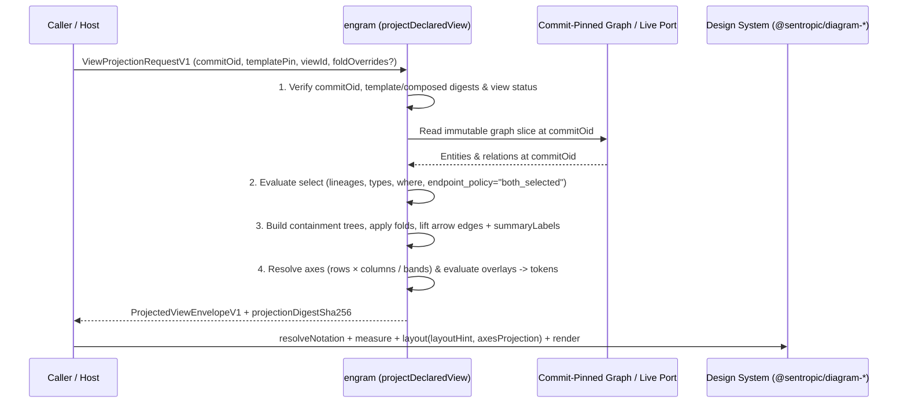

# Specification: View Mechanism of the Base Ontology Profile

- **Document ID:** `SPEC-ENGRAM-PROFILE-VIEW-MECHANISM`
- **Status:** `DESIGN` (Gemini Carbon — normative specification, `proposed` until implementation lots land)
- **Date:** `2026-11-14`
- **Repository / Branch:** `engram` (`docs/memory-r15-sediment`)
- **Depends On:**
  - `spec/SPEC_ENGRAM_METAMODEL_AND_LINEAGE_REGISTRY.md` (**Spec 0** — `engram.metamodel/v1` constructs, `S-ENGRAMHASH v1`, `CrossLineageCompositionPin`, `MM_*` diagnostics)
  - `spec/memory/OWNER-DECISIONS-2026-11-14.md` (**T-M-C** ownership rule)
  - `spec/SPEC_ONTOLOGY_DIAGRAM_VIEW_SCHEMA_V2.md` (`engram:diagram-view-schema/2`)
  - `/home/antoinefa/src/graphify/.graphify/scratch/design/archi-card-semantics/SPEC_EVOL_ARCHI_V2_ONTOLOGY.r4.md` (§8, `engram.archi-view/2`, `viewKind`, `environmentScope`, `folds`, rules `V1`–`V6`)
  - `/home/antoinefa/src/sent-tech-design-system/scratchpad/dc2d/SPEC_EVOL_DC2D_NOTATION_FLOWS.md` (**DC-2d**, `diagram-notation@1`, roles/natures/encodings, `projectView` / `resolveNotation`, layout modes)

---

## 0. Binding Owner Decisions & Architectural Mandate

### 0.1 Owner Decision of 2026-11-13 — Mechanism vs Domain Views vs Rendering

Domain views do **not** belong to the base profile:

> « Attend teprends. Ata doit pas etre dans le profil de base. Precise ta question »

Approved four-way architectural split:

> « Oui, ce découpage »

1. **The base profile carries ONLY the view mechanism** (the declarative view grammar, schema validation, compatibility classification, and commit-pinned subgraph projection).
2. **Domain views** (for example a 2-axis matrix partitioned by `chapter × zone`) **are declared in the domain ontologies** (`process-std`, `client-org`, `archi`, `track`, `h2a`, etc.), never in `engram`'s metamodel or base profile.
3. **The Design System (DS) renders** and owns the closed presentation and layout-hint vocabularies (`diagram-notation@1`, `ds-layout-hints@1`).
4. **Native BPMN extraction is a separate workstream**, strictly outside this specification.

### 0.2 Owner Decision of 2026-11-14 — The T-M-C Rule

Per `spec/memory/OWNER-DECISIONS-2026-11-14.md:9-15`:

- **T (Template):** An ontology template's content belongs to its **author lineage**, sole author (`Track` → `track`, `h2a` → `h2a`, `archi` → `sentropic`, domain lineages → their owning domain repositories such as `client-org` or `process-std`). `engram` contains **zero** foreign template content.
- **M (Metamodel):** The grammar, structural invariants, canonical hashing, compatibility rules, and diagnostic codes belong to **`engram`** (`engram.metamodel/v1`).
- **C (Control):** Domain control masters validate domain policy invariants; `engram` validates metamodel conformance.

Applied to views:
- The **view grammar** (`MetamodelViewDecl` and its validation/projection semantics) is **Metamodel (`M`)**, owned by `engram`.
- Every **view declaration** (`views.<view_id>` inside a `profile.yaml` template) is **Template content (`T`)**, authored and versioned exclusively by its owning lineage.

### 0.3 Problem Statement & Current Code Baseline

1. **No view construct in `engram` profiles today:** `[FACT: src/ontology-profile.ts:341-521]` and `[FACT: src/types.ts:1186-1203]` parse `node_types` (including static-studio `visual_encoding` at `:38-47, 360-376`), `relation_types`, `registries`, `hierarchies`, `class_hierarchies`, `linking`, `extraction`, `projections`, and `outputs`. Neither `OntologyProfile` nor `CONSUMED_KEYS` in `[FACT: src/profile-bundle.ts:30-41, 105-118]` recognizes a `views` block; any `views` key placed in `profile.yaml` today falls into `ProfileBundleV1.extensions` (`[FACT: src/profile-bundle.ts:523-526]`) and triggers `changed_unmodeled_block` (`MAJOR` break on any edit, `[FACT: src/profile-bundle.ts:1188-1192]`).
2. **Spec 0 stopped at eight constructs:** `[FACT: spec/SPEC_ENGRAM_METAMODEL_AND_LINEAGE_REGISTRY.md:52-65]` defines eight `engram.metamodel/v1` constructs (`NodeTypeDecl`, `AttributeDecl`, `RelationTypeDecl`, `StateMachineDecl`, `FileProjectionDecl`, `Version`, `LineageDecl`, `DomainPoliciesDecl`) and strips `presentation` / `visual_encoding` into `presentationDigest` (`:111-126, 265-266`), but does not yet define a metamodel construct for declarative views.
3. **`archi` view rules are hardcoded in TypeScript:** `[FACT: src/ontology-guardian/archi-view.ts:85-115, 401-532]` and `[FACT: SPEC_EVOL_ARCHI_V2_ONTOLOGY.r4.md:314, 718-733]` implement `engram.archi-view/1` and specify `engram.archi-view/2` (`viewKind: "logical" | "deployment"`, `environmentScope`, `plateauFilter`, `activeHierarchy`, `folds`, and invariants `V1`–`V6`) as `archi`-specific shapes rather than a reusable profile grammar.
4. **Domain consumers invented an inverted stopgap:** A domain ontology registry currently attaches a stopgap `views:` array `{ id, kind, status, layout, overlays, note }` per registry entry because the profile metamodel lacked a top-level view declaration block.

This specification adds **Metamodel Construct #9 (`ViewDecl`)** to `engram.metamodel/v1`, defines its ownership and validation diagnostics, specifies commit-pinned view projection from `engram` to the DS, and defines the deterministic migration from the per-registry-entry stopgap `views:` shape.

---

## 1. The View Declaration Grammar (`MetamodelViewDecl`)

### 1.1 Integration into `engram.metamodel/v1`

`MetamodelTemplateDocument` (`[FACT: spec/SPEC_ENGRAM_METAMODEL_AND_LINEAGE_REGISTRY.md:477-494]`) is extended with an optional top-level `views` map and the DC-2d `presentation_vocabulary` pin (`[FACT: SPEC_EVOL_DC2D_NOTATION_FLOWS.md:57-58]`):

```ts
// Extension to Spec 0 §2.4 MetamodelTemplateDocument (proposed)
export interface MetamodelTemplateDocumentWithViews extends MetamodelTemplateDocument {
  /**
   * Closed DS notation vocabulary pin when this template declares node/relation
   * presentation blocks or diagram views rendered by the DS (DC-2d §2.1).
   */
  readonly presentation_vocabulary?: "diagram-notation@1";
  /**
   * Declarative view definitions owned by this template's lineage (Construct #9).
   * Base metamodel carries zero views; domain templates declare 0..N views.
   */
  readonly views?: Readonly<Record<ViewId, MetamodelViewDecl>>;
}
```

Both `views` and `presentation_vocabulary` MUST be added to `CONSUMED_KEYS` in `src/profile-bundle.ts:105-118` so they are compiled into typed bundle fields rather than `ProfileBundleV1.extensions`.

Because T-M-C admits domain ontology lineages alongside the four core platform lineages (`archi`, `h2a`, `track`, `engram` in `Spec 0 :147`), `LineageId` in view selection matches the open registered identifier pattern `^[a-z][a-z0-9-]{1,31}$` (`Spec 0 §2.1`), subject to explicit registration in the `LineageRegistry` and pinning in `composed_lineage_pins` (`Spec 0 §2.5`, `:545-575`).

### 1.2 Normative TypeScript Schema

```ts
/** Lowercase kebab-case identifier: ^[a-z][a-z0-9-]{0,63}$ */
export type ViewId = string;

/**
 * Qualified type or relation reference:
 * - Unqualified "<id>" resolves in the declaring template ("self").
 * - Qualified "<importAlias>:<id>" resolves in the matching entry of
 *   `composed_lineage_pins` (Spec 0 §2.5).
 */
export type QualifiedElementRef = string;

/**
 * Closed structural view archetype owned by engram's metamodel.
 * Carries ZERO domain taxonomy names.
 */
export type ViewMechanismKind =
  | "topology"      // Node-and-edge graph with optional containment folds (<= 1 band axis)
  | "matrix"        // 2-axis orthogonal row × column partition (requires `axes.rows` & `axes.columns`)
  | "lane-flow"     // Swimlane / activity flow (requires `axes.lanes` or DC-2d `role: "lane"` + `"flow-node"`)
  | "hierarchy"     // Containment / taxonomy tree view (requires `folds.containment_relations`)
  | "entity-model"; // Data / schema entity-table diagram (DC-2d `role: "entity-table"`)

/** Closed lifecycle status of a view declaration. */
export type ViewLifecycleStatus =
  | "draft"
  | "experimental"
  | "active"
  | "deprecated"
  | "retired";

export interface MetamodelViewDecl {
  /** Must equal the enclosing map key in `views.<id>`. */
  readonly id: ViewId;
  /** Independent view contract version (exact SemVer MAJOR.MINOR.PATCH). */
  readonly version: SemVer;
  /** Human-readable title (1..120 chars). */
  readonly label: string;
  /** Closed structural mechanism kind. */
  readonly kind: ViewMechanismKind;
  /**
   * Optional domain viewpoint tag owned by the declaring lineage
   * (e.g. "logical" | "deployment" in archi@2, or "governance" in process-std).
   * Pattern: ^[a-z][a-z0-9-]{0,63}$. Never interpreted by engram as domain logic.
   */
  readonly perspective?: string;
  /** Lifecycle state of this view declaration. */
  readonly status: ViewLifecycleStatus;
  /** Required when `status` is "deprecated" or "retired". */
  readonly deprecated_reason?: string;
  /** Optional successor `ViewId` in the same template when deprecated/retired. */
  readonly replaced_by?: ViewId;
  /** Optional human note / rationale (replaces stopgap `note`; PATCH-level metadata). */
  readonly note?: string;
  /** Typed runtime filter parameters bound at projection time (optional). */
  readonly parameters?: Readonly<Record<string, ViewParameterDecl>>;
  /** Subgraph selection rules (lineages, node types, relation types, predicates). */
  readonly select: ViewSelectionDecl;
  /**
   * Occurrence uniqueness invariant:
   * - "single_per_entity" (default): enforces archi V1 (<= 1 occurrence per entity).
   * - "per_axis_cell": permitted ONLY when `axes` has `multi_value_policy: "duplicate_occurrence"`.
   */
  readonly occurrence_uniqueness?: "single_per_entity" | "per_axis_cell";
  /** Containment folding rules (optional; required when `kind === "hierarchy"`). */
  readonly folds?: ViewFoldDecl;
  /** Attribute-to-visual-channel overlay rules (0..8 ordered entries). */
  readonly overlays?: readonly ViewOverlayDecl[];
  /** Orthogonal dimension axes (required when `kind === "matrix"`). */
  readonly axes?: ViewAxesDecl;
  /** Closed DS-owned layout hint descriptor. Zero pixel or coordinate literals. */
  readonly layout: ViewLayoutHintDecl;
}

// ---------------------------------------------------------------------------
// 1.2.1 Runtime Filter Parameters & Deterministic Attribute Predicates
// ---------------------------------------------------------------------------

export interface ViewParameterDecl {
  readonly value_type: "string" | "enum" | "string_list" | "enum_list" | "boolean";
  readonly enum_values?: readonly string[];
  readonly required: boolean;
  readonly default_value?: string | readonly string[] | boolean;
  readonly description?: string;
}

export type ViewValueOperand =
  | { readonly literal: string | number | boolean | readonly (string | number | boolean)[] }
  | { readonly param: string };

export type ViewComparisonOp =
  | "eq"
  | "neq"
  | "in"
  | "not_in"
  | "contains_any"
  | "contains_all"
  | "gte"
  | "lte"
  | "exists"
  | "not_exists";

export interface ViewAttributeComparison {
  readonly attribute: string;
  readonly op: ViewComparisonOp;
  /** Required for all ops except `exists` and `not_exists`. */
  readonly value?: ViewValueOperand;
  /**
   * Deterministic evaluation when `attribute` is absent/null on an element
   * (for ops other than `exists` / `not_exists`):
   * - "exclude" (default): evaluates to false.
   * - "include": evaluates to true (grounds archi@2 `environmentScope` and
   *   `plateauFilter`, where unscoped entities remain admitted).
   */
  readonly on_missing?: "exclude" | "include";
}

export type ViewPredicateExpr =
  | ViewAttributeComparison
  | { readonly all: readonly ViewPredicateExpr[] }
  | { readonly any: readonly ViewPredicateExpr[] }
  | { readonly not: ViewPredicateExpr };

// ---------------------------------------------------------------------------
// 1.2.2 Node & Relation Selection (`select`)
// ---------------------------------------------------------------------------

export interface ViewNodeSelectionDecl {
  /** Non-empty list of admitted node types (`<typeId>` or `<importAlias>:<typeId>`). */
  readonly include_types: readonly QualifiedElementRef[];
  /** Expand `class_hierarchies` subclasses of `include_types` (default: false). */
  readonly include_subclasses?: boolean;
  /** Explicitly excluded node types (applied after `include_types` + subclasses). */
  readonly exclude_types?: readonly QualifiedElementRef[];
  /**
   * Optional restriction to canonical nodes bound from specific `registries` ids
   * declared in the template (supports deterministic migration of registry-scoped views).
   */
  readonly include_registries?: readonly string[];
  /** Deterministic attribute predicate over candidate nodes. */
  readonly where?: ViewPredicateExpr;
}

export interface ViewRelationSelectionDecl {
  /** Admitted relation types, or `"*"` for all declared relations in selected lineages. */
  readonly include_types: "*" | readonly QualifiedElementRef[];
  /** Explicitly excluded relation types. */
  readonly exclude_types?: readonly QualifiedElementRef[];
  /** Deterministic attribute predicate over candidate relations. */
  readonly where?: ViewPredicateExpr;
  /**
   * Closed endpoint rule in v1:
   * Both endpoints MUST survive `select.nodes`. Edges with a filtered-out
   * endpoint are dropped and NEVER lifted across selection filters
   * (grounds archi@2 §5.4 / §8.1 `environmentScope` and `graph-time-slice.ts`
   * `"endpoint-induced"`).
   */
  readonly endpoint_policy: "both_selected";
}

export interface ViewSelectionDecl {
  /**
   * Contributing lineages: `"self"` and/or `importAlias` keys declared in
   * `composed_lineage_pins`. Defaults to `["self"]`.
   */
  readonly lineages?: readonly ("self" | string)[];
  readonly nodes: ViewNodeSelectionDecl;
  readonly relations: ViewRelationSelectionDecl;
}

// ---------------------------------------------------------------------------
// 1.2.3 Fold Rules (`folds`)
// ---------------------------------------------------------------------------

export interface ViewFoldDecl {
  /**
   * Ordered priority list of containment relations that form foldable visual
   * groups in this view. Every entry MUST resolve to a relation with tree
   * hierarchy semantics (`hierarchies` or `hierarchy.shape === "tree"`) and,
   * when `diagram-notation@1` is pinned, `presentation.encoding === "containment"`.
   * Orientation:
   * - "parent_to_child": `source` contains `target`
   * - "child_to_parent": `source` is contained inside `target` (e.g. `c4Parent` / `part_of`)
   */
  readonly containment_relations: readonly {
    readonly relation: QualifiedElementRef;
    readonly orientation: "parent_to_child" | "child_to_parent";
  }[];
  /** Baseline fold state for every foldable container in the view. */
  readonly default_state: "expanded" | "collapsed";
  /** Specific node types whose initial state overrides `default_state` to collapsed. */
  readonly default_collapsed_types?: readonly QualifiedElementRef[];
  /** Specific node types whose initial state overrides `default_state` to expanded. */
  readonly default_expanded_types?: readonly QualifiedElementRef[];
  /**
   * Optional 1-based tree depth threshold (root = 1) at or below which
   * containers start collapsed when `default_state === "expanded"`.
   */
  readonly default_collapsed_depth?: number;
  /**
   * Policy for `arrow`-encoded relations between two SELECTED nodes when at
   * least one endpoint is hidden inside a collapsed container:
   * - "lift_with_summary" (default): lifts to nearest visible container ancestor
   *   and emits `summaryLabels` + `endpointProvenance` (archi V5, DC-2d OA12).
   * - "hide": suppresses edges whose endpoints are folded away.
   */
  readonly folded_edge_policy?: "lift_with_summary" | "hide";
  /** Whether interactive viewers may pass `foldOverrides` at projection time. */
  readonly interactive_toggle: boolean;
}

// ---------------------------------------------------------------------------
// 1.2.4 Attribute Overlays (`overlays`)
// ---------------------------------------------------------------------------

export type OverlayChannel =
  | "badge"              // Compact text/code pill on node/edge (e.g. capability ref, env tag)
  | "tone_token"         // Abstract semantic tone category (`categoryTokens`, theme-invariant)
  | "stroke_style"       // Edge/border line treatment ("solid" | "dashed")
  | "provisional_marker" // Provisional/target-state indicator (DC-2d `provisional`)
  | "detail_pill"        // Secondary slot pill inside card detail row
  | "metric_counter";    // Numeric/count chip from an integer/number attribute

export type SemanticToneToken =
  | "neutral"
  | "accent"
  | "positive"
  | "warning"
  | "critical"
  | "muted";

export interface ViewOverlayDecl {
  /** Unique within the view (`^[a-z][a-z0-9-]{0,31}$`). */
  readonly id: string;
  readonly target: "node" | "relation";
  /** Optional subset of selected types; defaults to all selected types carrying `attribute`. */
  readonly applies_to_types?: readonly QualifiedElementRef[];
  /** Must reference a declared `AttributeDecl` on covered target types. */
  readonly attribute: string;
  /** Closed DS overlay rendering channel. */
  readonly channel: OverlayChannel;
  /**
   * Optional finite lookup (<= 32 keys, matching DC-2d §2.2 slot lookup bound)
   * mapping attribute scalar values to abstract DS tokens:
   * - For `tone_token`: values MUST be `SemanticToneToken`.
   * - For `stroke_style`: values MUST be `"solid" | "dashed"`.
   * - For `provisional_marker`: values MUST be `"provisional" | "settled"`.
   * - For `badge` / `detail_pill`: short plain-text labels (1..24 chars).
   * Raw CSS properties, hex colors (`#...`), and pixel lengths are FORBIDDEN.
   */
  readonly value_map?: Readonly<Record<string, string>>;
  /** Behavior when `attribute` is absent on an instance (default: "omit"). */
  readonly when_missing?: "omit" | { readonly token: string };
  /** Optional legend group heading emitted into `ViewDocument.presentation.diagram.legends`. */
  readonly legend_label?: string;
}

// ---------------------------------------------------------------------------
// 1.2.5 Dimension Axes (`axes`)
// ---------------------------------------------------------------------------

export type AxisValueSource =
  | {
      readonly kind: "attribute";
      /** Declared scalar/enum/ref/list attribute on selected nodes. */
      readonly attribute: string;
    }
  | {
      readonly kind: "relation_target";
      /** Declared relation linking a selected node to its axis bucket entity. */
      readonly relation: QualifiedElementRef;
      readonly direction: "outbound" | "inbound";
      readonly target_type: QualifiedElementRef;
      /** Optional attribute on `target_type` used as display label (defaults to entity label). */
      readonly label_attribute?: string;
    };

export interface ViewAxisDecl {
  /** Axis identifier (`^[a-z][a-z0-9-]{0,31}$`). */
  readonly id: string;
  /** Human axis header label (1..80 chars). */
  readonly label: string;
  readonly source: AxisValueSource;
  /** Deterministic bucket ordering rule. */
  readonly order:
    | "declared_enum"   // Uses `AttributeDecl.enumValues` order (valid when `source` is enum attribute)
    | "registry_order"  // Uses canonical registry order of `target_type` (valid for `relation_target` / `ref`)
    | "key_asc"
    | "key_desc"
    | "explicit";
  /** Required iff `order === "explicit"`. */
  readonly explicit_buckets?: readonly string[];
  /** Whether declared enum values / target registry entries with 0 nodes still render as headers. */
  readonly empty_buckets: "retain" | "omit";
  /** Handling of selected nodes with no value for this axis. */
  readonly unassigned_policy: "exclude" | "unassigned_bucket" | "refuse";
  /**
   * Handling of nodes resolving to >1 bucket on this axis:
   * - "refuse" (default): fails projection if a node resolves to multiple buckets.
   * - "primary_first": picks the first bucket under deterministic `order`.
   * - "duplicate_occurrence": places one occurrence in each matching cell;
   *   REQUIRES `occurrence_uniqueness: "per_axis_cell"` on the view.
   */
  readonly multi_value_policy?: "refuse" | "primary_first" | "duplicate_occurrence";
}

export type ViewAxesDecl =
  | {
      /** 2-axis matrix partition (required when `kind === "matrix"`). */
      readonly mode: "matrix_2d";
      readonly rows: ViewAxisDecl;
      readonly columns: ViewAxisDecl;
    }
  | {
      /** 1-axis swimlane or band partition (valid on `lane-flow` and `topology`). */
      readonly mode: "bands_1d";
      readonly bands: ViewAxisDecl;
    };

// ---------------------------------------------------------------------------
// 1.2.6 Closed DS Layout Hint Vocabulary (`layout`)
// ---------------------------------------------------------------------------

/**
 * Closed layout hint vocabulary owned by the Design System (`ds-layout-hints@1`).
 * Validated by engram against `DS_LAYOUT_VOCABULARY_PIN`; executed solely by DS.
 */
export type DsLayoutMode =
  | "auto-pack"     // Measured hierarchical container/patch pack (DC-2d `layoutMeasured`)
  | "layered-flow"  // Directed rank/layer graph layout
  | "lane-stack"    // Swimlane stack (`packLaneStack` in DC-2d §7.2)
  | "matrix-grid"   // 2D row × column matrix grid (required iff `kind === "matrix"`)
  | "tree";         // Strict hierarchy tree layout

export interface ViewLayoutHintDecl {
  readonly vocabulary: "ds-layout-hints@1";
  readonly mode: DsLayoutMode;
  /** Valid on `layered-flow`, `lane-stack`, and `tree` (DC-2d §7.2 `flowDirection`). */
  readonly direction?: "left-to-right" | "top-to-bottom";
  /** Abstract DS spacing tier — replaces legacy pixel gaps (`cardGapX`, `zoneGapX`). */
  readonly density?: "compact" | "regular" | "spacious";
  /** Label rotation hint on edges (DC-2d §6.1 `rotateLabels`). */
  readonly edge_label_orientation?: "horizontal" | "along-edge";
}
```

### 1.3 Grounding in `archi@2`, `DC-2d`, and `engram` Code (`file:line` & Delta Matrix)

Every element of `MetamodelViewDecl` is grounded in existing `engram`, `archi@2`, and `DC-2d` contracts. The table below states exact `file:line` anchors and distinguishes **generalized existing mechanics** from **net-new metamodel constructs**.

| Grammar Element | Grounding in `engram` / `archi@2` / `DC-2d` (`[FACT: file:line]`) | What Exists Today vs What Is **NEW** |
| :--- | :--- | :--- |
| **Top-level `views` construct** | `spec/SPEC_ENGRAM_METAMODEL_AND_LINEAGE_REGISTRY.md:52-65, 477-494`; `src/ontology-profile.ts:341-521`; `src/profile-bundle.ts:105-118` | **NEW** as Metamodel Construct #9 (`views` in `CONSUMED_KEYS`). Previously `engram` profiles had only static `visual_encoding` (`src/ontology-profile.ts:38-47, 360-376`) and `outputs.ontology` (`:264-287`). |
| **`id`** | `src/ontology-guardian/diagram-schemas.ts:219` (`NativeViewDocument.id`); `SPEC_EVOL_ARCHI_V2_ONTOLOGY.r4.md:721` (`viewId`); `src/ontology-guardian/archi-view.ts:86` (`ArchiViewSpec.id`) | **Generalized:** Lifts instance-level `viewId` to a stable kebab-case template declaration key (`^[a-z][a-z0-9-]{0,63}$`). |
| **`kind` & `perspective`** | `SPEC_EVOL_ARCHI_V2_ONTOLOGY.r4.md:314, 664, 723` (`viewKind: "logical" \| "deployment"`, rule `V6`); `SPEC_EVOL_DC2D_NOTATION_FLOWS.md:41-56, 189-203, 239-245` (`card`/`container`, `lane`+`flow-node`, `entity-table`) | **NEW split:** Separates the closed metamodel structural archetype (`kind`: `topology \| matrix \| lane-flow \| hierarchy \| entity-model`) from the optional lineage-owned viewpoint tag (`perspective`, e.g. `"logical"` / `"deployment"`), keeping `engram` 100% free of domain viewpoint enums. |
| **Selection by lineage (`select.lineages`)** | `spec/SPEC_ENGRAM_METAMODEL_AND_LINEAGE_REGISTRY.md:156-158, 545-575` (`composed_lineage_pins`, `importAlias`) | **NEW in views:** Binds multi-lineage views (`<importAlias>:<typeId>`) strictly to SHA-256-pinned `composed_lineage_pins`. |
| **Selection by type (`include_types`, `exclude_types`, `include_subclasses`, `include_registries`)** | `src/ontology-guardian/diagram-schemas.ts:212` (`NativeViewFilter` `entity-type`, `relation-type`); `SPEC_EVOL_ARCHI_V2_ONTOLOGY.r4.md:314, 563-579` (`V3` `archi-edge-policy`, `V6` `archi2-view-kind-mixed`); `src/ontology-profile.ts:138-251` (`registries`, `class_hierarchies`) | **Generalized:** Promotes instance filter lists and `archi@2`'s hardcoded `V6` type table into declarative type/subclass/registry selectors. |
| **Selection by attribute predicate (`where`, `parameters`, `endpoint_policy`)** | `src/ontology-guardian/diagram-schemas.ts:212` (`attribute-equals`); `SPEC_EVOL_ARCHI_V2_ONTOLOGY.r4.md:99, 112-116, 594, 649, 723` (`environmentScope` with missing-included semantics, `plateauFilter`, dropped dangling edges); `src/graph-time-slice.ts:14-17, 73` (`edges: "endpoint-induced"`) | **Generalized + NEW operators:** Extends flat `attribute-equals` into a closed, side-effect-free predicate AST (`eq`, `neq`, `in`, `not_in`, `contains_any`, `contains_all`, `gte`, `lte`, `exists`, `not_exists`) with `on_missing: "exclude" \| "include"` and typed `$param` bindings, preserving `endpoint_policy: "both_selected"`. |
| **Fold rules (`folds`)** | `SPEC_EVOL_ARCHI_V2_ONTOLOGY.r4.md:314, 580-593, 620, 726` (`activeHierarchy`, `V2` `archi-zone-mismatch`, `V5` `archi-summary-missing`, `folds`); `src/ontology-guardian/archi-view.ts:112, 332-399, 441-460, 493-529`; `src/ontology-guardian/diagram-schemas.ts:210, 224` (`VisualGroup.collapsed`, `summaryLabels`); `SPEC_EVOL_DC2D_NOTATION_FLOWS.md:14, 29, 52-53, 78, 97, 148, 161-164` (`containment`, `tree` requirement, `K5` promotable card, `projectView`, OA12 `endpoint-provenance`) | **Generalized + NEW defaults:** Replaces hardcoded `c4Parent` / `activeHierarchy` with declarative `containment_relations` (checked against `tree` hierarchies and `DC-2d` `containment` encoding) plus declarative `default_state`, `default_collapsed_types`, `default_collapsed_depth`, and `interactive_toggle`. |
| **Overlays (`overlays`)** | `SPEC_EVOL_ARCHI_V2_ONTOLOGY.r4.md:99, 102-103, 118-119, 314, 596, 755` (`V4` `archi-stroke-status` `lifecycle -> dashed`, `category`, `env:` tag, `referenceModel`); `src/ontology-guardian/diagram-schemas.ts:100-112, 127-135` (`categoryTokens`, `legends`, theme-invariance); `SPEC_EVOL_DC2D_NOTATION_FLOWS.md:28-29, 47-48, 51, 75, 165-167` (`provisional`, `<= 32` lookup cap, OA8/OA10) | **NEW first-class view construct:** Unifies ad-hoc `V4` stroke rules, `categoryTokens`, `provisional` markers, and capability/environment pills into typed `AttributeDecl` -> `OverlayChannel` mappings with strict raw-style prohibition. |
| **Dimension axes (`axes`)** | `src/ontology-guardian/archi-view.ts:103` (embryonic `grouping?: "rows" \| "columns"`); `SPEC_EVOL_ARCHI_V2_ONTOLOGY.r4.md:402-409` (single-axis `DeploymentEnvironment` bands); `SPEC_EVOL_DC2D_NOTATION_FLOWS.md:41, 113-114, 239-245` (`role: "lane"`, `packLaneStack`) | **NET-NEW metamodel construct:** Introduces `matrix_2d` (`rows` × `columns`) and `bands_1d` axes bound to declared attributes or functional `relation_target` traversals, with explicit `order`, `empty_buckets`, `unassigned_policy`, and `multi_value_policy` reconciled with `V1` (`archi-view.ts:423-439`). |
| **Layout hint (`layout`)** | `SPEC_EVOL_DC2D_NOTATION_FLOWS.md:7, 25, 29, 31, 61-65, 209-214, 226, 239-245, 290` (`DIAGRAM_NOTATION_PIN`, `layoutMeasured`, `packLaneStack`, `flowDirection`, `rotateLabels`, OA9 zero pixel gaps in profiles); `src/ontology-guardian/archi-view.ts:95-104` (legacy `ArchiLayoutHints`) | **NEW closed DS contract (`ds-layout-hints@1`):** Replaces legacy pixel literals (`cardGapX`, `zoneGapX`, `rankGap`) with DS-owned layout mode and spacing-density tokens pinned via `DS_LAYOUT_VOCABULARY_PIN`. |
| **Lifecycle status (`status`)** | `spec/SPEC_ONTOLOGY_GUARDIAN_G0_CONTRACTS.md:184-201`; `src/ontology-guardian/diagram-registry.ts:93, 129`; `spec/SPEC_ENGRAM_METAMODEL_AND_LINEAGE_REGISTRY.md:522` (`deprecated`, `deprecatedReason`) | **NEW per-view lifecycle:** Formalizes `draft \| experimental \| active \| deprecated \| retired` with `deprecated_reason` and `replaced_by` validation. |
| **Versioning (`version` & digests)** | `spec/SPEC_ENGRAM_METAMODEL_AND_LINEAGE_REGISTRY.md:111-126, 265-266, 535-543, 648-693` (`S-ENGRAMHASH v1`, `templateDigestSha256` vs `presentationDigest`); `src/profile-bundle.ts:847-1223` (`checkProfileCompatibility`) | **NEW view SemVer & digest split:** Adds per-view `version`, keeps corpus `templateDigestSha256` invariant under view edits, rolls `viewsDigestSha256` into `presentationDigest`, and classifies view diffs as `PATCH` / `MINOR` / `MAJOR`. |

### 1.4 Canonical Hashing & SemVer Compatibility Rules

To satisfy both **Spec 0 §1.3.2** (`templateDigestSha256` must not churn when presentation/view metadata changes, `[FACT: spec/SPEC_ENGRAM_METAMODEL_AND_LINEAGE_REGISTRY.md:111-126]`) and downstream view consumer determinism:

1. **Corpus Semantic Digest Invariance (`templateDigestSha256` / `profile_hash`):**
   - `stableForHash` (`src/ontology-profile.ts:69-83`) strips top-level `views` and `presentation_vocabulary` alongside `presentation`, `presentation_hash`, and `node_types.<t>.visual_encoding`.
   - Adding, modifying, or retiring a view declaration **never** invalidates stored semantic corpus facts or `OntologyRecord` digests.
2. **View & Presentation Digests (`S-ENGRAMHASH v1`, RFC 8785 JCS + SHA-256):**
   - `viewsDigestSha256`: SHA-256 over JCS-canonicalized `views` (`sha256:<64 lowercase hex>`), folded into the envelope's `presentationDigest` (`Spec 0 §2.4 :539`).
   - Per view `v = views[id]`, `engram` computes two deterministic sub-digests:
     - `viewSemanticDigestSha256`: hashes `{ id, version, kind, perspective, parameters, select, occurrence_uniqueness, folds, overlays, axes, status }`.
     - `viewPresentationDigestSha256`: hashes `{ label, note, deprecated_reason, replaced_by, layout }`.
3. **Compatibility Classification (`checkProfileCompatibility` in `src/profile-bundle.ts`):**

| View Change Between `previous` and `next` Template Bundle | Required Bump (Template & View `version`) | Reason Code |
| :--- | :--- | :--- |
| Edit `label`, `note`, `deprecated_reason`, or change `layout.density` / `layout.direction` / `layout.edge_label_orientation` (same `layout.mode`) | **`PATCH`** | `changed_view_presentation_hint` |
| Add a new `views.<id>` entry; add an optional `overlay`; add a `parameters.<p>` with `required: false`; promote `draft -> experimental -> active`; mark `active -> deprecated` (with valid `replaced_by` or `deprecated_reason`) | **`MINOR`** | `added_view` / `extended_view_contract` / `deprecated_view` |
| Remove an `active` or `deprecated` view without a `MappingFile` `view_renames` entry; transition to `retired`; change `kind`; change `select`, `axes`, or `folds.containment_relations`; remove an `overlay`; add a `required: true` parameter; change `occurrence_uniqueness` | **`MAJOR`** | `removed_view` / `retired_view` / `changed_view_selection_or_axes` |
| Modify `select` / `axes` / `kind` on a view whose `previous.status` is `"draft"` | **`MINOR`** (pre-active instability allowance) | `changed_draft_view` |

### 1.5 Canonical YAML Specimens

#### Specimen A — Domain 2-Axis Matrix View (`process-std` × `client-org`, Neutral IDs)

```yaml
metamodel_version: "engram.metamodel/v1"
id: "process-std-enterprise"
lineage: "process-std"
version: "1.2.0"
presentation_vocabulary: "diagram-notation@1"

composed_lineage_pins:
  - importAlias: "org"
    lineage: "client-org"
    templateId: "client-org-core"
    templateVersion: "2.1.0"
    templateDigestSha256: "sha256:4a8d9b1e2c3f4a5b6c7d8e9f0a1b2c3d4e5f6a7b8c9d0e1f2a3b4c5d6e7f8a9b"

views:
  activity-by-chapter-and-zone:
    id: "activity-by-chapter-and-zone"
    version: "1.0.0"
    label: "Process Activities by Chapter and Organizational Zone"
    kind: "matrix"
    perspective: "operating-model"
    status: "active"
    note: "Canonical chapter × zone coverage matrix across process-std and client-org."
    select:
      lineages: ["self", "org"]
      nodes:
        include_types: ["process_activity", "process_group", "org:zone_anchor"]
        where:
          attribute: "publication_state"
          op: "in"
          value: { literal: ["approved", "provisional"] }
      relations:
        include_types: ["handoff_to", "contains_activity"]
        endpoint_policy: "both_selected"
    occurrence_uniqueness: "single_per_entity"
    folds:
      containment_relations:
        - relation: "contains_activity"
          orientation: "parent_to_child"
      default_state: "collapsed"
      default_expanded_types: ["process_group"]
      folded_edge_policy: "lift_with_summary"
      interactive_toggle: true
    overlays:
      - id: "lifecycle-stroke"
        target: "relation"
        attribute: "publication_state"
        channel: "stroke_style"
        value_map:
          approved: "solid"
          provisional: "dashed"
        legend_label: "Handoff Maturity"
      - id: "criticality-tone"
        target: "node"
        applies_to_types: ["process_activity"]
        attribute: "criticality"
        channel: "tone_token"
        value_map:
          tier_1: "critical"
          tier_2: "warning"
          tier_3: "neutral"
        when_missing: "omit"
        legend_label: "Activity Criticality"
    axes:
      mode: "matrix_2d"
      rows:
        id: "chapter"
        label: "Process Chapter"
        source:
          kind: "attribute"
          attribute: "chapter_code"
        order: "declared_enum"
        empty_buckets: "retain"
        unassigned_policy: "refuse"
        multi_value_policy: "refuse"
      columns:
        id: "zone"
        label: "Organizational Zone"
        source:
          kind: "relation_target"
          relation: "org:assigned_to_zone"
          direction: "outbound"
          target_type: "org:org_zone"
          label_attribute: "zone_code"
        order: "registry_order"
        empty_buckets: "retain"
        unassigned_policy: "unassigned_bucket"
        multi_value_policy: "refuse"
    layout:
      vocabulary: "ds-layout-hints@1"
      mode: "matrix-grid"
      density: "compact"
```

#### Specimen B — `archi@2` Deployment View Declared in the `archi` Template (Zero Hardcoded TS)

```yaml
views:
  deployment-topology:
    id: "deployment-topology"
    version: "2.0.0"
    label: "Deployment Topology"
    kind: "topology"
    perspective: "deployment"
    status: "active"
    parameters:
      environment_scope:
        value_type: "enum_list"
        enum_values: ["dev", "test", "preprod", "prod"]
        required: false
        default_value: ["prod"]
      plateau_filter:
        value_type: "string_list"
        required: false
    select:
      lineages: ["self"]
      nodes:
        include_types:
          - "LandingZone"
          - "ExecutionZone"
          - "DeploymentNode"
          - "ManagedRuntime"
          - "DeployedInstance"
          - "PhysicalAsset"
        where:
          all:
            - attribute: "environment"
              op: "in"
              value: { param: "environment_scope" }
              on_missing: "include"
            - attribute: "plateauIds"
              op: "contains_any"
              value: { param: "plateau_filter" }
              on_missing: "include"
      relations:
        include_types: ["containsDeployment", "runsOn", "realizedBy", "networkFlow"]
        endpoint_policy: "both_selected"
    folds:
      containment_relations:
        - relation: "containsDeployment"
          orientation: "parent_to_child"
      default_state: "expanded"
      default_collapsed_depth: 3
      folded_edge_policy: "lift_with_summary"
      interactive_toggle: true
    overlays:
      - id: "lifecycle-dash"
        target: "relation"
        attribute: "lifecycle"
        channel: "stroke_style"
        value_map:
          current: "solid"
          target: "dashed"
          deprecated: "dashed"
      - id: "env-tag"
        target: "node"
        attribute: "environment"
        channel: "detail_pill"
    layout:
      vocabulary: "ds-layout-hints@1"
      mode: "auto-pack"
      density: "regular"
```

---

## 2. Ownership Boundary & Closed Validation Diagnostics

### 2.1 Four-Party Ownership Matrix (`T-M-C` + DS)

| Concern | Owner | Allowed Actions | Strictly Forbidden Actions |
| :--- | :--- | :--- | :--- |
| **View Grammar & Projection Kernel (`M`)** | **`engram`** | Parse/validate `MetamodelViewDecl`; emit stable `MM_VIEW_*` diagnostics; enforce SemVer diff rules; evaluate commit-pinned subgraphs, fold lifts, axis assignments, and overlay token lookups. | **Never** declare domain views in the base profile; **never** invent, synthesize, mutate, or auto-repair a view; **never** hardcode domain dimensions (`chapter`, `zone`, `environment`); **never** compute pixel coordinates or render SVG/HTML. |
| **View Declarations (`T`)** | **Domain Template Lineage** (`process-std`, `client-org`, `archi`, `track`, `h2a`, etc.) | Author and SemVer-version `views.<id>` inside its own `profile.yaml`; pin cross-lineage dependencies in `composed_lineage_pins`; retire or deprecate its own views. | **Never** inject domain axes into `engram`; **never** embed raw CSS/hex colors or pixel layout numbers; **never** reference unpinned foreign lineages. |
| **Domain Governance (`C`)** | **Domain Control Master** | Enforce domain-specific publication policies over declared views (e.g., requiring an approved matrix view before publishing a milestone). | **Never** redefine the `MetamodelViewDecl` schema or bypass `MM_VIEW_*` refusal gates. |
| **Layout Vocabulary & Rendering (`DS`)** | **Design System** (`@sentropic/diagram-core`, `@sentropic/diagram-canvas`, matrix/table host) | Own and version `diagram-notation@1` (`DIAGRAM_NOTATION_PIN`) and `ds-layout-hints@1` (`DS_LAYOUT_VOCABULARY_PIN`); measure text, compute geometry/routing/matrix cells, apply theme tokens, and handle interactive UI rendering. | **Never** mutate `engram` semantic subgraphs or re-parent entities across undeclared containment relations (`DC-2d:97`). |

### 2.2 Pure Acceptor / Refuser Contract ("Never Invents a View")

1. **Empty `views` means zero views:** If a template omits `views` or sets `views: {}`, `engram` exposes `0` declared views for that template. `engram` **never** synthesizes a fallback `"default"`, `"all-nodes"`, or `"overview"` view.
2. **Atomic refusal on invalid declarations:** Validation is a pure function `(templateBundle, composedBundles, dsVocabularyPins) => readonly MetamodelDiagnostic[]`. Any `"error"` diagnostic refuses compilation of the template bundle; `engram` never drops invalid fields or coerces unknown `layout.mode` values to `"auto-pack"`.
3. **Pinned DS descriptor verification:** `engram` transcribes and SHA-256-pins `DS_LAYOUT_VOCABULARY_PIN` (matching the existing pattern for `VIEW_SCHEMA_PINS` in `[FACT: src/ontology-guardian/diagram-schemas.ts:1-8, 276-288]` and `DIAGRAM_NOTATION_PIN` in `[FACT: SPEC_EVOL_DC2D_NOTATION_FLOWS.md:61-65]`). `engram` checks membership against that pin without importing browser or rendering dependencies.

### 2.3 Closed `MM_VIEW_*` Diagnostic Catalog

Extending Spec 0 §3.2 (`MetamodelDiagnostic`, `[FACT: spec/SPEC_ENGRAM_METAMODEL_AND_LINEAGE_REGISTRY.md:594-645]`), `engram` emits the following stable diagnostic codes:

| Code | Severity | Trigger Condition |
| :--- | :--- | :--- |
| `MM_VIEW_ID_INVALID` | `error` | Map key or `view.id` fails `^[a-z][a-z0-9-]{0,63}$`, or `view.id !== mapKey`. |
| `MM_VIEW_VERSION_INVALID` | `error` | `view.version` is not exact `MAJOR.MINOR.PATCH` SemVer. |
| `MM_VIEW_KIND_INVALID` | `error` | `view.kind` is outside `ViewMechanismKind`. |
| `MM_VIEW_STATUS_METADATA_MISSING` | `error` | `status` is `"deprecated"` or `"retired"` without non-empty `deprecated_reason`, or `replaced_by` references a non-existent/retired `ViewId`. |
| `MM_VIEW_LINEAGE_UNPINNED` | `error` | `select.lineages` or a qualified `<alias>:<id>` reference uses an alias absent from `composed_lineage_pins`. |
| `MM_VIEW_SELECT_EMPTY_TYPES` | `error` | `select.nodes.include_types` is empty, or `exclude_types` eliminates every included type. |
| `MM_VIEW_TYPE_UNKNOWN` | `error` | Any node type, relation type, or registry ref in `select`, `folds`, `overlays`, or `axes` does not exist in its target pinned template. |
| `MM_VIEW_PREDICATE_INVALID` | `error` | `where` references an undeclared attribute on all candidate types, uses an operator incompatible with `AttributeValueType`, or references an undeclared `$param`. |
| `MM_VIEW_ENDPOINT_POLICY_INVALID` | `error` | `select.relations.endpoint_policy` is missing or not `"both_selected"`. |
| `MM_VIEW_FOLD_NOT_CONTAINMENT_TREE` | `error` | A relation in `folds.containment_relations` lacks `tree` hierarchy semantics (`hierarchies` / `hierarchy.shape === "tree"`), or lacks `presentation.encoding === "containment"` when `diagram-notation@1` is active (`DC-2d:78`), or `kind === "hierarchy"` omits `folds`. |
| `MM_VIEW_FOLD_DEFAULT_CONFLICT` | `error` | The same type appears in both `default_collapsed_types` and `default_expanded_types`, or `default_collapsed_depth < 1`. |
| `MM_VIEW_OVERLAY_BUDGET_EXCEEDED` | `error` | More than `8` overlays declared on a single view, or `value_map` exceeds `32` entries (`DC-2d:75`), or duplicate `overlay.id`. |
| `MM_VIEW_OVERLAY_ATTRIBUTE_UNKNOWN` | `error` | `overlay.attribute` is not declared on any covered target type, or `metric_counter` binds to a non-numeric attribute. |
| `MM_VIEW_OVERLAY_RAW_STYLE_FORBIDDEN` | `error` | `overlay.value_map` or `when_missing` contains a raw hex color, CSS property/function, pixel literal, or token outside the closed domain of `overlay.channel` (G0 `theme-invariance`, `DC-2d` OA10). |
| `MM_VIEW_AXES_KIND_MISMATCH` | `error` | `kind === "matrix"` without `axes.mode === "matrix_2d"`, or `axes.mode === "matrix_2d"` with `kind !== "matrix"`, or `kind === "lane-flow"` with neither `axes.mode === "bands_1d"` nor a selected `role: "lane"` type. |
| `MM_VIEW_AXIS_SOURCE_INVALID` | `error` | `axis.source` references an undeclared attribute/relation, uses `order: "declared_enum"` on a non-enum attribute, uses `order: "registry_order"` without a registry-backed target, or omits `explicit_buckets` when `order === "explicit"`. |
| `MM_VIEW_OCCURRENCE_UNIQUENESS_CONFLICT` | `error` | An axis sets `multi_value_policy: "duplicate_occurrence"` while `occurrence_uniqueness` is `"single_per_entity"` (violates `V1`), or `occurrence_uniqueness: "per_axis_cell"` is set without an axis using `"duplicate_occurrence"`. |
| `MM_VIEW_LAYOUT_VOCABULARY_UNKNOWN` | `error` | `layout.vocabulary` is not `"ds-layout-hints@1"` or fails verification against `DS_LAYOUT_VOCABULARY_PIN`. |
| `MM_VIEW_LAYOUT_HINT_INVALID` | `error` | `layout.mode` is unknown, incompatible with `kind` (e.g. `kind === "matrix"` with `mode !== "matrix-grid"`), supplies `direction` on `"matrix-grid"` / `"auto-pack"`, or contains unmodeled/pixel properties (`cardGapX`, `x`, `y`, `width`, `height`). |
| `MM_VIEW_NOTATION_UNCOVERED` | `error` | `presentation_vocabulary: "diagram-notation@1"` is set, and a type selected by the view lacks an inherited or direct `presentation` block (`DC-2d:105` `notation-type-uncovered`). |
| `MM_VIEW_SEMVER_VIOLATION` | `error` | A breaking/feature view diff violates the §1.4 version bump matrix without a valid `MappingFile`. |
| `MM_VIEW_BASE_PROFILE_DOMAIN_LEAK` | `error` | Enforced on `lineage === "engram"`: rejects any non-empty `views` map on the base metamodel profile itself (§0.1 owner mandate). |

---

## 3. Commit-Pinned View Projection Contract (`engram` → DS)

### 3.1 Projection Request & Mandatory Commit Pinning

`engram` serves a declared view through a pure, deterministic query port (`projectDeclaredView`). Every projection request MUST bind an immutable source commit pin — floating ref names (`"HEAD"`, `"main"`, uncommitted working-tree state) are **refused** (`VIEW_PROJ_UNPINNED_COMMIT_REFUSED`); callers resolve refs to an algorithm-qualified commit OID (`[FACT: spec/SPEC_LIVE_GIT_INDEXING.md:83, 89]`) before invoking projection.

```ts
export type CommittedSourcePin =
  | {
      readonly kind: "live-git-generation";
      readonly cloneKey: string;
      /** Immutable algorithm-qualified commit OID (`sha1:<40hex>` or `sha256:<64hex>`). */
      readonly commitOid: string;
      readonly generationId: string;
    }
  | {
      readonly kind: "corpus-snapshot";
      /** Commit OID from which the file-first graph snapshot was extracted. */
      readonly commitOid: string;
      /** Topology/content digest (`src/graph-time-slice.ts:75`). */
      readonly sourceGraphDigestSha256: Sha256Digest;
    };

export interface ViewProjectionRequestV1 {
  readonly sourcePin: CommittedSourcePin;
  readonly templatePin: {
    readonly lineage: string;
    readonly templateId: string;
    readonly templateVersion: SemVer;
    readonly templateDigestSha256: Sha256Digest;
    readonly presentationDigestSha256: Sha256Digest;
  };
  readonly composedPins: readonly CrossLineageCompositionPin[];
  readonly viewId: ViewId;
  /** Bound values for `view.parameters` (defaults applied for omitted optional params). */
  readonly parameterBindings?: Readonly<Record<string, unknown>>;
  /**
   * Optional interactive container expand/collapse overrides `{ [entityId]: collapsed }`.
   * Refused with `VIEW_PROJ_FOLD_OVERRIDE_FORBIDDEN` if `folds.interactive_toggle === false`.
   */
  readonly foldOverrides?: Readonly<Record<string, boolean>>;
}
```

### 3.2 Six-Stage Deterministic Evaluation Pipeline

Given a verified `ViewProjectionRequestV1`, `engram` executes six pure, deterministic stages without touching layout geometry:

1. **Pin, Lifecycle & Parameter Gate:**
   - Verify `commitOid` syntax, verify `templatePin` and `composedPins` digests match the loaded template bundles, and locate `view = bundle.views[viewId]`.
   - If `view.status === "retired"`, refuse with `VIEW_PROJ_RETIRED_VIEW_REFUSED` (returning `replaced_by` and `deprecated_reason`). If `view.status === "deprecated"`, proceed and attach `deprecationNotice` to the response envelope.
   - Validate `parameterBindings` against `view.parameters` and canonicalize bound values.
2. **Subgraph Selection (Nodes → Endpoint-Induced Relations):**
   - Filter candidate entities at `sourcePin` by `select.lineages`, `select.nodes.include_types` (expanding `class_hierarchies` when `include_subclasses === true`), `exclude_types`, `include_registries`, and `select.nodes.where` (respecting `on_missing`). Sort surviving entities by canonical lexicographic `id`.
   - Filter candidate relations at `sourcePin` by `select.relations.include_types`, `exclude_types`, and `select.relations.where`.
   - Apply `endpoint_policy: "both_selected"`: drop every relation whose `source` or `target` entity is not in the surviving node set, incrementing `counts.droppedDanglingRelations` (`[FACT: src/graph-time-slice.ts:88]`, `[FACT: SPEC_EVOL_ARCHI_V2_ONTOLOGY.r4.md:594]`).
3. **Containment Tree Construction & Fold Lifting:**
   - Build the containment forest over selected nodes using `folds.containment_relations` in declared priority order. Enforce `nearest-holder` placement (`V2` `[FACT: src/ontology-guardian/archi-view.ts:441-460]`, `DC-2d` `[FACT: SPEC_EVOL_DC2D_NOTATION_FLOWS.md:111, 148]`): each contained node attaches to its nearest selected container ancestor; synthetic unbacked groups are never created (`r4.md:593`).
   - Compute `collapsed: boolean` for each container from `default_state`, `default_collapsed_depth`, `default_collapsed_types` / `default_expanded_types`, and `foldOverrides`.
   - Partition selected nodes into **visible occurrences** (no collapsed ancestor) and **folded descendants** (at least one collapsed ancestor).
   - For `arrow`-encoded selected relations (`V3` `[FACT: src/ontology-guardian/archi-view.ts:462-477]`):
     - If both endpoints are visible, emit a direct relation occurrence.
     - If one or both endpoints are folded descendants and `folded_edge_policy === "lift_with_summary"`, lift hidden endpoints to their nearest visible collapsed container ancestor; suppress self-loops inside the same collapsed container; deduplicate parallel lifted pairs into deterministic `summaryLabels` (`V5` `[FACT: src/ontology-guardian/archi-view.ts:332-399]`) and record original hidden endpoint pairs in `endpointProvenance` (`DC-2d` OA12 `[FACT: SPEC_EVOL_DC2D_NOTATION_FLOWS.md:161-164]`).
4. **Orthogonal Axis Assignment (`axes`):**
   - When `view.axes` is declared, resolve bucket keys for every visible occurrence placed on the partitioned plane (top-level visible occurrences, or leaf occurrences inside uncollapsed groups) via `source` (`attribute` or `relation_target`).
   - Order row/column (or band) headers per `order` + `empty_buckets` (`"retain"` preserves empty cells from `enumValues` or target registries so sparse `chapter × zone` coverage gaps remain visible).
   - Apply `unassigned_policy` (`"exclude"`, `"unassigned_bucket"`, or `"refuse"` → `VIEW_PROJ_AXIS_UNASSIGNED_NODE`) and `multi_value_policy` (`"refuse"` → `VIEW_PROJ_AXIS_MULTI_VALUE_NODE`, `"primary_first"`, or `"duplicate_occurrence"` generating cell-scoped occurrence IDs `occ:<entityId>@<rowKey>:<colKey>` when `occurrence_uniqueness === "per_axis_cell"`).
5. **Overlay Token Resolution (`overlays`):**
   - Evaluate `view.overlays` in declared order against each visible node occurrence and visible/lifted relation occurrence. Map raw attribute values through `value_map` / `when_missing` into closed semantic tokens and populate `viewDocument.presentation.diagram.legends` and `categoryTokens` (`[FACT: src/ontology-guardian/diagram-schemas.ts:100-135]`).
6. **Canonical Envelope & Digest Emission (`ProjectedViewEnvelopeV1`):**
   - Emit the immutable envelope below and compute `projectionDigestSha256` via RFC 8785 JCS (`[FACT: src/ontology-guardian/canonical.ts]`).

### 3.3 Normative Projection Output (`ProjectedViewEnvelopeV1`)

```ts
export interface ProjectedViewEnvelopeV1 {
  readonly schema: "engram.projected-view-envelope/v1";
  readonly pin: {
    readonly sourcePin: CommittedSourcePin;
    readonly templateDigestSha256: Sha256Digest;
    readonly presentationDigestSha256: Sha256Digest;
    readonly viewId: ViewId;
    readonly viewVersion: SemVer;
    readonly viewSemanticDigestSha256: Sha256Digest;
    readonly viewPresentationDigestSha256: Sha256Digest;
    readonly diagramViewSchemaPin: string;   // SHA-256 pin of `engram:diagram-view-schema/2`
    readonly diagramNotationPin?: string;    // SHA-256 pin of `diagram-notation@1`
    readonly dsLayoutVocabularyPin: string;  // SHA-256 pin of `ds-layout-hints@1`
    readonly parameterBindingsDigestSha256: Sha256Digest;
    readonly foldOverridesDigestSha256: Sha256Digest;
  };
  readonly metadata: {
    readonly label: string;
    readonly kind: ViewMechanismKind;
    readonly perspective?: string;
    readonly status: Exclude<ViewLifecycleStatus, "retired">;
    readonly deprecationNotice?: {
      readonly reason: string;
      readonly replacedBy?: ViewId;
    };
  };
  /** Selected semantic entities & relations (`engram:diagram-document-schema/1`). */
  readonly semanticSubgraph: NativeSemanticDocument;
  /**
   * Projected DS view document (`engram:diagram-view-schema/2`):
   * occurrences, VisualGroup fold states, summaryLabels, and legends.
   */
  readonly viewDocument: NativeViewDocument;
  /** Provenance of lifted folded edges (DC-2d OA12). */
  readonly liftedEdgeProvenance: readonly {
    readonly summaryKey: string;
    readonly liftedSourceOccurrenceId: string;
    readonly liftedTargetOccurrenceId: string;
    readonly hiddenPairs: readonly {
      readonly entitySourceId: string;
      readonly entityTargetId: string;
      readonly relationId: string;
    }[];
  }[];
  /** Resolved semantic overlay tokens per occurrence (zero hex/pixel styles). */
  readonly resolvedOverlays: readonly {
    readonly overlayId: string;
    readonly occurrenceId: string;
    readonly target: "node" | "relation";
    readonly channel: OverlayChannel;
    readonly token: string;
  }[];
  /** Populated for `matrix_2d` and `bands_1d` views; `null` otherwise. */
  readonly axesProjection:
    | {
        readonly mode: "matrix_2d";
        readonly rows: readonly { readonly key: string; readonly label: string }[];
        readonly columns: readonly { readonly key: string; readonly label: string }[];
        readonly cells: readonly {
          readonly rowKey: string;
          readonly columnKey: string;
          readonly occurrenceIds: readonly string[];
        }[];
        readonly unassignedOccurrenceIds: readonly string[];
      }
    | {
        readonly mode: "bands_1d";
        readonly bands: readonly {
          readonly key: string;
          readonly label: string;
          readonly occurrenceIds: readonly string[];
        }[];
        readonly unassignedOccurrenceIds: readonly string[];
      }
    | null;
  /** Validated DS layout hint forwarded untouched to the DS renderer. */
  readonly layoutHint: ViewLayoutHintDecl;
  /** Contributing `diagram-notation@1` profile slices for `resolveNotation`. */
  readonly notationProfiles: Readonly<Record<string, unknown>>;
  readonly counts: {
    readonly candidateNodes: number;
    readonly selectedNodes: number;
    readonly visibleNodeOccurrences: number;
    readonly foldedNodes: number;
    readonly candidateRelations: number;
    readonly selectedRelations: number;
    readonly droppedDanglingRelations: number;
    readonly visibleEdgeOccurrences: number;
    readonly liftedSummaryEdges: number;
  };
  /** JCS SHA-256 digest memoizing DS `resolveNotation` + layout caches (DC-2d §3.4, §6.4). */
  readonly projectionDigestSha256: Sha256Digest;
}
```



---

## 4. Migration of the Consumer Stopgap `views:` Field

### 4.1 Why Per-Registry-Entry `views:` Is Replaced

A domain ontology consumer currently carries a stopgap `views:` list on individual registry entries:

```ts
interface LegacyRegistryEntryStopgapView {
  readonly id: string;
  readonly kind: string;
  readonly status: string;
  readonly layout: string | Record<string, unknown>;
  readonly overlays?: readonly string[];
  readonly note?: string;
}
```

Attaching `{ id, kind, status, layout, overlays, note }` per registry row inverts `T-M-C`:
1. **Duplication & split-brain hazard:** The same view `id` repeated across `N` registry entries duplicates view-level contract fields (`kind`, `status`, `layout`, `overlays`, `note`) `N` times and permits contradictory states across rows.
2. **Template vs instance confusion:** Under `OWNER-DECISIONS-2026-11-14.md:9-15`, a view declaration is **template-level content** (`views.<id>` in `profile.yaml`), whereas a registry row is a catalog entity instance whose membership in a view is governed by `select.nodes` (`include_types`, `include_registries`, `where`).

### 4.2 Field-by-Field Mapping Table

| Stopgap Per-Registry-Entry Field | Target Path in `MetamodelViewDecl` (`profile.yaml`) | Deterministic Migration & Validation Rule |
| :--- | :--- | :--- |
| *(Structural attachment: `registry[entry].views[]`)* | Top-level `views.<id>` + `views.<id>.select.nodes` | **Deduplicating hoist:** Group all stopgap entries across the domain registry by `entry.views[].id`. Emit **one** `MetamodelViewDecl` per unique `id`. Populate `select.nodes.include_registries` (and corresponding `include_types`) from the registries whose entries referenced `id`. If only a subset of rows within a registry carried `id`, migrate row membership to a declared node attribute (`published_views` or domain attribute predicate) matched by `select.nodes.where`, and strip `views:` from the registry file. |
| `id` | `views.<id>.id` (and map key `<id>`) | Normalize/validate against `^[a-z][a-z0-9-]{0,63}$`. Refuse migration (`MIG_STOPGAP_VIEW_ID_INVALID`) if empty or colliding after normalization. |
| `kind` | `views.<id>.kind` (+ optional `views.<id>.perspective`) | Map structural values `1:1`: `"topology" -> "topology"`, `"matrix" -> "matrix"`, `"flow" \| "lane-flow" -> "lane-flow"`, `"hierarchy" \| "tree" -> "hierarchy"`, `"erd" \| "entity-model" -> "entity-model"`. If stopgap `kind` held a domain viewpoint string (e.g. `"operating-model"`, `"logical"`, `"governance"`), infer `kind` from declared axes/layout (`"matrix"` if 2-axis, else `"topology"`) and preserve the original string lossless in `views.<id>.perspective`. Refuse (`MIG_STOPGAP_CONFLICTING_FIELD`) if two registry entries specify different `kind` values for the same `id`. |
| `status` | `views.<id>.status` | Map `"draft" -> "draft"`, `"experimental" \| "preview" -> "experimental"`, `"active" \| "published" \| "stable" -> "active"`, `"deprecated" -> "deprecated"`, `"retired" \| "archived" -> "retired"`. If `"deprecated"` or `"retired"`, populate `deprecated_reason` from `note` (or require explicit author string if `note` is empty). Refuse on cross-entry conflict. |
| `layout` | `views.<id>.layout` (`{ vocabulary: "ds-layout-hints@1", mode, direction?, density? }`) | Map stopgap token strings: `"auto" \| "pack" \| "auto-pack" -> { mode: "auto-pack" }`, `"matrix" \| "grid" \| "matrix-grid" -> { mode: "matrix-grid" }`, `"lanes" \| "swimlane" \| "lane-stack" -> { mode: "lane-stack" }`, `"flow-lr" -> { mode: "layered-flow", direction: "left-to-right" }`, `"flow-tb" -> { mode: "layered-flow", direction: "top-to-bottom" }`, `"tree" -> { mode: "tree" }`. Refuse (`MIG_STOPGAP_PIXEL_LAYOUT_REFUSED`) if stopgap `layout` embeds raw pixel numbers or coordinates. |
| `overlays` | `views.<id>.overlays[]` | Convert each stopgap overlay attribute name `<attr>` into a typed `ViewOverlayDecl`: `{ id: "<attr>-overlay", target: "node" \| "relation" (resolved from template AttributeDecl owner), attribute: "<attr>", channel: <inferred closed channel or author mapping table> }`. Refuse (`MIG_STOPGAP_UNKNOWN_OVERLAY_ATTR`) if `<attr>` is not a declared `AttributeDecl` in the domain template. |
| `note` | `views.<id>.note` | Preserve verbatim when identical across all registry rows citing `id`. If rows carry distinct per-row notes, refuse automatic merge (`MIG_STOPGAP_DIVERGENT_NOTES`) unless the author chooses template-level `note` vs row-level entity `description`. |
| *(Implicit / absent in stopgap)* | `version`, `label`, `select.relations`, `folds`, `axes` | Initialize `version: "1.0.0"`; derive `label` from human-cased `id` if absent; set `select.relations: { include_types: "*", endpoint_policy: "both_selected" }`; require explicit `axes.rows` and `axes.columns` declaration in the domain template whenever migrated `kind === "matrix"`. |

### 4.3 Before / After Specimen (Neutral Domain Registry `process-std`)

**Before (stopgap per-registry-entry `views:` in `registries/activities.yaml` — deprecated):**

```yaml
# Stopgap inside domain registry entries (to be removed)
entries:
  - id: "act-order-intake"
    label: "Order Intake"
    chapter_code: "ch-01"
    zone_ref: "zone-front-office"
    criticality: "tier_1"
    views:
      - id: "chapter-zone-matrix"
        kind: "matrix"
        status: "active"
        layout: "grid"
        overlays: ["criticality"]
        note: "Chapter × zone operating matrix."
```

**After (registry row holds pure instance facts; template `profile.yaml` owns `views.<id>`):**

```yaml
# 1. Domain registry row (`registries/activities.yaml`) — zero `views:` key:
entries:
  - id: "act-order-intake"
    label: "Order Intake"
    chapter_code: "ch-01"
    zone_ref: "zone-front-office"
    criticality: "tier_1"

# 2. Domain template (`profile.yaml`) — top-level declarative view:
views:
  chapter-zone-matrix:
    id: "chapter-zone-matrix"
    version: "1.0.0"
    label: "Chapter Zone Matrix"
    kind: "matrix"
    status: "active"
    note: "Chapter × zone operating matrix."
    select:
      nodes:
        include_types: ["process_activity"]
        include_registries: ["activities"]
      relations:
        include_types: "*"
        endpoint_policy: "both_selected"
    overlays:
      - id: "criticality-overlay"
        target: "node"
        attribute: "criticality"
        channel: "tone_token"
        value_map:
          tier_1: "critical"
          tier_2: "warning"
          tier_3: "neutral"
    axes:
      mode: "matrix_2d"
      rows:
        id: "chapter"
        label: "Chapter"
        source: { kind: "attribute", attribute: "chapter_code" }
        order: "declared_enum"
        empty_buckets: "retain"
        unassigned_policy: "refuse"
      columns:
        id: "zone"
        label: "Zone"
        source: { kind: "attribute", attribute: "zone_ref" }
        order: "registry_order"
        empty_buckets: "retain"
        unassigned_policy: "refuse"
    layout:
      vocabulary: "ds-layout-hints@1"
      mode: "matrix-grid"
```

---

## 5. Explicit Non-Goals & Out of Scope

1. **Native BPMN 2.0 extraction and internal choreography modelling:** Parsing `.bpmn` XML files, extracting internal BPMN gateways/events/sequence flows into `engram`, or projecting BPMN collaboration diagrams is a **separate workstream** outside this specification (§0.1). External process specifications remain opaque string references (such as `bpmnRef` in `SPEC_EVOL_ARCHI_V2_ONTOLOGY.r4.md:455, 899`).
2. **Any domain dimension, axis, or viewpoint in the base profile:** `engram`'s base metamodel and built-in `app-context` profile carry **zero** domain axes (`chapter`, `zone`, `environment`, `plateau`, organizational unit, business capability) and **zero** domain views (`MM_VIEW_BASE_PROFILE_DOMAIN_LEAK`). Every domain view and domain axis lives exclusively in its owning domain ontology template.
3. **Geometry, text measurement, edge routing, and rendering in `engram`:** `engram` never measures glyph widths, never assigns `(x, y, width, height)` boxes, never routes orthogonal/spline edges, and never resolves theme colors. Those responsibilities belong exclusively to the Design System.

---

## 6. Test-First Implementation Lots (TypeScript / Vitest Only)

All implementation work is strictly TypeScript/Node.js verified with `vitest` and `tsc --noEmit`. Each lot writes failing unit/contract tests **before** production code.

### Lot V.1 — Metamodel Schema, `DS_LAYOUT_VOCABULARY_PIN`, and `MM_VIEW_*` Validator
- **Tests first (`src/__tests__/metamodel-view-grammar.test.ts`):**
  - Positive vectors: Specimen A (`matrix` `chapter × zone` with `composed_lineage_pins`), Specimen B (`archi@2` `topology` with `$param` and `on_missing: "include"`), `lane-flow`, `hierarchy`, and empty/omitted `views`.
  - Negative vectors: one dedicated fixture per `MM_VIEW_*` code in §2.3 (`22` codes), including `MM_VIEW_BASE_PROFILE_DOMAIN_LEAK` on `lineage: "engram"`, `MM_VIEW_OVERLAY_RAW_STYLE_FORBIDDEN` on `#ff0000` / `12px`, `MM_VIEW_FOLD_NOT_CONTAINMENT_TREE` on a `dag` relation, and `MM_VIEW_OCCURRENCE_UNIQUENESS_CONFLICT`.
- **Implementation:** `src/metamodel/view-grammar.ts`, `src/ontology-guardian/ds-layout-vocabulary.ts` (pinned `ds-layout-hints@1` descriptor).

### Lot V.2 — Canonical Digests (`S-ENGRAMHASH v1`) & `ProfileBundleV1` SemVer Compatibility
- **Tests first (`src/__tests__/profile-bundle-views-compat.test.ts`):**
  - Prove `templateDigestSha256` (`profile_hash`) is bit-for-bit identical before and after adding/editing/removing `views`, while `presentationDigest` and `viewsDigestSha256` change deterministically under RFC 8785 JCS key reordering.
  - Verify `CONSUMED_KEYS` absorbs `views` and `presentation_vocabulary` (`ProfileBundleV1.extensions` stays `{}`).
  - Verify every row of the §1.4 SemVer compatibility matrix (`PATCH`, `MINOR`, `MAJOR`, draft-view allowance, and `MappingFile` `view_renames`).
- **Implementation:** Update `src/ontology-profile.ts` (`stableForHash`), `src/profile-bundle.ts` (`CONSUMED_KEYS`, `compileProfileBundle`, `checkProfileCompatibility`), and `src/types.ts`.

### Lot V.3 — Commit-Pinned Subgraph, Fold-Lift, Overlay & 2D Axis Projection Engine
- **Tests first (`src/__tests__/view-projection-engine.test.ts`):**
  - Refusal on unpinned refs (`"HEAD"`, `"main"`) and `"retired"` views (`VIEW_PROJ_UNPINNED_COMMIT_REFUSED`, `VIEW_PROJ_RETIRED_VIEW_REFUSED`).
  - Selection & scope isolation: verify `endpoint_policy: "both_selected"` drops edges to filtered-out nodes without lifting, whereas `folds` lifts `arrow` edges across collapsed containers with deterministic `summaryLabels` (`V5`) and `liftedEdgeProvenance` (`DC-2d` OA12).
  - `matrix_2d` projection: verify `declared_enum` and `registry_order` headers, `empty_buckets: "retain"` for sparse `chapter × zone` cells, `unassigned_policy`, and `multi_value_policy: "duplicate_occurrence"` with `occurrence_uniqueness: "per_axis_cell"`.
  - Byte-for-byte determinism of `projectionDigestSha256` across shuffled input entity/relation arrays at the same `commitOid`.
- **Implementation:** `src/view-projection/project-declared-view.ts`.

### Lot V.4 — Stopgap Registry `views:` Migration Tooling & Refusal Suite
- **Tests first (`src/__tests__/migrate-stopgap-registry-views.test.ts`):**
  - Lossless N-to-1 deduplicating hoist from per-registry-entry `{ id, kind, status, layout, overlays, note }` fixtures to top-level `views.<id>` + cleaned registry YAML.
  - Deterministic refusal on conflicting `kind`/`status`/`layout`/`note` across rows, embedded pixel layout values (`MIG_STOPGAP_PIXEL_LAYOUT_REFUSED`), and undeclared overlay attributes (`MIG_STOPGAP_UNKNOWN_OVERLAY_ATTR`).
- **Implementation:** `src/view-projection/migrate-stopgap-views.ts`.

### Lot V.5 — `archi@2` Parity Verification Over Declarative View Grammar
- **Tests first (`src/__tests__/archi-v2-declarative-view-parity.test.ts`):**
  - Express `archi@2` `logical` and `deployment` views (`environmentScope`, `plateauFilter`, `activeHierarchy`, `V1`–`V6`) purely as `MetamodelViewDecl` entries and verify exact equivalence on golden `NativeSemanticDocument` fixtures against `src/ontology-guardian/archi-view.ts`.

---

## 7. Open Questions

### 7.1 Open Questions for the Design System (DS) Team

1. **DS-Q1 — Freezing `DS_LAYOUT_VOCABULARY_PIN` (`ds-layout-hints@1`):**
   Does `@sentropic/diagram-core` accept owning and exporting the canonical JSON Schema + SHA-256 pin for `ds-layout-hints@1` (`auto-pack`, `layered-flow`, `lane-stack`, `matrix-grid`, `tree`, `direction`, `density`, `edge_label_orientation`) alongside `DIAGRAM_NOTATION_PIN` (`DC-2d §2.1`)?
   - *Proposed default:* Yes; `engram` transcribes the pinned constant with SHA-256 verification exactly like `diagram-schemas.ts`.
2. **DS-Q2 — Rendering Host for `matrix-grid` (`axesProjection.mode === "matrix_2d"`):**
   Will 2-axis matrix views (`chapter × zone`) including cross-cell `arrow` handoff edges be rendered inside `@sentropic/diagram-canvas` as a grid-partitioned scene, or by a dedicated DS matrix/table component when relation occurrences are suppressed?
   - *Proposed default:* `@sentropic/diagram-canvas` owns `matrix-grid` whenever `select.relations` admits `arrow` edges across cells; a pure tabular host may consume the exact same `ProjectedViewEnvelopeV1` when `visibleEdgeOccurrences === 0`.
3. **DS-Q3 — Card Slot Placement for `ViewOverlayDecl` Channels (`OA8` Card Anatomy):**
   In `DC-2d` §4.1 (`OA8`, fixed card anatomy), which exact visual sub-regions host `badge`, `detail_pill`, and `metric_counter` overlays so card height prediction in `measure.ts` stays exact without DOM measurement?
   - *Proposed default:* Cap visible node overlays to `<= 2` pills in the existing `detail` / `footer` anatomy row and `1` header corner `metric_counter`, keeping card box height closed-form.
4. **DS-Q4 — Cell-Scoped Occurrence IDs Under `occurrence_uniqueness: "per_axis_cell"`:**
   `diagram-view-schema@2` already keys `summaryLabels` and selection by `occurrence.id` rather than `entityId` (`DC-2d §5.2 :146`). Confirm that DS hover/selection highlighting highlights all sibling occurrences sharing `entityId` when a multi-cell entity is duplicated across matrix cells.

### 7.2 Open Questions for Domain Ontology Owners (`process-std`, `client-org`, `track`, `h2a`)

1. **DOM-Q1 — Axis Representation in Domain Templates (`attribute` vs `relation_target`):**
   For 2-axis domain matrices (such as `chapter × zone`), are both axes backed by canonical entity registries linked via relations (`relation_target`), or is one axis an inline `enum` attribute (`declared_enum`)? (`MetamodelViewDecl` supports both; each domain template must choose one canonical representation per axis.)
2. **DOM-Q2 — Policy for Unassigned & Multi-Zone Entities (`unassigned_policy`, `multi_value_policy`):**
   When an approved domain entity has not yet been mapped to a `zone`, or spans multiple zones, should the domain matrix **refuse** projection (`"refuse"`), route unmapped entities to an explicit `"unassigned_bucket"`, or duplicate the card into each covered cell (`"duplicate_occurrence"` + `occurrence_uniqueness: "per_axis_cell"`)?
3. **DOM-Q3 — Stopgap Registry `views:` Cutover & Row-Level Membership:**
   In existing registries using the stopgap `views:` field, did `entry.views[]` ever encode selective per-row curation (including row A of a registry while hiding sibling row B of the same type and status), or did every active row carry the same `views:` block? If selective curation existed, confirm the domain attribute name (e.g. `publication_tier` or `view_tags`) that replaces per-row `views:` in `select.nodes.where`.
4. **DOM-Q4 — Default Fold State for Multi-Level Process / Org Hierarchies:**
   In domain matrix views whose cells contain hierarchical groups (`process_group -> process_activity`), should cells open with groups `"collapsed"` (showing lifted handoff summaries via `folded_edge_policy: "lift_with_summary"`) or `"expanded"` down to `default_collapsed_depth: 2`?
