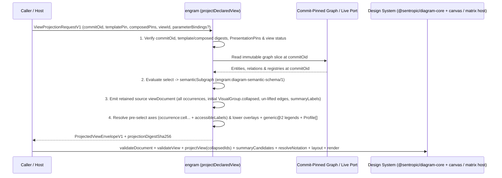

# Specification: View Mechanism of the Base Ontology Profile

- **Document ID:** `SPEC-ENGRAM-PROFILE-VIEW-MECHANISM`
- **Status:** `DESIGN` (Gemini Carbon — normative specification, DS & ontology registry reviews folded `2026-11-14`, `proposed` until implementation lots land)
- **Date:** `2026-11-14`
- **Repository / Branch:** `engram` (`docs/memory-r15-sediment`)
- **Depends On:**
  - `spec/SPEC_ENGRAM_METAMODEL_AND_LINEAGE_REGISTRY.md` (**Spec 0** — `engram.metamodel/v1` constructs, `S-ENGRAMHASH v1`, `CrossLineageCompositionPin`, `MM_*` diagnostics)
  - `spec/SPEC_ONTOLOGY_GUARDIAN_G0_CONTRACTS.md` (**G0** — `Pin`, instance-merge boundary & `G3` cross-ontology identity deferral)
  - `spec/memory/OWNER-DECISIONS-2026-11-14.md` (**T-M-C** ownership rule, Points `1B`–`6A`, `D28` kept)
  - `spec/SPEC_ONTOLOGY_DIAGRAM_VIEW_SCHEMA_V2.md` (`engram:diagram-view-schema/2`)
  - `/home/antoinefa/src/graphify/.graphify/scratch/design/archi-card-semantics/SPEC_EVOL_ARCHI_V2_ONTOLOGY.r4.md` (§8, `engram.archi-view/2`, `viewKind`, `environmentScope`, `folds`, rules `V1`–`V6`)
  - `/home/antoinefa/src/sent-tech-design-system/scratchpad/dc2d/SPEC_EVOL_DC2D_NOTATION_FLOWS.md` (**DC-2d**, `diagram-notation@1`, `DIAGRAM_NOTATION_PIN`, `DS_LAYOUT_VOCABULARY_PIN`, `validateView` / `projectView` / `summaryCandidates` / `resolveNotation`, layout modes)

---

## 0. Binding Owner Decisions & Architectural Mandate

### 0.1 Owner Decision of 2026-11-13 — Mechanism vs Domain Views vs Rendering

Domain views do **not** belong to the base profile:

> « Attend teprends. Ata doit pas etre dans le profil de base. Precise ta question »

Approved four-way architectural split:

> « Oui, ce découpage »

1. **The base profile carries ONLY the view mechanism** (the declarative view grammar, schema validation, compatibility classification, and commit-pinned semantic subgraph + retained source view emission, with zero pre-projection).
2. **Domain views** (for example a 2-axis breakdown matrix partitioned by `chapter × zone`) **are declared in the domain ontologies** (`R1`–`R7`, `process-std`, `client-org`, `archi`, `track`, `h2a`, etc.), never in `engram`'s metamodel or base profile.
3. **The Design System (DS) folds, lays out, and renders**, and `@sentropic/diagram-core` authors, versions, and exports the closed presentation and layout-hint vocabularies (`diagram-notation@1` via `DIAGRAM_NOTATION_PIN`, `ds-layout-hints@1` via `DS_LAYOUT_VOCABULARY_PIN`). `engram` only **references** those pins and never declares or owns the layout vocabulary.
4. **Native BPMN extraction is a separate workstream**, strictly outside this specification.

### 0.2 Owner Decision of 2026-11-14 — The T-M-C Rule

Per `spec/memory/OWNER-DECISIONS-2026-11-14.md:9-15`:

- **T (Template):** An ontology template's content belongs to its **author lineage**, sole author (`Track` → `track`, `h2a` → `h2a`, `archi` → `engram`, domain lineages → their owning producer lineages or registry converters). `engram` contains **zero** foreign template content.
- **M (Metamodel):** The grammar, structural invariants, canonical hashing, compatibility rules, and diagnostic codes belong to **`engram`** (`engram.metamodel/v1`).
- **C (Control):** Domain control masters validate domain policy invariants; `engram` validates metamodel conformance.

Applied to views:
- The **view grammar** (`MetamodelViewDecl` and its validation and source-slice semantics) is **Metamodel (`M`)**, owned by `engram`.
- Every **view declaration** (`views.<view_id>` inside a `profile.yaml` template) is **Template content (`T`)**, authored and versioned exclusively by its owning template author.

### 0.3 Problem Statement & Current Code Baseline

1. **No view construct in `engram` profiles today:** `[FACT: src/ontology-profile.ts:341-521]` and `[FACT: src/types.ts:1186-1203]` parse `node_types` (including static-studio `visual_encoding` at `:38-47, 360-376`), `relation_types`, `registries`, `hierarchies`, `class_hierarchies`, `linking`, `extraction`, `projections`, and `outputs`. Neither `OntologyProfile` nor `CONSUMED_KEYS` in `[FACT: src/profile-bundle.ts:30-41, 105-118]` recognizes a `views` block; any `views` key placed in `profile.yaml` today falls into `ProfileBundleV1.extensions` (`[FACT: src/profile-bundle.ts:523-526]`) and triggers `changed_unmodeled_block` (`MAJOR` break on any edit, `[FACT: src/profile-bundle.ts:1188-1192]`).
2. **Spec 0 stopped at eight constructs:** `[FACT: spec/SPEC_ENGRAM_METAMODEL_AND_LINEAGE_REGISTRY.md:52-65]` defines eight `engram.metamodel/v1` constructs (`NodeTypeDecl`, `AttributeDecl`, `RelationTypeDecl`, `StateMachineDecl`, `FileProjectionDecl`, `Version`, `LineageDecl`, `DomainPoliciesDecl`) and strips `presentation` / `visual_encoding` into `presentationDigest` (`:111-126, 265-266`), without yet defining a metamodel construct for declarative views.
3. **`archi` view rules are hardcoded in TypeScript:** `[FACT: src/ontology-guardian/archi-view.ts:85-115, 401-532]` and `[FACT: SPEC_EVOL_ARCHI_V2_ONTOLOGY.r4.md:314, 718-733]` implement `engram.archi-view/1` and specify `engram.archi-view/2` (`viewKind: "logical" | "deployment"`, `environmentScope`, `plateauFilter`, `activeHierarchy`, `folds`, and invariants `V1`–`V6`) as `archi`-specific shapes rather than a reusable profile grammar.
4. **Domain catalog stopgap sits one level above `profile.yaml`:** A domain ontology catalog (`R1`–`R7`) currently carries a provisional `views:` list `{ id, kind, status, layout, overlays, note }` on each **catalog entry** (`ontologies/<ID>/entry.yaml`, one list per ontology, never on CSV registry rows) because `profile.yaml` lacked a top-level `views` declaration block.

This specification adds **Metamodel Construct #9 (`ViewDecl`)** to `engram.metamodel/v1`, defines its ownership and validation diagnostics, specifies the commit-pinned semantic subgraph and retained source `ViewDocument` contract from `engram` to the DS (with folding and layout executed exclusively by the DS), and defines the authored 1:1 migration from the catalog-entry stopgap `views:` list into `profile.yaml`.

---

## 1. The View Declaration Grammar (`MetamodelViewDecl`)

### 1.1 Integration into `engram.metamodel/v1`

`MetamodelTemplateDocument` (`[FACT: spec/SPEC_ENGRAM_METAMODEL_AND_LINEAGE_REGISTRY.md:477-490]`) is extended with an optional top-level `views` map and the DC-2d `presentation_vocabulary` pin (`[FACT: SPEC_EVOL_DC2D_NOTATION_FLOWS.md:57-58]`):

```ts
// Extension to Spec 0 §1.4 MetamodelTemplateDocument (proposed)
export interface MetamodelTemplateDocumentWithViews extends MetamodelTemplateDocument {
  /**
   * Closed DS notation vocabulary pin when this template declares node/relation
   * presentation blocks or diagram views rendered by the DS (DC-2d §3.1).
   */
  readonly presentation_vocabulary?: "diagram-notation@1";
  /**
   * Declarative view definitions owned by this template's author (Construct #9).
   * Base metamodel carries zero views; domain templates declare 0..N views.
   */
  readonly views?: Readonly<Record<ViewId, MetamodelViewDecl>>;
}
```

Both `views` and `presentation_vocabulary` MUST be added to `CONSUMED_KEYS` in `src/profile-bundle.ts:105-118` so they are compiled into typed bundle fields rather than `ProfileBundleV1.extensions`.

**Domain lineages & single-store composition vs. cross-bundle `G3` boundary:**
- Alongside the four core platform lineages (`archi`, `h2a`, `track`, `engram` in `Spec 0 §2.1`), domain ontology bundles (`R1`–`R7`) are authored by their respective domain producer or converter lineages (`^[a-z][a-z0-9-]{1,31}$`); `engram` itself (`lineage === "engram"` / base profile) carries zero domain views (`MM_VIEW_BASE_PROFILE_DOMAIN_LEAK`).
- Within a single commit-pinned `engram` store (`sourcePin`), a template may reference external types via `<importAlias>:<id>` when bound in `composed_lineage_pins` (`Spec 0 §2.5`, `spec/SPEC_ENGRAM_METAMODEL_AND_LINEAGE_REGISTRY.md:545-576`, e.g. `track-archi2-bridge@1`).
- Across independent file-first / catalog ontology bundles (`R1`–`R7`), **cross-template / cross-ontology instance selection (`view_includes`, such as `R7` selecting target nodes owned by `R1`/`R4`/`R5`/`R6`) is NOT part of §1 v1 and waits for `G3`** (canonical cross-ontology instance IDs = `G0` ontology identity + local ID, and cross-bundle graph merge/resolution per `spec/SPEC_ONTOLOGY_GUARDIAN_G0_CONTRACTS.md:596`). Until `G3` lands, multi-ontology catalog views such as `R7` remain single-template declarations using local placeholder/reference target nodes (§5.4, §7.2).

### 1.2 Normative TypeScript Schema

```ts
/**
 * DS contract pin shape exported by `@sentropic/diagram-core`
 * (`presentation.ts:18-22`, matching `src/ontology-guardian/diagram-schemas.ts:11-20`).
 * `contentDigest` is bare 64 lowercase hex (`^[0-9a-f]{64}$`) over RFC 8785 JCS bytes.
 */
export interface PresentationPin {
  readonly id: string;
  readonly version: string;
  readonly contentDigest: string;
}

/** Lowercase kebab-case identifier: ^[a-z][a-z0-9-]{0,63}$ */
export type ViewId = string;

/**
 * Qualified type or relation reference:
 * - Unqualified "<id>" resolves in the declaring template ("self").
 * - Qualified "<importAlias>:<id>" resolves in the matching entry of
 *   `composed_lineage_pins` (Spec 0 §2.5) within the same commit-pinned store.
 */
export type QualifiedElementRef = string;

/**
 * Closed structural view archetype owned by engram's metamodel.
 * Carries ZERO domain taxonomy names.
 */
export type ViewMechanismKind =
  | "topology"      // Node-and-edge graph with optional containment folds (<= 1 band axis)
  | "matrix"        // 2-axis orthogonal row × column partition (requires `axes.rows` & `axes.columns`)
  | "lane-flow"     // Swimlane / activity flow (requires `axes.bands` or DC-2d `role: "lane"` + `"flow-node"`)
  | "hierarchy"     // Containment / taxonomy tree view (requires `folds.containment_relations`)
  | "entity-model"; // Data / schema entity-table diagram (DC-2d `role: "entity-table"`)

/**
 * Closed lifecycle status of a view declaration inside `profile.yaml`.
 * Catalog-level readiness tokens (`requested | available | waiting-engram | source-gap`)
 * stay outside `MetamodelViewDecl` in the catalog `entry.yaml` (§4.2).
 * Newly migrated template views start at `"draft"`.
 */
export type ViewLifecycleStatus =
  | "draft"
  | "experimental"
  | "active"
  | "deprecated"
  | "retired";

export interface MetamodelViewDecl {
  /** Must equal the enclosing map key in `views.<id>`. */
  readonly id: ViewId;
  /** Independent view contract version (exact SemVer MAJOR.MINOR.PATCH). */
  readonly version: SemVer;
  /** Human-readable title (1..120 chars). */
  readonly label: string;
  /** Closed structural mechanism kind. */
  readonly kind: ViewMechanismKind;
  /**
   * Optional domain viewpoint tag owned by the declaring template author
   * (e.g. "logical" | "deployment" in archi@2, or "capability-map" |
   * "roadmap" | "application-landscape" | "traceability" in R1–R7).
   * Pattern: ^[a-z][a-z0-9-]{0,63}$. Never interpreted by engram as domain logic.
   */
  readonly perspective?: string;
  /** Lifecycle state of this view declaration (newly authored/migrated views start at "draft"). */
  readonly status: ViewLifecycleStatus;
  /** Required when `status` is "deprecated" or "retired". */
  readonly deprecated_reason?: string;
  /** Optional successor `ViewId` in the same template when deprecated/retired. */
  readonly replaced_by?: ViewId;
  /** Optional human note / design-intent rationale (PATCH-level metadata). */
  readonly note?: string;
  /** Typed runtime filter parameters bound at query time (optional). */
  readonly parameters?: Readonly<Record<string, ViewParameterDecl>>;
  /** Subgraph selection rules (lineages, node types, relation types, predicates). */
  readonly select: ViewSelectionDecl;
  /**
   * Occurrence uniqueness invariant:
   * - "single_per_entity" (default): enforces archi V1 (<= 1 occurrence per entity).
   * - "per_axis_cell": permitted ONLY when `axes` has an axis resolving with
   *   `multi_value_policy === "duplicate_occurrence"`.
   */
  readonly occurrence_uniqueness?: "single_per_entity" | "per_axis_cell";
  /** Declarative containment folding rules applied by DS `projectView` (required when `kind === "hierarchy"`). */
  readonly folds?: ViewFoldDecl;
  /** Attribute or relation-target overlay rules mapped strictly to frozen DS slots (0..8 ordered entries). */
  readonly overlays?: readonly ViewOverlayDecl[];
  /** Orthogonal dimension axes (required when `kind === "matrix"`). */
  readonly axes?: ViewAxesDecl;
  /**
   * Opaque reference to a DS-owned layout hint payload validated against
   * `@sentropic/diagram-core`'s `DS_LAYOUT_VOCABULARY_PIN` (`ds-layout-hints@1`).
   * Required on all canvas views (`topology`, `lane-flow`, `hierarchy`, `entity-model`,
   * and any `matrix` admitting `arrow` edges once `ds-layout-hints@2` lands);
   * optional (`undefined`) ONLY on zero-edge `kind === "matrix"` views
   * (`select.relations.include_types` empty `[]`) rendered by the DS tabular matrix host.
   */
  readonly layout?: DsLayoutHintRef;
}

// ---------------------------------------------------------------------------
// 1.2.1 Runtime Filter Parameters & Deterministic Attribute Predicates
// ---------------------------------------------------------------------------

export interface ViewParameterDecl {
  readonly value_type: "string" | "enum" | "string_list" | "enum_list" | "boolean";
  readonly enum_values?: readonly string[];
  readonly required: boolean;
  readonly default_value?: string | readonly string[] | boolean;
  readonly description?: string;
}

export type ViewValueOperand =
  | { readonly literal: string | number | boolean | readonly (string | number | boolean)[] }
  | { readonly param: string };

export type ViewComparisonOp =
  | "eq"
  | "neq"
  | "in"
  | "not_in"
  | "contains_any"
  | "contains_all"
  | "gte"
  | "lte"
  | "exists"
  | "not_exists";

export interface ViewAttributeComparison {
  readonly attribute: string;
  readonly op: ViewComparisonOp;
  /** Required for all ops except `exists` and `not_exists`. */
  readonly value?: ViewValueOperand;
  /**
   * Deterministic evaluation when `attribute` is absent/null on an element
   * (for ops other than `exists` / `not_exists`):
   * - "exclude" (default): evaluates to false.
   * - "include": evaluates to true (grounds archi@2 `environmentScope` and
   *   `plateauFilter`, where unscoped entities remain admitted).
   */
  readonly on_missing?: "exclude" | "include";
}

export type ViewPredicateExpr =
  | ViewAttributeComparison
  | { readonly all: readonly ViewPredicateExpr[] }
  | { readonly any: readonly ViewPredicateExpr[] }
  | { readonly not: ViewPredicateExpr };

// ---------------------------------------------------------------------------
// 1.2.2 Node & Relation Selection (`select`)
// ---------------------------------------------------------------------------

export interface ViewNodeSelectionDecl {
  /** Non-empty list of admitted node types (`<typeId>` or `<importAlias>:<typeId>`). */
  readonly include_types: readonly QualifiedElementRef[];
  /** Expand `class_hierarchies` subclasses of `include_types` (default: false). */
  readonly include_subclasses?: boolean;
  /** Explicitly excluded node types (applied after `include_types` + subclasses). */
  readonly exclude_types?: readonly QualifiedElementRef[];
  /**
   * Optional restriction to canonical nodes bound from specific `registries` ids
   * declared in the template.
   */
  readonly include_registries?: readonly string[];
  /** Deterministic attribute predicate over candidate nodes. */
  readonly where?: ViewPredicateExpr;
}

export interface ViewRelationSelectionDecl {
  /**
   * Admitted relation types (`[]` for zero-edge tabular matrices), or `"*"` for
   * all declared relations in selected lineages.
   */
  readonly include_types: "*" | readonly QualifiedElementRef[];
  /** Explicitly excluded relation types. */
  readonly exclude_types?: readonly QualifiedElementRef[];
  /** Deterministic attribute predicate over candidate relations. */
  readonly where?: ViewPredicateExpr;
  /**
   * Closed endpoint rule in v1:
   * Both endpoints MUST survive `select.nodes`. Edges with a filtered-out
   * endpoint are dropped and NEVER lifted across selection filters
   * (grounds archi@2 §5.4 / §8.1 `environmentScope` and `graph-time-slice.ts`
   * `"endpoint-induced"`).
   */
  readonly endpoint_policy: "both_selected";
}

export interface ViewSelectionDecl {
  /**
   * Contributing lineages in the same commit-pinned store: `"self"` and/or
   * `importAlias` keys declared in `composed_lineage_pins` (Spec 0 §2.5).
   * Defaults to `["self"]`. Cross-bundle catalog selection (`view_includes`)
   * waits for `G3` (§1.1, §5.4).
   */
  readonly lineages?: readonly ("self" | string)[];
  readonly nodes: ViewNodeSelectionDecl;
  readonly relations: ViewRelationSelectionDecl;
}

// ---------------------------------------------------------------------------
// 1.2.3 Fold Declarations (`folds` — Evaluated by DS `projectView`)
// ---------------------------------------------------------------------------

export interface ViewFoldDecl {
  /**
   * Ordered priority list of containment relations that form foldable visual
   * groups in this view. Every entry MUST resolve to a relation with tree
   * hierarchy semantics (`hierarchies` or `hierarchy.shape === "tree"`) and,
   * when `diagram-notation@1` is pinned, `presentation.encoding === "containment"`.
   * Orientation:
   * - "parent_to_child": `source` contains `target`
   * - "child_to_parent": `source` is contained inside `target` (e.g. `c4Parent` / `part_of_domain`)
   */
  readonly containment_relations: readonly {
    readonly relation: QualifiedElementRef;
    readonly orientation: "parent_to_child" | "child_to_parent";
  }[];
  /**
   * Declared initial fold state per view, recorded on `VisualGroup.collapsed`
   * in the retained source `ViewDocument` and applied by the DS (`DOM-Q4`):
   * - `"collapsed"` (paired with `folded_edge_policy: "lift_with_summary"`) for large
   *   entries (e.g. `R1` with 183 apps under 21 capabilities, `R2` with 5083 nodes);
   * - `"expanded"` for small entries (e.g. `R5` / `R6` with <= 25 nodes).
   */
  readonly default_state: "expanded" | "collapsed";
  /** Specific node types whose initial default state overrides `default_state` to collapsed. */
  readonly default_collapsed_types?: readonly QualifiedElementRef[];
  /** Specific node types whose initial default state overrides `default_state` to expanded. */
  readonly default_expanded_types?: readonly QualifiedElementRef[];
  /**
   * Optional 1-based tree depth threshold (root = 1) at or below which
   * containers start collapsed when `default_state === "expanded"`.
   */
  readonly default_collapsed_depth?: number;
  /**
   * Policy for `arrow`-encoded relations between two SELECTED nodes when at
   * least one endpoint sits inside a collapsed container (executed by DS `projectView` / `summaryCandidates`):
   * - "lift_with_summary" (default): `engram` emits authored `summaryLabels` (`SummaryDefinition`)
   *   on the retained source `ViewDocument` (strictly exempting DC-2c `flow-step` relations per
   *   `flows.ts:75-99` and `DC-2d:163`), and DS `projectView` lifts hidden endpoints with
   *   `RelationOccurrenceEndpoint.{ occurrence, semanticTarget, sourceOccurrence }` (DC-2d OA12).
   * - "hide": `engram` emits `FoldValidationMask.projectedHiddenRelationOccurrences`
   *   (`validate.ts:1953-1956, 2279-2295`) without mutating source endpoints.
   */
  readonly folded_edge_policy?: "lift_with_summary" | "hide";
  /** Whether the DS viewer enables interactive client-side expand/collapse (`layoutFolded`). */
  readonly interactive_toggle: boolean;
}

// ---------------------------------------------------------------------------
// 1.2.4 Overlays (`overlays` — Symmetric Sources & Frozen DS Anatomy Slots)
// ---------------------------------------------------------------------------

/**
 * Overlay data source, symmetric with `AxisValueSource` (Ontology F6.1):
 * - `"attribute"`: reads a declared attribute on the covered node or relation.
 * - `"relation_target"`: traverses a declared relation in the pre-`select` `sourcePin`
 *   graph to resolve target entity labels/keys (valid when `target === "node"`,
 *   e.g. `R4` `managed_by` / `operated_by` -> `org_unit`).
 */
export type OverlayValueSource =
  | {
      readonly kind: "attribute";
      readonly attribute: string;
    }
  | {
      readonly kind: "relation_target";
      readonly relation: QualifiedElementRef;
      /** Traversal direction from the selected node (default: "outbound"). */
      readonly direction?: "outbound" | "inbound";
      readonly target_type: QualifiedElementRef;
      /** Optional scalar attribute on `target_type` (defaults to canonical entity label). */
      readonly label_attribute?: string;
    };

/**
 * Closed V1 overlay channels mapping exclusively to existing frozen `460 × 200`
 * `DiagramCard` slots and `diagram-notation@1` relation fields (DS OA8, OA10, OA14, DS-Q3).
 * Sub-region pills/counters (`badge`, `detail_pill`, `metric_counter`) are NOT in V1
 * (deferred to any future owner-approved `DiagramCard` anatomy v2 evolution; `flow-badge`
 * is reserved exclusively for DC-2c numbered `FlowStep` sequences).
 */
export type OverlayChannel =
  | "text_slot"          // Node only: formatted plain string in existing `EntityPresentation.text.detail` or `text.footer`
  | "category_tone"      // Node only: DS semantic/data token in `categoryRef` + `categoryTokens` + synthesized `generic@2` legend
  | "stroke_style"       // Relation only: `RelationOccurrence.strokeStyle` ("solid" | "dashed")
  | "provisional_marker";// Relation (`arrow`) only: DC-2d `provisional: { attribute, equals }` (`data-provisional`)

/**
 * Allowed DS semantic and categorical tokens (`@sentropic/tokens/src/semantic.ts:34-55`
 * and `TOKEN_GRAMMAR` in `diagram-schemas.ts:38-40`).
 * Unrequested `"accent"` (OA10) and non-DS names (`"positive"`, `"critical"`) are forbidden.
 */
export type DsSemanticToneToken =
  | "feedback.info"
  | "feedback.success"
  | "feedback.warning"
  | "feedback.error"
  | "status.pending"
  | "status.processing"
  | "status.completed"
  | "status.failed"
  | "data.category1"
  | "data.category2"
  | "data.category3"
  | "data.category4"
  | "data.category5"
  | "data.category6"
  | "data.category7"
  | "data.category8";

export interface ViewOverlayDecl {
  /** Unique within the view (`^[a-z][a-z0-9-]{0,31}$`). */
  readonly id: string;
  readonly target: "node" | "relation";
  /** Optional subset of selected types; defaults to all selected types compatible with `source`. */
  readonly applies_to_types?: readonly QualifiedElementRef[];
  /** Attribute or pre-`select` `relation_target` value source. */
  readonly source: OverlayValueSource;
  /** Closed DS overlay rendering channel. */
  readonly channel: OverlayChannel;
  /** Required iff `channel === "text_slot"`: selects the frozen `DiagramCard` text row. */
  readonly slot?: "detail" | "footer";
  /** Optional plain-text label prefix for `text_slot` (e.g. `"Managed by"` -> `"Managed by: Core Ops"`). */
  readonly label_prefix?: string;
  /**
   * Required iff `channel === "provisional_marker"`: scalar match value emitted
   * into DC-2d `arrow` `provisional: { attribute, equals }` (no `"settled"` token).
   */
  readonly equals?: string | boolean;
  /**
   * Finite lookup (<= 32 keys, matching DC-2d §3.1 slot lookup bound) mapping resolved
   * scalar values to DS tokens or formatted labels:
   * - Required on `category_tone` (values MUST be `DsSemanticToneToken`) and `stroke_style`
   *   (values MUST be `"solid" | "dashed"`).
   * - Optional on `text_slot` (concise plain-text strings, 1..40 chars; raw scalar/target
   *   labels used when omitted, joined by `", "` in canonical order for multi-target relations).
   * Raw CSS properties, hex colors (`#...`), and pixel lengths are FORBIDDEN.
   */
  readonly value_map?: Readonly<Record<string, string>>;
  /** Behavior when `source` yields no value on an instance (default: "omit"). */
  readonly when_missing?: "omit" | { readonly token: string };
  /**
   * Mandatory (non-empty) when `channel === "category_tone"` so DS always renders a
   * visible text-keyed `generic@2` legend alongside color tokens (WCAG 1.4.1 Use of Color).
   * Must be omitted on relation channels (`diagram-presentation@1` `legends` are entity-keyed).
   */
  readonly legend_label?: string;
}

// ---------------------------------------------------------------------------
// 1.2.5 Dimension Axes (`axes`)
// ---------------------------------------------------------------------------

export type AxisValueSource =
  | {
      readonly kind: "attribute";
      /** Declared scalar/enum/ref/collection attribute on selected nodes. */
      readonly attribute: string;
    }
  | {
      readonly kind: "relation_target";
      /**
       * Declared relation linking a selected node to its axis bucket entity.
       * Evaluated against the pre-`select` `sourcePin` graph + target registry.
       */
      readonly relation: QualifiedElementRef;
      readonly direction?: "outbound" | "inbound"; // default: "outbound"
      readonly target_type: QualifiedElementRef;
      /** Optional attribute on `target_type` used as display label (defaults to entity label). */
      readonly label_attribute?: string;
    }
  | {
      readonly kind: "node_type";
      /**
       * Partitions selected nodes by their declared node type (`<typeId>` or `<importAlias>:<typeId>`),
       * e.g. `R7` traceability matrix rows across 5 verification item node types (Ontology F6.2).
       * Used with `order: "explicit"` (`explicit_buckets` listing the covered `QualifiedElementRef`
       * types in declared display order) or `order: "key_asc" | "key_desc"`.
       */
      readonly type_labels?: Readonly<Record<QualifiedElementRef, string>>;
    };

export interface ViewAxisDecl {
  /** Axis identifier (`^[a-z][a-z0-9-]{0,31}$`). */
  readonly id: string;
  /** Human axis header label (1..80 chars). */
  readonly label: string;
  readonly source: AxisValueSource;
  /** Deterministic bucket ordering rule. */
  readonly order:
    | "declared_enum"   // Uses `AttributeDecl.values` order (valid when `source` is enum attribute)
    | "registry_order"  // Uses canonical registry order of `target_type` (valid for `relation_target` / `ref`)
    | "key_asc"
    | "key_desc"
    | "explicit";       // Uses `explicit_buckets` order (required for declared `node_type` order)
  /** Required iff `order === "explicit"`. */
  readonly explicit_buckets?: readonly string[];
  /** Whether declared enum/registry/explicit buckets with 0 nodes still render as headers. */
  readonly empty_buckets: "retain" | "omit";
  /**
   * Handling of selected nodes with no value on this axis (Ontology F5):
   * - "unassigned_bucket" (default): places unmapped nodes in a trailing `"__unassigned__"` bucket.
   * - "exclude": omits unmapped nodes from the partitioned grid/bands.
   * - "refuse": opt-in strict completeness gate (`VIEW_PROJ_AXIS_UNASSIGNED_NODE`); NEVER the default.
   */
  readonly unassigned_policy?: "unassigned_bucket" | "exclude" | "refuse";
  /**
   * Handling of nodes resolving to >1 bucket on this axis (Ontology F5):
   * - Defaults to `"duplicate_occurrence"` when `occurrence_uniqueness === "per_axis_cell"`,
   *   and to `"primary_first"` when `occurrence_uniqueness` is `"single_per_entity"` (or omitted).
   * - "duplicate_occurrence": places one cell-scoped occurrence in each matching bucket;
   *   REQUIRES `occurrence_uniqueness: "per_axis_cell"` on the view.
   * - "primary_first": picks the first bucket under deterministic `order`.
   * - "refuse": opt-in strict gate (`VIEW_PROJ_AXIS_MULTI_VALUE_NODE`); NEVER the default.
   */
  readonly multi_value_policy?: "duplicate_occurrence" | "primary_first" | "refuse";
}

export type ViewAxesDecl =
  | {
      /** 2-axis matrix partition (required when `kind === "matrix"`). */
      readonly mode: "matrix_2d";
      readonly rows: ViewAxisDecl;
      readonly columns: ViewAxisDecl;
    }
  | {
      /** 1-axis swimlane or band partition (valid on `lane-flow` and `topology`). */
      readonly mode: "bands_1d";
      readonly bands: ViewAxisDecl;
    };

// ---------------------------------------------------------------------------
// 1.2.6 Referenced DS Layout Pin (`layout` — Owned by `@sentropic/diagram-core`)
// ---------------------------------------------------------------------------

/**
 * `engram` NEVER declares or owns a layout-hint mode union or property table.
 * `@sentropic/diagram-core` authors, versions, and exports `DS_LAYOUT_HINTS_SCHEMA`,
 * `DS_LAYOUT_HINTS_RULES`, `validateLayoutHints()`, and `DS_LAYOUT_VOCABULARY_PIN: PresentationPin`
 * (`{ id: "https://sentropic.dev/schemas/diagram/layout-hints/v1", version: "ds-layout-hints@1", contentDigest }`)
 * alongside `DIAGRAM_NOTATION_PIN`. `engram` only references `DS_LAYOUT_VOCABULARY_PIN` and
 * delegates structural + semantic layout-hint validation to that DS-governed contract.
 */
export interface DsLayoutHintRef {
  /** Must match `DS_LAYOUT_VOCABULARY_PIN.version` ("ds-layout-hints@1"). */
  readonly vocabulary: string;
  readonly [key: string]: unknown;
}
```

**DS-governed `ds-layout-hints@1` scope boundary (referenced from `@sentropic/diagram-core`, never owned by `engram`):**
- **Implemented and admitted today in `ds-layout-hints@1` (`@sentropic/diagram-core`):** `"auto-pack"` (`layoutMeasured`), `"lane-stack"` (`packLaneStack` in DC-2d §8.3, with optional `direction: "left-to-right" | "top-to-bottom"`), and `"layered-flow"` **solely** on `generic@1` views without `presentation.diagram`; optional `rotate_labels: "auto" | "never"` (DC-2d §6.3 — horizontal chip first, `-90°` channel fallback when `scale >= 0.528`, never sloped `"along-edge"`); plus existing DS `LayoutHints` ordering and group-packing hints (`ordering`, `rootOrder`, `grouping` / `grouping_axis: "rows" | "columns"`, `stretch`, `@sentropic/diagram-canvas/src/layout/hints.ts:12-42`).
- **Forbidden spacing overrides (`OA1` + `OA9`):** `ds-layout-hints@1` admits **no `density` field** (`"compact" | "regular" | "spacious"` is UI form-control density only; DS diagram scenes enforce one flow-driven channel gap law) and **no pixel/coordinate literals** (`cardGapX`, `zoneGapX`, `rankGap`, `x`, `y`, `width`, `height`).
- **Unimplemented DS modes — marked future and refused today:** **`"matrix-grid"`**, **`"tree"`**, and **`@2` / `diagram-notation@1` `"layered-flow"`** are **future** (`ds-layout-hints@2` / DC-2e+) and **refused today** (`MM_VIEW_LAYOUT_HINT_INVALID` via DS `validateLayoutHints`). Today, `hierarchy` views use `"auto-pack"` over nested `VisualGroup` containment, and zero-edge `matrix` views (`select.relations.include_types: []`) omit `layout` and render in the DS tabular matrix host (§3.3, §7.1 `DS-Q2`).

### 1.3 Grounding in `archi@2`, `DC-2d`, and `engram` Code (`file:line` & Delta Matrix)

Every element of `MetamodelViewDecl` is grounded in existing `engram`, `archi@2`, and `DC-2d` contracts. The table below states exact `file:line` anchors and distinguishes **generalized existing mechanics** from **net-new metamodel constructs**.

| Grammar Element | Grounding in `engram` / `archi@2` / `DC-2d` (`[FACT: file:line]`) | What Exists Today vs What Is **NEW** |
| :--- | :--- | :--- |
| **Top-level `views` construct** | `spec/SPEC_ENGRAM_METAMODEL_AND_LINEAGE_REGISTRY.md:52-65, 477-490`; `src/ontology-profile.ts:341-521`; `src/profile-bundle.ts:105-118` | **NEW** as Metamodel Construct #9 (`views` and `presentation_vocabulary` in `CONSUMED_KEYS`). Previously `engram` profiles had only static `visual_encoding` (`src/ontology-profile.ts:38-47, 360-376`) and `outputs.ontology` (`:264-287`). |
| **`id`** | `src/ontology-guardian/diagram-schemas.ts:220` (`viewId`); `SPEC_EVOL_ARCHI_V2_ONTOLOGY.r4.md:721`; `src/ontology-guardian/archi-view.ts:86` (`ArchiViewSpec.id`) | **Generalized:** Lifts instance-level `viewId` to a stable kebab-case template declaration key (`^[a-z][a-z0-9-]{0,63}$`). |
| **`kind` & `perspective`** | `SPEC_EVOL_ARCHI_V2_ONTOLOGY.r4.md:314, 664, 723` (`viewKind: "logical" \| "deployment"`, rule `V6`); `SPEC_EVOL_DC2D_NOTATION_FLOWS.md:69-76, 99` (`card`/`container`, `lane`+`flow-node`, `entity-table`) | **NEW split:** Separates the closed metamodel structural archetype (`kind`: `topology \| matrix \| lane-flow \| hierarchy \| entity-model`) from the optional template-owned viewpoint tag (`perspective`), keeping `engram` 100% free of domain viewpoint enums. |
| **Selection by lineage (`select.lineages`)** | `spec/SPEC_ENGRAM_METAMODEL_AND_LINEAGE_REGISTRY.md:156-158, 545-576` (`composed_lineage_pins`, `importAlias`); `spec/SPEC_ONTOLOGY_GUARDIAN_G0_CONTRACTS.md:596` (`G3` merge gate) | **NEW in views (single-store) + explicit `G3` deferral:** Binds `<importAlias>:<typeId>` within one store to SHA-256-pinned `composed_lineage_pins`, while cross-bundle catalog `view_includes` waits for `G3`. |
| **Selection by type (`include_types`, `exclude_types`, `include_subclasses`, `include_registries`)** | `src/ontology-guardian/diagram-schemas.ts:212` (`entity-type`, `relation-type`); `SPEC_EVOL_ARCHI_V2_ONTOLOGY.r4.md:314, 563-579` (`V3`, `V6`); `src/ontology-profile.ts:138-251` (`registries`, `class_hierarchies`) | **Generalized:** Promotes instance filter lists and `archi@2`'s hardcoded `V6` type table into declarative type/subclass/registry selectors. |
| **Selection by attribute predicate (`where`, `parameters`, `endpoint_policy`)** | `src/ontology-guardian/diagram-schemas.ts:213` (`attribute-equals`); `SPEC_EVOL_ARCHI_V2_ONTOLOGY.r4.md:99, 112-116, 594, 649, 723` (`environmentScope`, `plateauFilter`); `src/graph-time-slice.ts:14-17, 73` (`edges: "endpoint-induced"`) | **Generalized + NEW operators:** Extends flat `attribute-equals` into a closed predicate AST (`eq`..`not_exists`) with `on_missing: "exclude" \| "include"` and typed `$param` bindings, preserving `endpoint_policy: "both_selected"`. |
| **Fold declarations (`folds`)** | `SPEC_EVOL_ARCHI_V2_ONTOLOGY.r4.md:314, 580-593, 620, 726` (`activeHierarchy`, `V2`, `V5`, `folds`); `src/ontology-guardian/diagram-schemas.ts:202-217, 237-249` (`VisualGroup.collapsed`, `diagram-view-schema@2` `summaryLabels`); `SPEC_EVOL_DC2D_NOTATION_FLOWS.md:78, 95, 148, 161-164` (`validateView`, `projectView`, `summaryCandidates`, `flow-step` bundle exemption, OA12) | **Generalized + DS-executed:** Replaces hardcoded `c4Parent` with declarative `containment_relations` and per-view initial `default_state` (`DOM-Q4`), emitting a **retained source `ViewDocument`** (zero pre-stripping, zero pre-lifting) folded by DS `projectView` / `summaryCandidates`. |
| **Overlays (`overlays`)** | `SPEC_EVOL_ARCHI_V2_ONTOLOGY.r4.md:99, 102-103, 118-119, 596, 755` (`V4` `lifecycle -> dashed`, `category`, `env:`); `src/ontology-guardian/diagram-schemas.ts:48-116` (`EntityPresentation.text.{detail,footer}`, `categoryTokens`, `legends`, `TOKEN_GRAMMAR`); `SPEC_EVOL_DC2D_NOTATION_FLOWS.md:51, 80-81, 88` (`provisional`, frozen `460 × 200` `DiagramCard` OA8/OA10/OA14, auxiliary `generic@2` legends) | **NEW symmetric construct:** Supports both `attribute` and pre-`select` `relation_target` sources (`F6.1`) lowered strictly into existing DS slots (`text_slot`, `category_tone` with synthesized `generic@2` legends and mandatory `legend_label` per WCAG 1.4.1, `stroke_style`, and `arrow` `provisional_marker`). |
| **Dimension axes (`axes`)** | `src/ontology-guardian/archi-view.ts:103` (`grouping?: "rows" \| "columns"`); `SPEC_EVOL_ARCHI_V2_ONTOLOGY.r4.md:402-409`; `SPEC_EVOL_DC2D_NOTATION_FLOWS.md:73, 99, 239-245` (`role: "lane"`, `packLaneStack`) | **NET-NEW metamodel construct:** Introduces `matrix_2d` and `bands_1d` axes over `attribute`, pre-`select` `relation_target`, or `node_type` (`F6.2`), defaulting to `unassigned_bucket` and `duplicate_occurrence`/`primary_first` (`F5`) with canonical `occurrence:` cell IDs and accessible coordinate labels. |
| **Layout hint reference (`layout`)** | `SPEC_EVOL_DC2D_NOTATION_FLOWS.md:61-65, 95, 208-212, 239-245` (`DIAGRAM_NOTATION_PIN`, `DS_LAYOUT_VOCABULARY_PIN`, `layoutMeasured`, `packLaneStack`, `rotateLabels`, OA1/OA9) | **NEW pin-reference only:** `@sentropic/diagram-core` authors and exports `ds-layout-hints@1` + `DS_LAYOUT_VOCABULARY_PIN: PresentationPin`; `engram` only references the pin, owns zero vocabulary table, and refuses unimplemented modes (`matrix-grid`, `tree`, `@2` `layered-flow`) today. |
| **Lifecycle status (`status`)** | `spec/SPEC_ONTOLOGY_GUARDIAN_G0_CONTRACTS.md:184-201`; `src/ontology-guardian/diagram-registry.ts:93, 129`; `spec/SPEC_ENGRAM_METAMODEL_AND_LINEAGE_REGISTRY.md:522` | **NEW per-view lifecycle:** Formalizes `draft \| experimental \| active \| deprecated \| retired` (separate from catalog readiness `requested \| available \| waiting-engram \| source-gap`). |
| **Versioning (`version` & digests)** | `spec/SPEC_ENGRAM_METAMODEL_AND_LINEAGE_REGISTRY.md:111-126, 265-266, 533-543` (`S-ENGRAMHASH v1`, `templateDigestSha256` vs `presentationDigest`); `src/profile-bundle.ts:847-1223` (`checkProfileCompatibility`) | **NEW view SemVer & digest split:** Keeps corpus `templateDigestSha256` invariant under view edits, folds `viewsDigestSha256` into `presentationDigest`, and classifies view diffs as `PATCH` / `MINOR` / `MAJOR`. |

### 1.4 Canonical Hashing & SemVer Compatibility Rules

To satisfy **Spec 0 §1.3.2 & §2.4** (`templateDigestSha256` must not churn when presentation/view metadata changes, `[FACT: spec/SPEC_ENGRAM_METAMODEL_AND_LINEAGE_REGISTRY.md:111-126, 535-540]`) and downstream consumer determinism:

1. **Corpus Semantic Digest Invariance (`templateDigestSha256` / `profile_hash`):**
   - `stableForHash` (`src/ontology-profile.ts:69-83`) strips top-level `views` and `presentation_vocabulary` alongside `presentation`, `presentation_hash`, and `node_types.<t>.visual_encoding`.
   - Adding, modifying, or retiring a view declaration **never** invalidates stored semantic corpus facts or `OntologyRecord` digests.
2. **View & Presentation Digests (`S-ENGRAMHASH v1`, RFC 8785 JCS + SHA-256):**
   - `viewsDigestSha256`: `Sha256Digest` (`sha256:<64 lowercase hex>`) over JCS-canonicalized `views`, folded into the template envelope's `presentationDigest` (`Spec 0 §2.4 :539`).
   - Per view `v = views[id]`, `engram` computes two deterministic sub-digests (`Sha256Digest`):
     - `viewSemanticDigestSha256`: hashes `{ id, version, kind, perspective, parameters, select, occurrence_uniqueness, folds, overlays, axes, status }`.
     - `viewPresentationDigestSha256`: hashes `{ label, note, deprecated_reason, replaced_by, layout }`.
   - Boundary rule against DS `PresentationPin`: `engram`'s `S-ENGRAMHASH v1` fields always carry the `"sha256:"` prefix (`Sha256Digest`), whereas DS `PresentationPin.contentDigest` (`DIAGRAM_VIEW_SCHEMA_V2.pin`, `DIAGRAM_NOTATION_PIN`, `DS_LAYOUT_VOCABULARY_PIN`) carries bare 64 lowercase hex (`^[0-9a-f]{64}$`); conversion at the boundary strips/prepends `"sha256:"` losslessly after regex validation (`Spec 0 §2.4 :535`).
3. **Compatibility Classification (`checkProfileCompatibility` in `src/profile-bundle.ts`):**

| View Change Between `previous` and `next` Template Bundle | Required Bump (Template & View `version`) | Reason Code |
| :--- | :--- | :--- |
| Edit `label`, `note`, `deprecated_reason`, or non-mode keys inside `layout` (e.g. `rotate_labels`, `direction` on `lane-stack`, or `LayoutHints` ordering/group-packing keys under the same `layout.vocabulary` and `layout.mode`) | **`PATCH`** | `changed_view_presentation_hint` |
| Add a new `views.<id>` entry; add an optional `overlay`; add a `parameters.<p>` with `required: false`; change `folds.default_state` / `default_collapsed_*`; change `layout.mode` within admitted `@1` modes; promote `draft -> experimental -> active`; mark `active -> deprecated` (with valid `deprecated_reason`) | **`MINOR`** | `added_view` / `extended_view_contract` / `deprecated_view` |
| Remove an `active` or `deprecated` view without a `MappingFile` `view_renames` entry; transition to `retired`; change `kind`; change `select`, `axes`, or `folds.containment_relations`; remove an `overlay`; add a `required: true` parameter; change `occurrence_uniqueness` | **`MAJOR`** | `removed_view` / `retired_view` / `changed_view_selection_or_axes` |
| Modify `select` / `axes` / `kind` / `overlays` / `layout` on a view whose `previous.status` is `"draft"` | **`MINOR`** (pre-active instability allowance) | `changed_draft_view` |

### 1.5 Canonical YAML Specimens

#### Specimen A — Domain 2-Axis Breakdown Matrix (`R3` Neutral Shape: `856` Parts by `chapter × zone`)

Grounded in ontology review `F5` (`R3` `parts`: `856` part nodes classified via canonical relations `classified_under` → `chapter` and `located_in` → `zone`). Because `select.relations.include_types` is `[]` (zero cross-cell `arrow` edges), `layout` is omitted and the DS tabular matrix host renders `axesProjection` + `semanticSubgraph` + `viewDocument` directly (`DS-Q2`; canvas `mode: "matrix-grid"` is future `ds-layout-hints@2` and refused today).

```yaml
metamodel_version: "engram.metamodel/v1"
id: "parts-std-catalog"
lineage: "parts-std"
version: "1.0.0"

views:
  parts-breakdown-by-chapter-and-zone:
    id: "parts-breakdown-by-chapter-and-zone"
    version: "1.0.0"
    label: "Parts Breakdown by Chapter and Zone"
    kind: "matrix"
    status: "draft"
    note: "2D breakdown matrix over canonical chapter and zone registries (migrated from R3 catalog entry)."
    select:
      lineages: ["self"]
      nodes:
        include_types: ["part"]
      relations:
        include_types: []
        endpoint_policy: "both_selected"
    occurrence_uniqueness: "per_axis_cell"
    axes:
      mode: "matrix_2d"
      rows:
        id: "chapter"
        label: "Chapter"
        source:
          kind: "relation_target"
          relation: "classified_under"
          direction: "outbound"
          target_type: "chapter"
          label_attribute: "code"
        order: "registry_order"
        empty_buckets: "retain"
        unassigned_policy: "unassigned_bucket"
        multi_value_policy: "duplicate_occurrence"
      columns:
        id: "zone"
        label: "Zone"
        source:
          kind: "relation_target"
          relation: "located_in"
          direction: "outbound"
          target_type: "zone"
          label_attribute: "code"
        order: "registry_order"
        empty_buckets: "retain"
        unassigned_policy: "unassigned_bucket"
        multi_value_policy: "duplicate_occurrence"
```

**Worked `R3` projection numbers (`856` `part` nodes, neutral IDs only):**
- **`chapter` row axis (`classified_under` → `chapter`):** evaluated against the pre-`select` `sourcePin` graph and `chapter` registry (`chapter` entities are bucket headers, not drawn cell cards). Out of **`856`** parts, **`839 / 856`** have no `classified_under` edge (`17` assigned) and **`0`** have multiple chapters. Under `unassigned_policy: "unassigned_bucket"`, those `839` parts land in the trailing `"__unassigned__"` (`"Unassigned"`) row instead of failing projection (`"refuse"` would reject the entire view).
- **`zone` column axis (`located_in` → `zone`):** out of **`856`** parts, **`481 / 856`** have no `located_in` edge (`375` assigned) and **`244`** link to multiple zones. Under `unassigned_policy: "unassigned_bucket"` and `multi_value_policy: "duplicate_occurrence"` (`occurrence_uniqueness: "per_axis_cell"`), the `481` unmapped parts route to the `"__unassigned__"` column while each of the `244` multi-zone parts emits one collision-free `OccurrenceRef` per covered `(chapter, zone)` cell — e.g. `occurrence:cell.7.part-42.5.ch-01.6.zn-100` — with accessible label `"Part 42 (ch-01, zn-100)"` and shared `entity: "entity:part-42"` for DS sibling-cell highlight (`DS-Q4`).

#### Specimen B — Large Domain Hierarchy with Relation-Target & Category-Tone Overlays (`R1` / `R4` Neutral Shape)

Demonstrates `DOM-Q4` (`default_state: "collapsed"` + `folded_edge_policy: "lift_with_summary"` for large hierarchies such as `R1` with `183` applications under `21` capabilities), `F6.1` (`source.kind: "relation_target"` overlay resolving `managed_by` into `EntityPresentation.text.detail`), WCAG 1.4.1 compliant `category_tone` with DS semantic tokens and mandatory `legend_label`, and `ds-layout-hints@1` `mode: "auto-pack"`.

```yaml
presentation_vocabulary: "diagram-notation@1"

views:
  capability-application-map:
    id: "capability-application-map"
    version: "1.0.0"
    label: "Capability and Application Map"
    kind: "hierarchy"
    perspective: "capability-map"
    status: "draft"
    note: "Domain containers > capability tree > application cards; managed-by org unit in detail slot."
    select:
      lineages: ["self"]
      nodes:
        include_types: ["business_domain", "capability", "application"]
      relations:
        include_types: ["part_of_domain", "subcapability_of", "supports", "converges_to"]
        endpoint_policy: "both_selected"
    folds:
      containment_relations:
        - relation: "part_of_domain"
          orientation: "child_to_parent"
        - relation: "subcapability_of"
          orientation: "child_to_parent"
        - relation: "supports"
          orientation: "child_to_parent"
      default_state: "collapsed"
      default_expanded_types: ["business_domain"]
      folded_edge_policy: "lift_with_summary"
      interactive_toggle: true
    overlays:
      - id: "managed-by-org"
        target: "node"
        applies_to_types: ["application"]
        source:
          kind: "relation_target"
          relation: "managed_by"
          direction: "outbound"
          target_type: "org_unit"
          label_attribute: "short_code"
        channel: "text_slot"
        slot: "detail"
        label_prefix: "Managed by"
      - id: "lifecycle-tone"
        target: "node"
        applies_to_types: ["application"]
        source:
          kind: "attribute"
          attribute: "lifecycle_phase"
        channel: "category_tone"
        value_map:
          invest: "feedback.success"
          sustain: "data.category1"
          sunset: "feedback.warning"
          retire: "feedback.error"
        when_missing: "omit"
        legend_label: "Application Lifecycle"
    layout:
      vocabulary: "ds-layout-hints@1"
      mode: "auto-pack"
      rotate_labels: "auto"
```

#### Specimen C — `archi@2` Deployment Topology View Declared in the `archi` Template (Zero Hardcoded TS)

```yaml
presentation_vocabulary: "diagram-notation@1"

views:
  deployment-topology:
    id: "deployment-topology"
    version: "2.0.0"
    label: "Deployment Topology"
    kind: "topology"
    perspective: "deployment"
    status: "active"
    parameters:
      environment_scope:
        value_type: "enum_list"
        enum_values: ["dev", "test", "preprod", "prod"]
        required: false
        default_value: ["prod"]
      plateau_filter:
        value_type: "string_list"
        required: false
    select:
      lineages: ["self"]
      nodes:
        include_types:
          - "LandingZone"
          - "ExecutionZone"
          - "DeploymentNode"
          - "ManagedRuntime"
          - "DeployedInstance"
          - "PhysicalAsset"
        where:
          all:
            - attribute: "environment"
              op: "in"
              value: { param: "environment_scope" }
              on_missing: "include"
            - attribute: "plateauIds"
              op: "contains_any"
              value: { param: "plateau_filter" }
              on_missing: "include"
      relations:
        include_types: ["containsDeployment", "runsOn", "realizedBy", "networkFlow"]
        endpoint_policy: "both_selected"
    folds:
      containment_relations:
        - relation: "containsDeployment"
          orientation: "parent_to_child"
      default_state: "expanded"
      default_collapsed_depth: 3
      folded_edge_policy: "lift_with_summary"
      interactive_toggle: true
    overlays:
      - id: "lifecycle-dash"
        target: "relation"
        source: { kind: "attribute", attribute: "lifecycle" }
        channel: "stroke_style"
        value_map:
          current: "solid"
          target: "dashed"
          deprecated: "dashed"
      - id: "target-provisional"
        target: "relation"
        source: { kind: "attribute", attribute: "lifecycle" }
        channel: "provisional_marker"
        equals: "target"
      - id: "env-detail"
        target: "node"
        source: { kind: "attribute", attribute: "environment" }
        channel: "text_slot"
        slot: "detail"
        label_prefix: "env"
    layout:
      vocabulary: "ds-layout-hints@1"
      mode: "auto-pack"
      grouping_axis: "rows"
```

---

## 2. Ownership Boundary & Closed Validation Diagnostics

### 2.1 Four-Party Ownership Matrix (`T-M-C` + DS)

| Concern | Owner | Allowed Actions | Strictly Forbidden Actions |
| :--- | :--- | :--- | :--- |
| **View Grammar & Source-Slice Kernel (`M`)** | **`engram`** | Parse/validate `MetamodelViewDecl`; reference `DIAGRAM_NOTATION_PIN` and `DS_LAYOUT_VOCABULARY_PIN` (`PresentationPin`); emit `MM_VIEW_*` diagnostics; enforce SemVer diff rules; emit commit-pinned `semanticSubgraph`, retained source `viewDocument` (all occurrences + initial `VisualGroup.collapsed` defaults + un-lifted `relationOccurrences` + candidate `summaryLabels` + synthesized `generic@2` legends), compiled `Profile[]` + `ExecutorProfileBindings`, and `axesProjection`. | **Never** declare domain views in the base profile; **never** own or declare a layout-hint vocabulary table; **never** pre-strip folded descendants or pre-lift relation endpoints; **never** invent, synthesize, or repair a template view; **never** compute pixel coordinates or render SVG/HTML. |
| **View Declarations (`T`)** | **Template Author** (upstream producers for producer-owned bundles `R1`–`R3`; registry converters for converted bundles `R4`–`R7`; `Track` → `track`; `h2a` → `h2a`; `engram` → `archi`) | Author and SemVer-version `views.<id>` inside its own `profile.yaml` (starting at `status: "draft"` on migration); pin same-store dependencies in `composed_lineage_pins`; retire or deprecate its own views. | **Never** rewrite a producer-owned bundle from a downstream catalog consumer; **never** inject domain axes into `engram`; **never** embed raw CSS/hex colors, colour-only category encodings without `legend_label`, or pixel layout numbers. |
| **Domain Governance & Catalog Readiness (`C`)** | **Domain Control Master / Catalog** | Enforce domain publication policies; track catalog-level readiness (`requested \| available \| waiting-engram \| source-gap`) in `entry.yaml` outside `MetamodelViewDecl`. | **Never** redefine `MetamodelViewDecl`, inject catalog readiness tokens into `MetamodelViewDecl.status`, or bypass `MM_VIEW_*` refusal gates. |
| **Layout Vocabulary, Folding & Rendering (`DS`)** | **Design System** (`@sentropic/diagram-core`, `@sentropic/diagram-canvas`, DS tabular matrix host) | Author, version, and export `diagram-notation@1` (`DIAGRAM_NOTATION_PIN`) and `ds-layout-hints@1` (`DS_LAYOUT_HINTS_SCHEMA`, `DS_LAYOUT_HINTS_RULES`, `validateLayoutHints`, `DS_LAYOUT_VOCABULARY_PIN: PresentationPin`); execute `validateDocument`, `validateView`, `projectView`, `summaryCandidates`, and `resolveNotation`; measure text, fold/lift interactively, lay out, apply light/dark semantic tokens, and render accessible labels. | **Never** mutate `engram` semantic subgraphs or re-parent entities across undeclared containment relations (`DC-2d:95`). |

### 2.2 Pure Acceptor / Refuser Contract ("Never Invents a View")

1. **Empty `views` means zero views:** If a template omits `views` or sets `views: {}`, `engram` exposes `0` declared views for that template. `engram` **never** synthesizes a fallback `"default"`, `"all-nodes"`, or `"overview"` view.
2. **Atomic refusal on invalid declarations:** Validation is a pure function `(templateBundle, composedBundles, dsPins) => readonly MetamodelDiagnostic[]`. Any `"error"` diagnostic refuses compilation of the template bundle; `engram` never drops invalid fields or coerces unknown or future `layout.mode` values (`"matrix-grid"`, `"tree"`, `@2` `"layered-flow"`) to `"auto-pack"`.
3. **Referenced DS `PresentationPin` verification:** `@sentropic/diagram-core` is the sole normative source of `DS_LAYOUT_HINTS_SCHEMA`, `DS_LAYOUT_HINTS_RULES`, `validateLayoutHints()`, and `DS_LAYOUT_VOCABULARY_PIN: PresentationPin` alongside `DIAGRAM_NOTATION_PIN`. `engram` verifies `DS_LAYOUT_VOCABULARY_PIN.contentDigest` via RFC 8785 JCS SHA-256 and calls `@sentropic/diagram-core`'s pure validator without declaring any layout vocabulary table in `engram` and without importing `@sentropic/diagram-canvas`.

### 2.3 Closed `MM_VIEW_*` Diagnostic Catalog

Extending Spec 0 §3.2 (`MetamodelDiagnostic`, `[FACT: spec/SPEC_ENGRAM_METAMODEL_AND_LINEAGE_REGISTRY.md:594-645]`), `engram` emits the following stable diagnostic codes:

| Code | Severity | Trigger Condition |
| :--- | :--- | :--- |
| `MM_VIEW_ID_INVALID` | `error` | Map key or `view.id` fails `^[a-z][a-z0-9-]{0,63}$`, or `view.id !== mapKey`. |
| `MM_VIEW_VERSION_INVALID` | `error` | `view.version` is not exact `MAJOR.MINOR.PATCH` SemVer. |
| `MM_VIEW_KIND_INVALID` | `error` | `view.kind` is outside `ViewMechanismKind`. |
| `MM_VIEW_STATUS_METADATA_MISSING` | `error` | `status` is outside `ViewLifecycleStatus` (e.g. catalog readiness strings `"requested"`, `"available"`, `"waiting-engram"`, `"source-gap"`), or `status` is `"deprecated"`/`"retired"` without non-empty `deprecated_reason`, or `replaced_by` references a non-existent/retired `ViewId`. |
| `MM_VIEW_LINEAGE_UNPINNED` | `error` | `select.lineages` or a qualified `<alias>:<id>` reference uses an alias absent from `composed_lineage_pins`. |
| `MM_VIEW_SELECT_EMPTY_TYPES` | `error` | `select.nodes.include_types` is empty, or `exclude_types` eliminates every included type. |
| `MM_VIEW_TYPE_UNKNOWN` | `error` | Any node type, relation type, or registry ref in `select`, `folds`, `overlays`, or `axes` does not exist in its target pinned template. |
| `MM_VIEW_PREDICATE_INVALID` | `error` | `where` references an undeclared attribute on all candidate types, uses an operator incompatible with `AttributeDecl`, or references an undeclared `$param`. |
| `MM_VIEW_ENDPOINT_POLICY_INVALID` | `error` | `select.relations.endpoint_policy` is missing or not `"both_selected"`. |
| `MM_VIEW_FOLD_NOT_CONTAINMENT_TREE` | `error` | A relation in `folds.containment_relations` lacks `tree` hierarchy semantics (`hierarchies` / `hierarchy.shape === "tree"`), or lacks `presentation.encoding === "containment"` when `diagram-notation@1` is active (`DC-2d:78`), or `kind === "hierarchy"` omits `folds`. |
| `MM_VIEW_FOLD_DEFAULT_CONFLICT` | `error` | The same type appears in both `default_collapsed_types` and `default_expanded_types`, or `default_collapsed_depth < 1`. |
| `MM_VIEW_OVERLAY_BUDGET_EXCEEDED` | `error` | More than `8` overlays declared on a single view, or `value_map` exceeds `32` entries (`DC-2d:75`), or duplicate `overlay.id`. |
| `MM_VIEW_OVERLAY_SOURCE_INVALID` | `error` | `overlay.source` (`attribute` or `relation_target`) references an undeclared attribute/relation/target_type, uses `relation_target` on `target: "relation"`, omits `slot: "detail" \| "footer"` on `text_slot`, omits `equals` on `provisional_marker`, or binds `text_slot`/`category_tone` to `"relation"` or `stroke_style`/`provisional_marker` to `"node"`. |
| `MM_VIEW_OVERLAY_RAW_STYLE_FORBIDDEN` | `error` | `overlay` uses a non-V1 card-anatomy channel (`"badge"`, `"detail_pill"`, `"metric_counter"`), embeds a raw hex color, CSS property/function, or pixel literal, or uses a banned/non-DS token (`"accent"`, `"positive"`, `"critical"`, `"settled"`, or outside `DsSemanticToneToken` / `"solid" \| "dashed"`). |
| `MM_VIEW_OVERLAY_LEGEND_REQUIRED` | `error` | `overlay.channel === "category_tone"` omits a non-empty `legend_label` (violating WCAG 1.4.1 non-color-only encoding), or `legend_label` is set on a relation overlay channel (`stroke_style`, `provisional_marker`). |
| `MM_VIEW_AXES_KIND_MISMATCH` | `error` | `kind === "matrix"` without `axes.mode === "matrix_2d"`, or `axes.mode === "matrix_2d"` with `kind !== "matrix"`, or `kind === "lane-flow"` with neither `axes.mode === "bands_1d"` nor a selected `role: "lane"` type. |
| `MM_VIEW_AXIS_SOURCE_INVALID` | `error` | `axis.source` references an undeclared attribute/relation, uses `order: "declared_enum"` on a non-enum source, uses `order: "registry_order"` without a registry-backed target, uses `kind: "node_type"` with `order` outside `"explicit" \| "key_asc" \| "key_desc"`, or omits/mis-types `explicit_buckets` when `order === "explicit"`. |
| `MM_VIEW_OCCURRENCE_UNIQUENESS_CONFLICT` | `error` | An axis sets `multi_value_policy: "duplicate_occurrence"` while `occurrence_uniqueness` is omitted or `"single_per_entity"` (violates `V1`), or `occurrence_uniqueness: "per_axis_cell"` is set when every axis explicitly overrides `multi_value_policy` away from `"duplicate_occurrence"`. |
| `MM_VIEW_LAYOUT_VOCABULARY_UNKNOWN` | `error` | `layout` is omitted on a non-tabular view (any view other than zero-edge `kind === "matrix"`), or `layout.vocabulary` does not match `@sentropic/diagram-core`'s `DS_LAYOUT_VOCABULARY_PIN` (`"ds-layout-hints@1"`). |
| `MM_VIEW_LAYOUT_HINT_INVALID` | `error` | `@sentropic/diagram-core` `validateLayoutHints` rejects `layout` — including future/unimplemented DS modes refused today (`"matrix-grid"`, `"tree"`, and `@2` / `diagram-notation@1` `"layered-flow"`), forbidden `density` overrides (`OA1`/`OA9`), sloped `"along-edge"` label orientation, out-of-scope `direction`, or unmodeled/pixel properties (`cardGapX`, `x`, `y`, `width`, `height`). |
| `MM_VIEW_NOTATION_UNCOVERED` | `error` | `presentation_vocabulary: "diagram-notation@1"` is set, and a concrete non-auxiliary selected type lacks an inherited or direct `presentation` block (`DC-2d:109` `notation-type-uncovered`). |
| `MM_VIEW_SEMVER_VIOLATION` | `error` | A breaking or additive view diff violates the §1.4 version bump matrix without a valid `MappingFile`. |
| `MM_VIEW_BASE_PROFILE_DOMAIN_LEAK` | `error` | Enforced on `lineage === "engram"` (base metamodel / built-in `app-context` profile): rejects any non-empty `views` map on the base profile (§0.1 owner mandate). |

---

## 3. Commit-Pinned View Slice Contract (`engram` → DS, Zero Pre-Projection)

### 3.1 Query Request & Mandatory Commit Pinning

`engram` serves a declared view through a pure, deterministic query port (`projectDeclaredView`). Every request MUST bind an immutable source commit pin — floating ref names (`"HEAD"`, `"main"`, uncommitted working-tree state) are **refused** (`VIEW_PROJ_UNPINNED_COMMIT_REFUSED`); callers resolve refs to an algorithm-qualified commit OID (`[FACT: spec/SPEC_LIVE_GIT_INDEXING.md:83, 89]`) before invoking `engram`. Interactive container expand/collapse state is **not** sent to `engram`: DS executes `projectView(semanticSubgraph, viewDocument, collapsedOccurrenceIds)` and `layoutFolded` client-side over the retained source `ViewDocument`.

```ts
export type CommittedSourcePin =
  | {
      readonly kind: "live-git-generation";
      readonly cloneKey: string;
      /** Immutable algorithm-qualified commit OID (`sha1:<40hex>` or `sha256:<64hex>`). */
      readonly commitOid: string;
      readonly generationId: string;
    }
  | {
      readonly kind: "corpus-snapshot";
      /** Commit OID from which the file-first graph snapshot was extracted. */
      readonly commitOid: string;
      /** Topology/content digest (`src/graph-time-slice.ts:75`). */
      readonly sourceGraphDigestSha256: Sha256Digest;
    };

export interface ViewProjectionRequestV1 {
  readonly sourcePin: CommittedSourcePin;
  readonly templatePin: {
    readonly lineage: string;
    readonly templateId: string;
    readonly templateVersion: SemVer;
    readonly templateDigestSha256: Sha256Digest;
    readonly presentationDigestSha256: Sha256Digest;
  };
  readonly composedPins: readonly CrossLineageCompositionPin[];
  readonly viewId: ViewId;
  /** Bound values for `view.parameters` (defaults applied for omitted optional params). */
  readonly parameterBindings?: Readonly<Record<string, unknown>>;
}
```

### 3.2 Six-Stage Deterministic Source-Slice Pipeline (No Pre-Projection)

Given a verified `ViewProjectionRequestV1`, `engram` executes six pure, deterministic stages. **`engram` never strips folded descendants, never pre-lifts relation endpoints, and never computes geometry:**

1. **Pin, Lifecycle & Parameter Gate:**
   - Verify `commitOid` syntax, verify `templatePin`, `composedPins`, `DIAGRAM_VIEW_SCHEMA_V2.pin`, `DIAGRAM_NOTATION_PIN`, and `DS_LAYOUT_VOCABULARY_PIN` digests, and locate `view = bundle.views[viewId]`.
   - If `view.status === "retired"`, refuse with `VIEW_PROJ_RETIRED_VIEW_REFUSED` (returning `replaced_by` and `deprecated_reason`). If `view.status === "deprecated"`, proceed and attach `deprecationNotice` to the response envelope.
   - Validate `parameterBindings` against `view.parameters` and canonicalize bound values.
2. **Semantic Subgraph Selection (`engram:diagram-semantic-schema/1`):**
   - Filter candidate entities at `sourcePin` by `select.lineages`, `select.nodes.include_types` (expanding `class_hierarchies` when `include_subclasses === true`), `exclude_types`, `include_registries`, and `select.nodes.where` (respecting `on_missing`). Sort surviving entities by canonical lexicographic `id`.
   - Filter candidate relations at `sourcePin` by `select.relations.include_types`, `exclude_types`, and `select.relations.where`.
   - Apply `endpoint_policy: "both_selected"`: drop every relation whose `source` or `target` entity is not in the surviving node set, incrementing `counts.droppedDanglingRelations` (`[FACT: src/graph-time-slice.ts:88]`, `[FACT: SPEC_EVOL_ARCHI_V2_ONTOLOGY.r4.md:594]`).
   - Auxiliary DC-2c `flow-scenario` entities and `flow-step` relations (`generic@1` / `generic@2`, `@sentropic/diagram-core/src/flows.ts:32-47`) are retained in `semanticSubgraph` whenever selected.
3. **Retained Source `ViewDocument` & Fold Declarations (`engram:diagram-view-schema/2`):**
   - Mint canonical `OccurrenceRef` IDs in the **`"occurrence:"` namespace** whose local ID strictly matches **`^[A-Za-z0-9][A-Za-z0-9._-]*$`** (`@sentropic/diagram-core/src/refs.ts:18-26, 35, 57`; `"occ:"`, `@`, and embedded `:` are forbidden; non-`[A-Za-z0-9._-]` characters in local entity/bucket keys are hex-escaped deterministically as `_x<XX>_`). Under `"single_per_entity"`, emit `occurrence:<safeEntityLocalId>` for **every** selected draw-eligible entity — **retaining all folded descendants** (`fold.ts:291-308`, `validate.ts:1993-2044`, `scene.ts:23-28`) while **omitting auxiliary DC-2c `flow-scenario` entities** from `viewDocument.entityOccurrences` (`diagram-canvas/src/layout/measured.ts:290` prohibits `flow-scenario` occurrences).
   - Build the containment forest over selected occurrences using `folds.containment_relations` in declared priority order (`nearest-holder` placement, `V2` `archi-view.ts:441-460`, `DC-2d:111, 148`; synthetic unbacked groups are never created). Attach each contained occurrence via `EntityOccurrence.group` to its container's `VisualGroup` (`{ id: "grp.<len>.<local>", occurrence, collapsed }`), where `collapsed` holds the **declared initial default fold state** computed from `default_state`, `default_collapsed_depth`, `default_collapsed_types`, and `default_expanded_types` (`DOM-Q4`).
   - Emit **un-lifted** `viewDocument.relationOccurrences` for selected `arrow` relations, targeting their direct selected endpoint occurrences (`{ role, occurrence }`, zero `{ semanticTarget, sourceOccurrence }` pre-lifting).
   - When `view.folds` is declared:
     - Under `folded_edge_policy: "lift_with_summary"` (default), emit authored candidate `summaryLabels` (`SummaryDefinition` entries keyed by `id`, carrying `{ id, sourceOccurrence, targetOccurrence, label, relationIds, strokeStyle, relationOccurrences }` per `diagram-schemas.ts:237-249`), **strictly exempting DC-2c numbered `flow-step` relations** (`flows.ts:75-99`, `SPEC_EVOL_DC2D_NOTATION_FLOWS.md:163`).
     - Under `folded_edge_policy: "hide"`, emit `foldValidationMask` (`FoldValidationMask.projectedHiddenRelationOccurrences`, `validate.ts:1953-1956, 2279-2295`) rather than mutating source endpoints.
   - DS (`@sentropic/diagram-core`) subsequently runs `validateView`, `projectView(semanticSubgraph, viewDocument, collapsedOccurrenceIds)`, and `summaryCandidates` to fold descendants and lift `RelationOccurrenceEndpoint.{ occurrence, semanticTarget, sourceOccurrence }` losslessly.
4. **Orthogonal Axis Assignment (`axes`):**
   - When `view.axes` is declared, evaluate `axis.source` (`attribute`, `relation_target`, or `node_type`) and `order: "registry_order"` against the immutable **`sourcePin` graph and pinned target registry prior to `select` pruning** (so axis bucket entities such as `chapter` or `zone` need not appear in `select.nodes.include_types` as drawn cards).
   - Order row/column (or band) headers per `order` + `empty_buckets` (`"retain"` preserves empty headers from `values`, target registries, or `explicit_buckets` so sparse coverage gaps remain visible).
   - Apply `unassigned_policy` (default `"unassigned_bucket"`, `"exclude"`, or opt-in `"refuse"` → `VIEW_PROJ_AXIS_UNASSIGNED_NODE`) and `multi_value_policy` (default `"duplicate_occurrence"` when `occurrence_uniqueness === "per_axis_cell"` else `"primary_first"`, or opt-in `"refuse"` → `VIEW_PROJ_AXIS_MULTI_VALUE_NODE`).
   - When `occurrence_uniqueness === "per_axis_cell"` duplicates an entity across cells, mint deterministic length-prefixed `OccurrenceRef` IDs matching `^occurrence:[A-Za-z0-9][A-Za-z0-9._-]*$`:
     - 2D matrix: `occurrence:cell.<entityLocalLen>.<safeEntityLocalId>.<rowKeyLen>.<safeRowKey>.<colKeyLen>.<safeColKey>`
     - 1D bands: `occurrence:band.<entityLocalLen>.<safeEntityLocalId>.<bandKeyLen>.<safeBandKey>`
     and populate each cell entry's disambiguated `accessibleLabel` (`"<entityTitle> (<rowLabel>, <columnLabel>)"` or `"<entityTitle> (<bandLabel>)"`, DS Finding 7 & `DS-Q4`).
5. **Overlay Lowering into Frozen DS Slots (`overlays`):**
   - Evaluate `view.overlays` in declared order (traversing `source.kind === "relation_target"` against the pre-`select` `sourcePin` graph when declared) and lower directly into native `viewDocument` and compiled `Profile.notation` fields (zero lossy sidecar):
     - `text_slot` (`slot: "detail" | "footer"`): writes formatted plain-text strings into `viewDocument.presentation.diagram.entities[occurrenceId].text.{detail, footer}` within frozen `460 × 200` `DiagramCard` line budgets (`OA8`, `OA14`).
     - `category_tone`: binds DS semantic/data tokens (`DsSemanticToneToken`, zero `"accent"` per `OA10`) into `EntityPresentation.categoryRef` + `viewDocument.presentation.diagram.categoryTokens` + `legends`, and **synthesizes the required auxiliary `generic@2` `legend` and `legend-key` entities, `generic@2` hierarchy relations, `entityOccurrences`, and `generic@2` profile/family/semanticCategory pins** (`presentation-validate.ts:537-556, 619-692`, `presentation-apply.ts:210-238`) paired with the mandatory `legend_label` (WCAG 1.4.1).
     - `stroke_style`: sets `viewDocument.relationOccurrences[relOccId].strokeStyle` (`"solid" | "dashed"`).
     - `provisional_marker`: sets DC-2d `arrow` `provisional: { attribute, equals }` on the compiled relation notation entry (`data-provisional`).
6. **Compiled DS Profiles, `PresentationPin`s & Source Snapshot Digest (`ProjectedViewEnvelopeV1`):**
   - Compile `profiles: readonly Profile[]` (`ProfileId = "${string}@${number}"`, including `entityTypes`, `relationTypes` with DC-2d `RelationRoleDeclaration.entityTypeRefs` and `Profile.requires` for cross-profile joins, `constraints`, and `notation?: NotationBlock`) plus `executorBindings: ExecutorProfileBindings` (`scoped-constraints@1`).
   - Emit `ProjectedViewEnvelopeV1` and compute `projectionDigestSha256` via RFC 8785 JCS (`src/ontology-guardian/canonical.ts`).

### 3.3 Normative Slice Envelope (`ProjectedViewEnvelopeV1`)

```ts
export interface ProjectedViewEnvelopeV1 {
  readonly schema: "engram.projected-view-envelope/v1";
  readonly pin: {
    readonly sourcePin: CommittedSourcePin;
    readonly templateDigestSha256: Sha256Digest;
    readonly presentationDigestSha256: Sha256Digest;
    readonly viewId: ViewId;
    readonly viewVersion: SemVer;
    readonly viewSemanticDigestSha256: Sha256Digest;
    readonly viewPresentationDigestSha256: Sha256Digest;
    /** DS `PresentationPin` (`{ id, version, contentDigest }` with bare 64-hex `contentDigest`). */
    readonly diagramViewSchemaPin: PresentationPin;
    /** Present when `presentation_vocabulary === "diagram-notation@1"` or `generic@2` legends are synthesized. */
    readonly diagramNotationPin?: PresentationPin;
    /** Present whenever `view.layout` is declared (exported by `@sentropic/diagram-core`). */
    readonly dsLayoutVocabularyPin?: PresentationPin;
    readonly parameterBindingsDigestSha256: Sha256Digest;
  };
  readonly metadata: {
    readonly label: string;
    readonly kind: ViewMechanismKind;
    readonly perspective?: string;
    readonly status: Exclude<ViewLifecycleStatus, "retired">;
    readonly deprecationNotice?: {
      readonly reason: string;
      readonly replacedBy?: ViewId;
    };
  };
  /**
   * Selected semantic entities & relations (`$id: "engram:diagram-semantic-schema/1"`,
   * `src/ontology-guardian/diagram-schemas.ts:192`), including any selected auxiliary
   * `flow-scenario` / `flow-step` elements and synthesized `generic@2` legend entities.
   */
  readonly semanticSubgraph: NativeSemanticDocument;
  /**
   * Retained source DS `ViewDocument` (`$id: "engram:diagram-view-schema/2"`,
   * `src/ontology-guardian/diagram-schemas.ts:238`):
   * - ALL draw-eligible selected `entityOccurrences` (`^occurrence:[A-Za-z0-9][A-Za-z0-9._-]*$`,
   *   folded descendants retained, `flow-scenario` omitted);
   * - `groups` with declared initial `collapsed` defaults (`DOM-Q4`);
   * - un-lifted `relationOccurrences` + candidate `summaryLabels` (`flow-step` exempted);
   * - lowered `presentation.diagram` text slots, `legends`, and `categoryTokens`.
   */
  readonly viewDocument: NativeViewDocument;
  /** Fold interaction and `hide`-mask metadata consumed by DS `validateView` / `projectView`. */
  readonly foldPolicy: {
    readonly interactiveToggle: boolean;
    readonly foldedEdgePolicy: "lift_with_summary" | "hide";
    readonly foldValidationMask?: {
      readonly projectedHiddenRelationOccurrences: readonly string[];
    };
  } | null;
  /** Populated for `matrix_2d` and `bands_1d` views; `null` otherwise. */
  readonly axesProjection:
    | {
        readonly mode: "matrix_2d";
        readonly rows: readonly { readonly key: string; readonly label: string }[];
        readonly columns: readonly { readonly key: string; readonly label: string }[];
        readonly cells: readonly {
          readonly rowKey: string;
          readonly columnKey: string;
          readonly occurrenceIds: readonly string[];
          /** Populated when `occurrence_uniqueness === "per_axis_cell"`: `"<title> (<rowLabel>, <columnLabel>)"`. */
          readonly accessibleLabels?: Readonly<Record<string, string>>;
        }[];
      }
    | {
        readonly mode: "bands_1d";
        readonly bands: readonly {
          readonly key: string;
          readonly label: string;
          readonly occurrenceIds: readonly string[];
          /** Populated when `occurrence_uniqueness === "per_axis_cell"`: `"<title> (<bandLabel>)"`. */
          readonly accessibleLabels?: Readonly<Record<string, string>>;
        }[];
      }
    | null;
  /** Validated DS layout hint forwarded untouched to DS (`undefined` on zero-edge tabular matrices). */
  readonly layoutHint?: DsLayoutHintRef;
  /** Compiled DS `Profile` descriptors (`entityTypes`, `relationTypes` with `entityTypeRefs`, `requires`, `constraints`, `notation`). */
  readonly profiles: readonly Profile[];
  /** Verified DS `scoped-constraints@1` bindings for `validateDocument` / `validateView`. */
  readonly executorBindings: ExecutorProfileBindings;
  readonly counts: {
    readonly candidateNodes: number;
    readonly selectedNodes: number;
    readonly entityOccurrences: number;
    readonly foldableGroups: number;
    readonly defaultCollapsedGroups: number;
    readonly candidateRelations: number;
    readonly selectedRelations: number;
    readonly droppedDanglingRelations: number;
    readonly relationOccurrences: number;
  };
  /**
   * JCS SHA-256 content cache key for this immutable source slice snapshot.
   * Reusable as the `(document + sourceView + profileNotation)` input prefix when client fold
   * state matches `viewDocument.groups`, NOT a standalone cache key for DS `resolveNotation`,
   * `layoutMeasured`, `packLaneStack`, or `SceneFrame` (which additionally depend on client
   * `collapsedOccurrenceIds`, `expandedTables`, `fitViewport`, `LineMeasurer`, and theme metrics).
   */
  readonly projectionDigestSha256: Sha256Digest;
}
```



---

## 4. Authored Migration of the Catalog Entry Stopgap `views:` Field

### 4.1 Where the Stopgap Lives & T-M-C Authorship Split (`F1`, `F2`)

Across the domain ontology catalog (verified against the 7 neutral bundle shapes `R1`–`R7`), the provisional `views:` list sits on the **catalog entry** (`ontologies/<ID>/entry.yaml`), **one list per ontology**, one level above `profile.yaml` — never on CSV registry rows:

| Neutral ID | Shape | Bundle Authorship (`F2`) |
| :--- | :--- | :--- |
| `R1` (`apps-capabilities`) | domains, capability tree, applications, roadmap periods, processes | **Producer-owned** |
| `R2` (`process-tree`) | two process trees + business objects attached to processes | **Producer-owned** |
| `R3` (`parts`) | parts with chapter and zone classification (`856` nodes) | **Producer-owned** |
| `R4` (`app-portfolio`) | applications, IT products, product lines, org units, locations, components | **Registry-converted** |
| `R5` / `R6` (`domain-grouping`) | domain > group > application (two instances of the same shape, `<= 25` nodes) | **Registry-converted** |
| `R7` (`verification-view`) | verification items (5 node types), verification targets, blocking issues | **Registry-converted** |

```ts
interface LegacyCatalogEntryStopgapView {
  readonly id: string;
  readonly kind:
    | "capability-map"
    | "roadmap-timeline"
    | "bpmn"
    | "process-hierarchy"
    | "breakdown-matrix"
    | "application-landscape"
    | "dependency-graph"
    | "architecture-diagram"
    | "traceability-matrix"
    | "hierarchy";
  readonly status: "requested" | "available" | "waiting-engram" | "source-gap";
  readonly layout?: string;            // Design-intent prose, not a machine token
  readonly overlays?: readonly string[];
  readonly note?: string;
}
```

**Consequences under `T-M-C` (`OWNER-DECISIONS-2026-11-14.md:9-15`):**
1. **1:1 move, zero hoist (`F1`, `DOM-Q3`):** Because `entry.yaml` holds a single `views:` list per ontology and zero CSV rows carry view tags or per-row curation, migration is a **1:1 move** from `entry.yaml views[i]` to `profile.yaml views.<id>`. There is **no** N-to-1 deduplicating hoist, and the `CONFLICTING_FIELD` and `DIVERGENT_NOTES` cases do not exist and are removed. Whole node types or registries are selected directly via `select.nodes.include_types`.
2. **Migration is performed exclusively by the template author (`F2`):**
   - **Producer-owned bundles (`R1`, `R2`, `R3`):** The upstream producer lineage authors `views.<id>` in its `profile.yaml`. The ontology catalog stores producer bundles verbatim and fingerprinted, and **never** edits or rewrites a producer template.
   - **Registry-converted bundles (`R4`–`R7`):** The ontology registry is the template author through its converters, and emits `views.<id>` directly into the generated `profile.yaml`.

### 4.2 Authored Field Migration, Kind Mapping & Catalog Readiness Split (`F3`, `F4`)

Because stopgap `layout` and `overlays` hold **human design intent in prose** (for example `"domain containers > capability tree > application cards"`), a mechanical token mapper would either refuse valid entries or invent structure (violating §2.2). Migration is therefore **authored**:

1. **Prose to `note`; structure written explicitly (`F3`):** Stopgap `layout` / `overlays` prose (combined with any existing `note`) moves to `views.<id>.note`, and the template author explicitly writes `select`, `folds`, `axes`, `overlays`, and `layout`.
2. **Catalog readiness stays outside `MetamodelViewDecl`; declared views start at `draft` (`F4`):**
   - Stopgap `status` values (`requested | available | waiting-engram | source-gap`) describe catalog rendering readiness, **not** declaration lifecycle, and stay outside `MetamodelViewDecl`.
   - `entry.yaml views:` is reduced to catalog readiness pointers `{ id, readiness }` (`requested | available | waiting-engram | source-gap`).
   - Every view migrated into `profile.yaml` starts at **`status: "draft"`**, advancing to `"active"` once validated by its template author.
   - `waiting-engram` views (`bpmn` across `R1`, `R2`, `R3`, `R6`) and `source-gap` views (undelivered `R5` `architecture-diagram`) are **not** declared in `profile.yaml` until their capability or source data exists; they remain in `entry.yaml` as catalog readiness entries only.
3. **Fold prerequisite: declared tree hierarchies.** `MM_VIEW_FOLD_NOT_CONTAINMENT_TREE` (§2) requires every fold relation to be a declared `tree` hierarchy. Today only the `R1` capability tree and the `R2` process trees are declared under `hierarchies`. Before the migrated views validate, each template author declares the missing tree hierarchies:
   - `R1` (producer-owned): `part_of_domain`, `supports`;
   - `R4`: `belongs_to_psl`, `part_of_it_product`;
   - `R5` / `R6`: `part_of_domain`, `in_group`;
   - `R7`: `part_of`, `groups`.
   `R4`–`R7` are emitted by the registry converters; the `R1` producer adds its own.
4. **Normative Stopgap `kind` Mapping Table (`F3`, checked against `R1`–`R7`):**

| Stopgap `kind` | Entries | Target `kind` | `perspective` | Authored Structure Notes |
| :--- | :--- | :--- | :--- | :--- |
| `capability-map` | `R1` | `hierarchy` | `capability-map` | `folds` in nearest-holder order: `supports` (apps as leaves), `subcapability_of`, then `part_of_domain` (`child_to_parent`). Applications have two holders (capability via `supports`, domain via `part_of_domain`); listing `part_of_domain` first would place applications directly under their domain. Measured on `R1`: 183/183 applications have exactly one `supports` target, so the tree holds. `default_state: "collapsed"`, `lift_with_summary`; `layout.mode: "auto-pack"` |
| `roadmap-timeline` | `R1` | `lane-flow` | `roadmap` | 1-axis bands (`bands_1d`) on `roadmap_period` (attribute on applications); `layout.mode: "lane-stack"` |
| `process-hierarchy` | `R2` | `hierarchy` | — | `folds`: `parent_process`, `default_state: "collapsed"`, `lift_with_summary` (`5083` nodes); `layout.mode: "auto-pack"` |
| `application-landscape` | `R4`, `R5`, `R6` | `hierarchy` | `application-landscape` | `R4`: `belongs_to_psl` + `part_of_it_product` (`managed_by` / `operated_by` via `relation_target` `text_slot` overlays); `R5`/`R6`: `part_of_domain` + `in_group` (`default_state: "expanded"`, `<= 25` nodes); `layout.mode: "auto-pack"` |
| `dependency-graph` | `R4` | `topology` | — | application → component (`uses_component`); `layout.mode: "auto-pack"` |
| `breakdown-matrix` | `R3` | `matrix` | — | 2D `relation_target` axes (`classified_under` → `chapter`, `located_in` → `zone`), `unassigned_bucket` + `duplicate_occurrence` + `per_axis_cell`, zero edges (`layout` omitted; see §1.5 Specimen A) |
| `traceability-matrix` | `R7` | `matrix` | `traceability` | `columns`: `relation_target` `verifies`; `rows`: `AxisValueSource` `kind: "node_type"` (`order: "explicit"`) over the 5 verification item types; single-template placeholder targets until `G3` |
| `hierarchy` | `R7` | `hierarchy` | — | `folds`: `part_of` / `groups`; `layout.mode: "auto-pack"` |
| `architecture-diagram` | `R5` | `topology` | — | source content not delivered yet — omitted from `profile.yaml`, kept in catalog `entry.yaml` as `readiness: "source-gap"` |
| `bpmn` | `R1`, `R2`, `R3`, `R6` | *(none)* | — | out of scope (§5.1) — omitted from `profile.yaml`, kept in catalog `entry.yaml` as `readiness: "waiting-engram"` |

### 4.3 Before / After Specimen (Neutral Catalog Entry `R4` `app-portfolio`)

**Before (stopgap `views:` on catalog `ontologies/R4-app-portfolio/entry.yaml`):**

```yaml
id: "O-R4-APP-PORTFOLIO"
title: "Application Portfolio"
status: "draft"
engram:
  profile: "bundle/profile.yaml"
  config: "engram.yaml"   # registry-owned engram config, next to entry.yaml
  outputs_schema: "engram_ontology_outputs_v1"
views:
  - id: "application-landscape"
    kind: "application-landscape"
    status: "requested"
    layout: "product line containers > IT product > application cards (belongs_to_psl, part_of_it_product)"
    overlays: ["managed_by org unit", "operated_by org unit"]
    note: "Portfolio grouping view."
```

**After (catalog `entry.yaml` keeps readiness only; converter-authored `bundle/profile.yaml` owns `views.<id>` starting at `draft`):**

```yaml
# 1. Catalog entry (`ontologies/R4-app-portfolio/entry.yaml`) — readiness pointer only:
views:
  - id: "application-landscape"
    readiness: "available"

# 2. Template (`ontologies/R4-app-portfolio/bundle/profile.yaml`) — authored 1:1 declaration:
presentation_vocabulary: "diagram-notation@1"

views:
  application-landscape:
    id: "application-landscape"
    version: "1.0.0"
    label: "Application Landscape"
    kind: "hierarchy"
    perspective: "application-landscape"
    status: "draft"
    note: "Portfolio grouping view. Design intent: product line containers > IT product > application cards (belongs_to_psl, part_of_it_product); overlays: managed_by and operated_by org units."
    select:
      lineages: ["self"]
      nodes:
        include_types: ["product_line", "it_product", "application"]
      relations:
        include_types: ["belongs_to_psl", "part_of_it_product"]
        endpoint_policy: "both_selected"
    folds:
      containment_relations:
        - relation: "belongs_to_psl"
          orientation: "child_to_parent"
        - relation: "part_of_it_product"
          orientation: "child_to_parent"
      default_state: "collapsed"
      default_expanded_types: ["product_line"]
      folded_edge_policy: "lift_with_summary"
      interactive_toggle: true
    overlays:
      - id: "managed-by"
        target: "node"
        applies_to_types: ["application"]
        source:
          kind: "relation_target"
          relation: "managed_by"
          direction: "outbound"
          target_type: "org_unit"
        channel: "text_slot"
        slot: "detail"
        label_prefix: "Managed by"
      - id: "operated-by"
        target: "node"
        applies_to_types: ["application"]
        source:
          kind: "relation_target"
          relation: "operated_by"
          direction: "outbound"
          target_type: "org_unit"
        channel: "text_slot"
        slot: "footer"
        label_prefix: "Operated by"
    layout:
      vocabulary: "ds-layout-hints@1"
      mode: "auto-pack"
```

---

## 5. Explicit Non-Goals & Deferred Scope

1. **Native BPMN 2.0 extraction and internal choreography modelling:** Parsing `.bpmn` XML files, extracting internal BPMN gateways/events/sequence flows into `engram`, or projecting BPMN collaboration diagrams is a **separate workstream** outside this specification (§0.1). Catalog entries keep `bpmn` views at `readiness: "waiting-engram"`, and external process specifications remain opaque string references (such as `bpmnRef` in `SPEC_EVOL_ARCHI_V2_ONTOLOGY.r4.md:455, 899`).
2. **Any domain dimension, axis, viewpoint, or layout vocabulary table in `engram`:** `engram`'s base metamodel and built-in profiles carry **zero** domain axes (`chapter`, `zone`, `environment`, `plateau`, organizational unit, business capability) and **zero** domain views (`MM_VIEW_BASE_PROFILE_DOMAIN_LEAK`), and `engram` owns **zero** layout vocabulary table (`@sentropic/diagram-core` owns `ds-layout-hints@1`).
3. **Pre-projection folding, geometry, text measurement, edge routing, and theme resolution in `engram`:** `engram` never strips folded descendants, never pre-lifts relation endpoints, never measures glyph widths, never assigns layout coordinates, never routes edges, and never resolves light/dark CSS colors. Folding (`projectView` / `summaryCandidates`), layout, and rendering belong exclusively to the Design System.
4. **Cross-ontology / cross-bundle catalog selection (`view_includes` — deferred to `G3`):** Grounded in `Spec 0` (`spec/SPEC_ENGRAM_METAMODEL_AND_LINEAGE_REGISTRY.md §2.1 :498-506, §2.5 :545-576`, which defines `composed_lineage_pins` strictly for schema-pinned `<importAlias>:<TypeId>` endpoints inside a single `engram` store) and `G0` (`spec/SPEC_ONTOLOGY_GUARDIAN_G0_CONTRACTS.md:596`, which gates cross-ontology instance graph reconciliation on lot `G3`), selecting live target instances across separate file-first catalog bundles (such as `R7` `view_includes` over `R1`/`R4`/`R5`/`R6`) **waits for `G3`** (canonical cross-ontology ID = `G0` ontology identity + local ID). Until `G3` lands, `R7` retains local placeholder target nodes in its single-template bundle.
5. **Future DS layout modes (`matrix-grid`, `tree`, `@2` `layered-flow`) and `DiagramCard` pill/counter chrome (`badge`, `detail_pill`, `metric_counter`):** Marked future (`ds-layout-hints@2` / DC-2e+ `packMatrixGrid` and any future owner-approved DS `DiagramCard` anatomy v2 evolution under `OA8`) and **refused today** in `@1`.

---

## 6. Test-First Implementation Lots (TypeScript / Vitest Only)

All implementation work is strictly TypeScript/Node.js verified with `vitest` and `tsc --noEmit`. Each lot writes failing unit/contract tests **before** production code.

### Lot V.1 — Metamodel Schema, Referenced `DS_LAYOUT_VOCABULARY_PIN`, and `MM_VIEW_*` Validator
- **Tests first (`src/__tests__/metamodel-view-grammar.test.ts`):**
  - Positive vectors: Specimen A (`R3` zero-edge `matrix` with `relation_target` axes, `unassigned_bucket`, `duplicate_occurrence`, `per_axis_cell`), Specimen B (`hierarchy` with `collapsed` + `lift_with_summary`, `relation_target` `text_slot` overlay, WCAG-compliant `category_tone` + `legend_label`, `auto-pack`), Specimen C (`archi@2` `topology`), `R7` `node_type` axis (`order: "explicit"`), `lane-flow` (`lane-stack`), and empty/omitted `views`.
  - Negative vectors: one dedicated fixture per `MM_VIEW_*` code in §2.3 (`23` codes), explicitly proving refusal today of future DS modes (`"matrix-grid"`, `"tree"`, and `@2` `"layered-flow"`), forbidden `density` and `"along-edge"` keys, removed pill/counter channels (`"badge"`, `"detail_pill"`, `"metric_counter"`), banned tokens (`"accent"`, `"positive"`, `"critical"`, `"settled"`), color-only `category_tone` omitting `legend_label`, catalog readiness strings (`"requested"`, `"waiting-engram"`) inside `MetamodelViewDecl.status`, and `MM_VIEW_BASE_PROFILE_DOMAIN_LEAK`.
- **Implementation:** `src/metamodel/view-grammar.ts` referencing `@sentropic/diagram-core`'s exported `DS_LAYOUT_VOCABULARY_PIN: PresentationPin` and `validateLayoutHints` (zero `engram`-authored layout vocabulary table).

### Lot V.2 — Canonical Digests (`S-ENGRAMHASH v1`), `PresentationPin` Boundary & SemVer Compatibility
- **Tests first (`src/__tests__/profile-bundle-views-compat.test.ts`):**
  - Prove `templateDigestSha256` (`profile_hash`) is bit-for-bit identical before and after adding/editing/removing `views`, while `presentationDigest` and `viewsDigestSha256` change deterministically under RFC 8785 JCS key reordering.
  - Verify lossless `"sha256:"` <-> bare-64-hex conversion against DS `PresentationPin` (`DIAGRAM_VIEW_SCHEMA_V2.pin`, `DIAGRAM_NOTATION_PIN`, `DS_LAYOUT_VOCABULARY_PIN`).
  - Verify `CONSUMED_KEYS` absorbs `views` and `presentation_vocabulary` (`ProfileBundleV1.extensions` stays `{}`), and test every row of the §1.4 SemVer compatibility matrix (`PATCH`, `MINOR`, `MAJOR`, `draft` allowance, and `MappingFile` `view_renames`).
- **Implementation:** Update `src/ontology-profile.ts` (`stableForHash`), `src/profile-bundle.ts` (`CONSUMED_KEYS`, `compileProfileBundle`, `checkProfileCompatibility`), and `src/types.ts`.

### Lot V.3 — Commit-Pinned Source-Slice Engine & `@sentropic/diagram-core` Round-Trip Proof
- **Tests first (`src/__tests__/view-projection-engine.test.ts`):**
  - Refusal on unpinned refs (`"HEAD"`, `"main"`) and `"retired"` views (`VIEW_PROJ_UNPINNED_COMMIT_REFUSED`, `VIEW_PROJ_RETIRED_VIEW_REFUSED`).
  - Zero pre-projection & DS contract acceptance: prove emitted `(semanticSubgraph, viewDocument, profiles, executorBindings)` passes `@sentropic/diagram-core` `validateDocument`, `validateNotation`, `validateView`, `validateDiagramPresentation`, `projectView`, and `summaryCandidates` with zero errors — retaining all folded descendants, omitting `flow-scenario` from `entityOccurrences`, exempting `flow-step` from `summaryLabels`, emitting `FoldValidationMask` under `folded_edge_policy: "hide"`, and synthesizing valid `generic@2` `legend` + `legend-key` entities/occurrences for `category_tone`.
  - Pre-`select` axis & overlay evaluation on the `856`-part `R3` fixture (`839/856` chapter-unassigned, `481/856` zone-unassigned, `244` multi-zone parts): verify `occurrence:cell.<len>...` refs match `^occurrence:[A-Za-z0-9][A-Za-z0-9._-]*$` and populate cell-disambiguated `accessibleLabels`.
  - Byte-for-byte determinism of `projectionDigestSha256` across shuffled input entity/relation arrays at the same `commitOid`.
- **Implementation:** `src/view-projection/project-declared-view.ts`.

### Lot V.4 — Neutral Catalog Shapes (`R1`–`R7`) Authored Conformance Suite
- **Tests first (`src/__tests__/catalog-authored-views-conformance.test.ts`):**
  - Author representative `status: "draft"` `MetamodelViewDecl` fixtures for every non-deferred view in the `R1`–`R7` kind mapping table (§4.2: `R1` `capability-map` + `roadmap-timeline`, `R2` `process-hierarchy`, `R3` `breakdown-matrix`, `R4` `application-landscape` + `dependency-graph`, `R5`/`R6` `application-landscape`, `R7` `traceability-matrix` with `node_type` rows + `hierarchy`) and prove validation + slice emission + DS `projectView` acceptance.

### Lot V.5 — `archi@2` Parity Verification Over Declarative View Grammar
- **Tests first (`src/__tests__/archi-v2-declarative-view-parity.test.ts`):**
  - Express `archi@2` `logical` and `deployment` views (`environmentScope`, `plateauFilter`, `activeHierarchy`, `LayoutHints.grouping`, `V1`–`V6`) purely as `MetamodelViewDecl` entries and verify exact post-`projectView` equivalence on golden `NativeSemanticDocument` fixtures against `src/ontology-guardian/archi-view.ts`.

---

## 7. Boundary Questions Resolved by the Design System and Domain Ontology Reviews

None of the resolutions below reopen `D1`–`D34` or `OWNER-DECISIONS-2026-11-14.md` (`T-M-C`, Points `1B`–`6A`, `D28` kept). Every answer is folded with explicit attribution to its review source (`REVIEW-carbon.md` from the Design System, `2026-11-14`; `2026-11-14-view-mechanism-s4-review.md` from the domain ontology registry, `2026-11-14`).

### 7.1 Design System Answers (`DS-Q1`–`DS-Q4` — *answered by Design System review `REVIEW-carbon.md`, 2026-11-14*)

1. **DS-Q1 — Freezing `DS_LAYOUT_VOCABULARY_PIN` (`ds-layout-hints@1`) — *answered by Design System (`REVIEW-carbon.md`), 2026-11-14*:**
   - **Question:** Does `@sentropic/diagram-core` accept owning and exporting the canonical JSON Schema + pin for `ds-layout-hints@1` alongside `DIAGRAM_NOTATION_PIN`?
   - **Resolution (`REVIEW-carbon.md` Finding 3 & `DS-Q1`):** **Conditional Yes — `@sentropic/diagram-core` owns, versions, and exports `DS_LAYOUT_HINTS_SCHEMA`, `DS_LAYOUT_HINTS_RULES`, `validateLayoutHints()`, and `DS_LAYOUT_VOCABULARY_PIN: PresentationPin` (`{ id: "https://sentropic.dev/schemas/diagram/layout-hints/v1", version: "ds-layout-hints@1", contentDigest: "<64 lowercase hex>" }`), and `engram` only references that pin without declaring a vocabulary table:**
     - `ds-layout-hints@1` admits only capabilities implemented in `@sentropic/diagram-canvas` or committed in DC-2d: `mode: "auto-pack" | "lane-stack" | "layered-flow"` (`"layered-flow"` valid solely on `generic@1` views in `@1`), `rotate_labels?: "auto" | "never"` (DC-2d §6.3, replacing sloped `"along-edge"`), `direction?: "left-to-right" | "top-to-bottom"` (`flowDirection` on `lane-stack`, DC-2d §8.3), and existing DS `LayoutHints` ordering/group-packing fields (`ordering`, `rootOrder`, `grouping` / `grouping_axis`, `stretch`).
     - `density` (`"compact" | "regular" | "spacious"`) is removed unconditionally (`OA1` + `OA9` single flow-driven channel gap law).
     - `"matrix-grid"`, `"tree"`, and `@2` (`diagram-notation@1`) `"layered-flow"` are marked **future** (`ds-layout-hints@2`) and **refused today** (§1.2.6, §2.3).

2. **DS-Q2 — Rendering Host for `matrix-grid` (`axesProjection.mode === "matrix_2d"`) — *answered by Design System (`REVIEW-carbon.md`), 2026-11-14*:**
   - **Question:** Will 2-axis matrix views (`chapter × zone`) render inside `@sentropic/diagram-canvas` or via a dedicated DS matrix/table component when relation occurrences are absent?
   - **Resolution (`REVIEW-carbon.md` `DS-Q2`):** **Neither `@sentropic/diagram-canvas` nor a `packages/ui-ontology` package implements canvas `matrix-grid` today; V1 splits zero-edge tabular matrices from future cross-cell `arrow` canvas matrices:**
     - **Zero-edge coverage/breakdown matrices (`select.relations.include_types: []`, e.g. `R3` and `R7`):** Omit `layout` and render via a DS tabular/matrix component (using DS semantic surface/border/text tokens and keyboard grid navigation) consuming `axesProjection` + `semanticSubgraph` + `viewDocument` directly without instantiating an SVG diagram scene.
     - **Cross-cell `arrow` handoff matrices:** Belong in `@sentropic/diagram-canvas` (orthogonal channel track allocation `OA1` and fold-lifted `summaryLabels` `OA12`), gated on a dedicated DC-2e / `ds-layout-hints@2` specification and implementation lot (`packMatrixGrid` + row/column header tracks + inter-cell routing), and **refused today** in `@1` (§1.2.6, §5.5).

3. **DS-Q3 — Card Slot Placement for `ViewOverlayDecl` Channels (`OA8` Card Anatomy) — *answered by Design System (`REVIEW-carbon.md`), 2026-11-14*:**
   - **Question:** Which visual sub-regions host node and relation overlays so `measure.ts` closed-form `460 × 200` card sizing stays exact without DOM measurement?
   - **Resolution (`REVIEW-carbon.md` Finding 4, Finding 7 & `DS-Q3`):** **Sub-region pills and corner counters (`badge`, `detail_pill`, `metric_counter`) are rejected for V1 (`OA8` + `OA14` frozen `460 × 200` `DiagramCard` anatomy); overlays map strictly into existing frozen DS slots:**
     - **Node text/metric overlays (`text_slot`):** Lower into existing `EntityPresentation.text.detail` (`1` line, monospace, `19px`) or `EntityPresentation.text.footer` (`1` line, `19px`) as formatted plain strings.
     - **Node tone overlays (`category_tone`):** Lower into `EntityPresentation.categoryRef` + `presentation.diagram.categoryTokens` + `legends` backed by synthesized auxiliary `generic@2` `legend` and `legend-key` entities/occurrences, using DS tokens (`feedback.*`, `status.*`, `data.category1..8`; never `"accent"` per `OA10`) and requiring a non-empty `legend_label` (WCAG 1.4.1).
     - **Relation overlays (`stroke_style`, `provisional_marker`):** Lower into `RelationOccurrence.strokeStyle` (`"solid" | "dashed"`) and DC-2d `arrow` `provisional: { attribute, equals }` (`data-provisional`); `flow-badge` remains reserved exclusively for DC-2c numbered `FlowStep` sequences (§1.2.4, §3.2 Stage 5).

4. **DS-Q4 — Cell-Scoped Occurrence IDs Under `occurrence_uniqueness: "per_axis_cell"` — *answered by Design System (`REVIEW-carbon.md`), 2026-11-14*:**
   - **Question:** Confirm occurrence ID formatting and DS hover/selection highlighting when a multi-value entity is duplicated across matrix cells.
   - **Resolution (`REVIEW-carbon.md` Finding 2, Finding 7 & `DS-Q4`):** **Confirmed with two mandatory contracts:**
     - **Canonical `OccurrenceRef` grammar:** Cell-scoped IDs MUST use the `"occurrence:"` namespace and `^[A-Za-z0-9][A-Za-z0-9._-]*$` local-ID grammar (`occurrence:cell.<entityLocalLen>.<safeEntityLocalId>.<rowKeyLen>.<safeRowKey>.<colKeyLen>.<safeColKey>`, replacing invalid `occ:<entityId>@<rowKey>:<colKey>`).
     - **Occurrence-scoped primary selection + entity-scoped peer highlight + accessible cell labels:** Primary selection (`selectedOccurrenceId`), keyboard `roving tabindex`, and fold/endpoint inspection remain occurrence-scoped, while hovering or selecting one cell occurrence highlights sibling occurrences sharing `SceneNode.entityId` via `data-entity-peer-active="true"`, and each duplicate occurrence exposes a cell-disambiguated accessible label `"<entityTitle> (<rowLabel>, <columnLabel>)"` (§3.2 Stage 4, §3.3).

### 7.2 Domain Ontology Registry Answers (`DOM-Q1`–`DOM-Q4` & `F1`–`F6` — *answered by ontology registry review `2026-11-14-view-mechanism-s4-review.md`, 2026-11-14*)

1. **DOM-Q1 — Axis Representation in Domain Templates (`attribute` vs `relation_target`) — *answered by ontology registry (`2026-11-14-view-mechanism-s4-review.md` `F5`), 2026-11-14*:**
   - **Question:** For 2-axis domain matrices (`chapter × zone`), are axes backed by canonical entity registries via relations (`relation_target`) or inline `enum` attributes?
   - **Resolution (`F5`):** Measured on `R3` (`parts`, `856` nodes): **both axes are canonical registries reached by relations** (`classified_under` → `chapter` and `located_in` → `zone`) using `source.kind: "relation_target"` with `order: "registry_order"` (evaluated pre-`select` against `sourcePin`). Although parallel list attributes (`chapter_ids`, `zone_ids`) exist, the relation is the canonical form (§1.2.5, §1.5 Specimen A).

2. **DOM-Q2 — Policy for Unassigned & Multi-Zone Entities (`unassigned_policy`, `multi_value_policy`) — *answered by ontology registry (`2026-11-14-view-mechanism-s4-review.md` `F5`), 2026-11-14*:**
   - **Question:** How should domain matrices handle entities without an axis assignment or spanning multiple zones?
   - **Resolution (`F5`):** Measured on `R3` (`856` parts: `chapter` has `839 / 856` unassigned and `0` multi-value; `zone` has `481 / 856` unassigned and `244` multi-value): `unassigned_policy: "refuse"` would render the matrix unusable. Domain matrices use **`unassigned_policy: "unassigned_bucket"`** and **`multi_value_policy: "duplicate_occurrence"`** (with `occurrence_uniqueness: "per_axis_cell"`), and **`"refuse"` is removed as the grammar/specimen default** (§1.2.5, §1.5 Specimen A).

3. **DOM-Q3 — Stopgap `views:` Attachment, Authorship & Row-Level Membership — *answered by ontology registry (`2026-11-14-view-mechanism-s4-review.md` `F1`–`F4`), 2026-11-14*:**
   - **Question:** Did stopgap `views:` ever encode selective per-row curation requiring a node membership attribute in `select.nodes.where`?
   - **Resolution (`F1`–`F4`, `DOM-Q3`):** **No per-row curation existed.** Stopgap `views:` lived on the **catalog entry** (`ontologies/<ID>/entry.yaml`, one list per ontology), never on CSV rows. Each view selects whole node types or registries (`select.nodes.include_types` suffices; no membership attribute, no N-to-1 hoist, and no `CONFLICTING_FIELD` / `DIVERGENT_NOTES` cases). Migration is an **authored 1:1 move** into `profile.yaml views.<id>` by the template author (producers for `R1`–`R3`; registry converters for `R4`–`R7`), preserving design-intent prose in `note`, starting declared views at `status: "draft"`, and keeping catalog readiness (`requested | available | waiting-engram | source-gap`) in `entry.yaml` outside `MetamodelViewDecl` (§4).

4. **DOM-Q4 — Default Fold State for Multi-Level Hierarchies — *answered by ontology registry (`2026-11-14-view-mechanism-s4-review.md` `DOM-Q4`) & Design System (`REVIEW-carbon.md` Finding 1), 2026-11-14*:**
   - **Question:** Should hierarchical views open `"collapsed"` with lifted summaries or `"expanded"`?
   - **Resolution (`DOM-Q4` + DS Finding 1):** Declared **per view** in `profile.yaml` (`folds.default_state` + `folds.folded_edge_policy`) and **applied by the DS** (`projectView` + `summaryCandidates` over the retained source `ViewDocument`): large entries declare `default_state: "collapsed"` with `folded_edge_policy: "lift_with_summary"` (`R1` with `183` apps under `21` capabilities; `R2` with `5083` nodes, where expanding by default is unreadable), whereas small entries declare `default_state: "expanded"` (`R5` and `R6`, `≤ 25` nodes) (§1.2.3, §1.5 Specimen B, §3.2 Stage 3).

5. **DOM-F6 — Grammar Extensions (`relation_target` Overlays, `node_type` Axis) & `G3` Cross-Template Selection Boundary — *answered by ontology registry (`2026-11-14-view-mechanism-s4-review.md` `F6`), grounded in Spec 0 & G0, 2026-11-14*:**
   - **Resolution (`F6.1`–`F6.3`):**
     1. **Overlay from `relation_target` (`F6.1`):** Added `OverlayValueSource` `{ kind: "relation_target", relation, direction?, target_type, label_attribute? }` symmetric with `AxisValueSource` so `R4` `managed_by` / `operated_by` relations lower directly into `text_slot` (`detail` / `footer`) (§1.2.4, §4.3).
     2. **Axis by `node_type` (`F6.2`):** Added `AxisValueSource` `{ kind: "node_type", type_labels? }` paired with `order: "explicit"` (`explicit_buckets`) so `R7`'s traceability matrix partitions rows across its 5 verification item node types in one view (§1.2.5, §4.2).
     3. **Cross-ontology catalog selection waits for `G3` (`F6.3`):** Confirmed and grounded in `Spec 0 §2.5` (`spec/SPEC_ENGRAM_METAMODEL_AND_LINEAGE_REGISTRY.md:545-576`) and `G0` (`spec/SPEC_ONTOLOGY_GUARDIAN_G0_CONTRACTS.md:596`): cross-bundle selection (`R7` `view_includes` over target nodes owned by `R1`/`R4`/`R5`/`R6`) waits for canonical cross-ontology instance IDs (`G3`: `G0` identity + local ID) and is not expected in §1 v1; `R7` retains local placeholder target nodes in the interim (§1.1, §5.4).
