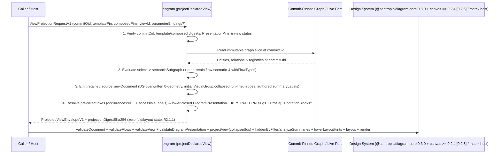

# Specification: View Mechanism of the Base Ontology Profile

- **Document ID:** `SPEC-ENGRAM-PROFILE-VIEW-MECHANISM`
- **Status:** `DESIGN` (Gemini Carbon — normative specification, DS round-1, re-check, `FREEZE-carbon.md` `F1`–`F4`, and `FREEZE-opus-r2.md` `B1` / `M1`–`M4` / `I1`–`I2` reviews against published `@sentropic/diagram-core@0.3.0` & `@sentropic/diagram-canvas` `>= 0.2.4` [`0.2.5` available on DS `main`, `0.2.4` valid freeze base], plus ontology registry review & re-check folded `2026-11-16`; V1 view grammar freezable against published DS `@1` pins, `proposed` until implementation lots land)
- **Date:** `2026-11-16`
- **Repository / Branch:** `engram` (`docs/memory-r15-sediment`)
- **Depends On:**
  - `spec/SPEC_ENGRAM_METAMODEL_AND_LINEAGE_REGISTRY.md` (**Spec 0** — `engram.metamodel/v1` constructs, `S-ENGRAMHASH v1`, `CrossLineageCompositionPin`, `MM_*` diagnostics)
  - `spec/SPEC_ONTOLOGY_GUARDIAN_G0_CONTRACTS.md` (**G0** — `Pin`, instance-merge boundary & `G3` cross-ontology identity deferral)
  - `spec/memory/OWNER-DECISIONS-2026-11-14.md` (**T-M-C** ownership rule, Points `1B`–`6A`, `D28` kept)
  - `spec/SPEC_ONTOLOGY_DIAGRAM_VIEW_SCHEMA_V2.md` (`engram:diagram-view-schema/2`, `DIAGRAM_PRESENTATION_CONTRACT_SCHEMA` in `src/ontology-guardian/diagram-schemas.ts:117`, View Projection Boundary Rule in §2.1.1 below)
  - `spec/SPEC_EVOL_ARCHI_CARDS.md` and `src/ontology-guardian/archi-view.ts:108` (`engram.archi-view/1`, `archi@1` / `archi-cards@1` baseline; `proposed` `archi@2` view extensions `engram.archi-view/2`, `viewKind`, `environmentScope`, `folds`, rules `V1`–`V6`, §6 Lot V.5)
  - Published `@sentropic/diagram-core` `0.3.0` (`packages/diagram-core/package.json:2-3, 28-29`, `packages/diagram-core/src/index.ts:10-38`) and `@sentropic/diagram-canvas` `>= 0.2.4` (`0.2.5` available on DS `origin/main` `27a829744` / tag `diagram-canvas-v0.2.5` centring card body text, with `0.2.4` at `234e090be` still a valid freeze base; both pin `"@sentropic/diagram-core": "0.3.0"` at `packages/diagram-canvas/package.json:2-3, 60`, `packages/diagram-canvas/src/layout/index.ts:10-20`) contracts: `DIAGRAM_PRESENTATION_CONTRACT_PIN` (`packages/diagram-core/src/presentation.ts:215-222`), `DIAGRAM_NOTATION_PIN` (`{ id: "diagram-notation", version: "1", contentDigest: "b4bfa7174a7a53ec23b8a8d7580d6bdfc3bab7f29deb1204aa2e4ce12424909f" }`, `DIAGRAM_NOTATION_SCHEMA`, `DIAGRAM_NOTATION_RULES` in `packages/diagram-core/src/notation.ts:293-306`), `DS_LAYOUT_VOCABULARY_PIN` (`{ id: "https://sentropic.dev/schemas/diagram/layout-hints/v1", version: "ds-layout-hints@1", contentDigest: "e72fd3f3446e19585b2992071f57c3777685f27087165c932806e12354ced42c" }`, `DS_LAYOUT_HINTS_SCHEMA` + `schemas/ds-layout-hints-1.json`, `DS_LAYOUT_HINTS_RULES`, `validateLayoutHints(value, context)`, `lowerLayoutHints(hints, roots?)` in `packages/diagram-core/src/layout-hints.ts:88-99, 186-196, 231, 416, 565`), `validateProfile` / `verifyExecutorBindings` / `validateDocument` / `validateFlows` / `validateView` / `validateDiagramPresentation` / `projectView` / `foldedScene` / `summaryCandidates` / `analyzeSummaries` (§6 Lots V.1 & V.3; DS items absent from `0.3.0` / `0.2.4+` — `validateNotation`, `validateViewNotation`, `resolveNotation`, `Profile.notation`, `Profile.requires`, `RelationRoleDeclaration.entityTypeRefs`, and `hints@2 (later version)` — are listed as **`new`** DS prerequisites outside the V1 freeze in §5.6)

---

## 0. Binding Owner Decisions & Architectural Mandate

### 0.1 Owner Decision of 2026-11-13 — Mechanism vs Domain Views vs Rendering

Domain views do **not** belong to the base profile:

> « Attend teprends. Ata doit pas etre dans le profil de base. Precise ta question »

Approved four-way architectural split:

> « Oui, ce découpage »

1. **The base profile carries ONLY the view mechanism** (the declarative view grammar, schema validation, compatibility classification, and commit-pinned declaration + semantic subgraph emission, with zero precomputed fold or projection state per §2.1.1).
2. **Domain views** (for example a 2-axis breakdown matrix partitioned by `chapter × zone`) **are declared in the domain ontologies** (`R1`–`R7`, `process-std`, `client-org`, `archi`, `track`, `h2a`, etc.), never in `engram`'s metamodel or base profile.
3. **The Design System (DS) folds, lays out, and renders**, and `@sentropic/diagram-core` authors, versions, and exports the closed presentation and layout-hint vocabularies (`diagram-presentation@1` via `DIAGRAM_PRESENTATION_CONTRACT_PIN`, `diagram-notation@1` via `DIAGRAM_NOTATION_PIN`, `ds-layout-hints@1` via `DS_LAYOUT_VOCABULARY_PIN`). `engram` only **references** those pins, never declares or owns the layout vocabulary, and never serves anything the DS derives from folding, layout, or rendering (§2.1.1).
4. **Native BPMN extraction is a separate workstream**, strictly outside this specification.

### 0.2 Owner Decision of 2026-11-14 — The T-M-C Rule

Per `spec/memory/OWNER-DECISIONS-2026-11-14.md:10-15`:

- **T (Template):** An ontology template's content belongs to its **author lineage**, sole author (`Track` → `track`, `h2a` → `h2a`, `archi` → `engram`, domain lineages → their owning producer lineages or registry converters). `engram` contains **zero** foreign template content.
- **M (Metamodel):** The grammar, structural invariants, canonical hashing, compatibility rules, and diagnostic codes belong to **`engram`** (`engram.metamodel/v1`).
- **C (Control):** Domain control masters validate domain policy invariants; `engram` validates metamodel conformance.

Applied to views:
- The **view grammar** (`MetamodelViewDecl` and its validation and source-slice semantics) is **Metamodel (`M`)**, owned by `engram`.
- Every **view declaration** (`views.<view_id>` inside a `profile.yaml` template) is **Template content (`T`)**, authored and versioned exclusively by its owning template author.

### 0.3 Problem Statement & Current Code Baseline

1. **No view construct in `engram` profiles today:** `[FACT: src/ontology-profile.ts:341-521]` and `[FACT: src/types.ts:1186-1203]` parse `node_types` (including static-studio `visual_encoding` at `:38-47, 360-376`), `relation_types`, `registries`, `hierarchies`, `class_hierarchies`, `linking`, `extraction`, `projections`, and `outputs`. Neither `OntologyProfile` nor `CONSUMED_KEYS` in `[FACT: src/profile-bundle.ts:30-41, 105-118]` recognizes a `views` block; any `views` key placed in `profile.yaml` today falls into `ProfileBundleV1.extensions` (`[FACT: src/profile-bundle.ts:523-526]`) and triggers `changed_unmodeled_block` (`MAJOR` break on any edit, `[FACT: src/profile-bundle.ts:1188-1192]`).
2. **Spec 0 stopped at eight constructs:** `[FACT: spec/SPEC_ENGRAM_METAMODEL_AND_LINEAGE_REGISTRY.md:52-65]` defines eight `engram.metamodel/v1` constructs (`NodeTypeDecl`, `AttributeDecl`, `RelationTypeDecl`, `StateMachineDecl`, `FileProjectionDecl`, `Version`, `LineageDecl`, `DomainPoliciesDecl`) and strips `presentation` / `visual_encoding` into `presentationDigest` (`:111-126, 265-266`), without yet defining a metamodel construct for declarative views.
3. **`archi` view rules are hardcoded in TypeScript:** `[FACT: src/ontology-guardian/archi-view.ts:85-115, 401-532]` and `[FACT: SPEC_EVOL_ARCHI_V2_ONTOLOGY.r4.md:314, 718-733]` implement `engram.archi-view/1` and specify `engram.archi-view/2` (`viewKind: "logical" | "deployment"`, `environmentScope`, `plateauFilter`, `activeHierarchy`, `folds`, and invariants `V1`–`V6`) as `archi`-specific shapes rather than a reusable profile grammar.
4. **Domain catalog stopgap sits one level above `profile.yaml`:** A domain ontology catalog (`R1`–`R7`) currently carries a provisional `views:` list `{ id, kind, status, layout, overlays, note }` on each **catalog entry** (`ontologies/<ID>/entry.yaml`, one list per ontology, never on CSV registry rows) because `profile.yaml` lacked a top-level `views` declaration block.

This specification adds **Metamodel Construct #9 (`ViewDecl`)** to `engram.metamodel/v1`, defines its ownership and validation diagnostics, specifies the commit-pinned semantic subgraph and retained source `ViewDocument` contract from `engram` to the DS (with folding and layout executed exclusively by the DS), and defines the authored 1:1 migration from the catalog-entry stopgap `views:` list into `profile.yaml`.

---

## 1. The View Declaration Grammar (`MetamodelViewDecl`)

### 1.1 Integration into `engram.metamodel/v1`

`MetamodelTemplateDocument` (`[FACT: spec/SPEC_ENGRAM_METAMODEL_AND_LINEAGE_REGISTRY.md:477-490]`) is extended with an optional top-level `views` map and the DC-2d `presentation_vocabulary` pin (`[FACT: SPEC_EVOL_DC2D_NOTATION_FLOWS.md:57-58]`):

```ts
// Extension to Spec 0 §1.4 MetamodelTemplateDocument (proposed)
export interface MetamodelTemplateDocumentWithViews extends MetamodelTemplateDocument {
  /**
   * Closed DS notation vocabulary pin when this template declares node/relation
   * presentation blocks or diagram views rendered by the DS (DC-2d §3.1).
   */
  readonly presentation_vocabulary?: "diagram-notation@1";
  /**
   * Declarative view definitions owned by this template's author (Construct #9).
   * Base metamodel carries zero views; domain templates declare 0..N views.
   */
  readonly views?: Readonly<Record<ViewId, MetamodelViewDecl>>;
}
```

Both `views` and `presentation_vocabulary` MUST be added to `CONSUMED_KEYS` in `src/profile-bundle.ts:105-118` so they are compiled into typed bundle fields rather than `ProfileBundleV1.extensions`.

**Domain lineages & single-store composition vs. cross-bundle `G3` boundary:**
- Alongside the four core platform lineages (`archi`, `h2a`, `track`, `engram` in `Spec 0 §2.1`), domain ontology bundles (`R1`–`R7`) are authored by their respective domain producer or converter lineages (`^[a-z][a-z0-9-]{1,31}$`); `engram` itself (`lineage === "engram"` / base profile) carries zero domain views (`MM_VIEW_BASE_PROFILE_DOMAIN_LEAK`).
- Within a single commit-pinned `engram` store (`sourcePin`), the grammar types `<importAlias>:<id>` references against `composed_lineage_pins` (`Spec 0 §2.5`, `spec/SPEC_ENGRAM_METAMODEL_AND_LINEAGE_REGISTRY.md:545-576`, e.g. `track-archi2-bridge@1`) as **reserved for `ds-layout-hints@2` / DC-2d L2** (`Profile.requires` + `RelationRoleDeclaration.entityTypeRefs`, §5.6): in `@1` (`ds-layout-hints@1`), `select.lineages` is restricted strictly to `["self"]` and unqualified local refs, refusing foreign `<importAlias>` view references with `MM_VIEW_LINEAGE_UNPINNED` because `@sentropic/diagram-core@0.3.0` `validateDocument` rejects cross-profile endpoints with `endpoint-without-join` (`packages/diagram-core/src/validate.ts:573-597`) and `@sentropic/diagram-canvas` `0.2.4+` refuses the document (`packages/diagram-canvas/src/layout/measured.ts:331-337`).
- Across independent file-first / catalog ontology bundles (`R1`–`R7`), **cross-template / cross-ontology instance selection (`view_includes`, such as `R7` selecting target nodes owned by `R1`/`R4`/`R5`/`R6`) is NOT part of §1 v1 and waits for `G3`** (canonical cross-ontology instance IDs = `G0` ontology identity + local ID, and cross-bundle graph merge/resolution per `spec/SPEC_ONTOLOGY_GUARDIAN_G0_CONTRACTS.md:596`). Until `G3` lands, multi-ontology catalog views such as `R7` remain single-template declarations using local placeholder/reference target nodes (§5.4, §7.2).

### 1.2 Normative TypeScript Schema

```ts
/**
 * DS contract pin shape exported by `@sentropic/diagram-core`
 * (`presentation.ts:18-22`, matching `src/ontology-guardian/diagram-schemas.ts:11-20`).
 * `contentDigest` is bare 64 lowercase hex (`^[0-9a-f]{64}$`) over RFC 8785 JCS bytes.
 */
export interface PresentationPin {
  readonly id: string;
  readonly version: string;
  readonly contentDigest: string;
}

/** Lowercase kebab-case identifier: ^[a-z][a-z0-9-]{0,63}$ */
export type ViewId = string;

/**
 * Qualified type or relation reference:
 * - Unqualified "<id>" resolves in the declaring template ("self"; sole form admitted in `@1`).
 * - Qualified "<importAlias>:<id>" resolves in the matching entry of
 *   `composed_lineage_pins` (Spec 0 §2.5) within the same commit-pinned store:
 *   RESERVED for `ds-layout-hints@2` / DC-2d L2 (`Profile.requires` + `entityTypeRefs`, §5.6)
 *   and refused in `@1` with `MM_VIEW_LINEAGE_UNPINNED`.
 */
export type QualifiedElementRef = string;

/**
 * Closed structural view archetype owned by engram's metamodel.
 * Carries ZERO domain taxonomy names.
 * In `@1` (`ds-layout-hints@1`), only `"topology"`, `"hierarchy"`, and tabular zero-edge
 * `"matrix"` have active DS consumers; `"lane-flow"` and `"entity-model"` are reserved in
 * the union for `ds-layout-hints@2` (so enabling them later is a `MINOR` change) and
 * refused in `@1` (`MM_VIEW_AXES_KIND_MISMATCH` / `MM_VIEW_KIND_INVALID`, §2.3).
 */
export type ViewMechanismKind =
  | "topology"      // Node-and-edge graph with optional containment folds (`axes` omitted in `@1`; `bands_1d` reserved for `ds-layout-hints@2`)
  | "matrix"        // 2-axis orthogonal row × column partition (requires `axes.rows` & `axes.columns`; strictly tabular zero-edge in `@1`)
  | "lane-flow"     // RESERVED for `ds-layout-hints@2` (refused in `@1` via `MM_VIEW_AXES_KIND_MISMATCH`): swimlane / activity flow (`axes.bands` + `lane-stack`, or DC-2d `role: "lane"` + `"flow-node"`)
  | "hierarchy"     // Containment / taxonomy tree view (requires `folds.containment_relations`)
  | "entity-model"; // RESERVED for `ds-layout-hints@2` / DC-2d `resolveNotation` (refused in `@1` via `MM_VIEW_KIND_INVALID`): data / schema entity-table diagram (DC-2d `role: "entity-table"`)

/**
 * Closed lifecycle status of a view declaration inside `profile.yaml`.
 * Catalog-level readiness tokens (`requested | available | waiting-engram | source-gap`)
 * stay outside `MetamodelViewDecl` in the catalog `entry.yaml` (§4.2).
 * Newly migrated template views start at `"draft"`.
 */
export type ViewLifecycleStatus =
  | "draft"
  | "experimental"
  | "active"
  | "deprecated"
  | "retired";

export interface MetamodelViewDecl {
  /** Must equal the enclosing map key in `views.<id>`. */
  readonly id: ViewId;
  /** Independent view contract version (exact SemVer MAJOR.MINOR.PATCH). */
  readonly version: SemVer;
  /** Human-readable title (1..120 chars). */
  readonly label: string;
  /** Closed structural mechanism kind. */
  readonly kind: ViewMechanismKind;
  /**
   * Optional domain viewpoint tag owned by the declaring template author
   * (e.g. "logical" | "deployment" in archi@2, or "capability-map" |
   * "roadmap" | "application-landscape" | "traceability" in R1–R7).
   * Pattern: ^[a-z][a-z0-9-]{0,63}$. Never interpreted by engram as domain logic.
   */
  readonly perspective?: string;
  /** Lifecycle state of this view declaration (newly authored/migrated views start at "draft"). */
  readonly status: ViewLifecycleStatus;
  /** Required when `status` is "deprecated" or "retired". */
  readonly deprecated_reason?: string;
  /** Optional successor `ViewId` in the same template when deprecated/retired. */
  readonly replaced_by?: ViewId;
  /** Optional human note / design-intent rationale (PATCH-level metadata). */
  readonly note?: string;
  /** Typed runtime filter parameters bound at query time (optional). */
  readonly parameters?: Readonly<Record<string, ViewParameterDecl>>;
  /** Subgraph selection rules (lineages, node types, relation types, predicates). */
  readonly select: ViewSelectionDecl;
  /**
   * Occurrence uniqueness invariant:
   * - "single_per_entity" (default): enforces archi V1 (<= 1 occurrence per entity).
   * - "per_axis_cell": permitted ONLY when `axes` has an axis resolving with
   *   `multi_value_policy === "duplicate_occurrence"`.
   */
  readonly occurrence_uniqueness?: "single_per_entity" | "per_axis_cell";
  /**
   * Declarative containment folding rules applied by DS `projectView` (required when
   * `kind === "hierarchy"`, optional on `"topology"`; reserved for `ds-layout-hints@2`
   * `matrix-grid` and refused in `@1` when `kind === "matrix"`, `MM_VIEW_AXES_KIND_MISMATCH`).
   */
  readonly folds?: ViewFoldDecl;
  /** Attribute or relation-target overlay rules mapped strictly to frozen DS slots (0..8 ordered entries). */
  readonly overlays?: readonly ViewOverlayDecl[];
  /**
   * Orthogonal dimension axes (required with `mode: "matrix_2d"` when `kind === "matrix"`,
   * and omitted on all V1 canvas views in `@1`; `mode: "bands_1d"` is reserved for
   * `ds-layout-hints@2` and refused in `@1` with `MM_VIEW_AXES_KIND_MISMATCH`).
   */
  readonly axes?: ViewAxesDecl;
  /**
   * Opaque reference to a DS-owned layout hint payload validated against
   * `@sentropic/diagram-core`'s `DS_LAYOUT_VOCABULARY_PIN` (`ds-layout-hints@1`).
   * Required on all admitted `@1` canvas views (`topology`, `hierarchy`; `lane-flow` and
   * `entity-model` are reserved for `ds-layout-hints@2` and refused in `@1`, §2.3);
   * MUST be omitted (`undefined`) on `kind === "matrix"` in `@1` (where `matrix` is
   * strictly tabular with `select.relations.include_types: []`, `folds === undefined`, and
   * rendered by the DS tabular matrix host; any non-tabular `matrix` with relations, `folds`,
   * or a `layout` block is refused in `@1` until `ds-layout-hints@2` lands, §2.3).
   */
  readonly layout?: DsLayoutHintRef;
}

// ---------------------------------------------------------------------------
// 1.2.1 Runtime Filter Parameters & Deterministic Attribute Predicates
// ---------------------------------------------------------------------------

export interface ViewParameterDecl {
  readonly value_type: "string" | "enum" | "string_list" | "enum_list" | "boolean";
  readonly enum_values?: readonly string[];
  readonly required: boolean;
  readonly default_value?: string | readonly string[] | boolean;
  readonly description?: string;
}

export type ViewValueOperand =
  | { readonly literal: string | number | boolean | readonly (string | number | boolean)[] }
  | { readonly param: string };

export type ViewComparisonOp =
  | "eq"
  | "neq"
  | "in"
  | "not_in"
  | "contains_any"
  | "contains_all"
  | "gte"
  | "lte"
  | "exists"
  | "not_exists";

export interface ViewAttributeComparison {
  readonly attribute: string;
  readonly op: ViewComparisonOp;
  /** Required for all ops except `exists` and `not_exists`. */
  readonly value?: ViewValueOperand;
  /**
   * Deterministic evaluation when `attribute` is absent/null on an element
   * (for ops other than `exists` / `not_exists`):
   * - "exclude" (default): evaluates to false.
   * - "include": evaluates to true (grounds archi@2 `environmentScope` and
   *   `plateauFilter`, where unscoped entities remain admitted).
   */
  readonly on_missing?: "exclude" | "include";
}

export type ViewPredicateExpr =
  | ViewAttributeComparison
  | { readonly all: readonly ViewPredicateExpr[] }
  | { readonly any: readonly ViewPredicateExpr[] }
  | { readonly not: ViewPredicateExpr };

// ---------------------------------------------------------------------------
// 1.2.2 Node & Relation Selection (`select`)
// ---------------------------------------------------------------------------

export interface ViewNodeSelectionDecl {
  /** Non-empty list of admitted node types (`<typeId>` or `<importAlias>:<typeId>`). */
  readonly include_types: readonly QualifiedElementRef[];
  /** Expand `class_hierarchies` subclasses of `include_types` (default: false). */
  readonly include_subclasses?: boolean;
  /** Explicitly excluded node types (applied after `include_types` + subclasses). */
  readonly exclude_types?: readonly QualifiedElementRef[];
  /**
   * Optional restriction to canonical nodes bound from specific `registries` ids
   * declared in the template.
   */
  readonly include_registries?: readonly string[];
  /** Deterministic attribute predicate over candidate nodes. */
  readonly where?: ViewPredicateExpr;
}

export interface ViewRelationSelectionDecl {
  /**
   * Admitted relation types (`[]` required for `kind === "matrix"` in `@1`), or `"*"` for
   * all declared relations in selected lineages on non-matrix views.
   */
  readonly include_types: "*" | readonly QualifiedElementRef[];
  /** Explicitly excluded relation types. */
  readonly exclude_types?: readonly QualifiedElementRef[];
  /** Deterministic attribute predicate over candidate relations. */
  readonly where?: ViewPredicateExpr;
  /**
   * Closed endpoint rule in v1:
   * Both endpoints MUST survive `select.nodes`. Edges with a filtered-out
   * endpoint are dropped and NEVER lifted across selection filters
   * (grounds archi@2 §5.4 / §8.1 `environmentScope` and `graph-time-slice.ts`
   * `"endpoint-induced"`).
   */
  readonly endpoint_policy: "both_selected";
}

export interface ViewSelectionDecl {
  /**
   * Contributing lineages in the same commit-pinned store: `"self"` (sole value
   * admitted in `@1` / `ds-layout-hints@1`) and/or `importAlias` keys declared in
   * `composed_lineage_pins` (Spec 0 §2.5; RESERVED for `ds-layout-hints@2` / DC-2d L2
   * `Profile.requires` + `entityTypeRefs`, refused in `@1` with `MM_VIEW_LINEAGE_UNPINNED`, §2.3, §5.6).
   * Defaults to `["self"]`. Cross-bundle catalog selection (`view_includes`) waits for `G3` (§1.1, §5.4).
   */
  readonly lineages?: readonly ("self" | string)[];
  readonly nodes: ViewNodeSelectionDecl;
  readonly relations: ViewRelationSelectionDecl;
}

// ---------------------------------------------------------------------------
// 1.2.3 Fold Declarations (`folds` — Evaluated by DS `projectView`)
// ---------------------------------------------------------------------------

export interface ViewFoldDecl {
  /**
   * Ordered priority list of containment relations that form foldable visual
   * groups in this view. Every entry MUST resolve to a relation with tree
   * hierarchy semantics (`hierarchies` or `hierarchy.shape === "tree"`) and,
   * when `diagram-notation@1` is pinned, `presentation.encoding === "containment"`.
   * Orientation:
   * - "parent_to_child": `source` contains `target`
   * - "child_to_parent": `source` is contained inside `target` (e.g. `c4Parent` / `part_of_domain`)
   */
  readonly containment_relations: readonly {
    readonly relation: QualifiedElementRef;
    readonly orientation: "parent_to_child" | "child_to_parent";
  }[];
  /**
   * Declared initial fold default per view, recorded on `VisualGroup.collapsed`
   * in the retained source `ViewDocument` as a pure declaration default and applied
   * by the DS (`DOM-Q4`; runtime client `collapsedOccurrenceIds` is never served by `engram`, §2.1.1):
   * - `"collapsed"` (paired with `folded_edge_policy: "lift_with_summary"`) for large
   *   entries (e.g. `R1` with 183 apps under 21 capabilities, `R2` with 5083 nodes);
   * - `"expanded"` for small entries (e.g. `R5` / `R6` with <= 25 nodes).
   */
  readonly default_state: "expanded" | "collapsed";
  /** Specific node types whose initial default state overrides `default_state` to collapsed. */
  readonly default_collapsed_types?: readonly QualifiedElementRef[];
  /** Specific node types whose initial default state overrides `default_state` to expanded. */
  readonly default_expanded_types?: readonly QualifiedElementRef[];
  /**
   * Optional 1-based tree depth threshold (root = 1) at or below which
   * containers start collapsed when `default_state === "expanded"`.
   */
  readonly default_collapsed_depth?: number;
  /**
   * Declared policy for `arrow`-encoded relations between two SELECTED nodes when at
   * least one endpoint sits inside a collapsed container (executed exclusively by the DS per §2.1.1):
   * - "lift_with_summary" (default): `engram` emits static authored `summaryLabels` (`SummaryDefinition`
   *   declarations derived purely from containment scopes and semantic relations, strictly omitting
   *   DC-2c `flow-step` occurrences per `flows.ts:75-99` and `DC-2d:163`), and DS `projectView` /
   *   `summaryCandidates` / `analyzeSummaries` lifts hidden endpoints with
   *   `RelationOccurrenceEndpoint.{ occurrence, semanticTarget, sourceOccurrence }` and resolves active summaries (DC-2d OA12).
   * - "hide": `engram` forwards only the declaration `foldPolicy.foldedEdgePolicy: "hide"` (never a
   *   precomputed hidden-occurrence mask, §2.1.1); at the active `collapsed` set, the DS host dynamically
   *   identifies all non-internal `relationOccurrences` with at least one endpoint
   *   `hiddenByFold(sourceView, collapsed, endpoint.occurrence)` (`fold.ts:50-58`) and supplies them via
   *   `FoldFilterState.hiddenByFilter` (`fold.ts:405, 453-475, 653-659`, `validate.ts:1955`).
   */
  readonly folded_edge_policy?: "lift_with_summary" | "hide";
  /** Whether the DS viewer enables interactive client-side expand/collapse (`layoutFolded`). */
  readonly interactive_toggle: boolean;
}

// ---------------------------------------------------------------------------
// 1.2.4 Overlays (`overlays` — Symmetric Sources & Frozen DS Anatomy Slots)
// ---------------------------------------------------------------------------

/**
 * Overlay data source, symmetric with `AxisValueSource` (Ontology F6.1):
 * - `"attribute"`: reads a declared attribute on the covered node or relation.
 * - `"relation_target"`: traverses a declared relation in the pre-`select` `sourcePin`
 *   graph to resolve target entity labels/keys (valid when `target === "node"`,
 *   e.g. `R4` `managed_by` / `operated_by` -> `org_unit`).
 */
export type OverlayValueSource =
  | {
      readonly kind: "attribute";
      readonly attribute: string;
    }
  | {
      readonly kind: "relation_target";
      readonly relation: QualifiedElementRef;
      /** Traversal direction from the selected node (default: "outbound"). */
      readonly direction?: "outbound" | "inbound";
      readonly target_type: QualifiedElementRef;
      /** Optional scalar attribute on `target_type` (defaults to canonical entity label). */
      readonly label_attribute?: string;
    };

/**
 * Closed overlay channels mapping to frozen `460 × 200` `DiagramCard` slots,
 * `diagram-presentation@1`, and `diagram-notation@1` relation fields (DS OA8, OA10, OA14, DS-Q3).
 * In `@1` (`ds-layout-hints@1`), only `"text_slot"`, `"category_tone"`, and `"stroke_style"`
 * have active consumers in `@sentropic/diagram-core@0.3.0` / `@sentropic/diagram-canvas` `0.2.4+`;
 * `"provisional_marker"` is RESERVED in the union for `ds-layout-hints@2` / DC-2d `resolveNotation`
 * and refused in `@1` with `MM_VIEW_OVERLAY_RAW_STYLE_FORBIDDEN` (§2.3, §5.6).
 * Sub-region pills/counters (`badge`, `detail_pill`, `metric_counter`) are NOT in V1
 * (deferred to any future owner-approved `DiagramCard` anatomy v2 evolution; `flow-badge`
 * is reserved exclusively for DC-2c numbered `FlowStep` sequences).
 */
export type OverlayChannel =
  | "text_slot"          // Node only: formatted plain string in existing `EntityPresentation.text.detail` or `text.footer`
  | "category_tone"      // Node only: DS semantic/data token in `categoryRef` + `categoryTokens` + synthesized `generic@2` legend
  | "stroke_style"       // Relation only: `RelationOccurrence.strokeStyle` ("solid" | "dashed")
  | "provisional_marker";// RESERVED for `ds-layout-hints@2` / DC-2d `resolveNotation` (refused in `@1`): DC-2d `arrow` `provisional: { attribute, equals }` (`data-provisional`)

/**
 * Allowed DS semantic and categorical tokens (`@sentropic/tokens/src/semantic.ts:34-55`
 * and `TOKEN_GRAMMAR` in `diagram-schemas.ts:38-40`).
 * Unrequested `"accent"` (OA10) and non-DS names (`"positive"`, `"critical"`) are forbidden.
 */
export type DsSemanticToneToken =
  | "feedback.info"
  | "feedback.success"
  | "feedback.warning"
  | "feedback.error"
  | "status.pending"
  | "status.processing"
  | "status.completed"
  | "status.failed"
  | "data.category1"
  | "data.category2"
  | "data.category3"
  | "data.category4"
  | "data.category5"
  | "data.category6"
  | "data.category7"
  | "data.category8";

export interface ViewOverlayDecl {
  /** Unique within the view (`^[a-z][a-z0-9-]{0,31}$`). */
  readonly id: string;
  readonly target: "node" | "relation";
  /** Optional subset of selected types; defaults to all selected types compatible with `source`. */
  readonly applies_to_types?: readonly QualifiedElementRef[];
  /** Attribute or pre-`select` `relation_target` value source. */
  readonly source: OverlayValueSource;
  /** Closed DS overlay rendering channel. */
  readonly channel: OverlayChannel;
  /**
   * Required iff `channel === "text_slot"`: selects the frozen `DiagramCard` text row.
   * When >= 2 `text_slot` overlays emit non-empty strings on the same `(occurrenceId, slot)`,
   * Stage 5 joins them in declared overlay order with `" · "` (never silent last-wins,
   * `presentation-apply.ts:5`), enforcing `detail <= 400` and `footer <= 120` code points.
   */
  readonly slot?: "detail" | "footer";
  /** Optional plain-text label prefix for `text_slot` (e.g. `"Managed by"` -> `"Managed by: Core Ops"`). */
  readonly label_prefix?: string;
  /**
   * RESERVED for `ds-layout-hints@2` / DC-2d `resolveNotation` (refused in `@1` via
   * `MM_VIEW_OVERLAY_RAW_STYLE_FORBIDDEN`): required iff `channel === "provisional_marker"` —
   * scalar match value (`string` of `1..40` code points, or `boolean` deterministically
   * stringified to `"true"` / `"false"` in Stage 5) emitted into DC-2d `arrow`
   * `provisional: { attribute, equals: string }` (`DC-2d §3.1 :47, 51`; no `"settled"` token).
   */
  readonly equals?: string | boolean;
  /**
   * Finite lookup (<= 32 keys, matching DC-2d §3.1 slot lookup bound) mapping resolved
   * scalar values to DS tokens or formatted labels:
   * - Required on `category_tone` (values MUST be `DsSemanticToneToken`; domain keys are
   *   deterministically slugified in Stage 5 to `KEY_PATTERN = /^[a-z][a-z0-9-]*$/`, `1..40` chars,
   *   preserving raw human display labels in `legend-key.attributes.name` and `entities[keyOccId].text.title`)
   *   and `stroke_style` (values MUST be `"solid" | "dashed"`).
   * - Optional on `text_slot` (concise plain-text strings, 1..40 chars; raw scalar/target
   *   labels used when omitted, joined by `", "` in canonical order for multi-target relations).
   * Raw CSS properties, hex colors (`#...`), and pixel lengths are FORBIDDEN.
   */
  readonly value_map?: Readonly<Record<string, string>>;
  /**
   * Behavior when `source` yields no value on an instance (default: `"omit"`).
   * When `{ token }` is declared, `token` MUST satisfy the channel's allowed domain
   * (`DsSemanticToneToken` on `category_tone`, `"solid" | "dashed"` on `stroke_style`,
   * plain text `1..40` chars on `text_slot`), and on `category_tone` Stage 5 synthesizes
   * a deterministic fallback `generic@2` `legend-key` entry (§3.2 Stage 5).
   */
  readonly when_missing?: "omit" | { readonly token: string };
  /**
   * Mandatory (non-empty) when `channel === "category_tone"` so DS always renders a
   * visible text-keyed `generic@2` legend alongside color tokens (WCAG 1.4.1 Use of Color).
   * Must be omitted on relation channels (`diagram-presentation@1` `legends` are entity-keyed).
   */
  readonly legend_label?: string;
}

// ---------------------------------------------------------------------------
// 1.2.5 Dimension Axes (`axes`)
// ---------------------------------------------------------------------------

export type AxisValueSource =
  | {
      readonly kind: "attribute";
      /** Declared scalar/enum/ref/collection attribute on selected nodes. */
      readonly attribute: string;
    }
  | {
      readonly kind: "relation_target";
      /**
       * Declared relation linking a selected node to its axis bucket entity.
       * Evaluated against the pre-`select` `sourcePin` graph + target registry.
       */
      readonly relation: QualifiedElementRef;
      readonly direction?: "outbound" | "inbound"; // default: "outbound"
      readonly target_type: QualifiedElementRef;
      /** Optional attribute on `target_type` used as display label (defaults to entity label). */
      readonly label_attribute?: string;
    }
  | {
      readonly kind: "node_type";
      /**
       * Partitions selected nodes by their declared node type (`<typeId>` or `<importAlias>:<typeId>`),
       * e.g. `R7` traceability matrix rows across 5 verification item node types (Ontology F6.2).
       * Used with `order: "explicit"` (`explicit_buckets` listing the covered `QualifiedElementRef`
       * types in declared display order) or `order: "key_asc" | "key_desc"`.
       */
      readonly type_labels?: Readonly<Record<QualifiedElementRef, string>>;
    };

export interface ViewAxisDecl {
  /** Axis identifier (`^[a-z][a-z0-9-]{0,31}$`). */
  readonly id: string;
  /** Human axis header label (1..80 chars). */
  readonly label: string;
  readonly source: AxisValueSource;
  /** Deterministic bucket ordering rule. */
  readonly order:
    | "declared_enum"   // Uses `AttributeDecl.values` order (valid when `source` is enum attribute)
    | "registry_order"  // Uses canonical registry order of `target_type` (valid for `relation_target` / `ref`)
    | "key_asc"
    | "key_desc"
    | "explicit";       // Uses `explicit_buckets` order (required for declared `node_type` order)
  /** Required iff `order === "explicit"`. */
  readonly explicit_buckets?: readonly string[];
  /** Whether declared enum/registry/explicit buckets with 0 nodes still render as headers. */
  readonly empty_buckets: "retain" | "omit";
  /**
   * Handling of selected nodes with no value on this axis (Ontology F5):
   * - "unassigned_bucket" (default): places unmapped nodes in a trailing `"__unassigned__"` bucket.
   * - "exclude": omits unmapped nodes from the partitioned grid/bands.
   * - "refuse": opt-in strict completeness gate (`VIEW_PROJ_AXIS_UNASSIGNED_NODE`); NEVER the default.
   */
  readonly unassigned_policy?: "unassigned_bucket" | "exclude" | "refuse";
  /**
   * Handling of nodes resolving to >1 bucket on this axis (Ontology F5):
   * - Defaults to `"duplicate_occurrence"` when `occurrence_uniqueness === "per_axis_cell"`,
   *   and to `"primary_first"` when `occurrence_uniqueness` is `"single_per_entity"` (or omitted).
   * - "duplicate_occurrence": places one cell-scoped occurrence in each matching bucket;
   *   REQUIRES `occurrence_uniqueness: "per_axis_cell"` on the view.
   * - "primary_first": picks the first bucket under deterministic `order`.
   * - "refuse": opt-in strict gate (`VIEW_PROJ_AXIS_MULTI_VALUE_NODE`); NEVER the default.
   */
  readonly multi_value_policy?: "duplicate_occurrence" | "primary_first" | "refuse";
}

export type ViewAxesDecl =
  | {
      /** 2-axis matrix partition (required when `kind === "matrix"`; sole `axes.mode` admitted in `@1`). */
      readonly mode: "matrix_2d";
      readonly rows: ViewAxisDecl;
      readonly columns: ViewAxisDecl;
    }
  | {
      /**
       * RESERVED for `ds-layout-hints@2` (`lane-stack`) — refused in `@1` on every view kind
       * with `MM_VIEW_AXES_KIND_MISMATCH` (§2.3): 1-axis swimlane or band partition (`lane-flow`, `topology`).
       */
      readonly mode: "bands_1d";
      readonly bands: ViewAxisDecl;
    };

// ---------------------------------------------------------------------------
// 1.2.6 Referenced DS Layout Pin (`layout` — Owned by `@sentropic/diagram-core`)
// ---------------------------------------------------------------------------

/**
 * `engram` NEVER declares or owns a layout-hint mode union or property table.
 * `@sentropic/diagram-core` (`0.3.0`, `packages/diagram-core/src/layout-hints.ts:88-99, 186-196, 231, 416, 565`
 * and `packages/diagram-core/schemas/ds-layout-hints-1.{json,sha256}:1`) authors, versions, and exports
 * `DS_LAYOUT_HINTS_SCHEMA`, `DS_LAYOUT_HINTS_RULES`, `validateLayoutHints(value, context)`,
 * `lowerLayoutHints(hints, roots?)`, and `DS_LAYOUT_VOCABULARY_PIN: PresentationPin`:
 *   `{ id: "https://sentropic.dev/schemas/diagram/layout-hints/v1", version: "ds-layout-hints@1", contentDigest: "e72fd3f3446e19585b2992071f57c3777685f27087165c932806e12354ced42c" }`
 * alongside `DIAGRAM_NOTATION_PIN: PresentationPin` (`packages/diagram-core/src/notation.ts:302-306`):
 *   `{ id: "diagram-notation", version: "1", contentDigest: "b4bfa7174a7a53ec23b8a8d7580d6bdfc3bab7f29deb1204aa2e4ce12424909f" }`
 * (`DIAGRAM_NOTATION_VOCABULARY = "diagram-notation@1"` at `:28`). `engram` only references
 * `DS_LAYOUT_VOCABULARY_PIN` and delegates structural + semantic layout-hint validation to
 * `validateLayoutHints(view.layout, context)` with an explicit `LayoutHintsContext` (§2.2).
 */
export interface DsLayoutHintRef {
  /** Must match `DS_LAYOUT_VOCABULARY_PIN.version` ("ds-layout-hints@1"). */
  readonly vocabulary: string;
  readonly [key: string]: unknown;
}
```

**DS-governed `ds-layout-hints@1` scope boundary & V1 consumer-existence rule (referenced from `@sentropic/diagram-core@0.3.0` and `@sentropic/diagram-canvas` `>= 0.2.4` [`0.2.5` available, `0.2.4` valid base], never owned by `engram`):**
- **V1 consumer-existence rule:** Every value admitted by V1 (`@1`) MUST have an active consumer in the published `@sentropic/diagram-core@0.3.0` (`ds-layout-hints@1`) / `@sentropic/diagram-canvas` `0.2.4+` chain (or the DS tabular matrix host for `@1` zero-edge `matrix` views, `DS-Q2`); otherwise V1 refuses it with an existing `MM_VIEW_*` diagnostic (`23` codes total) and reserves it in the TypeScript schema for `ds-layout-hints@2` (`hints@2` / DC-2d).
- **Implemented and admitted today in `ds-layout-hints@1` (`@sentropic/diagram-core@0.3.0`, `@sentropic/diagram-canvas` `>= 0.2.4`):** Only `DS_LAYOUT_MODES = ["auto-pack", "layered-flow"]` (`packages/diagram-core/src/layout-hints.ts:37`, `packages/diagram-core/schemas/ds-layout-hints-1.json:1`, `packages/diagram-canvas/src/layout/index.ts:10-20`):
  - `"auto-pack"` (`layoutMeasured`), admitting `DS_LAYOUT_MEASURED_HINTS = ["grouping", "grouping_axis", "ordering", "rootOrder", "stretch"]` (`packages/diagram-core/src/layout-hints.ts:58, 73-86`, `packages/diagram-canvas/src/layout/hints.ts:13-43`; `grouping` and `grouping_axis: "rows" | "columns"` are mutually exclusive and lowered to engine `LayoutHints` via `lowerLayoutHints(hints, roots?)` at `packages/diagram-core/src/layout-hints.ts:565`). **Template (`T`) authoring rule (`M3`):** Template views inside `profile.yaml` SHOULD limit `@1` hints to `grouping_axis` and `stretch`. `ordering`, `rootOrder`, and `grouping` key entries by instance `^entity:[A-Za-z0-9][A-Za-z0-9._-]*$` refs (`packages/diagram-core/src/layout-hints.ts:78-84, 101, 147`); any authored `entity:` ref is checked for existence and sibling scope by the DS layout engine (`validateHints` in `packages/diagram-canvas/src/layout/hints.ts:70-74`, per `packages/diagram-core/src/layout-hints.ts:412-414`), not by `MM_VIEW_*` — a dangling `entity:` ref is a DS layout refusal, not an `engram` diagnostic.
  - `"layered-flow"` (`layoutDocument`) **solely** on `generic@1` views without `presentation.diagram` and without `presentation_vocabulary` (verified via `LayoutHintsContext` in `checkLayeredFlowScope`, `packages/diagram-core/src/layout-hints.ts:88-99, 137-145, 378-405`, taking zero measured hints per `:127-130, 462-471`). **Template reachability (`M4`):** For `engram` templates, `layered-flow` is reachable only if the compiled document's profiles are **exactly** `["generic@1"]` (`packages/diagram-core/src/layout-hints.ts:140, 389-392`); otherwise it is refused (`layout-mode-out-of-scope`, `details.reason: "profile"`), and V1 template views use `"auto-pack"`.
- **Forbidden spacing overrides & coordinates in every version (`OA1` + `OA9`, `DS_LAYOUT_FORBIDDEN_HINTS`):** `ds-layout-hints@1` (and later versions) forbids `density` (`"compact" | "regular" | "spacious"` is UI form-control density only; DS diagram scenes enforce one flow-driven channel gap law), `edge_label_orientation` (any value), and all spacing or coordinate overrides (`cardGapX`, `cardGapY`, `zoneGapX`, `zoneGapY`, `rankGap`, `gapAfter`, `x`, `y`, `width`, `height`), raising `layout-hint-forbidden` (`packages/diagram-core/src/layout-hints.ts:43-56, 280-283`).
- **`hints@2 (later version)` modes, hints & reserved grammar values — outside the V1 freeze and refused today:** **`"lane-stack"`**, **`"matrix-grid"`**, and **`"tree"`** (`DS_LAYOUT_FUTURE_MODES`, `packages/diagram-core/src/layout-hints.ts:39, 206-208, 453-456` → `layout-mode-not-implemented`, `details.vocabulary: "ds-layout-hints@2"`), **`"direction"`** and **`"rotate_labels"`** (`DS_LAYOUT_FUTURE_HINTS`, `packages/diagram-core/src/layout-hints.ts:41, 220, 284-287` → `layout-hint-not-implemented`, `details.vocabulary: "ds-layout-hints@2"`), and **`@2` / `diagram-notation@1` `"layered-flow"`** (`layout-mode-out-of-scope`, `packages/diagram-core/src/layout-hints.ts:378-405`) — together with the Design System's `hints@2` roadmap (`stage-columns`, transverse `spanColumns` bands, compared panels via `stage-columns`, and optional `legend: "none"` opt-out for scene-layer auto link-style legends, while braces and graduated cursor remain caller/scene `annotations` outside `ds-layout-hints@2`; DS `ds-r7kit.md` and `ds-position-engine.md`) — are **`hints@2 (later version)`**, **outside the V1 freeze**, and **refused today** (`MM_VIEW_LAYOUT_HINT_INVALID` via DS `validateLayoutHints(view.layout, context)`). Any change to the `ds-layout-hints@1` schema bytes requires `ds-layout-hints@2` (`packages/diagram-core/src/layout-hints.ts:24-25`; zero `1.x` revision). Under the V1 consumer-existence rule above, V1 also reserves for `ds-layout-hints@2` (and DC-2d `resolveNotation` / L2 joins) and **refuses in `@1`**: `kind === "lane-flow"` and `axes.mode === "bands_1d"` on any view kind (`MM_VIEW_AXES_KIND_MISMATCH`), `kind === "entity-model"` (`MM_VIEW_KIND_INVALID`), `overlay.channel === "provisional_marker"` (`MM_VIEW_OVERLAY_RAW_STYLE_FORBIDDEN`), `diagram-notation@1` selected roles `"lane" | "entity-table" | "flow-node"` and `NotationRelation` `encoding: "detail" | "footer"` / `provisional` / `lift` / `fallback` (`MM_VIEW_NOTATION_UNCOVERED`), foreign `<importAlias>` `select.lineages` / `<importAlias>:<id>` refs (`MM_VIEW_LINEAGE_UNPINNED`), and non-tabular or folded `kind === "matrix"` views (any `matrix` with non-empty `select.relations.include_types`, `folds !== undefined`, or `layout !== undefined`, refused via `MM_VIEW_AXES_KIND_MISMATCH` / `MM_VIEW_LAYOUT_HINT_INVALID`, §2.3, §3.3, §7.1 `DS-Q2`). Today in V1, canvas views are `"topology"` and `"hierarchy"` (using `"auto-pack"` over nested `VisualGroup` containment, or `generic@1`-only `"layered-flow"`), and `kind === "matrix"` views in `@1` are strictly zero-edge tabular (`select.relations.include_types: []`, `folds === undefined`, `layout === undefined`), rendering in the DS tabular matrix host.

### 1.3 Grounding in `archi@2`, `DC-2d`, and `engram` Code (`file:line` & Delta Matrix)

Every element of `MetamodelViewDecl` is grounded in existing `engram`, `archi@2`, and published `@sentropic/diagram-core@0.3.0` / `@sentropic/diagram-canvas` `>= 0.2.4` (`0.2.5` available) contracts (with unshipped `DC-2d` / `hints@2` items explicitly marked **`new`** / `hints@2 (later version)` and refused in `@1`). The table below states exact `file:line` anchors and distinguishes **generalized existing mechanics** from **net-new metamodel constructs**.

| Grammar Element | Grounding in `engram` / `archi@2` / Published DS `0.3.0` (`[FACT: file:line]`) | What Exists Today vs What Is **NEW** |
| :--- | :--- | :--- |
| **Top-level `views` construct** | `spec/SPEC_ENGRAM_METAMODEL_AND_LINEAGE_REGISTRY.md:52-65, 477-490`; `src/ontology-profile.ts:341-521`; `src/profile-bundle.ts:105-118` | **NEW** as Metamodel Construct #9 (`views` and `presentation_vocabulary` in `CONSUMED_KEYS`). Previously `engram` profiles had only static `visual_encoding` (`src/ontology-profile.ts:38-47, 360-376`) and `outputs.ontology` (`:264-287`). |
| **`id`** | `src/ontology-guardian/diagram-schemas.ts:220` (`viewId`); `SPEC_EVOL_ARCHI_V2_ONTOLOGY.r4.md:721`; `src/ontology-guardian/archi-view.ts:86` (`ArchiViewSpec.id`) | **Generalized:** Lifts instance-level `viewId` to a stable kebab-case template declaration key (`^[a-z][a-z0-9-]{0,63}$`). |
| **`kind` & `perspective`** | `SPEC_EVOL_ARCHI_V2_ONTOLOGY.r4.md:314, 664, 723` (`viewKind: "logical" \| "deployment"`, rule `V6`); `packages/diagram-core/src/notation.ts:31-35, 194-230` (`card`/`container`, `lane`+`flow-node`, `entity-table`) | **NEW split:** Separates the closed metamodel structural archetype (`kind`: `@1`-admitted `topology \| matrix \| hierarchy`, plus `hints@2`-reserved `lane-flow \| entity-model` refused in `@1`) from the optional template-owned viewpoint tag (`perspective`), keeping `engram` 100% free of domain viewpoint enums. |
| **Selection by lineage (`select.lineages`)** | `spec/SPEC_ENGRAM_METAMODEL_AND_LINEAGE_REGISTRY.md:156-158, 545-576` (`composed_lineage_pins`, `importAlias`); `packages/diagram-core/src/validate.ts:573-597` (`endpoint-without-join`); `spec/SPEC_ONTOLOGY_GUARDIAN_G0_CONTRACTS.md:596` (`G3` merge gate) | **Single-template `["self"]` in `@1` + explicit `hints@2` / `G3` reservation:** Types `<importAlias>:<typeId>` against SHA-256-pinned `composed_lineage_pins`, reserving foreign `<importAlias>` refs for `ds-layout-hints@2` / DC-2d L2 (`Profile.requires`, `RelationRoleDeclaration.entityTypeRefs` — **`new`** in DS, refused in `@1` with `MM_VIEW_LINEAGE_UNPINNED`, §5.6) while cross-bundle catalog `view_includes` waits for `G3`. |
| **Selection by type (`include_types`, `exclude_types`, `include_subclasses`, `include_registries`)** | `src/ontology-guardian/diagram-schemas.ts:212` (`entity-type`, `relation-type`); `SPEC_EVOL_ARCHI_V2_ONTOLOGY.r4.md:314, 563-579` (`V3`, `V6`); `src/ontology-profile.ts:138-251` (`registries`, `class_hierarchies`) | **Generalized:** Promotes instance filter lists and `archi@2`'s hardcoded `V6` type table into declarative type/subclass/registry selectors. |
| **Selection by attribute predicate (`where`, `parameters`, `endpoint_policy`)** | `src/ontology-guardian/diagram-schemas.ts:213` (`attribute-equals`); `SPEC_EVOL_ARCHI_V2_ONTOLOGY.r4.md:99, 112-116, 594, 649, 723` (`environmentScope`, `plateauFilter`); `src/graph-time-slice.ts:14-17, 73` (`edges: "endpoint-induced"`) | **Generalized + NEW operators:** Extends flat `attribute-equals` into a closed predicate AST (`eq`..`not_exists`) with `on_missing: "exclude" \| "include"` and typed `$param` bindings, preserving `endpoint_policy: "both_selected"`. |
| **Fold declarations (`folds`)** | `SPEC_EVOL_ARCHI_V2_ONTOLOGY.r4.md:314, 580-593, 620, 726` (`activeHierarchy`, `V2`, `V5`, `folds`); `src/ontology-guardian/diagram-schemas.ts:200-217, 237-249` (`EntityOccurrence.geometry`, `VisualGroup.collapsed`, `diagram-view-schema@2` `summaryLabels`); `packages/diagram-core/src/fold.ts:50-58, 286, 404, 416, 560, 646` (`hiddenByFold`, `projectView`, `FoldFilterState`, `foldedScene`, `summaryCandidates`, `analyzeSummaries`) | **Generalized + DS-executed (§2.1.1):** Replaces hardcoded `c4Parent` with declarative `containment_relations` and per-view initial `default_state` (`DOM-Q4`) on `hierarchy` and `topology` views (refused on `@1` tabular `matrix`), emitting a **retained source `ViewDocument`** (neutral DS-overwritten `geometry` placeholder, static authored `summaryLabels`, zero precomputed fold or projection state per §2.1.1) folded exclusively by DS `projectView` / `summaryCandidates` / `analyzeSummaries` / `FoldFilterState.hiddenByFilter`. |
| **Overlays (`overlays`)** | `SPEC_EVOL_ARCHI_V2_ONTOLOGY.r4.md:99, 102-103, 118-119, 596, 755` (`V4` `lifecycle -> dashed`, `category`, `env:`); `src/ontology-guardian/diagram-schemas.ts:37-128`; `packages/diagram-core/src/presentation.ts:18-58, 90-170, 215-222`; `packages/diagram-core/src/profiles/generic2.ts:20-21, 65-82`; `packages/diagram-core/src/notation.ts:64-79, 136-146, 293-306`; `packages/tokens/src/semantic.ts:34-55` | **NEW symmetric construct:** Supports both `attribute` and pre-`select` `relation_target` sources (`F6.1`) lowered strictly into closed `DiagramPresentation` (`contractPin: DIAGRAM_PRESENTATION_CONTRACT_PIN`, `form`, `text.title`) and `RelationOccurrence.strokeStyle` (`text_slot` with `" · "` collision join, `category_tone` with deterministic `KEY_PATTERN` slugging + synthesized `generic@2` legends + deterministic `when_missing` fallback `legend-key` + mandatory `legend_label` per WCAG 1.4.1, and `stroke_style`; `arrow` `provisional_marker` is reserved in `OverlayChannel` for `ds-layout-hints@2` / DC-2d `resolveNotation` and refused in `@1` via `MM_VIEW_OVERLAY_RAW_STYLE_FORBIDDEN`, §5.6). |
| **Dimension axes (`axes`)** | `src/ontology-guardian/archi-view.ts:103` (`grouping?: "rows" \| "columns"`); `SPEC_EVOL_ARCHI_V2_ONTOLOGY.r4.md:402-409`; `packages/diagram-core/src/notation.ts:31, 208-214` (`role: "lane"`; `packLaneStack` in `SPEC_EVOL_DC2D_NOTATION_FLOWS.md:239-245` is `hints@2 (later version)`) | **NET-NEW metamodel construct:** Admits `matrix_2d` on `@1` tabular `matrix` views over `attribute`, pre-`select` `relation_target`, or `node_type` (`F6.2`), defaulting to `unassigned_bucket` and `duplicate_occurrence`/`primary_first` (`F5`) with canonical `occurrence:cell.*` IDs and accessible coordinate labels (pure function of declarations + semantic data, §2.1.1); reserves `bands_1d`, `axesProjection.bands_1d`, and `occurrence:band.*` for `ds-layout-hints@2` (`MM_VIEW_AXES_KIND_MISMATCH` in `@1`). |
| **Layout hint reference (`layout`)** | `packages/diagram-core/src/layout-hints.ts:33-59, 88-99, 186-196, 231, 416, 565`; `packages/diagram-core/schemas/ds-layout-hints-1.{json,sha256}:1`; `packages/diagram-canvas/src/layout/index.ts:10-20`; `packages/diagram-canvas/src/layout/hints.ts:13-43, 70-74` | **NEW pin-reference only:** `@sentropic/diagram-core@0.3.0` exports `ds-layout-hints@1` (`e72fd3f3…`), `DS_LAYOUT_VOCABULARY_PIN`, `validateLayoutHints(value, context)`, and `lowerLayoutHints(hints, roots?)`; `engram` only references the pin, passes `LayoutHintsContext`, owns zero vocabulary table, recommends `grouping_axis`/`stretch` over instance-keyed `ordering`/`rootOrder`/`grouping` in templates (`M3`), notes `layered-flow` is `generic@1`-only (`M4`), and refuses `hints@2 (later version)` modes/hints (`lane-stack`, `matrix-grid`, `tree`, `direction`, `rotate_labels`, `@2` `layered-flow`) and non-tabular `@1` matrices today. |
| **Lifecycle status (`status`)** | `spec/SPEC_ONTOLOGY_GUARDIAN_G0_CONTRACTS.md:184-201`; `src/ontology-guardian/diagram-registry.ts:93, 129`; `spec/SPEC_ENGRAM_METAMODEL_AND_LINEAGE_REGISTRY.md:522` | **NEW per-view lifecycle:** Formalizes `draft \| experimental \| active \| deprecated \| retired` (separate from catalog readiness `requested \| available \| waiting-engram \| source-gap`). |
| **Versioning (`version` & digests)** | `spec/SPEC_ENGRAM_METAMODEL_AND_LINEAGE_REGISTRY.md:111-126, 265-266, 533-543` (`S-ENGRAMHASH v1`, `templateDigestSha256` vs `presentationDigest`); `src/profile-bundle.ts:847-1223` (`checkProfileCompatibility`) | **NEW view SemVer & digest split:** Keeps corpus `templateDigestSha256` invariant under view edits, folds `viewsDigestSha256` into `presentationDigest`, and classifies view diffs as `PATCH` / `MINOR` / `MAJOR`. |

### 1.4 Canonical Hashing & SemVer Compatibility Rules

To satisfy **Spec 0 §1.3.2 & §2.4** (`templateDigestSha256` must not churn when presentation/view metadata changes, `[FACT: spec/SPEC_ENGRAM_METAMODEL_AND_LINEAGE_REGISTRY.md:111-126, 535-540]`) and downstream consumer determinism:

1. **Corpus Semantic Digest Invariance (`templateDigestSha256` / `profile_hash`):**
   - `stableForHash` (`src/ontology-profile.ts:69-83`) strips top-level `views` and `presentation_vocabulary` alongside `presentation`, `presentation_hash`, and `node_types.<t>.visual_encoding`.
   - Adding, modifying, or retiring a view declaration **never** invalidates stored semantic corpus facts or `OntologyRecord` digests.
2. **View & Presentation Digests (`S-ENGRAMHASH v1`, RFC 8785 JCS + SHA-256):**
   - `viewsDigestSha256`: `Sha256Digest` (`sha256:<64 lowercase hex>`) over JCS-canonicalized `views`, folded into the template envelope's `presentationDigest` (`Spec 0 §2.4 :539`).
   - Per view `v = views[id]`, `engram` computes two deterministic sub-digests (`Sha256Digest`):
     - `viewSemanticDigestSha256`: hashes `{ id, version, kind, perspective, parameters, select, occurrence_uniqueness, folds, overlays, axes, status }`.
     - `viewPresentationDigestSha256`: hashes `{ label, note, deprecated_reason, replaced_by, layout }`.
   - Boundary rule against DS `PresentationPin`: `engram`'s `S-ENGRAMHASH v1` fields always carry the `"sha256:"` prefix (`Sha256Digest`), whereas DS `PresentationPin.contentDigest` (`DIAGRAM_VIEW_SCHEMA_V2.pin`, `DIAGRAM_PRESENTATION_CONTRACT_PIN`, `DIAGRAM_NOTATION_PIN`, `DS_LAYOUT_VOCABULARY_PIN`) carries bare 64 lowercase hex (`^[0-9a-f]{64}$`); conversion at the boundary strips/prepends `"sha256:"` losslessly after regex validation (`Spec 0 §2.4 :535`).
3. **Compatibility Classification (`checkProfileCompatibility` in `src/profile-bundle.ts`):**

| View Change Between `previous` and `next` Template Bundle | Required Bump (Template & View `version`) | Reason Code |
| :--- | :--- | :--- |
| Edit `label`, `note`, `deprecated_reason`, or admitted non-mode keys inside `layout` under the same `layout.vocabulary` and `layout.mode` (template views SHOULD limit `@1` `auto-pack` hints to `grouping_axis` and `stretch`; `ordering`, `rootOrder`, and `grouping` take instance `entity:` refs whose existence is checked by DS `validateHints` in `packages/diagram-canvas/src/layout/hints.ts:70-74`, not by `MM_VIEW_*`) | **`PATCH`** | `changed_view_presentation_hint` |
| Add a new `views.<id>` entry; add an optional `overlay`; add a `parameters.<p>` with `required: false`; change `folds.default_state` / `default_collapsed_*`; change `layout.mode` within admitted `@1` modes; promote `draft -> experimental -> active`; mark `active -> deprecated` (with valid `deprecated_reason`) | **`MINOR`** | `added_view` / `extended_view_contract` / `deprecated_view` |
| Remove an `active` or `deprecated` view without a `MappingFile` `view_renames` entry; transition to `retired`; change `kind`; change `select`, `axes`, or `folds.containment_relations`; remove an `overlay`; add a `required: true` parameter; change `occurrence_uniqueness` | **`MAJOR`** | `removed_view` / `retired_view` / `changed_view_selection_or_axes` |
| Modify `select` / `axes` / `kind` / `overlays` / `layout` on a view whose `previous.status` is `"draft"` | **`MINOR`** (pre-active instability allowance) | `changed_draft_view` |

### 1.5 Canonical YAML Specimens

#### Specimen A — Domain 2-Axis Breakdown Matrix (`R3` Neutral Shape: `856` Parts by `chapter × zone`)

Grounded in ontology review `F5` (`R3` `parts`: `856` part nodes classified via canonical relations `classified_under` → `chapter` and `located_in` → `zone`). Because `select.relations.include_types` is `[]` (zero cross-cell `arrow` edges), `layout` is omitted and the DS tabular matrix host renders `axesProjection` + `semanticSubgraph` + `viewDocument` directly (`DS-Q2`; canvas `mode: "matrix-grid"` is future `ds-layout-hints@2` and refused today).

```yaml
metamodel_version: "engram.metamodel/v1"
id: "parts-std-catalog"
lineage: "parts-std"
version: "1.0.0"

views:
  parts-breakdown-by-chapter-and-zone:
    id: "parts-breakdown-by-chapter-and-zone"
    version: "1.0.0"
    label: "Parts Breakdown by Chapter and Zone"
    kind: "matrix"
    status: "draft"
    note: "2D breakdown matrix over canonical chapter and zone registries (migrated from R3 catalog entry)."
    select:
      lineages: ["self"]
      nodes:
        include_types: ["part"]
      relations:
        include_types: []
        endpoint_policy: "both_selected"
    occurrence_uniqueness: "per_axis_cell"
    axes:
      mode: "matrix_2d"
      rows:
        id: "chapter"
        label: "Chapter"
        source:
          kind: "relation_target"
          relation: "classified_under"
          direction: "outbound"
          target_type: "chapter"
          label_attribute: "code"
        order: "registry_order"
        empty_buckets: "retain"
        unassigned_policy: "unassigned_bucket"
        multi_value_policy: "duplicate_occurrence"
      columns:
        id: "zone"
        label: "Zone"
        source:
          kind: "relation_target"
          relation: "located_in"
          direction: "outbound"
          target_type: "zone"
          label_attribute: "code"
        order: "registry_order"
        empty_buckets: "retain"
        unassigned_policy: "unassigned_bucket"
        multi_value_policy: "duplicate_occurrence"
```

**Worked `R3` projection numbers (`856` `part` nodes, neutral IDs only):**
- **`chapter` row axis (`classified_under` → `chapter`):** evaluated against the pre-`select` `sourcePin` graph and `chapter` registry (`chapter` entities are bucket headers, not drawn cell cards). Out of **`856`** parts, **`839 / 856`** have no `classified_under` edge (`17` assigned) and **`0`** have multiple chapters. Under `unassigned_policy: "unassigned_bucket"`, those `839` parts land in the trailing `"__unassigned__"` (`"Unassigned"`) row instead of failing projection (`"refuse"` would reject the entire view).
- **`zone` column axis (`located_in` → `zone`):** out of **`856`** parts, **`481 / 856`** have no `located_in` edge (`375` assigned) and **`244`** link to multiple zones. Under `unassigned_policy: "unassigned_bucket"` and `multi_value_policy: "duplicate_occurrence"` (`occurrence_uniqueness: "per_axis_cell"`), the `481` unmapped parts route to the `"__unassigned__"` column while each of the `244` multi-zone parts emits one collision-free `OccurrenceRef` per covered `(chapter, zone)` cell — e.g. `occurrence:cell.7.part-42.5.ch-01.6.zn-100` — with accessible label `"Part 42 (ch-01, zn-100)"` and shared `entity: "entity:part-42"` for DS sibling-cell highlight (`DS-Q4`).

#### Specimen B — Large Domain Hierarchy with Relation-Target & Category-Tone Overlays (`R1` / `R4` Neutral Shape — `hints@2 (later version)` Example, Outside the V1 Freeze)

> **`hints@2 (later version)` scope notice:** Specimen B includes `rotate_labels: "auto"` (`DS_LAYOUT_FUTURE_HINTS` in `packages/diagram-core/src/layout-hints.ts:41, 284-287`), so it targets `vocabulary: "ds-layout-hints@2"` and stands **outside the V1 freeze** (refused in V1 `@1` validation; see `§4.3` for the V1-freezable `hierarchy` form under `vocabulary: "ds-layout-hints@1"` with `mode: "auto-pack"` and no `rotate_labels`). Its `folds` (`DOM-Q4` `default_state: "collapsed"` + `folded_edge_policy: "lift_with_summary"`, nearest-holder `containment_relations` priority `[supports, subcapability_of, part_of_domain]`), `relation_target` `text_slot` overlay (`F6.1`), and WCAG 1.4.1 `category_tone` + `legend_label` are V1 grammar constructs.

```yaml
presentation_vocabulary: "diagram-notation@1"

views:
  capability-application-map:
    id: "capability-application-map"
    version: "1.0.0"
    label: "Capability and Application Map"
    kind: "hierarchy"
    perspective: "capability-map"
    status: "draft"
    note: "Domain containers > capability tree > application cards; managed-by org unit in detail slot."
    select:
      lineages: ["self"]
      nodes:
        include_types: ["business_domain", "capability", "application"]
      relations:
        include_types: ["part_of_domain", "subcapability_of", "supports", "converges_to"]
        endpoint_policy: "both_selected"
    folds:
      containment_relations:
        - relation: "supports"
          orientation: "child_to_parent"
        - relation: "subcapability_of"
          orientation: "child_to_parent"
        - relation: "part_of_domain"
          orientation: "child_to_parent"
      default_state: "collapsed"
      default_expanded_types: ["business_domain"]
      folded_edge_policy: "lift_with_summary"
      interactive_toggle: true
    overlays:
      - id: "managed-by-org"
        target: "node"
        applies_to_types: ["application"]
        source:
          kind: "relation_target"
          relation: "managed_by"
          direction: "outbound"
          target_type: "org_unit"
          label_attribute: "short_code"
        channel: "text_slot"
        slot: "detail"
        label_prefix: "Managed by"
      - id: "lifecycle-tone"
        target: "node"
        applies_to_types: ["application"]
        source:
          kind: "attribute"
          attribute: "lifecycle_phase"
        channel: "category_tone"
        value_map:
          invest: "feedback.success"
          sustain: "data.category1"
          sunset: "feedback.warning"
          retire: "feedback.error"
        when_missing: "omit"
        legend_label: "Application Lifecycle"
    layout:
      vocabulary: "ds-layout-hints@2" # hints@2 (later version), outside the V1 freeze: rotate_labels is refused in ds-layout-hints@1
      mode: "auto-pack"
      rotate_labels: "auto"
```

#### Specimen C — `archi@2` Deployment Topology View Declared in the `archi` Template (Zero Hardcoded TS)

```yaml
presentation_vocabulary: "diagram-notation@1"

views:
  deployment-topology:
    id: "deployment-topology"
    version: "2.0.0"
    label: "Deployment Topology"
    kind: "topology"
    perspective: "deployment"
    status: "active"
    parameters:
      environment_scope:
        value_type: "enum_list"
        enum_values: ["dev", "test", "preprod", "prod"]
        required: false
        default_value: ["prod"]
      plateau_filter:
        value_type: "string_list"
        required: false
    select:
      lineages: ["self"]
      nodes:
        include_types:
          - "LandingZone"
          - "ExecutionZone"
          - "DeploymentNode"
          - "ManagedRuntime"
          - "DeployedInstance"
          - "PhysicalAsset"
        where:
          all:
            - attribute: "environment"
              op: "in"
              value: { param: "environment_scope" }
              on_missing: "include"
            - attribute: "plateauIds"
              op: "contains_any"
              value: { param: "plateau_filter" }
              on_missing: "include"
      relations:
        include_types: ["containsDeployment", "runsOn", "realizedBy", "networkFlow"]
        endpoint_policy: "both_selected"
    folds:
      containment_relations:
        - relation: "containsDeployment"
          orientation: "parent_to_child"
      default_state: "expanded"
      default_collapsed_depth: 3
      folded_edge_policy: "lift_with_summary"
      interactive_toggle: true
    overlays:
      - id: "lifecycle-dash"
        target: "relation"
        source: { kind: "attribute", attribute: "lifecycle" }
        channel: "stroke_style"
        value_map:
          current: "solid"
          target: "dashed"
          deprecated: "dashed"
      # Note: `channel: "provisional_marker"` is reserved for `ds-layout-hints@2` / DC-2d `resolveNotation` and refused in `@1`.
      - id: "env-detail"
        target: "node"
        source: { kind: "attribute", attribute: "environment" }
        channel: "text_slot"
        slot: "detail"
        label_prefix: "env"
    layout:
      vocabulary: "ds-layout-hints@1"
      mode: "auto-pack"
      grouping_axis: "rows"
```

---

## 2. Ownership Boundary & Closed Validation Diagnostics

### 2.1 Four-Party Ownership Matrix (`T-M-C` + DS)

| Concern | Owner | Allowed Actions | Strictly Forbidden Actions |
| :--- | :--- | :--- | :--- |
| **View Grammar & Source-Slice Kernel (`M`)** | **`engram`** | Parse/validate `MetamodelViewDecl`; reference `DIAGRAM_PRESENTATION_CONTRACT_PIN`, `DIAGRAM_NOTATION_PIN`, and `DS_LAYOUT_VOCABULARY_PIN` (`PresentationPin`); emit `MM_VIEW_*` diagnostics; enforce SemVer diff rules; emit commit-pinned `semanticSubgraph`, retained source `viewDocument` (all draw-eligible occurrences with DS-overwritten neutral `geometry` placeholder + initial `VisualGroup.collapsed` defaults + un-lifted `relationOccurrences` + static authored `summaryLabels` + closed `DiagramPresentation` with synthesized `generic@2` legends), compiled `Profile[]` (matching `@sentropic/diagram-core@0.3.0` `packages/diagram-core/src/profile.ts:227-240`) + `notationBlocks?: Readonly<Record<ProfileId, NotationBlock>>` + `ExecutorProfileBindings`, and declaration-derived `axesProjection`. | **Never** declare domain views in the base profile; **never** own or declare a layout-hint vocabulary table; **never** pre-strip folded descendants, pre-lift relation endpoints, or emit precomputed fold/projection state or masks (`§2.1.1`); **never** invent, synthesize, or repair a template view; **never** compute pixel coordinates or render SVG/HTML. |
| **View Declarations (`T`)** | **Template Author** (upstream producers for producer-owned bundles `R1`–`R3`; registry converters for converted bundles `R4`–`R7`; `Track` → `track`; `h2a` → `h2a`; `engram` → `archi`) | Author and SemVer-version `views.<id>` inside its own `profile.yaml` (starting at `status: "draft"` on migration); pin same-store dependencies in `composed_lineage_pins`; retire or deprecate its own views. | **Never** rewrite a producer-owned bundle from a downstream catalog consumer; **never** inject domain axes into `engram`; **never** embed raw CSS/hex colors, colour-only category encodings without `legend_label`, or pixel layout numbers. |
| **Domain Governance & Catalog Readiness (`C`)** | **Domain Control Master / Catalog** | Enforce domain publication policies; track catalog-level readiness (`requested \| available \| waiting-engram \| source-gap`) in `entry.yaml` outside `MetamodelViewDecl`. | **Never** redefine `MetamodelViewDecl`, inject catalog readiness tokens into `MetamodelViewDecl.status`, or bypass `MM_VIEW_*` refusal gates. |
| **Layout Vocabulary, Folding & Rendering (`DS`)** | **Design System** (`@sentropic/diagram-core@0.3.0`, `@sentropic/diagram-canvas` `>= 0.2.4` [`0.2.5` available, `0.2.4` valid base], DS tabular matrix host) | Author, version, and export `diagram-presentation@1` (`DIAGRAM_PRESENTATION_CONTRACT_PIN`), `diagram-notation@1` (`DIAGRAM_NOTATION_PIN`, `DIAGRAM_NOTATION_SCHEMA`, `DIAGRAM_NOTATION_RULES`), and `ds-layout-hints@1` (`DS_LAYOUT_HINTS_SCHEMA`, `DS_LAYOUT_HINTS_RULES`, `validateLayoutHints(value, context)`, `lowerLayoutHints(hints, roots?)`, `DS_LAYOUT_VOCABULARY_PIN: PresentationPin`); execute `validateProfile`, `verifyExecutorBindings`, `validateDocument`, `validateFlows`, `validateView`, `validateDiagramPresentation`, `projectView`, `foldedScene`, `summaryCandidates`, `analyzeSummaries`, and dynamic `FoldFilterState.hiddenByFilter` (plus **`new`** outside-V1 DS notation executor `validateNotation` / `validateViewNotation` / `resolveNotation`, §5.6); measure text, fold/lift interactively, lay out, apply light/dark semantic tokens, and render accessible labels. | **Never** mutate `engram` semantic subgraphs or re-parent entities across undeclared containment relations (`DC-2d:95`). |

#### 2.1.1 View Projection Boundary Rule (`engram` vs Design System — Binding)

**`engram` never computes or serves anything the Design System derives from folding, projection, layout, or rendering:**

1. **What `engram` serves:**
   - **Declarations:** the validated view declaration (`select`, `folds`, `overlays`, `axes`, `layout` by DS pin, `status`) and declaration-derived authored source-view bindings (`VisualGroup` initial defaults, static authored `SummaryDefinition` records, closed `DiagramPresentation`, `axesProjection`);
   - **Semantic data:** the selected subgraph (`entities`, `relations`, `ports`, `resources`, `typeDefinitions`, attributes, evidence references), pinned to an immutable commit OID and SHA-256 digest.
2. **Rendering and fold state `engram` never serves (neither as data nor as a mask):**
   - hidden or visible occurrence sets;
   - lifted relation endpoints (`{ semanticTarget, sourceOccurrence }`);
   - summary candidates or active folded summaries (`summaryCandidates`, `ActiveSummary`);
   - runtime or projected fold states (`collapsedOccurrenceIds`);
   - computed geometry;
   - layout or notation-resolution caches;
   - any rendering- or fold-derived count.
   The Design System computes all of them through `@sentropic/diagram-core` (`validateView`, `validateDiagramPresentation`, `projectView`, `foldedScene`, `summaryCandidates`, `analyzeSummaries`, `lowerLayoutHints`; plus `resolveNotation` as a **`new`** DS prerequisite outside V1, `packages/diagram-core/src/notation.ts:19-22`) and `@sentropic/diagram-canvas`.
3. **Pure-function mask rule:** `engram` keeps a mask or filter **only** where it is a pure function of declarations and semantic data (`MetamodelViewDecl` + `sourcePin`), **never** of DS fold, projection, or layout outcomes. A rule that can only be checked or evaluated after folding belongs to the DS validator and host runtime (`FoldFilterState.hiddenByFilter`, `validateView`), never to an `engram` mask.
4. **Schema-required neutral placeholders:** Where a DS-governed schema requires a field `engram` cannot know prior to layout (such as `EntityOccurrence.geometry` and `ViewDocument.presentation.camera`), `engram` emits a deterministic, neutral, explicitly marked **DS-overwritten** placeholder fixed by the DS schema and referenced by pin (`DIAGRAM_VIEW_SCHEMA_V2.pin`), never a guessed value.
5. **Validation split:** `engram` validates declaration well-formedness against `engram.metamodel/v1` (`MM_VIEW_*`) and referential integrity of the semantic data; the DS validates projection, fold, presentation, notation, and layout outcomes.

### 2.2 Pure Acceptor / Refuser Contract ("Never Invents a View")

1. **Empty `views` means zero views:** If a template omits `views` or sets `views: {}`, `engram` exposes `0` declared views for that template. `engram` **never** synthesizes a fallback `"default"`, `"all-nodes"`, or `"overview"` view.
2. **Atomic refusal on invalid declarations:** Validation is a pure function `(templateBundle, composedBundles, dsPins) => readonly MetamodelDiagnostic[]`. Any `"error"` diagnostic refuses compilation of the template bundle; `engram` never drops invalid fields or coerces unknown or `hints@2 (later version)` `layout.mode` values (`"lane-stack"`, `"matrix-grid"`, `"tree"`, `@2` `"layered-flow"`) to `"auto-pack"`.
3. **Referenced DS `PresentationPin` verification & `LayoutHintsContext` contract:** `@sentropic/diagram-core` (`0.3.0`, `packages/diagram-core/src/index.ts:37-38`) is the sole normative source of `DS_LAYOUT_HINTS_SCHEMA` (`packages/diagram-core/schemas/ds-layout-hints-1.json:1`), `DS_LAYOUT_HINTS_RULES`, `validateLayoutHints(value, context)`, `lowerLayoutHints(hints, roots?)`, and `DS_LAYOUT_VOCABULARY_PIN` (`{ id: "https://sentropic.dev/schemas/diagram/layout-hints/v1", version: "ds-layout-hints@1", contentDigest: "e72fd3f3446e19585b2992071f57c3777685f27087165c932806e12354ced42c" }`, `packages/diagram-core/src/layout-hints.ts:192-196`) alongside `DIAGRAM_NOTATION_PIN` (`{ id: "diagram-notation", version: "1", contentDigest: "b4bfa7174a7a53ec23b8a8d7580d6bdfc3bab7f29deb1204aa2e4ce12424909f" }`, `packages/diagram-core/src/notation.ts:302-306`). `engram` verifies both `contentDigest` fields via RFC 8785 JCS SHA-256 and calls `validateLayoutHints(view.layout, context)` with an explicit `LayoutHintsContext` (`packages/diagram-core/src/layout-hints.ts:88-99, 378-405, 416`):
   - `profiles`: the view's resolved DS `ProfileId`s (e.g. `["generic@1"]` on a `generic@1` view, or `[<compiledProfileId>, ...]` plus `"generic@2"` when `category_tone` synthesizes a legend; for `engram` templates, `mode: "layered-flow"` is reachable only if the compiled document's profiles are **exactly** `["generic@1"]` per `packages/diagram-core/src/layout-hints.ts:140, 389-392`, otherwise it is refused with `profile` reason and V1 template views use `"auto-pack"`);
   - `diagramPresentation`: explicit `boolean` (`true` whenever `presentation_vocabulary === "diagram-notation@1"` or any node overlay emits `presentation.diagram`, else `false`; omitting `context` or leaving `diagramPresentation` `undefined` refuses `mode: "layered-flow"` with `profiles-unstated` / `diagram-presentation-unstated`);
   - `presentationVocabulary`: `template.presentation_vocabulary` when declared (`"diagram-notation@1"`), else omitted (`undefined`).
   `engram` declares zero layout vocabulary table of its own and never imports `@sentropic/diagram-canvas`.

### 2.3 Closed `MM_VIEW_*` Diagnostic Catalog

Extending Spec 0 §3.2 (`MetamodelDiagnostic`, `[FACT: spec/SPEC_ENGRAM_METAMODEL_AND_LINEAGE_REGISTRY.md:594-645]`), `engram` emits the following `23` stable diagnostic codes:

| Code | Severity | Trigger Condition |
| :--- | :--- | :--- |
| `MM_VIEW_ID_INVALID` | `error` | Map key or `view.id` fails `^[a-z][a-z0-9-]{0,63}$`, or `view.id !== mapKey`. |
| `MM_VIEW_VERSION_INVALID` | `error` | `view.version` is not exact `MAJOR.MINOR.PATCH` SemVer. |
| `MM_VIEW_KIND_INVALID` | `error` | `view.kind` is outside `ViewMechanismKind`, or in `@1` (`ds-layout-hints@1`) `view.kind === "entity-model"` (reserved for `ds-layout-hints@2` / DC-2d `resolveNotation`, since `@sentropic/diagram-canvas` `0.2.4+` dispatches `layoutErd` / `renderErdCardSvg` solely on `profileRefs === ["erd@1"]` at `packages/diagram-canvas/src/layout/measured.ts:264` and `src/presentation/diagramSceneModel.ts:365, 506` while `resolveNotation` for `role: "entity-table"` is absent in `@sentropic/diagram-core@0.3.0` `packages/diagram-core/src/notation.ts:19-22`). |
| `MM_VIEW_STATUS_METADATA_MISSING` | `error` | `status` is outside `ViewLifecycleStatus` (e.g. catalog readiness strings `"requested"`, `"available"`, `"waiting-engram"`, `"source-gap"`), or `status` is `"deprecated"`/`"retired"` without non-empty `deprecated_reason`, or `replaced_by` references a non-existent/retired `ViewId`. |
| `MM_VIEW_LINEAGE_UNPINNED` | `error` | `select.lineages` or a qualified `<alias>:<id>` reference uses an alias absent from `composed_lineage_pins`, or in `@1` (`ds-layout-hints@1`) references any foreign `<alias>` other than `"self"` (cross-lineage view joins are reserved for `ds-layout-hints@2` / DC-2d L2 `Profile.requires` + `entityTypeRefs`, since `@sentropic/diagram-core@0.3.0` `validateDocument` rejects cross-profile endpoints with `endpoint-without-join` at `packages/diagram-core/src/validate.ts:573-597` and `@sentropic/diagram-canvas` `0.2.4+` refuses the document at `packages/diagram-canvas/src/layout/measured.ts:331-337`). |
| `MM_VIEW_SELECT_EMPTY_TYPES` | `error` | `select.nodes.include_types` is empty, or `exclude_types` eliminates every included type. |
| `MM_VIEW_TYPE_UNKNOWN` | `error` | Any node type, relation type, or registry ref in `select`, `folds`, `overlays`, or `axes` does not exist in its target pinned template. |
| `MM_VIEW_PREDICATE_INVALID` | `error` | `where` references an undeclared attribute on all candidate types, uses an operator incompatible with `AttributeDecl`, or references an undeclared `$param`. |
| `MM_VIEW_ENDPOINT_POLICY_INVALID` | `error` | `select.relations.endpoint_policy` is missing or not `"both_selected"`. |
| `MM_VIEW_FOLD_NOT_CONTAINMENT_TREE` | `error` | A relation in `folds.containment_relations` lacks `tree` hierarchy semantics (`hierarchies` / `hierarchy.shape === "tree"`), or lacks `presentation.encoding === "containment"` when `diagram-notation@1` is active (`DC-2d:78`), or `kind === "hierarchy"` omits `folds`. |
| `MM_VIEW_FOLD_DEFAULT_CONFLICT` | `error` | The same type appears in both `default_collapsed_types` and `default_expanded_types`, or `default_collapsed_depth < 1`. |
| `MM_VIEW_OVERLAY_BUDGET_EXCEEDED` | `error` | More than `8` overlays declared on a single view, or `value_map` exceeds `32` entries (`DC-2d:75`), or duplicate `overlay.id`. |
| `MM_VIEW_OVERLAY_SOURCE_INVALID` | `error` | `overlay.source` (`attribute` or `relation_target`) references an undeclared attribute/relation/target_type, uses `relation_target` on `target: "relation"`, omits `slot: "detail" \| "footer"` on `text_slot`, omits `equals` on `provisional_marker` or sets string `equals` outside `1..40` code points (`DC-2d:47, 51`), or binds `text_slot`/`category_tone` to `"relation"` or `stroke_style`/`provisional_marker` to `"node"`. |
| `MM_VIEW_OVERLAY_RAW_STYLE_FORBIDDEN` | `error` | `overlay` uses a non-V1 card-anatomy channel (`"badge"`, `"detail_pill"`, `"metric_counter"`) or an `OverlayChannel` reserved in `@1` for `ds-layout-hints@2` / DC-2d `resolveNotation` (`"provisional_marker"`, which has no consumer in `@sentropic/diagram-core@0.3.0` / `@sentropic/diagram-canvas` `0.2.4+`), embeds a raw hex color, CSS property/function, or pixel literal, or uses a banned/non-DS token in `value_map` or `when_missing.token` (`"accent"`, `"positive"`, `"critical"`, `"settled"`, or outside `DsSemanticToneToken` / `"solid" \| "dashed"` / `1..40` plain-text chars). |
| `MM_VIEW_OVERLAY_LEGEND_REQUIRED` | `error` | `overlay.channel === "category_tone"` omits a non-empty `legend_label` (violating WCAG 1.4.1 non-color-only encoding), or `legend_label` is set on a relation overlay channel (`stroke_style`, `provisional_marker`). |
| `MM_VIEW_AXES_KIND_MISMATCH` | `error` | `kind === "matrix"` without `axes.mode === "matrix_2d"`, or `axes.mode === "matrix_2d"` with `kind !== "matrix"`, or in `@1` (`ds-layout-hints@1`) `kind === "lane-flow"` or `axes.mode === "bands_1d"` on any view kind (both reserved for `ds-layout-hints@2`, since published `@sentropic/diagram-canvas` `0.2.4+` has no lane or band consumer and `lowerLayoutHints` lowers `grouping_axis` to a single root group at `packages/diagram-core/src/layout-hints.ts:568-573`), or in `@1` `kind === "matrix"` declares non-empty `select.relations.include_types` (including `"*"`) or `folds !== undefined` (non-tabular / folded matrices are reserved for `ds-layout-hints@2`); under `@2`, `kind === "lane-flow"` without `axes.mode === "bands_1d"` or a selected `role: "lane"` type. |
| `MM_VIEW_AXIS_SOURCE_INVALID` | `error` | `axis.source` references an undeclared attribute/relation, uses `order: "declared_enum"` on a non-enum source, uses `order: "registry_order"` without a registry-backed target, uses `kind: "node_type"` with `order` outside `"explicit" \| "key_asc" \| "key_desc"`, or omits/mis-types `explicit_buckets` when `order === "explicit"`. |
| `MM_VIEW_OCCURRENCE_UNIQUENESS_CONFLICT` | `error` | An axis sets `multi_value_policy: "duplicate_occurrence"` while `occurrence_uniqueness` is omitted or `"single_per_entity"` (violates `V1`), or `occurrence_uniqueness: "per_axis_cell"` is set when every axis explicitly overrides `multi_value_policy` away from `"duplicate_occurrence"`. |
| `MM_VIEW_LAYOUT_VOCABULARY_UNKNOWN` | `error` | `layout` is omitted on a canvas view (`topology`, `hierarchy`, or `@2`-reserved `lane-flow`, `entity-model`), or `layout.vocabulary` does not match `@sentropic/diagram-core`'s `DS_LAYOUT_VOCABULARY_PIN.version` (`"ds-layout-hints@1"`, including `"ds-layout-hints@2"` `hints@2 (later version)` payloads such as Specimen B; `layout-vocabulary-unknown` in `packages/diagram-core/src/layout-hints.ts:430-441`). |
| `MM_VIEW_LAYOUT_HINT_INVALID` | `error` | `kind === "matrix"` in `@1` (`ds-layout-hints@1`) supplies any `layout` (`layout !== undefined`, including `mode: "auto-pack"`, since `@1` matrices are strictly tabular with `select.relations.include_types: []`, `folds === undefined`, and `layout === undefined`), or `@sentropic/diagram-core@0.3.0` `validateLayoutHints(view.layout, context)` (called with `LayoutHintsContext`, `packages/diagram-core/src/layout-hints.ts:88-99, 416`) rejects `layout` — including `hints@2 (later version)` modes refused today (`"lane-stack"`, `"matrix-grid"`, `"tree"` → `layout-mode-not-implemented`), `hints@2 (later version)` hints refused today (`"direction"`, `"rotate_labels"` → `layout-hint-not-implemented`), out-of-scope `"layered-flow"` (`@2` / `diagram-notation@1` / `diagramPresentation: true` / non-`generic@1` `profiles` → `layout-mode-out-of-scope`) or measured hints under `"layered-flow"` (`layout-hint-out-of-scope`), forbidden spacing/coordinate/orientation overrides (`density`, `edge_label_orientation` [any value], `cardGapX`, `cardGapY`, `zoneGapX`, `zoneGapY`, `rankGap`, `gapAfter`, `x`, `y`, `width`, `height` → `layout-hint-forbidden`, `packages/diagram-core/src/layout-hints.ts:43-56, 280-283`), or structural/conflict errors (`layout-hints-invalid`, `layout-mode-unknown`, `layout-hint-unknown`, `layout-hint-conflict`). |
| `MM_VIEW_NOTATION_UNCOVERED` | `error` | `presentation_vocabulary: "diagram-notation@1"` is set, and either a concrete non-auxiliary selected type lacks an inherited or direct `presentation` block (`DC-2d:109` `notation-type-uncovered`), or in `@1` (`ds-layout-hints@1`) a selected node type or relation uses a `diagram-notation@1` role (`"lane"`, `"entity-table"`, `"flow-node"`) or `NotationRelation` field (`encoding: "detail" \| "footer"`, `provisional`, `lift`, `fallback`) reserved for `ds-layout-hints@2` / DC-2d `resolveNotation` (`packages/diagram-core/src/notation.ts:19-22, 31, 34, 64-72`). |
| `MM_VIEW_SEMVER_VIOLATION` | `error` | A breaking or additive view diff violates the §1.4 version bump matrix without a valid `MappingFile`. |
| `MM_VIEW_BASE_PROFILE_DOMAIN_LEAK` | `error` | Enforced on `lineage === "engram"` (base metamodel / built-in `app-context` profile): rejects any non-empty `views` map on the base profile (§0.1 owner mandate). |

---

## 3. Commit-Pinned View Slice Contract (`engram` → DS, Zero Pre-Projection)

### 3.1 Query Request & Mandatory Commit Pinning

`engram` serves a declared view through a pure, deterministic query port (`projectDeclaredView`) governed by the **§2.1.1 View Projection Boundary Rule** (declarations + commit-pinned semantic data only; zero precomputed fold, projection, or layout results). Every request MUST bind an immutable source commit pin — floating ref names (`"HEAD"`, `"main"`, uncommitted working-tree state) are **refused** (`VIEW_PROJ_UNPINNED_COMMIT_REFUSED`); callers resolve refs to an algorithm-qualified commit OID (`[FACT: spec/SPEC_LIVE_GIT_INDEXING.md:83, 89]`) before invoking `engram`. Interactive container expand/collapse state (`collapsedOccurrenceIds`) and dynamic `FoldFilterState.hiddenByFilter` masks are **never** sent to or computed by `engram`: DS executes `projectView(semanticSubgraph, viewDocument, collapsedOccurrenceIds)`, `foldedScene`, `summaryCandidates`, `analyzeSummaries`, and `layoutFolded` client-side over the retained source `ViewDocument`.

```ts
export type CommittedSourcePin =
  | {
      readonly kind: "live-git-generation";
      readonly cloneKey: string;
      /** Immutable algorithm-qualified commit OID (`sha1:<40hex>` or `sha256:<64hex>`). */
      readonly commitOid: string;
      readonly generationId: string;
    }
  | {
      readonly kind: "corpus-snapshot";
      /** Commit OID from which the file-first graph snapshot was extracted. */
      readonly commitOid: string;
      /** Topology/content digest (`src/graph-time-slice.ts:75`). */
      readonly sourceGraphDigestSha256: Sha256Digest;
    };

export interface ViewProjectionRequestV1 {
  readonly sourcePin: CommittedSourcePin;
  readonly templatePin: {
    readonly lineage: string;
    readonly templateId: string;
    readonly templateVersion: SemVer;
    readonly templateDigestSha256: Sha256Digest;
    readonly presentationDigestSha256: Sha256Digest;
  };
  readonly composedPins: readonly CrossLineageCompositionPin[];
  readonly viewId: ViewId;
  /** Bound values for `view.parameters` (defaults applied for omitted optional params). */
  readonly parameterBindings?: Readonly<Record<string, unknown>>;
}
```

### 3.2 Six-Stage Deterministic Source-Slice Pipeline (No Pre-Projection)

Given a verified `ViewProjectionRequestV1`, `engram` executes six pure, deterministic stages governed by the **§2.1.1 View Projection Boundary Rule** (every emitted field or filter is a pure function of declarations and `sourcePin` semantic data, never of DS fold, projection, or layout outcomes):

1. **Pin, Lifecycle & Parameter Gate:**
   - Verify `commitOid` syntax, verify `templatePin`, `composedPins`, `DIAGRAM_VIEW_SCHEMA_V2.pin` (`{ id: "diagram-view-schema", version: "2", contentDigest: "50c97fc87a9546facff86f2deab8fdb99073419f43eef09958b96225367037ef" }`, `src/ontology-guardian/diagram-schemas.ts:247-249`, `packages/diagram-core/src/view-schema-pin.ts:85-92`), `DIAGRAM_PRESENTATION_CONTRACT_PIN` (`{ id: "diagram-presentation", version: "1", contentDigest: "74dadb9c31fff7653ca31692d8db3cfea782baea8d9268a3c20982ea8ab0aeae" }`, `packages/diagram-core/src/presentation.ts:215-222`), `DIAGRAM_NOTATION_PIN` (`{ id: "diagram-notation", version: "1", contentDigest: "b4bfa7174a7a53ec23b8a8d7580d6bdfc3bab7f29deb1204aa2e4ce12424909f" }`, `packages/diagram-core/src/notation.ts:302-306`), and `DS_LAYOUT_VOCABULARY_PIN` (`{ id: "https://sentropic.dev/schemas/diagram/layout-hints/v1", version: "ds-layout-hints@1", contentDigest: "e72fd3f3446e19585b2992071f57c3777685f27087165c932806e12354ced42c" }`, `packages/diagram-core/src/layout-hints.ts:192-196`) digests, and locate `view = bundle.views[viewId]`.
   - If `view.status === "retired"`, refuse with `VIEW_PROJ_RETIRED_VIEW_REFUSED` (returning `replaced_by` and `deprecated_reason`). If `view.status === "deprecated"`, proceed and attach `deprecationNotice` to the response envelope.
   - Validate `parameterBindings` against `view.parameters` and canonicalize bound values.
2. **Semantic Subgraph Selection (`engram:diagram-semantic-schema/1`):**
   - Filter candidate entities at `sourcePin` by `select.lineages`, `select.nodes.include_types` (expanding `class_hierarchies` when `include_subclasses === true`), `exclude_types`, `include_registries`, and `select.nodes.where` (respecting `on_missing`). Sort surviving entities by canonical lexicographic `id`.
   - Filter candidate relations at `sourcePin` by `select.relations.include_types`, `exclude_types`, and `select.relations.where`.
   - Apply `endpoint_policy: "both_selected"`: drop every relation whose `source` or `target` entity is not in the surviving node set, incrementing `counts.droppedDanglingRelations` (`[FACT: src/graph-time-slice.ts:88]`, `[FACT: SPEC_EVOL_ARCHI_V2_ONTOLOGY.r4.md:594]`).
   - **DC-2c `flow-step` / `flow-scenario` co-retention (`flows.ts:32-56, 77, 110-123`):** Auxiliary `flow-step` endpoints connect drawn entities or ports (`endpoint_policy: "both_selected"` never touches `flow-scenario`), while `flow-step.attributes.scenario` holds an `EntityRef` targeting a `flow-scenario` entity. Whenever one or more `flow-step` relations survive `select.relations`, Stage 2 **automatically co-retains** every non-empty `flow-scenario` entity referenced by `flow-step.attributes.scenario` in `semanticSubgraph.entities` (even if the template author did not list auxiliary `flow-scenario` in `select.nodes.include_types`) and ensures the canonical `flow-step` and `flow-scenario` `typeDefinitions` (`withFlowTypes`, `flows.ts:32-56`) are present on `semanticSubgraph.typeDefinitions` so `validateFlows` (`flows.ts:123` `flow-scenario-unknown`) and `validateDocument` succeed.
3. **Retained Source `ViewDocument` & Fold Declarations (`engram:diagram-view-schema/2`):**
   - Mint canonical `OccurrenceRef` IDs in the **`"occurrence:"` namespace** whose local ID strictly matches **`^[A-Za-z0-9][A-Za-z0-9._-]*$`** (`@sentropic/diagram-core/src/refs.ts:18-26, 35, 57`; `"occ:"`, `@`, embedded `:`, and leading `_` are forbidden; non-`[A-Za-z0-9._-]` characters in local entity/bucket keys are hex-escaped deterministically as `_x<XX>_`). Under `"single_per_entity"`, emit `occurrence:e.<safeEntityLocalId>` (guaranteeing a leading `[A-Za-z0-9]` character even when `<safeEntityLocalId>` starts with `_x<XX>_`) for **every** selected draw-eligible entity — **retaining all folded descendants** (`fold.ts:291-308`, `validate.ts:1993-2044`, `scene.ts:23-28`) while **omitting auxiliary DC-2c `flow-scenario` entities** from `viewDocument.entityOccurrences` (`diagram-canvas/src/layout/measured.ts:290` and `flows.ts:112-115` prohibit `flow-scenario` occurrences/endpoints).
   - **Neutral DS-overwritten `EntityOccurrence.geometry` placeholder (§2.1.1):** Because `DIAGRAM_VIEW_SCHEMA_V2` (`src/ontology-guardian/diagram-schemas.ts:200-201`, `required: ["id", "entity", "geometry"]`), `@sentropic/diagram-core/src/view.ts:29-39`, and `validateView` (`validate.ts:2133-2142`, `value-not-finite`) require finite `{ x, y, width, height }` numbers on every `EntityOccurrence`, Stage 3 stamps the deterministic, explicitly marked **DS-overwritten** neutral placeholder `geometry: { x: 0, y: 0, width: 0, height: 0 }` on every retained source `EntityOccurrence` (and on Stage 5 `legend` / `legend-key` occurrences), plus neutral `viewDocument.presentation.camera: { x: 0, y: 0, zoom: 1 }` (`diagram-schemas.ts:223-225`, `validate.ts:2476-2494`). DS layout overwrites `geometry` unconditionally and never treats placeholder zeros as layout input.
   - Build the containment forest over selected occurrences using `folds.containment_relations` in declared priority order (`nearest-holder` placement, `V2` `archi-view.ts:441-460`, `DC-2d:111, 148`; synthetic unbacked groups are never created). Attach each contained occurrence via `EntityOccurrence.group` to its container's `VisualGroup` (`{ id: "grp.<len>.<local>", occurrence, collapsed }`), where `collapsed` records only the **declared initial default** computed from `default_state`, `default_collapsed_depth`, `default_collapsed_types`, and `default_expanded_types` (`DOM-Q4`, §2.1.1).
   - Emit **un-lifted** `viewDocument.relationOccurrences` for selected `arrow` relations, targeting their direct selected endpoint occurrences (`{ role, occurrence }`, zero `{ semanticTarget, sourceOccurrence }` pre-lifting, §2.1.1), and set `viewDocument.filters: []` (no fold-dependent mask; any `ViewDocument` filter is permitted only if it is a pure function of declarations and semantic data, §2.1.1).
   - When `view.folds` is declared:
     - Under `folded_edge_policy: "lift_with_summary"` (default), emit static authored `summaryLabels` (`SummaryDefinition` declarations keyed by `id`, carrying `{ id, sourceOccurrence, targetOccurrence, label, relationIds, strokeStyle, relationOccurrences }` per `diagram-schemas.ts:237-249` as a pure function of declared containment scopes and semantic relations, §2.1.1), **strictly omitting DC-2c numbered `flow-step` occurrences** (`flows.ts:75-99`, `SPEC_EVOL_DC2D_NOTATION_FLOWS.md:163`).
       - **`analyzeSummaries` behaviour when `flow-step` is omitted:** On the retained source `ViewDocument`, `analyzeSummaries` (`packages/diagram-core/src/fold.ts:689-718`) checks that `SummaryDefinition.relationOccurrences` is sorted, distinct, contained in `summaryCandidates`, and complete per listed `relationId`, so omitting `flow-step` passes `validateView` source validation with zero `sourceIssues` (while un-lifted `sourceView` has `aggregate.projected === false` at `fold.ts:787, 811`). After `projectView`, when a lifted `flow-step` crosses the same `(sourceRepresentative, targetRepresentative, strokeStyle)` container pair: (i) in `@sentropic/diagram-core@0.3.0` (`packages/diagram-core/src/fold.ts:750-820`, where `aggregates` still collects lifted `flow-step` occurrences), `selected.length !== aggregate.members.length` (`fold.ts:813`) leaves that `SummaryDefinition` inactive (`actives.get(key) === undefined`) with **zero** `sourceIssues` or `conflicts` diagnostics; (ii) under the **`new`** (outside-V1, §5.6) DS **DC-2d** rule (`SPEC_EVOL_DC2D_NOTATION_FLOWS.md §5.4 :163`), a future DS lot exempts `flow-step` from both `summaryCandidates` and post-`projectView` `analyzeSummaries` `aggregates` alongside `@sentropic/diagram-canvas` `edgeBundles`, activating the `SummaryDefinition` over non-`flow-step` `arrow` occurrences while numbered `flow-step` badges draw individually.
     - Under `folded_edge_policy: "hide"`, `engram` emits **zero** precomputed hidden-occurrence mask (§2.1.1: a static server-side mask cannot represent interactive client expand/collapse and `validate.ts:2279-2295` `relation-target-hidden` is an M3 §3.9.1 relation-target error check rather than an edge filter). `engram` forwards only the declaration `foldPolicy: { interactiveToggle, foldedEdgePolicy: "hide" }`; at the active `collapsed` set, the **DS host** dynamically computes all non-internal `relationOccurrences` having at least one endpoint `hiddenByFold(sourceView, collapsed, endpoint.occurrence)` (`fold.ts:50-58`) and supplies them via `FoldFilterState.hiddenByFilter` (`fold.ts:405, 453-475, 653-659`, `validate.ts:1955`).
   - DS (`@sentropic/diagram-core`) subsequently runs `validateView`, `projectView(semanticSubgraph, viewDocument, collapsedOccurrenceIds)`, `foldedScene`, `summaryCandidates`, and `analyzeSummaries` to fold descendants, apply `hiddenByFilter` when `foldedEdgePolicy === "hide"`, and lift `RelationOccurrenceEndpoint.{ occurrence, semanticTarget, sourceOccurrence }` losslessly (§2.1.1).
4. **Orthogonal Axis Assignment (`axes` — Pure Function of Declarations & Semantic Data, §2.1.1):**
   - When `view.axes` is declared, evaluate `axis.source` (`attribute`, `relation_target`, or `node_type`) and `order: "registry_order"` against the immutable **`sourcePin` graph and pinned target registry prior to `select` pruning** (so axis bucket entities such as `chapter` or `zone` need not appear in `select.nodes.include_types` as drawn cards). `axesProjection` carries only bucket keys/labels and cell occurrence memberships — zero coordinates, geometry, or fold outcomes (§2.1.1).
   - Order row/column headers (`matrix_2d`, or `ds-layout-hints@2`-reserved band headers) per `order` + `empty_buckets` (`"retain"` preserves empty headers from `values`, target registries, or `explicit_buckets` so sparse coverage gaps remain visible).
   - Apply `unassigned_policy` (default `"unassigned_bucket"`, `"exclude"`, or opt-in `"refuse"` → `VIEW_PROJ_AXIS_UNASSIGNED_NODE`) and `multi_value_policy` (default `"duplicate_occurrence"` when `occurrence_uniqueness === "per_axis_cell"` else `"primary_first"`, or opt-in `"refuse"` → `VIEW_PROJ_AXIS_MULTI_VALUE_NODE`).
   - When `occurrence_uniqueness === "per_axis_cell"` duplicates an entity across cells, mint deterministic length-prefixed `OccurrenceRef` IDs matching `^occurrence:[A-Za-z0-9][A-Za-z0-9._-]*$`:
     - 2D matrix (`@1` tabular `matrix_2d`): `occurrence:cell.<entityLocalLen>.<safeEntityLocalId>.<rowKeyLen>.<safeRowKey>.<colKeyLen>.<safeColKey>`
     - 1D bands (**RESERVED for `ds-layout-hints@2`**, never emitted in `@1` because `axes.mode === "bands_1d"` is refused with `MM_VIEW_AXES_KIND_MISMATCH`): `occurrence:band.<entityLocalLen>.<safeEntityLocalId>.<bandKeyLen>.<safeBandKey>`
     and populate each cell entry's disambiguated `accessibleLabel` (`"<entityTitle> (<rowLabel>, <columnLabel>)"` in `@1`, or `"<entityTitle> (<bandLabel>)"` when `ds-layout-hints@2` enables `bands_1d`, DS Finding 7 & `DS-Q4`).
5. **Overlay Lowering into Closed `DiagramPresentation` & `ProjectedViewEnvelopeV1.notationBlocks` (`overlays`):**
   - Evaluate `view.overlays` in declared order (traversing `source.kind === "relation_target"` against the pre-`select` `sourcePin` graph when declared) and lower directly into native `viewDocument` (plus `ProjectedViewEnvelopeV1.notationBlocks` once `ds-layout-hints@2` / DC-2d `resolveNotation` ships; zero lossy sidecar; `@sentropic/diagram-core@0.3.0` `Profile` has no `notation` member per `packages/diagram-core/src/profile.ts:227-240` and `README.md:279`):
     - **Closed `DiagramPresentation` envelope & `DIAGRAM_PRESENTATION_CONTRACT_PIN`:** Whenever `viewDocument.presentation.diagram` is emitted (including `text_slot`-only views with zero legends), it MUST carry all four required keys `{ contractPin: DIAGRAM_PRESENTATION_CONTRACT_PIN, entities, legends, categoryTokens }` with zero extra properties (`legends: {}` and `categoryTokens: []` when unused; `diagram-schemas.ts:79-128`, `packages/diagram-core/src/presentation.ts:112-170, 215-222`, `packages/diagram-core/src/presentation-validate.ts:203-214, 256-303`), and every `entities[occurrenceId]` entry MUST populate `form` (`"card" | "container" | "legend" | "legend-key"` matching `satisfiesExplicitForm`, `presentation-validate.ts:349-369, 491-494`) and `text.title` (from the canonical entity label, `<= 200` code points or `<= 120` for `"legend-key"`) alongside any lowered `text.{detail, footer}`.
     - `text_slot` (`slot: "detail" | "footer"`): writes formatted plain-text strings into `viewDocument.presentation.diagram.entities[occurrenceId].text.{detail, footer}` within frozen `460 × 200` `DiagramCard` line budgets (`OA8`, `OA14`). **Collision rule:** when `>= 2` `text_slot` overlays produce non-empty strings for the same `(occurrenceId, slot)`, Stage 5 joins them deterministically in declared `view.overlays` order with `" · "` (never silent last-wins, `packages/diagram-core/src/presentation-apply.ts:5`), enforcing `[...value].length <= 400` for `detail` and `<= 120` for `footer` (`presentation-validate.ts:499-501`; overflow refuses projection with `VIEW_PROJ_OVERLAY_TEXT_TOO_LONG`).
     - `category_tone`: binds DS semantic/data tokens (`DsSemanticToneToken`, zero `"accent"` per `OA10`) into `EntityPresentation.categoryRef` + `viewDocument.presentation.diagram.categoryTokens` + `legends`, and **synthesizes the required auxiliary `generic@2` `legend` and `legend-key` entities, `generic@2` `contains` hierarchy relations (`parent` = `legend`, `child` = `legend-key`) whose sorted child `EntityRef`s match `legends[legendOccId].order` (`packages/diagram-core/src/presentation-validate.ts:623-640, 805-815`), neutral-geometry `entityOccurrences`, and `generic@2` profile/family/semanticCategory pins** (`presentation-validate.ts:537-556, 619-692`, `presentation-apply.ts:210-238`) paired with the mandatory `legend_label` (WCAG 1.4.1). **Deterministic `KEY_PATTERN` slugging:** because `generic2Profile` (`packages/diagram-core/src/profiles/generic2.ts:20-21, 75-82`) and `validateDiagramPresentation` (`presentation-validate.ts:22, 559, 666`) enforce `KEY_PATTERN = /^[a-z][a-z0-9-]*$/` (`1..40` chars) on `legend-key.attributes.category` and `categoryTokens[i].category`, Stage 5 deterministically normalizes each domain `value_map` key `rawKey` (NFKD-normalized, combining marks stripped, ASCII-lowercased, non-`[a-z0-9]` runs collapsed to `"-"`, leading/trailing `"-"` trimmed, `"k"` if empty, `"k-"` prepended if starting with `[0-9]`, and if `> 40` chars or colliding within the legend, truncated to `<= 31` chars with trailing `"-"` trimmed plus `"-" + sha256Hex(UTF8(rawKey)).slice(0, 8)`) into a unique `^[a-z][a-z0-9-]{0,39}$` `category` slug while keeping the raw human display label in `legend-key.attributes.name` (`<= 120` chars) and `entities[keyOccId].text.title` (`<= 120` chars). **`when_missing: { token }` fallback `legend-key` rule:** because `validateDiagramPresentation` (`presentation-validate.ts:591-610, 655-692`) requires every `EntityPresentation.categoryRef` and `categoryTokens[i]` entry to resolve to a direct `generic@2` `legend-key` child of `legendRef`, whenever `when_missing: { token }` is declared on `category_tone`, Stage 5 emits a deterministic trailing fallback `generic@2` `legend-key` entry under the same `legend` with `category` slug `"unspecified"` (or `"unspecified-" + sha256Hex(UTF8("__when_missing__")).slice(0, 8)` if `"unspecified"` collides with a normalized `value_map` slug in that legend), `attributes.name: "Unspecified"`, `entities[fallbackKeyOccId].text.title: "Unspecified"`, `generic@2` `contains` edge, neutral `0`-geometry occurrence, sorted `legends[legendOccId].order` membership, and `{ legendRef, category: fallbackSlug, token: when_missing.token }` in `categoryTokens`, binding covered nodes with missing `source` values to `categoryRef: fallbackKeyEntityRef`.
     - `stroke_style`: sets `viewDocument.relationOccurrences[relOccId].strokeStyle` (`"solid" | "dashed"`).
     - `provisional_marker` (**RESERVED for `ds-layout-hints@2` / DC-2d `resolveNotation`**, refused in `@1` via `MM_VIEW_OVERLAY_RAW_STYLE_FORBIDDEN`): sets `arrow` `provisional: { attribute, equals }` on `notationBlocks[profileId].relationTypes[relTypeId]` (`packages/diagram-core/src/notation.ts:64-72, 136-146`; `SPEC_EVOL_DC2D_NOTATION_FLOWS.md:47, 51`). **`equals` stringification:** `string` values (`1..40` code points) are emitted verbatim, and `boolean` values (`true` / `false`) are deterministically stringified to `"true"` / `"false"`.
6. **Compiled DS Profiles, `NotationBlock`s, `PresentationPin`s & Source Snapshot Digest (`ProjectedViewEnvelopeV1`, §2.1.1):**
   - Compile `profiles: readonly Profile[]` strictly conforming to `@sentropic/diagram-core@0.3.0`'s `Profile` interface (`packages/diagram-core/src/profile.ts:227-240`: `ProfileId = "${string}@${number}"`, `entityTypes`, `portTypes`, `relationTypes` with intra-profile `RelationRoleDeclaration.entityTypes` at `:59-66`, `constraints`, `limits`, `chainPredicates?`, `notes` — zero `Profile.notation`, zero `Profile.requires`, zero `entityTypeRefs`), plus `notationBlocks?: Readonly<Record<ProfileId, NotationBlock>>` (validated on an interim basis in `engram` with `Ajv2020` from `ajv/dist/2020.js` against imported `DIAGRAM_NOTATION_SCHEMA` + `DIAGRAM_NOTATION_RULES` from `@sentropic/diagram-core@0.3.0`, `packages/diagram-core/src/notation.ts:74-79, 293-296`, superseded by DS `validateNotation` once shipped per §5.6) when `presentation_vocabulary === "diagram-notation@1"`, and `executorBindings: ExecutorProfileBindings` (`scoped-constraints@1`, `packages/diagram-core/src/bindings.ts:24, 40, 162`). Cross-profile DS `validateDocument` semantic joins (`Profile.requires`, `RelationRoleDeclaration.entityTypeRefs`, and lifting `endpoint-without-join` in `packages/diagram-core/src/validate.ts:573-597`) are absent from `@sentropic/diagram-core@0.3.0`, refused in `@1` (`MM_VIEW_LINEAGE_UNPINNED`), and listed as **`new`** DS prerequisites outside V1 (§5.6).
   - Emit `ProjectedViewEnvelopeV1` and compute `projectionDigestSha256` via RFC 8785 JCS (`src/ontology-guardian/canonical.ts`) strictly over the declaration + semantic source-slice snapshot (§2.1.1).

### 3.3 Normative Slice Envelope (`ProjectedViewEnvelopeV1`)

```ts
export interface ProjectedViewEnvelopeV1 {
  readonly schema: "engram.projected-view-envelope/v1";
  readonly pin: {
    readonly sourcePin: CommittedSourcePin;
    readonly templateDigestSha256: Sha256Digest;
    readonly presentationDigestSha256: Sha256Digest;
    readonly viewId: ViewId;
    readonly viewVersion: SemVer;
    readonly viewSemanticDigestSha256: Sha256Digest;
    readonly viewPresentationDigestSha256: Sha256Digest;
    /**
     * `DIAGRAM_VIEW_SCHEMA_V2.pin` (`{ id: "diagram-view-schema", version: "2", contentDigest: "50c97fc87a9546facff86f2deab8fdb99073419f43eef09958b96225367037ef" }`,
     * `src/ontology-guardian/diagram-schemas.ts:247-249`, `packages/diagram-core/src/view-schema-pin.ts:85-92`).
     */
    readonly diagramViewSchemaPin: PresentationPin;
    /**
     * `DIAGRAM_PRESENTATION_CONTRACT_PIN` (`{ id: "diagram-presentation", version: "1", contentDigest: "74dadb9c31fff7653ca31692d8db3cfea782baea8d9268a3c20982ea8ab0aeae" }`,
     * `packages/diagram-core/src/presentation.ts:215-222`), present iff `viewDocument.presentation.diagram` is emitted.
     */
    readonly diagramPresentationContractPin?: PresentationPin;
    /**
     * `DIAGRAM_NOTATION_PIN` (`{ id: "diagram-notation", version: "1", contentDigest: "b4bfa7174a7a53ec23b8a8d7580d6bdfc3bab7f29deb1204aa2e4ce12424909f" }`,
     * `packages/diagram-core/src/notation.ts:302-306`), present iff `presentation_vocabulary === "diagram-notation@1"`.
     */
    readonly diagramNotationPin?: PresentationPin;
    /**
     * `DS_LAYOUT_VOCABULARY_PIN` (`{ id: "https://sentropic.dev/schemas/diagram/layout-hints/v1", version: "ds-layout-hints@1", contentDigest: "e72fd3f3446e19585b2992071f57c3777685f27087165c932806e12354ced42c" }`,
     * `packages/diagram-core/src/layout-hints.ts:192-196`), present whenever `view.layout` is declared.
     */
    readonly dsLayoutVocabularyPin?: PresentationPin;
    readonly parameterBindingsDigestSha256: Sha256Digest;
  };
  readonly metadata: {
    readonly label: string;
    readonly kind: ViewMechanismKind;
    readonly perspective?: string;
    readonly status: Exclude<ViewLifecycleStatus, "retired">;
    readonly deprecationNotice?: {
      readonly reason: string;
      readonly replacedBy?: ViewId;
    };
  };
  /**
   * Selected semantic entities & relations (`$id: "engram:diagram-semantic-schema/1"`,
   * `src/ontology-guardian/diagram-schemas.ts:192`), including any selected `flow-step` relations,
   * auto-retained referenced `flow-scenario` entities + `withFlowTypes` `typeDefinitions`,
   * and synthesized `generic@2` `legend` / `legend-key` entities + `contains` relations.
   */
  readonly semanticSubgraph: NativeSemanticDocument;
  /**
   * Retained source DS `ViewDocument` (`$id: "engram:diagram-view-schema/2"`,
   * `src/ontology-guardian/diagram-schemas.ts:238`, governed by §2.1.1):
   * - ALL draw-eligible selected `entityOccurrences` (`^occurrence:[A-Za-z0-9][A-Za-z0-9._-]*$`,
   *   folded descendants retained, `flow-scenario` omitted) with neutral DS-overwritten
   *   `geometry: { x: 0, y: 0, width: 0, height: 0 }`;
   * - `groups` with declared initial `collapsed` defaults (`DOM-Q4`);
   * - un-lifted `relationOccurrences` + static authored `summaryLabels` (`flow-step` omitted);
   * - closed `presentation.diagram` (`contractPin: DIAGRAM_PRESENTATION_CONTRACT_PIN`, `entities`
   *   with `form` + `text.title`, `legends`, and `KEY_PATTERN`-slugged `categoryTokens`).
   */
  readonly viewDocument: NativeViewDocument;
  /**
   * Pure declaration-derived fold policy (`§2.1.1` — zero precomputed hidden-occurrence mask;
   * under `"hide"`, the DS host dynamically computes `FoldFilterState.hiddenByFilter`
   * via `hiddenByFold` at the active `collapsed` set).
   */
  readonly foldPolicy: {
    readonly interactiveToggle: boolean;
    readonly foldedEdgePolicy: "lift_with_summary" | "hide";
  } | null;
  /**
   * Pure function of `view.axes` declarations and pre-`select` `sourcePin` semantic data (`§2.1.1`);
   * `null` when `axes` is omitted. In `@1` (`ds-layout-hints@1`), only `mode: "matrix_2d"` is emitted;
   * `mode: "bands_1d"` is RESERVED for `ds-layout-hints@2` (`MM_VIEW_AXES_KIND_MISMATCH` in `@1`).
   */
  readonly axesProjection:
    | {
        readonly mode: "matrix_2d";
        readonly rows: readonly { readonly key: string; readonly label: string }[];
        readonly columns: readonly { readonly key: string; readonly label: string }[];
        readonly cells: readonly {
          readonly rowKey: string;
          readonly columnKey: string;
          readonly occurrenceIds: readonly string[];
          /** Populated when `occurrence_uniqueness === "per_axis_cell"`: `"<title> (<rowLabel>, <columnLabel>)"`. */
          readonly accessibleLabels?: Readonly<Record<string, string>>;
        }[];
      }
    | {
        /** RESERVED for `ds-layout-hints@2` (`lane-stack`); never emitted in `@1` (`MM_VIEW_AXES_KIND_MISMATCH`). */
        readonly mode: "bands_1d";
        readonly bands: readonly {
          readonly key: string;
          readonly label: string;
          readonly occurrenceIds: readonly string[];
          /** Populated when `occurrence_uniqueness === "per_axis_cell"`: `"<title> (<bandLabel>)"`. */
          readonly accessibleLabels?: Readonly<Record<string, string>>;
        }[];
      }
    | null;
  /** Validated DS layout hint forwarded untouched to DS (`undefined` on `@1` tabular matrices). */
  readonly layoutHint?: DsLayoutHintRef;
  /**
   * Compiled DS `Profile` descriptors conforming strictly to `@sentropic/diagram-core@0.3.0`
   * (`packages/diagram-core/src/profile.ts:227-240`: `entityTypes`, `portTypes`, `relationTypes`
   * with `RelationRoleDeclaration.entityTypes`, `constraints`, `limits`, `chainPredicates?`, `notes`;
   * zero `notation`, `requires`, or `entityTypeRefs`).
   */
  readonly profiles: readonly Profile[];
  /**
   * Compiled `diagram-notation@1` `NotationBlock` map keyed by `ProfileId`, present iff
   * `presentation_vocabulary === "diagram-notation@1"` and validated on an interim basis (`Ajv2020`, §5.6)
   * against imported `DIAGRAM_NOTATION_SCHEMA` + `DIAGRAM_NOTATION_RULES` (`packages/diagram-core/src/notation.ts:74-79, 293-296`).
   */
  readonly notationBlocks?: Readonly<Record<ProfileId, NotationBlock>>;
  /** Verified DS `scoped-constraints@1` bindings for `validateDocument` / `validateView`. */
  readonly executorBindings: ExecutorProfileBindings;
  /** Pure semantic-selection counts (`§2.1.1` — zero fold-, occurrence-, or rendering-derived counts). */
  readonly counts: {
    readonly candidateNodes: number;
    readonly selectedNodes: number;
    readonly candidateRelations: number;
    readonly selectedRelations: number;
    readonly droppedDanglingRelations: number;
  };
  /**
   * JCS SHA-256 content cache key for this immutable declaration + semantic source-slice snapshot (`§2.1.1`).
   * Reusable as the `(document + sourceView + notationBlocks)` input prefix when client fold
   * state matches `viewDocument.groups`, NOT a standalone cache key for DS `layoutMeasured`,
   * `layoutDocument`, `SceneFrame`, or future **`new`** outside-V1 `resolveNotation` /
   * `hints@2` solvers (which additionally depend on client `collapsedOccurrenceIds`,
   * `hiddenByFilter`, `expandedTables`, `fitViewport`, `LineMeasurer`, and theme metrics).
   */
  readonly projectionDigestSha256: Sha256Digest;
}
```



---

## 4. Authored Migration of the Catalog Entry Stopgap `views:` Field

### 4.1 Where the Stopgap Lives & T-M-C Authorship Split (`F1`, `F2`)

Across the domain ontology catalog (verified against the 7 neutral bundle shapes `R1`–`R7`), the provisional `views:` list sits on the **catalog entry** (`ontologies/<ID>/entry.yaml`), **one list per ontology**, one level above `profile.yaml` — never on CSV registry rows:

| Neutral ID | Shape | Bundle Authorship (`F2`) |
| :--- | :--- | :--- |
| `R1` (`apps-capabilities`) | domains, capability tree, applications, roadmap periods, processes | **Producer-owned** |
| `R2` (`process-tree`) | two process trees + business objects attached to processes | **Producer-owned** |
| `R3` (`parts`) | parts with chapter and zone classification (`856` nodes) | **Producer-owned** |
| `R4` (`app-portfolio`) | applications, IT products, product lines, org units, locations, components | **Registry-converted** |
| `R5` / `R6` (`domain-grouping`) | domain > group > application (two instances of the same shape, `<= 25` nodes) | **Registry-converted** |
| `R7` (`verification-view`) | verification items (5 node types), verification targets, blocking issues | **Registry-converted** |

```ts
interface LegacyCatalogEntryStopgapView {
  readonly id: string;
  readonly kind:
    | "capability-map"
    | "roadmap-timeline"
    | "bpmn"
    | "process-hierarchy"
    | "breakdown-matrix"
    | "application-landscape"
    | "dependency-graph"
    | "architecture-diagram"
    | "traceability-matrix"
    | "hierarchy";
  readonly status: "requested" | "available" | "waiting-engram" | "source-gap";
  readonly layout?: string;            // Design-intent prose, not a machine token
  readonly overlays?: readonly string[];
  readonly note?: string;
}
```

**Consequences under `T-M-C` (`OWNER-DECISIONS-2026-11-14.md:10-15`):**
1. **1:1 move, zero hoist (`F1`, `DOM-Q3`):** Because `entry.yaml` holds a single `views:` list per ontology and zero CSV rows carry view tags or per-row curation, migration is a **1:1 move** from `entry.yaml views[i]` to `profile.yaml views.<id>`. There is **no** N-to-1 deduplicating hoist, and the `CONFLICTING_FIELD` and `DIVERGENT_NOTES` cases do not exist and are removed. Whole node types or registries are selected directly via `select.nodes.include_types`.
2. **Migration is performed exclusively by the template author (`F2`):**
   - **Producer-owned bundles (`R1`, `R2`, `R3`):** The upstream producer lineage authors `views.<id>` in its `profile.yaml`. The ontology catalog stores producer bundles verbatim and fingerprinted, and **never** edits or rewrites a producer template.
   - **Registry-converted bundles (`R4`–`R7`):** The ontology registry is the template author through its converters, and emits `views.<id>` directly into the generated `profile.yaml`.

### 4.2 Authored Field Migration, Kind Mapping & Catalog Readiness Split (`F3`, `F4`)

Because stopgap `layout` and `overlays` hold **human design intent in prose** (for example `"domain containers > capability tree > application cards"`), a mechanical token mapper would either refuse valid entries or invent structure (violating §2.2). Migration is therefore **authored**:

1. **Prose to `note`; structure written explicitly (`F3`):** Stopgap `layout` / `overlays` prose (combined with any existing `note`) moves to `views.<id>.note`, and the template author explicitly writes `select`, `folds`, `axes`, `overlays`, and `layout`.
2. **Catalog readiness stays outside `MetamodelViewDecl`; declared views start at `draft` (`F4`):**
   - Stopgap `status` values (`requested | available | waiting-engram | source-gap`) describe catalog rendering readiness, **not** declaration lifecycle, and stay outside `MetamodelViewDecl`.
   - `entry.yaml views:` is reduced to catalog readiness pointers `{ id, readiness }` (`requested | available | waiting-engram | source-gap`).
   - Every view migrated into `profile.yaml` starts at **`status: "draft"`**, advancing to `"active"` once validated by its template author.
   - `waiting-engram` views (`bpmn`), `source-gap` views (undelivered `architecture-diagram` entries), and `hints@2 (later version)` views requiring `ds-layout-hints@2` (`roadmap-timeline` with `kind: "lane-flow"`, `axes.mode: "bands_1d"`, and `layout.mode: "lane-stack"`, below) are **not** frozen as V1 `ds-layout-hints@1` declarations in `profile.yaml` until their capability, source data, or `ds-layout-hints@2` vocabulary exists; they remain held in `entry.yaml` at `hints@2` readiness (or as `hints@2 (later version)` drafts outside the V1 freeze).
3. **Fold prerequisite: declared tree hierarchies (`MM_VIEW_FOLD_NOT_CONTAINMENT_TREE`).** Every relation referenced in `views.<id>.folds.containment_relations` MUST be declared under `hierarchies` with `kind: "tree"` in the owning template's `profile.yaml` before migrated views validate (`MM_VIEW_FOLD_NOT_CONTAINMENT_TREE` in §2.3). Under `T-M-C` (§0.2), declaring any missing tree hierarchy belongs exclusively to each template's owning author in its own repository (the upstream producer for producer-owned bundles, or the external ontology-registry converter in the ontology-registry repository for converter-emitted bundles) — never to `engram`. When a leaf entity participates in multiple declared containment trees, `containment_relations` is ordered in **nearest-holder priority** (§3.2 Stage 3): for example, in a synthetic two-holder model where an `application` holds both a `capability` (`supports`) and a `domain` (`part_of_domain`), listing `supports`, `subcapability_of`, then `part_of_domain` places each application under its `capability` rather than directly under its `domain`.
4. **Normative Stopgap `kind` Mapping Table (`F3`, neutral to external consumer catalog layouts):**

| Stopgap `kind` | Target `kind` | `perspective` | Authored Structure Notes (Synthetic Domain Illustrations) |
| :--- | :--- | :--- | :--- |
| `capability-map` | `hierarchy` | `capability-map` | `folds` in nearest-holder order on a synthetic two-holder model (`supports` with applications as leaves, `subcapability_of`, then `part_of_domain`, `child_to_parent`, placing multi-holder applications under their capability rather than directly under domain); `default_state: "collapsed"`, `lift_with_summary`; `layout.mode: "auto-pack"` |
| `roadmap-timeline` | `lane-flow` | `roadmap` | **`hints@2 (later version)` readiness in `entry.yaml`, outside the V1 freeze:** 1-axis bands (`bands_1d`) on a `roadmap_period` attribute + `layout.mode: "lane-stack"` (`kind: "lane-flow"` and `axes.mode: "bands_1d"` are refused in `@1` via `MM_VIEW_AXES_KIND_MISMATCH`, and `lane-stack` is in `DS_LAYOUT_FUTURE_MODES` at `packages/diagram-core/src/layout-hints.ts:39, 453-456` — held at `hints@2` readiness until `ds-layout-hints@2` lands) |
| `process-hierarchy` | `hierarchy` | — | `folds`: `parent_process`, `default_state: "collapsed"`, `lift_with_summary`; `layout.mode: "auto-pack"` |
| `application-landscape` | `hierarchy` | `application-landscape` | `folds` over declared portfolio/grouping tree relations (for example synthetic `belongs_to_line` + `part_of_product`, or `part_of_domain` + `in_group`, with optional `relation_target` `text_slot` overlays, WCAG-compliant `category_tone` + `legend_label` + `when_missing: { token }`, and per-view `default_state: "collapsed" \| "expanded"`); `layout.mode: "auto-pack"` |
| `dependency-graph` | `topology` | — | application → component (`uses_component`); `layout.mode: "auto-pack"` |
| `breakdown-matrix` | `matrix` | — | 2D `relation_target` axes (`classified_under` → `chapter`, `located_in` → `zone`), `unassigned_bucket` + `duplicate_occurrence` + `per_axis_cell`, zero edges (`layout` omitted; see §1.5 Specimen A) |
| `traceability-matrix` | `matrix` | `traceability` | `columns`: `relation_target` `verifies`; `rows`: `AxisValueSource` `kind: "node_type"` (`order: "explicit"`) over declared verification item types; single-template placeholder targets until `G3` |
| `hierarchy` | `hierarchy` | — | `folds` over declared `tree` containment relations; `layout.mode: "auto-pack"` |
| `architecture-diagram` | `topology` | — | when source content is not yet delivered, omitted from `profile.yaml` and kept in catalog `entry.yaml` as `readiness: "source-gap"` |
| `bpmn` | *(none)* | — | out of scope (§5.1) — omitted from `profile.yaml`, kept in catalog `entry.yaml` as `readiness: "waiting-engram"` |

### 4.3 Synthetic Before / After Specimen (Application Portfolio Entry)

**Before (stopgap `views:` on synthetic catalog entry `ontologies/example-app-portfolio/entry.yaml`):**

```yaml
id: "O-EXAMPLE-APP-PORTFOLIO"
title: "Application Portfolio (Synthetic Example)"
status: "draft"
engram:
  profile: "bundle/profile.yaml"
  config: "bundle/config.yaml"
  outputs_schema: "engram_ontology_outputs_v1"
views:
  - id: "application-landscape"
    kind: "application-landscape"
    status: "requested"
    layout: "product line containers > IT product > application cards (belongs_to_line, part_of_product)"
    overlays: ["managed_by org unit", "operated_by org unit", "lifecycle_phase tone"]
    note: "Portfolio grouping view."
```

**After (catalog `entry.yaml` keeps readiness only; template-authored `bundle/profile.yaml` owns `views.<id>` starting at `draft`):**

```yaml
# 1. Catalog entry (`ontologies/example-app-portfolio/entry.yaml`) — readiness pointer only:
views:
  - id: "application-landscape"
    readiness: "available"

# 2. Template (`ontologies/example-app-portfolio/bundle/profile.yaml`) — authored 1:1 declaration
#    (with `belongs_to_line` and `part_of_product` declared under `hierarchies` with `kind: "tree"`):
presentation_vocabulary: "diagram-notation@1"

views:
  application-landscape:
    id: "application-landscape"
    version: "1.0.0"
    label: "Application Landscape"
    kind: "hierarchy"
    perspective: "application-landscape"
    status: "draft"
    note: "Portfolio grouping view. Design intent: product line containers > IT product > application cards (belongs_to_line, part_of_product); overlays: managed_by and operated_by org units, lifecycle_phase category tone."
    select:
      lineages: ["self"]
      nodes:
        include_types: ["product_line", "it_product", "application"]
      relations:
        include_types: ["belongs_to_line", "part_of_product"]
        endpoint_policy: "both_selected"
    folds:
      containment_relations:
        - relation: "part_of_product"
          orientation: "child_to_parent"
        - relation: "belongs_to_line"
          orientation: "child_to_parent"
      default_state: "collapsed"
      default_expanded_types: ["product_line"]
      folded_edge_policy: "lift_with_summary"
      interactive_toggle: true
    overlays:
      - id: "managed-by"
        target: "node"
        applies_to_types: ["application"]
        source:
          kind: "relation_target"
          relation: "managed_by"
          direction: "outbound"
          target_type: "org_unit"
        channel: "text_slot"
        slot: "detail"
        label_prefix: "Managed by"
      - id: "operated-by"
        target: "node"
        applies_to_types: ["application"]
        source:
          kind: "relation_target"
          relation: "operated_by"
          direction: "outbound"
          target_type: "org_unit"
        channel: "text_slot"
        slot: "footer"
        label_prefix: "Operated by"
      - id: "lifecycle-tone"
        target: "node"
        applies_to_types: ["application"]
        source:
          kind: "attribute"
          attribute: "lifecycle_phase"
        channel: "category_tone"
        value_map:
          invest: "feedback.success"
          sustain: "data.category1"
          sunset: "feedback.warning"
          retire: "feedback.error"
        when_missing:
          token: "status.pending"
        legend_label: "Application Lifecycle"
    layout:
      vocabulary: "ds-layout-hints@1"
      mode: "auto-pack"
```

---

## 5. Explicit Non-Goals & Deferred Scope

1. **Native BPMN 2.0 extraction and internal choreography modelling:** Parsing `.bpmn` XML files, extracting internal BPMN gateways/events/sequence flows into `engram`, or projecting BPMN collaboration diagrams is a **separate workstream** outside this specification (§0.1). Catalog entries keep `bpmn` views at `readiness: "waiting-engram"`, and external process specifications remain opaque string references (such as `bpmnRef` in `SPEC_EVOL_ARCHI_V2_ONTOLOGY.r4.md:455, 899`).
2. **Any domain dimension, axis, viewpoint, or layout vocabulary table in `engram`:** `engram`'s base metamodel and built-in profiles carry **zero** domain axes (`chapter`, `zone`, `environment`, `plateau`, organizational unit, business capability) and **zero** domain views (`MM_VIEW_BASE_PROFILE_DOMAIN_LEAK`), and `engram` owns **zero** layout vocabulary table (`@sentropic/diagram-core` owns `ds-layout-hints@1`).
3. **Pre-projection folding, fold/projection masks, geometry, text measurement, edge routing, and theme resolution in `engram` (§2.1.1):** Per the §2.1.1 View Projection Boundary Rule, `engram` never computes or serves anything the Design System derives from folding, projection, layout, or rendering (beyond schema-required neutral DS-overwritten placeholders). Folding (`projectView` / `foldedScene` / `summaryCandidates` / `analyzeSummaries` / dynamic `FoldFilterState.hiddenByFilter`), layout, glyph measurement, edge routing, and theme resolution belong exclusively to the Design System.
4. **Cross-ontology / cross-bundle catalog selection (`view_includes` — deferred to `G3`):** Grounded in `Spec 0` (`spec/SPEC_ENGRAM_METAMODEL_AND_LINEAGE_REGISTRY.md §2.1 :498-506, §2.5 :545-576`, which defines `composed_lineage_pins` strictly for schema-pinned `<importAlias>:<TypeId>` endpoints inside a single `engram` store) and `G0` (`spec/SPEC_ONTOLOGY_GUARDIAN_G0_CONTRACTS.md:596`, which gates cross-ontology instance graph reconciliation on lot `G3`), selecting live target instances across separate file-first catalog bundles (such as `R7` `view_includes` over `R1`/`R4`/`R5`/`R6`) **waits for `G3`** (canonical cross-ontology ID = `G0` ontology identity + local ID). Until `G3` lands, `R7` retains local placeholder target nodes in its single-template bundle.
5. **`hints@2 (later version)` DS layout modes, hints & reserved V1 grammar values (`lane-stack`, `matrix-grid`, `tree`, `@2` `layered-flow`, `direction`, `rotate_labels`, `stage-columns`, transverse bands, compared panels; `kind: "lane-flow"`, `kind: "entity-model"`, `axes.mode: "bands_1d"`, `axesProjection.bands_1d`, `occurrence:band.*`, `channel: "provisional_marker"`, `@1` matrix `folds`, unexecuted `diagram-notation@1` roles/fields, foreign `<importAlias>` `select.lineages`) and `DiagramCard` pill/counter chrome (`badge`, `detail_pill`, `metric_counter`):** Marked **`hints@2 (later version)`** (`ds-layout-hints@2` per `packages/diagram-core/src/layout-hints.ts:39-41, 206-208, 284-287, 453-456` and DS `ds-r7kit.md` / `ds-position-engine.md`, plus DC-2d L1–L2 and any future owner-approved DS `DiagramCard` anatomy evolution under `OA8`), **outside the V1 freeze**, and **refused today** in `@1` using existing `MM_VIEW_*` codes (zero request for a `1.x` DS revision).
6. **Design System prerequisites absent from published `@sentropic/diagram-core@0.3.0` and `@sentropic/diagram-canvas` `>= 0.2.4` (`0.2.5` available, `0.2.4` valid base) — marked `new` and outside the V1 freeze:**
   - **`validateNotation`, `validateViewNotation`, `resolveNotation`, and `Profile.notation?: NotationBlock` (`new`, outside V1 — DS DC-2d L1):** `@sentropic/diagram-core@0.3.0` freezes `DIAGRAM_NOTATION_PIN`, `DIAGRAM_NOTATION_SCHEMA`, `DIAGRAM_NOTATION_RULES`, and TypeScript types only (`packages/diagram-core/src/notation.ts:19-22, 293-306`, `packages/diagram-core/src/profile.ts:227-240`, `packages/diagram-core/README.md:277-279, 314`). V1 carries compiled `NotationBlock`s in `ProjectedViewEnvelopeV1.notationBlocks` without needing the DS notation executor (reserving `kind: "lane-flow"`, `kind: "entity-model"`, `channel: "provisional_marker"`, and `diagram-notation@1` roles `"lane" | "entity-table" | "flow-node"` & `NotationRelation` `detail | footer | provisional | lift | fallback` for `hints@2` / DC-2d `resolveNotation`, and refusing them in `@1`). The `engram` check over `DIAGRAM_NOTATION_SCHEMA` (validated with Node/TS JSON Schema 2020-12 validator `Ajv2020` from `ajv/dist/2020.js`, `"ajv": "^8.20.0"` — **`new`** Lot V.1/V.3 dependency in `engram/package.json`, matching `sent-tech-design-system` `package.json:37` and `packages/diagram-core/tests/notation-pin.test.ts:11`) and `DIAGRAM_NOTATION_RULES` is interim and reads the pinned `DIAGRAM_NOTATION_SCHEMA` and `DIAGRAM_NOTATION_RULES` strictly as imported data from `@sentropic/diagram-core`, never copied; the DS `validateNotation` supersedes it once shipped, and any divergence is settled in the Design System's favour.
   - **`Profile.requires`, `RelationRoleDeclaration.entityTypeRefs`, and cross-profile DS `validateDocument` semantic joins (`new`, outside V1 — DS DC-2d L2):** `@sentropic/diagram-core@0.3.0` exposes `RelationRoleDeclaration.entityTypes?: readonly string[]` only (`packages/diagram-core/src/profile.ts:59-66`), has no `Profile.requires` (`:227-240`), and rejects cross-profile relation endpoints under `scoped-constraints@1` with `endpoint-without-join` (`packages/diagram-core/src/validate.ts:573-597`). V1 restricts `select.lineages` in `@1` strictly to `["self"]` (`MM_VIEW_LINEAGE_UNPINNED` refuses foreign `<importAlias>` refs in `@1`; intra-`generic@2` `legend` `contains` relations stay intra-profile); cross-profile `composed_lineage_pins` view joins wait for this `new` DS prerequisite.
   - **Post-`projectView` `flow-step` exemption in `summaryCandidates` / `analyzeSummaries` (`new`, outside V1 — DS DC-2d):** `@sentropic/diagram-core@0.3.0` (`packages/diagram-core/src/fold.ts:560, 750-820`) already accepts retained source `SummaryDefinition`s omitting `flow-step` with zero errors (leaving a crossed container pair's summary inactive rather than raising diagnostics); exempting lifted `flow-step` occurrences from `aggregates` so the summary simultaneously activates is a `new` DS enhancement outside V1 (§3.2 Stage 3).
   - **`ds-layout-hints@2` & `@sentropic/diagram-canvas` L0–L4 additions (`new`, outside V1 — DS `ds-r7kit.md` & `ds-position-engine.md`):** `lane-stack` (`packLaneStack`), `matrix-grid` (`packMatrixGrid`), `tree`, `@2` `layered-flow`, `direction`, `rotate_labels`, `stage-columns`, transverse `spanColumns` bands, compared panels, scene-layer automatic link-style legends (`legend: "none"` opt-out), caller/scene `annotations` (`bracePath`, `rulerPath`, outside `ds-layout-hints@2`), and compact `flow-node` face / rounded-elbow stroke updates.

---

## 6. Test-First Implementation Lots (TypeScript / Vitest Only)

All implementation work is strictly TypeScript/Node.js verified with `vitest` and `tsc --noEmit`. Each lot writes failing unit/contract tests **before** production code.

### Lot V.1 — Metamodel Schema, Referenced `DS_LAYOUT_VOCABULARY_PIN`, and `MM_VIEW_*` Validator
- **External Gate (Satisfied by Published `@sentropic/diagram-core@0.3.0` & `@sentropic/diagram-canvas` `>= 0.2.4` [`0.2.5` available, `0.2.4` valid base]):** `@sentropic/diagram-core` `0.3.0` (`packages/diagram-core/package.json:2-3, 28-29`, `packages/diagram-core/src/index.ts:37-38`, pinned by `@sentropic/diagram-canvas` `0.2.4` and `0.2.5` at `packages/diagram-canvas/package.json:2-3, 60`) exports **`DIAGRAM_NOTATION_PIN`** (`{ id: "diagram-notation", version: "1", contentDigest: "b4bfa7174a7a53ec23b8a8d7580d6bdfc3bab7f29deb1204aa2e4ce12424909f" }`, `DIAGRAM_NOTATION_SCHEMA`, `DIAGRAM_NOTATION_RULES` in `packages/diagram-core/src/notation.ts:293-306`) and **`DS_LAYOUT_VOCABULARY_PIN`** (`{ id: "https://sentropic.dev/schemas/diagram/layout-hints/v1", version: "ds-layout-hints@1", contentDigest: "e72fd3f3446e19585b2992071f57c3777685f27087165c932806e12354ced42c" }`, `DS_LAYOUT_HINTS_SCHEMA` + `./schemas/ds-layout-hints-1.json` & `.sha256`, `DS_LAYOUT_HINTS_RULES`, `validateLayoutHints(value, context)`, and `lowerLayoutHints(hints, roots?)` in `packages/diagram-core/src/layout-hints.ts:88-99, 186-196, 231, 416, 565`). Lot V.1 pins `"@sentropic/diagram-core": "0.3.0"` and `"ajv": "^8.20.0"` (`Ajv2020` from `ajv/dist/2020.js`, **`new`** JSON Schema 2020-12 validator dependency for interim `DIAGRAM_NOTATION_SCHEMA` checking per §5.6) in `engram` `package.json` (`package.json:145-165, 252-265` currently lists neither; `validateNotation` is absent in `0.3.0` per `packages/diagram-core/src/notation.ts:19-22`, **`new`** outside V1, and not a Lot V.1 gate) and MUST NOT stub, vendor, or duplicate either schema, rule object, or pin in `engram`.
- **Tests first (`src/__tests__/metamodel-view-grammar.test.ts`):**
  - Positive V1 vectors: Specimen A (`R3` zero-edge `matrix` with `relation_target` axes, `unassigned_bucket`, `duplicate_occurrence`, `per_axis_cell`), V1 `@1` `hierarchy` (`§4.3` `application-landscape` + `collapsed` + `lift_with_summary`, nearest-holder `containment_relations`, `relation_target` `text_slot` overlays, WCAG-compliant `category_tone` + `legend_label` + `when_missing: { token: "status.pending" }`, `ds-layout-hints@1` `mode: "auto-pack"` without `rotate_labels`), Specimen C (`archi@2` `topology` with `stroke_style` + `text_slot` and `grouping_axis: "rows"`), `R7` `node_type` axis (`order: "explicit"`), `generic@1`-only `mode: "layered-flow"` (validated directly with `LayoutHintsContext: { profiles: ["generic@1"], diagramPresentation: false }`, exercising the DS validator call since `engram`-compiled templates carry template-owned `ProfileId`s and use `mode: "auto-pack"` in V1), and empty/omitted `views`. *(Specimen B with `rotate_labels: "auto"` and `§4.2` `roadmap-timeline` / `lane-flow` are `hints@2 (later version)` examples outside the V1 freeze.)*
  - Negative V1 vectors: one dedicated fixture per `MM_VIEW_*` code in §2.3 (`23` codes), explicitly proving refusal today of **`kind: "lane-flow"` + `mode: "auto-pack"`** (`MM_VIEW_AXES_KIND_MISMATCH`), **`kind: "topology"` + `axes.mode: "bands_1d"`** (`MM_VIEW_AXES_KIND_MISMATCH`), `kind: "entity-model"` + `mode: "auto-pack"` (`MM_VIEW_KIND_INVALID`), non-tabular or folded `@1` `matrix` views (`select.relations.include_types` non-empty, `folds !== undefined`, or `layout !== undefined`, including `mode: "auto-pack"` → `MM_VIEW_AXES_KIND_MISMATCH` / `MM_VIEW_LAYOUT_HINT_INVALID`), foreign `<importAlias>` in `select.lineages` (`MM_VIEW_LINEAGE_UNPINNED`), `hints@2 (later version)` modes (`"lane-stack"`, `"matrix-grid"`, `"tree"` → `layout-mode-not-implemented`), `hints@2 (later version)` hints (`"direction"`, `"rotate_labels"` → `layout-hint-not-implemented`), `vocabulary: "ds-layout-hints@2"` payloads (Specimen B verbatim → `layout-vocabulary-unknown` / `MM_VIEW_LAYOUT_VOCABULARY_UNKNOWN`), out-of-scope `"layered-flow"` (`@2` / `diagram-notation@1` / `diagramPresentation: true` / non-`generic@1` `profiles` via `LayoutHintsContext`), forbidden `density`, `edge_label_orientation` (any value), and spacing/coordinate keys, removed pill/counter channels (`"badge"`, `"detail_pill"`, `"metric_counter"`) and `@2`-reserved `channel: "provisional_marker"` (`MM_VIEW_OVERLAY_RAW_STYLE_FORBIDDEN`), `@2`-reserved `diagram-notation@1` selected roles (`"lane"`, `"entity-table"`, `"flow-node"` → `MM_VIEW_NOTATION_UNCOVERED`), banned tokens in `value_map` or `when_missing.token` (`"accent"`, `"positive"`, `"critical"`, `"settled"`), color-only `category_tone` omitting `legend_label`, catalog readiness strings (`"requested"`, `"waiting-engram"`) inside `MetamodelViewDecl.status`, and `MM_VIEW_BASE_PROFILE_DOMAIN_LEAK`.
- **Implementation:** `src/metamodel/view-grammar.ts` (`new`) referencing `@sentropic/diagram-core@0.3.0`'s exported `DIAGRAM_NOTATION_PIN`, `DIAGRAM_NOTATION_SCHEMA`, `DIAGRAM_NOTATION_RULES` (with `Ajv2020` from `ajv/dist/2020.js` as interim validator per §5.6), `DS_LAYOUT_VOCABULARY_PIN: PresentationPin`, and `validateLayoutHints(view.layout, context)` with explicit `LayoutHintsContext` (`{ profiles, diagramPresentation, presentationVocabulary? }`, zero `engram`-authored layout vocabulary table).

### Lot V.2 — Canonical Digests (`S-ENGRAMHASH v1`), `PresentationPin` Boundary & SemVer Compatibility
- **Tests first (`src/__tests__/profile-bundle-views-compat.test.ts`):**
  - Prove `templateDigestSha256` (`profile_hash`) is bit-for-bit identical before and after adding/editing/removing `views`, while `presentationDigest` and `viewsDigestSha256` change deterministically under RFC 8785 JCS key reordering.
  - Verify lossless `"sha256:"` <-> bare-64-hex conversion against DS `PresentationPin` (`DIAGRAM_VIEW_SCHEMA_V2.pin`, `DIAGRAM_PRESENTATION_CONTRACT_PIN`, `DIAGRAM_NOTATION_PIN`, `DS_LAYOUT_VOCABULARY_PIN`).
  - Verify `CONSUMED_KEYS` absorbs `views` and `presentation_vocabulary` (`ProfileBundleV1.extensions` stays `{}`), and test every row of the §1.4 SemVer compatibility matrix (`PATCH`, `MINOR`, `MAJOR`, `draft` allowance, and `MappingFile` `view_renames`).
- **Implementation:** Update `src/ontology-profile.ts` (`stableForHash`), `src/profile-bundle.ts` (`CONSUMED_KEYS`, `compileProfileBundle`, `checkProfileCompatibility`), and `src/types.ts`.

### Lot V.3 — Commit-Pinned Source-Slice Engine & `@sentropic/diagram-core@0.3.0` Round-Trip Proof
- **Tests first (`src/__tests__/view-projection-engine.test.ts`):**
  - Refusal on unpinned refs (`"HEAD"`, `"main"`) and `"retired"` views (`VIEW_PROJ_UNPINNED_COMMIT_REFUSED`, `VIEW_PROJ_RETIRED_VIEW_REFUSED`).
  - §2.1.1 projection-boundary & `@sentropic/diagram-core@0.3.0` round-trip acceptance: prove emitted `ProjectedViewEnvelopeV1` obeys §2.1.1 (pure declarations + semantic data only; zero precomputed fold/projection masks or fold/rendering-derived counts), emits strict `0.3.0`-conformant `profiles: readonly Profile[]` (`validateProfile(profile, "scoped-constraints@1")` + `verifyExecutorBindings` in `packages/diagram-core/src/profile.ts:283` & `bindings.ts:175`) plus separate `notationBlocks` validated on an interim basis (`Ajv2020`, §5.6) against imported `DIAGRAM_NOTATION_SCHEMA` + `DIAGRAM_NOTATION_RULES` (`packages/diagram-core/src/notation.ts:293-296`), and passes `@sentropic/diagram-core@0.3.0` `validateDocument`, `validateFlows`, `validateView`, `validateDiagramPresentation`, `projectView`, `foldedScene`, `summaryCandidates`, `analyzeSummaries`, and `lowerLayoutHints` with zero errors *(cross-profile `composed_lineage_pins` DS `validateDocument` join round-trips and `validateNotation` / `resolveNotation` wait for the **`new`** DS prerequisites in §5.6 outside V1)* — verifying:
    - neutral DS-overwritten `EntityOccurrence.geometry: { x: 0, y: 0, width: 0, height: 0 }` and `occurrence:e.<safeEntityLocalId>` prefixing on retained folded descendants;
    - dynamic DS `FoldFilterState.hiddenByFilter` via `hiddenByFold` under `folded_edge_policy: "hide"` across interactive expand/collapse transitions;
    - Stage 2 auto-retention of referenced `flow-scenario` entities + `withFlowTypes` `typeDefinitions` (with `flow-scenario` omitted from `entityOccurrences`) and `analyzeSummaries` behavior when `flow-step` is omitted from `summaryLabels`;
    - closed `DiagramPresentation` (`contractPin: DIAGRAM_PRESENTATION_CONTRACT_PIN`, `entities` with `form` + `text.title`, `legends`, `categoryTokens` including on `text_slot`-only views), deterministic `KEY_PATTERN` slugging of uppercase/underscore/digit/colliding `category_tone` `value_map` keys + `generic@2` `contains` legend synthesis + deterministic `when_missing: { token }` fallback `legend-key` (`"unspecified"` / collision-suffixed, exercised on `§4.3` `application-landscape`), and deterministic `" · "` joining (`<= 400` / `<= 120` code points) on colliding `text_slot` overlays *(`provisional_marker` lowering into `notationBlocks` is reserved for `ds-layout-hints@2` / DC-2d `resolveNotation` outside V1)*.
  - Pre-`select` axis & overlay evaluation on the `856`-part `R3` fixture (`839/856` chapter-unassigned, `481/856` zone-unassigned, `244` multi-zone parts): verify `occurrence:cell.<len>...` refs match `^occurrence:[A-Za-z0-9][A-Za-z0-9._-]*$` and populate cell-disambiguated `accessibleLabels`.
  - Byte-for-byte determinism of `projectionDigestSha256` across shuffled input entity/relation arrays at the same `commitOid`.
- **Implementation:** `src/view-projection/project-declared-view.ts` (`new`).

### Lot V.4 — Neutral Catalog Shapes (`R1`–`R7`) Authored Conformance Suite
- **Tests first (`src/__tests__/catalog-authored-views-conformance.test.ts`):**
  - Author representative `status: "draft"` `MetamodelViewDecl` fixtures for every V1 `@1`-admitted view in the `R1`–`R7` kind mapping table (§4.2: `R1` `capability-map`, `R2` `process-hierarchy`, `R3` `breakdown-matrix`, `R4` `application-landscape` + `dependency-graph`, `R5`/`R6` `application-landscape`, `R7` `traceability-matrix` with `node_type` rows + `hierarchy`; `R1` `roadmap-timeline` is held at `hints@2` readiness in `entry.yaml` outside the V1 freeze) and prove validation + slice emission + DS `projectView` acceptance.

### Lot V.5 — `archi@2` Parity Verification Over Declarative View Grammar
- **Tests first (`src/__tests__/archi-v2-declarative-view-parity.test.ts`):**
  - Express `archi@2` `logical` and `deployment` views (`environmentScope`, `plateauFilter`, `activeHierarchy`, `LayoutHints.grouping`, `V1`–`V6`) purely as `MetamodelViewDecl` entries and verify exact post-`projectView` equivalence on golden `NativeSemanticDocument` fixtures against `src/ontology-guardian/archi-view.ts`.

---

## 7. Boundary Questions Resolved by the Design System and Domain Ontology Reviews

None of the resolutions below reopen `D1`–`D34` or `OWNER-DECISIONS-2026-11-14.md` (`T-M-C`, Points `1B`–`6A`, `D28` kept). Every answer is folded with explicit attribution to its review source (`REVIEW-carbon.md`, `RECHECK-carbon.md`, `FREEZE-carbon.md`, and `FREEZE-opus-r2.md` from the Design System, `2026-11-14` / `2026-11-15` / `2026-11-16`; §2.1.1 View Projection Boundary Rule; `2026-11-14-view-mechanism-s4-review.md` and re-check from the domain ontology registry, `2026-11-14`).

### 7.1 Design System Answers (`DS-Q1`–`DS-Q4` — *answered by Design System reviews `REVIEW-carbon.md`, `RECHECK-carbon.md`, `FREEZE-carbon.md` & `FREEZE-opus-r2.md`, 2026-11-14 / 2026-11-15 / 2026-11-16*)

1. **DS-Q1 — Freezing `DS_LAYOUT_VOCABULARY_PIN` (`ds-layout-hints@1`) — *answered by Design System (`REVIEW-carbon.md`, `RECHECK-carbon.md`, `FREEZE-carbon.md` & `FREEZE-opus-r2.md`), 2026-11-14 / 2026-11-15 / 2026-11-16*:**
   - **Question:** Does `@sentropic/diagram-core` accept owning and exporting the canonical JSON Schema + pin for `ds-layout-hints@1` alongside `DIAGRAM_NOTATION_PIN`?
   - **Resolution (`REVIEW-carbon.md` Finding 3, `DS-Q1`, `RECHECK-carbon.md` `N3.2`, `FREEZE-carbon.md` `F1` & `F3`, and `FREEZE-opus-r2.md` `B1`, `M3`, `M4`, `I1` & `I2`):** **Yes — published in `@sentropic/diagram-core@0.3.0` (`packages/diagram-core/package.json:2-3, 28-29`, `packages/diagram-core/src/index.ts:37-38`, paired with `@sentropic/diagram-canvas` `>= 0.2.4` — `0.2.5` available on DS `main` `27a829744` / tag `diagram-canvas-v0.2.5`, with `0.2.4` still a valid freeze base, at `packages/diagram-canvas/package.json:2-3, 60`). `@sentropic/diagram-core@0.3.0` exports `DS_LAYOUT_HINTS_SCHEMA` (`./schemas/ds-layout-hints-1.json` & `.sha256`), `DS_LAYOUT_HINTS_RULES`, `validateLayoutHints(value, context)`, `lowerLayoutHints(hints, roots?)`, and `DS_LAYOUT_VOCABULARY_PIN: PresentationPin` (`{ id: "https://sentropic.dev/schemas/diagram/layout-hints/v1", version: "ds-layout-hints@1", contentDigest: "e72fd3f3446e19585b2992071f57c3777685f27087165c932806e12354ced42c" }`, `packages/diagram-core/src/layout-hints.ts:186-196, 231, 416, 565`) alongside `DIAGRAM_NOTATION_PIN: PresentationPin` (`{ id: "diagram-notation", version: "1", contentDigest: "b4bfa7174a7a53ec23b8a8d7580d6bdfc3bab7f29deb1204aa2e4ce12424909f" }`, `packages/diagram-core/src/notation.ts:302-306`), and `engram` only references those pins and passes `LayoutHintsContext` without declaring a vocabulary table:**
     - Published `ds-layout-hints@1` (`0.3.0`) admits **only** capabilities executed by `@sentropic/diagram-canvas` `>= 0.2.4` today: `mode: "auto-pack" | "layered-flow"` (`"layered-flow"` valid solely on `generic@1` views without `presentation.diagram` and without `presentation_vocabulary`, checked via `LayoutHintsContext` in `packages/diagram-core/src/layout-hints.ts:88-99, 140, 378-405` — reachable on `engram` templates only if compiled `profiles` are `["generic@1"]`, so V1 template views use `"auto-pack"`), and `auto-pack`-only DS `LayoutHints` ordering/group-packing fields (`ordering`, `rootOrder`, `grouping`, `grouping_axis: "rows" | "columns"` lowered via `lowerLayoutHints(hints, roots?)`, and `stretch`; template views SHOULD limit `@1` hints to `grouping_axis` and `stretch`, as `ordering`/`rootOrder`/`grouping` take instance `entity:` refs checked for existence by DS `validateHints` in `packages/diagram-canvas/src/layout/hints.ts:70-74`).
     - `density` (`"compact" | "regular" | "spacious"`), `edge_label_orientation` (any value), and all spacing/coordinate overrides are forbidden in every version (`OA1` + `OA9`, `DS_LAYOUT_FORBIDDEN_HINTS`, `packages/diagram-core/src/layout-hints.ts:43-56, 280-283`).
     - **`"lane-stack"`**, **`"matrix-grid"`**, **`"tree"`**, **`"direction"`**, **`"rotate_labels"`**, and **`@2` (`diagram-notation@1`) `"layered-flow"`** (`DS_LAYOUT_FUTURE_MODES` & `DS_LAYOUT_FUTURE_HINTS`, `packages/diagram-core/src/layout-hints.ts:39-41, 284-287, 453-456`, plus `stage-columns`, transverse bands, and compared panels in DS `ds-r7kit.md` and `ds-position-engine.md`), together with grammar values that lack a consumer in published `ds-layout-hints@1` / `diagram-canvas` `0.2.4+` (`kind: "lane-flow"`, `axes.mode: "bands_1d"`, `axesProjection.bands_1d`, `occurrence:band.*`, `kind: "entity-model"`, `channel: "provisional_marker"`, `@1` matrix `folds`, unexecuted `diagram-notation@1` roles/fields, and foreign `<importAlias>` `select.lineages`), are reserved for **`hints@2 (later version)`**, **outside the V1 freeze**, and **refused today** in `@1` using existing `MM_VIEW_*` codes (§1.2.6, §2.3, §5.5; zero `1.x` revision).

2. **DS-Q2 — Rendering Host for `matrix-grid` (`axesProjection.mode === "matrix_2d"`) — *answered by Design System (`REVIEW-carbon.md` & `RECHECK-carbon.md`), 2026-11-14*:**
   - **Question:** Will 2-axis matrix views (`chapter × zone`) render inside `@sentropic/diagram-canvas` or via a dedicated DS matrix/table component when relation occurrences are absent?
   - **Resolution (`REVIEW-carbon.md` `DS-Q2` & `RECHECK-carbon.md` `N3.1`):** **Neither `@sentropic/diagram-canvas` nor a `packages/ui-ontology` package implements canvas `matrix-grid` today; V1 restricts `kind === "matrix"` strictly to zero-edge tabular matrices and refuses non-tabular matrices in `@1`:**
     - **Zero-edge coverage/breakdown matrices (`select.relations.include_types: []`, `folds: undefined`, and `layout: undefined`, e.g. `R3` and `R7`):** Render via a DS tabular/matrix component (using DS semantic surface/border/text tokens and keyboard grid navigation) consuming `axesProjection` + `semanticSubgraph` + `viewDocument` directly without instantiating an SVG diagram scene.
     - **Non-tabular / cross-cell `arrow` matrices:** Any `kind === "matrix"` with non-empty `select.relations.include_types`, `folds !== undefined`, or a `layout` block (even `mode: "auto-pack"`) is **refused today** in `@1` (`MM_VIEW_AXES_KIND_MISMATCH` / `MM_VIEW_LAYOUT_HINT_INVALID`), gated on a dedicated DC-2e / `ds-layout-hints@2` specification and implementation lot (`packMatrixGrid` + row/column header tracks + inter-cell routing; §1.2.6, §2.3, §5.5).

3. **DS-Q3 — Card Slot Placement for `ViewOverlayDecl` Channels (`OA8` Card Anatomy) — *answered by Design System (`REVIEW-carbon.md`, `RECHECK-carbon.md`, `FREEZE-carbon.md` & `FREEZE-opus-r2.md`), 2026-11-14 / 2026-11-15 / 2026-11-16*:**
   - **Question:** Which visual sub-regions host node and relation overlays so `measure.ts` closed-form `460 × 200` card sizing stays exact without DOM measurement?
   - **Resolution (`REVIEW-carbon.md` Finding 4, Finding 7, `DS-Q3`, `RECHECK-carbon.md` `N1.2`–`N1.4`, and `FREEZE-carbon.md` `F2` & `F4`):** **Sub-region pills and corner counters (`badge`, `detail_pill`, `metric_counter`) are rejected for V1 (`OA8` + `OA14` frozen `460 × 200` `DiagramCard` anatomy); `@1` overlays lower strictly into the closed `DiagramPresentation` envelope (`{ contractPin: DIAGRAM_PRESENTATION_CONTRACT_PIN, entities, legends, categoryTokens }`, `form` + `text.title` on every entity entry) and `RelationOccurrence.strokeStyle` (`Profile.notation` and `resolveNotation` are `new` outside V1, §5.6):**
     - **Node text/metric overlays (`text_slot`):** Lower into existing `EntityPresentation.text.detail` (`1` line, monospace, `19px`, `<= 400` code points) or `EntityPresentation.text.footer` (`1` line, `19px`, `<= 120` code points) as formatted plain strings, joining colliding overlays on the same `(occurrenceId, slot)` in declared order with `" · "` (zero silent last-wins).
     - **Node tone overlays (`category_tone`):** Lower into `EntityPresentation.categoryRef` + `presentation.diagram.categoryTokens` + `legends` backed by synthesized auxiliary `generic@2` `legend` and `legend-key` entities (including a deterministic `"unspecified"` / collision-suffixed fallback `legend-key` when `when_missing: { token }` is declared, exercised in `§4.3`), `generic@2` `contains` relations (`order` matching sorted direct children), neutral-geometry occurrences, and deterministic `KEY_PATTERN` (`^[a-z][a-z0-9-]*$`, `1..40` chars) `category` slugs, using DS tokens (`feedback.*`, `status.*`, `data.category1..8`; never `"accent"` per `OA10`) and requiring a non-empty `legend_label` (WCAG 1.4.1).
     - **Relation overlays (`stroke_style` in `@1`; `provisional_marker` reserved for `ds-layout-hints@2` / DC-2d `resolveNotation`):** `stroke_style` lowers into `RelationOccurrence.strokeStyle` (`"solid" | "dashed"`); `provisional_marker` (`arrow` `provisional: { attribute, equals: string }` on `notationBlocks[profileId].relationTypes[relTypeId]`, deterministically stringifying `boolean` `equals` to `"true"` / `"false"`) has no consumer in `@sentropic/diagram-core@0.3.0` / `@sentropic/diagram-canvas` `0.2.4+` and is reserved for `ds-layout-hints@2` / DC-2d `resolveNotation` (`MM_VIEW_OVERLAY_RAW_STYLE_FORBIDDEN` in `@1`); `flow-badge` remains reserved exclusively for DC-2c numbered `FlowStep` sequences (§1.2.4, §3.2 Stage 5).

4. **DS-Q4 — Cell-Scoped Occurrence IDs Under `occurrence_uniqueness: "per_axis_cell"` — *answered by Design System (`REVIEW-carbon.md`), 2026-11-14*:**
   - **Question:** Confirm occurrence ID formatting and DS hover/selection highlighting when a multi-value entity is duplicated across matrix cells.
   - **Resolution (`REVIEW-carbon.md` Finding 2, Finding 7 & `DS-Q4`):** **Confirmed with two mandatory contracts:**
     - **Canonical `OccurrenceRef` grammar:** Cell-scoped IDs MUST use the `"occurrence:"` namespace and `^[A-Za-z0-9][A-Za-z0-9._-]*$` local-ID grammar (`occurrence:cell.<entityLocalLen>.<safeEntityLocalId>.<rowKeyLen>.<safeRowKey>.<colKeyLen>.<safeColKey>`, replacing invalid `occ:<entityId>@<rowKey>:<colKey>`).
     - **Occurrence-scoped primary selection + entity-scoped peer highlight + accessible cell labels:** Primary selection (`selectedOccurrenceId`), keyboard `roving tabindex`, and fold/endpoint inspection remain occurrence-scoped, while hovering or selecting one cell occurrence highlights sibling occurrences sharing `SceneNode.entityId` via `data-entity-peer-active="true"`, and each duplicate occurrence exposes a cell-disambiguated accessible label `"<entityTitle> (<rowLabel>, <columnLabel>)"` (§3.2 Stage 4, §3.3).

### 7.2 Domain Ontology Registry Answers (`DOM-Q1`–`DOM-Q4` & `F1`–`F6` — *answered by ontology registry review `2026-11-14-view-mechanism-s4-review.md`, 2026-11-14*)

1. **DOM-Q1 — Axis Representation in Domain Templates (`attribute` vs `relation_target`) — *answered by ontology registry (`2026-11-14-view-mechanism-s4-review.md` `F5`), 2026-11-14*:**
   - **Question:** For 2-axis domain matrices (`chapter × zone`), are axes backed by canonical entity registries via relations (`relation_target`) or inline `enum` attributes?
   - **Resolution (`F5`):** Measured on `R3` (`parts`, `856` nodes): **both axes are canonical registries reached by relations** (`classified_under` → `chapter` and `located_in` → `zone`) using `source.kind: "relation_target"` with `order: "registry_order"` (evaluated pre-`select` against `sourcePin`). Although parallel list attributes (`chapter_ids`, `zone_ids`) exist, the relation is the canonical form (§1.2.5, §1.5 Specimen A).

2. **DOM-Q2 — Policy for Unassigned & Multi-Zone Entities (`unassigned_policy`, `multi_value_policy`) — *answered by ontology registry (`2026-11-14-view-mechanism-s4-review.md` `F5`), 2026-11-14*:**
   - **Question:** How should domain matrices handle entities without an axis assignment or spanning multiple zones?
   - **Resolution (`F5`):** Measured on `R3` (`856` parts: `chapter` has `839 / 856` unassigned and `0` multi-value; `zone` has `481 / 856` unassigned and `244` multi-value): `unassigned_policy: "refuse"` would render the matrix unusable. Domain matrices use **`unassigned_policy: "unassigned_bucket"`** and **`multi_value_policy: "duplicate_occurrence"`** (with `occurrence_uniqueness: "per_axis_cell"`), and **`"refuse"` is removed as the grammar/specimen default** (§1.2.5, §1.5 Specimen A).

3. **DOM-Q3 — Stopgap `views:` Attachment, Authorship & Row-Level Membership — *answered by ontology registry (`2026-11-14-view-mechanism-s4-review.md` `F1`–`F4`), 2026-11-14*:**
   - **Question:** Did stopgap `views:` ever encode selective per-row curation requiring a node membership attribute in `select.nodes.where`?
   - **Resolution (`F1`–`F4`, `DOM-Q3`):** **No per-row curation existed.** Stopgap `views:` lived on the **catalog entry** (`ontologies/<ID>/entry.yaml`, one list per ontology), never on CSV rows. Each view selects whole node types or registries (`select.nodes.include_types` suffices; no membership attribute, no N-to-1 hoist, and no `CONFLICTING_FIELD` / `DIVERGENT_NOTES` cases). Migration is an **authored 1:1 move** into `profile.yaml views.<id>` by the template author (producers for `R1`–`R3`; registry converters for `R4`–`R7`), preserving design-intent prose in `note`, starting declared views at `status: "draft"`, and keeping catalog readiness (`requested | available | waiting-engram | source-gap`) in `entry.yaml` outside `MetamodelViewDecl` (§4).

4. **DOM-Q4 — Default Fold State for Multi-Level Hierarchies — *answered by ontology registry (`2026-11-14-view-mechanism-s4-review.md` `DOM-Q4`) & Design System (`REVIEW-carbon.md` Finding 1), 2026-11-14*:**
   - **Question:** Should hierarchical views open `"collapsed"` with lifted summaries or `"expanded"`?
   - **Resolution (`DOM-Q4` + DS Finding 1):** Declared **per view** in `profile.yaml` (`folds.default_state` + `folds.folded_edge_policy`) and **applied by the DS** (`projectView` + `summaryCandidates` over the retained source `ViewDocument`): large entries declare `default_state: "collapsed"` with `folded_edge_policy: "lift_with_summary"` (`R1` with `183` apps under `21` capabilities; `R2` with `5083` nodes, where expanding by default is unreadable), whereas small entries declare `default_state: "expanded"` (`R5` and `R6`, `≤ 25` nodes) (§1.2.3, §4.3, §1.5 Specimen B [`hints@2`], §3.2 Stage 3).

5. **DOM-F6 — Grammar Extensions (`relation_target` Overlays, `node_type` Axis) & `G3` Cross-Template Selection Boundary — *answered by ontology registry (`2026-11-14-view-mechanism-s4-review.md` `F6`), grounded in Spec 0 & G0, 2026-11-14*:**
   - **Resolution (`F6.1`–`F6.3`):**
     1. **Overlay from `relation_target` (`F6.1`):** Added `OverlayValueSource` `{ kind: "relation_target", relation, direction?, target_type, label_attribute? }` symmetric with `AxisValueSource` so `R4` `managed_by` / `operated_by` relations lower directly into `text_slot` (`detail` / `footer`) (§1.2.4, §4.3).
     2. **Axis by `node_type` (`F6.2`):** Added `AxisValueSource` `{ kind: "node_type", type_labels? }` paired with `order: "explicit"` (`explicit_buckets`) so `R7`'s traceability matrix partitions rows across its 5 verification item node types in one view (§1.2.5, §4.2).
     3. **Cross-ontology catalog selection waits for `G3` (`F6.3`):** Confirmed and grounded in `Spec 0 §2.5` (`spec/SPEC_ENGRAM_METAMODEL_AND_LINEAGE_REGISTRY.md:545-576`) and `G0` (`spec/SPEC_ONTOLOGY_GUARDIAN_G0_CONTRACTS.md:596`): cross-bundle selection (`R7` `view_includes` over target nodes owned by `R1`/`R4`/`R5`/`R6`) waits for canonical cross-ontology instance IDs (`G3`: `G0` identity + local ID) and is not expected in §1 v1; `R7` retains local placeholder target nodes in the interim (§1.1, §5.4).
