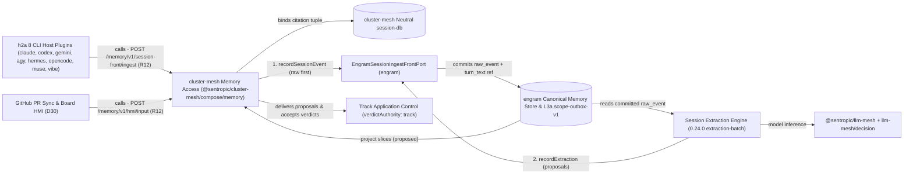
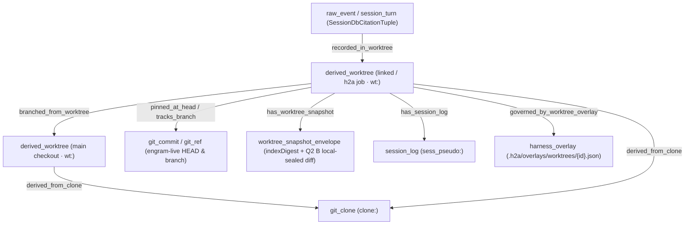
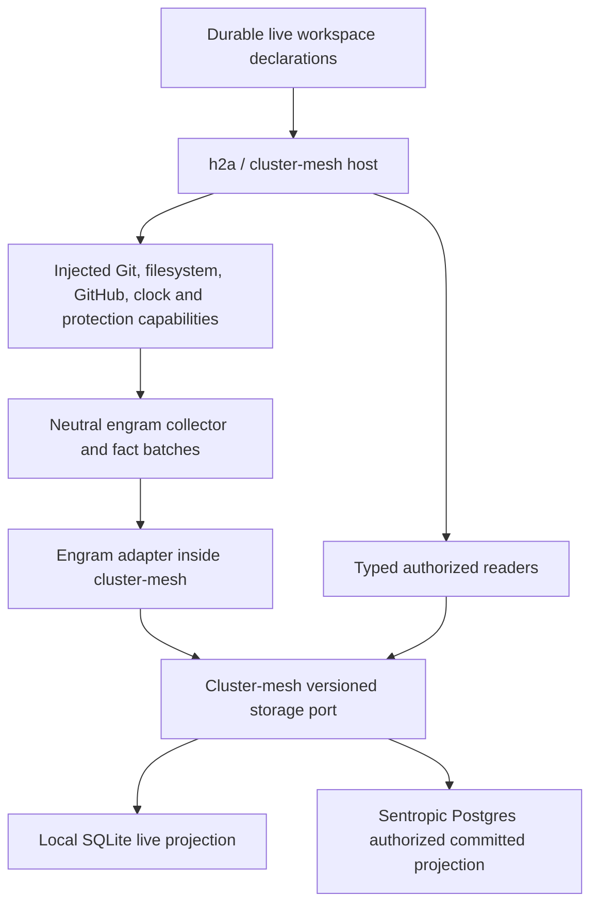
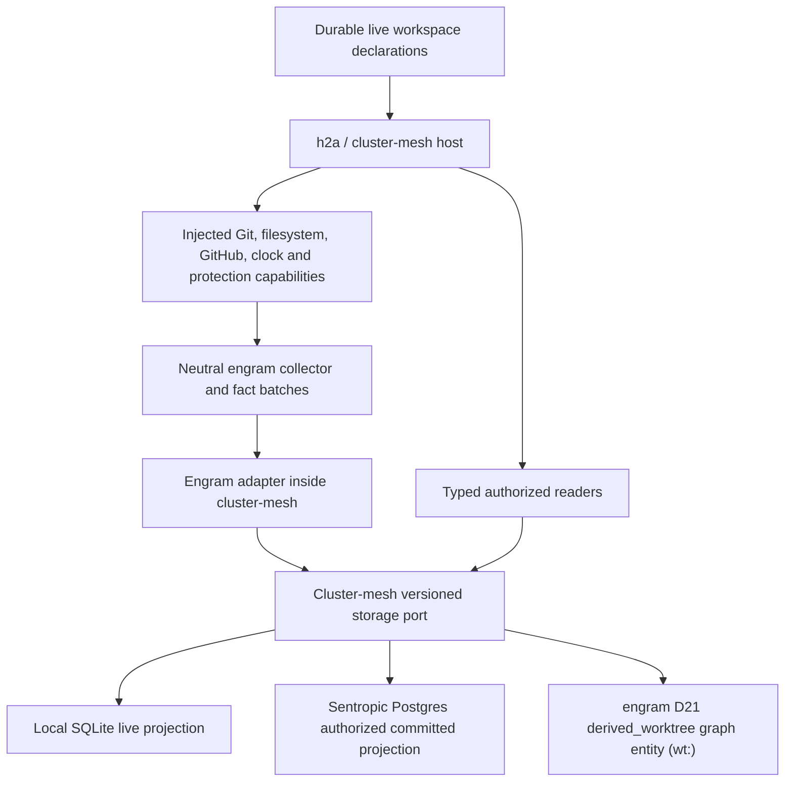

# Spec 1 — Live Session Ingestion Front, Extraction Pipeline, and Derived Git Worktree Graph Model (`SPEC_ENGRAM_SESSION_FRONT_AND_EXTRACTION`)

- **Spec ID:** `SPEC_ENGRAM_SESSION_FRONT_AND_EXTRACTION` (Spec 1 in [`spec/memory/PLAN_SPEC_ENGRAM_FRONT.md`](memory/PLAN_SPEC_ENGRAM_FRONT.md), §3 `:157-173`)
- **Stage:** `DESIGN` (`Gemini Carbon`)
- **Status:** `proposed`
- **Date:** `2026-11-14`
- **Repository of Record:** `engram` (`@sentropic/engram` `0.28.0`, branch `docs/memory-r15-sediment`, `package.json:2-3`) `[FACT: spec/memory/R15-SEDIMENT.md:4; spec/memory/PLAN_SPEC_ENGRAM_FRONT.md:4,159]`
- **Primary Owner:** `engram` (consumed by `h2a` CLI host plugins, `Track` analyst/control, and `sentropic` external HMI ingress exclusively via `@sentropic/cluster-mesh`, `R12`) `[FACT: spec/memory/PLAN_SPEC_ENGRAM_FRONT.md:159; spec/memory/ARCHITECTURE-RULES.md:5]`
- **Dependencies:**
  - [`spec/SPEC_ENGRAM_METAMODEL_AND_LINEAGE_REGISTRY.md`](SPEC_ENGRAM_METAMODEL_AND_LINEAGE_REGISTRY.md) (`Spec 0`: `Sha256Digest` `:144`, `LineageId` `:147`, `OntologyTemplateEnvelopeRef` `:149-154`, `H2AMandateEnvelope` `:161-174`, `track.ontology.yaml` `:930-933`, `.h2a/overlays/*` `:977-982`)
  - [`spec/SPEC_ENGRAM_CLUSTER_MESH_MEMORY_ACCESS_AND_MCP_WIRING.md`](SPEC_ENGRAM_CLUSTER_MESH_MEMORY_ACCESS_AND_MCP_WIRING.md) (`Spec 6A`: `POST /memory/v1/session-front/ingest` `:215-217,224`, `POST /memory/v1/hmi/input` `:228`, `POST /memory/v1/track/verdicts` `:227`, verified `H2AEnvelope<H2AMandate>` `:311-398`, `D17=degraded` durability `:399-416`, neutral `session-db` citation tuple + L3a `scope-outbox-v1` + `@sentropic/llm-mesh` routing `:417-429`)
- **Binding Authorities:**
  - [`spec/memory/OWNER-DECISIONS-2026-11-14.md`](memory/OWNER-DECISIONS-2026-11-14.md) (`:1-29` — `T-M-C` ownership rule, ratified Points `1B`, `2B`, `3C`, `4B`, `5B`, `6A`, and `D28` kept unchanged)
  - [`spec/memory/R15-SEDIMENT.md`](memory/R15-SEDIMENT.md) (`:1-146` — Engram-First Principle and settled decision ledger `D1`–`D34`, never reopened)
  - [`spec/memory/ARCHITECTURE-RULES.md`](memory/ARCHITECTURE-RULES.md) (`:1-13` — `R12` no-bypass invariant, `D30` three-layer separation, `archi@1` relation rules)
  - [`spec/memory/DESIGN-NOTE-VIEW-PROJECTION-BOUNDARY.md`](memory/DESIGN-NOTE-VIEW-PROJECTION-BOUNDARY.md) (`:1-35` — `engram` serves declarations and semantic data only, never design-system fold/layout/rendering state)
  - [`spec/memory/contracts/engram-h2a.md`](memory/contracts/engram-h2a.md) (`:1-214`), [`spec/memory/contracts/engram-track.md`](memory/contracts/engram-track.md) (`:1-247`), [`spec/memory/contracts/engram-cluster-mesh.md`](memory/contracts/engram-cluster-mesh.md) (`:1-181`)
- **Amends (Listed as Exact `Before → After` Deltas in §7; Target Files Unmodified in This Lot):**
  - [`spec/SPEC_AGENT_MEMORY_SUBSTRATE.md`](SPEC_AGENT_MEMORY_SUBSTRATE.md) (`§0`–`§5` write path, lines `53–244`, and `§9.4`, lines `343–370`)
  - [`spec/SPEC_EVOL_AGENT_MEMORY_SUBSTRATE.md`](SPEC_EVOL_AGENT_MEMORY_SUBSTRATE.md) (`§4`, lines `145–252`, and `§5.1`, lines `253–290`; preserving EVOL `D3` at `:73-77` and [`spec/SPEC_MEMORY_MCP_V2.md`](SPEC_MEMORY_MCP_V2.md) `M10` at `:884-910`)
  - [`spec/SPEC_LIVE_GIT_INDEXING.md`](SPEC_LIVE_GIT_INDEXING.md) (`§2`, lines `42–71`, and `§5`, lines `118–129`)
- **Evidence Baseline Verified (Read-Only):**
  - `engram`: `/home/antoinefa/src/graphify-wt-memfinal` (`@sentropic/engram` `0.28.0` on `docs/memory-r15-sediment`, `CHANGELOG.md:39-44`, `src/extraction-batch.ts:1-3140`, `src/profile-bundle.ts:1-1223`, `engram-memory/*`, `engram-live/*`)
  - `sentropic`: `origin/main` commit `913e3bcbc` (`packages/cluster-mesh/src/storage/contracts.ts:29-54`, `packages/cluster-mesh/src/engram-memory/binding.ts:17-43`, `packages/mcp-platform/src/registry.ts:100-145`, `packages/llm-mesh/src/mesh.ts:49-54`, `packages/llm-mesh/src/routing-contracts.ts:13-17,190-222`, `packages/llm-mesh/src/decision/index.ts:1-16`, `api/src/routes/session-content/route-table.ts:60-100`)
  - `h2a`: `origin/main` commit `1f57127de` (`packages/h2a/src/hosts/plugin.ts:63-212`, `packages/h2a/src/envelope.ts:109-150`, `packages/h2a/src/runtime/identity/workspace-id.ts:41-48`, `packages/h2a-runtime/src/delegate.ts:765-810`, `packages/h2a-runtime/src/gateway-host/live-github.ts:1-45`, `packages/track/src/events/store.ts:40-80`, `packages/track/src/ingest/ingest.ts:239-276`, `packages/track/src/model/decision.ts:14-114`)

---

## 0. Binding Governance, Owner Verbatims, and Architectural Boundaries

### 0.1 Binding Owner Verbatims

This specification executes the settled R15/R16 architecture without reopening any decision in `D1`–`D34` (`spec/memory/R15-SEDIMENT.md:40-80`) or `OWNER-DECISIONS-2026-11-14.md` (`:1-29`).

1. **Templates / Metamodel / Control (`T-M-C`) and Consolidated Review Decisions (`1B`–`6A`, `D28` Kept)** (`spec/memory/OWNER-DECISIONS-2026-11-14.md:6-7`):
   > « Les question sont pas assez detaillees. Pose les ici. On est en train de faire des modif coté track sjr les ontologies de son domaine, il fdoit en rester maitre au moins piur les templates et engram pour leur metamodel et application track pour leur controle. Mene un tour avec h2a rapide en fable 5.2 + carbon et repose les 6 quesfion a l issi »
   > « Tout comme recommandé »

2. **First-Rank Session Ingestion Before `Track` and Analysts (`D19`, `D24`, `D32`)** (`spec/memory/R15-SEDIMENT.md:12,20-21,69,77`):
   - > « Engram doit etee en premier front pour recup les donnes de session avant track, avec des analystes » (`comments-2026-11-08.md:19`)
   - > « Attention car le premier rang doit etre engram (enregistrement pkur serialisarkkn eg tour de parole + regles + conrrole track si possible par agent). L usage d agent en controle pour track iu engrame devrai etre possible mais potentiellement reposer plutot sur des api type jev/decison ou llm tres rapides. Je ne sais pas si ce seront des "agents" » (`comments-2026-11-08.md:15`)
   - > « Donc part de engram - et de track » (`comments-2026-11-08.md:16`)
   - > « Attention track c juste pour les decision et gestion d evenement projet. Engram doit etre la premiere etape in fine. Cette assertion me smeble tres mauvaiss » (`comments-2026-11-08.md:9`)
   - > « Track nest qu un modal d analyst et controle mais le harnais en est un autre et l agent dormant aussi... » (`comments-2026-11-08.md:19`)

3. **Mandatory `cluster-mesh` MCP Registry and Integral DB-Cluster Sync (`R12`, `D24`)** (`spec/memory/ARCHITECTURE-RULES.md:5`; `spec/memory/R15-SEDIMENT.md:31,69`):
   - > « repose bien sur le mcp registry de cluster mesh » (`owner-r9/r12-correction-2026-11-07.md:5`)
   - > « De plus j ai demande un partage de graphe entre local et remote. Integral. Engram doit gere ca comme des transaction et synchro de cluster de db via cluster mesh. » (`comments-2026-11-08.md:10`)

4. **Extraction Model Posture** (`spec/memory/R15-SEDIMENT.md:27`):
   > « Il faut oeut etre en permanence un deuxiemme llm light d extraction ou reposer sur le llm de session pour les decisions a terme pkoi pas des modeles deeplearninf specialises. » (`comments-2026-11-08.md:19`)

5. **Derived Git Worktree Graph Modelling (`D21`)** (`spec/memory/R15-SEDIMENT.md:66,104`):
   > « J ai demande un [nom retiré à ta demande] like et c est cette merde que j ai les donmees sont pas modelisees » (`comments-2026-11-08.md:5`)

6. **Decision-Dossier Learning Exchanges (`D27=decision-only`) and Project vs Harness Decisions (`D3`, `D31`)** (`spec/memory/R15-SEDIMENT.md:48,72,76`):
   - > « Oui decision mais ce peut etre comme un decision dossier. Temps d echanger de qualite avec l ia resultant en des faits contextualisé et des decisions associees a ce contexte » (`comments-2026-11-08.md:12`)
   - > « quoi qu'il arrive engram doit modéliser toute décision: décision de projet, décision de harnais, mais avec des destination de sérialisation différentes. » (`owner-r8/comments-2026-11-07.md:19`)
   - > « C est tres mauvais tu confonds bcp de concepts. Engram est la memoire et enregistre les decisions de harnais. H2a a le master harnais et chaque dev a sa surouche. Engram tien le premker rang et tout comme on serialise les spec du engram et le track on serialise la surcouche de chque workspace / repo qu on va aussi commiter » (`comments-2026-11-08.md:14`)

7. **External HMI / GitHub Layer (`D30`) and Live Tracking (`suivi live`)** (`spec/memory/R15-SEDIMENT.md:21,32,75`; `owner-r10/suivi-direct-2026-11-07.md:5`):
   - > « Attention tu confonds l outil track la memoire e tun outil ihm pour interagir avec - gh pourra donner de l input c une autre layer » (`comments-2026-11-08.md:13`)
   - > « trakc avec engram devra vraiment assurer un suivi live » (`owner-r10/suivi-direct-2026-11-07.md:5`)

8. **Privacy, Confidentiality Deny-List, PII Armor, Study Bounds, Federation, and Queryable Text History (`D7`, `D8`, `D9`, `D10`, `D23`)** (`spec/memory/R15-SEDIMENT.md:52-55,68`):
   - > « de base empreintes + triage de sensibilité pour faciliter stp (possibilité de gérer une black list de confidentialité a prevoir dans la memoire pour un agent de controle de memoire type PII) » (`owner-r8/comments-2026-11-07.md:15`)
   - > « metadonnées deterministes + extrait bornés (voir le meme sujet décision précédente il faut un mécanisme de type armor PII pour faciliter le partage) » (`owner-r8/comments-2026-11-07.md:13`)
   - > « 30 projets 6 mois de session merci (tu bornes les session aux 6 mois) » (`owner-r8/comments-2026-11-07.md:11`)
   - > « + propriétaire peut avoir une polituqe par repo » (`owner-r8/comments-2026-11-07.md:9-10`)
   - > « Comme je disais precedemment un contexte de session devrait etre une requete contextuelle a la memoire + le resultat de la requete. L envoi au llm ne devrait pas envoyer de vieux contexte. L historique de sessions serait juste acceasible via la memoire comme gestionnaire de session et memoire (on garde l historique de texte en query via le graph memoire) » (`comments-2026-11-08.md:8`)

9. **Proactive `h2a` Role Analysis When Unassigned (`D16`)** (`spec/memory/R15-SEDIMENT.md:22,61`):
   > « Quand il n y a pas de role, h2a devrait etre proactif en analyse et proposition. » (`comments-2026-11-08.md:2`)

### 0.2 Scope Boundary Across Specs 0, 6A, 1, 2, 3, 4, 5, and 6B

| Spec | Ownership Boundary Relative to Spec 1 |
| :--- | :--- |
| **Spec 0** (`SPEC_ENGRAM_METAMODEL_AND_LINEAGE_REGISTRY.md`) | Owns `Sha256Digest` (`:144`), `LineageId` (`:147`), `OntologyTemplateEnvelopeRef` (`:149-154`), `H2AMandateEnvelope` (`:161-174`), `track.ontology.yaml` (`:930-933`), and `.h2a/overlays/*` path conventions (`:977-982`). Spec 1 imports these contracts unchanged. |
| **Spec 6A** (`SPEC_ENGRAM_CLUSTER_MESH_MEMORY_ACCESS_AND_MCP_WIRING.md`) | Owns the mandatory `R12` transport endpoints (`POST /memory/v1/session-front/ingest`, `POST /memory/v1/hmi/input`, `POST /memory/v1/track/verdicts` at `:215-228`), verified `H2AEnvelope<H2AMandate>` check (`:311-398`), `D17=degraded` outbox durability (`:399-416`), neutral `session-db` citation tuple (`:421-423`), and `@sentropic/llm-mesh` model routing (`:424-426`). Spec 1 defines the `engram` domain ingestion, extraction, worktree, dossier, privacy, and live-tracking semantics invoked behind those `cluster-mesh` endpoints. |
| **Spec 1** *(this document)* | Owns `EngramSessionIngestFrontPort` (`recordSessionEvent`, `recordExtraction`), the pluggable post-recording extraction pipeline over the `0.24.0` extraction toolkit (`CHANGELOG.md:39-44`), `D21` `derived_worktree` graph entities bound to `@sentropic/engram-live`, `D27=decision-only` decision-dossier exchanges, `D33`/`D7`/`D8`/`D9`/`D11`/`D13`/`D14` privacy & retention rules, and typed live-tracking events (`pr.merged`, `owner.answer`, `owner.request`) with reconciliation and gap reporting. |
| **Spec 2** (`SPEC_ENGRAM_CONTEXTUAL_GRAPH_AND_PROMPT_LOOP.md`) | Consumes the canonical records and authorized graph projections written by Spec 1 to assemble durationless prompts via `engram_memory_context` (`D20`, `D22`, `D23`). |
| **Spec 3 / Spec 4 / Spec 5 / Spec 6B** | Spec 3 owns dormant dreaming passes (`D19`, `D25`, `D26`, `Point 3C`); Spec 4 owns `h2a` role/skill ontology & `.h2a/` overlay Git serialization (`D16`, `D31`, `Point 4B`); Spec 5 owns `Track` template control & per-PR `.track/` projection/replay (`D1`, `D29`, `D34`, `Points 1B/5B`); Spec 6B owns multi-node ACID graph sync (`D24`, `Point 6A`). |

### 0.3 Design-System View Projection Boundary (`spec/memory/DESIGN-NOTE-VIEW-PROJECTION-BOUNDARY.md:8-35`)

Wherever Spec 1 graph entities (`derived_worktree`, `decision_dossier`, `project_decision`, `harness_decision`, live-tracking trails) are served to diagram or UI views, **`engram` never computes or serves any state that the design system derives from folding, layout, or rendering**:
1. `engram` serves **declarations** (validated against `engram.metamodel/v1`) and **semantic data** (selected nodes, relations, attributes, and `CitationV1` / `SessionDbCitationTuple` evidence pinned to commit/cursor and `Sha256Digest`).
2. `engram` never emits hidden/visible occurrence sets, lifted endpoints, summary candidates, fold states, geometry, layout caches, or rendering-derived counts (`spec/memory/DESIGN-NOTE-VIEW-PROJECTION-BOUNDARY.md:13-23`).

---

## 1. First-Rank Session Ingestion Front (`EngramSessionIngestFrontPort`, `R12`, `D12`, `D15`, `D17`, `D18`, `D30`)

### 1.1 Verified Code-Fact Baseline and Current Gaps

| Surface | Verified Current Code (`[FACT: repo:file:line]`) | R15 Gap Closed by Spec 1 |
| :--- | :--- | :--- |
| **8 CLI Host Plugins (`h2a`)** | `H2A_HOST_PLUGIN_TARGETS` (`h2a:packages/h2a/src/hosts/plugin.ts:85-150`) defines 8 CLI hosts (`H2A_HOST_PLUGIN_HOSTS` at `:152`): 6 push-capable (`claude` `:86-92`, `codex` `:93-99`, `gemini` `:100-106`, `hermes` `:114-120`, `opencode` `:121-127`, `vibe` `:143-150` via `~/.vibe/hooks.toml` `post_agent` with no prompt-level receive hook at `:135-142` and `receive: 'N-A'` at `:207`) and 2 poll-path hosts (`agy` `:107-113`, `muse` `:128-134`). `renderStopHook` (`:182-212`) emits `h2a drumbeat record` (`:190-196`), `h2a drive receive` (`:197-199`), and `h2a drumbeat scan` (`:210`) only. | Turns, tool executions, file refs, and mandate bindings are not recorded raw in `engram` first via `cluster-mesh` (`R12`). |
| **`Track` Write Front (`h2a`)** | `EventStore.appendCommand` (`h2a:packages/track/src/events/store.ts:40-80`) appends directly to `.track/events.jsonl`, and `authorize` (`h2a:packages/track/src/ingest/ingest.ts:239-276`) checks channel capabilities and `ctx.prov.auth` without `engram` first-rank recording or `cluster-mesh` mediation. | Retires `.track/events.jsonl` as an unmediated live session front (`R15-SEDIMENT.md:90-92`); raw events enter `engram` first via `cluster-mesh`, and `Track` acts downstream as template/control authority (`Point 5B`). |
| **Canonical Memory Substrate (`engram`)** | `MemoryPortV2` (`engram-memory/contracts/index.ts:1342-1361`) exposes `capture` (`:1346`) and `ingestActivity` (`:1348`, `D-8 A` host pull of `ActivityEvidencePageV1` `:293-358` into `pending` `CandidatePayloadV2` `:56-68`), backed by `CanonicalMemoryStorePort` (`:761-857`) and `MEMORY_MODULE_ID = "engram-memory"` (`engram-memory/module-storage-neutral.ts:35-118`). | Lacks `EngramSessionIngestFrontPort` (`recordSessionEvent`, `recordExtraction`), the 6 first-rank raw event envelopes, `SessionDbCitationTuple` (`scheme: "session-db"`), and `Point 5B` `proposed` hold semantics. |
| **`cluster-mesh` Storage & Routes (`sentropic`)** | `STORAGE_MODULE_IDS` (`sentropic:packages/cluster-mesh/src/storage/contracts.ts:29`) registers `['comments', 'engram-live', 'engram-memory']`; `MEMORY_HANDLE_OPERATIONS` (`sentropic:packages/cluster-mesh/src/engram-memory/binding.ts:18`) restricts `engram`'s handle to `['read', 'write']`; `RECEIVER_ROUTE_TABLE` (`sentropic:api/src/routes/session-content/route-table.ts:60-100`) freezes 38 RC2 routes. | Spec 6A (`:215-228, 417-423`) adds `/memory/v1/session-front/ingest` and `/memory/v1/hmi/input` on `@sentropic/cluster-mesh/compose/memory` plus `'session-db'` in pre-lot `6A-S0b`; Spec 1 defines the exact `engram` port and canonical record folding behind them. |

### 1.2 Architecture and `R12` Mediation Flow



**Mandatory `R12` Invariant (`spec/memory/ARCHITECTURE-RULES.md:5`; `Spec 6A §2.1 :158-213`):**
`h2a`, `Track`, and external GitHub/board HMI adapters **never** import or invoke `EngramSessionIngestFrontPort` directly in-process across package boundaries. `engram` exports pure L0 data contracts/validators (`@sentropic/engram/session-front-contracts`) and the neutral engine factory consumed solely by `@sentropic/cluster-mesh/compose/memory`. Every caller reaches `recordSessionEvent` and `recordExtraction` exclusively through `cluster-mesh` (`POST /memory/v1/session-front/ingest`, `POST /memory/v1/hmi/input`, and `POST /memory/v1/session-front/extractions` / in-process `ClusterMeshMemoryAccessPort`), keeping the frozen 38-route `RECEIVER_ROUTE_TABLE` (`sentropic:api/src/routes/session-content/route-table.ts:60-100`) untouched.

### 1.3 Neutral `session-db` Citation Tuple and EVOL `D3` / `M10` Preservation

Per the owner's `2026-11-14` `chat-mesh` rulings relayed in `Spec 6A §2.2` (`:216, 224`) and `§2.5` (`:417-423`):
1. **Zero Duplicate Raw Transcript Blobs:** Operational session entries reside in `cluster-mesh`'s neutral `session-db` module (`STORAGE_MODULE_IDS` `'session-db'`, shared pre-lot `6A-S0b`). `engram` creates **no** memory-specific session table and **no** memory-specific outbox table.
2. **Canonical Citation Tuple (`SessionDbCitationTuple`):** Every turn-derived `raw_event` and `turn_text` record committed in `engram` references its immutable `session-db` source via the 4-tuple `(sessionId, entryId, ordinal, contentDigest)` plus optional fork coordinates `(branchEpoch, parentEntryId)` when a session branches:
   ```ts
   // status: proposed — Neutral session-db citation tuple (Spec 6A §2.2 :224, §2.5 :422)
   export interface SessionDbCitationTuple {
     readonly sessionId: string;               // Neutral session-db session identifier (pseudonymized as sessionPseudoId in projections per D33)
     readonly entryId: string;                 // Immutable entry primary key in neutral session-db
     readonly ordinal: number;                 // Safe non-negative integer sequence within (sessionId, branchEpoch)
     readonly contentDigest: Sha256Digest;     // sha256:<64 lowercase hex> over UTF-8 RFC 8785 JCS bytes of the raw entry
     readonly branchEpoch?: number;            // Present when the session forks from an earlier ordinal
     readonly parentEntryId?: string;          // Parent entry anchor across a session branch
   }
   ```
   When mapped into `CitationV1` (`engram-memory/contracts/index.ts:18-24`), `locator` is `{ scheme: "session-db", value: "${sessionPseudoId}/${entryId}#ord=${ordinal}${branchEpoch !== undefined ? `&epoch=${branchEpoch}` : ""}" }` and `content_digest` equals `contentDigest`.
3. **Preservation of EVOL `D3` (`SPEC_EVOL_AGENT_MEMORY_SUBSTRATE.md:73-77`) and `SPEC_MEMORY_MCP_V2` `M10` (`:884-910`):**
   - `raw_event` records, `turn_text` envelopes, immutable `MemoryRecordV2` blobs, and `LifecycleEventV2` chains in `CanonicalMemoryStorePort` (`engram-memory/contracts/index.ts:761-857`) are the **sole canonical memory authority**.
   - The contextual memory graph queried by `engram_memory_context` (`Spec 2`) is an **authorized derived projection**; no graph projection method (`GraphStore.pushGraph` or `FileGraphStore`) may capture, admit, mutate, or resurrect a canonical record.
   - Under `D23`, `engram_memory_context` resolves and returns authorized, `D8`-bounded text history on demand via `SessionDbCitationTuple` / canonical `turn_text` envelopes; **raw turn text and session event logs are never copied into `graph.json`**, preserving `MEMORY_PROJECTION_RAW_BYTE_CEILING = 52_428_800` (`engram-memory/bounded-projection.ts:22`) and `accepted_current`-only projection eligibility (`SPEC_MEMORY_MCP_V2.md:898`).

### 1.4 Normative `EngramSessionIngestFrontPort` Contract

```ts
// status: proposed — @sentropic/engram/session-front-contracts (consumed via cluster-mesh R12)
import type {
  H2AMandateEnvelope,
  LineageId,
  OntologyTemplateEnvelopeRef,
  Sha256Digest,
} from './metamodel-contracts.js'; // Spec 0 §2.1 (:144-174)
import type {
  AuthorizationContextV1,
  CitationV1,
  Cursor,
  Instant,
  OpaqueRef,
  Result,
  RetentionV1,
} from '../engram-memory/contracts/index.js'; // engram-memory/contracts/index.ts:1-68,122-125,148-151

export type CliHostId =
  | 'claude' | 'codex' | 'gemini' | 'agy'
  | 'hermes' | 'opencode' | 'muse' | 'vibe'; // h2a:packages/h2a/src/hosts/plugin.ts:85-150

export type RawSessionEventKind =
  | 'speech_turn'
  | 'tool_result'
  | 'file_ref'
  | 'mandate_binding'
  | 'external_hmi_input'
  | 'context_saturation';

export type ToolResultSignificance =
  | 'routine'
  | 'significant'
  | 'error'
  | 'security-gate'; // Drives D23 attention weighting in Spec 2 without dropping raw recording

export interface D6FileOrPathRef {
  /**
   * Deterministic path carrier:
   * - Allowed non-secret relative path when repo/content policy permits;
   * - `withheld-path:<sha256>` via protectedPathRef (engram-live/content-policy.ts:133-136)
   *   when classifyPath (:92-125) flags a secret-bearing basename/segment or when ungranted;
   * - Never an unmasked host-local absolute filesystem realpath (D6=refs, D33).
   */
  readonly pathRef: string;
  readonly contentFingerprint: Sha256Digest;
  readonly byteLength?: number;
  readonly lineRange?: { readonly start: number; readonly end: number };
  readonly contentDisclosureAuthorized: boolean; // False => zero excerpt/content reaches external models, caches, or logs (D6)
}

export type RawSessionEventPayload =
  | {
      readonly kind: 'speech_turn';
      readonly speakerRole: 'owner' | 'user' | 'assistant' | 'conductor' | 'system';
      readonly hostId: CliHostId;
      readonly deliveryPath: 'push-hook' | 'post-agent-hook' | 'poll-scan' | 'in-process';
      readonly sessionCitation: SessionDbCitationTuple;
      readonly triggerTurnSweep: boolean; // True on outbound send per D12=turn
    }
  | {
      readonly kind: 'tool_result';
      readonly hostId: CliHostId;
      readonly toolName: string;
      readonly invocationId: string;
      readonly succeeded: boolean;
      readonly exitCode?: number;
      readonly significance: ToolResultSignificance;
      readonly sessionCitation: SessionDbCitationTuple;
      readonly touchedFiles: readonly D6FileOrPathRef[];
    }
  | {
      readonly kind: 'file_ref';
      readonly file: D6FileOrPathRef;
      readonly gitCommitOid?: { readonly algorithm: 'sha1' | 'sha256'; readonly oid: string };
      readonly sessionCitation?: SessionDbCitationTuple;
    }
  | {
      readonly kind: 'mandate_binding';
      /**
       * Verified by cluster-mesh against real H2AEnvelope<H2AMandate> (Spec 6A §2.3 :311-390).
       * Explicit `null` is valid and triggers proactive h2a role/rule analysis (D16).
       */
      readonly mandate: H2AMandateEnvelope | null;
      readonly unboundRoleAnalysisRequested: boolean; // Must be true when mandate === null (D16)
    }
  | {
      readonly kind: 'external_hmi_input'; // D30 separate HMI/GitHub/board input layer
      readonly hmiSource: 'github-pr-sync' | 'github-webhook' | 'github-issue' | 'github-review' | 'project-board';
      readonly externalSourceId: string; // Source-owned stable id; equals idempotencyKey for live-tracking (§6)
      readonly liveTrackingKind?: 'pr.merged' | 'owner.answer' | 'owner.request';
      readonly payloadDigest: Sha256Digest;
      readonly structuredAttributes: Readonly<Record<string, unknown>>;
      readonly citations: readonly CitationV1[];
    }
  | {
      readonly kind: 'context_saturation'; // D19 / D25 event trigger for local dreaming resynthesis
      readonly hostId: CliHostId;
      readonly observedTokenRatio: number; // 0..1
      readonly throughOrdinal: number;
    };

export interface RawSessionEventEnvelope {
  readonly schemaVersion: 'engram.session-event/v1';
  readonly idempotencyKey: string;            // 16..256 UTF-8 bytes; for live-tracking events MUST equal sourceId (§6)
  readonly tenantId: string;
  readonly workspaceId: string;
  /** Canonical derived worktree entity id (`wt:<sha256>`, §3); never a flat path alias (D21). */
  readonly derivedWorktreeId: string;
  readonly cloneId: string;
  /** D33 deterministic pseudonym (`sess_pseudo:<hex>`) derived from neutral sessionId under scope key (§5.1). */
  readonly sessionPseudoId: string;
  /** D33 deterministic pseudonym (`actor_pseudo:<hex>`) of the emitting human or NHI instance (§5.1). */
  readonly actorPseudoId: string;
  /** Verified mandate ref when bound; null triggers D16 proactive h2a analysis. */
  readonly mandateRef: H2AMandateEnvelope | null;
  /**
   * Dedicated capture purpose ref (`D11=dedicated`, §5.5):
   * `'memory.capture.session/v1'` for CLI session capture, `'memory.capture.hmi/v1'` for D30 external HMI input.
   */
  readonly purposeRef: 'memory.capture.session/v1' | 'memory.capture.hmi/v1';
  /** Host audit retention bound (`D13=host`, §5.3). */
  readonly retention: RetentionV1;
  readonly occurredAt: Instant;
  readonly payload: RawSessionEventPayload;
  readonly authorization: AuthorizationContextV1;
  readonly deadlineAt: Instant;
}

export interface RawSessionEventReceipt {
  readonly status: 'recorded' | 'duplicate_exact';
  readonly eventRecordId: string;             // Canonical raw_event identifier (`raw_<base32(recordDigest)>`)
  readonly recordDigest: Sha256Digest;
  readonly cursor: Cursor;
  readonly syncState: 'synced' | 'queued-degraded' | 'local-only';
  /** Present and non-null whenever D17=degraded mode is active; surfaced across all 8 CLI hosts. */
  readonly degradedBanner?: string;
  /** Ready context slice identifiers eligible for immediate non-blocking hook delivery (D15=slices). */
  readonly readySlices: readonly ('track' | 'git' | 'architecture' | 'rules' | 'memory')[];
  /** Set true when mandateRef === null so h2a schedules proactive role/rule analysis (D16). */
  readonly h2aProactiveRoleAnalysisQueued: boolean;
  /** Set true when D12=turn sweep or D19 saturation schedules asynchronous post-record extraction/dreaming. */
  readonly extractionSweepScheduled: boolean;
  readonly transactionReceiptDigest: Sha256Digest;
}

export type ExtractionBackendKind =
  | 'light-permanent-llm'
  | 'session-llm'
  | 'specialized-model';

export interface ExtractedCandidateItem {
  readonly localCandidateKey: string;
  /** D3 / D31 mandatory domain split: project (-> Track control & .track/) vs harness (-> h2a & .h2a/). */
  readonly domain: 'project' | 'harness';
  /**
   * Neutral template pin (Spec 0 §2.1 :149-154): (lineage, templateId, templateVersion, templateDigestSha256).
   * Required for all domain-typed candidates; zero closed list of Track or h2a types in engram (T-M-C).
   */
  readonly templateRef: OntologyTemplateEnvelopeRef;
  /** Open template-declared node or decision type id, validated against the registered ProfileBundleV1. */
  readonly candidateEntityTypeId: string;
  readonly candidateRelations: readonly {
    readonly relationTypeId: string;
    readonly targetRef: string;
    readonly attributes?: Readonly<Record<string, unknown>>;
  }[];
  readonly attributes: Readonly<Record<string, unknown>>;
  readonly validTime: { readonly t: number; readonly t_end?: number };
  /** Grounded citations back to committed raw_event records and/or D6 file refs. */
  readonly sourceEventRecordIds: readonly string[];
  readonly citations: readonly CitationV1[];
  /** Live-tracking classification when extracted or reconciled from a live-tracking signal (§6). */
  readonly liveTrackingBinding?: {
    readonly eventKind: 'pr.merged' | 'owner.answer' | 'owner.request';
    readonly sourceId: string;
  };
}

export interface SessionExtractionProposalBatch {
  readonly schemaVersion: 'engram.session-extraction/v1';
  readonly idempotencyKey: string;
  readonly tenantId: string;
  readonly workspaceId: string;
  readonly derivedWorktreeId: string;
  readonly sessionPseudoId: string;
  /** Every referenced raw_event MUST already exist in engram; unrecorded sources fail closed (NOT_FOUND). */
  readonly sourceEventRecordIds: readonly string[];
  readonly extractor: {
    readonly kind: ExtractionBackendKind;
    readonly modelOrAdapterId: string;        // Resolved via @sentropic/llm-mesh
    readonly extractionSemanticsVersion: string; // Pinned to EXTRACTION_SEMANTICS_VERSION (src/extraction-batch.ts)
    readonly llmMeshAttemptRef?: string;      // PreparedRouteAttempt.attemptRef (routing-contracts.ts:198)
  };
  readonly purposeRef: 'memory.capture.session/v1' | 'memory.capture.hmi/v1';
  readonly retention: RetentionV1;
  readonly candidates: readonly ExtractedCandidateItem[];
  readonly authorization: AuthorizationContextV1;
  readonly deadlineAt: Instant;
}

export interface RecordedExtractionOutcome {
  readonly localCandidateKey: string;
  readonly candidateId: string;
  readonly domain: 'project' | 'harness';
  /**
   * Point 5B invariant:
   * - `domain === 'project'` ALWAYS enters `'proposed'` (`proposalDisposition: 'stays-proposed'`)
   *   with `verdictAuthority: 'track'` and awaits an authoritative TrackControlVerdict.
   * - `domain === 'harness'` enters `'proposed'` unless a verified h2a mandate + master/overlay rule
   *   explicitly authorizes local overlay recording (`D3`, `D4`, `D31`, `Point 4B`).
   */
  readonly reviewStatus: 'proposed' | 'accepted-harness-local';
  readonly verdictAuthority: 'track' | 'h2a';
  readonly recordDigest: Sha256Digest;
}

export interface SessionExtractionReceipt {
  readonly status: 'committed' | 'duplicate_exact';
  readonly batchCursor: Cursor;
  readonly outcomes: readonly RecordedExtractionOutcome[];
  readonly d7BlockedKeys: readonly string[];  // Candidates withheld by engram's D7 confidentiality deny-list
  readonly transactionReceiptDigest: Sha256Digest;
}

export interface EngramSessionIngestFrontPort {
  readonly version: 1;
  recordSessionEvent(envelope: RawSessionEventEnvelope): Promise<Result<RawSessionEventReceipt>>;
  recordExtraction(batch: SessionExtractionProposalBatch): Promise<Result<SessionExtractionReceipt>>;
}
```

### 1.5 Normative First-Rank Execution Rules (`D12`, `D15`, `D16`, `D18`, `D30`)

1. **Strict Write-Before-Analysis Ordering (`D24`, `D32`, `F6`):**
   - No extraction model, `Track` analyst, `h2a` role/rule analyst, or dormant dreaming pass may consume an unrecorded session turn, tool result, or GitHub/board input.
   - `recordExtraction` validates inside the storage transaction that every entry in `sourceEventRecordIds` resolves to an already-committed `raw_event` in the same `(tenantId, workspaceId)` scope; any missing `eventRecordId` fails closed with `NOT_FOUND` and writes nothing.
2. **8-Host CLI Parity (`packages/h2a/src/hosts/plugin.ts:85-152`):**
   - Push-hook hosts (`claude`, `codex`, `gemini`, `hermes`, `opencode`) invoke `/memory/v1/session-front/ingest` synchronously at prompt send (`triggerTurnSweep: true`, `D12=turn`) and stop/tool boundaries.
   - `vibe` (`packages/h2a/src/hosts/plugin.ts:135-150`, TOML `post_agent` / `pre_tool` / `post_tool` hooks, no prompt-level receive hook) records tool outputs on `post_tool` and full turn pairs + `D12=turn` sweep on `post_agent`.
   - Poll-path hosts (`agy` `:107-113`, `muse` `:128-134`) record `SessionStart` / `PreToolUse` scope hooks where supported and flush newly appended neutral `session-db` / host transcript entries through `/memory/v1/session-front/ingest` on the `h2a` poll loop with identical `(sessionId, entryId, ordinal)` idempotency.
3. **Send-Time Promotion Sweep (`D12=turn`):**
   - Whenever `speech_turn.triggerTurnSweep === true` (every outbound send, superseding `per-mode`, `R15-SEDIMENT.md:57`), `engram` commits the `raw_event` immediately, returns `extractionSweepScheduled: true`, and triggers the §2 extraction + `D4` mandate-gated admission sweep over all unextracted `raw_event` records through that cursor so summaries and proposals stay current on every turn.
4. **Non-Blocking Slice Injection (`D15=slices`) and Pass-Through Read-Only Mode (`D18=readonly`):**
   - Hook activation never blocks waiting for full-model convergence or asynchronous extraction (`D15=slices`, `R15-SEDIMENT.md:60`); `readySlices` reports whichever of `track`, `git`, `architecture`, `rules`, and `memory` satisfy their freshness/authorization gates right now.
   - A session without a verified memory identity (`D18=readonly`, `R15-SEDIMENT.md:63`) is refused on `recordSessionEvent` / `recordExtraction` (`UNAUTHORIZED`) and receives only the allowed non-memory slices (`track`, `git`, `architecture`, `rules`) read-only under a recorded policy, with zero memory content disclosed.
5. **Unassigned-Role Proactive `h2a` Trigger (`D16`):**
   - When `mandateRef === null`, `recordSessionEvent` records the raw event under the verified workspace principal (if authorized for capture) and sets `h2aProactiveRoleAnalysisQueued: true`, emitting a workspace-scoped signal on `cluster-mesh` so `h2a` proactively analyzes recorded activity and proposes a standard role and overlay rules (`comments-2026-11-08.md:2`; `Point 4B`: `engram` never writes roles itself).

### 1.6 Degraded Mode (`D17=degraded`, `Spec 6A §2.4 :399-416`)

`D17=degraded` (`R15-SEDIMENT.md:62`: *"A session may start when the context service does not answer. Work continues in signalled degraded mode, with a banner and a log"*) governs two distinct fault modes without ever introducing a shadow JSONL queue in `~/.h2a/` or `.track/`:

| Fault Mode | Normative Behaviour | Banner & Audit Requirement |
| :--- | :--- | :--- |
| **Mode A — Remote Sentropic / context service unreachable; local `embedded-local` `cluster-mesh` SQLite healthy** | `recordSessionEvent` commits atomically in **one** fenced `SqliteKernel.commit(...)` transaction (`engram-memory/module-storage-neutral.ts:42,103,224-230`) to local `engram-memory` (`memory-binding-v2` keys: `raw_event`, `turn_text`, `context_log`) **and** `cluster-mesh`'s neutral L3a `scope-outbox-v1` (`memory-projection-outbox`). Returns `status: 'recorded'`, `syncState: 'queued-degraded'`. Drained transactionally via `Spec 6B` once remote connectivity returns (`D24`, `Point 6A`). | Sets non-null `degradedBanner` (`ClusterMeshMemoryHealthStatus.userVisibleBanner`, `engram-cluster-mesh.md:107-115`), writes daemon health marker read on-demand across all 8 CLI hosts (`Spec 6A :410`), and emits structured log `memory.access.degraded_entered`. |
| **Mode B — Local `embedded-local` `SqliteKernel` unavailable or writer fence lost (`FENCE_LOST` / `STORE_UNAVAILABLE`)** | `/memory/v1/session-front/ingest` returns HTTP `503` (`ClusterMeshMemoryDegradedError`, `Spec 6A :412`). `h2a` fails the memory call closed immediately, creates **zero** secondary local JSONL buffer in `~/.h2a/` or `.track/` (`Spec 6A :412, 777`), and lets the CLI session proceed in signalled degraded mode (`D18`-equivalent non-memory slices where available). Upon kernel recovery, catch-up replays deterministically from the existing neutral `session-db` / host transcript using `(sessionId, entryId, ordinal)` idempotency (`duplicate_exact` on already-committed turns). | Displays mandatory user-visible degraded banner on all 8 CLI hosts (`claude`, `codex`, `gemini`, `agy`, `hermes`, `opencode`, `muse`, `vibe`) and logs `memory.access.degraded_entered` + `memory.access.degraded_ingest_refused`. |

---

## 2. Post-Recording Extraction Pipeline (`recordExtraction`, `T-M-C`, `Point 5B`, `0.24.0` Toolkit)

### 2.1 Pluggable Extraction Strategy Over `@sentropic/llm-mesh`

Per `comments-2026-11-08.md:19` (`« Il faut oeut etre en permanence un deuxiemme llm light d extraction ou reposer sur le llm de session pour les decisions a terme pkoi pas des modeles deeplearninf specialises. »`) and `Spec 6A §2.5` (`:424-426`), `engram` defines a neutral, model-agnostic `SessionExtractionStrategyPort` whose runtime inference adapter routes **exclusively** through `@sentropic/llm-mesh` (`LlmMesh.generate` in `sentropic:packages/llm-mesh/src/mesh.ts:49-54` with `VerifiedRoutingSubject` in `routing-contracts.ts:13-17` and `PreparedRouteAttempt` usage metering in `:190-222`, or `DecisionClient` from `@sentropic/llm-mesh/decision` in `sentropic:packages/llm-mesh/src/decision/index.ts:6-9`):

```ts
// status: proposed — Neutral extraction strategy port (@sentropic/engram/extraction-batch)
export interface SessionExtractionSliceInput {
  readonly tenantId: string;
  readonly workspaceId: string;
  readonly derivedWorktreeId: string;
  readonly sessionPseudoId: string;
  readonly rawEvents: readonly CommittedRawSessionEventView[]; // Resolved from engram + authorized session-db citations
  /** Active template bundles for this workspace: repo-pinned Track bundle (track.ontology.yaml) + h2a bundle. */
  readonly activeTemplateBundles: readonly {
    readonly domain: 'project' | 'harness';
    readonly templateRef: OntologyTemplateEnvelopeRef;
    readonly profileBundleJson: string;       // Canonical ProfileBundleV1 (schema: "engram.profile-bundle/v1")
  }[];
  readonly d6ContentAuthorized: boolean;      // False => model sees D6 path+fingerprint refs only, zero raw file excerpts
}

export interface SessionExtractionStrategyPort {
  readonly backendKind: ExtractionBackendKind; // 'light-permanent-llm' | 'session-llm' | 'specialized-model'
  readonly adapterId: string;
  extractSlice(input: SessionExtractionSliceInput): Promise<Result<SessionExtractionProposalBatch>>;
}
```

| `backendKind` | Execution Path & Horizon | How It Connects to `0.24.0` Toolkit & `@sentropic/llm-mesh` |
| :--- | :--- | :--- |
| `'light-permanent-llm'` | **Now (default asynchronous/turn worker):** dedicated low-latency model running alongside the session at each `D12=turn` sweep. | Wraps `LlmMesh.generate` (`intent: 'fast'`, `routing-contracts.ts:59`) via `adaptTextJsonClient` (`src/extraction-batch.ts:751-828`) and executes `extractDocumentBatch` (`:2956`). |
| `'session-llm'` | **Now (co-turn mode):** uses the active session LLM route under the same `VerifiedRoutingSubject` (`routing-contracts.ts:13-17`) to emit structured `EXTRACTION_SCHEMA_V1` (`"engram_extraction_v1"`, `src/extraction-batch.ts:251`) JSON over the committed turn slice. | Feeds the structured JSON through `validateAndPruneChunkExtraction` (`src/extraction-batch.ts:1338-1608`), `processCitationsForItem` (`:1279-1336`), and `mergeExtractionsWithCitationsPrepared` (`:2724`). |
| `'specialized-model'` | **Later (evolution slot):** domain-tuned sequence/graph deep-learning extractors or `DecisionClient` (`@sentropic/llm-mesh/decision`) evaluators. | Implements `SessionExtractionStrategyPort` and emits the exact same `EXTRACTION_SCHEMA_V1` + `CitationV1` bundle into `mergeExtractionsWithCitations` without altering `recordExtraction`, storage, or `Track`/`h2a` contracts. |

### 2.2 Reuse of the `0.24.0` Extraction Toolkit (`CHANGELOG.md:39-44`)

*(Note on line anchor: `PLAN_SPEC_ENGRAM_FRONT.md:172` cites `CHANGELOG.md:19` from an earlier release; on current `0.28.0` `docs/memory-r15-sediment`, the `0.24.0 (2026-11-07)` extraction-toolkit entry is at `CHANGELOG.md:39-44`, specifically `:41`.)*

Every `SessionExtractionStrategyPort` implementation reuses the shipped `@sentropic/engram/extraction-batch` and `@sentropic/engram/profile-bundle` pipeline rather than inventing a parallel extractor:
1. **Bundle Re-validation & Profile Derivation:** For each active lineage (`track` from `track.ontology.yaml` per `Spec 0 §7.1.1 :930-933`, and `h2a`), the worker re-validates `ProfileBundleV1` (`schema: "engram.profile-bundle/v1"`, `registriesMode: "full"` in `src/profile-bundle.ts:14, 30-41, 560-565`) via `revalidateFullBundleAndRederiveProfile` (`src/extraction-batch.ts:431-642`) and checks that `bundle.profileHash` matches `templateRef.templateDigestSha256`.
2. **Deterministic Coverage & Idempotent Caching:** Slice extraction keys are computed deterministically via `computeExtractionKey` / `getOrExtract` (`src/extraction-batch.ts:98-105`) over `(rawEventDigests, templateDigestSha256, EXTRACTION_SEMANTICS_VERSION, d6ContentAuthorized)` and tracked via `checkCoverageGate` / `transitionCoverageRecord` (`:112-113`), preventing redundant LLM invocations on replayed turns.
3. **Chunk Validation, Grounding, and Citation Merge:**
   - Candidate nodes and relations are validated against the template's `NormalizedOntologyProfile` (`validateAndPruneChunkExtraction`, `src/extraction-batch.ts:1338-1608`).
   - Every candidate item is stamped with `CitationV1` locators (`processCitationsForItem`, `:1279-1336`); when `d6ContentAuthorized === true`, verbatim quotes are verified with `verifyVerbatim` (`src/source-grounding.ts:316`), and when `d6ContentAuthorized === false` (`D6=refs`), citations carry only `(SessionDbCitationTuple | D6FileOrPathRef)` digests with empty quote text.
   - Multi-turn or chunked extractions merge through `mergeExtractionsWithCitations` / `mergeAcceptedChunksPrepared` (`src/extraction-batch.ts:54, 152, 2724`), surfacing explicit conflict diagnostics rather than silently dropping competing assertions.

### 2.3 Strict `T-M-C` and `Point 5B` Proposal Lifecycle

When `EngramSessionIngestFrontPort.recordExtraction` receives a `SessionExtractionProposalBatch`:

1. **`engram` Metamodel + `D7` Gate Only (`OWNER-DECISIONS-2026-11-14.md:13, 21, 25`):**
   - `engram` verifies: (a) all `sourceEventRecordIds` exist in canonical `engram` storage, (b) `templateRef` (`{ lineage, templateId, templateVersion, templateDigestSha256 }`) resolves in `engram`'s lineage registry (`Spec 0 §2`), (c) `candidateEntityTypeId`, `attributes`, and `candidateRelations` are metamodel-well-formed against that exact registered `ProfileBundleV1`, and (d) no attribute, label, or citation matches `engram`'s `D7` confidentiality deny-list (§5.2; matching items are withheld and reported in `d7BlockedKeys`).
   - **`engram` never embeds a closed enum of `Track` types, states, or `D1` bounded-list names**, and **never mutates or repairs** a non-conforming proposal.
2. **Project-Domain Proposals Stay `proposed` Until `Track` Verdict (`Point 5B`):**
   - Every candidate with `domain: 'project'` (`templateRef.lineage === 'track'`) is persisted with:
     - `reviewStatus: 'proposed'` (`proposalDisposition: 'stays-proposed'`, `verdict: null` under the `spec/memory/contracts/engram-track.md:154-165` bijection),
     - `verdictAuthority: 'track'`,
     - `engram` substrate state `pending` (`PendingControlV1` in `engram-memory/contracts/index.ts:509-521`).
   - While in `reviewStatus: 'proposed'`, the candidate is **invisible** to `accepted_current` recall, `BoundedCurrentProjectionV1` / `graph.json` (`engram-memory/bounded-projection.ts:24-27, 74-86`), and per-PR `.track/` serialization (`Point 1B`), whereas the underlying `raw_event` is already durable in `engram`.
   - Only when the `Track` application evaluates its own rules (`D1=borne-review` bounded-list check vs third-party promotion review, `D4` mandate scope, template state transitions via `« api type jev/decison »`, fast LLM, or control agent per `D32`) and submits an authoritative `TrackControlVerdict` (`verdictAuthority: 'track'`) via `POST /memory/v1/track/verdicts` (`Spec 6A :227`) does `engram` record the verdict and transition the item according to the `engram-track.md:154-165` bijection (`accepted-bounded` / `accepted-promoted` → `accepted_current`; `rejected` → `rejected`; `superseded` → `historical`). `engram` records `Track`'s verdict verbatim and never overrides it; `cluster-mesh` sync never overwrites a `Track`-controlled record (`Point 6A`).
3. **Harness-Domain Proposals (`D3=mandated`, `D4=mandate`, `D31`, `Point 4B`):**
   - Every candidate with `domain: 'harness'` (`templateRef.lineage === 'h2a'`) is routed outside `Track` serialization (`D3`).
   - Master-harness or role-definition proposals remain `reviewStatus: 'proposed'` (`verdictAuthority: 'h2a'`, `Point 4B`: *"engram may propose role changes, never write them"*). Developer/workspace/worktree overlay rules explicitly authorized by a verified `H2AMandateEnvelope` (`D3=mandated`, `D4=mandate`) and tighten-only overlay rules (`Spec 0 §4.4`) transition to `accepted-harness-local` for `.h2a/overlays/*` Git serialization (`D31`, `D34`).

---

## 3. Derived Git Worktree Graph Entities (`D21`) and Binding to `engram-live`

### 3.1 Retiring Flat Path Aliasing (`D21`) Over Verified `engram-live` Primitives

Owner principle `D21` (`spec/memory/R15-SEDIMENT.md:66, 102-104`) permanently retires flat path aliasing (`worktree=alias`): every Git checkout—main checkout, `git worktree add` linked worktree, or detached `h2a` job worktree (`.h2a/jobs/<jobId>/wt` in `h2a:packages/h2a-runtime/src/delegate.ts:798-810`)—is modelled in `engram` as a first-class **`derived_worktree`** graph entity retaining its parent origin link, branch and working-tree state, and attached session logs.

Spec 1 binds `derived_worktree` directly to `@sentropic/engram-live` without violating any `SPEC_LIVE_GIT_INDEXING` safety or activation invariant:
- **Shared Canonical Identity Derivation (`engram-live/registration.ts:312-411`):**
  - `deriveCloneIdentity` (`:312-360`) hashes `(hostScope, normalizedCommonDirRealpath, commonDirProjectFingerprint)` into `cloneId` (`clone:<sha256>`). Linked worktrees sharing one Git `commondir` (`engram-live/worktree.ts:247-253, 336`) resolve to the **same** `cloneId`, whereas two separate clones with equal `ws:` root-commit hashes (`h2a:packages/h2a/src/runtime/identity/workspace-id.ts:41-48`) remain distinct (`SPEC_LIVE_GIT_INDEXING.md:230`).
  - `deriveWorktreeIdentity` (`engram-live/registration.ts:369-411`) hashes `(hostScope, gitDir)` under `cloneId` into `worktreeId` (`wt:<sha256>`). Spec 1 uses this exact `worktreeId` as `derivedWorktreeId`.
- **Preservation of Explicit Live Activation (`SPEC_LIVE_GIT_INDEXING` `A01` `:315`, `classifyLifecycleEvent` in `engram-live/registration.ts:468-475`):**
  - Opening an `h2a` session and recording a turn via `recordSessionEvent` computes `(cloneId, derivedWorktreeId)` purely and deterministically (`liveIndexingState: 'unactivated'`) and creates/updates the `derived_worktree` node in `engram` **without** implicitly starting background `engram-live` filesystem watchers or `Reconciler` loops (`engram-live/reconcile.ts:95-145`).
  - When explicit live indexing is activated (`WorkspaceDeclarationDto` with `liveCapability: "live"` in `engram-live/contracts.ts:243-258`, `createLiveDeclaration` in `engram-live/registration.ts:155-185`), `engram-live` attaches `declarationId` (`decl:<sha256>`, `:421-445`), `StableCapture` index/worktree digests (`engram-live/worktree.ts:104-117, 302-352`), ref observations, and `publishedGenerationId` (`gen:<10 digits>`, `engram-live/contracts.ts:371-375`) to the **exact same `derivedWorktreeId`**.

### 3.2 Normative `DerivedWorktreeNodeV1` and Graph Relation Schema

```ts
// status: proposed — D21 Derived Git worktree graph node & relations
export type WorktreeOriginKind =
  | 'main-checkout'
  | 'linked-worktree'
  | 'h2a-job-worktree'
  | 'detached-checkout';

export interface DerivedWorktreeParentOriginV1 {
  readonly parentCloneId: string;             // Canonical clone:<sha256> from deriveCloneIdentity
  /** Present when spawned from a parent worktree (e.g., h2a delegate job worktree from a dev checkout). */
  readonly parentWorktreeId?: string;         // Canonical wt:<sha256>
  readonly originKind: WorktreeOriginKind;
  readonly baseRefName?: string;              // e.g. 'refs/heads/main' or parent feature branch at creation
  readonly baseCommitOid?: { readonly algorithm: 'sha1' | 'sha256'; readonly oid: string };
  readonly durableWorkspaceFingerprint?: string; // Preserved h2a `ws:<sha256>` (workspace-id.ts:41-48)
  readonly identityUncertainty: readonly ('missing_history' | 'shallow_clone' | 'detached_archive')[];
}

export interface DerivedWorktreeGitStateV1 {
  readonly headOid: { readonly algorithm: 'sha1' | 'sha256'; readonly oid: string } | null;
  readonly symbolicBranchRef: string | null;  // e.g. 'refs/heads/docs/memory-r15-sediment'; null when detached
  readonly detached: boolean;
  readonly indexDigest?: Sha256Digest;        // Mapped from StableCapture.indexDigest (engram-live/worktree.ts:113)
  readonly workingTreeFingerprint?: Sha256Digest;
  readonly dirtyState: 'clean' | 'staged-only' | 'dirty' | 'conflicted' | 'unknown';
  readonly liveIndexingState: 'unactivated' | 'bootstrap' | 'current' | 'partial' | 'stale' | 'degraded';
  readonly liveDeclarationId?: string;        // decl:<sha256> when liveCapability === 'live'
  readonly livePublishedGenerationId?: string; // gen:0000000001.. (engram-live/contracts.ts:371)
  readonly observedAt: Instant;
}

export interface DerivedWorktreeNodeV1 {
  readonly nodeType: 'derived_worktree';
  readonly derivedWorktreeId: string;         // Canonical wt:<sha256> (engram-live/registration.ts:398)
  readonly tenantId: string;
  readonly workspaceId: string;
  readonly cloneId: string;                   // Canonical clone:<sha256>
  /**
   * D33 + D6 path representation: opaque scoped pseudonym / relative label;
   * raw absolute host realpath NEVER leaves the local host (SPEC_LIVE_GIT_INDEXING.md:230).
   */
  readonly worktreePathRef: D6FileOrPathRef;
  readonly parentOrigin: DerivedWorktreeParentOriginV1;
  readonly gitState: DerivedWorktreeGitStateV1;
  /**
   * Supports R1 private object retention after branch deletion or .h2a/jobs/<jobId>/wt cleanup
   * (h2a:packages/h2a-runtime/src/delegate.ts:765-781; SPEC_LIVE_GIT_INDEXING.md:116, 316).
   */
  readonly lifecycleState: 'active' | 'detached-idle' | 'removed-retained' | 'revoked-private-purged';
  readonly r1RetentionReceiptId?: string;
  /** Relative Git overlay path per Spec 0 §7.2.4 (:981): `.h2a/overlays/worktrees/{derivedWorktreeId}.json`. */
  readonly harnessOverlayRelPath: string;
  readonly createdAt: Instant;
  readonly updatedAt: Instant;
}
```

**First-Class Graph Edges Anchored on `derived_worktree`:**

| Relation Type | `Source → Target` | Provenance & Privacy Invariant |
| :--- | :--- | :--- |
| `derived_from_clone` | `derived_worktree → git_clone` | Links linked/job worktrees to their shared `commondir` repository clone (`engram-live/registration.ts:369-411`). |
| `branched_from_worktree` | `derived_worktree → derived_worktree` | Retains parent checkout lineage when an `h2a` job or secondary worktree forks from an existing worktree (`D21`). |
| `pinned_at_head` / `tracks_branch` | `derived_worktree → git_commit` / `git_ref` | Binds worktree state to `engram-live` `Commit` and `RefObservation` entities (`SPEC_LIVE_GIT_INDEXING.md:81-82`). |
| `has_worktree_snapshot` | `derived_worktree → worktree_snapshot_envelope` | Carries metadata/digests only in shared/remote projections; local uncommitted hunks stay locally encrypted under `KeyProviderPort` (`engram-live/content-policy.ts:46-51`, `SPEC_LIVE_GIT_INDEXING` `Q2 B` / `Q6 A`) and are purged on `revokeLiveDeclaration` (`engram-live/registration.ts:268-298`). |
| `has_session_log` / `recorded_in_worktree` | `derived_worktree → session_log` and `raw_event → derived_worktree` | Attaches every `sessionPseudoId` session log and `raw_event` directly to the worktree in which it executed (`D21`), surviving worktree removal when `r1RetentionReceiptId` holds (`R1`). |
| `governed_by_worktree_overlay` | `derived_worktree → harness_overlay` | Binds `.h2a/overlays/worktrees/{derivedWorktreeId}.json` (`D31`, `Spec 0 :981`). |



---

## 4. Decision-Dossier Learning Exchanges (`D27=decision-only`, `D3`, `D31`)

### 4.1 Verified Code Alignment with `Track` Decision Dossiers

In `h2a:packages/track/src/model/decision.ts`, `Track` defines:
- `Option` (`:14-20`: `{ id, title, summary, pros?, cons? }`), `QAEntry` (`:22-26`: `{ id, question, answer? }`), and `Dossier` (`:66-78`: `{ context, options, qa, selectedOptionId?, recommendation?, resultingSpecChange?, decisionEvaluation?, artifacts? }`);
- `ComprehensionEvidence` (`:34-41`: `{ subject, dossierHash, h2aEventRef?, attestationHash?, sig?, at? }`), recording the attesting decider principal (`subject`) distinctly from the relaying channel principal (`prov.principal`);
- `DossierArtifact` (`:49-64`: discriminated union `'h2a-decision-dossier' | 'rendered-view' | 'mockup'`).

Under `D27=decision-only` (`spec/memory/R15-SEDIMENT.md:72`: `« Oui decision mais ce peut etre comme un decision dossier. Temps d echanger de qualite avec l ia resultant en des faits contextualisé et des decisions associees a ce contexte »`) and `D3` (`:48`: `« quoi qu'il arrive engram doit modéliser toute décision: décision de projet, décision de harnais, mais avec des destination de sérialisation différentes. »`), interactive and asynchronous learning exchanges (`e_rt_swipe` swipe/card review, CLI deliberation, or web dossier review) **never** produce unanchored trait notes (`SPEC_AGENT_MEMORY_SUBSTRATE.md:130-149`). Every learning exchange is modelled in `engram` as a structured **`decision_dossier`** graph subgraph binding **`contextualized_fact`** nodes to **`project_decision`** or **`harness_decision`** nodes.

### 4.2 Normative `DecisionDossierNodeV1`, `ContextualizedFactNodeV1`, and Domain Routing

```ts
// status: proposed — D27=decision-only learning exchange & D3/D31 decision nodes
export interface DossierOptionV1 {
  readonly id: string;
  readonly title: string;
  readonly summary: string;
  readonly pros?: readonly string[];
  readonly cons?: readonly string[];
}

export interface DossierQAExchangeV1 {
  readonly id: string;
  readonly question: string;
  readonly answer?: string;
  /** Citation to the exact raw_event (speech_turn or external_hmi_input) where the owner/decider answered. */
  readonly answerEventRecordId?: string;
  readonly answerCitation?: CitationV1;
}

export interface ComprehensionAttestationRefV1 {
  /** Decider actor pseudonym (`actor_pseudo:<hex>`, D33) — distinct from the relaying channel caller. */
  readonly subjectPseudoId: string;
  readonly dossierDigestSha256: Sha256Digest;
  readonly h2aEventRef?: string;
  readonly attestationDigestSha256?: Sha256Digest;
  readonly attestedAt: Instant;
}

export interface ContextualizedFactNodeV1 {
  readonly nodeType: 'contextualized_fact';
  readonly factId: string;
  readonly tenantId: string;
  readonly workspaceId: string;
  readonly derivedWorktreeId: string;
  readonly summaryText: string;               // Subject to D7 deny-list + D8 PII-armor on boundary egress
  readonly validTime: { readonly t: number; readonly t_end?: number };
  readonly sourceEventRecordIds: readonly string[];
  readonly citations: readonly CitationV1[];
}

export interface DecisionDossierNodeV1 {
  readonly nodeType: 'decision_dossier';
  readonly dossierId: string;
  readonly negotiationRef?: string;           // Matches DossierArtifact.negotiationRef (decision.ts:52)
  readonly tenantId: string;
  readonly workspaceId: string;
  readonly derivedWorktreeId: string;
  readonly sessionPseudoId: string;
  readonly exchangeMode: 'interactive-session' | 'async-swipe-review' | 'hmi-dossier-thread';
  readonly contextSummary: string;
  readonly options: readonly DossierOptionV1[]; // Pending owner-facing dossiers carry >= 2 options + recommendation
  readonly recommendation?: { readonly optionId: string; readonly rationale: string };
  readonly qaExchanges: readonly DossierQAExchangeV1[];
  readonly selectedOptionId?: string;
  readonly comprehensionAttestations: readonly ComprehensionAttestationRefV1[];
  readonly dossierDigestSha256: Sha256Digest;
  readonly sourceEventRecordIds: readonly string[];
  readonly citations: readonly CitationV1[];
}

export interface DomainDecisionNodeBaseV1 {
  readonly decisionId: string;
  readonly dossierId: string;                 // Linked via `settles_in_decision`
  readonly contextualizedFactIds: readonly string[]; // Linked via `contextualizes_decision` (non-empty for settled decisions)
  readonly title: string;
  readonly outcome: 'pending' | 'go' | 'no-go' | 'deferred';
  readonly selectedOptionId?: string;
  readonly deciderPseudoId?: string;
  readonly mandateRef: H2AMandateEnvelope | null;
  readonly templateRef: OntologyTemplateEnvelopeRef;
  readonly validTime: { readonly t: number; readonly t_end?: number };
  readonly citations: readonly CitationV1[];
}

export interface ProjectDecisionNodeV1 extends DomainDecisionNodeBaseV1 {
  readonly nodeType: 'project_decision';
  readonly domain: 'project';
  /** templateRef.lineage MUST equal 'track'. Enters 'proposed' until authoritative TrackControlVerdict (Point 5B). */
  readonly reviewStatus: 'proposed' | 'accepted-bounded' | 'accepted-promoted' | 'rejected' | 'superseded' | 'needs-human-decision';
  readonly verdictAuthority: 'track';
  readonly serializationTarget: 'track-pr-slice'; // Serialized to .track/ under Track template (D29=both, D34=engram, Point 1B)
}

export interface HarnessDecisionNodeV1 extends DomainDecisionNodeBaseV1 {
  readonly nodeType: 'harness_decision';
  readonly domain: 'harness';
  /** templateRef.lineage MUST equal 'h2a'. Classified local under formal h2a mandate (D3=mandated). */
  readonly overlayScope: 'worktree' | 'workspace-developer' | 'repository' | 'master-proposal';
  readonly reviewStatus: 'proposed' | 'accepted-harness-local' | 'rejected' | 'superseded';
  readonly verdictAuthority: 'h2a';
  readonly serializationTarget: 'h2a-harness-overlay'; // Serialized to .h2a/overlays/* (D31, D34, Point 4B)
}
```

**Execution Invariants for `D27` Exchanges:**
1. Every prompt, option presentation, Q&A turn, and swipe/selection action in a learning exchange is recorded **first** via `recordSessionEvent` (`speech_turn` or `external_hmi_input`), and when the owner answers an option or question it also emits a typed `owner.answer` live-tracking signal (§6).
2. Settling a dossier (`selectedOptionId` chosen or `outcome !== 'pending'`) atomically links at least one `ContextualizedFactNodeV1` (`grounds_dossier` and `contextualizes_decision`) to the resulting `project_decision` or `harness_decision`, ensuring decisions never float without the factual context that justified them (`D27`).
3. `project_decision` and `harness_decision` share `engram`'s graph substrate (`D3`) while remaining strictly partitioned by `domain`, `templateRef.lineage`, `verdictAuthority`, and `serializationTarget` (`.track/` vs `.h2a/overlays/*`, `D31`, `Point 4B`, `Point 5B`).

---

## 5. Privacy, Pseudonymization, Deny-Lists, Retention, Study Bounds, and Capture Purpose

### 5.1 Deterministic Pseudonymization (`D33=pseudonymize`) and `D6=refs` Path Policy

Per `D33=pseudonymize` (`spec/memory/R15-SEDIMENT.md:78`: *"Authors and session identifiers receive a stable, deterministic pseudonym; paths follow D6"*):
1. **Scoped HMAC Pseudonyms (`actor_pseudo:*`, `sess_pseudo:*`):**
   - For each `(tenantId, workspaceId)` protection scope, the host key custodian (`KeyProviderPort` in `engram-live/content-policy.ts:46-51` / `CryptoPort` in `engram-memory/contracts/index.ts:901-907`) holds a 256-bit scope pseudonymization key `K_pseudo` outside graph projections and outside Git files.
   - Author identities and session IDs are mapped deterministically before graph/index/study persistence:
     $$\text{actorPseudoId} = \text{"actor\_pseudo:"} \mathbin{\|} \operatorname{HMAC-SHA256}_{K_{\text{pseudo}}}(\text{"engram/d33/actor/v1\textbackslash 0"} \mathbin{\|} \operatorname{NFC}(\text{canonicalActorId}))$$
     $$\text{sessionPseudoId} = \text{"sess\_pseudo:"} \mathbin{\|} \operatorname{HMAC-SHA256}_{K_{\text{pseudo}}}(\text{"engram/d33/session/v1\textbackslash 0"} \mathbin{\|} \operatorname{NFC}(\text{sessionId}))$$
   - Stability guarantees that all turns of one session and all contributions of one actor join deterministically in the graph without leaking emails, OS usernames, or raw CLI session UUIDs. Note that per `SPEC_EVOL_AGENT_MEMORY_SUBSTRATE.md:388`, **pseudonymization is never a substitute for field-omission redaction** when `AuthorizationPort.redact` withholds a field.
2. **Paths Under `D6=refs` (`spec/memory/R15-SEDIMENT.md:51`):**
   - Every file path passes deterministic pre-persistence classification (`classifyPath` in `engram-live/content-policy.ts:92-125`). Secret-bearing basenames/segments (`.env*`, `*.pem`, `*.key`, `credentials.json`, `secrets.json`, `service-account.json`, `id_rsa`/`id_ed25519`, `secret`/`secrets`/`credentials` segments at `:59-73`) are immediately replaced with `protectedPathRef` (`withheld-path:<sha256>`, `:133-136`) — `.gitignore` is never consulted as a secrecy guarantee (`:12-16`).
   - Without an active `G4` / `D6` content-disclosure grant (`SPEC_LIVE_GIT_INDEXING.md:369, 395`), external models, dreaming summaries, caches, and logs receive **only** `(pathRef, contentFingerprint)` (`contentDisclosureAuthorized: false`), never file bodies or line excerpts.

### 5.2 `D7` Confidentiality Deny-List and `D8=bounded` PII Armor Across Boundaries (`D24`, `D10`)

1. **`engram` Confidentiality / PII Deny-List (`D7`, `e_svc_mctrl`):**
   - `engram` owns `ConfidentialityDenyListV1` (`version: string`, `digestSha256: Sha256Digest`, `saltedTermHashes: readonly Sha256Digest[]`, `deterministicPatterns: readonly string[]`, `piiCategoryRules: readonly ('email' | 'phone' | 'national-id' | 'iban' | 'secret-token' | 'private-key' | 'client-program-code')[]`), building on `SECRET_PATTERNS` (`engram-live/content-policy.ts:144-150`) and aligned with `Track`'s confidentiality policy (`D32`: joint memory control from `engram` and `Track`).
   - Pre-persistence screening (`screenBatchSurfaces` pattern, `engram-live/content-policy.ts:206-240`) withholds hard-denied secret/confidentiality hits before canonical sealing; under explicit content authorization, `D7` model-assisted sensitivity triage runs exclusively through `@sentropic/llm-mesh` (`Spec 6A §2.5 :424-426`).
2. **`D8=bounded` PII-Armor Redaction and the `D24` / `D10` Egress Matrix:**
   - Implemented behind `AuthorizationPort.redact` (`engram-memory/contracts/index.ts:214-234`), stamping `PiiArmorStamp` (`{ policyVersion, redactionReceiptDigest, d7BlacklistVersion, d33Pseudonymized: true }` per `spec/memory/contracts/engram-cluster-mesh.md:45-57`):

| Transfer / Read Path | `crossesBoundary` | Normative Privacy & Federation Treatment |
| :--- | :--- | :--- |
| **Same `(tenantId, workspaceId)` local ↔ remote DB-cluster sync (`D24`)** — `raw_event`, `turn_text`, `typed_node`, `typed_edge`, `ontology_template`, `control_verdict` | `false` | **Integral and unmasked** transactional replication (`engram-cluster-mesh.md:53-57`), preserving `D6` protected-path withholding and local-only `Q2 B` uncommitted Git hunks (`SPEC_LIVE_GIT_INDEXING.md:114, 330`). |
| **Same `(tenantId, workspaceId)` `context_log` and `context_summary` (`D10=mandate`)** | `local-by-default` | **Stays local by default** (`R15-SEDIMENT.md:55`). Replicated to another machine **only** when both `H2AMandateEnvelope.federationPolicy.allowContextTransfer === true` and the owner's per-repository policy explicitly allow it (`Spec 6A :324-328, 394`). |
| **Cross-workspace / cross-tenant capitalisation (`proposeCapitalisation`), cross-session study access (`D8`, `D9`), or external-model disclosure without raw grant** | `true` | **Mandatory `PiiArmorStamp` (`D8=bounded`):** deterministic metadata + byte-bounded extracts (`RedactionDirectiveV1.max_packet_bytes`, `engram-memory/contracts/index.ts:170-175`) scrubbed through `D7` deny-list + PII armor + `D33` pseudonyms. Missing or invalid `piiArmorStamp` fails closed (`UNAUTHORIZED` / `POLICY_UNAVAILABLE`). |

### 5.3 Host Audit Retention (`D13=host`) and Post-Close Window + Announced Purge (`D14=window` vs `D23`)

Per `D13=host` (`R15-SEDIMENT.md:58`) and `D14=window` (`:59`):
1. **Single Declared Host Audit Policy (`D13=host`):**
   - Each host deployment declares a single `HostAuditRetentionPolicyV1` (`policyId`, `auditWindowMs`, `derivativeRule: 'retain' | 'make-ineligible'`). Once declared, that single policy governs all `context_log` records and processed session items on the host; per-caller or per-CLI ad-hoc TTL overrides are rejected (`INVALID_SCHEMA`).
2. **Post-Close Audit Presentation Window and Announced Purge (`D14=window`):**
   - When a session closes at `closedAt`, its processed items enter `AuditWindowState = 'presented-for-audit'` with `auditWindowEndsAt = closedAt + auditWindowMs` (`RetentionV1.expires_at` on audit-scoped records, `engram-memory/contracts/index.ts:47-50`).
   - During `[closedAt, auditWindowEndsAt)`, processed items remain presented on the host audit surface.
   - At `now >= auditWindowEndsAt`, a deterministic two-step transition executes:
     1. **Presentation Stop + Announced Purge Receipt:** Presentation stops immediately (`AuditWindowState = 'presentation-stopped'`), and before any physical deletion runs, the engine emits and journals an immutable **`PurgeAnnouncementReceiptV1`**:
        ```ts
        // status: proposed — D14 announced purge receipt
        export interface PurgeAnnouncementReceiptV1 {
          readonly schemaVersion: 'engram.purge-announcement/v1';
          readonly announcementId: string;
          readonly tenantId: string;
          readonly workspaceId: string;
          readonly sessionPseudoIds: readonly string[];
          readonly hostAuditPolicyId: string;
          readonly closedWindowEnd: Instant;
          readonly announcedAt: Instant;
          readonly executeNotBefore: Instant;
          readonly targetClasses: readonly ('host-context-log' | 'host-audit-view' | 'expired-memory-envelope')[];
          readonly receiptDigest: Sha256Digest;
        }
        ```
     2. **Purge Execution Without Breaking `D23` Canonical Graph Queries:** Host-local `context_log` copies and expired sealed candidate keys are destroyed (`CryptoPort.destroy`, `engram-memory/contracts/index.ts:905`). In canonical `engram` storage, records governed by `D13` expiry fold deterministically to `expired` (or `tombstoned` on explicit erasure, cascading across every node, edge, FTS, vector, and aggregate read surface per `SPEC_AGENT_MEMORY_SUBSTRATE.md:184-195` and `SPEC_EVOL_AGENT_MEMORY_SUBSTRATE.md:716, 773-776`), while non-expired canonical `turn_text` citations retained for mission continuity remain queryable on demand through the memory graph (`D23`, `PLAN_SPEC_ENGRAM_FRONT.md:184`).

### 5.4 Study Corpus Calibration Bounds (`D9=full` — Study Corpus Only)

Per `D9=full` (`R15-SEDIMENT.md:54`: `« 30 projets 6 mois de session merci (tu bornes les session aux 6 mois) »`):
- `StudyCorpusCalibrationPolicyV1` fixes `maxActiveProjects = 30` and `sessionSlidingWindowDays = 183` (`6` calendar months anchored at query `asOf`), combined with mandatory `D8=bounded` PII armor and `D33=pseudonymize`.
- **Hard Non-Truncation Invariant:** `D9` bounds **only** the read-only cross-session study and calibration corpus projection (`purposeRef: 'memory.recall.study/v1'`). It **never** deletes, expires, evicts, or caps canonical project memories in `engram` (`D28=engram`), `Track` project event trails, or `engram-live` Git/PR history (`Q1 A` uncapped history in `SPEC_LIVE_GIT_INDEXING.md:104-112`).

### 5.5 Dedicated, Independently Revocable Capture Purpose (`D11=dedicated`)

Per `D11=dedicated` (`R15-SEDIMENT.md:56`: *"Automatic capture of session facts has its own purpose, separate from the recall purpose. Capture can be revoked without cutting recall"*):
- `engram` enforces disjoint purpose namespaces in `AuthorizationPort.authorize` and `AuthorizationPort.revalidate` (`engram-memory/contracts/index.ts:161-234`):
  - **Capture purposes:** `'memory.capture.session/v1'` and `'memory.capture.hmi/v1'` (required on `recordSessionEvent`, `recordExtraction`, `MemoryPortV2.capture`, and `MemoryPortV2.ingestActivity`).
  - **Recall purposes:** `'memory.recall.contextual/v1'` (for `engram_memory_search`, `engram_memory_get`, `engram_memory_context`) and `'memory.recall.study/v1'` (for `D8`/`D9` study reads).
- Revoking a principal's or workspace's `'memory.capture.*'` grant increments the capture-grant revocation state so every subsequent `recordSessionEvent` / `recordExtraction` call fails closed with `AUTHORIZATION_REVOKED`, **without** invalidating `'memory.recall.*'` receipts or cutting recall over already admitted (`accepted_current` / `historical`) records.

---

## 6. Typed Live-Tracking Events, Source-ID Idempotency, Reconciliation Job, and Gap Counter

### 6.1 Typed Live-Tracking Events (`pr.merged`, `owner.answer`, `owner.request`)

Per `owner-r10/suivi-direct-2026-11-07.md:5-6` (`« trakc avec engram devra vraiment assurer un suivi live »`) and `PLAN_SPEC_ENGRAM_FRONT.md:167`, `engram` defines three closed live-tracking event schemas so deliveries, owner answers, and new owner requests are recorded live one-by-one rather than relying on manual conductor bookkeeping:

```ts
// status: proposed — Typed live-tracking events (owner-r10/suivi-direct-2026-11-07.md:5-6)
export type LiveTrackingEventKind = 'pr.merged' | 'owner.answer' | 'owner.request';

export type LiveTrackingEventPayloadV1 =
  | {
      readonly eventKind: 'pr.merged';
      /** Canonical sourceId: `gh:pr-merged:${owner}/${repo}#${prNumber}@${mergeOid.algorithm}:${mergeOid.oid}` */
      readonly sourceId: string;
      readonly repositoryOwner: string;
      readonly repositoryRepo: string;
      readonly prNumber: number;
      readonly headOid: { readonly algorithm: 'sha1' | 'sha256'; readonly oid: string };
      readonly baseOid: { readonly algorithm: 'sha1' | 'sha256'; readonly oid: string };
      readonly mergeOid: { readonly algorithm: 'sha1' | 'sha256'; readonly oid: string };
      readonly mergeStrategy: 'merge' | 'squash' | 'rebase';
      readonly mergedAt: Instant;
    }
  | {
      readonly eventKind: 'owner.answer';
      /** Canonical sourceId: upstream immutable id, e.g. `session-db:${sessionId}:${entryId}:owner.answer` or `gh:comment:${owner}/${repo}#${id}:owner.answer` */
      readonly sourceId: string;
      readonly dossierId?: string;            // Present when answering a D27 decision_dossier option or QAEntry
      readonly selectedOptionId?: string;
      readonly questionId?: string;
      readonly verbatimDigest: Sha256Digest;
      readonly answeredAt: Instant;
      readonly citations: readonly CitationV1[];
    }
  | {
      readonly eventKind: 'owner.request';
      /** Canonical sourceId: upstream immutable id, e.g. `session-db:${sessionId}:${entryId}:owner.request` or `gh:issue:${owner}/${repo}#${num}:owner.request` */
      readonly sourceId: string;
      readonly requestSummary: string;
      readonly verbatimDigest: Sha256Digest;
      readonly requestedAt: Instant;
      readonly citations: readonly CitationV1[];
    };
```

### 6.2 Source-ID Idempotency (`idempotencyKey === sourceId`) and `Point 5B` Write Path

1. **Exact Source-ID Idempotency (`idempotencyKey === sourceId`):**
   - Every live-tracking ingestion sets `RawSessionEventEnvelope.idempotencyKey = payload.sourceId` and binds `ExtractedCandidateItem.liveTrackingBinding = { eventKind, sourceId }`.
   - In `engram-memory`'s lifecycle-independent X1 capture-idempotency registry (`CaptureIdempotencyRecordV1` in `engram-memory/contracts/index.ts:549-555`, `PersistedCaptureIdempotencyV1` at `:730-736`), `candidate_id` is derived deterministically from `(tenantId, workspaceId, sourceId)`.
   - Re-delivering the same `sourceId` with identical canonical JCS `payloadDigest` (for example, `PR_SYNC_OVERLAP_MS = 5 * 60 * 1000` overlap pagination in `engram-live/pr-sync.ts:33, 345-347` or webhook + poll overlap) returns `duplicate_exact` with zero writes; re-delivering the same `sourceId` with a different `payloadDigest` fails closed with `DIGEST_CONFLICT` (`SPEC_EVOL_AGENT_MEMORY_SUBSTRATE.md:534-536`).
2. **End-to-End Live-Tracking Execution Under `R12` + `Point 5B`:**
   - **Step 1 (Raw First in `engram`):** `pr.merged` (from `engram-live/pr-sync.ts:332-450` / `h2a:packages/h2a-runtime/src/gateway-host/live-github.ts:1-45` via `/memory/v1/hmi/input`), `owner.answer`, and `owner.request` (from `/memory/v1/session-front/ingest` or `/memory/v1/hmi/input`) commit first as `raw_event` records in `engram` via `cluster-mesh`.
   - **Step 2 (Typed Project Proposal):** `recordExtraction` writes the corresponding `Track`-template-referenced candidate (`domain: 'project'`, `templateRef` pinned to `track.ontology.yaml`, `reviewStatus: 'proposed'`).
   - **Step 3 (`Track` Control Verdict):** `Track` control (`verdictAuthority: 'track'`) validates each candidate one-by-one via `cluster-mesh` (`D1=borne-review`, template conformance, item/decision linkage) and records its `TrackControlVerdict` in `engram` (`POST /memory/v1/track/verdicts`, `Spec 6A :227`).

### 6.3 Live-Tracking Reconciliation Job and Gap Counter (`LiveTrackingReconcilerPort`)

To guarantee zero silent loss when an extraction worker lags, a host restarts, or an HMI delivery drops (`owner-r10/suivi-direct-2026-11-07.md:6`), `engram` specifies a deterministic reconciliation job:

```ts
// status: proposed — Live-tracking reconciliation job & gap counter
export interface LiveTrackingGapBreakdown {
  readonly eventKind: LiveTrackingEventKind;
  readonly unrecordedRawCount: number;        // Present in upstream source cursor, absent from engram raw_event
  readonly unproposedCount: number;           // Present in engram raw_event, no Extraction candidate proposed yet
  readonly awaitingTrackVerdictCount: number; // Proposed in engram (`reviewStatus: 'proposed'`), awaiting Track verdict
}

export interface LiveTrackingGapReportV1 {
  readonly schemaVersion: 'engram.live-tracking-gap/v1';
  readonly tenantId: string;
  readonly workspaceId: string;
  readonly checkedAt: Instant;
  readonly prSyncUpdatedAtCursor: number | null; // From PrSyncCursorDto.updatedAtCursor (engram-live/pr-sync.ts:367)
  readonly sessionDbThroughCursor: Cursor;
  readonly engramJournalThroughCursor: Cursor;
  readonly byKind: readonly LiveTrackingGapBreakdown[];
  /** Published scalar metric `live_tracking_gap_count` = sum of unrecordedRawCount + unproposedCount across all 3 kinds. */
  readonly liveTrackingGapCount: number;
  /** Published separately as `live_tracking_pending_verdict_count` so Track backlog is visible without conflating missing ingestion. */
  readonly pendingTrackVerdictCount: number;
  readonly proposalsSubmittedCount: number;
  readonly reportDigestSha256: Sha256Digest;
}

export interface LiveTrackingReconcilerPort {
  runReconciliationSweep(input: {
    readonly tenantId: string;
    readonly workspaceId: string;
    readonly authorization: AuthorizationContextV1;
    readonly deadlineAt: Instant;
  }): Promise<Result<LiveTrackingGapReportV1>>;
}
```

**Reconciliation Invariants:**
1. **Proposal-Only — Never Direct Accepted Writes (`suivi-direct-2026-11-07.md:6`, `Point 5B`):** When the reconciler finds a merged `PullRequestFactDto` in `PrSyncPersistencePort.listObservations` (`engram-live/pr-sync.ts:83`) or an owner-authored turn/HMI item in `session-db` lacking a corresponding `engram` proposal, it records the missing `raw_event` (if absent) and submits a **proposal** via `recordExtraction` (`reviewStatus: 'proposed'`, `idempotencyKey = sourceId`). It **never** mutates `.track/events.jsonl` directly and **never** mints a `TrackControlVerdict`.
2. **Observable Gap Counter:** Every sweep persists `LiveTrackingGapReportV1` and publishes `live_tracking_gap_count` and `live_tracking_pending_verdict_count` through `cluster-mesh` diagnostics (`GET /memory/v1/health` / telemetry sink).

---

## 7. Exact Specification Amendments (`Before → After` Deltas; Target Files Unmodified)

Per the Spec 1 charter (`spec/memory/PLAN_SPEC_ENGRAM_FRONT.md:168-172`), the three existing specifications below remain untouched on disk in this lot; the hunks below record the exact verbatim `Before` text at the cited line ranges and the normative `After` replacement to apply in the dedicated documentation-amendment lot (`D2=review`).

### 7.1 Amendments to `spec/SPEC_AGENT_MEMORY_SUBSTRATE.md` (`§0`–`§5`, lines `53–244`, and `§9.4`, lines `343–370`)

#### Hunk 7.1.1 — Scope Closure, Substrate, and In-Scope Kinds (`spec/SPEC_AGENT_MEMORY_SUBSTRATE.md:53-120`, with `:60-70` and `:103-114` unchanged)

**Before (verbatim, lines `53–59`, `71–102`, `115–120`):**
````markdown
The principal decided: **graphify ACCEPTS being the agent-memory substrate, WITH
a written scope closure.** IN scope: agent memory — **context / decision /
evidence**. OUT (hard gate holds): persona / authored h2a identity semantics.
Anti-cycle invariant: graphify **never imports h2a**; h2a only DISPATCHES into a
contract graphify defines. This lifts the T6 out-of-scope boundary **only for
the in-scope kinds**; everything else stays OUT.
````
````markdown
## 2. Substrate — additive, no new store

Realized on `graphify.agent-stats.project-graph/v1`, additive (no version bump).
An agent-memory node is a normal graph node carrying the shared `t`/`t_end`/
`t_src` contract, so it is born window-queryable (T5) and recall-addressable
(T6) with no new reader.

## 3. IN-SCOPE kinds — the closure

### 3.1 `MemoryNote` (asserted) — the normative schema

| Field | Meaning | Enforced |
|---|---|---|
| `node_type: "MemoryNote"` | fixed | admission |
| `memory_kind` | closed enum `"context" \| "decision" \| "evidence"` | admission (enum check) |
| `subject` | what the note is ABOUT: `"agent-work"` or `"human:<id>"` (a named human as work context). A `subject` naming a persona/identity/voice is **REFUSED** (§3.3). | admission (subject predicate) |
| `t` | authored-at / turn instant (ordering coordinate, §6) | pass-through |
| `t_end` | absent ⇒ still-current; `=== t` ⇒ closed point | pass-through |
| `t_src` | which coordinate produced `t` | pass-through, UNVERIFIED |
| `provenance` | structured citation: cited string + named source (§4) | admission (citation check, §4) |
| `event_shaped` | a mandatory machine-verifiable event ANCHOR: `t` + the assertion as an anchored event, not free prose (§3.3 — **structural**, not a writer flag, not a prose classifier) | admission (structural predicate) |
| `trust: "asserted"` | fixed | — |
| `reconcilable: false` | **opt-out by construction** (C1, §3.4): a non-earned tier is NOT reconciled by default | reconciliation gate |
| `principal_owner` | tenant identity: the principal/owner this note belongs to (§3.6) | admission + gate |
| `scope` | `"private"` (to `principal_owner`) \| `"capitalised"` (shared) (§3.6) | admission + gate |
| `purpose` | the finality the subject-human fact serves (A2, §3.5) — required when `subject` is a human | admission |
| `retention` | TTL / retention bound (A2, §3.5) — required when `subject` is a human | retention sweep + deletion path |
| `review_status` | `"pending" \| "accepted"` (binary gate, D11) | gate |

`memory_kind` closes the enum; but the enum ALONE does not hold the persona
boundary. The boundary is held by CODE — §3.3.
````
````markdown
### 3.2 Deliberately OUT (hard gate)

`Persona`/`Soul` binding, `UserModel` as an identity model, any h2a write path
or invented product envelope, caller-selected namespaces, cross-workspace reads,
pagination/cursors. As `SPEC_AGENTSTATS_TIMEORIENTED` §4.3 states them.
````

**After (normative replacement for lines `53–59`, `71–102`, `115–120`; lines `60–70`, `103–114`, and `121–229` retained unchanged):**
````markdown
The principal decided (extended by R15/R16 and `SPEC_ENGRAM_SESSION_FRONT_AND_EXTRACTION.md`):
**engram (`@sentropic/engram`) is the first-rank live session ingestion front and canonical
agent-memory substrate (`D24`, `D28=engram`, `D32`), reached exclusively via `@sentropic/cluster-mesh`
(`R12`).** IN scope: first-rank raw session events (`speech_turn`, `tool_result`, `file_ref`,
`mandate_binding`, `external_hmi_input` per `D30`, `context_saturation`), derived Git worktrees
(`derived_worktree`, `D21`), decision-dossier learning exchanges (`decision_dossier`,
`contextualized_fact`, `D27=decision-only`), domain-typed `project_decision` / `harness_decision`
(`D3`, `D31`) and lineage-registered ontology instances (`Spec 0` `OntologyTemplateEnvelopeRef`),
plus `MemoryNote` (`context | decision | evidence`). OUT (hard gate holds): `Persona`/`Soul`
voice traits, `UserModel` aggregation (§3.3), and direct unmediated `h2a` or `Track` imports
bypassing `cluster-mesh` (`R12`). Anti-cycle invariant: `engram` **never imports `h2a` or `Track`**.
````
````markdown
## 2. Substrate — canonical journal first, derived worktree anchor (`D21`), bounded projection

Canonical authority resides in `CanonicalMemoryStorePort` (`SPEC_EVOL_AGENT_MEMORY_SUBSTRATE.md` D3)
over `cluster-mesh` L3a storage (`D17`, `D24`). Every session record binds to a `derived_worktree`
entity (`wt:<sha256>`, `D21`) rather than a flat `workspaceId` path alias, carries the shared
`t`/`t_end` temporal contract, and projects only `accepted_current` envelopes into bounded graph views
(`SPEC_MEMORY_MCP_V2.md` M10; raw turn text stays queryable on demand via `D23` and never inflates `graph.json`).

## 3. IN-SCOPE kinds — first-rank session front + `MemoryNote` closure

### 3.1 First-rank session-front kinds (`Spec 1`) and `MemoryNote` (asserted)

In addition to `MemoryNote` below, `EngramSessionIngestFrontPort` (`SPEC_ENGRAM_SESSION_FRONT_AND_EXTRACTION.md` §§1–6)
admits canonical `raw_event` records (citing `cluster-mesh` neutral `session-db` via
`(sessionId, entryId, ordinal, contentDigest)`), `derived_worktree` (`D21`), `decision_dossier` +
`contextualized_fact` (`D27=decision-only`), `project_decision` (citing `Track` `OntologyTemplateEnvelopeRef`,
held in `review_status: "proposed"` until an authoritative `Track` verdict per `Point 5B`), and
`harness_decision` (`D3=mandated`, serialized to `.h2a/overlays/*` per `D31`). Authors and session IDs
carry deterministic `D33` pseudonyms; capture uses dedicated revocable purpose `memory.capture.*` (`D11`).

| Field | Meaning | Enforced |
|---|---|---|
| `node_type: "MemoryNote"` | fixed (for episodic asserted notes; domain-typed nodes cite `OntologyTemplateEnvelopeRef` per `Spec 0`) | admission |
| `memory_kind` | closed enum `"context" \| "decision" \| "evidence"` | admission (enum check) |
| `subject` | what the note is ABOUT: `"agent-work"` or `"human:<actor_pseudo_id>"` (`D33` pseudonymized work context). A `subject` naming a persona/identity/voice is **REFUSED** (§3.3). | admission (subject predicate) |
| `derived_worktree_id` | canonical `wt:<sha256>` worktree entity (`D21`, replacing flat `workspaceId` aliasing) | admission |
| `t` | authored-at / turn instant (ordering coordinate, §6) | pass-through |
| `t_end` | absent ⇒ still-current; `=== t` ⇒ closed point | pass-through |
| `t_src` | which coordinate produced `t` | pass-through, UNVERIFIED |
| `provenance` | structured citation (`SessionDbCitationTuple`, `D6FileOrPathRef`, or named source, §4) | admission (citation check, §4) |
| `event_shaped` | mandatory machine-verifiable event ANCHOR: `t` + anchored event, not free prose (§3.3) | admission (structural predicate) |
| `trust: "asserted"` | fixed on `MemoryNote` (`earned` / `signed` governed by `EvidenceVerifierPort`) | — |
| `reconcilable: false` | **opt-out by construction** (C1, §3.4) | reconciliation gate |
| `principal_owner` | tenant/owner scope binding (§3.6) | admission + gate |
| `scope` | `"private"` \| `"capitalised"` (§3.6; cross-boundary egress requires `D8` `PiiArmorStamp`) | admission + gate |
| `purpose` | dedicated capture vs recall finality (`D11=dedicated`: `memory.capture.*` vs `memory.recall.*`) | admission |
| `retention` | host audit retention policy (`D13=host`, `D14=window` announced purge; A2 §3.5) | retention sweep + deletion path |
| `review_status` | `"pending" \| "proposed" \| "accepted"` (`project` domain stays `"proposed"` until `Track` verdict, `Point 5B`) | gate + `Track`/`h2a` control |

`memory_kind` closes the `MemoryNote` enum; the persona boundary continues to be held by CODE — §3.3.
````
````markdown
### 3.2 Deliberately OUT (hard gate)

`Persona`/`Soul` voice/value traits, `UserModel` as an aggregated identity profile (§3.3),
flat `workspaceId` path aliasing (`D21`), unmediated `h2a`/`Track` writes bypassing `cluster-mesh`
(`R12`), and closed lists of `Track` or `h2a` domain types hardcoded inside `engram` (`T-M-C`).
*(Pagination/cursors and `cluster-mesh`-mediated multi-workspace study/sync are governed by
`SPEC_EVOL_AGENT_MEMORY_SUBSTRATE.md` and `Spec 6A`/`Spec 6B`.)*
````

#### Hunk 7.1.2 — Provenance and Write Path Header (`spec/SPEC_AGENT_MEMORY_SUBSTRATE.md:230-249`)

**Before (verbatim, lines `230–249`):**
````markdown
## 4. Provenance — what `verifyVerbatim` DOES and does NOT do (B1 correction)

Each `MemoryNote` carries a structured citation (cited string + named source).
`verifyVerbatim` (`src/source-grounding.ts:316`) is applied at admission: a note
whose cited string is not literally present in its named source is **refused**.

**Correction (the previously overstated claim is removed):** `verifyVerbatim`
checks the **citation only** — that the cited string exists in the named source.
It does **NOT** check that the note is event-shaped, nor that it is not a
persona/trait. The FORM/persona boundary is a **separate code predicate**
(§3.3, `event_shaped` + `subject`), NOT `verifyVerbatim`. And neither checks
that the lesson is TRUE. graphify guarantees FORM (via §3.3) and citation
integrity (via `verifyVerbatim`), never TRUTH.

## 5. Write path — versioned append CAPABILITY (M4), not a whole-graph push

A living memory adds **one note at a time**. Measured: the `GraphStore` port
(`src/storage/types.ts`) exposes only `pushGraph` (whole-graph). Re-pushing per
note is not viable.
````

**After (normative replacement for lines `230–249`):**
````markdown
## 4. Provenance — `SessionDbCitationTuple`, `D6=refs`, and `verifyVerbatim` (B1 + R15)

Every record carries structured citations:
1. When content disclosure is authorized, `verifyVerbatim` (`src/source-grounding.ts:316`) verifies
   that the cited string is literally present in the named source; mismatches are **refused**.
2. For neutral `session-db` turns (`Spec 6A` §2.5) or ungranted files (`D6=refs`), provenance binds
   the cryptographic `(sessionId, entryId, ordinal, contentDigest)` tuple or `(pathRef, contentFingerprint)`
   without copying withheld plaintext.
`verifyVerbatim` checks citation grounding only, never `event_shaped`, persona exclusion (§3.3),
or `Track` domain validity (`Point 5B`).

## 5. Write path — first-rank `EngramSessionIngestFrontPort` via `cluster-mesh` (`R12`) + append projection (M4)

Live sessions record raw turns, tool results, `D6` file refs, mandates, and `D30` HMI inputs **first**
through `EngramSessionIngestFrontPort` (`recordSessionEvent`, then post-record `recordExtraction`
proposals) over `@sentropic/cluster-mesh` (`R12`), committing to `CanonicalMemoryStorePort` (`EVOL` D3).
For derived `GraphStore` projections (`src/storage/types.ts`), whole-graph re-push per event remains
non-viable; projection updates use incremental append/invalidation capabilities (M4 below and `EVOL` §5.5).
````

#### Hunk 7.1.3 — Producer Wire-Shape (`spec/SPEC_AGENT_MEMORY_SUBSTRATE.md:343-370`)

**Before (verbatim, lines `343–370`):**
````markdown
### 9.4 Producer wire-shape — CO-SPEC CONVERGED with the memory peer

graphify DEFINES three entry points; h2a imports ONLY the signature (types +
method shapes) and never graphify internals; graphify never imports h2a
(anti-cycle). h2a authors ALL content — graphify validates and admits, it
authors no memory (hard gate).

- **`admitMemoryNote(note, ctx) → {admitted:true, id} | {admitted:false,
  reason}`.** h2a builds the COMPLETE note (§3.1 fields). graphify runs the
  admission checks IN ORDER, all must pass: (1) `memory_kind` enum; (2)
  `subject` predicate (§3.3.1); (3) `event_shaped` STRUCTURAL predicate
  (§3.3.2, the anchor below); (4) `verifyVerbatim` citation (§4); (5) tenancy
  (`principal_owner` + `scope`, §3.6); (6) retention required when `subject`
  is a human (§3.5). On pass → `appendNode` (§5), enters `pending`. On fail →
  refused, NOTHING stored (no silent no-op).
- **`promoteNote(noteId, {leg1_verdict_ref, leg2_verdict_ref,
  independence_attestation}, ctx) → {promoted|rejected}`** — SEPARATE from
  admission (separation of powers; the trigger is never the note's author). The
  double-consensus is scheduled by the conductor; two independent high-grade
  legs emit verdict ARTEFACTS; verdicts travel by REFERENCE (a locator to the
  file), never a self-report; graphify appends the two refs + the independence
  attestation + provenance to the journal (D12).
- **`requestTombstone(target, auth, ctx) → outcome`** — h2a REQUESTS, graphify
  KEEPS the `principal_owner` authority check (§3.5). For a subject-human fact
  `auth` is a SIGNED authorization (Ed25519 of `principal_owner` or a signed
  mandate), NOT an asserted requester field — authority never rests on a
  fabricable `by`. graphify checks, then `appendTombstone` (§5).
````

**After (normative replacement for lines `343–370`):**
````markdown
### 9.4 Producer wire-shape — `cluster-mesh`-mediated (`R12`) first-rank session front (`Spec 1` + `Spec 6A`)

`engram` defines data-pure contracts (`@sentropic/engram/session-front-contracts` and
`@sentropic/engram-memory/contracts`); `engram` never imports `h2a` or `Track` (anti-cycle), and
neither `h2a` nor `Track` calls `engram` in-process (`R12`). All producer traffic transits
`@sentropic/cluster-mesh/compose/memory`:

- **`recordSessionEvent(envelope)` (via `POST /memory/v1/session-front/ingest` or `/memory/v1/hmi/input`):**
  Records every raw `speech_turn`, `tool_result`, `file_ref` (`D6`), `mandate_binding` (verified
  `H2AEnvelope<H2AMandate>` or `null` triggering `D16`), `external_hmi_input` (`D30`), and
  `context_saturation` (`D19`) **first**, anchored on `derivedWorktreeId` (`D21`), `D33` pseudonyms,
  `D11` capture purpose (`memory.capture.*`), and `D13` host retention. Degrades via L3a `scope-outbox-v1`
  with an 8-host banner + structured log (`D17=degraded`), never via `~/.h2a/` or `.track/` JSONL files.
- **`recordExtraction(batch)` (post-recording extraction pipeline):**
  `light-permanent-llm`, `session-llm`, or `specialized-model` (via `@sentropic/llm-mesh` and
  `0.24.0` `@sentropic/engram/extraction-batch`) reads committed `raw_event` records and writes
  template-pinned proposals (`OntologyTemplateEnvelopeRef`, `Spec 0`). `domain: "project"` candidates
  check only metamodel well-formedness + `D7` deny-list in `engram` and stay in `reviewStatus: "proposed"`
  until an authoritative `TrackControlVerdict` (`verdictAuthority: "track"`, `Point 5B`, `D1=borne-review`)
  arrives via `POST /memory/v1/track/verdicts`.
- **`engram_memory_capture` / `engram_memory_request_admission` / `engram_memory_withdraw` / `engram_memory_forget`:**
  MCP write tools routed through `mcp-platform` (`Spec 6A` §3). Erasure (`forget` / `tombstone`)
  enforces signed principal/mandate authority and folds tombstones out of every read, edge, and aggregate surface (§3.5).
````

---

### 7.2 Amendments to `spec/SPEC_EVOL_AGENT_MEMORY_SUBSTRATE.md` (`§4`, lines `145–252`, and `§5.1`, lines `253–290`)

**Explicit Preservation Notice:**
- **EVOL `D3` (`spec/SPEC_EVOL_AGENT_MEMORY_SUBSTRATE.md:73-77`) is preserved verbatim and unamended:** immutable record blobs plus the append-only lifecycle journal in `CanonicalMemoryStorePort` remain sole canonical authority; all graph/lexical/vector/UI surfaces remain projections.
- **`SPEC_MEMORY_MCP_V2.md` `M10` (`:884-910`) is preserved verbatim and unamended:** `graph.json` (`BoundedCurrentProjectionV1`, `52_428_800`-byte ceiling) contains `accepted_current` envelopes and citation refs only; `session_turn` / `turn_text` history is queried on demand via `engram_memory_context` (`D23`) and **never** copied into `graph.json`.

#### Hunk 7.2.1 — Normative Data Model Extensions (`spec/SPEC_EVOL_AGENT_MEMORY_SUBSTRATE.md:234-252`, honoring the `:149` D-5 Evolution Rule across `§4` `:145-252`)

**Before (verbatim, lines `234–252`; lines `145–233` retained unchanged, so `:234-242` continues the ```` ```ts ```` block opened at `:151` and closed at `:243`):**
````markdown
export interface MemoryRecordV2 extends CandidatePayloadV2 {
  record_id: string;                          // writer-derived from record_digest
  payload_digest: Digest;
  record_digest: Digest;
  recorded_at: Instant;                       // writer assigned
  recorded_cursor: Cursor;                    // writer assigned
  authorization_receipt_digest: Digest;
  trust: TrustBindingV1;
}
```

The caller supplies `CandidatePayloadV2`, never writer fields or a trust class. Exactly one primary component and exactly one primary event anchor are required. `primary_event.citation_id` must resolve to a citation used by the primary component, and the locator must cover the anchored event. Every component is atomic for citation and redaction purposes; multiple component kinds may coexist.

`scope_ref` is opaque. No installation, tenant, workspace, compartment, user, hierarchy, wildcard, or shared/private label exists in the record schema. Only `AuthorizationPort` may interpret the reference. Scope change is never an in-place mutation.

Evidence class is immutable for a record. `asserted` is the engine's fail-closed class when no configured verifier produces a stronger valid binding. `earned` requires a verifier receipt binding source evidence to the payload digest. `signed` requires a verifier receipt binding a verified cryptographic attestation to the payload digest. The caller cannot request a class. Elevation creates a distinct pending derivative; verifier expiry or revocation appends `trust_invalidated` and makes the old record ineligible without rewriting it.

## 5. Normative ports, errors, and receipts
````

**After (normative replacement for lines `234–252`, keeping frozen `CandidatePayloadV2` / `MemoryRecordV2` binary-compatible per `:149` D-5 Evolution Rule):**
````markdown
export interface MemoryRecordV2 extends CandidatePayloadV2 {
  record_id: string;                          // writer-derived from record_digest
  payload_digest: Digest;
  record_digest: Digest;
  recorded_at: Instant;                       // writer assigned
  recorded_cursor: Cursor;                    // writer assigned
  authorization_receipt_digest: Digest;
  trust: TrustBindingV1;
}

// (2026-11-14 Spec 1 & Spec 0 amendment, additive V1 session-front & metamodel envelopes)
export type EngramGraphNodeKindV1 =
  | "session_turn"                            // canonical journal record citing neutral session-db; text queryable via D23, NEVER copied into graph.json (M10)
  | "tool_result"                             // structured tool outcome + significance tier + D6 file refs
  | "project_decision"                        // cites Track OntologyTemplateEnvelopeRef; stays 'proposed' until Track verdict (Point 5B)
  | "harness_decision"                        // D3=mandated local/harness decision; serializes to .h2a/overlays/* (D31)
  | "decision_dossier"                        // D27=decision-only exchange binding contextualized_fact nodes to decisions
  | "contextualized_fact"                     // D27 factual context grounded on raw_event citations
  | "derived_worktree"                        // D21 Git worktree entity bound to @sentropic/engram-live (cloneId, wt:<sha256>, parentOrigin, gitState, session logs)
  | "template_typed_node";                    // open lineage-registered entity citing OntologyTemplateEnvelopeRef (Spec 0)

export interface PrivacyAndGovernanceStampV1 {
  actor_pseudo_id: OpaqueRef;                 // D33 deterministic HMAC pseudonym (`actor_pseudo:<hex>`)
  session_pseudo_id?: OpaqueRef;              // D33 deterministic HMAC pseudonym (`sess_pseudo:<hex>`)
  derived_worktree_id: OpaqueRef;             // D21 `wt:<sha256>`
  d7_deny_list_version: string;               // D7 confidentiality deny-list version screened pre-persistence
  pii_armor_stamp?: {                         // D8=bounded: REQUIRED when crosses_boundary === true; omitted on integral same-(tenant, workspace) D24 sync
    policy_version: string;
    redaction_receipt_digest: Digest;
    d7_blacklist_version: string;
    d33_pseudonymized: true;
  };
  template_ref?: {                            // Spec 0 OntologyTemplateEnvelopeRef (required on project_decision, harness_decision, template_typed_node)
    lineage: "archi" | "h2a" | "track" | "engram";
    template_id: string;
    template_version: string;
    template_digest_sha256: Digest;
  };
  review_status?: "proposed" | "accepted-bounded" | "accepted-promoted" | "accepted-harness-local" | "rejected" | "superseded" | "needs-human-decision";
}
```

The caller supplies `CandidatePayloadV2` (or a Spec 1 `RawSessionEventEnvelope` / `SessionExtractionProposalBatch` translated by `EngramSessionIngestFrontPort`), never writer fields or a trust class. Exactly one primary component and one primary event anchor are required. For `session_turn` records, `CitationLocatorV1` uses `{ scheme: "session-db", value }` binding `cluster-mesh`'s neutral `session-db` `(session_id, entry_id, ordinal, content_digest)` tuple (`Spec 6A` §2.5). Under `D11=dedicated`, automatic capture uses `purpose_ref = "memory.capture.session/v1" | "memory.capture.hmi/v1"`, revocable without cutting `memory.recall.*`. Under `D9=full`, the 30-project / 6-month window filters `memory.recall.study/v1` only and never truncates canonical storage.

`scope_ref` remains opaque inside `CandidatePayloadV2`; `AuthorizationPort` owns scope interpretation and `D8` redaction. EVOL D3 (`:73-77`) and `SPEC_MEMORY_MCP_V2.md` M10 (`:884-910`) govern all projections: raw session events and `session_turn` text history are canonical journal records whose authorized graph projection serves `engram_memory_context` (`D23`), and turn text is never copied into `graph.json`.

Evidence class remains immutable (`asserted` | `earned` | `signed`). Project-domain candidates (`template_ref.lineage === "track"`) remain in `review_status: "proposed"` (`pending` in the canonical store) until an authoritative `Track` verdict (`Point 5B`) admits them.

## 5. Normative ports, errors, and receipts
````

#### Hunk 7.2.2 — Common Result and Typed Errors (`spec/SPEC_EVOL_AGENT_MEMORY_SUBSTRATE.md:253-290`)

**Before (verbatim, lines `253–290`):**
````markdown
### 5.1 Common result and typed errors

**2026-10-17 conformance amendment.** `MemoryErrorCode` includes `PROJECTION_OVERSIZED`,
the existing typed refusal when a raw current projection exceeds the §8/D10 byte ceiling.
This corrects an omission in this alias; the implementation and ceiling are unchanged.

```ts
export type MemoryOperation =
  | "capture" | "cancel_capture" | "request_admission"
  | "reject" | "withdraw" | "dispute" | "resolve_dispute" | "expire" | "supersede"
  | "mark_non_current" | "rewind" | "trust_invalidate" | "tombstone"
  | "recall_current" | "recall_history" | "recall_disputed"
  | "propose_capitalisation" | "propose_reconciliation" | "inspect_candidate"
  | "projection_invalidate" | "backup" | "restore" | "admin" | "migrate";

export type MemoryErrorCode =
  | "INVALID_SCHEMA" | "INVALID_DIGEST" | "DIGEST_CONFLICT"
  | "UNAUTHORIZED" | "AUTHORIZATION_EXPIRED" | "AUTHORIZATION_REVOKED"
  | "POLICY_UNAVAILABLE" | "POLICY_STALE" | "ILLEGAL_TRANSITION"
  | "NOT_FOUND" | "ALREADY_TERMINAL" | "DEADLINE_EXCEEDED" | "CANCELLED"
  | "CAPABILITY_UNAVAILABLE" | "STORE_UNAVAILABLE" | "FENCE_LOST"
  | "CURSOR_GAP" | "JOURNAL_CORRUPT" | "BLOB_MISSING"
  | "PROJECTION_STALE" | "PROJECTION_OVERSIZED" | "RANKING_UNAVAILABLE" | "STALE_PAGE"
  | "REGISTRY_VERSION_UNAVAILABLE" | "BACKUP_INVALID" | "RESTORE_REFUSED" | "MIGRATION_LEDGER_INVALID";

export interface MemoryErrorV1 {
  code: MemoryErrorCode;
  operation: MemoryOperation;
  message: string;
  retryable: boolean;
  error_receipt_digest?: Digest;
  denial?: true;
}

export type Result<T> =
  | { ok: true; value: T }
  | { ok: false; error: MemoryErrorV1 };
```
````

**After (normative replacement for lines `253–290`):**
````markdown
### 5.1 Common result and typed errors

**2026-10-17 conformance amendment.** `MemoryErrorCode` includes `PROJECTION_OVERSIZED`,
the existing typed refusal when a raw current projection exceeds the §8/D10 byte ceiling.
**2026-11-14 Spec 1 session-front amendment.** `MemoryPortV2` retains its frozen `MemoryOperation`
and `MemoryErrorCode` unions unchanged for V2 binary compatibility; `EngramSessionIngestFrontPort`
(`SPEC_ENGRAM_SESSION_FRONT_AND_EXTRACTION.md` §1.4) maps onto `Result<T>` using existing codes
(`DIGEST_CONFLICT` for `sourceId` payload mismatch in live-tracking, `AUTHORIZATION_REVOKED` when
`D11` `memory.capture.*` is revoked while `memory.recall.*` stays valid, `REGISTRY_VERSION_UNAVAILABLE`
for unknown/unpinned `OntologyTemplateEnvelopeRef`, `POLICY_UNAVAILABLE` / `UNAUTHORIZED` for `D7`
deny-list or missing `D8` `pii_armor_stamp` on cross-boundary egress, and `STORE_UNAVAILABLE` /
`FENCE_LOST` triggering `D17=degraded` handling at the `cluster-mesh` boundary).

```ts
export type MemoryOperation =
  | "capture" | "cancel_capture" | "request_admission"
  | "reject" | "withdraw" | "dispute" | "resolve_dispute" | "expire" | "supersede"
  | "mark_non_current" | "rewind" | "trust_invalidate" | "tombstone"
  | "recall_current" | "recall_history" | "recall_disputed"
  | "propose_capitalisation" | "propose_reconciliation" | "inspect_candidate"
  | "projection_invalidate" | "backup" | "restore" | "admin" | "migrate";

export type MemoryErrorCode =
  | "INVALID_SCHEMA" | "INVALID_DIGEST" | "DIGEST_CONFLICT"
  | "UNAUTHORIZED" | "AUTHORIZATION_EXPIRED" | "AUTHORIZATION_REVOKED"
  | "POLICY_UNAVAILABLE" | "POLICY_STALE" | "ILLEGAL_TRANSITION"
  | "NOT_FOUND" | "ALREADY_TERMINAL" | "DEADLINE_EXCEEDED" | "CANCELLED"
  | "CAPABILITY_UNAVAILABLE" | "STORE_UNAVAILABLE" | "FENCE_LOST"
  | "CURSOR_GAP" | "JOURNAL_CORRUPT" | "BLOB_MISSING"
  | "PROJECTION_STALE" | "PROJECTION_OVERSIZED" | "RANKING_UNAVAILABLE" | "STALE_PAGE"
  | "REGISTRY_VERSION_UNAVAILABLE" | "BACKUP_INVALID" | "RESTORE_REFUSED" | "MIGRATION_LEDGER_INVALID";

export interface MemoryErrorV1 {
  code: MemoryErrorCode;
  operation: MemoryOperation;
  message: string;
  retryable: boolean;
  error_receipt_digest?: Digest;
  denial?: true;
}

export type Result<T> =
  | { ok: true; value: T }
  | { ok: false; error: MemoryErrorV1 };
```
````

---

### 7.3 Amendments to `spec/SPEC_LIVE_GIT_INDEXING.md` (`§2`, lines `42–71`, and `§5`, lines `118–129`)

#### Hunk 7.3.1 — Architecture And Scope (`spec/SPEC_LIVE_GIT_INDEXING.md:42-71`)

**Before (verbatim, lines `42–71`):**
````markdown
## 2. Architecture And Scope



| Owner / repository | Responsibility |
|---|---|
| **engram** | Logical code/Git facts, deterministic extraction, OID incrementality, reconciliation, content selection, coverage and bounded scheduling logic in the separate `engram-live/` package (`@sentropic/engram-live`). Neutral factories, DTOs and injected ports; no host imports, database writes or SQL drivers. |
| **cluster-mesh package** | Engram adapter, generic storage kernel, both reusable SQLite/Postgres backends and their schema/migration algorithms, generation semantics, capability negotiation, staging/publication, typed readers, namespace authorization and N/N-1 compatibility (L3a v4.1). Postgres consumes an injected driver; pool and credential ownership stay with the application. |
| **h2a** | Compose the factory and cluster-mesh runtime; supply approved processes, filesystem access, credentials, keys, supervision, resource controls and workspace/job lifecycle. Host startup replays declarations and resumes work independently of agent sessions. |
| **sentropic app** | Compose the reusable cluster-mesh Postgres backend in `api/src/services/cluster-mesh/`; inject the driver/session bridge, operate pools/credentials and attach application migration/history in the app's DB and `api/drizzle/` surfaces. Own product live declarations, authorization, network retry, tenant access, backup/restore and deployment. An ephemeral agent or Pod is not the database operator. |

Live state, extraction caches, temporary data and signal markers reside in injected host-managed locations **outside every observed worktree and its git-dir/common-dir**, stable across branch switches. No cache/marker API may silently default to the source root. `.engram/` is the existing application state convention, with legacy `.graphify/` / `graphify-out/` compatibility; none is a permitted live write destination in the worktree. No database export, hook rebuild, JSON, report, assistant work file or graph merge driver becomes a live-to-Git output path. Git and the filesystem are observed sources. Only the separate private retention store in §4 accepts acquisition writes.

H0, L5, L6b and L9-E/L9-H enforce the same whole-cycle guard: activation, bootstrap, edit reconciliation, reads, restart and deactivation leave source-tree bytes and entries (tracked, untracked and ignored), `.gitattributes`, local/worktree Git config, index and refs unchanged by the collector. An isolated, quiescent fixture compares file inventories/digests and `git status --porcelain --ignored --untracked-files=all` before/after; controlled user edits become the next baseline. The test's status oracle runs only on benign fixtures with optional locks/fsmonitor disabled; it is not a production capture preflight (§7). An empty tracked diff alone is insufficient.

The existing file-based corpus workflow remains separate. S0 neither removes its artifacts nor migrates its users. Optional future compatibility views are bounded typed reads of authorized committed data; they do not create a live file. Existing explicitly invoked file exports remain outside live and cannot read private live snapshots through a convenience bridge.

No host/product registry is introduced inside engram. A durable **live declaration capability must be added to the hosts**; existing product workspace membership is not a repository registry. See §12 for the explicit activation, enrollment binding and local authority. Host changes have their own branches; this engram S0 branch contains only the four specified documents.
````

**After (normative replacement for lines `42–71`):**
````markdown
## 2. Architecture And Scope



| Owner / repository | Responsibility |
|---|---|
| **engram** | Logical code/Git facts, deterministic extraction, OID incrementality, reconciliation, content selection, coverage and bounded scheduling logic in the separate `engram-live/` package (`@sentropic/engram-live`), plus the `D21` `derived_worktree` graph model (`SPEC_ENGRAM_SESSION_FRONT_AND_EXTRACTION.md` §3) sharing canonical `deriveCloneIdentity` / `deriveWorktreeIdentity` (`engram-live/registration.ts:312–411`). Neutral factories, DTOs and injected ports; no host imports, database writes or SQL drivers. |
| **cluster-mesh package** | Engram adapter, generic storage kernel, both reusable SQLite/Postgres backends and their schema/migration algorithms, generation semantics, capability negotiation, staging/publication, typed readers, namespace authorization, N/N-1 compatibility (L3a v4.1), and `R12` binding of published live worktree/branch/HEAD/snapshot facts to `engram` `derived_worktree` nodes (`D21`). Postgres consumes an injected driver; pool and credential ownership stay with the application. |
| **h2a** | Compose the factory and cluster-mesh runtime; supply approved processes, filesystem access, credentials, keys, supervision, resource controls and workspace/job lifecycle (including `.h2a/jobs/<jobId>/wt` worktrees bound to `D21` + R1 retention). Host startup replays declarations and resumes work independently of agent sessions. |
| **sentropic app** | Compose the reusable cluster-mesh Postgres backend in `api/src/services/cluster-mesh/`; inject the driver/session bridge, operate pools/credentials and attach application migration/history in the app's DB and `api/drizzle/` surfaces. Own product live declarations, authorization, network retry, tenant access, backup/restore and deployment. An ephemeral agent or Pod is not the database operator. |

**`D21` derived worktree binding (`2026-11-14` Spec 1 amendment).** Every observed main checkout, linked worktree, and detached `h2a` job worktree binds directly by its canonical `(cloneId, worktreeId)` (`wt:<sha256>`) to `engram`'s `derived_worktree` graph node, uniting parent origin link, live branch/HEAD/index/working-tree digests, `.h2a/overlays/worktrees/{derivedWorktreeId}.json` ref (`D31`), and attached session logs (`D21`). Recording a session turn on an unactivated checkout creates only the passive `derived_worktree` identity node (`liveIndexingState: 'unactivated'`) and **never** implicitly activates live filesystem/Git collection (`A01` preserved).

Live state, extraction caches, temporary data and signal markers reside in injected host-managed locations **outside every observed worktree and its git-dir/common-dir**, stable across branch switches. No cache/marker API may silently default to the source root. `.engram/` is the existing application state convention, with legacy `.graphify/` / `graphify-out/` compatibility; none is a permitted live collector write destination in the worktree (explicit `D34` PR/overlay serialization is a separate governed Git workflow outside the live collector). Git and the filesystem remain observed sources for `engram-live`. Only the separate private retention store in §4 accepts acquisition writes.

H0, L5, L6b and L9-E/L9-H enforce the same whole-cycle guard: activation, bootstrap, edit reconciliation, reads, restart and deactivation leave source-tree bytes and entries (tracked, untracked and ignored), `.gitattributes`, local/worktree Git config, index and refs unchanged by the collector. An isolated, quiescent fixture compares file inventories/digests and `git status --porcelain --ignored --untracked-files=all` before/after; controlled user edits become the next baseline. The test's status oracle runs only on benign fixtures with optional locks/fsmonitor disabled; it is not a production capture preflight (§7). An empty tracked diff alone is insufficient.

The existing file-based corpus workflow remains separate. S0 neither removes its artifacts nor migrates its users. Optional future compatibility views are bounded typed reads of authorized committed data; they do not create a live file. Existing explicitly invoked file exports remain outside live and cannot read private live snapshots through a convenience bridge.

No host/product registry is introduced inside engram. A durable **live declaration capability must be added to the hosts**; existing product workspace membership is not a repository registry. See §12 for the explicit activation, enrollment binding and local authority.
````

#### Hunk 7.3.2 — Automatic GitHub PR Synchronization (`spec/SPEC_LIVE_GIT_INDEXING.md:118-129`)

**Before (verbatim, lines `118–129`):**
````markdown
## 5. Automatic GitHub PR Synchronization — P1

1. Use the host-approved installed `gh` binary and its existing authentication to enumerate **all pages and all PR states** for each registered GitHub repository. Retain identity, state/dates, pinned head/base observations and available merge metadata. CI/review/worktree metadata used by readers carries its own freshness and availability.
2. Persist object-acquisition jobs independently of the metadata cursor. Acquire authorized `refs/pull/<n>/head` and necessary associated objects in service-owned refs in a **private Git store**, never by moving refs or changing the index of the user's clone. Verify the acquired target against the observed OID; a moving remote head produces another observation, not an OID substitution.
3. Traverse the acquired DAG without a commit cap. No REST/GraphQL or `gh pr view` commit array is proof of exhaustive history. The review's reported REST limit of 250 remains `unverified` in the supplied dossier; correctness does not depend on that number.
4. Advance metadata using an `updatedAt` cursor with overlap and identity deduplication, plus periodic complete sweeps. Persist continuation/retry state and deduplicate pages that move during enumeration. A successful metadata page does not complete a failed object job.
5. Keep PR attribution separate from ancestry. Pin historically observed head/base bounds and merge-base evidence; distinguish merge, squash and rebase. Do not label every ancestor as PR-specific, subtract today's base to erase a merged PR's commits, or infer missing historical bounds. Unknown attribution stays partial while acquired ancestry remains available.
6. Apply independent request/concurrency budgets, supported ETags, timeouts, primary/secondary rate-limit handling and bounded backoff with durable retry. Tokens never enter facts, logs or database rows. Do not trust a repository-selected credential helper or executable; use host-controlled credentials and transport configuration.

No authentication, revoked access, network outage or unavailable PR ref produces an explicit `auth_required`, `stale` or `unavailable` state and last successful observation. Local collection continues. Retained observations do not disappear when credentials change, but access remains subject to host authorization. Resume automatically when the condition clears.

Q3 A already authorizes the required GitHub PR synchronization. It does not authorize periodic fetch of every remote branch, arbitrary remote URLs, telemetry or update checks.
````

**After (normative replacement for lines `118–129`):**
````markdown
## 5. Automatic GitHub PR Synchronization — P1 (And First `D30` External HMI Input Path)

1. Use the host-approved installed `gh` binary and its existing authentication to enumerate **all pages and all PR states** for each registered GitHub repository. Retain identity, state/dates, pinned head/base observations and available merge metadata. CI/review/worktree metadata used by readers carries its own freshness and availability.
2. Persist object-acquisition jobs independently of the metadata cursor. Acquire authorized `refs/pull/<n>/head` and necessary associated objects in service-owned refs in a **private Git store**, never by moving refs or changing the index of the user's clone. Verify the acquired target against the observed OID; a moving remote head produces another observation, not an OID substitution.
3. Traverse the acquired DAG without a commit cap. No REST/GraphQL or `gh pr view` commit array is proof of exhaustive history. The review's reported REST limit of 250 remains `unverified` in the supplied dossier; correctness does not depend on that number.
4. Advance metadata using an `updatedAt` cursor with overlap and identity deduplication, plus periodic complete sweeps. Persist continuation/retry state and deduplicate pages that move during enumeration. A successful metadata page does not complete a failed object job.
5. Keep PR attribution separate from ancestry. Pin historically observed head/base bounds and merge-base evidence; distinguish merge, squash and rebase. Do not label every ancestor as PR-specific, subtract today's base to erase a merged PR's commits, or infer missing historical bounds. Unknown attribution stays partial while acquired ancestry remains available.
6. Apply independent request/concurrency budgets, supported ETags, timeouts, primary/secondary rate-limit handling and bounded backoff with durable retry. Tokens never enter facts, logs or database rows. Do not trust a repository-selected credential helper or executable; use host-controlled credentials and transport configuration.
7. **`D30` External HMI Input & Live Tracking (`2026-11-14` Spec 1 amendment, `proposed` extension for issues/reviews/boards):** P1 GitHub PR synchronization is the first concrete `D30` external HMI input path into `engram` (via `cluster-mesh` `POST /memory/v1/hmi/input`, `R12`). Newly observed merged PR facts (`state === "merged"` with `mergeOid`) emit typed `pr.merged` live-tracking events (`idempotencyKey = "gh:pr-merged:<owner>/<repo>#<number>@<alg>:<mergeOid>"`, `SPEC_ENGRAM_SESSION_FRONT_AND_EXTRACTION.md` §6), feeding `engram` first and `Track` control proposals downstream (`Point 5B`). GitHub issue, review-comment, and project-board inputs (`owner.answer`, `owner.request`, board transitions) extend this same `D30` HMI ingress bridge (`proposed`) without introducing collector model calls (`A07`) or conflating GitHub/boards with `Track` or `engram`.

No authentication, revoked access, network outage or unavailable PR ref produces an explicit `auth_required`, `stale` or `unavailable` state and last successful observation. Local collection continues. Retained observations do not disappear when credentials change, but access remains subject to host authorization. Resume automatically when the condition clears.

Q3 A already authorizes the required GitHub PR synchronization. It does not authorize periodic fetch of every remote branch, arbitrary remote URLs, telemetry or update checks.
````

---

## 8. Small Test-First Implementation Lots per Repository (`engram` / `sentropic` / `h2a`)

All lots execute in TypeScript/Node only (zero scripting runtimes outside Node), follow `RED → GREEN → GUARD` discipline, keep ≤12 files per lot, and respect `Spec 0` + `Spec 6A` prerequisites.

### 8.1 `engram` Lots (`@sentropic/engram`)

| Lot | Depends On | Scope (≤12 Files) | RED → GREEN → GUARD Test Cases (`tests/*.test.ts`) |
| :--- | :--- | :--- | :--- |
| **`1-E0` *(doc)* ** | Spec 1 review (`D2=review`) | `spec/SPEC_AGENT_MEMORY_SUBSTRATE.md`, `spec/SPEC_EVOL_AGENT_MEMORY_SUBSTRATE.md`, `spec/SPEC_LIVE_GIT_INDEXING.md`, `CHANGELOG.md` | Documentary gate verifying exact application of §7.1–§7.3 hunks while keeping EVOL `D3` (`:73-77`) and `SPEC_MEMORY_MCP_V2.md` `M10` (`:884-910`) intact. |
| **`1-E1`** | `Spec 0` Lot `0.1`, `6A-E1` | `engram-memory/contracts/session-front.ts`, `engram-memory/session-front-engine.ts`, `engram-memory/validation.ts`, `engram-memory/index.ts`, `tests/session-front-ingest.test.ts` | **RED:** Rejects unknown keys, missing `derivedWorktreeId`, `recordExtraction` citing uncommitted `sourceEventRecordIds` (`NOT_FOUND`), and `D18` unauthenticated writes (`UNAUTHORIZED`). **GREEN:** `recordSessionEvent` commits all 6 raw event kinds with `SessionDbCitationTuple` (`scheme: "session-db"`), `D12=turn` sweep flag, `D15=slices` readiness, and `D16` `null`-mandate signal. **GUARD:** `BoundedCurrentProjectionV1` (`engram-memory/bounded-projection.ts:74`) never includes raw `speech_turn` text (`M10`). |
| **`1-E2`** | `1-E1` | `engram-memory/privacy/pseudonym.ts`, `engram-memory/privacy/deny-list.ts`, `engram-memory/privacy/pii-armor.ts`, `engram-memory/privacy/retention-window.ts`, `engram-memory/privacy/study-window.ts`, `tests/session-front-privacy.test.ts` | **RED:** Cross-boundary egress without `PiiArmorStamp` fails closed; revoking `memory.capture.session/v1` blocks capture (`AUTHORIZATION_REVOKED`); `D7` term/secret hits are withheld pre-seal; ad-hoc per-CLI TTLs fail `D13=host`. **GREEN:** `D33` HMAC pseudonyms are deterministic per scope; `D11` recall (`memory.recall.*`) stays green after capture revocation; `D14` stops presentation at `closedAt + D13` and emits `PurgeAnnouncementReceiptV1` before purge; `D9` (`30` projects, `6` months) filters `memory.recall.study/v1` while leaving canonical project/Git records untouched. |
| **`1-E3`** | `1-E1`, `1-E2`, `Spec 0` Lot `0.2` | `src/session-extraction-adapter.ts`, `src/extraction-batch.ts` (additive re-export), `tests/session-extraction-pipeline.test.ts` | **RED:** Project-domain candidate with unknown `OntologyTemplateEnvelopeRef` fails `REGISTRY_VERSION_UNAVAILABLE`; `domain: 'project'` candidate never enters `accepted_current` without a `TrackControlVerdict`. **GREEN:** `'light-permanent-llm'`, `'session-llm'`, and `'specialized-model'` fakes run through `revalidateFullBundleAndRederiveProfile` (`src/extraction-batch.ts:431`), `mergeExtractionsWithCitations`, and `recordExtraction`, holding `domain: 'project'` in `reviewStatus: 'proposed'` (`Point 5B`) and enforcing `D6=refs` when `d6ContentAuthorized === false`. |
| **`1-E4`** | `1-E1` | `engram-live/derived-worktree-graph.ts`, `engram-live/contracts.ts` (additive DTO), `engram-live/index.ts`, `tests/derived-worktree-d21.test.ts` | **RED:** Rejects raw absolute host realpaths in remote DTOs; rejects cross-clone merging of distinct checkouts. **GREEN:** `DerivedWorktreeNodeV1` binds `deriveCloneIdentity` + `deriveWorktreeIdentity` (`engram-live/registration.ts:312-411`), parent origin (`branched_from_worktree`), `StableCapture` digests (`engram-live/worktree.ts:104-117`), `R1` `removed-retained` state, session logs, and `.h2a/overlays/worktrees/{id}.json`. **GUARD:** Passive turn recording keeps `liveIndexingState: 'unactivated'` (`A01`). |
| **`1-E5`** | `1-E3`, `1-E4` | `engram-memory/decision-dossier.ts`, `tests/decision-dossier-d27.test.ts` | **RED:** Rejects unanchored persona/trait learning notes and settled decisions without `ContextualizedFactNodeV1` citations. **GREEN:** Models `decision_dossier` (`D27=decision-only`), `ComprehensionAttestationRefV1`, `project_decision` (`reviewStatus: 'proposed'`, `.track/` target), and `harness_decision` (`D3=mandated`, `.h2a/overlays/*` target per `D31`). |
| **`1-E6`** | `1-E3`, `1-E5` | `engram-memory/live-tracking.ts`, `engram-memory/live-tracking-reconciler.ts`, `tests/live-tracking-reconcile.test.ts` | **RED:** Duplicate `sourceId` with mutated payload fails `DIGEST_CONFLICT`; reconciler attempting direct accepted `Track` state write is structurally impossible. **GREEN:** `pr.merged`, `owner.answer`, and `owner.request` deduplicate idempotently on `idempotencyKey === sourceId`; reconciler proposes missing items (`reviewStatus: 'proposed'`) and emits deterministic `LiveTrackingGapReportV1` (`live_tracking_gap_count`). |

### 8.2 `sentropic` Lots (`@sentropic/cluster-mesh`, `@sentropic/llm-mesh`, `sentropic/api`)

| Lot | Depends On | Scope (≤12 Files) | RED → GREEN → GUARD Test Cases (`tests/*.spec.ts`, `api/tests/api/*.test.ts`) |
| :--- | :--- | :--- | :--- |
| **`1-S1`** | `6A-S0b`, `6A-S1a`, `6A-S1b`, `1-E1`, `1-E2` | `packages/cluster-mesh/src/compose/memory/session-front.ts`, `packages/cluster-mesh/src/compose/memory/hmi-input.ts`, `api/src/routes/memory/session-front.ts`, `packages/cluster-mesh/tests/session-front-r12.spec.ts`, `api/tests/api/memory-session-front.test.ts` | **RED:** Unverified `H2AEnvelope<H2AMandate>` or mismatched `(tenantId, workspaceId)` fails `403`; local `SqliteKernel` fault returns `503 ClusterMeshMemoryDegradedError`. **GREEN:** `POST /memory/v1/session-front/ingest`, `/extractions`, and `/hmi/input` bind neutral `session-db` citations (`6A-S0b`), commit atomically with L3a `scope-outbox-v1` under `D17=degraded`, and surface `degradedBanner`. **GUARD:** Zero diff on 38-route `RECEIVER_ROUTE_TABLE` (`api/src/routes/session-content/route-table.ts:60-100`). |
| **`1-S2`** | `1-S1`, `1-E3`, `6A-S2` | `packages/cluster-mesh/src/compose/memory/llm-extraction-bridge.ts`, `packages/cluster-mesh/tests/memory-llm-mesh-extraction.spec.ts` | **RED:** Direct provider HTTP call or missing `VerifiedRoutingSubject` (`packages/llm-mesh/src/routing-contracts.ts:13-17`) is refused. **GREEN:** Routes `'light-permanent-llm'`, `'session-llm'`, `'specialized-model'`, and `D7` sensitivity triage through `@sentropic/llm-mesh` / `@sentropic/llm-mesh/decision` with `PreparedRouteAttempt` metering (`:197-206`). |
| **`1-S3`** | `1-S1`, `1-E6` | `api/src/services/github-hmi/memory-bridge.ts`, `api/src/services/memory/live-tracking-metrics.ts`, `api/tests/api/hmi-live-tracking.test.ts` | **RED:** Unauthenticated webhook or foreign-repo PR event is rejected (`401`/`403`). **GREEN:** Forwards GitHub PR merge, issue, review, and board HMI events (`D30`) to `/memory/v1/hmi/input` with `idempotencyKey = sourceId`, runs `LiveTrackingReconcilerPort`, and exports `live_tracking_gap_count` + `D17` health gauges. |

### 8.3 `h2a` Lots (`@sentropic/h2a`, `@sentropic/h2a-runtime`, `@sentropic/track`)

| Lot | Depends On | Scope (≤12 Files) | RED → GREEN → GUARD Test Cases (`packages/**/src/**/*.test.ts`) |
| :--- | :--- | :--- | :--- |
| **`1-H1`** | `6A-H1`, `6A-H2`, `1-S1` | `packages/h2a/src/hosts/plugin.ts`, `packages/h2a/src/runtime/memory/session-front-client.ts`, `packages/h2a/src/runtime/memory/degraded-banner.ts`, `packages/h2a/src/hosts/plugin-session-front.test.ts` | **RED:** Static AST guard fails on any direct `@sentropic/engram` runtime import (`R12`); `503 ClusterMeshMemoryDegradedError` writes **zero** fallback JSONL in `~/.h2a/` or `.track/`. **GREEN:** All 8 CLI hosts (`claude`, `codex`, `gemini`, `agy`, `hermes`, `opencode`, `muse`, `vibe` including `vibe` `post_agent` and `agy`/`muse` poll catch-up) record turns/tool results/mandates via `/memory/v1/session-front/ingest`, trigger `D12=turn`, render `D15` slices, and display the 8-host `D17` banner; post-recovery catch-up replays idempotently from neutral `session-db` / host transcript. |
| **`1-H2`** | `1-H1`, `1-E4` | `packages/h2a-runtime/src/delegate.ts`, `packages/h2a-runtime/src/gateway-host/live-github.ts`, `packages/h2a-runtime/src/retention/d14-host-purge.ts`, `packages/h2a-runtime/src/derived-worktree-lifecycle.test.ts` | **RED:** Removing `.h2a/jobs/<jobId>/wt` (`delegate.ts:765-810`) without `R1` retention receipt reports explicit `retention_gap`; session start never flips `liveCapability: "live"` (`A01`). **GREEN:** Binds job/linked worktrees to `D21` `derivedWorktreeId`, forwards P1 merged PR observations (`live-github.ts:1-45`) as `D30` `pr.merged` inputs, and executes `D13`/`D14` post-window host purge after `PurgeAnnouncementReceiptV1`. |
| **`1-H3`** | `1-H1`, `1-E5` | `packages/focus-interactive/src/decision-dossier-bridge.ts`, `packages/h2a/src/negotiation/dossier-ingest.ts`, `packages/h2a/src/negotiation/dossier-ingest.test.ts` | **RED:** Rejects comprehension attestation where `subject === relayingChannelPrincipal` when impersonated, or settled dossier without factual context citations. **GREEN:** Routes interactive/async `D27` swipe and dossier exchanges (`ComprehensionEvidence`, `owner.answer`) through `cluster-mesh` into `decision_dossier` + `project_decision` / `harness_decision`. |
| **`1-H4`** | `1-S1`, `1-E6`, `Spec 0` Lot `0.3` | `packages/track/src/control/engram-proposal-evaluator.ts`, `packages/track/src/ingest/engram-live-tracking.ts`, `packages/track/src/control/engram-proposal-evaluator.test.ts` | **RED:** Any unratified `proposed` project write or third-party promotion by its own author (`D1=borne-review`) is refused by `Track` control; live session turn bypassing `engram` into `.track/events.jsonl` fails guard. **GREEN:** `Track` subscribes to `proposed` `project_decision` and `pr.merged` / `owner.answer` / `owner.request` items via `cluster-mesh`, applies `Track` template + `D1` rules, and posts authoritative `TrackControlVerdict` (`verdictAuthority: 'track'`, `Point 5B`). |

---

## 9. Open Questions (Non-Reopening Implementation & Operational Parameters)

None of the items below reopen `D1`–`D34` or `OWNER-DECISIONS-2026-11-14.md` (`T-M-C`, `1B`–`6A`, `D28` kept):

1. **`OQ-S1-1` (`engram` + `sentropic` — Default `D12=turn` Extraction Route Profile):** In `@sentropic/llm-mesh`, which default `policyProfile` and `RouteUsageCeiling` (`packages/llm-mesh/src/routing-contracts.ts:70, 80-91`) should back `'light-permanent-llm'` vs `'session-llm'` at `D12=turn` launch so per-turn latency stays sub-second without starving interactive generation?
2. **`OQ-S1-2` (`sentropic` + `h2a` — `D33` Scope Pseudonymization Key Sync):** When `D24` integral workspace sync connects multiple local `h2a` workstations of the same `(tenantId, workspaceId)` to Sentropic, should `K_pseudo` (§5.1) be provisioned inside the workspace enrollment key-ring (`Spec 6A`) so `actorPseudoId` and `sessionPseudoId` match byte-for-byte across workstations without ever persisting `K_pseudo` inside `engram` tables?
3. **`OQ-S1-3` (`engram` + `Track` — Live-Tracking Reconciliation Cadence & Alert Threshold, `owner-r10/suivi-direct-2026-11-07.md:6`):** What default periodic sweep interval (e.g., `5 min` aligned with GitHub PR sync in `SPEC_LIVE_GIT_INDEXING.md:252`, plus pre-PR-serialization trigger) and non-zero `live_tracking_gap_count` alert threshold should be configured for `LiveTrackingReconcilerPort`?
4. **`OQ-S1-4` (`h2a` — Poll Cadence on `agy` and `muse` CLI Hosts):** On the two poll-only CLI hosts (`agy` and `muse`, `packages/h2a/src/hosts/plugin.ts:107-113, 128-134`), what bounded poll interval balances `D12=turn` send-time catch-up and `D17` degraded-banner freshness against idle CPU (`<1%` core target)?
5. **`OQ-S1-5` (`sentropic` + `Track` — Phase-2 GitHub Board HMI Event Subset for `D30`):** Beyond P1 PR sync (`pr.merged`), issues (`owner.request`), and issue/PR review comments (`owner.answer`), which exact GitHub `ProjectsV2Item` webhook/poll mutations should map into `/memory/v1/hmi/input` in Lot `1-S3`?
