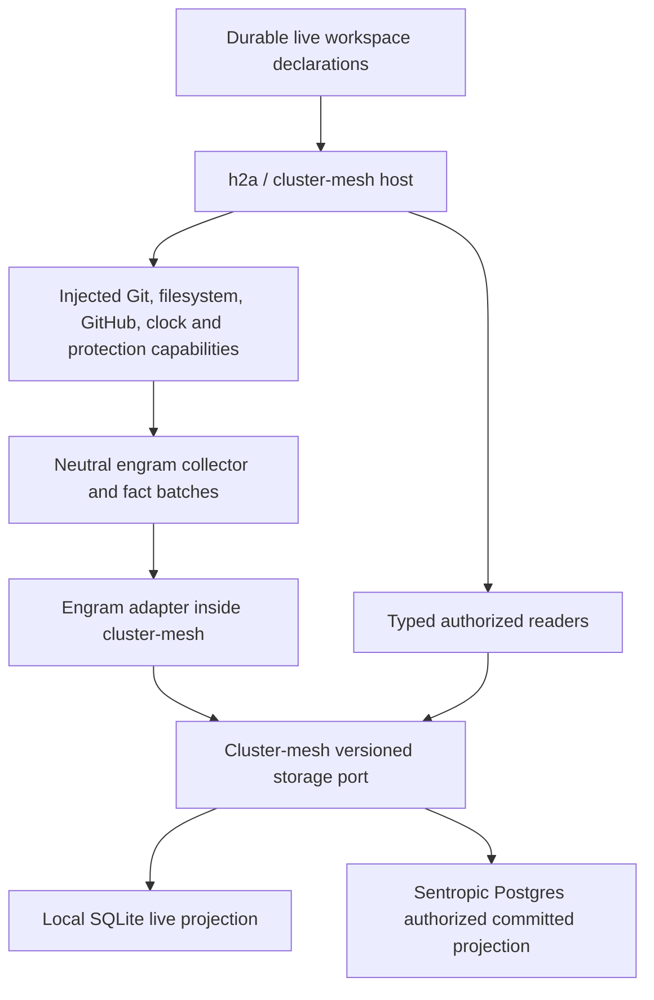

# Live Git Indexing

Date: **2026-10-11**. Delivery stage: **S0, specification and plan only**. Branch: `feat/live-git-indexing-s0`; S0 base: `c9ed019331d1ea0fbf96890cca602fd5f6817088` (the earlier `origin/main` revision; current ref state is recorded in §17).

This specification records accepted product decisions and the contracts to implement. **The live chain, proposed interfaces, tests, deployment, driver qualification and performance are `unverified` until their implementation gates execute.** Existing extraction or storage primitives do not constitute acceptance of a live lot. `Required` below describes the target, not an already delivered capability.

## 1. Authority, Sources And Owner Decisions

S0 is based on `DOSSIER-v2.md`, `OWNER-ANSWERS-2026-10-11.md`, `REVIEW-opus-max.md` and `SOTA-3-astra.md`. The subsequent `REVIEW-S0-opus.md` was read in full for this amendment; all 21 findings are disposed of at the end of this specification. These source artifacts are local, ignored files under the graphify checkout's `.graphify/scratch/design/live-git-indexing/`, not portable normative dependencies. The decision table, source translations and source digests below preserve the requirements needed to use this tracked specification without that directory.

The execution format is [plan/08](../plan/08-BRANCH_MEMORY_FINALIZATION.md); the live plan is [plan/09](../plan/09-BRANCH_LIVE_GIT_INDEXING.md). Source citations use **E:** engram `c9ed019331d1ea0fbf96890cca602fd5f6817088`, **H:** h2a `43ce2705b4065060218cfc18a98034611360b28e`, and **S:** sentropic `dc95f7e4f88048e9671002827537cde4cb8149b7`. These Git objects were inspected directly in the three repositories; neighboring working checkouts are on other branches and were not modified. The older dossier's engram audit is `e0c3eb90e03f559afa56e9f9abb23a263463a95b`. A citation such as `S:packages/cluster-mesh/src/persistence/ports.ts:101` is reproducible with `git show <S SHA>:<path>` and the indicated line.

| Source artifact | SHA-256 of supplied bytes |
|---|---|
| Owner answers, 2026-10-11 | `2e34a6f38b1fbf5b4e8d71c87447d4221766a0bd682c7215f703fff54344ab8f` |
| Decision dossier v2 | `b2c63b9857d8b646b3092fca8eb6ad1a53835209a0f3ad4bc4bf62e00d2c9c2e` |
| Opus S0 review | `2e4ff6b3aeff35809475fe26ee908e4044a99b510aa03579317a61c2612d2fdf` |
| Nearby-tool source study | `aa467e10d5c12f99dfce52d0fa7dbacb45d65806ccd5bfe178d62ca788510e18` |

English translations of the relevant owner wording, **not verbatim English quotations**: baseline — index GitHub PRs and their commits; remove the 200-commit limit per branch; keep all history for investigations; SQLite locally, Postgres inside the sentropic app, other graph databases later. At 17:41 — cluster-mesh must own the database abstraction with an engram adapter; a direct SQLite/Git link makes no sense. That source still marked the adapter's location as **to be confirmed** at 17:41. In the evening — the owner followed the dossier recommendations, Q1 A through Q7 A with Q2 B, and D subject to qualification. Cluster-mesh placement of the adapter is the resulting S0 architecture, not an already confirmed 17:41 quotation. Original-language wording is identified by the owner artifact digest; these translations satisfy this document's English-only requirement.

Precedence: the owner's decisions and architectural correction override the dossier's older proposals and the review's question numbering. In particular, the dossier's direct engram-to-database diagram, engram ownership of L3, and live-generated JSON export are superseded. Q1–Q7 below are the **dossier** identifiers, not the earlier review's alternatives.

| Decision date | ID | Accepted requirement |
|---|---|---|
| 2026-10-11 | Baseline | Follow local and known remote branches active within 30 days, GitHub PRs with their commits, the default branch and registered worktree HEADs. No count or age limit on ingested commits, including PR history associated with `main`. |
| 2026-10-11 | Hosting | Main exposure is h2a / cluster-mesh. A possible standalone deployment also uses cluster-mesh. Filesystem watch and subsequent updates are automatic after live activation. |
| 2026-10-11, 17:41; evening adoption | Storage ownership | **Cluster-mesh owns the storage abstraction and generation contract; its engram adapter maps neutral batches.** S0 assigned SQLite to the package and Postgres to the app; subsequent **L3a v4.1**, aligned below on 2026-10-17, supersedes that implementation split: cluster-mesh owns both reusable backends; the app injects and operates Postgres. Adapter placement was tentative at 17:41 and is fixed by S0 under the adopted architecture. No direct SQLite-to-Git relationship or version-controlled file produced by live indexing. |
| 2026-10-11, evening | Q1 A | Materialize authorized complete commit metadata, DAG and changed-file facts. Historical patches and ASTs are computed on demand from retained objects; prioritize active heads, index and working tree. |
| 2026-10-11, evening | Q2 B | Keep authorized metadata/ranges and **only the latest authorized encrypted local hunks**. No journal of successive uncommitted states. Purge local snapshots on unregister; do not prune committed history. |
| 2026-10-11, evening | Q3 A | Automatic network access covers GitHub for registered repositories and objects needed for their PRs. No general remote refresh. Already known remote refs remain observable locally. |
| 2026-10-11, evening | Q4 A | Explicit one-time live activation per workspace through h2a/cluster-mesh. Replay declarations already marked live without renewed activation. A session opening alone does not activate collection. |
| 2026-10-11, evening | Q5 A | Narrow exception to file-first storage for **live code/Git only**, through the cluster-mesh-owned port. No global corpus, annotation or memory migration; no live-generated versioned JSON. |
| 2026-10-11, evening | Q6 A | Sentropic Postgres receives authorized committed facts, refs and PRs; omit or tenant-pseudonymize emails. Private index/working-tree content and its derivatives remain local. Sentropic operates access, migrations and backups. |
| 2026-10-11, evening | Q7 A, qualified fallback B | Qualify `node:sqlite`; API floor at least Node 22.13, Node 24 reference, patched releases of advertised 22/24/26 lines tested individually. Inspect the actual SQLite runtime. If A fails qualification, B is verified prebuilt `better-sqlite3`, with install tested without Python and no compilation fallback. No automatic runtime driver switching. |
| 2026-10-11, evening | Option D, qualified fallback B | Qualify a versioned code/Git storage capability in **L3a** before freezing the production contract. If D fails, B is a dedicated code/Git store behind a neutral, cluster-mesh-owned port, using the same SQLite/app-Postgres placement. It changes neither memory nor host ownership. |

Q1–Q7 and these conditional alternatives are resolved. Dossier §3.2 documents D → B on memory-guarantee or load failure; §4 Q7 recommends A, then B if qualification fails. L3a records the failed case/threshold, versions, measurements and selected alternative; conductor review checks that the trigger is met. Qualify that alternative against the same gates before production. These are build/release choices, never automatic runtime fallbacks. Return to the owner only if the alternative itself conflicts with an accepted constraint; do not reopen accepted choices for routine implementation.

Technical choices retained from the dossier: multiple repositories and worktrees; Linux as the first qualified platform; durable restart; PR base or default branch for comparisons; convergence after stabilization. They introduce no additional owner question in S0.

## 2. Architecture And Scope

| Owner / repository | Responsibility |
|---|---|
| **engram** | Logical code/Git facts, deterministic extraction, OID incrementality, reconciliation, content selection, coverage and bounded scheduling logic in the separate `engram-live/` package (`@sentropic/engram-live`). Neutral factories, DTOs and injected ports; no host imports, database writes or SQL drivers. |
| **cluster-mesh package** | Engram adapter, generic storage kernel, both reusable SQLite/Postgres backends and their schema/migration algorithms, generation semantics, capability negotiation, staging/publication, typed readers, namespace authorization and N/N-1 compatibility (L3a v4.1). Postgres consumes an injected driver; pool and credential ownership stay with the application. |
| **h2a** | Compose the factory and cluster-mesh runtime; supply approved processes, filesystem access, credentials, keys, supervision, resource controls and workspace/job lifecycle. Host startup replays declarations and resumes work independently of agent sessions. |
| **sentropic app** | Compose the reusable cluster-mesh Postgres backend in `api/src/services/cluster-mesh/`; inject the driver/session bridge, operate pools/credentials and attach application migration/history in the app's DB and `api/drizzle/` surfaces. Own product live declarations, authorization, network retry, tenant access, backup/restore and deployment. An ephemeral agent or Pod is not the database operator. |

Live state, extraction caches, temporary data and signal markers reside in injected host-managed locations **outside every observed worktree and its git-dir/common-dir**, stable across branch switches. No cache/marker API may silently default to the source root. `.engram/` is the existing application state convention, with legacy `.graphify/` / `graphify-out/` compatibility; none is a permitted live write destination in the worktree. No database export, hook rebuild, JSON, report, assistant work file or graph merge driver becomes a live-to-Git output path. Git and the filesystem are observed sources. Only the separate private retention store in §4 accepts acquisition writes.

H0, L5, L6b and L9-E/L9-H enforce the same whole-cycle guard: activation, bootstrap, edit reconciliation, reads, restart and deactivation leave source-tree bytes and entries (tracked, untracked and ignored), `.gitattributes`, local/worktree Git config, index and refs unchanged by the collector. An isolated, quiescent fixture compares file inventories/digests and `git status --porcelain --ignored --untracked-files=all` before/after; controlled user edits become the next baseline. The test's status oracle runs only on benign fixtures with optional locks/fsmonitor disabled; it is not a production capture preflight (§7). An empty tracked diff alone is insufficient.

The existing file-based corpus workflow remains separate. S0 neither removes its artifacts nor migrates its users. Optional future compatibility views are bounded typed reads of authorized committed data; they do not create a live file. Existing explicitly invoked file exports remain outside live and cannot read private live snapshots through a convenience bridge.

No host/product registry is introduced inside engram. A durable **live declaration capability must be added to the hosts**; existing product workspace membership is not a repository registry. See §12 for the explicit activation, enrollment binding and local authority. Host changes have their own branches; this engram S0 branch contains only the four specified documents.

## 3. Logical Model And Neutral Boundary

Names in this section are proposed logical entities, **not exported APIs already available**. Storage layouts and exact method signatures are frozen only after L3a.

| Entity | Required identity, content and invariants |
|---|---|
| WorkspaceDeclaration | Host identity, verified tenant/principal, h2a workspace fingerprint, optional server-bound sentropic workspace ID/binding revision, authorized roots, explicit live capability, policy version and declaration revision. Durable independently of the projection; bind/upload are not activation. |
| Repository / Clone | Separate logical project from local clone. Clone key includes host scope, the common-dir project fingerprint and common-dir realpath; same fingerprint in two clone paths remains distinct. The h2a worktree-specific `ws:` fingerprint stays on the declaration, not as the sole clone key (§12). Record OID algorithm, approved remotes and Git availability. |
| Worktree | Clone identity, authorized path, resolved git-dir, symbolic/detached HEAD, independent index and working tree. Linked worktrees share only authorized immutable analyses. |
| Ref / RefObservation | Full ref name, clone, category, observed OID, generation and activity provenance. Creation, deletion and recreation are separate observations. Polling time is not activity. |
| Commit / Parent | Algorithm-qualified OID, tree OID, **ordered** parents, authorized author/committer identities and dates, authorized message, extraction/policy version and missing-object state. Parent order preserves merge semantics. |
| Tree / FileVersion / Blob | Path bytes, mode, algorithm/OID, size and kind (text, binary, symlink, gitlink). Historical paths exist independently of today's checkout and AST language support. |
| CodeAnalysis | Syntax identity includes content, language, grammar and extractor versions; resolution also includes tree, path, project configuration and dependencies. Distinguish source-extracted from deterministically resolved relations. |
| IndexSnapshot | Worktree, entries with path/mode/OID/stage, conflict stages 1/2/3, sparse/skip-worktree state, capture interval and stability evidence. |
| WorkingTreeSnapshot | Worktree, raw content fingerprints, present/deleted paths, explicitly allowed untracked paths, exclusions, policy, capture interval and stability. Latest authorized state only. |
| Diff / FileChange / Hunk | Immutable endpoints, compared parent when applicable, algorithm/version, before/after paths and modes, rename evidence, numstat including binary state, ranges and policy-controlled payload. |
| PullRequest / PRObservation | GitHub repository identity and PR number, state/dates, pinned base/head observations, merge OID/strategy evidence, metadata cursor and separate object/attribution coverage. |
| BranchComparison | Pinned branch/base tips, all merge-bases or an explicit unknown/unrelated status, comparison kind and derived result. |
| Generation / Coverage / Job | Scope, source vector, versions, stable generation identity, writer epoch, batch receipts, completion state, exclusions, errors, progress and durable remaining work. |

Every fact and lookup is scoped by tenant and clone, then by worktree or immutable version as applicable. Equal OIDs do not authorize cross-tenant existence probes or sharing. Edges need identities that distinguish repeated observations, diff parents and relation roles; `(source, target, relation)` alone is insufficient for every live fact.

Neutral batches carry scope, producer/schema/extractor/policy versions, generation/job identity, batch identity/digest, facts and coverage progress. Delivery is retryable: same identity and same bytes is idempotent; same identity with different bytes is refused. The adapter acknowledges durable receipt separately from publication. Dependency-complete facts may be staged in bounded batches, but no reader may infer that receipt alone makes a generation current. No SQL query string, database handle, h2a class or sentropic runtime type crosses this boundary. Both producer and storage contracts express facts, identities, capabilities and publication semantics without relational-table, SQL-transaction or backend-specific query semantics: other graph databases are an accepted future extension, while their implementations remain outside this delivery.

The contract transport is fixed in S0: `@sentropic/engram-live/contracts` is a built, data-pure export (DTOs, constants and validators); `@sentropic/engram-live/integration` exports the executable factory. Cluster-mesh uses a **catalogued optional peer**, following `S:packages/cluster-mesh/src/modules/catalog.ts:18–38`, with declared version range and required exports. It imports only the contract at the adapter boundary and lazily loads the factory when the host composes live. No vendored runtime or root `@sentropic/engram` dependency is used. Contract version, fixture digest and release evidence must match, following the evidence check in `S:packages/cluster-mesh/src/memory.ts:18–22,74–102`; this does not reuse memory data or capabilities. H2a installs the exact compatible neutral package and cluster-mesh versions and obtains the factory through that composition. Missing/mismatched peers fail explicitly. H2a's copyable DTOs remain data-pure, separate from runtime factory imports.

Typed reads return scope, source OIDs/snapshot identities, published generation, policy and coverage with bounded pagination. Required capabilities include progress, refs/history, PR observations, staged/unstaged diffs, versioned code/impact and authorized multi-repository traversal. A missing provider, unavailable capability or unsupported schema is explicit; no fallback to a memory namespace or a stale JSON graph disguised as live.

## 4. History Roots And Retention

History roots are the default branch even when old; local and known remote branches active within 30 days; GitHub PR heads in **open, closed and merged states regardless of age**; HEADs of registered worktrees including detached jobs; and previously ingested roots retained for investigation. Include an authorized current worktree HEAD even when its named branch is old.

The 30-day rule selects active branch follow-up. It never limits commit count, commit age, retained DAG facts or already acquired PR history. Bootstrap can use tip committer time as an activity signal; later observed target changes are another signal. Record which signal selected a root. Merely observing the same ref again must not refresh its activity date.

Removing the 200-commit default also applies to the **legacy** `src/extract-git.ts` entry and its detection-window metadata, not only the new live engine. L2a removes `DEFAULT_MAX_COMMITS = 200` and implicit `--max-count` use. An explicitly requested bounded non-live query may remain, labelled partial; no live caller may pass such a cap. A legacy default extraction over more than 200 commits must retain the complete selected history.

Walk all parents without `--max-count`, age filters or `--first-parent`. A force-push, deleted/recreated ref, expired activity window or closed PR cannot erase ingested history. Derive reachability from refs and the DAG; do not persist a permanent `ON_BRANCH` edge for every commit/branch pair. Derived reachability caches are bounded, versioned and invalidatable.

Tags may be inventoried without automatically becoming traversal roots. Reflogs and objects unreachable before registration are not promised recoverable. Shallow boundaries, promisor objects, missing Git metadata and inaccessible PR roots remain explicit gaps; do not fetch arbitrary remotes to hide them under Q3 A.

Q1 A keeps authorized metadata/DAG/changed files without a retention cap. Historical patches and ASTs are lazy derived caches. Their eviction is allowed only when required authorized objects remain available for reconstruction. The host must retain the necessary objects in a private managed Git object store, including superseded PR heads, with access controls and backup. Do not rely on user-clone GC or GitHub continuing to serve a rewritten PR ref. If object acquisition or protection is incomplete, report that specific investigation coverage gap.

The private object store is an explicitly authorized Git acquisition/retention facility, not an export of SQLite and not a user checkout. Remote acquisition may bring sensitive committed bytes: it is host-protected, never a bypass around the content/publication policy. No raw private object pack is automatically published to Postgres. Uncommitted plaintext is never added to this store. Resource exhaustion pauses collection with durable backlog; it does not prune committed facts.

**R1 owns retention of every ingested root**, not only P1's PR roots. Engram emits scoped retention requests/receipts through a fakeable port; the h2a host copies/fetches local committed objects into its private store, including detached job HEADs and branches before deletion/rewrite can make them unavailable. Acquisition uses pinned OIDs and private refs, without writing into the clone, borrowing an alternates store that may be GC'd, or invoking repository-controlled programs. Durable protection receipts precede a claim of reconstructible coverage. If removal wins the acquisition race, report an object gap instead of inventing retention. Host-controlled job cleanup waits for retention acknowledgement or records an explicit failed handoff; user-controlled deletion is not blocked. Quotas pause further work without deleting protected roots. R1 tests reconstruction after branch deletion plus source GC and after job-worktree removal; L5 depends on R1. L8 coordinates backups of receipts, non-reconstructible observations, private objects and separately protected keys.

## 5. Automatic GitHub PR Synchronization — P1

1. Use the host-approved installed `gh` binary and its existing authentication to enumerate **all pages and all PR states** for each registered GitHub repository. Retain identity, state/dates, pinned head/base observations and available merge metadata. CI/review/worktree metadata used by readers carries its own freshness and availability.
2. Persist object-acquisition jobs independently of the metadata cursor. Acquire authorized `refs/pull/<n>/head` and necessary associated objects in service-owned refs in a **private Git store**, never by moving refs or changing the index of the user's clone. Verify the acquired target against the observed OID; a moving remote head produces another observation, not an OID substitution.
3. Traverse the acquired DAG without a commit cap. No REST/GraphQL or `gh pr view` commit array is proof of exhaustive history. The review's reported REST limit of 250 remains `unverified` in the supplied dossier; correctness does not depend on that number.
4. Advance metadata using an `updatedAt` cursor with overlap and identity deduplication, plus periodic complete sweeps. Persist continuation/retry state and deduplicate pages that move during enumeration. A successful metadata page does not complete a failed object job.
5. Keep PR attribution separate from ancestry. Pin historically observed head/base bounds and merge-base evidence; distinguish merge, squash and rebase. Do not label every ancestor as PR-specific, subtract today's base to erase a merged PR's commits, or infer missing historical bounds. Unknown attribution stays partial while acquired ancestry remains available.
6. Apply independent request/concurrency budgets, supported ETags, timeouts, primary/secondary rate-limit handling and bounded backoff with durable retry. Tokens never enter facts, logs or database rows. Do not trust a repository-selected credential helper or executable; use host-controlled credentials and transport configuration.

No authentication, revoked access, network outage or unavailable PR ref produces an explicit `auth_required`, `stale` or `unavailable` state and last successful observation. Local collection continues. Retained observations do not disappear when credentials change, but access remains subject to host authorization. Resume automatically when the condition clears.

Q3 A already authorizes the required GitHub PR synchronization. It does not authorize periodic fetch of every remote branch, arbitrary remote URLs, telemetry or update checks.

## 6. Streaming Extraction And OID Incrementality — L2a/L2b

Separate discovery of roots/observations, extraction of missing immutable facts and recomputation of observation-dependent views. Cache immutable extraction by OID algorithm, OID and extractor version, with authorization/policy applied in the relevant scope. A no-change pass extracts zero already complete commits.

Use bounded streaming `rev-list`, `cat-file --batch` and a grouped diff/numstat path. `cat-file` alone does not provide changed-file statistics. L2a compares candidate plumbing with native Git and the old extractor's valid domain before choosing the protocol. Process count scales with batches, not two `git show` processes per commit. Never load the entire history into Graphology or a full `pushGraph` argument.

Decode object bodies using explicit lengths and paths with NUL delimiters. Preserve unusual/non-UTF-8 path bytes losslessly; avoid line-based path parsing. Test SHA-1 and SHA-256 where the installed Git supports them, root commits, multiple parents, deletions, renames, mode changes, binaries, gitlinks and symlinks. Changed-file facts must not depend on the path existing in the current AST graph.

Persist progress only after the required fact set has durable acknowledgement; mark the OID complete for its extraction version only with a published, dependency-complete checkpoint. Encountering a known but partial OID is not a traversal stop. A complete-ancestry frontier is separately evidenced, including shallow/missing boundaries. Replays after interruption must fill gaps, not skip known-looking rows.

## 7. Filesystem Watch And Safe Git Reads — H0/L4a/L6b

**Events accelerate work; reconciliation establishes state.** Resolve worktree git-dir, common-dir and hook paths through Git. `.git` can be a file; packed refs and reftable are not a `.git/refs` directory contract. Watch authorized worktree files, relevant git-dir/common-dir changes and configuration/attribute inputs, then poll refs and reconcile periodically. A shared common-dir watcher may serve linked worktrees without sharing their mutable state.

Install the watcher before the initial scan, coalesce changes during extraction and serialize publication for each scope. On overflow, restart, lost events, replacement of the local database or excessive pending paths, schedule bounded reconciliation. A file changed during the scan must be picked up before readiness or leave visible pending coverage. Native watch may fall back to explicit polling; degraded coverage is observable.

**Live activation installs no hook implicitly** and changes neither `.gitattributes` nor repository config. An independently requested hook installation is setup outside the live cycle; it is not the legacy graph merge-driver installer. Hooks remain optional short signals: post-commit, post-checkout, post-merge, post-rewrite, optionally post-index-change and only the `committed` phase of reference-transaction. There is no standard post-fetch hook. Use a pinned/verified installed executable; a missing executable must never invoke `npm`, `npx` or download a package. Resolve the configured hook location and preserve third-party hooks. Live signals use only injected host IPC/marker storage; they must not call the legacy `.graphify/needs_update` writer. Recognition of `.engram/` or legacy state does not authorize writes there. Explicit non-live hook behavior remains separate. The live hook performs no rebuild, export, config mutation or network access.

The safe capture sequence is normative:

1. Resolve authorized roots and inventory index entries and paths without asking Git to convert working-tree content. Distinguish a real deletion from sparse checkout, skip-worktree and unavailable paths.
2. Read relevant `filter` and `diff` attributes through `git check-attr -z --stdin` in the applicable committed/index/working-tree context. Record configuration/attribute fingerprints; changed attributes invalidate capture. Exclude filtered/protected paths before any conversion-capable read.
3. Apply path, type, size and authorization exclusions. Inspect symlinks without following them outside the root. Use race-resistant opens and before/after identity checks; never read an arbitrary device or FIFO as a source file.
4. Read Git blobs as raw objects and authorized regular working-tree files directly. Compute raw fingerprints, optionally `hash-object --no-filters` **without `-w`**. Do not run `status` or a working-tree diff as an unsafe preflight to later filtering.
5. Diff only approved content with a versioned normalization algorithm. Recheck HEAD, index identity, attributes and file fingerprints after observation. Changed/occupied inputs cause bounded retry or an `unstable` result; never label a mixed-time capture as stable.

Every local Git invocation disables optional locks (`--no-optional-locks` or `GIT_OPTIONAL_LOCKS=0`), repository fsmonitor and lazy fetching. Applicable diff commands additionally use `--no-ext-diff --no-textconv`. These diff flags do **not** disable clean/process filters; the inventory/raw-read sequence is therefore required. Apply flags only to commands that support them. Capability/version checks must fail explicitly if the required safe mode is unavailable.

No collector `update-index`, `write-tree`, checkout/reset, untracked-cache activation, repository maintenance or object write is allowed in the user clone. Never acquire, remove or bypass `index.lock`; a busy/changing index is retried. Git reads run with controlled executable/environment/configuration handling so repository hooks, pagers, external diffs, fsmonitor and credential programs cannot execute implicitly. Network acquisition uses a separate host-approved executor and private store. Process traces must distinguish explicitly approved Git/`gh` from repository-triggered programs.

Ignore only designated output/cache paths. A broad `.git` substring rule must not hide `.github/` or other authorized hidden source files. `.gitignore` selects files; it does not attest that tracked content is safe.

## 8. Snapshots, Diffs And Versioned Code — L4b/L5

| Comparison | Meaning |
|---|---|
| HEAD → index | Staged changes, including independent conflict stages |
| Index → working tree | Unstaged changes over the captured index |
| HEAD → working tree | Optional cumulative view, explicitly labelled |
| Merge-base(s) → branch tip | Contribution relative to the chosen base |
| Base tip → branch tip | Difference between pinned current states |
| Each ordered parent → commit | Merge changes, preserving secondary parents |

Use a PR's base when known, otherwise the default branch, with an explicit configurable override. Persist all endpoint OIDs and merge-base evidence. Multiple merge-bases, unrelated histories and unknown squash/rebase attribution must not be collapsed to a fabricated single parent. Rename detection and thresholds are versioned evidence; binary/large/protected files expose metadata/exclusion rather than invented text hunks.

Parse-cache identity includes content, language, grammar and extractor version. Resolution-cache identity also includes tree, path, configuration and dependencies. Equal blobs can resolve differently in different projects. Index and working-tree analyses additionally bind snapshot and policy. Body-only changes invalidate content-derived facts even when topology is unchanged. Reconcile affected calls/inheritance and unresolved references without deleting valid callers or publishing partial repairs. Missing grammar diagnostics are part of coverage, not an empty graph interpreted as successful extraction.

Q1 A does not require eagerly computing every historical AST or patch. Q2 B does require distinct local index/working-tree state and latest authorized hunks. Source snippets, symbols and search material derived from uncommitted content inherit its privacy classification.

## 9. Cluster-Mesh Storage Qualification And Durability — L3a/L3b-S/L3b-P

The accepted option D is a **cluster-mesh-owned versioned code/Git capability**, connected by its engram adapter. Existing engram GraphStore append/merge primitives are evidence to evaluate; they are not moved into the neutral producer by assumption. Their unit appends, endpoint requirements, edge identity and missing generation/read contract require qualification. Do not open raw SQL on the memory GraphStore or reuse `memory_snapshot` for code/Git.

L3a must demonstrate on SQLite and Postgres: bounded ingestion/reads, stable fact identities, dependency handling, duplicate/conflicting batches, ref deletion/recreation, atomic visibility, old-writer rejection, version negotiation and **all fixed qualification thresholds in §13**. A missed threshold is qualification failure, recorded before applying the relevant §1 fallback; L3a cannot choose easier thresholds after measuring. Preserve the previous published generation while a new one is staged. An atomic publication pointer binds the completed scope and source vector. Readers pin it for pagination so their result does not mix generations. Publication can truthfully carry partial historical coverage; it cannot hide missing required facts of the capture it declares complete.

**Placement authority: L3a v4.1, aligned on 2026-10-17.** Cluster-mesh owns the generic kernel and both reusable SQLite/Postgres backends, including their schema/migration algorithms; the app injects the Postgres driver/session bridge and operates pools, credentials and application migration/history attachment. This supersedes S0's app-owned reusable Postgres implementation and runtime-persistence extension prerequisite. Existing `ClusterMeshPersistenceBinding` and `LOCAL_ONLY | DURABLE` consumers remain independent; `LOCAL_ONLY` describes deployment scope, not permission to lose locally durable history. L3a's engram adapter maps neutral facts, generations, readers and lifecycle onto the shared capability; L3b-S/L3b-P harden the applicable reusable profiles and qualify application composition. No package-owned Postgres pool, credentials or direct app/driver dependency is implied. `node:sqlite` adds no external driver dependency; the conditional Q7 B prebuilt addon remains an explicit, qualified package dependency.

Evaluate namespace rollout through the existing `shadow | active | rolled_back | disabled` cutover and rollback ports (`S:packages/cluster-mesh/src/persistence/ports.ts:70–99`). A namespace/runtime generation and a published **content** generation are different identities. Shadow reads must not become authoritative; activation and rollback retain the last compatible content generation and do not erase declarations or committed evidence. L3a qualifies that mapping; L8 tests app cutover/rollback. Do not replace those contracts with an unrelated deployment state machine.

SQLite uses a local filesystem, a coordinated single writer, WAL, `synchronous=FULL` and short transactions; unsupported filesystem/runtime combinations fail explicitly. `journal_mode=MEMORY` and `synchronous=OFF` are forbidden even during bootstrap. Writer epochs/fencing prevent an old process publishing after ownership changes. Validate `sqlite_version()` **before WAL use** with the same D-9 A predicate as [memory finalization X3](SPEC_MEMORY_FINALIZATION.md#4-findings-outside-the-brief-triage): **SQLite ≥3.51.3, or documented corrected backports 3.44.6 and 3.50.7**; additional backports need explicit qualification, not a guessed numeric range. Share predicate fixtures/evidence without importing the memory runtime or changing its behavior. The existing GraphStore guard is deferred (`E:src/storage/sqlite.ts:37–40,543–546`); comments and Node's API floor do not prove a safe embedded engine.

Both backends require crash/restart, idempotence, schema compatibility, tenant/clone/worktree isolation and real-backend parity tests. Required lanes fail on missing infrastructure rather than silently skipping. No partial generation may be called current. Logical tombstones do not prove physical erasure of sensitive content.

Host declarations remain authoritative outside this projection; database loss must not erase desired live registrations. However, observations of deleted refs, old PR bounds and retained objects may no longer exist upstream. Treating the entire store as a disposable cache is incorrect. Back up non-reconstructible evidence, private objects and required host/key material under their respective policies. Test restore and source-aware resumption; Postgres operations belong to the sentropic app.

The dated amendments in [SPEC_GRAPH_STORAGE_BACKENDS](SPEC_GRAPH_STORAGE_BACKENDS.md#2026-10-11-amendment-live-codegit-only-q5-a) and [SPEC_STORAGE_BACKENDS](SPEC_STORAGE_BACKENDS.md#2026-10-11-amendment-live-codegit-only-q5-a) take precedence only within this scope.

## 10. Content Policy, Privacy And Publication

Apply the host-authorized, versioned policy **before persistence** across committed metadata, PR fields, hunks, context, citations, derived symbols, search indexes, diagnostics and reader responses. Exclude `.env*`, private keys, credentials, protected/filtered paths and forbidden content. Deterministic TypeScript rules recognize known secret formats and risk signals; ambiguous content is excluded rather than stored and then masked. Existing `src/security.ts` is not evidence that this detector exists.

For Q2 B, allowed uncommitted payloads are encrypted **before writing any persistent surface**, using host-supplied keys kept outside the database. Derived local content must not leak through plaintext FTS, WAL, temporary files, logs, telemetry or backups. Without authorization/policy/key protection, retain only allowed metadata/ranges and expose `content_unavailable`; do not fall back to plaintext. Secret detection cannot prove the absence of unknown secrets and is not the sole protection.

Retain the latest local snapshot only; staging a replacement does not authorize an accessible history of prior local content. Remove superseded payloads under a documented storage/key lifecycle. On unregister, stop work, reject delayed jobs and purge private local snapshots, derived indexes and decryptability, while preserving authorized committed history. L4b/L3b-S must distinguish logical removal from residual ciphertext, WAL and backup handling, and verify the chosen purge/cryptographic-erasure mechanism. Do not claim secure deletion from a tombstone alone.

Verification follows ownership. Engram L4b checks emitted batches, sink calls, local diagnostics and fake protection/key ports only, including absence of forbidden plaintext and missing-key downgrade. The sentropic/cluster-mesh L4b branch checks the real SQLite DB/WAL/search/temp/backup and purge behavior; its h2a branch tests key custody. L8 owns app-Postgres leak scans and coordinated restore. No engram test imports a host or a database to meet another repository's gate. Typed database readers belong to cluster-mesh; the complete freshness benchmark belongs to h2a (§13, L9-H).

Under Q6 A, remote publication is a filtered committed-data projection, not SQLite replication. It contains authorized committed facts, refs and PR metadata, with emails omitted or tenant-pseudonymized. Do not publish index/working-tree text, hunks, symbols, fingerprints or snapshots through a derived-facts loophole. A ref may describe a registered worktree's committed HEAD only if its host metadata is authorized; local paths and job/user identifiers are not implicitly shareable. PR descriptions/messages remain subject to policy even though GitHub supplies them.

Tenant-local identity and authorization apply to OID caches, queries, counts and errors. Never reveal another tenant's possession of a blob. Network-disabled or failed remote publication leaves local reads available with a separate remote coverage state. There is no implicit telemetry, model traffic or package/update check; Q3 and explicit sentropic publication define the network surfaces.

## 11. No LLM And No Python — L1a/L1b

Live extraction performs no model inference, embeddings, model-generated descriptions/labels, OCR, assistant instruction emission or deferred enrichment marker. This applies even when provider keys, project configuration, `--force` or previously stored vectors are present. Explicit non-live enrichment remains a separate workflow.

L1a fixes code-only `watch`, mixed code/document batches, code-only `update` and the code path of `buildProject`; documents in a mixed batch cannot prevent code refresh or activate semantic extraction. Use deterministic AST/resolution primitives. Prove behavior with and without fake keys, providers that fail on invocation, controlled network and assistant-artifact detection. Affected-call/inheritance repair inspired by CodeGraphContext is work to **implement and verify** in L5, not an existing repair to claim as preserved by L1a.

L1b creates the **separate, publishable `engram-live/` package, `@sentropic/engram-live`**, following the directory separation of `engram-memory/` without inheriting its native dependencies or private-package status. All new collector modules live there, not in a root-package `src/live` subpath. Build the `/contracts` and `/integration` exports described in §3; publish the full executable factory, not types alone. Audit/bundle any reused deterministic extraction source into the isolated build with its injected cache/grammar ports; the installed result must resolve entirely inside its own tarball and declared neutral dependencies, without requiring the root package. Scan transitive static/dynamic imports, built output and install closure. Exclude host/consumer dependencies, model SDKs, `ai`, `ollama-ai-provider`, `mistral-ocr` and internal LLM bridges. `E:package.json:45,89–106` demonstrates why a root subpath would not isolate installation.

The **delivered installation and jobs** must run without Python, not merely the steady-state TypeScript loop. Qualify packaged WASM for every advertised language and surface missing grammars. Existing addons such as `better-sqlite3`/`fs-ext` and grammar install scripts must not enter the neutral package closure via a root-package shortcut. Q7 A puts `node:sqlite` in cluster-mesh storage delivery, with Node 24 as reference and qualified patched 22/24/26 releases; Q7 B admits only verified prebuilt `better-sqlite3` in the host storage distribution after L3a failure and conductor review. It never admits a driver into the producer. No compilation/Python fallback, runtime `npm`/`npx` or package download is allowed. Unsupported platforms/runtime lines stay `unverified` and unadvertised.

Release checkpoints are explicit: **neutral engram package → `@sentropic/contracts` namespace release → cluster-mesh adapter/reader/provider release → h2a exact-version pins**. Qualification may use digest-pinned packed prereleases before final release; it may not import a neighboring checkout or ship `file:` paths. The neutral release includes L1b–L6b runtime work; the contracts release includes L7b-C; cluster-mesh includes L3/L7b-R/L7b-D and N/N-1 evidence. Each checkpoint records version, tarball integrity, contract/fixture digest and tested consumer range; h2a's present exact `0.13.3` cluster-mesh pin (`H:packages/h2a-runtime/package.json:18`) must change in L7a. Package publication is a later conductor operation; none is performed in S0.

## 12. Registration, Supervision And Coverage — L6/L7

Explicit activation records a durable host declaration. **The live repository registry does not already exist in the audited host surfaces.** `S:packages/cluster-mesh/src/hono/workspaces-router.ts:5–29` and the app's `workspaces/product-ports.ts:23` handle product workspaces/membership; h2a does not obtain a durable live registry from that router. H2a does have durable control-plane workspace stores (`H:apps/control-plane/src/workspace-registry.ts`, `workspace-store.ts`), but their entries/descriptors do not express this live capability, clone identity or collection policy (`packages/remote-protocol/src/schemas/workspace.ts:11–23`). Their existence must not be described as an absence of all durable host workspace state. L6a adds the missing live capability and stores: local h2a state outside source roots, and app-operated product persistence separate from the live projection. List/status/remove/path-resolution and authorized multi-repository reads use those declarations. Session end never unregisters a workspace. Host restart, not a new agent connection, resumes declarations and durable jobs. The gateway daemon is a composition point; boot/login supervision remains `unverified` until L7a executes its scenario.

The normative h2a enrollment v3 (`H:docs/specs/2026-07-11-sentropic-h2a-enrollment.md`, §§1,3–4) keeps **admin-gated bind**, **transcript upload**, and now **live collection** as distinct capabilities. Neither bind, default conversation persistence, upload consent, code-workspace creation nor an agent session creates a live declaration. Product live intent binds the server/issuer, `(sentropicWorkspaceId, h2aFingerprint)` pair and binding-record revision; existing code-workspace/fingerprint mapping (`S:api/src/db/schema.ts:17–22`, `api/src/routes/namespaces/clients-product-vscode.ts:97–155`) is reused, not silently repurposed as opt-in. Local-only declarations require no sentropic enrollment. Rebinding requires revalidation and cannot redirect in-flight collection/publication.

`H:packages/h2a/src/runtime/identity/workspace-id.ts:11–20,41–48` hashes root commits **and a linked-worktree name**, while remaining clone/path independent. Preserve that existing public fingerprint. For the local clone key, compute the project fingerprint using the common-dir history with the empty main-worktree component, then bind it to host scope and the common-dir realpath. Linked worktrees thus share one clone; two separate clones with equal `ws:` values remain distinct. Keep worktree fingerprint/git-dir separately. Missing/shallow history yields explicit identity/coverage uncertainty; it must not merge clones by remote URL or missing fingerprint. Absolute local paths are not published to sentropic; use a scoped opaque clone ID.

**Local authorization is required new L7a work.** The current gateway disables cluster-mesh context verification, registration authorization and receipts (`H:packages/h2a-runtime/src/gateway-host/host.ts:250–257`); its loopback/session bearers are not live authority. Define a verified local principal as the host's registered h2a identity/key reference, with proof of possession checked against the host-owned trust record. The local tenant is a stable `local:<host-owner-id>` scope, never a sentropic tenant inferred from a workspace ID. The authenticated owner-side host operation issues a live-specific, expiring, audience-bound capability tied to principal, host, authorized roots, declaration revision and operations; it is stored outside worktrees and revalidated/revoked at lifecycle changes. Session-token minting cannot create it. This is host-identity proof, not proof of human intent; the separate explicit activation supplies collection intent. Verification and local receipts are injected only for the live namespace, without enabling unrelated session-control operations. When accessing the product, use the enrollment's issuer/server-bound token and app-resolved tenant/RBAC as a separate authority. Missing, expired, mismatched or unverified principal/tenant denies registration **and reads** explicitly, never as a successful empty result. Enforcement remains `unverified` until its negative tests and installed-host gate pass.

Authorized submodules are separate associated repositories; clones with equal remote URLs remain distinct. h2a `.h2a/jobs/*/wt` worktrees attach/detach through host lifecycle, run below interactive priority and share immutable tree/configuration analysis where authorized. Their index and private content remain isolated. Remote archives or Pods without a complete `.git` advertise absent/shallow/partial Git coverage; filesystem indexing alone cannot imply history completion. No machine-wide directory crawl is permitted.

Readiness requires an initial reconciliation and safe publication, with watcher coverage visible. Scheduler jobs and overflow state are durable and memory-bounded. Give current code/index changes priority over history backfill without starving either; bound retries, cancellation and per-scope concurrent work. A disconnected client cannot terminate live scheduling. Replacement of the database invalidates local checkpoints and triggers declaration replay plus reconciliation.

Report coverage separately for **refs, DAG, PR metadata, object availability, PR attribution, AST, index, working tree and remote publication**. Each exposes applicable source/generation, last success, pending frontier/count, exclusion/error reason and state such as current, pending/backfill, partial, stale, unstable, auth_required or unavailable. Git-relative freshness can distinguish current/behind/diverged/unknown. Unknown must never be treated as current. A current head AST does not imply a complete historical backfill.

Cluster-mesh exposes the distinct **`/code-git`** namespace and capability contract with public N/N-1 fixtures. L7b-C adds it to the closed `CLUSTER_MESH_NAMESPACES` list in `S:packages/contracts/src/cluster-mesh-namespace.ts:3–35`; L7b-R owns typed readers, L7b-D provider/distribution wiring. App files follow `code-git.ts`, `code-git-cutover.ts` and `code-git-ports.ts`. Absence/incompatibility is explicit, not a 503 interpreted as an empty graph. H2a DTOs remain data-pure. Authorization is checked before registration, reads, acquisition and publication and rechecked after policy/lifecycle changes.

## 13. Resource And Freshness Budgets

These are initial **qualification targets, all `unverified`**, not measured results. Convergence is promised after sources stabilize and required resources are available; the collector does not promise to observe every A→B→A transition between observations.

| Measure | Target / behavior |
|---|---|
| Filesystem debounce | 500 ms initial setting; adaptive coalescence may be qualified without changing the freshness target |
| Local ref polling | 10 s nominal, independent of hooks |
| Small warm local change | p50 ≤2 s; p95 ≤5 s from stable source to published readable generation |
| Ref changed by external fetch | p95 ≤15 s to published observation |
| GitHub PR sync | Nominal 5 min poll; p95 ≤2 min from detection to publication when API is available and initial backfill is excluded |
| Idle CPU | Mean <1% of one core over a documented 5 min interval |
| L3a history corpus, each backend | Complete ≥100,000 commits plus a 1,501-commit PR under ≤2 CPU cores and ≤1 GiB aggregate RSS for collector, adapter and dedicated database processes; no truncation. Record completion time and object/database volume |
| Bootstrap duration | Measured separately on every corpus/backend, **without a duration target** in S0; completing the full corpus is still required |
| L3a warm publication, each backend | At least 200 stabilized changes (≤10 text files and ≤128 KiB changed input per change): p95 ≤5 s including extraction, durable storage and first readable published generation, while history backfill is active |
| L3a bounded read, each backend | Page of at most 200 facts and 1 MiB encoded response, whichever is reached first; p95 ≤200 ms across at least 200 local requests against the populated corpus, including authorization and generation pinning |
| L3a crash recovery, each backend | ≤30 s from host/backend process availability to the previous complete generation being readable and durable pending work rescheduled, for every tested staging/publication crash window; no full reingestion prerequisite |
| Git extraction processes | For C newly extracted commits at fixed roots: ≤8 + 3 × ceil(C / 1000) Git launches per pass, including metadata and changed files; C=0 permits ≤8 and re-extracts zero complete OIDs. Thus the 100,000-commit tier permits ≤308 launches; at most 4 Git children concurrently |
| Queue / object / content limits | Emitted batch ≤4 MiB; bounded page above. L6b records pending-path, retry, file-size and quota limits before running; tuning these must not relax the fixed CPU/RSS/process/freshness gates or history scope |
| Quota or overload | Persist backlog and expose lag/error; never reduce the total history scope or silently delete commits |

L3a runs the four backend qualification rows on **each** real backend, with the same fixture and pinned installed producer prerelease. Count the dedicated Postgres server's processes in the cap; report OS page cache separately. Use a deterministic fixture with at least one changed file per ordinary commit, ordered merge parents, ref churn and the specified PR. Record hardware, filesystem, input bytes, versions, samples, commands and crash windows before comparing results. These engineering thresholds are fixed S0 targets, not measured owner promises. A missed functional or numerical threshold fails L3a and triggers the applicable D/Q7 alternative process in §1; the alternative must pass the same matrix.

**L9-H, in h2a**, owns the installed end-to-end SLO bench. It records hardware, OS/filesystem, Git/Node/SQLite/Postgres versions, exact repository SHAs, data size and commands. Use graphify/engram, h2a and sentropic at the source audit SHAs plus the synthetic corpus. Report bootstrap separately from warm changes; measure subprocess count, p50/p95, RSS, CPU, database/object volume and retry/backfill behavior. E-only tests measure producer/sink work, not database publication latency. A target missed is an acceptance gap, not a silent change to the commitment.

## 14. Functional Parity With Graphify Upstream

Upstream code reference: `Graphify-Labs/graphify`, `upstream/v8` / `upstream/HEAD`, **`b4e6307bf170f27e0cb888c03f4af9308d531a42`**, source version 0.9.85 (2026-10-10). `upstream/main` is the older `91f4d120b630ee35c79bf3c75ccd186870a808f9`, version 0.1.14. Do not use the older branch to infer current functionality.

Published functional documentation read on 2026-10-11: [CLI overview](https://docs.graphify.com/reference/overview), [incremental updates](https://docs.graphify.com/guides/incremental-updates), [team workflows](https://docs.graphify.com/guides/team-workflows) and [PR workflow](https://docs.graphify.com/guides/pull-requests). The overview identifies its reference as **0.9.62**; this does not replace the pinned source version. The separately mentioned published decision page has no URL in the supplied local sources; its identity/equivalence is `unverified` until located. The local decision dossier remains the available decision source.

| Upstream behavior | Live requirement / deliberate boundary | Owning lots and acceptance |
|---|---|---|
| `watch` refreshes code; source has a rebuild lock and pending-change queue | Continuous refresh preserves changes arriving during extraction, serializes writes and reconciles lost events; mixed batches still update code without inference | L1a, L6b: mixed-batch and concurrent-change cases |
| Install/status/uninstall hooks; refresh after commit/checkout; published docs ask for manual update after pull/merge | Preserve hook operability and third-party hooks, add safe signal-only triggers; polling/reconciliation detects fetch, merge and missed hooks automatically | H0, L6b: no npm/npx, `.engram/`, hook-disabled catch-up |
| PR queue, detail, available CI/review status, impact, worktree mapping and community overlap; explicit repo/base selection | Typed authorized PR list/detail/impact/overlap and worktree association with pinned source and freshness. Overlap is a review signal, not proof of textual conflict. Extend collection to all PR states and uncapped history | P1, L5, L7b, L9: data acquisition, comparison and reader contract cases |
| `prs --triage` uses a model; MCP triage supplies data for an assistant | Expose deterministic PR data/impact only. No automatic model ranking or assistant work request in live | L1a/L1b guards; L9 reader checks |
| `global add/list/remove/path`, merged graphs and global manifest | Equivalent authorized registration/list/status/remove/path resolution and multi-repository query/traversal through the host registry; preserve per-repository provenance and authorization. No parallel file registry or `global-graph.json` written by live | L6a, L7b, L9: registry and cross-repository reader cases |
| `global add` also links unresolved member calls to types in another repository (`upstream/v8:graphify/global_graph.py:153–155`, `cross_repo_calls.py:12–23`) | Required deterministic parity for advertised supported languages: resolve only a unique authorized, same-language declaration; retain both repositories' pinned versions and evidence. Ambiguous/missing targets stay unresolved, and removal/reindex invalidates derived edges. No whole-history merged graph is required | L5 emits unresolved/type facts; L7b-R resolves bounded authorized candidates; L9-S tests incremental add/remove/reindex equivalence and ambiguity |
| One output per worktree; commit/share generated graphs or operate shared MCP | Worktree isolation and shared authorized reads via cluster-mesh. **No live-generated tracked artifact** and no independent engram MCP daemon | L4a, L7a/L7b, L9: isolation and no-artifact guards |
| `query`, `path`, `explain`, affected-code traversal over saved graph | Required live readers expose version/generation and coverage; keep annotations/corpus views separate and preserve them during adoption | L5, L7b, L9: typed reader and compatibility cases |
| Graphify Cloud advertises always-on/cross-repo service | Host supervision and restart are required and tested here. Upstream Cloud internals, complete Git coverage and absence of inference remain `unverified`; marketing is not implementation evidence | L7a/L8/L9 |

The dossier's pinned-source examination found no upstream durable branches/commits extractor equivalent to engram's. That source finding is not a claim about all Cloud internals. Parity is functional for watch/hooks/PR/registry/readers; it does not adopt the upstream runtime, generated-file storage, manual refresh gaps or model-dependent triage.

## 15. Behaviors To Carry From Nearby Tools

The study is source inspection, not executed qualification. **All ports below remain `unverified`.** “Carry” means a behavior to implement and test in the owning repository, not a dependency adoption or a completed lot.

| Reference pinned by the study | Behavior to carry | Lot and observable result |
|---|---|---|
| GitNexus `191a954bf67583447dac5c71cc8d679aabd101d8`, 1.6.12 | Common Git directory / checkout / immutable-content identity; share clean immutable analysis while isolating dirty state | L2b/L4a/L5: two linked worktrees share parsing, never index snapshots or context-dependent resolution |
| GitNexus | Distinguish staged, unstaged and reference diffs | L4a/L4b: persistent, provenance-bound comparisons expose all three independently |
| GitNexus | Declarative projects, cadence and explicit content retention/exclusions | L6a/L4a/L4b: durable host declaration with policy; exclusions precede persistence |
| GitNexus | Watcher ready before scan, serialized work, persistent incomplete markers, explicit current/behind/diverged/unknown, refuse incomplete publication | L6b/L3a: changes during bootstrap converge; restart resumes; unknown is not current; incomplete batches remain invisible |
| CodeGraphContext `1eedea3527a31443b75d29a632c4c477b7b30508`, 0.6.13 | Reconcile present/deleted files on restart; native watch with polling fallback | L6b: mandatory catch-up after downtime through every host entry |
| CodeGraphContext | Repair affected calls/inheritance after file change | L5/L6b: implement and verify this repair; L1a only establishes deterministic execution |
| CodeGraphContext | Explicit watcher configuration and startup synchronization | L6a/L6b: desired state survives clients and process restart |
| CodeGraph `fc0da38f0f1a18147bd8c395ff78ae915d8de6e9`, 1.6.2 | Adaptive debounce/coalescence, pending-path threshold, exclusive writer, bounded retries/backoff and explicit degraded state | L6b/L3b: event storm falls back to bounded reconciliation; writer conflict cannot spin or falsely report readiness |
| CodeGraph | Watch before initial sync, reconcile before ready, detect database replacement, durable phase markers | L6b/L3a/L3b: interrupted phases and replaced projections recover without losing declarations |
| CodeGraph | Distinguish partial batched writes from atomic derived-edge publication | L3a: strengthen this into atomic reader-visible generation publication on both backends |
| CodeGraph | Resolve Git common-dir and hook path; detect borrowed worktree index | L2b/L4a/H0: reject silent cross-worktree index use and respect configured hooks |

Deliberate differences: no shallow depth-1 history, first-available-branch selection, checkout/reset synchronization, immediate historical GC, topology/mtime-only freshness proof, plaintext/full-content default, optional secret redaction, inference activated by configuration/force, telemetry, client-lifetime daemon or incomplete in-place publication. CodeGraph's fast initialization sets `journal_mode=MEMORY` and `synchronous=OFF` (`src/index.ts:534–546` at the pinned revision); neither setting is carried, including during bootstrap. `node:sqlite` is a useful primitive, not proof of cluster-mesh/Postgres parity or a reason to copy a direct SQL architecture.

GitNexus is PolyForm Noncommercial 1.0.0: independently implement the observed behavior; do not copy its code as an unrestricted commercial dependency. CodeGraph and CodeGraphContext are MIT at the pinned revisions; any future direct reuse requires the applicable notices and dependency review. CodeGraphContext's runtime is excluded by the no-Python constraint. CodeGraph's optional Rust core and GitNexus grammar build paths are not adopted by this plan. None of the three demonstrates the entire required refs/history/PR/index/worktree/privacy chain.

## 16. Acceptance Criteria

All execution evidence below is **`unverified` at S0**. Each row is an acceptance obligation, with named cases and bounded scopes in plan/09. Group references L3b, L7b and L9 mean respectively L3b-S/L3b-P, L7b-C/L7b-R/L7b-D and L9-E/L9-S/L9-H.

| ID | Required evidence | Lots |
|---|---|---|
| A01 | Explicit live activation survives session end/restart/projection loss; bind/upload alone never activates it; unverified local principal denies registration and reads; equal-fingerprint clones remain distinct | L6a/L6b/L7a/L7b |
| A02 | ≥100,000 commits and a 1,501-commit PR have no count/age/first-parent truncation; legacy default also exceeds 200; deleted branches and removed job worktrees remain reconstructible after acknowledged retention | L0/L2a/L2b/R1/P1/L5/L9-H |
| A03 | No-change pass re-extracts zero complete OIDs; incomplete ancestry resumes; Git launches ≤8 + 3 × ceil(C/1000), ≤308 for 100000 commits, ≤4 concurrent children; §13 aggregate CPU/RSS cap passes | L2a/L2b/L3a/L9-H |
| A04 | Every coverage axis distinguishes missing/shallow Git, unavailable PRs/objects/grammars, unstable captures and incomplete backfill from current | P1/L5/L6b/L7a/L9 |
| A05 | Concurrent user add/commit has zero collector-caused `index.lock` failures; collector writes no user index, refs, checkout files or Git objects | H0/L4a |
| A06 | Process/network traces show zero implicit clean/process filters, textconv, fsmonitor, repository scripts, Python or package-resolution calls | H0/L1b/L4a/P1 |
| A07 | With/without fake provider keys, config/force and mixed batches: zero model/embedding calls and zero assistant/deferred-enrichment artifacts | L1a/L1b |
| A08 | Staged/unstaged/conflict-stage/branch/merge-parent differences are distinct and version-bound; body-only changes and context-dependent resolution invalidate correctly | L4b/L5 |
| A09 | E tests protect emitted batches/sink calls with fake ports; S/H tests prove no fixture plaintext in real DB/WAL/search/log/temp/backup/readers, missing-key downgrade and private purge on unregister | L4b/L3b-S/L6a/L8 |
| A10 | Duplicate/reordered/conflicting batches and crash windows preserve one published generation; stale writers fail; live never mutates memory or another tenant/clone/worktree | L3a/L3b/L8 |
| A11 | More than 30 PRs across all states paginate/reconcile; inaccessible objects and historical attribution stay partial; offline shows last success/stale and resumes automatically | P1/L8 |
| A12 | Cluster-mesh's reusable SQLite/Postgres profiles and app-injected Postgres composition implement the port under L3a v4.1; applicable bindings, real-backend lanes, N/N-1 fixtures and neutral→contracts→cluster-mesh→h2a release pins are evidenced with zero silent skips | L3a/L3b-S/L3b-P/L7b/L7a/L8 |
| A13 | Live changes no tracked/untracked/ignored worktree file, status, attributes, repo config, index or refs; host cache/marker injection and no implicit hook install are tested; no SQL-to-Git export; compatibility preserves annotations/provenance | H0/L5/L6b/L9-E/L9-H |
| A14 | §13 fixed thresholds pass per backend, including bounded-page latency and crash recovery; installed h2a measures all three repos and synthetic corpus, reports bootstrap duration without a target and keeps warm results separate | L3a/L6b/L9-H |
| A15 | Delivered install/build/jobs work without Python on each advertised runtime/platform; actual SQLite version guard and all promised grammar WASMs execute | L1b/L3a/L3b |
| A16 | Sentropic admits only Q6 A data; tenant isolation, interrupted publication and restoration of non-reconstructible evidence are tested before product activation | L8 |
| A17 | Upstream watch/hooks/PR/registry matrix includes unique authorized cross-repository call/type resolution, ambiguity and add/remove/reindex invalidation; deliberate exclusions remain explicit | H0/P1/L5/L6a/L6b/L7b-R/L9-S |

## 17. S0 Evidence And Delivery Boundaries

The storage anchors were reread at `c9ed0193`: `SPEC_GRAPH_STORAGE_BACKENDS.md` lines **7–8, 14, 36**, and `SPEC_STORAGE_BACKENDS.md` lines **13, 41–43, 263**. They state JSON authority, file-first mirrors, deferred SQLite primary storage, no artifact-store abstraction, no resident engram backend and no reverse sync. Only the dated append-only amendments change; baseline anchors are not renumbered. The no-resident rule remains true for the neutral producer, with resident services/databases owned by its hosts; no-reverse-sync remains intact.

S0 supplies this specification, the two storage amendments and plan/09 in English. It changes no runtime, tests, migrations, existing graph, tracking log or branch-control file and creates no commit. The plan's RED/GUARD cases are proposed obligations, not tests executed by this documentation lot; documentary checks are labelled manual. Review findings were checked against the pinned code and decisions before disposition. No new independent consensus review, deployment result or performance result is claimed.

The revised plan has **25 lots**: SQLite/Postgres, contract/readers/distribution and producer/functional/SLO exit work are separated, and R1 explicitly owns private retention. New receiving tests follow H `src/**/*.test.ts`, cluster-mesh `tests/*.spec.ts`, and app `api/tests/api/*.test.ts` conventions. All Allowed lists enumerate exact files, at most 12 per repository per lot. L0, L1a, H0, L1b guards, L4a safety cases and L6a contracts can start without waiting for the full chain.

| Findings | Verified source basis; implementation remains `unverified` |
|---|---|
| M1, M9, m2 | Owner answers and dossier §3.2/§4 recommend the two conditional alternatives; neither the old S0 prose nor old L3a gate supplied the new fixed qualification thresholds. L1a's defect is directly visible in `E:src/watch.ts:837–840`. |
| M2, m4 | `E:src/hooks.ts:44–48,249–260,337–338` writes worktree markers/attributes/config; `src/extract.ts:6857,6880` calls root-derived cache functions (`src/cache.ts:298–303,359–373`, `src/paths.ts:183`); `.gitignore:22–41` does not ignore `.engram/`. `src/extract-git.ts:9,155–156,325` applies the 200 default and metadata cap. |
| M3, M8 | S persistence binding/cutover ports and app Postgres classes cited in §9 establish storage ownership; E emits facts, S implements readers/storage. The previous E DB/WAL and publication-latency test placement violated that boundary. |
| M4 | E root dependencies/postinstall and separate `engram-memory/package.json` are inspected precedents, not proof of neutral packaging. S catalog/contract-evidence checks are cited in §3; the closed namespace and H exact 0.13.3 pin are cited in §§11–12. |
| M5, M6 | Product workspace handlers, `ws:` derivation, enrollment v3, code-workspace mapping and disabled local authorization ports are cited in §12. Enrollment is a normative design source, not proof its full flow is implemented. No existing live-repository declaration capability was found in the audited host surfaces. |
| M7 | `H:packages/h2a-runtime/src/delegate.ts:766–807` creates detached job worktrees. Reconstructibility after their removal is a new R1 obligation; an existing retention/cleanup handshake is not established (`unverified`). |
| m1, m10 | H audited tree contains 112 colocated runtime test files; S `packages/cluster-mesh/tests/persistence-ports.spec.ts` and `api/tests/api/cluster-mesh-memory.test.ts` establish conventions. `plan/08` F5 uses enumerated file scope; previous plan/09 lists were open-ended. |
| m3, m5, m6, m7 | Owner future-backend requirement and source chronology are retained in §1; storage baseline line 43 continues to exclude an engram resident backend. Private Git acquisition in §4 is distinct from writing the user repository. `.gitignore:60` confirms the decision artifacts are ignored. |
| m8, m11 | `E:spec/SPEC_MEMORY_FINALIZATION.md:441` and `src/storage/sqlite.ts:37–40,543–546` give the D-9 A threshold/deferred check. The study's CodeGraph fast-init claim was checked against its pinned `src/index.ts:534–546`; affected-call repair remains planned in L5. |
| m9, m12 | Upstream `b4e6307b:graphify/global_graph.py:153–155` invokes `cross_repo_calls.py`, whose unique-declaration/recompute behavior is now explicit in §14. Prior A03/bootstrap wording had no numerical process bound or duration disposition; §13 supplies both. |

S0 documentary validation executed on 2026-10-11 with Node/Git: **PASS** for 25 unique ordered lots, no dependency cycles, 112 named planned cases, exact Allowed scopes (maximum 12 files per repository/lot), 21 dispositions, local links/anchors, unchanged storage baselines, whitespace/diff checks and the four-file boundary. These are document checks; runtime tests and numerical targets remain `unverified`. HEAD remains the S0 base; the inspected `origin/main` is two commits ahead (`d89c1f04` tip), with neither commit touching the four S0 documents. Rebase is left to later PR preparation.

Cross-repository acceptance requires each receiving branch and its evidence. L3a owns measured qualification and application of the accepted alternatives; it cannot reopen Q1–Q7 by omission. Package publication, deployment, merge and Track import remain conductor/owner operations outside this S0 turn.

## Read side (2026-10-17)

**Accepted owner decisions, 2026-10-17.** The equivalent of Anthropic's Scion is the **read side of continuous Git indexing**, delivered through the existing lots in [plan/09](../plan/09-BRANCH_LIVE_GIT_INDEXING.md). Git remains the version authority. The additions below extend those lots; they create no separate Scion project or agent-execution scope.

Source analysis: local `scion-graph/GAP-read-side-astra.md`, read in full, sections A–D (SHA-256 `1516a8eaad5e6201ee370e710091286950627dc3bf7dc64283a625f5ea174634`), and `DOSSIER-scion-graph-v2.md` (SHA-256 `a6e3c7d78b42911585854cc45780de49560d5e1578615c6703a0a8617b70a13a`), under `.graphify/scratch/design/` in the source checkout. These ignored artifacts explain the decisions; this section and the plan preserve the portable requirements. The owner's decisions supersede their proposed native/git-ai comparison and separate SG lots. Inspected code, integrated delivery and measured value are separate: the analysis reports the live facade as `unavailable`, `delivered: false`; installed operation and gains remain `unverified`.

| Decision | Accepted requirement |
|---|---|
| Native realization | Implement the missing producers/readers natively. `feder-cr/git-ai` is rejected: first-parent-only path history, no path/symbol move tracking, no blame move/copy options or origin-path DTO, cache writes under the observed `<git dir>/graft/derived/`, and an additional Go/gRPC stack. No integration or comparative git-ai trial is required by this plan. |
| Value threshold fixed before measurement | Use the 20 real cases and protocol recorded in plan/09 under Δ-L9-S/L9-H. Continue if `median(1 − T1ᵢ/T0ᵢ) ≥ 30%` over all 20 first investigations at constant answer quality. No failed case is removed. Current tools, including available engram/document/memory tools, form T0; measure existing planned readers separately from additions G1–G5. No gain is established yet. |
| Agent execution | Consider an execution pilot only if it demonstrates **at least 20% additional gain** against the read-only service, including preparation, copying, verification, recovery and cleanup. No execution lot or mandate is added here. |
| External-model disclosure | Local unpublished content, including local commits and derivatives, may reach an external model only with explicit authorization for **repository × provider × scope × duration**, subject to secret exclusions. Deny by default; expiry, revocation or a mismatched destination deny before emission. Live activation, read access, enrollment and MCP access confer no disclosure authorization. |
| Storage authority | **L3a v4.1 governs:** cluster-mesh owns the generic kernel and both reusable backends; the app injects and operates Postgres. The alignment in §§1–2, 9 and A12 removes the older implementation split. |

**Questions served (analysis A).** Existing code and planned delivery below are dependencies, not claims that a reader is already available.

| Question | Existing chain / delivery | Read-side requirement |
|---|---|---|
| Which commit and author explain this line at a pinned version? | Commit/DAG/changed-path facts; R1 objects; L7b-R readers | **G1:** line attribution producer and reader with origin path, ranges and move/copy policy. |
| What is this file's history, including before rename or deletion? | L2a/L2b retained history; L7b-R `history` | **G2:** explicit rename following and all-parent/first-parent query views, using the existing history engine. |
| How did this symbol evolve? | L5 version-context facts; L5-P production parser/package; L7b-R | **G2:** evidenced cross-version correspondences, renames/moves and explicit ambiguity; a version-local symbol ID alone proves no continuity. |
| What changed between A and B, in a PR or against each merge parent? | Existing comparisons, multiple merge-bases; L5-P/R1/L3a/L7b-R | Complete that chain; no new general comparison engine. |
| Where is this path/symbol at an OID, even outside today's checkout? | Raw objects/trees, historical paths and contextual analysis; L7b-R `code`/`history`/registry | Specify pinned search, returned evidence and pagination. A specialized new index is not justified before measurement. |
| Which PR introduced the change? | P1 observations, merge/squash/rebase attribution and L7b-R PR readers | Join **G1** line origins to P1 evidence; preserve partial attribution and reuse PR synchronization. |
| Why does this line exist: decision, discussion or admitted memory? | P1 and memory citations/admission; existing memory search/get contracts | **G3:** verifiable code → commit/PR → decision/memory citations. A commit message or similarity result alone is insufficient. |
| Which callers, contracts and other repositories may be affected? | L5 facts; L7b-R authorized impact/overlap and cross-repository resolution; L9-S | Complete the existing chain; dynamic or ambiguous dependencies remain unresolved. |
| What is the unpublished index/worktree/conflict state? | L4a/L4b captures, protection, L5-P/L7a and L9 | No new collection; **G4** controls external disclosure separately from permission to index. |
| Which concurrent work touches the same paths? | Clone/worktree/ref/PR/local identities; L6a/L6b and L7b-R | Complete the existing association/overlap reads; overlap does not establish a conflict. |
| Which files often change together? | Existing commit → changed-file facts; L7b-R bounded reads | **G5:** optional bounded aggregation, only if measurement establishes utility; expose period, observations, denominator and merge-counting rule. Correlation establishes no causality. |
| Is this answer current, complete and authorized? | L3a generations, L7a authority, L8 publication and L9 qualification | Reuse OIDs, snapshots, policy, calculation versions and coverage for every addition; multiple repositories return identified generations, without global atomicity. |

**G1 — Line attribution (Δ-L5/G1).** Engram produces deterministic versioned facts through a controlled Git executor over R1-retained authorized objects; cluster-mesh persists/caches them through L3a and exposes the L7b-R reader. Pin target OID, path bytes and requested ranges; return origin commit/author, origin path and original/final ranges, ordered-parent evidence, algorithm/options and move/copy policy. The current capture executor does not already admit `blame`: add and qualify the exact safe command forms. Compare with a native Git oracle, expose missing/shallow/excluded coverage, and preserve the whole observed-worktree/git-dir/common-dir non-write invariant. Cache keys bind scope, endpoints, policy and calculation version.

**G2 — Path and symbol history (Δ-L7b-R/G2).** Cluster-mesh extends its existing reader; engram supplies correspondence evidence using L5/L5-P. Follow evidenced renames across deleted/historical paths and expose all-parent versus explicitly requested first-parent views without reducing ingested ancestry. Record rename/move/copy options and thresholds; report uncertain symbol matches rather than inventing continuity. Search at pinned OIDs independently of checkout presence, with stable generation-bound cursors, response bounds and visible partial coverage. Dependencies: L5/L5-P, R1 and the L3a adapter. G5, if retained, is an aggregation in this reader, without new history collection or specialized storage before measurement.

**G3 — Links to reasons (Δ-L7b-R/G3).** Cluster-mesh composes authorized reads, engram provides code/commit/PR anchors and h2a supplies session references. Depend on P1, G1, memory MCP-L1/L4 reads and MCP-L7/L8 integrations. Consume `engram_memory_search` and `engram_memory_get`; preserve citations, admission/current-validity status and access decisions along the chain. Missing, denied, expired or ambiguous evidence is explicit. Reuse the memory engine and MCP tools without copying memory content into `/code-git` or treating a pending `ingestActivity` candidate as admitted knowledge.

**G4 — Disclosure authorization (Δ-L7a/L8/G4).** H2a and sentropic enforce the repository/provider grant at each concerned external-model output, including composed MCP code/memory responses, summaries, symbols, citations and cached derivatives. Depend on L7a authority, L4b/L8 policy and the concerned MCP composition. Revalidate the grant immediately before emission, including on cache hits and after lifecycle changes; revoked, expired, absent or out-of-scope authorization yields an explicit refusal without sensitive response/log/cache leakage. Existing secret exclusions remain mandatory even with a grant. This bounded exception permits the named model destination only: Q6 A's remote product projection is unchanged. It authorizes neither collector inference/network traffic nor implicit publication to the web interface. Latest-local-state-only retention still applies; prompts, logs and caches cannot create an archive of superseded local states.

**Measurement and acceptance.** Plan/09 records all 20 questions, pinned revision aliases, independent oracles, timing, counterbalancing, correctness and failure handling from analysis C. Exploratory measurement may use a declared prototype before full-chain delivery; final qualification requires installed artifacts and the applicable existing gates. H2a owns timing, cluster-mesh reader verification, and engram Git oracles. Report bootstrap/CPU/RSS/storage separately, first answers separately from warm repetitions, and gains from existing lots separately from G1–G5. The 30%/20% thresholds are fixed before execution; they do not waive privacy, reliability or §13 engineering gates. This documentary amendment executes no benchmark and claims no implementation acceptance.

## Review S0 (Opus 5.5 max) — disposition

Review verdict supplied: GO with amendments, 0 blocking / 9 major / 12 minor. `Applied` means the documentation requirement was amended after source inspection, **not** that its future code/test gate passed. One narrow part of m7 is contested under the English-only instruction; its source portability and chronology corrections are applied.

| id | disposition | section |
|---|---|---|
| M1 | applied | §§1, 9, 11; both storage amendments; L3a, L3b-S/L3b-P |
| M2 | applied | §§2, 7–8, A13; H0/L5/L6b/L9-E/L9-H; both amendments |
| M3 | applied | §§2, 9; L3a/L3b-S/L3b-P/L8 |
| M4 | applied | §§3, 11–12; L1b/L7b-C/L7b-D/L7a; R-E → R-C → R-S → R-H |
| M5 | applied | §§3, 12; L2b/L6a; common-dir fingerprint normalization preserves linked-worktree grouping |
| M6 | applied | §12; L7a verified-principal/tenant and refusal cases |
| M7 | applied | §4; R1, P1 reuse, L5 dependency, L8 backup |
| M8 | applied | §§10, 13; L4b repository-specific gates, L7b-R, L9-E/L9-S/L9-H |
| M9 | applied | §§9, 13, A14; L3a fixed per-backend thresholds and fallback trigger |
| m1 | applied | §17; plan receiving test and app namespace paths |
| m2 | applied | Plan Recommended Order and start-without-waiting list; L1a/L1b/L6a dependencies |
| m3 | applied | §§1, 3; both amendments; plan Scope/Out Of Scope distinguish future portability from current implementation |
| m4 | applied | §4, A02; L2a legacy extractor/default-window regression |
| m5 | applied | §17; SPEC_STORAGE_BACKENDS amendment preserves line 43 for engram |
| m6 | applied | §4; SPEC_GRAPH_STORAGE_BACKENDS amendment limits no-write rule to user repositories |
| m7 | contested + reason: verbatim French quotations conflict with the owner's English-only document instruction; retain clearly labelled English translations. Portable decision content/source digests and corrected 17:41 chronology are applied. | §1 |
| m8 | applied | §9; both amendments; L3b-S uses the D-9 A ≥3.51.3 / 3.44.6 / 3.50.7 predicate |
| m9 | applied | §14; L5/L7b-R/L9-S require bounded authorized cross-repository call/type resolution |
| m10 | applied | §17; all plan Allowed lists; L7b-C/L7b-R/L7b-D and L9-E/L9-S/L9-H splits |
| m11 | applied | §§9, 11, 15; L1a/L5 wording and L3b-S durability prohibitions |
| m12 | applied | §13, A03/A14; L2a/L3a/L9-H process bound and bootstrap measured without duration target |
