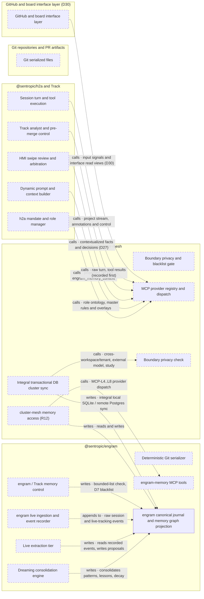
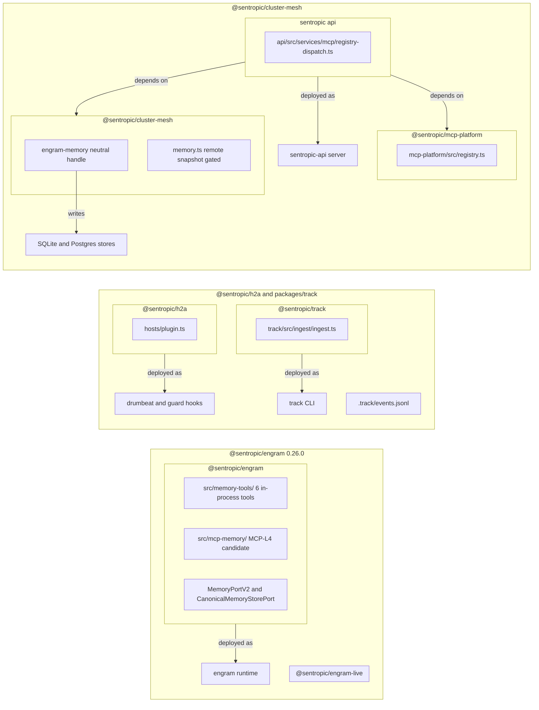

# Engram-First Specification Plan and Target Architecture (`PLAN_SPEC_ENGRAM_FRONT`)

- **Status:** `proposed, pending owner review` (`docs/memory-r15-sediment`) `[FACT: memory-dossier/owner-r15/comments-2026-11-08.md:20]`
- **Repository of Record:** `engram` `[FACT: memory-dossier/owner-r15/comments-2026-11-08.md:20]`

---

## 1. Target Architecture (`engram` First Front)

Owner-review form: the r15 dossier (the r14 dossier updated) in the design-system diagram model, sourced from [`spec/memory/architecture-target.mmd`](architecture-target.mmd) (`engram.archi-mermaid/1`; full ingestion stages 1–6 verified with `0 diagnostics` at `DS_COMMIT = 7c5a8c82bf2abc71bf0963e3fcfc395c48fcf6af`). Governed by [`spec/memory/ARCHITECTURE-RULES.md`](ARCHITECTURE-RULES.md). The Mermaid flowchart below is a text mirror regenerated from the canonical file and matches its drawn containers, leaf entities, and arrow-encoded relations one for one.

In the R15 target architecture, `engram` is the primary ingestion front for all session data (`tour de parole`, tool results, owner decisions, harness rules) and for external GitHub/board HMI inputs (`D19`, `D24`, `D30`, `D32`), with every `h2a`, `Track`, and HMI read/write mediated by `cluster-mesh` (`R12`) `[FACT: memory-dossier/owner-r9/r12-correction-2026-11-07.md:5,9; memory-dossier/owner-r15/comments-2026-11-08.md:9,13,15,19]`. Raw session events are recorded in `engram` first; live extraction reads the recorded raw events from `engram` and writes extracted entity, decision, and rule proposals back via a permanent lightweight LLM or the session LLM now, and specialized models later `[FACT: memory-dossier/owner-r15/comments-2026-11-08.md:15,19]`. Downstream analysts (`Track`, the `h2a` Harness/Role analyst, and the Dormant Dreaming Agent) operate over the `engram` canonical journal and memory graph projection `[FACT: memory-dossier/owner-r15/comments-2026-11-08.md:2,3,19]`. At every prompt step, linear transcript context is replaced by a durationless contextual graph query through the seventh memory tool (proposed name `engram_memory_context`, `D20`, `D22`, `D23`) `[FACT: memory-dossier/owner-r15/comments-2026-11-08.md:4,6-8]`. Local and remote `engram` graphs synchronize integrally as database transactions over `sentropic/cluster-mesh` (`D24`), and `engram` produces all Git/PR serializations (`D28`, `D29`, `D31`, `D34`)—`spec/` and `.engram/` cards (layout `proposed`) (`D2=review`), `.track/` PR event journal + state snapshot linked by fingerprint (`D29=both`), and `proposed` `.h2a/` workspace/repo harness overlays (`D31`)—with the `Track` control replaying the per-PR serialization from the serialized Git files before merge (`D34`) `[FACT: memory-dossier/owner-r15/answers-2026-11-08.compact.md:5; memory-dossier/owner-r15/comments-2026-11-08.md:10,14]`.

No relation crosses between the engram and h2a systems without cluster-mesh, in any view or fold state (R12; owner-r9 r12-correction:9).

---

## 2. Current State Architecture (Pre-R15 Baseline across `engram`, `h2a`, and `sentropic`)

Owner-review form: the r15 dossier (the r14 dossier updated) in the design-system diagram model, sourced from [`spec/memory/architecture-current.mmd`](architecture-current.mmd) (`engram.archi-mermaid/1`; full ingestion stages 1–6 verified with `0 diagnostics` at `DS_COMMIT = 7c5a8c82bf2abc71bf0963e3fcfc395c48fcf6af`). Governed by [`spec/memory/ARCHITECTURE-RULES.md`](ARCHITECTURE-RULES.md). The Mermaid flowchart below is a text mirror regenerated from the canonical file and matches its drawn containers, leaf entities, and arrow-encoded relations one for one.

In the current codebase baseline (`engram` `7e0f7d0d`, `h2a` `6a03e3132`, `sentropic` `e9f272c94`), session events and transcripts are split across linear CLI host transcripts and `.track/events.jsonl` (written by the `track` CLI via `packages/track/src/ingest/ingest.ts`). The `h2a` memory runtime has a V1-to-V2 adapter over the vendored V2 types (`graphify-contracts-v2.vendored.ts`), not wired to host hooks (`plugin.ts` only renders `drumbeat record`, `drive receive`, and workspace-scope guard hooks), plus `packages/h2a-runtime/src/gateway-host/live-github.ts` as the P1 host transport for `@sentropic/engram-live` (`engram-live/pr-sync.ts`). `@sentropic/engram` 0.26.0 ships the six in-process memory tools (`src/memory-tools/`, export `./memory-tools`), disabled by default. Since 0.22.0 it also ships the MCP-L4 candidate adapter (`./mcp-memory`, `./registry/*`; `src/mcp-memory/provider.ts`), disabled by default and pending MCP-L5 qualification (CHANGELOG.md:42-44). `./memory-substrate` implements `CanonicalMemoryStorePort` over the cluster-mesh neutral handle. Its durable backend qualification is `unverified` (CHANGELOG.md:72-77). plan/08:216 still records the 0.20.0 state. In `sentropic`, `packages/cluster-mesh/src/memory.ts` gates remote snapshot replication (`W-C seam`) while still carrying `H2aGraphifyMemoryPort`, `packages/mcp-platform/src/registry.ts` defines the MCP provider registry, and `createRegistryDispatchRouter` in `api/src/services/mcp/registry-dispatch.ts` (`:22,34`) only wires `sentropic.artifacts` `[FACT: package.json:3,22,31,35,39,43; CHANGELOG.md:42-44,72-77; spec/SPEC_MEMORY_MCP_V2.md:49-58; plan/08-BRANCH_MEMORY_FINALIZATION.md:202,216-220; h2a repository: packages/h2a/src/hosts/plugin.ts:22-46,182-210; packages/h2a/src/runtime/memory/port-v2-adapter.ts:3-4; packages/h2a-runtime/src/gateway-host/live-github.ts:1-5; packages/track/src/events/store.ts:35-39; sentropic repository: packages/cluster-mesh/src/memory.ts:5-42; packages/mcp-platform/src/registry.ts:100-143; api/src/services/mcp/registry-dispatch.ts:22,34]`.

---

## 3. Ordered Specification Plan (`engram` First)

All specifications below are authored in `engram` (`spec/`) as the repository of record, in dependency order starting with the `cluster-mesh` memory access and MCP provider chain (`R12`, `MCP-L4`–`L8`) followed by live event recording in `engram` `[FACT: memory-dossier/owner-r9/r12-correction-2026-11-07.md:5; memory-dossier/owner-r15/comments-2026-11-08.md:19-20; plan/08-BRANCH_MEMORY_FINALIZATION.md:216-220]`.

### Spec 6A — `spec/SPEC_ENGRAM_CLUSTER_MESH_MEMORY_ACCESS_AND_MCP_WIRING.md`
- **Title:** `cluster-mesh` Memory Access and Registry Wiring (`MCP-L4` → `L5` → `L6` → `L7` → `L8`, `plan/08-BRANCH_MEMORY_FINALIZATION.md:216-220`, `R12`)
- **Owning Repository:** engram and sentropic/cluster-mesh, with h2a for MCP-L8 (governed by `spec/memory/contracts/engram-cluster-mesh.md`) `[JUDGMENT]`.
- **Dependencies:** None (foundational transport and MCP provider chain required by `R12` before Specs 1–2) `[JUDGMENT]`.
- **Scope:**
  1. Complete the MCP delivery chain in `plan/08-BRANCH_MEMORY_FINALIZATION.md:216-220`: the `engram` MCP provider (`MCP-L4`: candidate shipped in 0.22.0, disabled by default, pending MCP-L5 qualification) over the six frozen tools (`engram_memory_search`, `engram_memory_get`, `engram_memory_capture`, `engram_memory_request_admission`, `engram_memory_withdraw`, `engram_memory_forget`), the production Sentropic path (`MCP-L5`), `mcp-platform` registry re-exposure (`MCP-L6`), mesh delivery and retirement of `H2aGraphifyMemoryPort` (`MCP-L7`), and `h2a` consumption (`MCP-L8`) `[FACT: CHANGELOG.md:42-44; spec/SPEC_MEMORY_MCP_V2.md:47-76,536-580; plan/08-BRANCH_MEMORY_FINALIZATION.md:216-220]`.
  2. Expose `cluster-mesh` memory access (`R12`) as the mandatory hop operating `engram` for all `h2a`, `Track`, and HMI reads and writes (`owner-r9/r12-correction-2026-11-07.md:5,9`, `kit/src/memory-content-r11.json:287`) `[FACT: memory-dossier/owner-r9/r12-correction-2026-11-07.md:5,9; memory-dossier/kit/src/memory-content-r11.json:287]`.
- **Amendments to Existing `engram` Specs:**
  - **Amends `spec/SPEC_MEMORY_MCP_V2.md` (`M7`, lines 536–580, manifest at `:553`) & `plan/08-BRANCH_MEMORY_FINALIZATION.md` (lines 216–220):** Binds `providerId: 'engram-memory'` and `createEngramMemoryWireManifest` (`packages/cluster-mesh/src/integrations/mcp/memory-manifest.ts:4`) into `packages/mcp-platform/src/registry.ts` (`:100-143`) and `api/src/services/mcp/registry-dispatch.ts` (`:22,34`). Amends plan/08-BRANCH_MEMORY_FINALIZATION.md:214-222 to record the 0.22.0 MCP-L4 candidate (CHANGELOG.md:42-44) `[FACT: CHANGELOG.md:42-44; spec/SPEC_MEMORY_MCP_V2.md:536-580; sentropic repository: packages/cluster-mesh/src/integrations/mcp/memory-manifest.ts:4; api/src/services/mcp/registry-dispatch.ts:22,34]`.

### Spec 1 — `spec/SPEC_ENGRAM_SESSION_FRONT_AND_EXTRACTION.md`
- **Title:** Live Session Ingestion Front, Extraction Pipeline, and Scion Worktree Graph Model (`D7`, `D8`, `D9`, `D11`, `D12`, `D13`, `D14`, `D15`, `D19`, `D21`, `D24`, `D27`, `D30`, `D33`)
- **Owning Repository:** `engram` (consumed by `h2a` host plugins and `sentropic` GitHub ingress via `cluster-mesh`) `[JUDGMENT]`.
- **Dependencies:** Spec 6A `[JUDGMENT]`.
- **Scope:**
  1. Define `EngramSessionIngestFrontPort` (`recordSessionEvent` and `recordExtraction`) so every raw session turn (`tour de parole`), tool execution result, file reference, formal mandate binding, and external GitHub/board input (`D30`) is recorded in `engram` first (via `cluster-mesh` memory access, `R12`) before extraction, `Track`, or `h2a` analysts run `[FACT: memory-dossier/owner-r15/comments-2026-11-08.md:13,15,19]`.
  2. Define the extraction interface: a light permanent extraction LLM or the session LLM now, specialized models later (owner message, `comments-2026-11-08.md:19`), reading recorded raw events from `engram` and writing extracted entity, decision, and rule proposals back into `engram` `[FACT: memory-dossier/owner-r15/comments-2026-11-08.md:15,19]`.
  3. Model git worktrees as `Scion`-like derived graph entities (`D21`) retaining parent origin link, branch/worktree state, and session logs `[FACT: memory-dossier/owner-r15/comments-2026-11-08.md:5]`.
  4. Model interactive/async decision-dossier learning exchanges (`D27=decision-only`) producing contextualized facts and associated decisions `[FACT: memory-dossier/owner-r15/comments-2026-11-08.md:12]`.
  5. Enforce `D33` pseudonymization, `D7`/`D8` PII armor and confidentiality blacklists; `D13` retention aligned on the host audit; `D14` window, then an announced purge. The 30 projects and 6 months of `D9` bound the study corpus only. Capture runs under its own purpose and can be revoked without cutting recall (`D11`) `[FACT: memory-dossier/owner-r15/answers-2026-11-08.compact.md:4-5; memory-dossier/owner-r8/comments-2026-11-07.md:11,13,15]`.
  6. Typed live-tracking events `pr.merged`, `owner.answer` and `owner.request`, with an idempotency key equal to the source id. A reconciliation job proposes missing writes and publishes a gap counter (`owner-r10/suivi-direct-2026-11-07.md:5-6`) `[FACT: memory-dossier/owner-r10/suivi-direct-2026-11-07.md:5-6]`.
- **Amendments to Existing `engram` Specs:**
  - **Amends `spec/SPEC_AGENT_MEMORY_SUBSTRATE.md` (`§2–§5 Write path`, lines 53–244, and `§9.4`, lines 343–370):** Expands the substrate from post-hoc `MemoryNote` admission to first-rank live turn, tool-result, decision, and rule graph recording, and replaces flat `workspaceId` path aliasing with the `D21` Scion-like worktree graph entity `[FACT: spec/SPEC_AGENT_MEMORY_SUBSTRATE.md:53-244,343-370]`.
  - **Amends `spec/SPEC_EVOL_AGENT_MEMORY_SUBSTRATE.md` (`§4`, lines 145–252, and `§5.1`, lines 253–290):** Adds graph node schemas for `session_turn` (with queryable text history per `D23`), `tool_result`, `project_decision`, `harness_decision`, `decision_dossier`, and `worktree_scion`, plus PII-armor and confidentiality blacklist fields (`D7`, `D8`, `D33`). Keeps EVOL D3 (SPEC_EVOL_AGENT_MEMORY_SUBSTRATE.md:73-77) and SPEC_MEMORY_MCP_V2 M10 (:884-910). Raw session events and text history are canonical journal records. The memory graph that the contextual query reads is their authorized projection. The query tool returns text history (D23), which is never copied into `graph.json` `[FACT: spec/SPEC_EVOL_AGENT_MEMORY_SUBSTRATE.md:73-77,145-290; spec/SPEC_MEMORY_MCP_V2.md:884-910]`.
  - **Amends `spec/SPEC_LIVE_GIT_INDEXING.md` (`§2`, lines 42–71, and `§5`, lines 118–129):** Binds live Git branch/worktree indexing directly to `D21` Scion worktree nodes. Amends SPEC_LIVE_GIT_INDEXING.md §5 (P1, :118-129). The GitHub PR sync is the first D30 input path. Issue, review and board inputs extend it (`proposed`) `[FACT: spec/SPEC_LIVE_GIT_INDEXING.md:42-71,118-129]`.
  - **Builds on the 0.24.0 extraction toolkit (`@sentropic/engram/extraction-batch`, `profile-bundle`; CHANGELOG.md:19):** The light permanent LLM, the session LLM and later models emit through it, with citations at merge `[FACT: CHANGELOG.md:19]`.

### Spec 2 — `spec/SPEC_ENGRAM_CONTEXTUAL_GRAPH_AND_PROMPT_LOOP.md`
- **Title:** Contextual Graph Replacement of Linear Context and the Seventh Memory Tool (proposed name `engram_memory_context`) (`D4`, `D5`, `D6`, `D14`, `D15`, `D18`, `D19`, `D20`, `D22`, `D23`)
- **Owning Repository:** `engram` (consumed by `h2a` prompt builder and registered in `sentropic/mcp-platform`) `[JUDGMENT]`.
- **Dependencies:** Spec 1; Spec 6A; reopening of the frozen six-tool contract (`SPEC_MEMORY_MCP_V2` `M1`) with an `engram` and `sentropic` co-signature (`D20`) `[FACT: spec/SPEC_MEMORY_MCP_V2.md:47-58; memory-dossier/owner-r15/answers-2026-11-08.compact.md:5]`.
- **Scope:**
  1. Specify the durationless, independent prompt construction loop (`D23`): at every step, `h2a` queries `engram` via the seventh memory tool (proposed name `engram_memory_context`, `D20=seventh`) and sends the LLM only the contextual graph query result + the reprocessed output of the previous step, eliminating linear context accumulation and session rollover `[FACT: memory-dossier/owner-r15/comments-2026-11-08.md:4,7-8]`.
  2. Define the `D22` role-consciousness fingerprint query where the formal signed `h2a` mandate (`D4`) is a primary graph-query component `[FACT: memory-dossier/owner-r15/comments-2026-11-08.md:6]`.
  3. Weight graph retrieval by attention on significant tool results and owner decisions and by mission focus (`D23`), while keeping raw session text history queryable on demand through the memory graph `[FACT: memory-dossier/owner-r15/comments-2026-11-08.md:7-8]`.
  4. Enforce `D5` (`same-agent`: successive sessions of the same `h2a` role, in the same space, read the non-admitted bodies before admission), `D6` (without content authorization, only path and fingerprint reach the external model), `D15` (hook activation does not wait for the whole model; each context slice—Track, Git, architecture, rules, memory—is injected as soon as its criteria pass), and `D18` (a session without a memory identity receives only the non-memory slices, read-only, under a recorded policy) `[FACT: memory-dossier/owner-r15/answers-2026-11-08.compact.md:4-5]`.
  5. Define which text the `D14` purge removes (host-side local copies) and which text history `engram` keeps queryable (`D23`) `[FACT: memory-dossier/owner-r15/answers-2026-11-08.compact.md:5; memory-dossier/owner-r15/comments-2026-11-08.md:8]`.
- **Amendments to Existing `engram` Specs:**
  - **Amends `spec/SPEC_MEMORY_MCP_V2.md` (`M1`, lines 47–76, `M7`, lines 536–580, manifest at `:553`, and `M10`, lines 884–910):** Reopens the six-tool contract under an `engram` + `sentropic` co-signature (`D20`), adds the seventh tool (proposed name `engram_memory_context`), updates `AppMcpProviderManifest` to export 7 tools, and replaces session rollover handoff assumptions with durationless per-step contextual graph queries (`D19`, `D22`, `D23`). Keeps EVOL D3 (SPEC_EVOL_AGENT_MEMORY_SUBSTRATE.md:73-77) and SPEC_MEMORY_MCP_V2 M10 (:884-910). Raw session events and text history are canonical journal records. The memory graph that the contextual query reads is their authorized projection. The query tool returns text history (D23), which is never copied into `graph.json` `[FACT: spec/SPEC_EVOL_AGENT_MEMORY_SUBSTRATE.md:73-77; spec/SPEC_MEMORY_MCP_V2.md:47-76,536-580,884-910]`.
  - **Amends `spec/SPEC_MEMORY_FINALIZATION.md` (`§0–§2`, lines 1–60):** Embeds mandate-primary graph fingerprint queries (`D22`) and model-assisted sensitivity-triaged ranking (`D7`) `[FACT: spec/SPEC_MEMORY_FINALIZATION.md:1-60]`.

### Spec 3 — `spec/SPEC_ENGRAM_DORMANT_DREAMING_SYNTHESIS.md`
- **Title:** Dormant Dreaming Agent: Default Cadences Nightly, Weekly, and Monthly + Event Triggers Mid-Day and Context Saturation (`D19`, `D23`, `D25`, `D26`)
- **Owning Repository:** `engram` `[JUDGMENT]`.
- **Dependencies:** Spec 1, Spec 2 `[JUDGMENT]`.
- **Scope:**
  1. Specify the dormant dreaming process (`D19`, `D25`) running on default cadences nightly (the owner's « daily »), weekly and monthly; event triggers mid-day and context saturation, consolidating cross-session patterns and re-injecting permanent facts forgotten in the short term into the seventh memory tool (`engram_memory_context`, `D23`) `[FACT: memory-dossier/owner-r15/comments-2026-11-08.md:3,7,11]`.
  2. Specify `D26` (`two-tier-shadow`) for dreaming lesson drafting: one language model drafts in shadow, an independent verifier checks, and nothing is shown to the owner before the measured threshold `[FACT: memory-dossier/owner-r15/answers-2026-11-08.compact.md:5; memory-dossier/kit/src/memory-content-r11.json:3807-3810]`.
  3. Bind dreaming promotion candidates to `D1=borne-review` and `D2=review` so no dreamed synthesis mutates `Track` or `spec/` without third-party/owner review `[FACT: memory-dossier/owner-r15/answers-2026-11-08.compact.md:4]`.
  4. Multi-repo harness audit: the dreaming agent reviews the h2a master harness across repositories and proposes changes. Each repository's overlay evolves in that repository (`comments-2026-11-08.md:24`) `[FACT: memory-dossier/owner-r15/comments-2026-11-08.md:24]`.
- **Amendments to Existing `engram` Specs:**
  - **Amends `spec/SPEC_MEMORY_FINALIZATION.md` (`§0–§2`, lines 1–60) & `plan/08-BRANCH_MEMORY_FINALIZATION.md` (lines 198–222):** Adds the dormant dreaming subsystem (default cadences nightly, weekly, monthly; event triggers mid-day, context saturation), `two-tier-shadow` lesson verification (`D26`), and multi-repo master harness auditing (`comments-2026-11-08.md:24`) to the `engram-memory` engine lifecycle `[FACT: plan/08-BRANCH_MEMORY_FINALIZATION.md:198-222; memory-dossier/owner-r15/comments-2026-11-08.md:24]`.

### Spec 4 — `spec/SPEC_ENGRAM_H2A_ROLE_ONTOLOGY_AND_HARNESS_OVERLAYS.md`
- **Title:** `h2a` Role & Activity Ontology Graph, Proactive Role Analysis, and Workspace Harness Overlay Serialization (`D3`, `D4`, `D16`, `D31`, `D34`)
- **Owning Repository:** `engram` (co-designed with `h2a`, governed by `spec/memory/contracts/engram-h2a.md`) `[JUDGMENT]`.
- **Dependencies:** Spec 1, Spec 2 `[JUDGMENT]`.
- **Scope:**
  1. Model standard `h2a` agent roles and classic human roles, their scopes, multi-actor relationships, and typical activities (`activité types`) and h2a harness skills (`comments-2026-11-08.md:25`) as an `engram` graph governed by an `h2a` ontology and derivable through `engram` graph composition rules (`D16`), with the `h2a` mandate-and-role manager as single writer `[FACT: memory-dossier/owner-r15/comments-2026-11-08.md:2,25; memory-dossier/owner-r8/comments-2026-11-07.md:17-18]`.
  2. Define the proactive `h2a` analysis hook when a session has no role assigned, proposing a role and rule scope from live `engram` activity (`D16`) `[FACT: memory-dossier/owner-r15/comments-2026-11-08.md:2]`.
  3. Define the two-tier harness model (`D31`): `h2a` holds the master harness, `engram` records all harness decisions in first rank, and `engram` (`D34=engram`) serializes each developer/workspace/repository harness overlay (`surcouche`, `proposed` `.h2a/` path) into Git-committed files `[FACT: memory-dossier/owner-r15/comments-2026-11-08.md:14]`.
- **Amendments to Existing `engram` Specs:**
  - **Amends `spec/SPEC_EVOL_ARCHI_CARDS.md` (`§1` and `§2.1–2.3`, lines 33–111):** Adds an `h2a`-authored role and activity profile (roles, scopes, multi-actor relations, activity types, harness skills, references into the mandate registry). It is registered as its own lineage in `engram`'s profile registry and composed with `archi@1` through the `engram` derivation models. `archi@1`'s eleven kinds and fifteen relations stay unchanged (`SPEC_EVOL_ARCHI_CARDS` `§2.2–2.3`); broader architectural ontology extensions (`process`, `session`, `businessObject`, `controlPolicy`, plateaus) are tracked separately in the archi ontology v2 study now in progress (`.graphify/scratch/design/archi-card-semantics/STUDY_ARCHI_ONTOLOGY_V2.md`, an untracked working note in the engram checkout, `.gitignore:60`; cite it once committed) `[FACT: spec/SPEC_EVOL_ARCHI_CARDS.md:33-111; .gitignore:60; memory-dossier/owner-r15/comments-2026-11-08.md:2,25]`.

### Spec 5 — `spec/SPEC_ENGRAM_TRACK_ANALYST_CONTROL_AND_PR_SERIALIZATION.md`
- **Title:** `Track` as Downstream `engram` Analyst, Joint Control Engine, and Per-PR Serialization (`D1`, `D2`, `D3`, `D24`, `D28`, `D29`, `D30`, `D32`, `D34`)
- **Owning Repository:** `engram` (co-designed with `h2a/packages/track`, governed by `spec/memory/contracts/engram-track.md`) `[JUDGMENT]`.
- **Dependencies:** Spec 6A, Spec 1, Spec 4 `[JUDGMENT]`.
- **Scope:**
  1. Refactor `Track` from an upstream `.track/events.jsonl` ingestion sink into a live downstream analyst reading `engram` (through `cluster-mesh` memory access, `R12`) for project decisions and project events only (`D24`, `D3`) `[FACT: memory-dossier/owner-r9/r12-correction-2026-11-07.md:5; memory-dossier/owner-r15/comments-2026-11-08.md:9,19; memory-dossier/owner-r10/suivi-direct-2026-11-07.md:5]`.
  2. Specify the joint `engram` + `Track` control port (`D32`) supporting a rules/decision engine (owner verbatim: `« api type jev/decison »`), fast low-latency LLMs, and optional control agents `[FACT: memory-dossier/owner-r15/comments-2026-11-08.md:15-16]`.
  3. Specify `engram`'s per-PR serializer (`D28=engram`, `D29=both`, `D34=engram`) exporting both the event journal and a state snapshot, with statuses and remaining work at the time of the PR, linked by fingerprint, into the PR branch and replayed by the `Track` control before merge (`D34`), while keeping GitHub/boards strictly as an external HMI and input layer (`D30`) `[FACT: memory-dossier/owner-r15/answers-2026-11-08.compact.md:5; memory-dossier/owner-r15/comments-2026-11-08.md:13]`.
- **Amendments to Existing `engram` Specs:**
  - **Amends `spec/SPEC_AGENT_MEMORY_SUBSTRATE.md` (`§5 Write path`, line 244, and `§9.4`, lines 343–370) & `spec/SPEC_EVOL_AGENT_MEMORY_SUBSTRATE.md` (`§5.1`, lines 253–290):** Replaces direct `Track` CLI promotion calls with `engram`-owned per-PR serialization (`D28`, `D29`, `D34`) replayed by the `Track` control before merge and gated by `D1=borne-review` and `D4=mandate` `[FACT: spec/SPEC_AGENT_MEMORY_SUBSTRATE.md:244,343-370; spec/SPEC_EVOL_AGENT_MEMORY_SUBSTRATE.md:253-290]`.

### Spec 6B — `spec/SPEC_ENGRAM_CLUSTER_MESH_TRANSACTIONAL_GRAPH_SYNC.md`
- **Title:** Integral Transactional Graph Synchronization (`D10`, `D17`, `D24`)
- **Owning Repository:** `engram` and `sentropic/cluster-mesh` (governed by `spec/memory/contracts/engram-cluster-mesh.md`) `[JUDGMENT]`.
- **Dependencies:** Spec 6A, Spec 1, Spec 2 `[JUDGMENT]`.
- **Scope:**
  1. Specify `ClusterMeshGraphClusterSyncPort` so the local store (`embedded-local`, SQLite) and remote store (`external-host`, Postgres backend, multi-node per D-A; the backend is host configuration) synchronize integrally as ACID database transactions and DB-cluster replication (`D24`) across subscribed workspaces, with no privacy gate on the owner's own local↔remote replicas of the same `(tenant, workspace)` `[FACT: spec/SPEC_EVOL_AGENT_MEMORY_SUBSTRATE.md:36-41; memory-dossier/owner-r15/comments-2026-11-08.md:10]`.
  2. Workspace graph sync is on by default (`kit:292`). Within it, context logs and context summaries stay local unless the mandate's transfer policy allows them, within the owner's per-repository policy (`D10`; `kit:2643-2646`; `owner-r8 comments:9`), with `D17=degraded` offline transactional outbox queueing and causal replay `[FACT: memory-dossier/kit/src/memory-content-r11.json:292,2643-2646; memory-dossier/owner-r15/answers-2026-11-08.compact.md:4-5; memory-dossier/owner-r8/comments-2026-11-07.md:9]`.
  3. Replace the `CapabilityGatedError('memory_replication')` seam in `MemoryReplicationPort` (`sentropic repository: packages/cluster-mesh/src/memory.ts:5-16`) with the integral transactional DB-cluster sync implementation `[FACT: sentropic repository: packages/cluster-mesh/src/memory.ts:5-16]`.
- **Amendments to Existing `engram` Specs:**
  - **Amends `spec/SPEC_MEMORY_MCP_V2.md` (`M8–M10`, lines 696–1020):** Integrates integral transactional DB-cluster graph synchronization (`D24`) and mandatory `mcp-platform` registry dispatch (`R12`). M10's bounded, filtered `graph.json` projection is unchanged. Integral sync replicates the canonical journal and records, not the projection `[JUDGMENT]` `[FACT: spec/SPEC_MEMORY_MCP_V2.md:696-1020]`.
  - **Preserves `spec/SPEC_L3A_GENERIC_MODULE_STORAGE_PORT.md` (lines 12–16, 105–128):** Keeps `radar-immobilier` (`Immo`) isolated on the generic `L3a` module storage port `[FACT: spec/SPEC_L3A_GENERIC_MODULE_STORAGE_PORT.md:12-16,105-128]`.

---

## 4. Owner Review Points (Architecture Statements to Confirm)

The following architecture statements summarize the structural commitments of this plan for owner confirmation:

1. **Engram-First Ingestion Boundary & Pre-Merge Replay (Spec 6A, Spec 1, Spec 5):** Every CLI host turn (`tour de parole`), tool execution result, owner decision, rule activation, and external GitHub/board input is recorded in `engram` first through `cluster-mesh` memory access (`R12`); `.track/events.jsonl` in `h2a` is retired as a primary ingestion sink and becomes a per-PR serialization artifact (event journal + state snapshot, linked by fingerprint, `D29`) generated by `engram` (`D28`, `D34`) and replayed by the `Track` control before merge (`D34`).
2. **Durationless Prompt Loop & D20 Contract Reopening (Spec 6A, Spec 2):** `D20` reopens the frozen six-tool MCP contract. The seventh tool (proposed name `engram_memory_context`) ships only after the `engram` and `sentropic` co-signature and after MCP-L5 qualifies the MCP-L4 candidate. `h2a` host plugins stop sending accumulated multi-turn conversation history to the LLM and stop performing session rollovers; every prompt step calls the seventh tool (using the signed `h2a` mandate as primary fingerprint component) and sends only the contextual graph query result plus the reprocessed previous step output (`D19`, `D20`, `D22`, `D23`).
3. **Dormant Dreaming Cadences & Shadow Verification (Spec 3):** The dormant dreaming process in `engram` runs on default cadences nightly (the owner's « daily »), weekly and monthly; event triggers mid-day and context saturation (`D19`, `D25`), surfacing forgotten permanent facts into the seventh memory tool (`D23`), verifying LLM-drafted lessons in shadow (`D26`), and gating any `Track` or `spec/` promotion on `D1=borne-review` / `D2=review`.
4. **Role Ontology Lineage & Git-Committed Workspace Harness Overlays (Spec 4):** `h2a` standard agent roles, classic human roles, and their typical activities are stored in an `h2a`-authored profile registered as its own lineage in `engram`'s profile registry and composed with `archi@1` (whose eleven kinds and fifteen relations stay unchanged) (`D16`), with proactive role proposals when a session has no role; `h2a` owns the master harness while `engram` records all harness decisions and serializes each developer/workspace/repository harness overlay (`surcouche`, `proposed` `.h2a/` path) to be committed in Git (`D31`, `D34`). h2a harness skills are graphs in the same ontology. The dreaming agent audits the master harness across repositories.
5. **Joint Control Without Mandatory Agent Overhead (Spec 5):** Control hooks originate from both `engram` and `Track` (`D32`) and execute through a rules/decision engine (owner verbatim: `« api type jev/decison »`), fast low-latency LLMs, or control agents.
6. **Integral DB-Cluster Graph Sync over `cluster-mesh` (Spec 6B):** Local store (`embedded-local`, SQLite) and remote store (`external-host`, Postgres backend, multi-node per D-A); the backend is host configuration. Local and remote `engram` graphs of the same `(tenant, workspace)` synchronize integrally and unmasked as ACID database transactions and DB-cluster replication over `@sentropic/cluster-mesh` (`D24`), with `D17=degraded` offline transactional queueing and all MCP tools routed through `packages/mcp-platform`.
