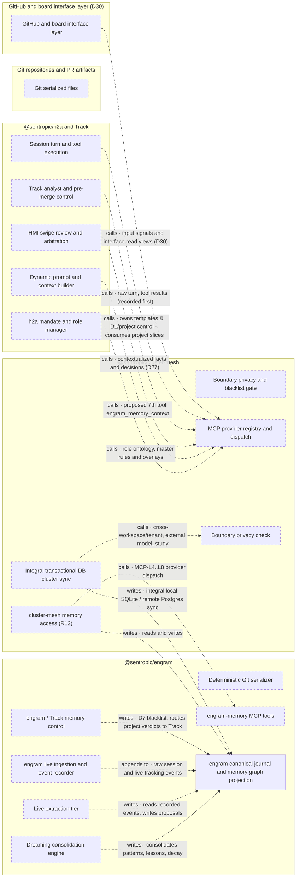
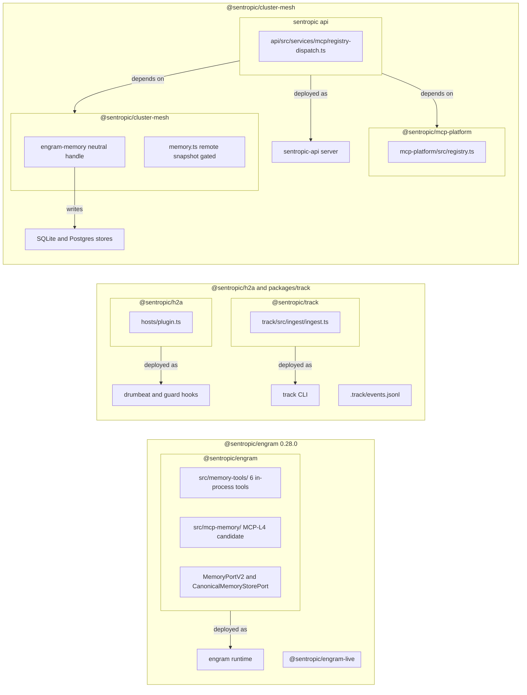

# Engram-First Specification Plan and Target Architecture (`PLAN_SPEC_ENGRAM_FRONT`)

- **Status:** `decided 2026-11-14` within the scope of `EVIDENCE-q6-message-shown-to-owner.md` and `EVIDENCE-q6-owner-question-and-answer.json` (`docs/memory-r15-sediment`; §4 architecture review points and T-M-C ownership rule recorded in [`spec/memory/OWNER-DECISIONS-2026-11-14.md`](OWNER-DECISIONS-2026-11-14.md), seat extensions marked `proposed, not decided by the owner`, session/prompt-loop direction annotated with the `2026-11-15` supersession banner, specs `proposed`) `[FACT: memory-dossier/owner-r15/comments-2026-11-08.md:20; spec/memory/OWNER-DECISIONS-2026-11-14.md:3,6-8]`
- **Repository of Record:** `engram` `[FACT: memory-dossier/owner-r15/comments-2026-11-08.md:20]`

---

## 1. Target Architecture (`engram` First Front)

> **Superseded in direction by the owner's 15/11 words; pending the owner's decision dossier "journal de session en graphe et outil mémoire":** « Deja engram doit devenir un loguer de session en // des outils. Dans notre outil cli a nous ce deviendra le loggeur principal. La session est loguée en graph. Et donc seul le diff est transmis a chaque fois. » *(Applies to the 7th MCP tool `engram_memory_context`, the 8-CLI transcript-cutoff framing, flat raw-turn session logging, and full-slice transmission per step below; the R15 / 14/11 text and diagram mirror are retained without redesign while the owner's decision dossier is pending.)*

Owner-review form: the commented R15 dossier (`artifact S8tzgFPqn8xXNfFpdLNqUq`, `owner-rebuild-2026-11-10.md:8`) in the design-system diagram model, sourced from [`spec/memory/architecture-target.mmd`](architecture-target.mmd) (`engram.archi-mermaid/1`; full ingestion stages 1–6 verified with `0 diagnostics` at `DS_COMMIT = 7c5a8c82bf2abc71bf0963e3fcfc395c48fcf6af`). Governed by [`spec/memory/ARCHITECTURE-RULES.md`](ARCHITECTURE-RULES.md). The Mermaid flowchart below is a text mirror regenerated from the canonical file and matches its drawn containers, leaf entities, and arrow-encoded relations one for one.

In the R15 target architecture, `engram` is the primary ingestion front for all session data (`tour de parole`, tool results, owner decisions, harness rules) and for external GitHub/board HMI inputs (`D19`, `D24`, `D30`, `D32`), with every `h2a`, `Track`, and HMI read/write mediated by `cluster-mesh` (`R12`) `[FACT: memory-dossier/owner-r9/r12-correction-2026-11-07.md:5,9; memory-dossier/owner-r15/comments-2026-11-08.md:9,13,15,19]`. Raw session events are recorded in `engram` first; live extraction reads the recorded raw events from `engram` and writes extracted entity, decision, and rule proposals back via a permanent lightweight LLM or the session LLM now, and specialized models later `[FACT: memory-dossier/owner-r15/comments-2026-11-08.md:15,19]`. Downstream analysts (`Track`, the `h2a` Harness/Role analyst, and the Dormant Dreaming Agent) operate over the `engram` canonical journal and memory graph projection `[FACT: memory-dossier/owner-r15/comments-2026-11-08.md:2,3,19]`. At every prompt step, linear transcript context is replaced by a durationless contextual graph query through the seventh memory tool (`engram_memory_context` — tool identifier `proposed, not decided by the owner`, source seats: conductor, `Fable`, `Carbon`; `D20`, `D22`, `D23`; *superseded in direction on 15/11 per banner above*) `[FACT: memory-dossier/owner-r15/comments-2026-11-08.md:4,6-8]`. Local and remote `engram` graphs synchronize integrally as database transactions over `sentropic/cluster-mesh` (`D24`), and `engram` produces all Git/PR serializations (`D28`, `D29`, `D31`, `D34`)—`spec/` and `.engram/` cards (layout `proposed`) (`D2=review`), `.track/` PR event journal + state snapshot linked by fingerprint (`D29=both`), and `proposed` `.h2a/` workspace/repo harness overlays (`D31`; `.h2a/` path/layout `proposed, not decided by the owner`, source seats: `Fable`, `Carbon`, `h2a`)—with the `Track` control replaying the per-PR serialization from the serialized Git files before merge (`D34`) `[FACT: memory-dossier/owner-r15/answers-2026-11-08.compact.md:5; memory-dossier/owner-r15/comments-2026-11-08.md:10,14]`.

No relation crosses between the engram and h2a systems without cluster-mesh, in any view or fold state (R12; owner-r9 r12-correction:9). Per the 2026-11-14 T-M-C ownership decision ([`spec/memory/OWNER-DECISIONS-2026-11-14.md`](OWNER-DECISIONS-2026-11-14.md)), `Track` is master of its domain ontology templates, `engram` is master of the shared metamodel and lineage registry, and the `Track` application (`e_rt_track`) is master of `Track`-domain control (including the `D1` bounded-list check and `D34` pre-merge acceptance, while `e_svc_mctrl` covers `engram` metamodel well-formedness, holds the `D7` confidentiality deny-list, and routes project verdicts to `Track`; synchronized across `architecture-target.mmd` and the flowchart mirror above per [`ARCHITECTURE-RULES.md`](ARCHITECTURE-RULES.md) Rule 5).

---

## 2. Current State Architecture (Pre-R15 Baseline across `engram`, `h2a`, and `sentropic`)

Owner-review form: the commented R15 dossier (`artifact S8tzgFPqn8xXNfFpdLNqUq`, `owner-rebuild-2026-11-10.md:8`) in the design-system diagram model, sourced from [`spec/memory/architecture-current.mmd`](architecture-current.mmd) (`engram.archi-mermaid/1`; full ingestion stages 1–6 verified with `0 diagnostics` at `DS_COMMIT = 7c5a8c82bf2abc71bf0963e3fcfc395c48fcf6af`). Governed by [`spec/memory/ARCHITECTURE-RULES.md`](ARCHITECTURE-RULES.md). The Mermaid flowchart below is a text mirror regenerated from the canonical file (`architecture-current.mmd:21` was captured at `engram` `7e0f7d0d` `0.26.0`, outside this pass's edit scope; the system label below reflects current `package.json:3` `0.28.0`).

In the current codebase baseline (`engram` `origin/main` `f75543a5` / branch `HEAD`, `h2a` `origin/main` `1f57127de`, `sentropic` `origin/main` `913e3bcbc`; initial diagram capture `engram` `7e0f7d0d`, `h2a` `6a03e3132`, `sentropic` `e9f272c94`), session events and transcripts are split across linear CLI host transcripts and `.track/events.jsonl` (written by the `track` CLI via `packages/track/src/ingest/ingest.ts`). The `h2a` memory runtime has a V1-to-V2 adapter over the vendored V2 types (`graphify-contracts-v2.vendored.ts`), not wired to host hooks (`plugin.ts` only renders `drumbeat record`, `drive receive`, `drumbeat scan`, and workspace-scope guard hooks), plus `packages/h2a-runtime/src/gateway-host/live-github.ts` as the P1 host transport for `@sentropic/engram-live` (`engram-live/pr-sync.ts`). `@sentropic/engram` 0.28.0 (`package.json:3`) ships the six in-process memory tools (`src/memory-tools/`, export `./memory-tools`), disabled by default. Since 0.22.0 it also ships the MCP-L4 candidate adapter (`./mcp-memory`, `./registry/*`; `src/mcp-memory/provider.ts`), disabled by default and pending MCP-L5 qualification (`CHANGELOG.md:64-66`). `./memory-substrate` implements `CanonicalMemoryStorePort` over the cluster-mesh neutral handle. Its durable backend qualification is `unverified` (`CHANGELOG.md:94-99`). `plan/08-BRANCH_MEMORY_FINALIZATION.md:216` still records the 0.20.0 state. In `sentropic`, `packages/cluster-mesh/src/memory.ts` gates remote snapshot replication (`W-C seam`) while still carrying `H2aGraphifyMemoryPort`, `packages/mcp-platform/src/registry.ts` defines the MCP provider registry, and `createRegistryDispatchRouter` in `api/src/services/mcp/registry-dispatch.ts` (`:22,34`) only wires `sentropic.artifacts` `[FACT: package.json:3,22,31,35,39,43; CHANGELOG.md:64-66,94-99; spec/SPEC_MEMORY_MCP_V2.md:49-58; plan/08-BRANCH_MEMORY_FINALIZATION.md:202,216-220; h2a repository: packages/h2a/src/hosts/plugin.ts:22-46,182-212; packages/h2a/src/runtime/memory/port-v2-adapter.ts:3-4; packages/h2a-runtime/src/gateway-host/live-github.ts:1-5; packages/track/src/events/store.ts:35-39; sentropic repository: packages/cluster-mesh/src/memory.ts:5-42; packages/mcp-platform/src/registry.ts:100-143; api/src/services/mcp/registry-dispatch.ts:22,34]`.

---

## 3. Ordered Specification Plan (`engram` First)

> **Superseded in direction by the owner's 15/11 words; pending the owner's decision dossier "journal de session en graphe et outil mémoire":** « Deja engram doit devenir un loguer de session en // des outils. Dans notre outil cli a nous ce deviendra le loggeur principal. La session est loguée en graph. Et donc seul le diff est transmis a chaque fois. » *(Applies across §3 where Spec 1 logs flat raw session events across all 8 CLI hosts and Spec 2 / Spec 3 rely on a 7th MCP tool `engram_memory_context`, full-slice payloads, and an 8-host transcript-cutoff switchover; retained below without redesign while the owner's decision dossier is pending.)*

All specifications below are authored in `engram` (`spec/`) as the repository of record, in dependency order starting in parallel with the shared ontology metamodel and lineage registry (`Spec 0`, editorial schedule split proposed by `Fable` and confirmed in [`OWNER-DECISIONS-2026-11-14.md`](OWNER-DECISIONS-2026-11-14.md) `:17`) and the `cluster-mesh` memory access and MCP provider chain (`Spec 6A`, `R12`, `MCP-L4`–`L8`), followed by live event recording in `engram` `[FACT: memory-dossier/owner-r9/r12-correction-2026-11-07.md:5; memory-dossier/owner-r15/comments-2026-11-08.md:19-20; plan/08-BRANCH_MEMORY_FINALIZATION.md:216-220; spec/memory/OWNER-DECISIONS-2026-11-14.md:17]`.

### Spec 0 — Metamodel and lineage registry (`spec/SPEC_ENGRAM_METAMODEL_AND_LINEAGE_REGISTRY.md`)
- **Deliverable:** `spec/SPEC_ENGRAM_METAMODEL_AND_LINEAGE_REGISTRY.md`
- **Owner:** `engram` (`@sentropic/engram`, master of the shared metamodel and lineage registry) `[FACT: spec/memory/OWNER-DECISIONS-2026-11-14.md:14,17]`.
- **Consumers:** `Track` (`h2a/packages/track`, sole author of the `Track` domain template lineage) and `h2a` (`h2a/packages/h2a`, sole author of the `h2a` role lineage) via `cluster-mesh` (`R12`), governed by `spec/memory/contracts/engram-track.md` and `spec/memory/contracts/engram-h2a.md` `[FACT: spec/memory/OWNER-DECISIONS-2026-11-14.md:13-15,25]`.
- **Dependencies:** None (written first, in parallel with Spec 6A and before Spec 1, per the `Fable` editorial schedule split confirmed in `EVIDENCE-q6-message-shown-to-owner.md:13` and `EVIDENCE-q6-owner-question-and-answer.json:6,12` while `Track` refactors its domain ontologies) `[FACT: spec/memory/OWNER-DECISIONS-2026-11-14.md:6-8,17]`.
- **Scope:**
  1. Specify the `engram` shared ontology metamodel grammar: node types, relation types, and versions plus the registry (`decided 2026-11-14`, `EVIDENCE-q6-message-shown-to-owner.md:10`), extended with attributes, allowed states, Git/PR file-projection shapes, SHA-256 digests, lineages, and cross-lineage derivation and composition rules with version pinning (`proposed, not decided by the owner` — source seats: `Fable`, `Carbon`) `[FACT: spec/memory/OWNER-DECISIONS-2026-11-14.md:13-14,22,25]`.
  2. Specify the multi-lineage registry hosting two sibling lineages (`decided 2026-11-14`, `EVIDENCE-q6-message-shown-to-owner.md:48-50`, `EVIDENCE-q6-owner-question-and-answer.json:6,12`)—the `Track` domain template lineage (sole author: `Track`, evolving with no `engram` release) and the `h2a` role, activity, and harness-skill profile lineage (sole author: `h2a` mandate-and-role manager, `D4`)—alongside `archi@1` whose eleven kinds and fifteen relations stay unchanged (`D16`; sibling `archi@1` immutability `proposed, not decided by the owner` — source seats: `Fable`, `Carbon`) `[FACT: spec/memory/OWNER-DECISIONS-2026-11-14.md:13-15,25]`.
  3. Enforce the T-M-C ownership rule (`« […] il fdoit en rester maitre au moins piur les templates et engram pour leur metamodel et application track pour leur controle. »`): `engram` checks only that a submitted template is well formed against its metamodel—accepting it or refusing it with diagnostics, never authoring or modifying a `Track` or `h2a` template (`decided 2026-11-14`, `EVIDENCE-q6-message-shown-to-owner.md:10,51`), with digest recording (`proposed, not decided by the owner` — source seats: `Fable`, `Carbon`) and non-repair (`proposed, not decided by the owner` — source seat: `h2a`)—and keeps previously registered template versions readable across metamodel evolutions `[FACT: spec/memory/OWNER-DECISIONS-2026-11-14.md:6,13-15,22,25]`.
  4. Define the canonical template-reference envelope (`lineage`, `templateId`, `templateVersion`, plus `templateDigestSha256` `proposed, not decided by the owner` — source seats: `Fable`, `Carbon`) carried by extraction proposals (`Spec 1`), the seventh MCP tool (`Spec 2`, *superseded in direction on 15/11*), harness overlays and role graphs (`Spec 4`), generic per-PR `.track/` projection and `Track` control gates (`Spec 5`), and `cluster-mesh` graph transactions (`Spec 6B`), eliminating closed lists of `Track` domain types from `engram` and `cluster-mesh` interfaces `[FACT: spec/memory/OWNER-DECISIONS-2026-11-14.md:22-23,25-27]`.
- **Amendments to Existing `engram` Specs:**
  - **Amends `spec/SPEC_EVOL_ARCHI_CARDS.md` (`§1` and `§2.1–2.3`, lines 33–111) & `spec/SPEC_EVOL_AGENT_MEMORY_SUBSTRATE.md` (`§4`, lines 145–252):** Extracts the shared metamodel and multi-lineage registry layer while preserving `archi@1` unchanged (`proposed, not decided by the owner` — source seats: `Fable`, `Carbon`), and anchors domain-typed graph records on `(lineage, templateId, templateVersion)` (`decided 2026-11-14`) plus `templateDigestSha256` (`proposed, not decided by the owner` — source seats: `Fable`, `Carbon`) `[FACT: spec/SPEC_EVOL_ARCHI_CARDS.md:33-111; spec/SPEC_EVOL_AGENT_MEMORY_SUBSTRATE.md:145-252; spec/memory/OWNER-DECISIONS-2026-11-14.md:13-17,25]`.

### Spec 6A — `spec/SPEC_ENGRAM_CLUSTER_MESH_MEMORY_ACCESS_AND_MCP_WIRING.md`
- **Title:** `cluster-mesh` Memory Access and Registry Wiring (`MCP-L4` → `L5` → `L6` → `L7` → `L8`, `plan/08-BRANCH_MEMORY_FINALIZATION.md:216-220`, `R12`)
- **Owning Repository:** engram and sentropic/cluster-mesh, with h2a for MCP-L8 (governed by `spec/memory/contracts/engram-cluster-mesh.md`) `[JUDGMENT]`.
- **Dependencies:** None (runs in parallel with Spec 0; foundational transport and MCP provider chain required by `R12` before Specs 1–2 go live) `[JUDGMENT]`.
- **Scope:**
  1. Complete the MCP delivery chain in `plan/08-BRANCH_MEMORY_FINALIZATION.md:216-220`: the `engram` MCP provider (`MCP-L4`: candidate shipped in 0.22.0, disabled by default, pending MCP-L5 qualification) over the six frozen tools (`engram_memory_search`, `engram_memory_get`, `engram_memory_capture`, `engram_memory_request_admission`, `engram_memory_withdraw`, `engram_memory_forget`), the production Sentropic path (`MCP-L5`), `mcp-platform` registry re-exposure (`MCP-L6`), mesh delivery and retirement of `H2aGraphifyMemoryPort` (`MCP-L7`), and `h2a` consumption (`MCP-L8`) `[FACT: CHANGELOG.md:64-66; spec/SPEC_MEMORY_MCP_V2.md:47-76,536-580; plan/08-BRANCH_MEMORY_FINALIZATION.md:216-220]`.
  2. Expose `cluster-mesh` memory access (`R12`) as the mandatory hop operating `engram` for all `h2a`, `Track`, and HMI reads and writes (`owner-r9/r12-correction-2026-11-07.md:5,9`, `kit/src/memory-content-r11.json:287`) `[FACT: memory-dossier/owner-r9/r12-correction-2026-11-07.md:5,9; memory-dossier/kit/src/memory-content-r11.json:287]`.
- **Amendments to Existing `engram` Specs:**
  - **Amends `spec/SPEC_MEMORY_MCP_V2.md` (`M7`, lines 536–580, manifest draft at `:553-555`) & `plan/08-BRANCH_MEMORY_FINALIZATION.md` (lines 216–220):** Reconciles `SPEC_MEMORY_MCP_V2.md:555` (`providerId: "engram-memory"` in the M7 draft) onto shipped `providerId: 'sentropic.engram.memory'` (`connectorId: 'engram-memory'`, `src/registry/definitions.ts:46-48`) and binds `createEngramMemoryWireManifest` (`sentropic@913e3bcbc:packages/cluster-mesh/src/integrations/mcp/memory-manifest.ts:4`) into `packages/mcp-platform/src/registry.ts` (`:100-143`) and `api/src/services/mcp/registry-dispatch.ts` (`:22,34`). Amends `plan/08-BRANCH_MEMORY_FINALIZATION.md:214-222` to record the 0.22.0 MCP-L4 candidate (`CHANGELOG.md:64-66`) `[FACT: src/registry/definitions.ts:46-48; CHANGELOG.md:64-66; spec/SPEC_MEMORY_MCP_V2.md:536-580; sentropic repository (origin/main 913e3bcbc): packages/cluster-mesh/src/integrations/mcp/memory-manifest.ts:4; packages/mcp-platform/src/registry.ts:100-143; api/src/services/mcp/registry-dispatch.ts:22,34]`.

### Spec 1 — `spec/SPEC_ENGRAM_SESSION_FRONT_AND_EXTRACTION.md`
- **Title:** Live Session Ingestion Front, Extraction Pipeline, and Derived Git Worktree Graph Model (`D7`, `D8`, `D9`, `D11`, `D12`, `D13`, `D14`, `D15`, `D19`, `D21`, `D24`, `D27`, `D30`, `D33`)
- **Direction Note (`2026-11-15`):** Superseded in direction by the owner's 15/11 words; pending the owner's decision dossier "journal de session en graphe et outil mémoire": « Deja engram doit devenir un loguer de session en // des outils. Dans notre outil cli a nous ce deviendra le loggeur principal. La session est loguée en graph. Et donc seul le diff est transmis a chaque fois. » *(Applies where Spec 1 models sessions as a flat raw-event ledger across all 8 CLI hosts rather than logging the session directly as a graph `en //` alongside external tools and as primary logger in our own CLI, transmitting only the diff.)*
- **Owning Repository:** `engram` (consumed by `h2a` host plugins and `sentropic` GitHub ingress via `cluster-mesh`) `[JUDGMENT]`.
- **Dependencies:** Spec 0, Spec 6A `[JUDGMENT]`.
- **Scope:**
  1. Define `EngramSessionIngestFrontPort` (`recordSessionEvent` and `recordExtraction`) so every raw session turn (`tour de parole`), tool execution result, file reference, formal mandate binding, and external GitHub/board input (`D30`) is recorded in `engram` first (via `cluster-mesh` memory access, `R12`) before extraction, `Track`, or `h2a` analysts run `[FACT: memory-dossier/owner-r15/comments-2026-11-08.md:13,15,19]`.
  2. Define the extraction interface: a light permanent extraction LLM or the session LLM now, specialized models later (owner message, `comments-2026-11-08.md:19`), reading recorded raw events from `engram` and writing extracted entity, decision, and rule proposals back into `engram`; project-domain proposals cite the `Track` template version (`decided 2026-11-14`, `EVIDENCE-q6-message-shown-to-owner.md:23,63`; `digest` citation `proposed, not decided by the owner` — source seats: `Fable`, `Carbon`) and stay in `proposed` state until the `Track` application's control verdict (`decided 2026-11-14`, `EVIDENCE-q6-message-shown-to-owner.md:58`) `[FACT: memory-dossier/owner-r15/comments-2026-11-08.md:15,19; spec/memory/OWNER-DECISIONS-2026-11-14.md:22,26]`.
  3. Model git worktrees as derived graph entities (`D21`) retaining parent origin link, branch/worktree state, and session logs `[FACT: memory-dossier/owner-r15/comments-2026-11-08.md:5]`.
  4. Model interactive/async decision-dossier learning exchanges (`D27=decision-only`) producing contextualized facts and associated decisions `[FACT: memory-dossier/owner-r15/comments-2026-11-08.md:12]`.
  5. Enforce `D33` pseudonymization, `D7`/`D8` PII armor and confidentiality blacklists; `D13` retention aligned on the host audit; `D14` window, then an announced purge. The 30 projects and 6 months of `D9` bound the study corpus only. Capture runs under its own purpose and can be revoked without cutting recall (`D11`) `[FACT: memory-dossier/owner-r15/answers-2026-11-08.compact.md:4-5; memory-dossier/owner-r8/comments-2026-11-07.md:11,13,15]`.
  6. Typed live-tracking events `pr.merged`, `owner.answer` and `owner.request`, with an idempotency key equal to the source id. A reconciliation job proposes missing writes and publishes a gap counter (`owner-r10/suivi-direct-2026-11-07.md:5-6`) `[FACT: memory-dossier/owner-r10/suivi-direct-2026-11-07.md:5-6]`.
- **Amendments to Existing `engram` Specs:**
  - **Amends `spec/SPEC_AGENT_MEMORY_SUBSTRATE.md` (`§2–§5 Write path`, lines 53–244, and `§9.4`, lines 343–370):** Expands the substrate from post-hoc `MemoryNote` admission to first-rank live turn, tool-result, decision, and rule graph recording, and replaces flat `workspaceId` path aliasing with the `D21` derived Git worktree graph entity `[FACT: spec/SPEC_AGENT_MEMORY_SUBSTRATE.md:53-244,343-370]`.
  - **Amends `spec/SPEC_EVOL_AGENT_MEMORY_SUBSTRATE.md` (`§4`, lines 145–252, and `§5.1`, lines 253–290):** Adds graph node schemas for `session_turn` (with queryable text history per `D23`), `tool_result`, `project_decision`, `harness_decision`, `decision_dossier`, and `derived_worktree`, plus PII-armor and confidentiality blacklist fields (`D7`, `D8`, `D33`). Keeps EVOL D3 (`SPEC_EVOL_AGENT_MEMORY_SUBSTRATE.md:73-77`) and `SPEC_MEMORY_MCP_V2` M10 (`:884-910`). Raw session events and text history are canonical journal records. The memory graph that the contextual query reads is their authorized projection. The query tool returns text history (`D23`), which is never copied into `graph.json` `[FACT: spec/SPEC_EVOL_AGENT_MEMORY_SUBSTRATE.md:73-77,145-290; spec/SPEC_MEMORY_MCP_V2.md:884-910]`.
  - **Amends `spec/SPEC_LIVE_GIT_INDEXING.md` (`§2`, lines 42–71, and `§5`, lines 118–129):** Binds live Git branch/worktree indexing directly to `D21` derived worktree nodes. Amends `SPEC_LIVE_GIT_INDEXING.md` §5 (`P1`, `:118-129`). The GitHub PR sync is the first `D30` input path. Issue, review and board inputs extend it (`proposed`) `[FACT: spec/SPEC_LIVE_GIT_INDEXING.md:42-71,118-129]`.
  - **Builds on the 0.24.0 extraction toolkit (`@sentropic/engram/extraction-batch`, `profile-bundle`; `CHANGELOG.md:41`):** The light permanent LLM, the session LLM and later models emit through it, with citations at merge `[FACT: CHANGELOG.md:41]`.

### Spec 2 — `spec/SPEC_ENGRAM_CONTEXTUAL_GRAPH_AND_PROMPT_LOOP.md`
- **Title:** Contextual Graph Replacement of Linear Context and the Seventh Memory Tool (proposed name `engram_memory_context`) (`D4`, `D5`, `D6`, `D14`, `D15`, `D18`, `D19`, `D20`, `D22`, `D23`)
- **Direction Note (`2026-11-15`):** Superseded in direction by the owner's 15/11 words; pending the owner's decision dossier "journal de session en graphe et outil mémoire": « Deja engram doit devenir un loguer de session en // des outils. Dans notre outil cli a nous ce deviendra le loggeur principal. La session est loguée en graph. Et donc seul le diff est transmis a chaque fois. » *(Retained without redesign pending the owner's decision dossier.)*
- **Owning Repository:** `engram` (consumed by `h2a` prompt builder and registered in `sentropic/mcp-platform`) `[JUDGMENT]`.
- **Dependencies:** Spec 0 (template-reference envelope); under the historical 14/11 Point 2B decision (`EVIDENCE-q6-message-shown-to-owner.md:33`, `EVIDENCE-q6-owner-question-and-answer.json:6,12`), Spec 2 is written and the seventh tool is built now (disabled by default), while production activation requires Spec 1, Spec 6A (`MCP-L5` production qualification), and the `engram` + `sentropic` co-signature reopening the frozen six-tool contract (`SPEC_MEMORY_MCP_V2` `M1`, `D20`), followed by host-by-host switchover with a fixed end date `[FACT: spec/SPEC_MEMORY_MCP_V2.md:47-58; memory-dossier/owner-r15/answers-2026-11-08.compact.md:5; spec/memory/OWNER-DECISIONS-2026-11-14.md:23]`.
- **Scope:**
  1. Specify the durationless, independent prompt construction loop (`D23`): Spec 2 is authored and the seventh memory tool (`D20=seventh`; tool identifier `engram_memory_context` `proposed, not decided by the owner` — source seats: conductor, `Fable`, `Carbon`) is built disabled by default, enabled only after co-signature and qualification, with CLI hosts switching one by one to a fixed end date (`decided 2026-11-14`, `EVIDENCE-q6-message-shown-to-owner.md:33`; *superseded in direction on 15/11*); once switched, at every step `h2a` queries `engram` via the seventh tool and sends the LLM only the contextual graph query result + the reprocessed output of the previous step, eliminating linear context accumulation and session rollover `[FACT: memory-dossier/owner-r15/comments-2026-11-08.md:4,7-8; spec/memory/OWNER-DECISIONS-2026-11-14.md:23]`.
  2. Define the `D22` role-consciousness fingerprint query where the formal signed `h2a` mandate (`D4`) is a primary graph-query component `[FACT: memory-dossier/owner-r15/comments-2026-11-08.md:6]`.
  3. Weight graph retrieval by attention on significant tool results and owner decisions and by mission focus (`D23`), while keeping raw session text history queryable on demand through the memory graph; fix only the neutral template-reference envelope (template reference and version `decided 2026-11-14`, `EVIDENCE-q6-message-shown-to-owner.md:30`; `digest` `proposed, not decided by the owner` — source seats: `Fable`, `Carbon`) for any `Track`-domain slice or object, never a closed list of `Track` types `[FACT: memory-dossier/owner-r15/comments-2026-11-08.md:7-8; spec/memory/OWNER-DECISIONS-2026-11-14.md:23]`.
  4. Enforce `D5` (`same-agent`: successive sessions of the same `h2a` role, in the same space, read the non-admitted bodies before admission), `D6` (without content authorization, only path and fingerprint reach the external model), `D15` (hook activation does not wait for the whole model; each context slice—Track, Git, architecture, rules, memory—is injected as soon as its criteria pass), and `D18` (a session without a memory identity receives only the non-memory slices, read-only, under a recorded policy) `[FACT: memory-dossier/owner-r15/answers-2026-11-08.compact.md:4-5]`.
  5. Define which text the `D14` purge removes (host-side local copies) and which text history `engram` keeps queryable (`D23`) `[FACT: memory-dossier/owner-r15/answers-2026-11-08.compact.md:5; memory-dossier/owner-r15/comments-2026-11-08.md:8]`.
- **Amendments to Existing `engram` Specs:**
  - **Amends `spec/SPEC_MEMORY_MCP_V2.md` (`M1`, lines 47–76, `M7`, lines 536–580, manifest at `:553`, and `M10`, lines 884–910):** Reopens the six-tool contract under an `engram` + `sentropic` co-signature (`D20`), adds the seventh tool (`engram_memory_context` `proposed, not decided by the owner` — source seats: conductor, `Fable`, `Carbon`; disabled by default until co-signature and qualification, fixing only the template-reference and version envelope `decided 2026-11-14` plus digest `proposed, not decided by the owner` — source seats: `Fable`, `Carbon`; *superseded in direction on 15/11*), updates `AppMcpProviderManifest` to export 7 tools, and replaces session rollover handoff assumptions with durationless per-step contextual graph queries (`D19`, `D22`, `D23`). Keeps EVOL D3 (`SPEC_EVOL_AGENT_MEMORY_SUBSTRATE.md:73-77`) and `SPEC_MEMORY_MCP_V2` M10 (`:884-910`). Raw session events and text history are canonical journal records. The memory graph that the contextual query reads is their authorized projection. The query tool returns text history (`D23`), which is never copied into `graph.json` `[FACT: spec/SPEC_EVOL_AGENT_MEMORY_SUBSTRATE.md:73-77; spec/SPEC_MEMORY_MCP_V2.md:47-76,536-580,884-910; spec/memory/OWNER-DECISIONS-2026-11-14.md:23]`.
  - **Amends `spec/SPEC_MEMORY_FINALIZATION.md` (`§0–§2`, lines 1–60):** Embeds mandate-primary graph fingerprint queries (`D22`) and model-assisted sensitivity-triaged ranking (`D7`) `[FACT: spec/SPEC_MEMORY_FINALIZATION.md:1-60]`.

### Spec 3 — `spec/SPEC_ENGRAM_DORMANT_DREAMING_SYNTHESIS.md`
- **Title:** Dormant Dreaming Agent: Default Cadences Nightly, Weekly, and Monthly + Event Triggers Mid-Day and Context Saturation (`D19`, `D23`, `D25`, `D26`)
- **Owning Repository:** `engram` `[JUDGMENT]`.
- **Dependencies:** Spec 1, Spec 2 (plus Spec 6B for remote weekly, monthly, and cross-repository audit passes) `[FACT: spec/memory/OWNER-DECISIONS-2026-11-14.md:24]`.
- **Scope:**
  1. Specify the dormant dreaming process (`D19`, `D25`) running on default cadences nightly (the owner's « daily »), weekly and monthly, and event triggers mid-day and context saturation—with **nightly running locally** and **weekly and monthly (cross-repository audit, after synchronization) running remotely** (`decided 2026-11-14`, `EVIDENCE-q6-message-shown-to-owner.md:42`, `EVIDENCE-q6-owner-question-and-answer.json:6,12`), and local placement of `mid-day` and `context-saturation` passes (`proposed, not decided by the owner` — source seats: `Fable` local; `Carbon` reactive near-session with local offline fallback)—consolidating cross-session patterns and surfacing permanent facts forgotten in the short term (`D23`) `[FACT: memory-dossier/owner-r15/comments-2026-11-08.md:3,7,11; spec/memory/OWNER-DECISIONS-2026-11-14.md:24]`. *(Note: the `engram_memory_context` 7th-tool injection channel is superseded in direction by the owner's 15/11 words; pending the owner's decision dossier "journal de session en graphe et outil mémoire": « Deja engram doit devenir un loguer de session en // des outils. Dans notre outil cli a nous ce deviendra le loggeur principal. La session est loguée en graph. Et donc seul le diff est transmis a chaque fois. »)*
  2. Specify `D26` (`two-tier-shadow`) for dreaming lesson drafting: one language model drafts in shadow, an independent verifier checks, and nothing is shown to the owner before the measured threshold `[FACT: memory-dossier/owner-r15/answers-2026-11-08.compact.md:5; memory-dossier/kit/src/memory-content-r11.json:3807-3810]`.
  3. Bind dreaming promotion candidates to `D1=borne-review` and `D2=review` so no dreamed synthesis mutates `Track` or `spec/` without third-party/owner review; every proposal touching the `Track` domain passes `Track` application control and the dormant agent never writes directly into `Track` (`decided 2026-11-14`, `EVIDENCE-q6-message-shown-to-owner.md:38`), while routing dreamed proposals that touch a `Track` template as requests to `Track` alone is `proposed, not decided by the owner` (source seat: `Fable`) `[FACT: memory-dossier/owner-r15/answers-2026-11-08.compact.md:4; spec/memory/OWNER-DECISIONS-2026-11-14.md:24]`.
  4. Multi-repo harness audit: the dreaming agent reviews the h2a master harness across repositories (running remotely after graph sync, `decided 2026-11-14`, `EVIDENCE-q6-message-shown-to-owner.md:42`) and proposes changes. Each repository's overlay evolves in that repository (`comments-2026-11-08.md:24`) `[FACT: memory-dossier/owner-r15/comments-2026-11-08.md:24; spec/memory/OWNER-DECISIONS-2026-11-14.md:24]`.
- **Amendments to Existing `engram` Specs:**
  - **Amends `spec/SPEC_MEMORY_FINALIZATION.md` (`§0–§2`, lines 1–60) & `plan/08-BRANCH_MEMORY_FINALIZATION.md` (lines 198–222):** Adds the dormant dreaming subsystem (default cadences nightly, weekly, monthly; event triggers mid-day, context saturation; local vs remote pass placement), `two-tier-shadow` lesson verification (`D26`), and multi-repo master harness auditing (`comments-2026-11-08.md:24`) to the `engram-memory` engine lifecycle `[FACT: plan/08-BRANCH_MEMORY_FINALIZATION.md:198-222; memory-dossier/owner-r15/comments-2026-11-08.md:24; spec/memory/OWNER-DECISIONS-2026-11-14.md:24]`.

### Spec 4 — `spec/SPEC_ENGRAM_H2A_ROLE_ONTOLOGY_AND_HARNESS_OVERLAYS.md`
- **Title:** `h2a` Role & Activity Ontology Graph, Proactive Role Analysis, and Workspace Harness Overlay Serialization (`D3`, `D4`, `D16`, `D31`, `D34`)
- **Owning Repository:** `engram` (metamodel and overlay serializer; `h2a` is sole author of the role/activity/harness templates, governed by `spec/memory/contracts/engram-h2a.md`) `[FACT: spec/memory/OWNER-DECISIONS-2026-11-14.md:14,25]`.
- **Dependencies:** Spec 0, Spec 1, Spec 2 `[JUDGMENT]`.
- **Scope:**
  1. Model standard `h2a` agent roles and classic human roles, their scopes, multi-actor relationships, typical activities (`activité types`), and `h2a` harness skills (`comments-2026-11-08.md:25`) as an `h2a`-authored profile lineage under `engram`'s metamodel (`Spec 0`, `D16`), with `h2a` (the `h2a` mandate-and-role manager, `D4`) as sole author while `Track` is sole author of `Track` templates and `engram` may propose role changes, never write them (`decided 2026-11-14`, `EVIDENCE-q6-message-shown-to-owner.md:48-51`, `EVIDENCE-q6-owner-question-and-answer.json:6,12`), and cross-references to the sibling `Track` domain template lineage expressed by version-pinned composition without redefining `Track` objects (`proposed, not decided by the owner` — source seats: `Fable`, `Carbon`) `[FACT: memory-dossier/owner-r15/comments-2026-11-08.md:2,25; memory-dossier/owner-r8/comments-2026-11-07.md:17-18; spec/memory/OWNER-DECISIONS-2026-11-14.md:25]`.
  2. Define the proactive `h2a` analysis hook when a session has no role assigned, proposing a role and rule scope from live `engram` activity (`D16`) `[FACT: memory-dossier/owner-r15/comments-2026-11-08.md:2]`.
  3. Define the two-tier harness model (`D31`): `h2a` holds the master harness, `engram` records all harness decisions in first rank, and `engram` (`D34=engram`) serializes each developer/workspace/repository harness overlay (`surcouche`) into Git-committed files; the `.h2a/` directory layout (`single .h2a/` vs `.h2a/repo/` + `.h2a/workspaces/<id>/` vs `.h2a/overlays/{repo,workspaces,worktrees}`, `proposed, not decided by the owner` — source seats: `Fable`, `Carbon`, `h2a`) and the rule that a `.h2a/` harness overlay never modifies a `Track` template or bypasses `Track` control (`proposed, not decided by the owner` — source seats: `Fable`, `Carbon`) are seat proposals `[FACT: memory-dossier/owner-r15/comments-2026-11-08.md:14; spec/memory/OWNER-DECISIONS-2026-11-14.md:13,25]`.
- **Amendments to Existing `engram` Specs:**
  - **Amends `spec/SPEC_EVOL_ARCHI_CARDS.md` (`§1` and `§2.1–2.3`, lines 33–111):** Adds an `h2a`-authored role, activity, and harness-skill profile registered as a sibling lineage to `Track`'s domain lineage in `engram`'s registry (`Spec 0`, `decided 2026-11-14`) and composed with `archi@1` (with version pinning, `proposed, not decided by the owner` — source seats: `Fable`, `Carbon`) through the `engram` derivation models. `archi@1`'s eleven kinds and fifteen relations stay unchanged (`SPEC_EVOL_ARCHI_CARDS` `§2.2–2.3`; sibling `archi@1` immutability `proposed, not decided by the owner` — source seats: `Fable`, `Carbon`); broader architectural ontology extensions (`process`, `session`, `businessObject`, `controlPolicy`, plateaus) are tracked separately in the archi ontology v2 study now in progress (`.graphify/scratch/design/archi-card-semantics/STUDY_ARCHI_ONTOLOGY_V2.md`, an untracked working note in the engram checkout, `.gitignore:60`; cite it once committed) `[FACT: spec/SPEC_EVOL_ARCHI_CARDS.md:33-111; .gitignore:60; memory-dossier/owner-r15/comments-2026-11-08.md:2,25; spec/memory/OWNER-DECISIONS-2026-11-14.md:25]`.

### Spec 5 — `spec/SPEC_ENGRAM_TRACK_ANALYST_CONTROL_AND_PR_SERIALIZATION.md`
- **Title:** `Track` Domain Template Mastery, Authoritative Project Control, and Template-Driven Per-PR Projection (`D1`, `D2`, `D3`, `D24`, `D28`, `D29`, `D30`, `D32`, `D34`)
- **Owning Repository:** `engram` (co-designed with `h2a/packages/track`, governed by `spec/memory/contracts/engram-track.md`) `[JUDGMENT]`.
- **Dependencies:** Spec 0, Spec 6A, Spec 1, Spec 4 `[JUDGMENT]`.
- **Scope:**
  1. Refactor `Track` from an upstream `.track/events.jsonl` ingestion sink into the master and sole author of its domain ontology templates (published in its own lineage under `Spec 0`) and a live consumer of `engram` signals (through `cluster-mesh` memory access, `R12`) for project decisions and project events only (`D24`, `D3`) `[FACT: memory-dossier/owner-r9/r12-correction-2026-11-07.md:5; memory-dossier/owner-r15/comments-2026-11-08.md:9,19; memory-dossier/owner-r10/suivi-direct-2026-11-07.md:5; spec/memory/OWNER-DECISIONS-2026-11-14.md:13,22,25]`.
  2. Specify the split joint control port (`D32`, `T-M-C`) supporting a rules/decision engine (owner verbatim: `« api type jev/decison »`), fast low-latency LLMs, and optional control agents: for the `Track` domain, the `Track` application writes and executes its rules and its verdict (`verdictAuthority: 'track'`) is authoritative (`decided 2026-11-14`, `EVIDENCE-q6-message-shown-to-owner.md:58`; without a verdict, a typed write stays `proposed`, while the raw event is already in `engram`; `engram` recording the verdict as a distinct record and never replacing it is `proposed, not decided by the owner` — source seat: `Fable`), whereas `engram` checks template well-formedness against its metamodel and holds the `D7` confidentiality deny-list `[FACT: memory-dossier/owner-r15/comments-2026-11-08.md:15-16; spec/memory/OWNER-DECISIONS-2026-11-14.md:14-15,26]`.
  3. Specify `engram`'s template-driven per-PR projection serializer (`D28=engram`, `D29=both`, `D34=engram`) producing both the event journal and a state snapshot (with statuses and remaining work at the time of the PR, linked by fingerprint) by applying the `Track` domain template version published by `Track` (`decided 2026-11-14`, `EVIDENCE-q6-message-shown-to-owner.md:23`; citing its `digest` `proposed, not decided by the owner` — source seats: `Fable`, `Carbon`), replayed before merge by the `Track` application which blocks merge on discrepancy (`D34`, `decided 2026-11-14`; `"never repaired by engram"` `proposed, not decided by the owner` — source seat: `h2a`, while `D28` is kept so `engram`'s live registry remains the reference), keeping GitHub/boards strictly as an external HMI and input layer (`D30`) `[FACT: memory-dossier/owner-r15/answers-2026-11-08.compact.md:5; memory-dossier/owner-r15/comments-2026-11-08.md:13; spec/memory/OWNER-DECISIONS-2026-11-14.md:22]`.
- **Amendments to Existing `engram` Specs:**
  - **Amends `spec/SPEC_AGENT_MEMORY_SUBSTRATE.md` (`§5 Write path`, line 244, and `§9.4`, lines 343–370) & `spec/SPEC_EVOL_AGENT_MEMORY_SUBSTRATE.md` (`§5.1`, lines 253–290):** Replaces direct `Track` CLI promotion calls with `engram`-produced, `Track`-template-driven per-PR projections (`D28`, `D29`, `D34`) replayed before merge by the `Track` application and gated by `Track` control (`D1=borne-review`) and `D4=mandate` `[FACT: spec/SPEC_AGENT_MEMORY_SUBSTRATE.md:244,343-370; spec/SPEC_EVOL_AGENT_MEMORY_SUBSTRATE.md:253-290; spec/memory/OWNER-DECISIONS-2026-11-14.md:22,26]`.

### Spec 6B — `spec/SPEC_ENGRAM_CLUSTER_MESH_TRANSACTIONAL_GRAPH_SYNC.md`
- **Title:** Integral Transactional Graph Synchronization (`D10`, `D17`, `D24`)
- **Owning Repository:** `engram` and `sentropic/cluster-mesh` (governed by `spec/memory/contracts/engram-cluster-mesh.md`) `[JUDGMENT]`.
- **Dependencies:** Spec 0, Spec 6A, Spec 1, Spec 2 `[JUDGMENT]`.
- **Scope:**
  1. Specify `ClusterMeshGraphClusterSyncPort` as one bidirectional synchronization mechanism enabled workspace by workspace (`decided 2026-11-14`, `EVIDENCE-q6-message-shown-to-owner.md:66`, `EVIDENCE-q6-owner-question-and-answer.json:6,12`), so the local store (`embedded-local`, SQLite) and remote store (`external-host`, Postgres backend, multi-node per D-A; the backend is host configuration) synchronize integrally as ACID database transactions and DB-cluster replication (`D24`) across subscribed workspaces, with no privacy gate on the owner's own local↔remote replicas of the same `(tenant, workspace)`; every typed object cites its template version and `cluster-mesh` carries objects without knowing `Track` types (`decided 2026-11-14`, `EVIDENCE-q6-message-shown-to-owner.md:63`), while citing template `digest` and having registered `template versions travel with the graph` are `proposed, not decided by the owner` (source seats: `Fable`, `Carbon`) `[FACT: spec/SPEC_EVOL_AGENT_MEMORY_SUBSTRATE.md:36-41; memory-dossier/owner-r15/comments-2026-11-08.md:10; spec/memory/OWNER-DECISIONS-2026-11-14.md:27]`.
  2. Workspace graph sync is on by default (`kit:292`). Within it, context logs and context summaries stay local unless the mandate's transfer policy allows them, within the owner's per-repository policy (`D10`; `kit:2643-2646`; `owner-r8 comments:9`), with `D17=degraded` offline transactional outbox queueing and causal replay; sync never overwrites a `Track`-controlled record (`decided 2026-11-14`, `EVIDENCE-q6-message-shown-to-owner.md:64`), whereas refusing concurrent template versions published offline on sync so `Track` decides is `proposed, not decided by the owner` (source seat: `Fable`) `[FACT: memory-dossier/kit/src/memory-content-r11.json:292,2643-2646; memory-dossier/owner-r15/answers-2026-11-08.compact.md:4-5; memory-dossier/owner-r8/comments-2026-11-07.md:9; spec/memory/OWNER-DECISIONS-2026-11-14.md:27]`.
  3. Replace the `CapabilityGatedError('memory_replication')` seam in `MemoryReplicationPort` (`sentropic repository: packages/cluster-mesh/src/memory.ts:5-16`) with the integral transactional DB-cluster sync implementation `[FACT: sentropic repository: packages/cluster-mesh/src/memory.ts:5-16]`.
- **Amendments to Existing `engram` Specs:**
  - **Amends `spec/SPEC_MEMORY_MCP_V2.md` (`M8–M10`, lines 696–1020):** Integrates integral transactional DB-cluster graph synchronization (`D24`), domain-blind template-versioned transaction envelopes (`Spec 0`), and mandatory `mcp-platform` registry dispatch (`R12`). M10's bounded, filtered `graph.json` projection is unchanged. Integral sync replicates the canonical journal, records, and (`proposed, not decided by the owner` — source seats: `Fable`, `Carbon`) registered template versions, not the projection `[JUDGMENT]` `[FACT: spec/SPEC_MEMORY_MCP_V2.md:696-1020; spec/memory/OWNER-DECISIONS-2026-11-14.md:27]`.
  - **Preserves `spec/SPEC_L3A_GENERIC_MODULE_STORAGE_PORT.md` (lines 12–16, 105–128):** Keeps `radar-immobilier` (`Immo`) isolated on the generic `L3a` module storage port `[FACT: spec/SPEC_L3A_GENERIC_MODULE_STORAGE_PORT.md:12-16,105-128]`.

---

## 4. Owner Review Points (Decided 2026-11-14, Scoped to Presented Evidence)

The following six architecture statements record what the owner decided on `2026-11-14` ([`spec/memory/OWNER-DECISIONS-2026-11-14.md`](OWNER-DECISIONS-2026-11-14.md), anchored on `EVIDENCE-q6-message-shown-to-owner.md` and `EVIDENCE-q6-owner-question-and-answer.json`) under the T-M-C ownership rule (`Template` = `Track`, `Metamodel` = `engram`, `Control` = the `Track` application; owner verbatims: `« […] il fdoit en rester maitre au moins piur les templates et engram pour leur metamodel et application track pour leur controle. »`, `« Tout comme recommandé (Recommandé) »`), with sub-clauses not present in that message or question marked **`proposed, not decided by the owner`** alongside their source seat, and settled choices `D1`–`D34` in [`spec/memory/R15-SEDIMENT.md`](R15-SEDIMENT.md) unchanged:

1. **Engram-First Ingestion Boundary, Template-Driven Per-PR Projection & Pre-Merge Replay (Spec 0, Spec 6A, Spec 1, Spec 5) — decided 2026-11-14 (option B, `EVIDENCE-q6-message-shown-to-owner.md:17-26,70`, `EVIDENCE-q6-owner-question-and-answer.json:6,12`):** Every CLI host turn (`tour de parole`), tool execution result, owner decision, rule activation, and external GitHub/board input (`D30`) is recorded in `engram` first through `cluster-mesh` memory access (`R12`) *(on the 8-CLI per-turn hook framing and flat raw-turn transport: **Superseded in direction by the owner's 15/11 words; pending the owner's decision dossier "journal de session en graphe et outil mémoire":** « Deja engram doit devenir un loguer de session en // des outils. Dans notre outil cli a nous ce deviendra le loggeur principal. La session est loguée en graph. Et donc seul le diff est transmis a chaque fois. »)*. `.track/events.jsonl` in `h2a` is retired as a primary ingestion sink; `.track/` becomes a per-PR serialization projection (event journal + state snapshot, linked by fingerprint, `D29=both`) produced by `engram` (`D28=engram`, `D34=engram`) by applying the `Track` domain template version published by `Track` (citing its SHA-256 `digest` in the serialization is `proposed, not decided by the owner` — source seats: `Fable`, `Carbon`). The `Track` application validates conformance to the `Track` template and replays the projection before merge, blocking merge on discrepancy (`D34`; `"never repaired by engram"` is `proposed, not decided by the owner` — source seat: `h2a`). `engram` checks only that a template is well formed against its metamodel and never writes `Track` domain types, allowed states, or file shapes. **`D28` is kept:** `engram`'s live registry stays the canonical reference.
2. **Durationless Prompt Loop, D20 Contract Reopening & Envelope-Only Seventh Tool (Spec 0, Spec 6A, Spec 2) — historically decided 2026-11-14 (option B, `EVIDENCE-q6-message-shown-to-owner.md:28-35`, `EVIDENCE-q6-owner-question-and-answer.json:6,12`):**
   > **Superseded in direction by the owner's 15/11 words; pending the owner's decision dossier "journal de session en graphe et outil mémoire":** « Deja engram doit devenir un loguer de session en // des outils. Dans notre outil cli a nous ce deviendra le loggeur principal. La session est loguée en graph. Et donc seul le diff est transmis a chaque fois. »
   *Historical 14/11 statement (retained without redesign pending the owner's decision dossier):* `D20` reopens the frozen six-tool MCP contract. Spec 2 is written now and the seventh tool (`engram_memory_context` — tool identifier `proposed, not decided by the owner`, source seats: conductor, `Fable`, `Carbon`) is built now, disabled by default; it goes live only after the `engram` + `sentropic` co-signature and production qualification (`MCP-L5` qualifying the `MCP-L4` candidate). CLI hosts then switch one by one, with a fixed end date, stopping accumulated multi-turn conversation history and session rollovers so every prompt step calls the seventh tool (using the formal signed `h2a` mandate as primary fingerprint component) and sends only the contextual graph query result plus the reprocessed output of the previous step (`D19`, `D20`, `D22`, `D23`). Whenever the seventh tool returns `Track`-domain objects or the `D15` `Track` slice, its contract fixes only the envelope (template reference and version `decided 2026-11-14`; `digest` `proposed, not decided by the owner` — source seats: `Fable`, `Carbon`), never the list of `Track` types.
3. **Dormant Dreaming Local/Remote Split, Shadow Verification & Track Control Gate (Spec 3, Spec 6B) — decided 2026-11-14 (option C, `EVIDENCE-q6-message-shown-to-owner.md:36-43`, `EVIDENCE-q6-owner-question-and-answer.json:6,12`):** The dormant dreaming process in `engram` runs on default cadences nightly (the owner's « daily »), weekly, and monthly, plus event triggers mid-day and context saturation (`D19`, `D25`): **nightly runs locally** and **weekly and monthly (cross-repository master harness audit, after graph synchronization, `Spec 6B`) run remotely** (`decided 2026-11-14`), whereas local placement of `mid-day` and `context-saturation` passes is `proposed, not decided by the owner` (source seats: `Fable` local; `Carbon` reactive near-session with local offline fallback). Dreaming surfaces forgotten permanent facts (`D23`; *the 7th-tool injection channel is superseded in direction on 15/11 per item 2*), verifies LLM-drafted lessons in two-tier shadow (`D26`), and gates any `spec/` or master-harness promotion on `D2=review`. Every proposal touching the `Track` domain passes the `Track` application's control on top of `D1=borne-review` and the dormant agent never writes into `Track` itself (`decided 2026-11-14`); routing dreamed proposals that touch a `Track` template as requests to `Track` alone (or to `engram` if a new metamodel construct is needed) is `proposed, not decided by the owner` (source seat: `Fable`).
4. **Sibling Ontology Lineages under Engram Metamodel & Git-Committed Workspace Harness Overlays (Spec 0, Spec 4, Spec 5) — decided 2026-11-14 (option B, `EVIDENCE-q6-message-shown-to-owner.md:44-52`, `EVIDENCE-q6-owner-question-and-answer.json:6,12`):** Two sibling ontology lineages coexist under `engram`'s shared metamodel (`decided 2026-11-14`), alongside `archi@1` whose eleven kinds and fifteen relations stay unchanged (`D16`; sibling `archi@1` immutability `proposed, not decided by the owner` — source seats: `Fable`, `Carbon`): (a) the `h2a` role, activity, and harness-skill profile, with `h2a` as sole author (`D4`; `h2a` proactively proposes a role when a session has none, and `engram` may propose role changes, never write them), and (b) the `Track` domain ontology templates, with `Track` as sole author. Cross-references from `h2a` roles or harness skills to `Track` objects via metamodel composition with version pinning are `proposed, not decided by the owner` (source seats: `Fable`, `Carbon`); `engram` is master of the shared metamodel and lineage registry and modifies neither lineage's content. `h2a` owns the master harness while `engram` records all harness decisions in first rank and serializes each developer/workspace/repository harness overlay (`surcouche`) to be committed in Git (`D31`, `D34`), with the `.h2a/` directory layout (`proposed, not decided by the owner` — source seats: `Fable`, `Carbon`, `h2a`) and the non-modification of `Track` templates by `.h2a/` overlays (`proposed, not decided by the owner` — source seats: `Fable`, `Carbon`) recorded as seat proposals, and the dreaming agent audits the master harness across repositories.
5. **Split Control Mastery Without Mandatory Agent Overhead (Spec 0, Spec 5) — decided 2026-11-14 (option B, `EVIDENCE-q6-message-shown-to-owner.md:54-60`, `EVIDENCE-q6-owner-question-and-answer.json:6,12`):** Control hooks still originate from both `engram` and `Track` (`D32`), with each master of its own scope: for the `Track` domain, the `Track` application writes and executes its rules (template conformance, `D1` bounded list and third-party promotion gate, mandate, and `D34` pre-merge replay), and its verdict is authoritative (`decided 2026-11-14`; without a verdict, a typed project write stays `proposed`, while the raw record is already in `engram`; `engram` recording the verdict as a distinct record and never replacing it is `proposed, not decided by the owner` — source seat: `Fable`). `engram` checks template well-formedness against its metamodel and holds the confidentiality deny-list (`D7`, `D8`, `D33`). Both sides execute through a rules/decision engine (owner verbatim: `« api type jev/decison »`), fast low-latency LLMs, or control agents, with no mandatory agent overhead.
6. **Integral Bidirectional Workspace Graph Sync & Domain-Blind Template Transport over `cluster-mesh` (Spec 0, Spec 6B) — decided 2026-11-14 (option A, `EVIDENCE-q6-message-shown-to-owner.md:61-69`, `EVIDENCE-q6-owner-question-and-answer.json:6,12`):** Local store (`embedded-local`, SQLite) and remote store (`external-host`, Postgres backend, multi-node per D-A; the backend is host configuration). Local and remote `engram` graphs of the same `(tenant, workspace)` synchronize integrally and unmasked as ACID database transactions and DB-cluster replication over `@sentropic/cluster-mesh` (`D24`) via one bidirectional mechanism enabled workspace by workspace (`decided 2026-11-14`), with `D17=degraded` offline transactional queueing, `D10` local retention of context logs and summaries unless permitted by mandate and repository policy, and all MCP tools routed through `packages/mcp-platform`. Every typed object cites its template version, `cluster-mesh` carries objects without knowing `Track` types, and synchronization never overwrites a `Track`-controlled record (`decided 2026-11-14`, `EVIDENCE-q6-message-shown-to-owner.md:63-64`); citing template `digest`, having registered template versions (`Track` and `h2a`) travel with the graph (`proposed, not decided by the owner` — source seats: `Fable`, `Carbon`), and refusing concurrent template versions published offline on sync so `Track` decides (`proposed, not decided by the owner` — source seat: `Fable`) are seat proposals.
