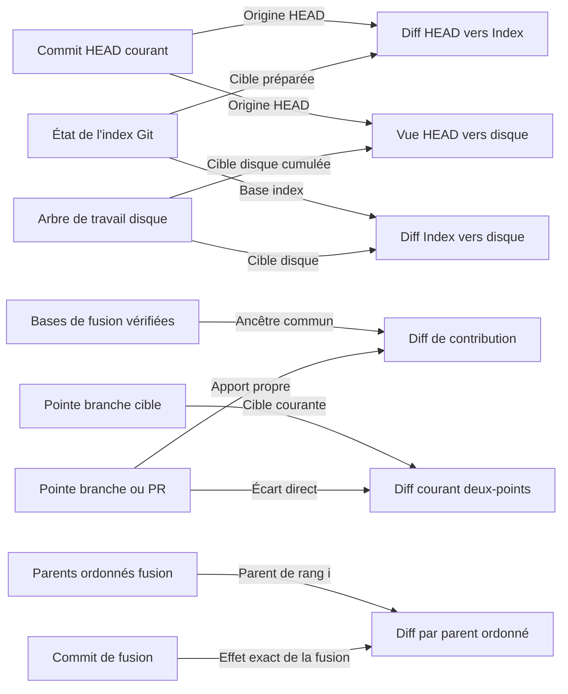

```mermaid
flowchart LR
  trg_fs["Surveillance fichiers"]
  trg_hook["Signal crochet Git"]
  trg_pr_poll["Synchro PR GitHub"]
  trg_reconcile["Réconciliation périodique"]
  que_coalesce["File bornée et époque"]
  obs_read["Lecture Git sans verrou"]
  chk_stable["État Git et index stables ?"]
  ret_objects["Rétention privée d'objets"]
  ext_analyze["Secrets, diffs et AST"]
  stg_batch["Lots préparés SQLite WAL"]
  pub_switch["Bascule de génération"]
  pub_pg_sync["Projection Postgres équipe"]
  rd_clients["Lecteurs /code-git"]

  trg_fs -->|Événements disque| que_coalesce
  trg_hook -->|Notification réf ou commit| que_coalesce
  trg_pr_poll -->|Métadonnées PR| que_coalesce
  trg_reconcile -->|Rattrapage borné| que_coalesce
  que_coalesce -->|Tâche élue| obs_read
  obs_read -->|Empreintes avant et après| chk_stable
  chk_stable -->|Non, replanifier sans écrire| que_coalesce
  chk_stable -->|Oui, capture cohérente| ret_objects
  ret_objects -->|Reçu de rétention valide| ext_analyze
  ext_analyze -->|Faits typés et état local scellé| stg_batch
  stg_batch -->|Lots complets validés| pub_switch
  pub_switch -->|Génération N+1 lisible| rd_clients
  pub_switch -->|Committé uniquement| pub_pg_sync
  pub_pg_sync -->|Vue équipe publiée| rd_clients
```

# Indexation Git continue — état livré, lecture et comparaison à l'outil de référence

**Date d'arrêté :** 15 novembre 2026 · **Temps de lecture :** ~4 min (synthèse, arbitrages et kit de réponse) / ~14 min (dossier complet, état lot par lot, comparaison et spécifications de schémas)
**Révisions auditées en lecture seule sur `origin/main` `[FAIT]` :** `engram` `f75543a5` · `h2a` `32a87af96` · `sentropic` `dc3082113`
**Statut décisionnel :** toutes les orientations d'architecture, de stockage, de confidentialité et de lecture sont **actées** (11/10, 12/10, 17/10, 18/10 et 15/11). **Aucune nouvelle question bloquante** n'est ouverte pour achever la mise en service.

---

## En bref — ce qu'il faut retenir en deux minutes

1. **Vos arbitrages sont enregistrés comme définitifs, sans réouverture `[FAIT]`.** Ce dossier consolide vos décisions du 11 octobre 2026 (sept arbitrages fondateurs et architecture cible sous qualification stockage), du 12 octobre 2026 (port générique de stockage dans `cluster-mesh` partagé avec les modules voisins), des 17–18 octobre 2026 (volet lecture natif au-dessus de Git, rejet du démon tiers `feder-cr/git-ai`, protocole de 20 investigations réelles piloté côté `engram`) et votre validation du 15 novembre 2026 (*« ok pour toutes les orientations préconisées »*).
2. **Où en est le produit aujourd'hui, finalité d'abord `[FAIT]`.** Le service d'indexation Git continue **n'est pas encore branché de bout en bout pour un utilisateur ou un agent** : l'entrée publique du paquet neutre (`engram-live/integration.ts:301-322`) répond encore explicitement `unavailable` (`delivered: false`), l'espace de noms `/code-git` et ses lecteurs de base de données ne sont pas encore ouverts dans `sentropic`, et l'hôte local `h2a` refuse par défaut toute émission tant que la composition finale n'est pas livrée (`packages/h2a-runtime/src/gateway-host/live-host.ts:12`). En revanche, **l'essentiel des fondations difficiles est déjà codé, testé hors-ligne et fusionné sur `main`** : moteur d'extraction Git en flux continu, rétention privée des objets, synchronisation complète des demandes de fusion GitHub, capture locale sans effet de bord, filtrage de secrets, analyse de code et comparaisons multi-bases, attribution de lignes, correspondance exacte de symboles, ordonnanceur temps réel, noyau générique SQLite/Postgres de `cluster-mesh`, déclarations d'espaces de travail sur les trois dépôts, garde cryptographique de divulgation aux modèles externes dans `h2a`, et oracles + harnais de mesure des 20 investigations.
3. **Ce que montre la comparaison avec l'outil de référence `[FAIT]` `[JUGEMENT]`.** L'outil de référence remplace Git par une base distribuée propriétaire pour servir un monorepo interne sans branches nommées et alimenter des agents de *bisect*, de *revert* et de résolution de conflits post-fusion — tout en concluant lui-même qu'il ne remplace pas Git pour un usage général. Notre système conserve Git comme source d'autorité universelle, le surpasse sur l'état local non committé, le multi-dépôts, la non-mutation garantie du clone et la protection des secrets/données privées, et reprend sous forme native les seules briques de lecture qui manquaient réellement (attribution de lignes, suivi de chemins et de symboles à travers renommages, liens vérifiés vers le « pourquoi » et contrôle de divulgation aux modèles externes).
4. **Tous les schémas sont remis au format Design System Focus `[FAIT]`.** Les quatre schémas du dossier du 11 octobre sont intégralement redéfinis sans coordonnées manuelles (modèles de conteneurs/composants `generic@1` ou graphes de flux `flowchart`), complétés d'un cinquième schéma comparatif face à l'outil de référence.

### Repères de vocabulaire (sans jargon implicite)

- **OID (identifiant d'objet Git) :** empreinte cryptographique (`SHA-1` ou `SHA-256`) identifiant de façon unique un commit, une arborescence (*tree*) ou un contenu de fichier (*blob*).
- **Graphe d'historique (DAG) :** graphe orienté sans cycle reliant chaque commit à la liste ordonnée de ses parents (un parent pour un commit linéaire, deux ou plus pour une fusion).
- **Index Git (*staging area*) et arbre de travail (*working tree*) :** respectivement les modifications préparées pour le prochain commit (`git add`) et les fichiers réellement présents sur le disque local.
- **Arbre syntaxique (AST) et grammaires WASM :** découpage déterministe du code source en symboles, appels et héritages via des analyseurs compilés en WebAssembly (`WASM`), sans recourir à Python ni à un modèle de langage (`LLM`).
- **SQLite WAL / FTS5 :** moteur de base locale en journal d'écriture anticipée (*Write-Ahead Logging*, permettant de lire pendant qu'un écrivain prépare un lot) et index de recherche plein texte intégré.
- **Bail d'écrivain (*lease* / *epoch fencing*) :** jeton numéroté garantissant qu'un collecteur ralenti ou redémarré ne peut jamais écraser les données publiées par une instance plus récente.
- **Protocole d'outils modèle (MCP) :** interface normalisée par laquelle un agent interroge des outils de lecture ; chez nous, sa lecture reste séparée du droit d'envoyer du contenu local à un fournisseur de modèle externe.

---

## 1. Demandes de l'owner et décisions définitivement actées

### 1.1 Verbatims de référence et traçabilité dans ce dossier

> **11 octobre 2026 — cadrage initial `[FAIT]` :**
> *« J'aimerais que tu réfléchisses à comment faire en sorte que l'indexation de git par engram fonctionne en live en permanence. [...] on veut indexer la totalité des branches en cours, les PR mergées, non mergées, etc. Je veux une architecture et une implémentation SOTA, qui n'aient pas d'effets de bord sur les opérations en cours dans les worktrees par les développeurs ou les agents. [...] Pas de LLM dans cette indexation du code et de git. [...] pas de dépendance à python. »*

> **11–12 octobre 2026 — arbitrage du premier dossier et mutualisation stockage `[FAIT]` :**
> *« Q1 A · Q2 B · Q3 A · Q4 A · Q5 A · Q6 A · Q7 A »*, validation de l'architecture cible sous qualification de stockage, puis précision du 12 octobre : le port générique de stockage vit dans `cluster-mesh` afin d'être réutilisé par les autres modules structurés (notamment les commentaires).

> **17–18 octobre 2026 — arbitrage du volet lecture et gardiennat de l'ontologie `[FAIT]` :**
> Adoption du service de requêtes en lecture seule au-dessus de Git dans la même trajectoire d'indexation continue, réalisation native (rejet de `feder-cr/git-ai`), protocole de 20 investigations réelles (seuil médian `≥ 30 %` à qualité constante ; exécution d'agents isolés reportée derrière un gain net additionnel `≥ 20 %`), baux explicites de divulgation aux modèles externes, et directive du 18 octobre : *« engram gardien de toutes les ontologies de dev »* (transfert du harnais de chronométrage des 20 cas de `h2a` vers `engram`).

> **15 novembre 2026 — demande de mise à jour du présent dossier `[FAIT]` :**
> *« ok le dossier git je suis ok pour toutes les orientation préconisées. J'aimerais qu'il soit remis au format design system (flowchart ou de composant lee cas échéant) mais ok. il manque la comparaison avec [nom retiré à ta demande] j'iamerais un update du dossier remis en forme en ce sens merci »*

| Exigence exprimée par l'owner | Où et comment ce dossier v5 y répond |
|---|---|
| Ne pas redemander ce qui a été tranché les 11/10, 17/10 et 15/11 | **Section 1.2** (registre complet des décisions closes) et **Section 5** (zéro question bloquante rouverte). |
| Donner l'état réel d'avancement, finalité d'abord, ancré dans le code | **Section 2.1** (bilan en langage courant de ce qui tourne vs manque) et **Section 2.2** (audit lot par lot avec `fichier:ligne`, `commit` et mentions `unverified`). |
| Ajouter la comparaison complète avec l'outil de référence (sans jamais citer son nom) | **Section 3** (présentation croisée, matrice fonction par fonction, écarts à combler vs écarts écartés) et **Schéma 5** en **Section 4.5**. |
| Remettre tous les schémas au format Design System (flowchart ou composants, zéro coordonnée manuelle) | **Section 4** : refonte des 4 schémas historiques + ajout du 5e schéma comparatif, avec tables exhaustives de conteneurs, nœuds et liens orientés pour le constructeur Focus. |
| Ne poser de question que s'il reste un vrai arbitrage owner, et fournir un kit de réponse | **Section 5** (constat motivé d'absence d'arbitrage bloquant + seuils conditionnels pré-cadrés) et **Section 6** (kit de réponse copiable). |

### 1.2 Registre des décisions actées (closes — appliquées par l'ingénierie)

Toutes les lignes ci-dessous ont valeur de consigne exécutoire `[FAIT]` (sources : réponses owner du 11/10, `spec/SPEC_LIVE_GIT_INDEXING.md:7-41` et `:358-397`, `plan/09-BRANCH_LIVE_GIT_INDEXING.md:39-69` et `:600-651`, validation du 15/11).

| Décision actée | Choix retenu en termes simples | Bénéfice pour l'owner | Garde-fou ou repli pré-accepté |
|---|---|---|---|
| **Architecture cible** *(Option D + stockage partagé `cluster-mesh`)* | `engram-live` produit des faits typés neutres sans base propre ; `cluster-mesh` porte le noyau de stockage, les moteurs réutilisables SQLite (local) et Postgres (serveur), l'adaptateur et les lecteurs `/code-git` ; `h2a` supervise localement ; `sentropic` injecte et opère Postgres. | Séparation nette entre extraction déterministe, stockage transactionnel réutilisable et supervision produit. | Repli pré-approuvé vers une base dédiée au module (*Option B*) **uniquement** si la qualification mesurée échoue sur les seuils fixés, sans redemander sauf violation d'une contrainte acceptée. |
| **Périmètre des dépôts surveillés** *(ex-Q1 → A)* | Activation uniquement sur **déclaration explicite** d'un espace de travail dans l'hôte (`h2a` ou `sentropic`), jamais par balayage silencieux du disque ni simple ouverture de session agent. | Aucune indexation surprise de dépôts personnels ou clients hors périmètre. | Désinscription atomique purgeant l'état privé local et révoquant les baux. |
| **Portée des demandes de fusion GitHub** *(ex-Q2 → B)* | Synchronisation automatique de **toutes** les demandes de fusion GitHub (ouvertes, brouillons, fusionnées, fermées sans fusion), avec pagination incrémentale et respect des quotas API. | Mémoire complète des revues, y compris les pistes abandonnées ou fusionnées par écrasement (*squash*). | La synchronisation des métadonnées reste séparée de l'acquisition privée des objets Git. |
| **Rétention après suppression de branche ou réécriture** *(ex-Q3 → A)* | **Rétention privée durable** de toutes les racines ingérées (espace d'objets séparé géré par l'hôte hors du clone utilisateur), sans modifier les références ni la purge naturelle (`git gc`) du développeur. | L'historique d'une PR fermée ou d'un `push --force` reste inspectable sans polluer le dépôt de travail. | Soumis au droit d'accès au dépôt et purgé lors de la révocation explicite du clone. |
| **Profondeur de l'analyse de code sur l'historique** *(ex-Q4 → A)* | Historique complet des commits/chemins sur tout le graphe, mais analyse syntaxique détaillée (symboles, appels) **sur les pointes actives et à la demande avec cache** pour les commits anciens. | Démarrage maîtrisé sur des dépôts de plus de 100 000 commits sans sacrifier l'inspection historique ponctuelle. | Tout résultat partiel ou hors grammaire est signalé comme couverture partielle, jamais comme absence de symbole. |
| **Contenu local non committé** *(ex-Q5 → A)* | Conservation **du seul dernier état stable** de l'index et de l'arbre de travail, chiffré au repos avec clé gérée par l'hôte et filtrage préalable des fichiers sensibles et motifs de secrets. | Diagnostic précis de l'encours local sans transformer l'indexeur en enregistreur permanent de frappes. | Écrasement immédiat des états locaux remplacés ; aucune archive d'états locaux intermédiaires. |
| **Visibilité multi-utilisateurs sur `sentropic`** *(ex-Q6 → A)* | **Seul l'historique committé et les PR** sont projetés dans Postgres pour l'application partagée ; l'index et l'arbre de travail restent strictement confinés au poste/hôte local. | Collaboration d'équipe sur le code partagé sans jamais exposer les brouillons locaux d'un développeur ou d'un agent. | Toute fuite de texte, symbole ou empreinte d'état privé vers Postgres fait échouer le test de publication. |
| **Mécanisme de détection locale** *(ex-Q7 → A)* | Surveillance du système de fichiers combinée à des **crochets Git optionnels de pur signal** installés par commande explicite, bornés, non bloquants et chaînant les crochets existants. | Fraîcheur quasi immédiate après `commit`, `checkout`, `merge` ou `rewrite`, sans casser les outils existants. | Repli vers la surveillance fichiers seule (*B*) si un environnement interdit l'installation de crochets, et fonctionnement dégradé sûr sans crochets. |
| **Service de lecture au-dessus de Git** *(arbitrages 17/10 & 18/10)* | Service de requêtes en **lecture seule** intégré nativement à la branche d'indexation continue (rejet de `feder-cr/git-ai`) : attribution de lignes, historique de chemins et de symboles à travers renommages et tous parents, liens vérifiés vers PR/sessions/mémoires admises, et garde de divulgation aux modèles externes. | Donne aux agents et aux humains les primitives d'investigation qui font la valeur de l'outil de référence, sans dupliquer de moteur ni muter Git. | Validation conditionnée à une réduction médiane `≥ 30 %` du temps d'investigation sur 20 cas réels à qualité constante ; harnais porté par `engram`. |
| **Divulgation aux modèles externes** *(arbitrage 17/10 — G4)* | **Refus par défaut** d'envoyer du contenu local non publié ou ses dérivés à un fournisseur de modèle externe ; ouverture uniquement par bail explicite `dépôt × fournisseur × portée × durée`, révocable immédiatement. | Autoriser l'indexation locale ou la lecture MCP n'équivaut jamais à envoyer du code privé vers une API externe. | Un bail modèle n'élargit jamais la publication produit Postgres (`Q6 → A`) et ne lève jamais l'exclusion des secrets. |
| **Orchestration d'agents d'exécution isolés** *(arbitrage 17/10)* | **Hors périmètre actuel** : aucun lot d'exécution d'agents (clones éphémères de *bisect*, *revert* ou résolution automatique de conflits) n'est engagé avant la mesure du service lecture. | Évite de construire une usine d'orchestration coûteuse tant que le gain de la lecture seule n'est pas mesuré. | Réouverture possible uniquement en pilote séparé si un gain net additionnel `≥ 20 %` (coûts de copie/vérification/nettoyage inclus) est démontré. |

---

## 2. État actuel au 15 novembre 2026 — finalité d'abord, puis détail lot par lot

### 2.1 Finalité d'abord : qu'est-ce qui fonctionne aujourd'hui et que reste-t-il à raccorder ?

En termes simples, **les moteurs sont construits et vérifiés isolément sur `main`, mais le câblage final qui allume le service de bout en bout n'est pas encore assemblé** `[FAIT]`.

#### Ce qui n'est pas encore actif pour un utilisateur final ou un agent aujourd'hui `[FAIT]`

1. **La porte d'entrée publique du paquet neutre est encore verrouillée en attente d'assemblage :** dans `engram`, `createLiveFactory()` vérifie la déclaration d'espace de travail et le manifeste de grammaires WASM, mais `describeCapabilities()` et `runCapability()` renvoient encore `state: "unavailable"` et `delivered: false` (`engram:engram-live/integration.ts:301-322`, commit `f75543a5`). L'adaptateur d'analyse syntaxique de production destiné au paquet neutre (`engram-live/parse-adapter.ts`) reste à livrer avant la publication du paquet `@sentropic/engram-live`.
2. **La couche de lecture `/code-git` n'est pas encore branchée dans `cluster-mesh` et `sentropic` :** l'espace de noms `/code-git` ne figure pas encore dans la liste fermée `CLUSTER_MESH_NAMESPACES` (`sentropic:packages/contracts/src/cluster-mesh-namespace.ts:3-33`, commit `dc3082113`) ; le catalogue des fournisseurs de `cluster-mesh` référence le paquet mémoire historique `@sentropic/engram`, pas encore `@sentropic/engram-live` (`sentropic:packages/cluster-mesh/src/modules/catalog.ts:17-18`) ; l'adaptateur de stockage `packages/cluster-mesh/src/live/*`, les lecteurs typés `live-storage/readers.ts` et les routes applicatives `api/src/routes/namespaces/code-git.ts` restent à écrire.
3. **Le démon hôte `h2a` bloque volontairement toute émission tant que la politique complète n'est pas câblée :** `h2a` épingle encore `@sentropic/cluster-mesh` en `0.25.0` (`h2a:packages/h2a-runtime/package.json:27`, commit `32a87af96`), embarque temporairement une copie partielle de contrats sous `src/vendor/engram-live/`, refuse l'autorité locale non vérifiée (`h2a:packages/h2a-runtime/src/gateway-host/live-registration.ts:305`) et maintient `createLiveDisclosureHost().emit()` en refus fermé `policy-unavailable` (`h2a:packages/h2a-runtime/src/gateway-host/live-host.ts:7-14`).
4. **Les qualifications de bout en bout restent `unverified` :** ni la qualification de charge stockage sur le corpus de 101 502 commits, ni les budgets installés (latence `< 2 s` au repos chaud, mémoire, CPU), ni le gain médian sur les 20 investigations réelles n'ont encore pu être mesurés sur la chaîne complète (`engram:docs/evidence/live-git-qualification.md:1-15` consigne explicitement `not measurable: native readers absent` -> `unverified`).

#### Ce qui est déjà construit, testé et fusionné sur `main` dans les trois dépôts `[FAIT]`

1. **Toute l'algorithmique d'observation Git, de sécurité locale et d'analyse incrémentale dans `engram` :**
   - exécution code/Git sans modèle de langage ni Python, et empaquetage neutre zéro dépendance `@sentropic/engram-live` (`engram:engram-live/package.json:1-34`, `scripts/check-live-package.mjs:136`) ;
   - crochets Git optionnels de pur signal bornés à 2 secondes, sans `npx` et avec puits hors du clone (`engram:src/hooks.ts:406-418`, `:697-973`) ;
   - lecture Git en flux continu (`git log` / `git cat-file --batch`) supprimant l'ancien plafond implicite de 200 commits (`engram:engram-live/git-stream.ts:501`, `src/extract-git.ts:1279`) et complétion incrémentale du graphe complet des commits et références (`engram:engram-live/history.ts:268`) ;
   - capture de l'index et de l'arbre de travail garantie sans écriture ni verrou dans `.git` (`--no-optional-locks`, vérification de stabilité avant/après lecture : `engram:engram-live/git-executor.ts:272`, `engram:engram-live/worktree.ts:302`), calcul de différences locales, filtrage des chemins sensibles et motifs de secrets, et préparation d'instantanés locaux scellés (`engram:engram-live/diffs.ts:255`, `content-policy.ts:92-248`, `snapshots.ts:595`) ;
   - analyse de code versionnée, comparaisons de branches multi-bases (`merge-base --all`) et par parent ordonné de fusion (`engram:engram-live/code-analysis.ts:490`, `comparisons.ts:347`), ordonnanceur borné à jetons de clôture et réconciliateur de couverture (`engram:engram-live/scheduler.ts:86`, `reconcile.ts:95`, `coverage.ts:133`).
2. **Les briques productrices du volet lecture et le dispositif de mesure des 20 cas :**
   - attribution exacte des lignes d'un fichier à un commit ancré avec suivi des mouvements/copies intra- et inter-fichiers (`engram:engram-live/line-attribution.ts:152`) ;
   - correspondance déterministe des symboles entre deux révisions par égalité d'empreinte SHA-256 du corps syntaxique, distinguant renommage, déplacement, copie ambiguë et absence (`engram:engram-live/symbol-history.ts:50`) ;
   - manifeste figé des 20 investigations réelles (53 contrôles Git natifs indépendants) et harnais de chronométrage contrebalancé (`engram:tests/fixtures/live-read-side-cases.json:1-20`, `tests/live-read-side-oracles.test.ts`, `scripts/bench-live.mjs`).
3. **Le noyau générique de stockage partagé dans `sentropic` et les briques transverses multi-dépôts :**
   - noyau transactionnel générique avec clôture d'époque, visibilité par portée et moteurs réutilisables SQLite (`>= 3.51.3`) et Postgres installés dans `cluster-mesh` (`sentropic:packages/cluster-mesh/src/storage/kernel.ts:80`, `sqlite/engine.ts:11-151`, `sqlite/backend.ts:88`, `postgres/core.ts:253`, `postgres/installed.ts:14-138`) ;
   - cycle complet de déclaration explicite et d'identité canonique des clones/arbres de travail sur **les trois dépôts** (`engram:engram-live/registration.ts:155-421`, `h2a:packages/h2a-runtime/src/gateway-host/live-registration.ts:93-150` et `live-declarations.ts:366`, `sentropic:packages/cluster-mesh/src/live-storage/registration.ts:10-85`, `api/src/services/cluster-mesh/live-declarations.ts:74`, migration `api/drizzle/control/0010_live_git_declarations.sql:1`) ;
   - rétention privée des objets Git hors clone utilisateur dans `engram` et `h2a` (`engram:engram-live/retention.ts:167`, `h2a:packages/h2a-runtime/src/gateway-host/live-object-store.ts:93`) ;
   - synchronisation paginée de toutes les PR GitHub et attribution de stratégie de fusion dans `engram` et `h2a` (`engram:engram-live/pr-sync.ts:332`, `pr-attribution.ts:43-149`, `h2a:packages/h2a-runtime/src/gateway-host/live-github.ts:208`) ;
   - autorité cryptographique et baux révocables de divulgation aux modèles externes dans `h2a` (`h2a:packages/h2a-runtime/src/gateway-host/live-auth.ts:80`, `live-disclosure.ts:142`).

### 2.2 État détaillé lot par lot (plan d'exécution sur `origin/main`)

Chaque ligne ci-dessous traduit la finalité métier du lot avant de citer son code interne dans `plan/09-BRANCH_LIVE_GIT_INDEXING.md` `[FAIT]`. Tout élément non encore exécuté en conditions réelles est marqué `unverified`.

| Lot (nom clair et code `plan/09`) | Finalité concrète | Statut au 15/11 | Preuves vérifiées sur `origin/main` (`dépôt:chemin:ligne`, `commit`) | Reste à livrer / statut `unverified` |
|---|---|---|---|---|
| **Spécification et contrat stockage** (`S0`) | Figer les règles d'architecture, de confidentialité, du noyau de stockage partagé et du volet lecture. | **Livré sur `main`** | `engram:spec/SPEC_LIVE_GIT_INDEXING.md:7-425`, `engram:plan/09-BRANCH_LIVE_GIT_INDEXING.md:1-668` (`b27e8532`, amendé jusqu'à `f75543a5` ; contrat stockage v4.1 `bb51d3b2`). | Complet sur le plan documentaire ; toutes les portes d'exécution aval restent vérifiées dans leurs lots respectifs. |
| **Corpus Git de qualification et oracles** (`L0`) | Disposer d'un banc d'essai reproductible (SHA-1/SHA-256, `files`/`reftable`, sous-modules, conflits, renommages, corpus synthétique de 100 001 commits + PR de 1 501 commits). | **Livré sur `main`** | `engram:tests/helpers/live-git-fixtures.ts:21-521`, `tests/helpers/live-process-trace.ts`, `tests/live-fixtures.test.ts` (`d4a4f1c6`). | Complet pour les tests producteurs ; réutilisé plus tard lors des qualifications stockage et hôte (`unverified` bout en bout). |
| **Exécution code/Git sans modèle de langage** (`L1a`) | Garantir que la construction et la surveillance code/Git tournent à 100 % sans appel LLM ni clé API, en préservant les annotations documentaires existantes. | **Livré sur `main`** | `engram:src/watch.ts:167`, `:834`, `:904`, `engram:src/pipeline.ts:138`, `tests/live-no-llm.test.ts` (`1675d380`, `6d010ea8`). | Complet. |
| **Paquet neutre `@sentropic/engram-live` sans Python** (`L1b`) | Empaqueter le producteur sous forme de bibliothèque TypeScript/WASM autonome (Node 20/22/24 Linux, zéro dépendance runtime, zéro Python). | **Livré sur `main`** *(publication différée)* | `engram:engram-live/package.json:1-34`, `engram-live/integration.ts:266`, `engram-live/contracts.ts:10-70`, `scripts/check-live-package.mjs:136`, `tests/live-package.test.ts`, `tests/live-neutrality.test.ts` (`8d331ed4`..`b6f73641`). | Publication de la version `R-E` différée jusqu'à la livraison de l'adaptateur d'analyse syntaxique (`L5-P`) et des raccords de clôture stockage (`unverified` en paquet publié). |
| **Crochets Git optionnels de pur signal** (`H0`) | Notifier instantanément les opérations Git (`post-commit`, `post-merge`, `post-checkout`, `post-rewrite`, `reference-transaction`) en `< 2 s`, sans `npx` et sans bloquer Git. | **Livré sur `main`** | `engram:src/hooks.ts:406-456`, `:697-973`, `tests/hooks.test.ts` (`2db13238`, fusion `976b1194`). | Complet côté `engram` ; consommation en démon supervisé à raccorder dans `h2a` (`L7a`, `unverified` en démon installé). |
| **Lecture Git native en flux continu** (`L2a`) | Extraire l'historique Git en flux paginé sans charger tout le dépôt en mémoire et supprimer l'ancien plafond de 200 commits. | **Livré sur `main`** | `engram:engram-live/git-stream.ts:74-501`, `engram-live/git-protocol.ts`, `src/extract-git.ts:1257-1279`, `tests/live-git-stream.test.ts` (`3e0b70e4`, `00fa55f1`). | Complet. |
| **Graphe complet des racines et reprise par OID** (`L2b`) | Parcourir toutes les références locales/distantes, conserver l'ordre exact des parents de fusion et ne traiter que les nouveaux OID depuis le dernier point de reprise. | **Livré sur `main`** | `engram:engram-live/history.ts:268`, `:475-522`, `engram-live/refs.ts`, `engram-live/repository.ts`, `tests/live-history.test.ts` (`b9290072`, fusion `691fd320`). | Complet côté producteur. |
| **Noyau générique de stockage et adaptateur `engram-live`** (`L3a`) | Séparer le noyau transactionnel générique de `cluster-mesh` (réutilisable par d'autres modules) de l'adaptateur spécifique aux tables Git/code d'`engram-live`, puis qualifier la charge à 100k commits. | **Partiel sur `main`** *(noyau livré, adaptateur à construire)* | **Livré :** noyau `sentropic:packages/cluster-mesh/src/storage/kernel.ts:80` et lots `staged-*.ts` (`a2feebbfa`). **Absent :** `packages/cluster-mesh/src/live/*` (aucun fichier sur `origin/main`). | Écrire l'adaptateur `packages/cluster-mesh/src/live/{index,adapter,descriptor,codecs,declarations,sqlite,postgres,readers,private-lifecycle,protected-payload,transfer}.ts` et exécuter la qualification `Q` sur 100k commits + 1 501 PR (`unverified`). |
| **Moteur SQLite durable partagé et migrations locales** (`L3b-S`) | Fournir le moteur SQLite local (`WAL`, `FTS5`, SQLite `>= 3.51.3`, reprise après crash) dans `cluster-mesh` et la compaction des marqueurs de progression. | **Partiel sur `main`** *(moteur générique livré, intégration `live` restante)* | **Livré :** `sentropic:packages/cluster-mesh/src/storage/sqlite/engine.ts:11-151` (`4026562ae`), `sqlite/backend.ts:88` (`b269fa8f7`), `tests/storage/sqlite-*.spec.ts`. | Raccorder les tables `live`, le stockage scellé d'état local (`L4b`), les reçus de rétention (`R1`) et la compaction des marqueurs de progression (`m12`, `unverified`). |
| **Moteur Postgres partagé et schéma applicatif `sentropic`** (`L3b-P`) | Fournir le moteur Postgres réutilisable dans `cluster-mesh` et câbler les migrations/pools Drizzle dans l'application `sentropic`. | **Partiel sur `main`** *(moteur générique livré, câblage app restant)* | **Livré :** `sentropic:packages/cluster-mesh/src/storage/postgres/core.ts:253` (`4cc5fc41d`), `postgres/installed.ts:14-138` (`0f10b6c92`). **Absent :** `api/src/services/cluster-mesh/postgres-live-store.ts`, `api/src/db/live-git-schema.ts`. | Créer le schéma Drizzle `live_git` côté `api/` et injecter le client Postgres applicatif dans le module `cluster-mesh` (`unverified`). |
| **Rétention privée de toutes les racines ingérées** (`R1`) | Conserver hors du clone utilisateur tous les objets Git observés (PR fermées, branches supprimées, `push --force`) pour éviter toute perte au `git gc`. | **Livré sur `main`** *(raccord reçus SQLite restant)* | `engram:engram-live/retention.ts:114-167`, `tests/live-retention.test.ts` (`96fb6687`) ; `h2a:packages/h2a-runtime/src/gateway-host/live-object-store.ts:93`, `live-object-store.test.ts` (`85b6996a0`). | Relier les reçus de rétention de `live-object-store.ts` au stockage durable `L3b-S` et au démon `L7a` (`unverified` en cycle complet de restauration). |
| **Synchronisation automatique de toutes les PR GitHub** (`P1`) | Importer et tenir à jour toutes les PR GitHub (ouvertes, brouillons, fusionnées, fermées), gérer les quotas/ETag et relier commits d'écrasement (*squash*) ou de rebasage. | **Partiel sur `main`** *(producteur `engram` et transport `h2a` livrés ; projection `cluster-mesh` restante)* | `engram:engram-live/pr-sync.ts:332`, `engram-live/pr-attribution.ts:43-149` (`29a6bd97`) ; `h2a:packages/h2a-runtime/src/gateway-host/live-github.ts:208` (`1ae884a33`). | Ajouter le mappage persistant des PR dans l'adaptateur `cluster-mesh` (`L3a`) et les lecteurs de liste/détail/chevauchement (`L7b-R`, `unverified`). |
| **Capture sans effet de bord de l'index et de l'arbre de travail** (`L4a`) | Lire l'état mis en scène (index), les fichiers modifiés/non suivis et `.gitattributes` sans jamais créer de `.git/index.lock` ni modifier le statut Git d'un développeur ou d'un agent. | **Livré sur `main`** | `engram:engram-live/git-executor.ts:272`, `engram-live/worktree.ts:302`, `engram-live/attributes.ts`, `engram-live/filesystem.ts`, `tests/live-worktree-safety.test.ts` (`ee1fa131`, fusion `d25104a7`). | Complet côté producteur. |
| **Différences locales séparées, exclusion des secrets et chiffrement du dernier état** (`L4b` + `L4b-2`) | Calculer séparément `HEAD -> index` et `index -> arbre de travail`, exclure `.env`/clés/secrets avant indexation et chiffrer uniquement le dernier état local stable. | **Partiel sur `main`** *(producteur `engram` livré ; coffre `cluster-mesh` et fournisseur de clés `h2a` restants)* | **Livré :** `engram:engram-live/diffs.ts:255`, `content-policy.ts:92-248`, `snapshots.ts:595-1005`, `tests/live-diffs.test.ts`, `tests/live-content-policy.test.ts` (`8356cf06`, `b44b2fce`). | Construire `sentropic:packages/cluster-mesh/src/live-storage/protected-payload.ts` et `h2a:packages/h2a-runtime/src/gateway-host/live-key-provider.ts`, puis vérifier l'absence de clair dans la base et le fichier WAL (`unverified`). |
| **Analyse de code versionnée, comparaisons de branches et attribution de lignes** (`L5` + amendement `Δ-L5/G1`) | Extraire symboles/appels/héritages par blob Git, calculer les comparaisons exactes multi-bases et par parent de fusion, et attribuer toute plage de lignes à son commit d'origine. | **Partiel sur `main`** *(producteurs `engram` livrés ; exposition lecteurs `cluster-mesh` restante)* | `engram:engram-live/code-analysis.ts:490`, `comparisons.ts:347`, `analysis-cache.ts` (`a1cfdc33`, `5ca9cfb4`) ; attribution de lignes `engram:engram-live/line-attribution.ts:152`, `tests/live-line-attribution.test.ts` (`c15df927`..`ae35d264`). | Finaliser `L5-P` (adaptateur WASM empaqueté) et exposer les résultats dans les lecteurs `/code-git` de `cluster-mesh` (`L7b-R`, `unverified`). |
| **Adaptateur d'analyse syntaxique empaqueté et activation de la fabrique neutre** (`L5-P`) | Brancher les grammaires Tree-sitter WASM signées dans `@sentropic/engram-live`, lever l'état `unavailable` de `integration.ts` et fermer les gardes d'ordonnancement restantes (`m8`/`m14`). | **À construire** | `engram:engram-live/integration.ts:301-322` retourne encore `delivered: false` ; `engram-live/parse-adapter.ts` absent sur `origin/main`. | Lot charnière côté `engram` qui débloque la publication du paquet neutre (`R-E`) (`unverified`). |
| **Déclarations explicites d'espaces de travail et identité des clones** (`L6a`) | Enregistrer, réviser et révoquer explicitement les clones/arbres de travail autorisés, avec identité canonique résistante aux déplacements et refus par défaut hors déclaration. | **Livré sur `main`** *(sur les 3 dépôts)* | `engram:engram-live/registration.ts:155-470` (`42620409`) ; `h2a:packages/h2a-runtime/src/gateway-host/live-registration.ts:93-380`, `live-declarations.ts:366` (`f81c054d9`..`f23fd6591`) ; `sentropic:packages/cluster-mesh/src/live-storage/registration.ts:10-85`, `api/src/services/cluster-mesh/live-declarations.ts:74`, `api/src/routes/namespaces/code-git-ports.ts:43`, `0010_live_git_declarations.sql:1` (`fb8576d4d`, `cf6c1f060`, `6a2a890e4`). | L'autorité locale `h2a` reste en refus fermé tant que `L7a` n'y branche pas le principal cryptographique vérifié. |
| **Ordonnanceur, surveillance fichiers et réconciliation de couverture** (`L6b`) | Coordonner événements fichiers, signaux de crochets et rattrapage d'historique avec files bornées, priorité à l'interactif et jetons de clôture d'époque. | **Livré sur `main`** | `engram:engram-live/scheduler.ts:86`, `engram-live/watch.ts:120-366`, `engram-live/reconcile.ts:95`, `engram-live/coverage.ts:133-427`, `tests/live-reconcile.test.ts`, `tests/live-scheduler-budget.test.ts` (`55bd0a22`). | Deux raccords de bout en bout sont explicitement portés par `L5-P` (`m8`/`m14`) et `L3b-S` (`m12`, compaction des marqueurs). |
| **Contrat d'espace de noms `/code-git`** (`L7b-C`) | Ouvrir officiellement `/code-git` dans `@sentropic/contracts` avec négociation explicite de compatibilité `N / N-1` (sans polluer l'espace mémoire `/engram`). | **À construire** | `sentropic:packages/contracts/src/cluster-mesh-namespace.ts:3-33` ne contient pas encore `'/code-git'`. | Ajouter `/code-git` et publier la version contrats `R-C` après `R-E` (`unverified`). |
| **Lecteurs typés `/code-git`, historique chemins/symboles et liens vers les raisons** (`L7b-R` + amendements `G2` et `G3`) | Exposer les requêtes paginées d'historique, PR, diffs, résolution inter-dépôts prudente, suivi de chemins/symboles (`G2`) et chaîne `ligne -> commit/PR -> décision/mémoire admise` (`G3`). | **Partiel sur `main`** *(producteur `G2` livré dans `engram` ; tous les lecteurs `cluster-mesh` et références `h2a` à construire)* | **Livré :** producteur de correspondance de symboles `engram:engram-live/symbol-history.ts:50`, `tests/live-symbol-history.test.ts` (`5f31cee0` ; `G5` co-changement volontairement non implémenté avant mesure). **Absent :** `sentropic:packages/cluster-mesh/src/live-storage/{readers,cross-repository,reasons}.ts`, `hono/code-git-router.ts`, `h2a:.../live-reason-references.ts`. | Construire les lecteurs typés dans `cluster-mesh` (y compris `G1`, `G2`, `G3`) et le pont de références de session dans `h2a` (`unverified`). |
| **Catalogue du pair neutre et publication `cluster-mesh`** (`L7b-D`) | Déclarer `@sentropic/engram-live` comme pair optionnel vérifié de `cluster-mesh` (chargement paresseux, sans dépendance à la racine d'`engram`) et publier `R-S`. | **À construire** | `sentropic:packages/cluster-mesh/src/modules/catalog.ts:17-18` ne déclare encore que `@sentropic/engram` ; `loaders/engram-live.ts` absent. | Livrable après `R-E`, `R-C` et `L7b-R` (`unverified`). |
| **Autorité locale vérifiée, supervision `h2a` et garde de divulgation** (`L7a` + amendement `Δ-L7a/G4`) | Vérifier cryptographiquement le principal local `h2a`, assembler le démon superviseur autonome et bloquer toute émission non autorisée vers un modèle externe (`G4`). | **Partiel sur `main`** *(brique `G4` livrée dans `h2a` ; composition démon et épingle de version restantes)* | **Livré (`G4`) :** `h2a:packages/h2a-runtime/src/gateway-host/live-auth.ts:80`, `live-disclosure.ts:142`, `live-host.ts:7` (`d7788b7db`..`56f9b6d47`). **En attente :** composition complète du démon `daemon.ts`/`host.ts` et remplacement de l'épingle `@sentropic/cluster-mesh: 0.25.0` (`package.json:27`). | Assembler le collecteur complet sous supervision `h2a`, retirer `src/vendor/engram-live/` au profit de `R-H` et vérifier l'exploitation sans client connecté (`unverified`). |
| **Publication Postgres `sentropic`, bascule, sauvegarde et garde `G4` serveur** (`L8` + amendement `Δ-L8/G4`) | Projeter dans Postgres uniquement l'historique committé et les PR (`Q6 A`), orchestrer la sauvegarde/restauration coordonnée et appliquer la garde de divulgation aux modèles côté serveur. | **À construire** *(seul le port d'autorisation `L6a` existe)* | `sentropic:api/src/routes/namespaces/code-git-ports.ts:43` est livré ; `code-git.ts`, `code-git-cutover.ts`, `live-publication.ts`, `live-backup.ts` et `live-disclosure.ts` sont absents. | Construire les routes, la publication idempotente, la restauration coordonnée et les tests anti-fuite Postgres (`unverified`). |
| **Compatibilité producteur et intégrité intégrale du clone** (`L9-E`) | Prouver sur un cycle complet que le producteur ne modifie aucun fichier suivi, non suivi, ignoré, `.gitattributes` ni configuration Git, et préserve les corpus annotés. | **À construire** | Garde de processus présente (`engram:tests/helpers/live-process-trace.ts`) ; `tests/live-producer-compatibility.test.ts` et `tests/live-artifact-boundary.test.ts` non créés. | À exécuter dès que `L5-P` active la fabrique publique (`unverified`). |
| **Parité fonctionnelle typée des lecteurs** (`L9-S`) | Vérifier sur vrais moteurs SQLite/Postgres que `/code-git` couvre toute la matrice fonctionnelle attendue et la compatibilité `N / N-1`. | **À construire** | `sentropic:packages/cluster-mesh/tests/live-functional-parity.spec.ts` absent. | Dépend de `L7b-R` et `L7a` (`unverified`). |
| **Budgets installés de bout en bout et protocole des 20 investigations réelles** (`L9-H` + amendement `Δ-L9-S/L9-H`) | Mesurer les latences/ressources du système installé (`< 2 s` au repos chaud) et chronométrer les 20 investigations réelles (`T1` contre `T0`, seuil médian `≥ 30 %`). | **Partiel sur `main`** *(oracles et harnais des 20 cas livrés dans `engram` ; exécution bout en bout restante)* | **Livré (`engram`) :** `tests/fixtures/live-read-side-cases.json:1-20`, `tests/live-read-side-oracles.test.ts` (`c309e95e`) ; `scripts/bench-live.mjs`, `tests/live-read-side-timing.test.ts`, `docs/evidence/live-git-qualification.md:1-115` (`f5d58342`, transfert `H -> E` du 18/10). **Absent :** `h2a:.../live-slo.test.ts`, `sentropic:.../live-read-side.spec.ts`. | Exécuter le banc SLO installé et le protocole contrebalancé des 20 cas dès livraison des lecteurs natifs ; tous les gains et SLO restent aujourd'hui `unverified`. |

### 2.3 Séquence critique restante jusqu'à la mise en service

L'ordre le plus court pour allumer le service sans dette cachée tient en six étapes en langage clair `[JUGEMENT]` :

1. **Activer la fabrique publique du paquet neutre côté `engram` :** brancher l'adaptateur d'analyse syntaxique WASM de production dans `@sentropic/engram-live` pour passer `integration.ts` de `unavailable` à `available`, vérifier l'intégrité du clone observé et publier le paquet neutre.
2. **Livrer l'adaptateur Git continu et le coffre d'état local dans `cluster-mesh`, puis qualifier les 100 000 commits :** connecter les structures d'`engram-live` au noyau générique `storage/kernel.ts` déjà présent sur `main`.
3. **Ouvrir l'espace de noms `/code-git` et ses lecteurs typés dans `cluster-mesh` :** rendre enfin interrogeables l'historique, les demandes de fusion, les différences locales, l'attribution de lignes, les correspondances de symboles et les liens vérifiés vers les raisons, puis enregistrer `@sentropic/engram-live` dans le catalogue des fournisseurs.
4. **Assembler le démon supervisé dans `h2a` :** brancher le fournisseur de clés locales et l'autorité locale vérifiée pour lever le refus par défaut de `live-host.ts` et remplacer les copies temporaires `vendor/` par les paquets publiés.
5. **Ouvrir la projection Postgres committée et la garde serveur dans `sentropic` :** activer la vue d'équipe sur l'historique partagé et les PR sans exposer aucun état local privé, avec sauvegarde/restauration coordonnée.
6. **Exécuter la double réception finale :** vérifier les budgets de performance du système installé (`< 2 s` au repos chaud) et chronométrer le protocole des 20 investigations réelles pour vérifier le gain médian `≥ 30 %` à qualité constante.

---

## 3. Comparaison avec l'outil de référence

**Sources de cette section `[FAIT]` :** l'ensemble des faits relatifs à l'outil de référence provient exclusivement de *« étude de l'outil de référence (v2) »*, de *« analyse de l'écart côté lecture »*, de l'article public d'ingénierie *Redesigning source control* publié par l'éditeur de l'outil de référence le 13 octobre 2026 (mis à jour le 15 octobre 2026) et de l'inspection directe du dépôt public tiers `feder-cr/git-ai` (v0.1.0, licence MIT, dérivé de Gitaly) citée dans *« analyse de l'écart côté lecture »*.

> **Distinction préalable indispensable entre trois systèmes différents `[FAIT]` :**
> 1. **L'outil de référence** proprement dit est le système interne de gestion de versions décrit dans *Redesigning source control* (octobre 2026). C'est lui qui est comparé ci-dessous.
> 2. **Un projet open source homonyme sous licence Apache-2.0** (publié dans l'écosystème cloud public) est un orchestrateur d'agents conteneurisés avec courtier d'identifiants, sans rapport avec le système interne de gestion de versions. Il ne concerne que l'éventuel futur chantier d'exécution d'agents isolés, hors du périmètre actuel.
> 3. **`feder-cr/git-ai` (v0.1.0, MIT)** est un démon Go/gRPC tiers dérivé de Gitaly qui tente de transposer certaines idées de l'outil de référence au-dessus de Git. Audité le 17 octobre 2026 dans *« analyse de l'écart côté lecture »*, il a été écarté au profit de notre réalisation native (raisons détaillées en §3.4).

### 3.1 Ce que fait l'outil de référence vs ce que fait notre indexation Git continue

- **Ce que fait l'outil de référence `[FAIT]` :** pour servir une organisation travaillant dans un monorepo interne massif où des milliers d'agents et d'ingénieurs poussent en continu, son éditeur a **remplacé Git comme source d'autorité** par un service interne appuyé sur Google Cloud Spanner, un stockage d'objets, des caches et des matérialisations partielles à la demande. Les opérations de contrôle de version passent par API ; le service calcule des données dérivées indexées par les parents de chaque changement (attribution de lignes, historique de chemins, ascendance) afin que des agents automatisent la recherche de régression (*bisect*) et l'annulation (*revert*) ; il applique des listes de contrôle d'accès par répertoire, intègre son propre outil de revue, décourage les branches nommées et supprime le verrou global de file de fusion (*merge queue*) au profit de tests post-fusion/pré-déploiement où des agents réparent les conflits après coup. Point décisif : l'article public conclut explicitement que ce système **n'est en aucun cas un remplaçant adapté de Git pour un usage général** (*« is by no means a suitable replacement for git for general use »*) et recommande d'en transposer les idées dans l'écosystème Git existant.
- **Ce que fait notre indexation Git continue `[FAIT]` :** nous **conservons Git comme unique source d'autorité** sur les dépôts standard des développeurs et de GitHub, sur un parc multi-dépôts ordinaire (Linux, postes locaux et serveur `sentropic`, sans Spanner). Un collecteur déterministe sans modèle de langage ni Python (`@sentropic/engram-live`) observe en flux continu tout le graphe des commits, les PR GitHub de tous états, les objets privés retenus hors du clone avant purge ainsi que l'état local non committé (`HEAD`, index et arbre de travail séparés, sans jamais muter ni verrouiller `.git`), projette ces faits typés dans le stockage partagé `cluster-mesh` (SQLite local chiffré pour le privé, Postgres serveur limité au committé), les expose en lecture via `/code-git` et les relie par citations vérifiables aux sessions `h2a` et aux mémoires/décisions admises d'`engram`, sous une garde explicite de divulgation aux modèles externes.

### 3.2 Comparaison fonction par fonction

Légende des verdicts `[JUGEMENT]` appuyés sur les faits cités `[FAIT]` :
- **Égal :** capacité équivalente en finalité une fois les lots en cours raccordés.
- **Meilleur chez nous :** couverture plus riche, plus sûre ou plus adaptée au travail réel sur Git.
- **Manquant (en cours de comblement) :** écart identifié grâce à l'outil de référence, intégré au plan le 17/10 et partiellement ou prochainement livré.
- **Délibérément différent :** choix inverse assumé car le modèle de l'outil de référence contredirait l'usage Git général, la confidentialité ou la sobriété d'infrastructure.

| Fonction | L'outil de référence `[FAIT]` | Notre indexation Git continue `[FAIT]` | Verdict `[JUGEMENT]` | Justification et ancrage |
|---|---|---|---|---|
| **Autorité de version et compatibilité écosystème** | Base distribuée interne (Spanner + stockage d'objets) remplaçant Git ; API propriétaire incompatible avec les outils Git standard. | **Git reste la seule autorité** (`SHA-1` et `SHA-256`, `files` et `reftable`) ; `engram-live` et `cluster-mesh` sont une projection dérivée reconstructible. | **Délibérément différent** *(avantage décisif pour notre usage)* | L'éditeur de l'outil de référence reconnaît lui-même qu'il ne remplace pas Git en usage général (*Redesigning source control*). Garder Git préserve `git`, les IDE, GitHub et les flux clients. |
| **Topologie des dépôts (monorepo vs multi-dépôts)** | Conçu autour d'un monorepo interne centralisé avec contrôle d'accès par sous-répertoire. | Natif **multi-dépôts et multi-arbres de travail**, avec identité canonique de clone (`registration.ts`) et résolution inter-dépôts bornée et prudente. | **Meilleur chez nous** | Nos projets réels (`engram`, `h2a`, `sentropic` et dépôts opérés) sont multi-dépôts ; l'ambiguïté inter-dépôts reste explicite plutôt que masquée. |
| **Modèle de branches, de fusion et de revue** | Décourage les branches nommées ; intègre un outil de revue dédié ; fusionne sans verrou global puis répare les conflits par agents avant déploiement. | **Indexe fidèlement toutes les branches et toutes les PR GitHub** (ouvertes, brouillons, fusionnées, fermées — `pr-sync.ts:332`), ainsi que les fusions multi-parents et les `push --force`. | **Délibérément différent** | Nous n'imposons aucun changement de méthode Git/GitHub aux équipes ; nous observons leur flux réel au lieu de le remplacer. |
| **Visibilité de l'index (*staged*) et de l'arbre de travail local** | Orienté changements envoyés au service central ; ne modélise pas le triptyque Git local `HEAD` / index / arbre de travail d'un clone standard. | **Capture séparée et continue** de `HEAD -> index` et `index -> arbre de travail` (`worktree.ts:302`, `diffs.ts:255`), chiffrée localement et jamais envoyée vers Postgres. | **Meilleur chez nous** | Indispensable pour qu'un agent local comprenne l'encours exact du poste sans confondre ce qui est préparé, modifié ou committé. |
| **Innocuité sur le répertoire de travail en cours d'édition** | N/A sur un clone Git classique (le client passe par l'API du service interne). | **Non-mutation prouvée par construction et par tests** : `--no-optional-locks`, index temporaire externe si besoin, puits de crochets hors arbre de travail, double contrôle de stabilité (`git-executor.ts:272`, `hooks.ts:809`). | **Meilleur chez nous** | Répond directement à l'exigence owner : zéro `.git/index.lock` parasite et zéro altération de `git status` pendant qu'un humain ou un agent travaille. |
| **Conservation des objets après suppression de branche ou réécriture** | Le stockage central conserve nativement tous les états envoyés au serveur avant ou hors branche nommée. | **Réserve privée d'objets hors clone utilisateur** (`retention.ts:167`, `live-object-store.ts:93`) couplée aux observations d'historique et de PR. | **Égal** *(sans toucher au `git gc` du développeur)* | À finalité égale (ne jamais perdre une PR fermée ou un commit réécrit), notre approche laisse le clone Git de l'utilisateur totalement propre. |
| **Attribution fine de lignes (*blame* / origine d'une plage)** | Données dérivées d'attribution de lignes indexées par parents de changement, servies par API pour accélérer l'investigation et le *bisect*. | **Producteur natif d'attribution de lignes livré** (`engram-live/line-attribution.ts:152`, suivi de mouvements/copies `-M/-C` et parents ordonnés) ; exposition lecteur `/code-git` restant à brancher dans `cluster-mesh`. | **Manquant -> en cours de comblement** *(producteur livré, lecteur restant)* | Premier écart identifié dans *« analyse de l'écart côté lecture »* : l'algorithme est sur `main`, reste son exposition dans `cluster-mesh`. |
| **Historique précis d'un chemin ou d'un symbole à travers renommages et fusions** | Historique de chemins et d'ascendance dérivé à la demande et mis en cache par parents de changement. | **Correspondance exacte de symboles livrée** (`symbol-history.ts:50`, égalité d'empreinte SHA-256 du corps syntaxique, ambiguïtés explicites) ; lecteur d'historique de chemins tous-parents vs premier-parent restant à brancher dans `cluster-mesh`. | **Manquant -> en cours de comblement** *(et plus précis sur les symboles)* | Deuxième écart côté lecture : une fois les lecteurs `cluster-mesh` livrés, nous ferons jeu égal sur les chemins et **mieux** sur le suivi vérifié des symboles sans fausse continuité silencieuse. |
| **Analyse structurelle du code (AST, symboles, appels, héritages)** | L'article public décrit des données dérivées d'historique/attribution et de recherche, sans revendiquer un graphe syntaxique multi-langages inter-dépôts dans le moteur de version. | **Extraction AST Tree-sitter WASM déterministe sans Python ni LLM** (`code-analysis.ts:490`), versionnée par blob Git et reliée aux appels inter-dépôts prudents. | **Meilleur chez nous** | Permet de relier immédiatement un changement Git aux fonctions, classes et appelants impactés, hors-ligne et sans coût d'inférence modèle. |
| **Lien vérifiable du code vers le « pourquoi » (discussions, décisions, mémoire)** | Lié à l'outil interne de revue de code et aux métadonnées du changement dans le même système propriétaire. | **Chaîne de preuves `ligne -> commit -> PR -> session h2a / décision ou mémoire admise engram`** avec citations inspectables et distinction stricte entre candidat en attente et savoir admis. | **Manquant -> en cours de comblement** *(et plus riche sur la mémoire d'agent)* | Troisième écart côté lecture (`SPEC_LIVE_GIT_INDEXING.md:358-397`) : au lieu d'inférer une intention à partir d'un message de commit vague, nous exigeons une source citée et valide. |
| **Protection des secrets et garde de divulgation aux modèles externes** | Contrôle d'accès interne par répertoire (ACL) au sein de l'infrastructure unifiée de l'éditeur (où stockage et modèles appartiennent au même opérateur). | **Filtrage de secrets avant stockage (`content-policy.ts:206`), séparation local chiffré / Postgres committé, et baux révocables `dépôt × fournisseur × portée × durée` (`live-disclosure.ts:142`, livré dans `h2a`)**. | **Meilleur chez nous** | Dans notre contexte multi-fournisseurs, un agent lisant localement le dépôt ne peut jamais exfiltrer par défaut du code non publié vers un LLM externe. |
| **Co-occurrence historique de fichiers (*quels tests bougent avec ce fichier ?*)** | Non mis en avant comme primitive dédiée dans la documentation publique (calculable sur l'historique). | **Optionnel et suspendu à la mesure** : aucun stockage spécialisé de co-changement n'est ajouté tant que le protocole des 20 cas n'en démontre pas l'utilité réelle. | **Délibérément différé** | Discipline anti-sur-ingénierie actée le 17/10 (`plan/09-BRANCH_LIVE_GIT_INDEXING.md:500`). |
| **Agents automatisés de *bisect*, *revert* et résolution de conflits post-fusion** | Point fort opérationnel revendiqué : le service alimente directement des flottes d'agents qui isolent une régression, proposent un *revert* ou résolvent les conflits d'intégration. | **Non inclus dans le périmètre actuel** : nous livrons d'abord le socle de lecture déterministe qui outille nos agents existants, sans orchestrateur de clones d'exécution dédié. | **Délibérément hors périmètre immédiat** *(porte conditionnelle `≥ 20 %`)* | Écart d'exécution volontairement écarté tant que le service lecture seul n'a pas été mesuré (`≥ 30 %`) et qu'un gain net additionnel `≥ 20 %` n'est pas prouvé. |
| **Empreinte d'infrastructure et souveraineté d'exploitation** | Requiert Google Cloud Spanner, stockage d'objets distribué et pile d'ingénierie dédiée à grande échelle. | **SQLite embarqué sur poste Linux + Postgres applicatif standard** dans `cluster-mesh`, zéro Python, zéro service cloud propriétaire requis. | **Meilleur chez nous** | Exploitable immédiatement sur un poste développeur hors-ligne comme sur l'instance serveur `sentropic`. |

### 3.3 Synthèse : quels écarts valent d'être comblés, et lesquels ne le valent pas ?

#### Écarts qui valent d'être comblés (tous déjà intégrés à la feuille de route actée) `[JUGEMENT]`

1. **Finir le raccordement des quatre briques de lecture inspirées de la comparaison :**
   - exposer dans `/code-git` l'attribution de lignes (producteur déjà sur `main`) et l'historique de chemins et de symboles multi-parents et à travers renommages (producteur symboles déjà sur `main`) ;
   - livrer le lecteur composé des raisons vérifiées `ligne -> commit/PR -> session / mémoire admise` sans dupliquer la mémoire dans `/code-git` ;
   - compléter côté serveur `sentropic` la garde de divulgation aux modèles externes déjà livrée côté `h2a`.
2. **Mesurer réellement le gain d'investigation sur les 20 cas figés :** vérifier que ces primitives réduisent d'au moins **30 % en médiane** le temps nécessaire pour répondre juste et avec preuves par rapport au flux d'outils actuel (`T0`), et ne décider d'une éventuelle agrégation de co-changement de fichiers qu'à la lumière du cas n° 14.

#### Écarts qui ne valent PAS d'être comblés `[JUGEMENT]`

1. **Ne jamais remplacer Git comme source d'autorité ni imposer un monorepo sans branches :** le coût de rupture avec Git, GitHub, les IDE et les dépôts existants serait disproportionné, alors que notre réserve privée d'objets et nos tables dérivées apportent les mêmes garanties de non-perte au-dessus de Git standard (`[FAIT]` : conclusion convergente de l'article public de l'outil de référence).
2. **Ne pas adopter le modèle de fusion sans verrou avec réparation post-fusion par agents :** pertinent uniquement pour un monorepo interne doté d'une flotte massive de tests pré-déploiement dédiés ; dangereux et contre-productif sur nos dépôts GitHub à revues explicites.
3. **Ne pas matérialiser d'avance l'AST ni les patchs complets de centaines de milliers de commits anciens :** même l'outil de référence utilise des matérialisations partielles et à la demande (`[FAIT]`) ; notre choix d'analyser les pointes actives et de calculer l'historique ancien à la demande avec cache est le bon équilibre.
4. **Ne pas lancer maintenant d'orchestrateur de clones d'exécution d'agents (*bisect/revert* automatisés) dans ce chantier :** mélanger l'indexation/lecture déterministe et l'exécution de code arbitraire en bac à sable alourdirait la surface de sécurité et retarderait la mise en service de `/code-git`, avant toute preuve du gain additionnel net de `≥ 20 %`.

### 3.4 Pourquoi le démon tiers `feder-cr/git-ai` a été écarté `[FAIT]`

L'audit technique mené dans *« analyse de l'écart côté lecture »* sur le code de `feder-cr/git-ai` (v0.1.0) établit cinq limites rédhibitoires face à nos exigences actées :
1. **Violation de la non-mutation du dépôt observé :** `git-ai` écrit ses caches dérivés directement sous `<git dir>/graft/derived/` dans le dépôt cible, ce qui contredit notre règle d'innocuité stricte sur les dépôts locaux.
2. **Historique de chemins tronqué et aveugle aux branches fusionnées :** son `PathHistory` suit uniquement le **premier parent** (`first-parent`) avec une limite par défaut de 100 entrées, sans suivi des renommages ni des symboles.
3. **Attribution de lignes incomplète :** son `Blame` n'expose ni détection de mouvements/copies (`-M`/`-C`) ni chemin d'origine structuré par plage.
4. **Recherche réduite à un seul commit :** sa recherche encapsule un simple `git grep` sur une révision unique, sans index inter-dépôts ni conscience des générations publiées.
5. **Double pile inutile :** introduire un démon Go + gRPC séparé dupliquerait la supervision `h2a`, les baux d'autorité et le stockage `cluster-mesh` alors que nos producteurs TypeScript natifs (`line-attribution.ts`, `symbol-history.ts`) couvrent le besoin sans dépendance supplémentaire.

---

## 4. Schémas au format Design System Focus (sans coordonnées manuelles)

Conformément au contrat du moteur de rendu Focus (`docs/focus/diagram-renderer-contract.md` et `docs/focus/portable-dossiers.md`), chaque schéma est intégralement spécifié par ses **groupes/conteneurs**, ses **nœuds** et ses **liens orientés**, sans aucune coordonnée X/Y ni dessin SVG manuel :
- les **schémas d'architecture, de modèle de données et de comparaison système** (Schémas 1, 2 et 5) utilisent le profil composant/conteneurs C4 **`generic@1`** (relations hiérarchiques `contains` acycliques à parent unique + relations orientées `link`) ;
- les **schémas de séquence opérationnelle et de comparaisons d'états** (Schémas 3 et 4) utilisent le profil **`flowchart`** strict (identifiants minuscules stables, une déclaration ou un lien orienté par ligne, étiquettes texte pur) accompagné de leurs groupes logiques explicites.

---

### 4.1 Schéma 1 — Architecture cible et frontières de responsabilité *(remplace l'ancienne Figure A)*

- **Type Design System :** schéma de composants et conteneurs (`generic@1`, style C4 — conteneurs, composants et relations orientées).
- **Ce que montre le schéma :** qui possède quoi entre les sources Git/GitHub, le paquet producteur neutre `@sentropic/engram-live`, le module de stockage et de lecture `@sentropic/cluster-mesh` (propriétaire du noyau et des deux moteurs réutilisables SQLite et Postgres), l'hôte local `h2a` et le serveur applicatif `sentropic`.

#### Groupes et conteneurs (`entities` de type `container` et relations `contains`)

| ID conteneur | Nature du groupe | Libellé affiché | Parent (`contains`) | Enfants contenus (`contains`) |
|---|---|---|---|---|
| `grp_sources` | Colonne amont — sources Git et GitHub observées | Sources Git et GitHub | *(racine)* | `src_worktree`, `src_git_hooks`, `src_github_api` |
| `grp_engram_live` | Cadre composant — paquet producteur neutre `engram-live` (`@sentropic/engram-live`, sans Python ni LLM) | Producteur engram-live | *(racine)* | `cmp_safe_observer`, `cmp_extractors`, `cmp_scheduler` |
| `grp_h2a_host` | Cadre hôte local — supervision locale `h2a` | Hôte local h2a | *(racine)* | `cmp_h2a_supervisor`, `cmp_private_objects`, `cmp_key_custody`, `cmp_disclosure_guard_h2a` |
| `grp_cluster_mesh` | Cadre central — module `cluster-mesh` (`@sentropic/cluster-mesh`, stockage partagé et espace `/code-git`) | Module cluster-mesh | *(racine)* | `grp_cm_storage`, `cmp_live_adapter`, `cmp_code_git_readers` |
| `grp_cm_storage` | Sous-cadre stockage — noyau transactionnel générique et moteurs réutilisables | Noyau et moteurs partagés | `grp_cluster_mesh` | `cmp_storage_kernel`, `cmp_sqlite_engine`, `cmp_postgres_engine` |
| `grp_sentropic_app` | Cadre serveur — application serveur `sentropic` (équipe et web) | Serveur sentropic | *(racine)* | `cmp_app_pg_ops`, `cmp_app_publication`, `cmp_disclosure_guard_app` |
| `grp_consumers` | Bande aval — consommateurs autorisés (lecture seule, mémoire associée et frontières externes) | Lecteurs et frontières | *(racine)* | `usr_local_agents`, `usr_web_team`, `cmp_engram_memory`, `ext_llm_provider` |

#### Nœuds (`entities` de type `node`)

| ID nœud | Libellé affiché | Rôle concis (sans jargon interne) |
|---|---|---|
| `src_worktree` | Clones et arbres Git | Clones Git et arbres de travail locaux déclarés (`HEAD`, index, fichiers sur disque, `.git` jamais muté) |
| `src_git_hooks` | Crochets Git de signal | Crochets Git optionnels émettant un signal borné `< 2 s` hors du clone après opération Git |
| `src_github_api` | API GitHub des PR | API GitHub (demandes de fusion) : métadonnées paginées de toutes les PR (ouvertes, brouillons, fusionnées, fermées) |
| `cmp_safe_observer` | Lecteur Git sans verrou | Lecteur Git et fichiers sans effet de bord : flux `cat-file`/`log` sans verrou `.git` et double contrôle de stabilité locale |
| `cmp_extractors` | Analyseurs AST et diffs | Analyseurs déterministes (AST, diffs, lignes, symboles) : grammaires WASM, filtrage de secrets, comparaisons multi-bases, attribution de lignes et symboles |
| `cmp_scheduler` | Ordonnanceur temps réel | Ordonnanceur et réconciliateur : files bornées, priorité à l'interactif et jetons de clôture d'époque |
| `cmp_h2a_supervisor` | Superviseur démon h2a | Superviseur de démon et déclarations `h2a` : identité vérifiée du poste, inscription des clones, transport GitHub |
| `cmp_private_objects` | Réserve privée d'objets | Réserve privée d'objets Git : conserve hors du clone les objets de PR fermées ou branches réécrites |
| `cmp_key_custody` | Garde locale des clés | Garde locale des clés de chiffrement : scelle et déchiffre uniquement le dernier état local non committé |
| `cmp_disclosure_guard_h2a` | Garde externe locale | Garde de divulgation externe locale : refuse par défaut tout envoi privé externe sans bail `dépôt × fournisseur × portée × durée` |
| `cmp_live_adapter` | Adaptateur Git continu | Adaptateur de domaine Git continu : valide les lots typés, les reçus de rétention et le cycle privé/committé |
| `cmp_storage_kernel` | Noyau de stockage | Noyau de stockage partagé : clôture d'écrivain, lots préparés et bascule atomique de génération |
| `cmp_sqlite_engine` | Moteur SQLite local | Moteur SQLite local (`WAL` + `FTS5`) : stocke sur le poste l'historique local et le dernier état privé chiffré |
| `cmp_postgres_engine` | Moteur Postgres partagé | Moteur Postgres réutilisable : moteur relationnel partagé exécuté sur le pool injecté par `sentropic` |
| `cmp_code_git_readers` | Lecteurs /code-git | Routeur et lecteurs typés `/code-git` : requêtes paginées d'historique, PR, diffs, lignes, symboles et liens vers les raisons |
| `cmp_app_pg_ops` | Pool et ops Postgres | Pool Postgres, migrations et sauvegarde `sentropic` : exploite l'instance Postgres, le contrôle d'accès d'équipe et la reprise |
| `cmp_app_publication` | Publication committée | Publication committée et bascule : reçoit uniquement les faits committés et PR ; rejette tout état privé local |
| `cmp_disclosure_guard_app` | Garde externe serveur | Garde de divulgation externe serveur : contrôle côté serveur toute émission vers un fournisseur de modèle externe |
| `cmp_engram_memory` | Mémoire admise engram | Mémoire et décisions admises (`engram`) : fournit par citations vérifiées les décisions/mémoires sans copie dans `/code-git` |
| `usr_local_agents` | Agents et poste local | Développeur et agents locaux (`h2a` / MCP) : interrogent `/code-git` (committé + dernier état local autorisé) |
| `usr_web_team` | Équipe web sentropic | Interface web et équipe `sentropic` : consultent uniquement l'historique committé et les PR partagées |
| `ext_llm_provider` | Modèle externe | Fournisseur de modèle externe : ne reçoit du contexte local que sous bail explicite valide et hors secrets |

#### Liens orientés (`relations` de type `link`)

| ID lien | Source | Cible | Étiquette du lien |
|---|---|---|---|
| `lnk_a01` | `src_git_hooks` | `cmp_scheduler` | Signal non bloquant hors clone |
| `lnk_a02` | `cmp_safe_observer` | `src_worktree` | Lecture seule sans verrou Git |
| `lnk_a03` | `cmp_h2a_supervisor` | `src_github_api` | Synchronisation paginée de toutes les PR |
| `lnk_a04` | `cmp_h2a_supervisor` | `cmp_scheduler` | Déclaration explicite, bail d'autorité et tâches PR |
| `lnk_a05` | `cmp_scheduler` | `cmp_safe_observer` | Commandes d'observation bornées |
| `lnk_a06` | `cmp_safe_observer` | `cmp_extractors` | Objets Git, arbres et instantanés stables |
| `lnk_a07` | `cmp_safe_observer` | `cmp_private_objects` | Objets à retenir hors clone avant purge Git |
| `lnk_a08` | `cmp_extractors` | `cmp_private_objects` | Lecture hors-ligne des objets retenus |
| `lnk_a09` | `cmp_key_custody` | `cmp_live_adapter` | Clé hôte pour sceller le dernier état local |
| `lnk_a10` | `cmp_extractors` | `cmp_live_adapter` | Lots de faits typés et couverture |
| `lnk_a11` | `cmp_live_adapter` | `cmp_storage_kernel` | Écriture préparée sous jeton d'époque |
| `lnk_a12` | `cmp_storage_kernel` | `cmp_sqlite_engine` | Persistance locale (committé + privé chiffré) |
| `lnk_a13` | `cmp_live_adapter` | `cmp_app_publication` | Transfert des seuls faits committés et PR |
| `lnk_a14` | `cmp_app_publication` | `cmp_storage_kernel` | Publication serveur autorisée |
| `lnk_a15` | `cmp_storage_kernel` | `cmp_postgres_engine` | Persistance partagée (committé uniquement) |
| `lnk_a16` | `cmp_app_pg_ops` | `cmp_postgres_engine` | Injection du pool, migrations et sauvegardes |
| `lnk_a17` | `cmp_sqlite_engine` | `cmp_code_git_readers` | Lecture sur génération locale publiée |
| `lnk_a18` | `cmp_postgres_engine` | `cmp_code_git_readers` | Lecture sur génération serveur publiée |
| `lnk_a19` | `cmp_code_git_readers` | `cmp_engram_memory` | Jointure par citations vérifiées |
| `lnk_a20` | `cmp_code_git_readers` | `usr_local_agents` | Réponses typées `/code-git` (poste local) |
| `lnk_a21` | `cmp_code_git_readers` | `usr_web_team` | Réponses typées `/code-git` (committé équipe) |
| `lnk_a22` | `usr_local_agents` | `cmp_disclosure_guard_h2a` | Vérification avant tout envoi modèle |
| `lnk_a23` | `cmp_disclosure_guard_h2a` | `ext_llm_provider` | Émission autorisée par bail valide uniquement |
| `lnk_a24` | `cmp_disclosure_guard_app` | `ext_llm_provider` | Émission serveur contrôlée par bail valide |

#### Spécification déclarative `generic@1` (directement consommable par le constructeur Focus)

```json
{
  "documentId": "document:fig-1-target-architecture",
  "schemaVersion": { "major": 1, "minor": 1 },
  "revision": 0,
  "profileRefs": ["generic@1"],
  "typeDefinitions": {},
  "entities": {
    "entity:grp_sources": { "id": "entity:grp_sources", "profile": "generic@1", "type": "container", "attributes": { "name": { "kind": "text", "value": "Sources Git et GitHub" } } },
    "entity:grp_engram_live": { "id": "entity:grp_engram_live", "profile": "generic@1", "type": "container", "attributes": { "name": { "kind": "text", "value": "Producteur engram-live" } } },
    "entity:grp_h2a_host": { "id": "entity:grp_h2a_host", "profile": "generic@1", "type": "container", "attributes": { "name": { "kind": "text", "value": "Hôte local h2a" } } },
    "entity:grp_cluster_mesh": { "id": "entity:grp_cluster_mesh", "profile": "generic@1", "type": "container", "attributes": { "name": { "kind": "text", "value": "Module cluster-mesh" } } },
    "entity:grp_cm_storage": { "id": "entity:grp_cm_storage", "profile": "generic@1", "type": "container", "attributes": { "name": { "kind": "text", "value": "Noyau et moteurs partagés" } } },
    "entity:grp_sentropic_app": { "id": "entity:grp_sentropic_app", "profile": "generic@1", "type": "container", "attributes": { "name": { "kind": "text", "value": "Serveur sentropic" } } },
    "entity:grp_consumers": { "id": "entity:grp_consumers", "profile": "generic@1", "type": "container", "attributes": { "name": { "kind": "text", "value": "Lecteurs et frontières" } } },
    "entity:src_worktree": { "id": "entity:src_worktree", "profile": "generic@1", "type": "node", "attributes": { "name": { "kind": "text", "value": "Clones et arbres Git" } } },
    "entity:src_git_hooks": { "id": "entity:src_git_hooks", "profile": "generic@1", "type": "node", "attributes": { "name": { "kind": "text", "value": "Crochets Git de signal" } } },
    "entity:src_github_api": { "id": "entity:src_github_api", "profile": "generic@1", "type": "node", "attributes": { "name": { "kind": "text", "value": "API GitHub des PR" } } },
    "entity:cmp_safe_observer": { "id": "entity:cmp_safe_observer", "profile": "generic@1", "type": "node", "attributes": { "name": { "kind": "text", "value": "Lecteur Git sans verrou" } } },
    "entity:cmp_extractors": { "id": "entity:cmp_extractors", "profile": "generic@1", "type": "node", "attributes": { "name": { "kind": "text", "value": "Analyseurs AST et diffs" } } },
    "entity:cmp_scheduler": { "id": "entity:cmp_scheduler", "profile": "generic@1", "type": "node", "attributes": { "name": { "kind": "text", "value": "Ordonnanceur temps réel" } } },
    "entity:cmp_h2a_supervisor": { "id": "entity:cmp_h2a_supervisor", "profile": "generic@1", "type": "node", "attributes": { "name": { "kind": "text", "value": "Superviseur démon h2a" } } },
    "entity:cmp_private_objects": { "id": "entity:cmp_private_objects", "profile": "generic@1", "type": "node", "attributes": { "name": { "kind": "text", "value": "Réserve privée d'objets" } } },
    "entity:cmp_key_custody": { "id": "entity:cmp_key_custody", "profile": "generic@1", "type": "node", "attributes": { "name": { "kind": "text", "value": "Garde locale des clés" } } },
    "entity:cmp_disclosure_guard_h2a": { "id": "entity:cmp_disclosure_guard_h2a", "profile": "generic@1", "type": "node", "attributes": { "name": { "kind": "text", "value": "Garde externe locale" } } },
    "entity:cmp_live_adapter": { "id": "entity:cmp_live_adapter", "profile": "generic@1", "type": "node", "attributes": { "name": { "kind": "text", "value": "Adaptateur Git continu" } } },
    "entity:cmp_storage_kernel": { "id": "entity:cmp_storage_kernel", "profile": "generic@1", "type": "node", "attributes": { "name": { "kind": "text", "value": "Noyau de stockage" } } },
    "entity:cmp_sqlite_engine": { "id": "entity:cmp_sqlite_engine", "profile": "generic@1", "type": "node", "attributes": { "name": { "kind": "text", "value": "Moteur SQLite local" } } },
    "entity:cmp_postgres_engine": { "id": "entity:cmp_postgres_engine", "profile": "generic@1", "type": "node", "attributes": { "name": { "kind": "text", "value": "Moteur Postgres partagé" } } },
    "entity:cmp_code_git_readers": { "id": "entity:cmp_code_git_readers", "profile": "generic@1", "type": "node", "attributes": { "name": { "kind": "text", "value": "Lecteurs /code-git" } } },
    "entity:cmp_app_pg_ops": { "id": "entity:cmp_app_pg_ops", "profile": "generic@1", "type": "node", "attributes": { "name": { "kind": "text", "value": "Pool et ops Postgres" } } },
    "entity:cmp_app_publication": { "id": "entity:cmp_app_publication", "profile": "generic@1", "type": "node", "attributes": { "name": { "kind": "text", "value": "Publication committée" } } },
    "entity:cmp_disclosure_guard_app": { "id": "entity:cmp_disclosure_guard_app", "profile": "generic@1", "type": "node", "attributes": { "name": { "kind": "text", "value": "Garde externe serveur" } } },
    "entity:cmp_engram_memory": { "id": "entity:cmp_engram_memory", "profile": "generic@1", "type": "node", "attributes": { "name": { "kind": "text", "value": "Mémoire admise engram" } } },
    "entity:usr_local_agents": { "id": "entity:usr_local_agents", "profile": "generic@1", "type": "node", "attributes": { "name": { "kind": "text", "value": "Agents et poste local" } } },
    "entity:usr_web_team": { "id": "entity:usr_web_team", "profile": "generic@1", "type": "node", "attributes": { "name": { "kind": "text", "value": "Équipe web sentropic" } } },
    "entity:ext_llm_provider": { "id": "entity:ext_llm_provider", "profile": "generic@1", "type": "node", "attributes": { "name": { "kind": "text", "value": "Modèle externe" } } }
  },
  "relations": {
    "relation:cnt_01": { "id": "relation:cnt_01", "profile": "generic@1", "type": "contains", "endpoints": [{ "role": "parent", "target": "entity:grp_sources" }, { "role": "child", "target": "entity:src_worktree" }], "attributes": {} },
    "relation:cnt_02": { "id": "relation:cnt_02", "profile": "generic@1", "type": "contains", "endpoints": [{ "role": "parent", "target": "entity:grp_sources" }, { "role": "child", "target": "entity:src_git_hooks" }], "attributes": {} },
    "relation:cnt_03": { "id": "relation:cnt_03", "profile": "generic@1", "type": "contains", "endpoints": [{ "role": "parent", "target": "entity:grp_sources" }, { "role": "child", "target": "entity:src_github_api" }], "attributes": {} },
    "relation:cnt_04": { "id": "relation:cnt_04", "profile": "generic@1", "type": "contains", "endpoints": [{ "role": "parent", "target": "entity:grp_engram_live" }, { "role": "child", "target": "entity:cmp_safe_observer" }], "attributes": {} },
    "relation:cnt_05": { "id": "relation:cnt_05", "profile": "generic@1", "type": "contains", "endpoints": [{ "role": "parent", "target": "entity:grp_engram_live" }, { "role": "child", "target": "entity:cmp_extractors" }], "attributes": {} },
    "relation:cnt_06": { "id": "relation:cnt_06", "profile": "generic@1", "type": "contains", "endpoints": [{ "role": "parent", "target": "entity:grp_engram_live" }, { "role": "child", "target": "entity:cmp_scheduler" }], "attributes": {} },
    "relation:cnt_07": { "id": "relation:cnt_07", "profile": "generic@1", "type": "contains", "endpoints": [{ "role": "parent", "target": "entity:grp_h2a_host" }, { "role": "child", "target": "entity:cmp_h2a_supervisor" }], "attributes": {} },
    "relation:cnt_08": { "id": "relation:cnt_08", "profile": "generic@1", "type": "contains", "endpoints": [{ "role": "parent", "target": "entity:grp_h2a_host" }, { "role": "child", "target": "entity:cmp_private_objects" }], "attributes": {} },
    "relation:cnt_09": { "id": "relation:cnt_09", "profile": "generic@1", "type": "contains", "endpoints": [{ "role": "parent", "target": "entity:grp_h2a_host" }, { "role": "child", "target": "entity:cmp_key_custody" }], "attributes": {} },
    "relation:cnt_10": { "id": "relation:cnt_10", "profile": "generic@1", "type": "contains", "endpoints": [{ "role": "parent", "target": "entity:grp_h2a_host" }, { "role": "child", "target": "entity:cmp_disclosure_guard_h2a" }], "attributes": {} },
    "relation:cnt_11": { "id": "relation:cnt_11", "profile": "generic@1", "type": "contains", "endpoints": [{ "role": "parent", "target": "entity:grp_cluster_mesh" }, { "role": "child", "target": "entity:grp_cm_storage" }], "attributes": {} },
    "relation:cnt_12": { "id": "relation:cnt_12", "profile": "generic@1", "type": "contains", "endpoints": [{ "role": "parent", "target": "entity:grp_cluster_mesh" }, { "role": "child", "target": "entity:cmp_live_adapter" }], "attributes": {} },
    "relation:cnt_13": { "id": "relation:cnt_13", "profile": "generic@1", "type": "contains", "endpoints": [{ "role": "parent", "target": "entity:grp_cluster_mesh" }, { "role": "child", "target": "entity:cmp_code_git_readers" }], "attributes": {} },
    "relation:cnt_14": { "id": "relation:cnt_14", "profile": "generic@1", "type": "contains", "endpoints": [{ "role": "parent", "target": "entity:grp_cm_storage" }, { "role": "child", "target": "entity:cmp_storage_kernel" }], "attributes": {} },
    "relation:cnt_15": { "id": "relation:cnt_15", "profile": "generic@1", "type": "contains", "endpoints": [{ "role": "parent", "target": "entity:grp_cm_storage" }, { "role": "child", "target": "entity:cmp_sqlite_engine" }], "attributes": {} },
    "relation:cnt_16": { "id": "relation:cnt_16", "profile": "generic@1", "type": "contains", "endpoints": [{ "role": "parent", "target": "entity:grp_cm_storage" }, { "role": "child", "target": "entity:cmp_postgres_engine" }], "attributes": {} },
    "relation:cnt_17": { "id": "relation:cnt_17", "profile": "generic@1", "type": "contains", "endpoints": [{ "role": "parent", "target": "entity:grp_sentropic_app" }, { "role": "child", "target": "entity:cmp_app_pg_ops" }], "attributes": {} },
    "relation:cnt_18": { "id": "relation:cnt_18", "profile": "generic@1", "type": "contains", "endpoints": [{ "role": "parent", "target": "entity:grp_sentropic_app" }, { "role": "child", "target": "entity:cmp_app_publication" }], "attributes": {} },
    "relation:cnt_19": { "id": "relation:cnt_19", "profile": "generic@1", "type": "contains", "endpoints": [{ "role": "parent", "target": "entity:grp_sentropic_app" }, { "role": "child", "target": "entity:cmp_disclosure_guard_app" }], "attributes": {} },
    "relation:cnt_20": { "id": "relation:cnt_20", "profile": "generic@1", "type": "contains", "endpoints": [{ "role": "parent", "target": "entity:grp_consumers" }, { "role": "child", "target": "entity:usr_local_agents" }], "attributes": {} },
    "relation:cnt_21": { "id": "relation:cnt_21", "profile": "generic@1", "type": "contains", "endpoints": [{ "role": "parent", "target": "entity:grp_consumers" }, { "role": "child", "target": "entity:usr_web_team" }], "attributes": {} },
    "relation:cnt_22": { "id": "relation:cnt_22", "profile": "generic@1", "type": "contains", "endpoints": [{ "role": "parent", "target": "entity:grp_consumers" }, { "role": "child", "target": "entity:cmp_engram_memory" }], "attributes": {} },
    "relation:cnt_23": { "id": "relation:cnt_23", "profile": "generic@1", "type": "contains", "endpoints": [{ "role": "parent", "target": "entity:grp_consumers" }, { "role": "child", "target": "entity:ext_llm_provider" }], "attributes": {} },
    "relation:lnk_a01": { "id": "relation:lnk_a01", "profile": "generic@1", "type": "link", "endpoints": [{ "role": "source", "target": "entity:src_git_hooks" }, { "role": "target", "target": "entity:cmp_scheduler" }], "attributes": { "label": { "kind": "text", "value": "Signal non bloquant" } } },
    "relation:lnk_a02": { "id": "relation:lnk_a02", "profile": "generic@1", "type": "link", "endpoints": [{ "role": "source", "target": "entity:cmp_safe_observer" }, { "role": "target", "target": "entity:src_worktree" }], "attributes": { "label": { "kind": "text", "value": "Lecture seule sans verrou" } } },
    "relation:lnk_a03": { "id": "relation:lnk_a03", "profile": "generic@1", "type": "link", "endpoints": [{ "role": "source", "target": "entity:cmp_h2a_supervisor" }, { "role": "target", "target": "entity:src_github_api" }], "attributes": { "label": { "kind": "text", "value": "Toutes les PR paginées" } } },
    "relation:lnk_a04": { "id": "relation:lnk_a04", "profile": "generic@1", "type": "link", "endpoints": [{ "role": "source", "target": "entity:cmp_h2a_supervisor" }, { "role": "target", "target": "entity:cmp_scheduler" }], "attributes": { "label": { "kind": "text", "value": "Déclarations et baux" } } },
    "relation:lnk_a05": { "id": "relation:lnk_a05", "profile": "generic@1", "type": "link", "endpoints": [{ "role": "source", "target": "entity:cmp_scheduler" }, { "role": "target", "target": "entity:cmp_safe_observer" }], "attributes": { "label": { "kind": "text", "value": "Collecte bornée" } } },
    "relation:lnk_a06": { "id": "relation:lnk_a06", "profile": "generic@1", "type": "link", "endpoints": [{ "role": "source", "target": "entity:cmp_safe_observer" }, { "role": "target", "target": "entity:cmp_extractors" }], "attributes": { "label": { "kind": "text", "value": "Objets et captures stables" } } },
    "relation:lnk_a07": { "id": "relation:lnk_a07", "profile": "generic@1", "type": "link", "endpoints": [{ "role": "source", "target": "entity:cmp_safe_observer" }, { "role": "target", "target": "entity:cmp_private_objects" }], "attributes": { "label": { "kind": "text", "value": "Rétention hors clone" } } },
    "relation:lnk_a08": { "id": "relation:lnk_a08", "profile": "generic@1", "type": "link", "endpoints": [{ "role": "source", "target": "entity:cmp_extractors" }, { "role": "target", "target": "entity:cmp_private_objects" }], "attributes": { "label": { "kind": "text", "value": "Lecture objets retenus" } } },
    "relation:lnk_a09": { "id": "relation:lnk_a09", "profile": "generic@1", "type": "link", "endpoints": [{ "role": "source", "target": "entity:cmp_key_custody" }, { "role": "target", "target": "entity:cmp_live_adapter" }], "attributes": { "label": { "kind": "text", "value": "Clé état local" } } },
    "relation:lnk_a10": { "id": "relation:lnk_a10", "profile": "generic@1", "type": "link", "endpoints": [{ "role": "source", "target": "entity:cmp_extractors" }, { "role": "target", "target": "entity:cmp_live_adapter" }], "attributes": { "label": { "kind": "text", "value": "Faits typés et couverture" } } },
    "relation:lnk_a11": { "id": "relation:lnk_a11", "profile": "generic@1", "type": "link", "endpoints": [{ "role": "source", "target": "entity:cmp_live_adapter" }, { "role": "target", "target": "entity:cmp_storage_kernel" }], "attributes": { "label": { "kind": "text", "value": "Lots sous jeton d'époque" } } },
    "relation:lnk_a12": { "id": "relation:lnk_a12", "profile": "generic@1", "type": "link", "endpoints": [{ "role": "source", "target": "entity:cmp_storage_kernel" }, { "role": "target", "target": "entity:cmp_sqlite_engine" }], "attributes": { "label": { "kind": "text", "value": "Committé + local chiffré" } } },
    "relation:lnk_a13": { "id": "relation:lnk_a13", "profile": "generic@1", "type": "link", "endpoints": [{ "role": "source", "target": "entity:cmp_live_adapter" }, { "role": "target", "target": "entity:cmp_app_publication" }], "attributes": { "label": { "kind": "text", "value": "Faits committés et PR seuls" } } },
    "relation:lnk_a14": { "id": "relation:lnk_a14", "profile": "generic@1", "type": "link", "endpoints": [{ "role": "source", "target": "entity:cmp_app_publication" }, { "role": "target", "target": "entity:cmp_storage_kernel" }], "attributes": { "label": { "kind": "text", "value": "Publication équipe" } } },
    "relation:lnk_a15": { "id": "relation:lnk_a15", "profile": "generic@1", "type": "link", "endpoints": [{ "role": "source", "target": "entity:cmp_storage_kernel" }, { "role": "target", "target": "entity:cmp_postgres_engine" }], "attributes": { "label": { "kind": "text", "value": "Committé uniquement" } } },
    "relation:lnk_a16": { "id": "relation:lnk_a16", "profile": "generic@1", "type": "link", "endpoints": [{ "role": "source", "target": "entity:cmp_app_pg_ops" }, { "role": "target", "target": "entity:cmp_postgres_engine" }], "attributes": { "label": { "kind": "text", "value": "Pool, migrations, backup" } } },
    "relation:lnk_a17": { "id": "relation:lnk_a17", "profile": "generic@1", "type": "link", "endpoints": [{ "role": "source", "target": "entity:cmp_sqlite_engine" }, { "role": "target", "target": "entity:cmp_code_git_readers" }], "attributes": { "label": { "kind": "text", "value": "Génération locale" } } },
    "relation:lnk_a18": { "id": "relation:lnk_a18", "profile": "generic@1", "type": "link", "endpoints": [{ "role": "source", "target": "entity:cmp_postgres_engine" }, { "role": "target", "target": "entity:cmp_code_git_readers" }], "attributes": { "label": { "kind": "text", "value": "Génération serveur" } } },
    "relation:lnk_a19": { "id": "relation:lnk_a19", "profile": "generic@1", "type": "link", "endpoints": [{ "role": "source", "target": "entity:cmp_code_git_readers" }, { "role": "target", "target": "entity:cmp_engram_memory" }], "attributes": { "label": { "kind": "text", "value": "Citations vérifiées" } } },
    "relation:lnk_a20": { "id": "relation:lnk_a20", "profile": "generic@1", "type": "link", "endpoints": [{ "role": "source", "target": "entity:cmp_code_git_readers" }, { "role": "target", "target": "entity:usr_local_agents" }], "attributes": { "label": { "kind": "text", "value": "Lectures /code-git locales" } } },
    "relation:lnk_a21": { "id": "relation:lnk_a21", "profile": "generic@1", "type": "link", "endpoints": [{ "role": "source", "target": "entity:cmp_code_git_readers" }, { "role": "target", "target": "entity:usr_web_team" }], "attributes": { "label": { "kind": "text", "value": "Lectures /code-git équipe" } } },
    "relation:lnk_a22": { "id": "relation:lnk_a22", "profile": "generic@1", "type": "link", "endpoints": [{ "role": "source", "target": "entity:usr_local_agents" }, { "role": "target", "target": "entity:cmp_disclosure_guard_h2a" }], "attributes": { "label": { "kind": "text", "value": "Contrôle avant envoi modèle" } } },
    "relation:lnk_a23": { "id": "relation:lnk_a23", "profile": "generic@1", "type": "link", "endpoints": [{ "role": "source", "target": "entity:cmp_disclosure_guard_h2a" }, { "role": "target", "target": "entity:ext_llm_provider" }], "attributes": { "label": { "kind": "text", "value": "Bail explicite valide" } } },
    "relation:lnk_a24": { "id": "relation:lnk_a24", "profile": "generic@1", "type": "link", "endpoints": [{ "role": "source", "target": "entity:cmp_disclosure_guard_app" }, { "role": "target", "target": "entity:ext_llm_provider" }], "attributes": { "label": { "kind": "text", "value": "Bail serveur valide" } } }
  },
  "ports": {},
  "resources": {},
  "extensions": []
}
```

---

### 4.2 Schéma 2 — Modèle logique des données, des instantanés et des preuves de lecture *(remplace l'ancienne Figure B)*

- **Type Design System :** schéma de composants et domaines de données (`generic@1` — conteneurs thématiques, entités logiques et relations orientées).
- **Ce que montre le schéma :** comment le modèle sépare strictement l'identité déclarée des clones, l'état local privé chiffré (dernier état seul), le graphe immuable des objets Git committés et retenus, l'analyse syntaxique dédupliquée par contenu (`blob`), les preuves de lecture ajoutées le 17/10 (attribution de lignes, correspondance de symboles, citations vers les raisons) et la bande transversale de gouvernance (générations atomiques, couverture et baux de divulgation).

#### Groupes et conteneurs (`entities` de type `container` et relations `contains`)

| ID conteneur | Nature du groupe | Libellé affiché | Parent (`contains`) | Enfants contenus (`contains`) |
|---|---|---|---|---|
| `dom_registry` | Colonne 1 — Périmètre déclaré et identité des clones | Déclarations et clones | *(racine)* | `ent_declaration`, `ent_repo_clone`, `ent_worktree` |
| `dom_local_private` | Colonne 2 — Poste local uniquement (dernier état seul, chiffré, jamais dans Postgres) | État local privé chiffré | *(racine)* | `ent_index_snap`, `ent_wt_snap`, `ent_local_diff` |
| `dom_git_pr` | Colonne 3 — Historique Git immuable, références et demandes de fusion | Graphe Git et PR | *(racine)* | `ent_ref_obs`, `ent_pr_obs`, `ent_commit_dag`, `ent_branch_cmp` |
| `dom_code_ast` | Colonne 4 — Contenus dédupliqués par OID et analyse syntaxique | Contenus OID et syntaxe | *(racine)* | `ent_tree_blob`, `ent_code_analysis`, `ent_cross_repo_call` |
| `dom_read_proofs` | Colonne 5 — Preuves de lecture (17/10) : investigation historique et liens vers le « pourquoi » | Preuves de lecture | *(racine)* | `ent_line_attr`, `ent_symbol_corr`, `ent_reason_link` |
| `dom_governance` | Bande transversale inférieure — publication atomique, rétention et contrôle de divulgation | Gouvernance et baux | *(racine)* | `ent_generation_cov`, `ent_retention_receipt`, `ent_disclosure_lease` |

#### Nœuds (`entities` de type `node`)

| ID nœud | Libellé affiché | Contenu clé et règle d'intégrité |
|---|---|---|
| `ent_declaration` | Workspace Declaration | `WorkspaceDeclaration` — Révision d'inscription explicite, tenant, politique et état de révocation |
| `ent_repo_clone` | Repository / Clone | `Repository / Clone` — Identité canonique du dépôt, format d'OID (`sha1`/`sha256`), origines distantes |
| `ent_worktree` | Worktree | `Worktree` — Arbre de travail principal ou lié, chemin local et référence `HEAD` courante |
| `ent_index_snap` | Index Snapshot | `IndexSnapshot` — Dernier état stable mis en scène (`staged`), stages de conflit `1..3`, scellé au repos |
| `ent_wt_snap` | Working Tree Snapshot | `WorkingTreeSnapshot` — Dernier état stable sur disque (suivis + non suivis non ignorés), secrets exclus |
| `ent_local_diff` | Local Diff / Hunk | `LocalDiff (FileChange / Hunk)` — Différences séparées `HEAD -> index` et `index -> arbre de travail` |
| `ent_ref_obs` | Ref / Observation | `Ref / RefObservation` — Pointes de branches et étiquettes + journal des suppressions et `push --force` |
| `ent_pr_obs` | Pull Request | `PullRequest / PRObservation` — Toutes les PR GitHub, `base_oid`, `head_oid`, `merge_commit_oid`, stratégie d'intégration |
| `ent_commit_dag` | Commit / Ordered Parent | `Commit / OrderedParent` — Métadonnées auteur/committeur et liste **ordonnée** des parents (`parent_0..parent_n`) |
| `ent_branch_cmp` | Branch Comparison | `BranchComparison` — Contribution depuis `merge-base --all`, diff courant et diff par parent de fusion |
| `ent_tree_blob` | Tree / File / Blob | `Tree / FileVersion / Blob` — Arborescences et empreintes de contenu dédupliquées une seule fois par `blob_oid` |
| `ent_code_analysis` | Code Analysis / Symbol | `CodeAnalysis (Symbol / Call)` — Symboles, appels et héritages extraits par `(blob_oid, langue, version_analyseur)` |
| `ent_cross_repo_call` | Cross-Repo Resolution | `CrossRepoResolution` — Résolution inter-dépôts uniquement si cible unique autorisée dans la même langue |
| `ent_line_attr` | Line Attribution | `LineAttribution` — Plage de lignes -> commit et chemin d'origine avec preuves de mouvement/copie |
| `ent_symbol_corr` | Symbol Correspondence | `SymbolCorrespondence` — Continuité entre deux révisions par empreinte exacte du corps syntaxique (ambiguïtés explicites) |
| `ent_reason_link` | Reason Citation | `ReasonCitation` — Lien vérifié vers PR, référence de session `h2a` ou décision/mémoire admise `engram` |
| `ent_generation_cov` | Generation / Coverage | `Generation / Coverage / Job` — Génération lisible atomique, état par axe (`current`, `partial`, `stale`) et époque |
| `ent_retention_receipt` | Retention Receipt | `RetentionReceipt` — Preuve que les objets d'une racine observée sont sécurisés dans la réserve privée |
| `ent_disclosure_lease` | Disclosure Grant | `DisclosureGrant` — Bail révocable `dépôt × fournisseur × portée × durée` contrôlant toute sortie externe |

#### Liens orientés (`relations` de type `link`)

| ID lien | Source | Cible | Étiquette du lien |
|---|---|---|---|
| `lnk_b01` | `ent_declaration` | `ent_repo_clone` | Autorise le clone |
| `lnk_b02` | `ent_repo_clone` | `ent_worktree` | Possède 1..N arbres de travail |
| `lnk_b03` | `ent_worktree` | `ent_index_snap` | Dernier index scellé |
| `lnk_b04` | `ent_worktree` | `ent_wt_snap` | Dernier disque scellé |
| `lnk_b05` | `ent_index_snap` | `ent_local_diff` | Diff préparé (`HEAD -> index`) |
| `lnk_b06` | `ent_wt_snap` | `ent_local_diff` | Diff non préparé (`index -> disque`) |
| `lnk_b07` | `ent_repo_clone` | `ent_ref_obs` | Observe branches et réécritures |
| `lnk_b08` | `ent_repo_clone` | `ent_pr_obs` | Synchronise toutes les PR |
| `lnk_b09` | `ent_ref_obs` | `ent_commit_dag` | Pointe vers `commit_oid` |
| `lnk_b10` | `ent_pr_obs` | `ent_commit_dag` | Épingle `base`, `head` et `merge` |
| `lnk_b11` | `ent_commit_dag` | `ent_branch_cmp` | Compare bases de fusion et parents |
| `lnk_b12` | `ent_commit_dag` | `ent_tree_blob` | Référence l'arbre racine et ses blobs |
| `lnk_b13` | `ent_tree_blob` | `ent_code_analysis` | Analyse indexée par `blob_oid` |
| `lnk_b14` | `ent_code_analysis` | `ent_cross_repo_call` | Candidats d'appels inter-dépôts |
| `lnk_b15` | `ent_commit_dag` | `ent_line_attr` | Attribue chaque plage de lignes |
| `lnk_b16` | `ent_code_analysis` | `ent_symbol_corr` | Prouve renommage ou ambiguïté |
| `lnk_b17` | `ent_line_attr` | `ent_reason_link` | Ancre le commit d'origine |
| `lnk_b18` | `ent_pr_obs` | `ent_reason_link` | Joint la revue et les décisions |
| `lnk_b19` | `ent_retention_receipt` | `ent_commit_dag` | Garantit la survie hors `git gc` |
| `lnk_b20` | `ent_generation_cov` | `dom_read_proofs` | Épingle la génération et la couverture |
| `lnk_b21` | `ent_disclosure_lease` | `dom_local_private` | Verrouille toute sortie vers un modèle externe |

#### Spécification déclarative `generic@1` (directement consommable par le constructeur Focus)

```json
{
  "documentId": "document:fig-2-logical-data-model",
  "schemaVersion": { "major": 1, "minor": 1 },
  "revision": 0,
  "profileRefs": ["generic@1"],
  "typeDefinitions": {},
  "entities": {
    "entity:dom_registry": { "id": "entity:dom_registry", "profile": "generic@1", "type": "container", "attributes": { "name": { "kind": "text", "value": "Déclarations et clones" } } },
    "entity:dom_local_private": { "id": "entity:dom_local_private", "profile": "generic@1", "type": "container", "attributes": { "name": { "kind": "text", "value": "État local privé chiffré" } } },
    "entity:dom_git_pr": { "id": "entity:dom_git_pr", "profile": "generic@1", "type": "container", "attributes": { "name": { "kind": "text", "value": "Graphe Git et PR" } } },
    "entity:dom_code_ast": { "id": "entity:dom_code_ast", "profile": "generic@1", "type": "container", "attributes": { "name": { "kind": "text", "value": "Contenus OID et syntaxe" } } },
    "entity:dom_read_proofs": { "id": "entity:dom_read_proofs", "profile": "generic@1", "type": "container", "attributes": { "name": { "kind": "text", "value": "Preuves de lecture" } } },
    "entity:dom_governance": { "id": "entity:dom_governance", "profile": "generic@1", "type": "container", "attributes": { "name": { "kind": "text", "value": "Gouvernance et baux" } } },
    "entity:ent_declaration": { "id": "entity:ent_declaration", "profile": "generic@1", "type": "node", "attributes": { "name": { "kind": "text", "value": "Workspace Declaration" } } },
    "entity:ent_repo_clone": { "id": "entity:ent_repo_clone", "profile": "generic@1", "type": "node", "attributes": { "name": { "kind": "text", "value": "Repository / Clone" } } },
    "entity:ent_worktree": { "id": "entity:ent_worktree", "profile": "generic@1", "type": "node", "attributes": { "name": { "kind": "text", "value": "Worktree" } } },
    "entity:ent_index_snap": { "id": "entity:ent_index_snap", "profile": "generic@1", "type": "node", "attributes": { "name": { "kind": "text", "value": "Index Snapshot" } } },
    "entity:ent_wt_snap": { "id": "entity:ent_wt_snap", "profile": "generic@1", "type": "node", "attributes": { "name": { "kind": "text", "value": "Working Tree Snapshot" } } },
    "entity:ent_local_diff": { "id": "entity:ent_local_diff", "profile": "generic@1", "type": "node", "attributes": { "name": { "kind": "text", "value": "Local Diff / Hunk" } } },
    "entity:ent_ref_obs": { "id": "entity:ent_ref_obs", "profile": "generic@1", "type": "node", "attributes": { "name": { "kind": "text", "value": "Ref / Observation" } } },
    "entity:ent_pr_obs": { "id": "entity:ent_pr_obs", "profile": "generic@1", "type": "node", "attributes": { "name": { "kind": "text", "value": "Pull Request" } } },
    "entity:ent_commit_dag": { "id": "entity:ent_commit_dag", "profile": "generic@1", "type": "node", "attributes": { "name": { "kind": "text", "value": "Commit / Ordered Parent" } } },
    "entity:ent_branch_cmp": { "id": "entity:ent_branch_cmp", "profile": "generic@1", "type": "node", "attributes": { "name": { "kind": "text", "value": "Branch Comparison" } } },
    "entity:ent_tree_blob": { "id": "entity:ent_tree_blob", "profile": "generic@1", "type": "node", "attributes": { "name": { "kind": "text", "value": "Tree / File / Blob" } } },
    "entity:ent_code_analysis": { "id": "entity:ent_code_analysis", "profile": "generic@1", "type": "node", "attributes": { "name": { "kind": "text", "value": "Code Analysis / Symbol" } } },
    "entity:ent_cross_repo_call": { "id": "entity:ent_cross_repo_call", "profile": "generic@1", "type": "node", "attributes": { "name": { "kind": "text", "value": "Cross-Repo Resolution" } } },
    "entity:ent_line_attr": { "id": "entity:ent_line_attr", "profile": "generic@1", "type": "node", "attributes": { "name": { "kind": "text", "value": "Line Attribution" } } },
    "entity:ent_symbol_corr": { "id": "entity:ent_symbol_corr", "profile": "generic@1", "type": "node", "attributes": { "name": { "kind": "text", "value": "Symbol Correspondence" } } },
    "entity:ent_reason_link": { "id": "entity:ent_reason_link", "profile": "generic@1", "type": "node", "attributes": { "name": { "kind": "text", "value": "Reason Citation" } } },
    "entity:ent_generation_cov": { "id": "entity:ent_generation_cov", "profile": "generic@1", "type": "node", "attributes": { "name": { "kind": "text", "value": "Generation / Coverage" } } },
    "entity:ent_retention_receipt": { "id": "entity:ent_retention_receipt", "profile": "generic@1", "type": "node", "attributes": { "name": { "kind": "text", "value": "Retention Receipt" } } },
    "entity:ent_disclosure_lease": { "id": "entity:ent_disclosure_lease", "profile": "generic@1", "type": "node", "attributes": { "name": { "kind": "text", "value": "Disclosure Grant" } } }
  },
  "relations": {
    "relation:cnt_m01": { "id": "relation:cnt_m01", "profile": "generic@1", "type": "contains", "endpoints": [{ "role": "parent", "target": "entity:dom_registry" }, { "role": "child", "target": "entity:ent_declaration" }], "attributes": {} },
    "relation:cnt_m02": { "id": "relation:cnt_m02", "profile": "generic@1", "type": "contains", "endpoints": [{ "role": "parent", "target": "entity:dom_registry" }, { "role": "child", "target": "entity:ent_repo_clone" }], "attributes": {} },
    "relation:cnt_m03": { "id": "relation:cnt_m03", "profile": "generic@1", "type": "contains", "endpoints": [{ "role": "parent", "target": "entity:dom_registry" }, { "role": "child", "target": "entity:ent_worktree" }], "attributes": {} },
    "relation:cnt_m04": { "id": "relation:cnt_m04", "profile": "generic@1", "type": "contains", "endpoints": [{ "role": "parent", "target": "entity:dom_local_private" }, { "role": "child", "target": "entity:ent_index_snap" }], "attributes": {} },
    "relation:cnt_m05": { "id": "relation:cnt_m05", "profile": "generic@1", "type": "contains", "endpoints": [{ "role": "parent", "target": "entity:dom_local_private" }, { "role": "child", "target": "entity:ent_wt_snap" }], "attributes": {} },
    "relation:cnt_m06": { "id": "relation:cnt_m06", "profile": "generic@1", "type": "contains", "endpoints": [{ "role": "parent", "target": "entity:dom_local_private" }, { "role": "child", "target": "entity:ent_local_diff" }], "attributes": {} },
    "relation:cnt_m07": { "id": "relation:cnt_m07", "profile": "generic@1", "type": "contains", "endpoints": [{ "role": "parent", "target": "entity:dom_git_pr" }, { "role": "child", "target": "entity:ent_ref_obs" }], "attributes": {} },
    "relation:cnt_m08": { "id": "relation:cnt_m08", "profile": "generic@1", "type": "contains", "endpoints": [{ "role": "parent", "target": "entity:dom_git_pr" }, { "role": "child", "target": "entity:ent_pr_obs" }], "attributes": {} },
    "relation:cnt_m09": { "id": "relation:cnt_m09", "profile": "generic@1", "type": "contains", "endpoints": [{ "role": "parent", "target": "entity:dom_git_pr" }, { "role": "child", "target": "entity:ent_commit_dag" }], "attributes": {} },
    "relation:cnt_m10": { "id": "relation:cnt_m10", "profile": "generic@1", "type": "contains", "endpoints": [{ "role": "parent", "target": "entity:dom_git_pr" }, { "role": "child", "target": "entity:ent_branch_cmp" }], "attributes": {} },
    "relation:cnt_m11": { "id": "relation:cnt_m11", "profile": "generic@1", "type": "contains", "endpoints": [{ "role": "parent", "target": "entity:dom_code_ast" }, { "role": "child", "target": "entity:ent_tree_blob" }], "attributes": {} },
    "relation:cnt_m12": { "id": "relation:cnt_m12", "profile": "generic@1", "type": "contains", "endpoints": [{ "role": "parent", "target": "entity:dom_code_ast" }, { "role": "child", "target": "entity:ent_code_analysis" }], "attributes": {} },
    "relation:cnt_m13": { "id": "relation:cnt_m13", "profile": "generic@1", "type": "contains", "endpoints": [{ "role": "parent", "target": "entity:dom_code_ast" }, { "role": "child", "target": "entity:ent_cross_repo_call" }], "attributes": {} },
    "relation:cnt_m14": { "id": "relation:cnt_m14", "profile": "generic@1", "type": "contains", "endpoints": [{ "role": "parent", "target": "entity:dom_read_proofs" }, { "role": "child", "target": "entity:ent_line_attr" }], "attributes": {} },
    "relation:cnt_m15": { "id": "relation:cnt_m15", "profile": "generic@1", "type": "contains", "endpoints": [{ "role": "parent", "target": "entity:dom_read_proofs" }, { "role": "child", "target": "entity:ent_symbol_corr" }], "attributes": {} },
    "relation:cnt_m16": { "id": "relation:cnt_m16", "profile": "generic@1", "type": "contains", "endpoints": [{ "role": "parent", "target": "entity:dom_read_proofs" }, { "role": "child", "target": "entity:ent_reason_link" }], "attributes": {} },
    "relation:cnt_m17": { "id": "relation:cnt_m17", "profile": "generic@1", "type": "contains", "endpoints": [{ "role": "parent", "target": "entity:dom_governance" }, { "role": "child", "target": "entity:ent_generation_cov" }], "attributes": {} },
    "relation:cnt_m18": { "id": "relation:cnt_m18", "profile": "generic@1", "type": "contains", "endpoints": [{ "role": "parent", "target": "entity:dom_governance" }, { "role": "child", "target": "entity:ent_retention_receipt" }], "attributes": {} },
    "relation:cnt_m19": { "id": "relation:cnt_m19", "profile": "generic@1", "type": "contains", "endpoints": [{ "role": "parent", "target": "entity:dom_governance" }, { "role": "child", "target": "entity:ent_disclosure_lease" }], "attributes": {} },
    "relation:lnk_b01": { "id": "relation:lnk_b01", "profile": "generic@1", "type": "link", "endpoints": [{ "role": "source", "target": "entity:ent_declaration" }, { "role": "target", "target": "entity:ent_repo_clone" }], "attributes": { "label": { "kind": "text", "value": "Autorise le clone" } } },
    "relation:lnk_b02": { "id": "relation:lnk_b02", "profile": "generic@1", "type": "link", "endpoints": [{ "role": "source", "target": "entity:ent_repo_clone" }, { "role": "target", "target": "entity:ent_worktree" }], "attributes": { "label": { "kind": "text", "value": "1..N arbres de travail" } } },
    "relation:lnk_b03": { "id": "relation:lnk_b03", "profile": "generic@1", "type": "link", "endpoints": [{ "role": "source", "target": "entity:ent_worktree" }, { "role": "target", "target": "entity:ent_index_snap" }], "attributes": { "label": { "kind": "text", "value": "Dernier index scellé" } } },
    "relation:lnk_b04": { "id": "relation:lnk_b04", "profile": "generic@1", "type": "link", "endpoints": [{ "role": "source", "target": "entity:ent_worktree" }, { "role": "target", "target": "entity:ent_wt_snap" }], "attributes": { "label": { "kind": "text", "value": "Dernier disque scellé" } } },
    "relation:lnk_b05": { "id": "relation:lnk_b05", "profile": "generic@1", "type": "link", "endpoints": [{ "role": "source", "target": "entity:ent_index_snap" }, { "role": "target", "target": "entity:ent_local_diff" }], "attributes": { "label": { "kind": "text", "value": "HEAD vers index" } } },
    "relation:lnk_b06": { "id": "relation:lnk_b06", "profile": "generic@1", "type": "link", "endpoints": [{ "role": "source", "target": "entity:ent_wt_snap" }, { "role": "target", "target": "entity:ent_local_diff" }], "attributes": { "label": { "kind": "text", "value": "Index vers disque" } } },
    "relation:lnk_b07": { "id": "relation:lnk_b07", "profile": "generic@1", "type": "link", "endpoints": [{ "role": "source", "target": "entity:ent_repo_clone" }, { "role": "target", "target": "entity:ent_ref_obs" }], "attributes": { "label": { "kind": "text", "value": "Branches et réécritures" } } },
    "relation:lnk_b08": { "id": "relation:lnk_b08", "profile": "generic@1", "type": "link", "endpoints": [{ "role": "source", "target": "entity:ent_repo_clone" }, { "role": "target", "target": "entity:ent_pr_obs" }], "attributes": { "label": { "kind": "text", "value": "Toutes les PR" } } },
    "relation:lnk_b09": { "id": "relation:lnk_b09", "profile": "generic@1", "type": "link", "endpoints": [{ "role": "source", "target": "entity:ent_ref_obs" }, { "role": "target", "target": "entity:ent_commit_dag" }], "attributes": { "label": { "kind": "text", "value": "Pointe commit_oid" } } },
    "relation:lnk_b10": { "id": "relation:lnk_b10", "profile": "generic@1", "type": "link", "endpoints": [{ "role": "source", "target": "entity:ent_pr_obs" }, { "role": "target", "target": "entity:ent_commit_dag" }], "attributes": { "label": { "kind": "text", "value": "Base, head et merge" } } },
    "relation:lnk_b11": { "id": "relation:lnk_b11", "profile": "generic@1", "type": "link", "endpoints": [{ "role": "source", "target": "entity:ent_commit_dag" }, { "role": "target", "target": "entity:ent_branch_cmp" }], "attributes": { "label": { "kind": "text", "value": "Bases et parents ordonnés" } } },
    "relation:lnk_b12": { "id": "relation:lnk_b12", "profile": "generic@1", "type": "link", "endpoints": [{ "role": "source", "target": "entity:ent_commit_dag" }, { "role": "target", "target": "entity:ent_tree_blob" }], "attributes": { "label": { "kind": "text", "value": "Arbres et blobs" } } },
    "relation:lnk_b13": { "id": "relation:lnk_b13", "profile": "generic@1", "type": "link", "endpoints": [{ "role": "source", "target": "entity:ent_tree_blob" }, { "role": "target", "target": "entity:ent_code_analysis" }], "attributes": { "label": { "kind": "text", "value": "Dédupliqué par blob_oid" } } },
    "relation:lnk_b14": { "id": "relation:lnk_b14", "profile": "generic@1", "type": "link", "endpoints": [{ "role": "source", "target": "entity:ent_code_analysis" }, { "role": "target", "target": "entity:ent_cross_repo_call" }], "attributes": { "label": { "kind": "text", "value": "Cible unique autorisée" } } },
    "relation:lnk_b15": { "id": "relation:lnk_b15", "profile": "generic@1", "type": "link", "endpoints": [{ "role": "source", "target": "entity:ent_commit_dag" }, { "role": "target", "target": "entity:ent_line_attr" }], "attributes": { "label": { "kind": "text", "value": "Origine des lignes" } } },
    "relation:lnk_b16": { "id": "relation:lnk_b16", "profile": "generic@1", "type": "link", "endpoints": [{ "role": "source", "target": "entity:ent_code_analysis" }, { "role": "target", "target": "entity:ent_symbol_corr" }], "attributes": { "label": { "kind": "text", "value": "Preuve corps exact" } } },
    "relation:lnk_b17": { "id": "relation:lnk_b17", "profile": "generic@1", "type": "link", "endpoints": [{ "role": "source", "target": "entity:ent_line_attr" }, { "role": "target", "target": "entity:ent_reason_link" }], "attributes": { "label": { "kind": "text", "value": "Commit d'origine" } } },
    "relation:lnk_b18": { "id": "relation:lnk_b18", "profile": "generic@1", "type": "link", "endpoints": [{ "role": "source", "target": "entity:ent_pr_obs" }, { "role": "target", "target": "entity:ent_reason_link" }], "attributes": { "label": { "kind": "text", "value": "Revue et mémoires admises" } } },
    "relation:lnk_b19": { "id": "relation:lnk_b19", "profile": "generic@1", "type": "link", "endpoints": [{ "role": "source", "target": "entity:ent_retention_receipt" }, { "role": "target", "target": "entity:ent_commit_dag" }], "attributes": { "label": { "kind": "text", "value": "Survie hors git gc" } } },
    "relation:lnk_b20": { "id": "relation:lnk_b20", "profile": "generic@1", "type": "link", "endpoints": [{ "role": "source", "target": "entity:ent_generation_cov" }, { "role": "target", "target": "entity:dom_read_proofs" }], "attributes": { "label": { "kind": "text", "value": "Génération et couverture" } } },
    "relation:lnk_b21": { "id": "relation:lnk_b21", "profile": "generic@1", "type": "link", "endpoints": [{ "role": "source", "target": "entity:ent_disclosure_lease" }, { "role": "target", "target": "entity:dom_local_private" }], "attributes": { "label": { "kind": "text", "value": "Garde sortie externe" } } }
  },
  "ports": {},
  "resources": {},
  "extensions": []
}
```

---

### 4.3 Schéma 3 — Flux de mise à jour continue, rétention et publication atomique *(remplace l'ancienne Figure C)*

- **Type Design System :** diagramme de flux orienté (`flowchart LR`, profil strict du moteur Focus).
- **Ce que montre le schéma :** le parcours complet d'un événement jusqu'à une génération lisible atomique, avec la boucle de re-vérification lorsqu'un développeur ou un agent est en train d'écrire, la mise en réserve privée des objets hors clone avant reconnaissance d'une référence ou PR, et le fait que les lecteurs `/code-git` ne voient jamais d'état intermédiaire incomplet.

#### Groupes logiques (colonnes et cadres fonctionnels pour l'habillage Focus)

| ID groupe | Nature du groupe | Libellé affiché | Nœuds membres |
|---|---|---|---|
| `col_triggers` | Colonne 1 — Déclencheurs d'événements | Signaux d'entrée | `trg_fs`, `trg_hook`, `trg_pr_poll`, `trg_reconcile` |
| `col_queue` | Colonne 2 — Ordonnancement et jetons de clôture | Coalescence et époque | `que_coalesce` |
| `frm_safe_git` | Cadre de sécurité (Colonne 3 — lecture sans mutation, `.git` intact) | Lecture Git sans verrou | `obs_read`, `chk_stable` |
| `col_process` | Colonne 4 — Rétention privée, filtrage secrets et analyse | Rétention et analyse | `ret_objects`, `ext_analyze` |
| `col_publish` | Colonne 5 — Stockage en lots préparés et bascule atomique | Publication atomique | `stg_batch`, `pub_switch`, `pub_pg_sync` |
| `col_readers` | Colonne 6 — Consommation sur génération complète | Lectures cohérentes | `rd_clients` |

#### Nœuds du graphe de flux

| ID nœud | Forme logique | Libellé affiché | Détail complet |
|---|---|---|---|
| `trg_fs` | Entrée | Surveillance fichiers | Surveillance fichiers (coalescée 150 à 400 ms) |
| `trg_hook` | Entrée | Signal crochet Git | Signal crochet Git optionnel (borné à 2 s) |
| `trg_pr_poll` | Entrée | Synchro PR GitHub | Synchronisation paginée PR GitHub (ETag / quotas) |
| `trg_reconcile` | Entrée | Réconciliation périodique | Réconciliation périodique et reprise au démarrage |
| `que_coalesce` | Étape | File bornée et époque | File bornée prioritaire et vérification du jeton d'époque écrivain |
| `obs_read` | Étape | Lecture Git sans verrou | Lecture Git en flux et capture locale sans verrou (`--no-optional-locks`) |
| `chk_stable` | Décision | État Git et index stables ? | Références, index et fichiers stables entre début et fin de lecture ? |
| `ret_objects` | Étape | Rétention privée d'objets | Sécurisation des nouveaux objets dans la réserve privée hors clone |
| `ext_analyze` | Étape | Secrets, diffs et AST | Filtrage des secrets, calcul des diffs, analyse AST WASM et chiffrement local |
| `stg_batch` | Étape | Lots préparés SQLite WAL | Écriture de lots préparés bornés dans SQLite WAL sous bail valide |
| `pub_switch` | Étape | Bascule de génération | Bascule atomique du pointeur de génération et du certificat de couverture |
| `pub_pg_sync` | Étape | Projection Postgres équipe | Envoi asynchrone des seuls faits committés et PR vers Postgres `sentropic` |
| `rd_clients` | Sortie | Lecteurs /code-git | Lecteurs `/code-git` (lisent toujours la dernière génération complète publiée) |

#### Liens orientés du graphe de flux

| Source | Cible | Étiquette |
|---|---|---|
| `trg_fs` | `que_coalesce` | Événements disque |
| `trg_hook` | `que_coalesce` | Notification réf ou commit |
| `trg_pr_poll` | `que_coalesce` | Lots de métadonnées PR |
| `trg_reconcile` | `que_coalesce` | Rattrapage borné |
| `que_coalesce` | `obs_read` | Tâche élue (interactif prioritaire) |
| `obs_read` | `chk_stable` | Empreintes avant / après |
| `chk_stable` | `que_coalesce` | Non — mutation concurrente détectée, replanifier |
| `chk_stable` | `ret_objects` | Oui — capture cohérente prouvée |
| `ret_objects` | `ext_analyze` | Reçu de rétention privée validé |
| `ext_analyze` | `stg_batch` | Faits typés et dernier état local scellé |
| `stg_batch` | `pub_switch` | Tous les lots de la passe validés |
| `pub_switch` | `rd_clients` | Génération N+1 immédiatement lisible (< 2 s cible) |
| `pub_switch` | `pub_pg_sync` | Faits committés uniquement (zéro donnée locale privée) |
| `pub_pg_sync` | `rd_clients` | Vue équipe publiée sur Postgres |

#### Bloc `flowchart` strict (directement consommable par le moteur Focus)



---

### 4.4 Schéma 4 — Comparaisons séparées : états locaux et comparaisons de branches/fusions *(remplace l'ancienne Figure D)*

- **Type Design System :** diagramme de flux et de relations comparatives (`flowchart LR`, profil strict Focus, structuré en deux cadres distincts).
- **Ce que montre le schéma :** pourquoi nous ne mélangeons jamais dans un même « diff flou » (1) ce qui est préparé dans l'index vs modifié sur disque, ni (2) la contribution propre d'une branche depuis sa ou ses bases de fusion vs l'écart courant avec la branche cible avancée vs l'apport propre d'un commit de fusion par rapport à chacun de ses parents ordonnés.

#### Groupes logiques (les deux cadres comparatifs côte à côte ou superposés)

| ID groupe | Nature du groupe | Libellé affiché | Nœuds membres |
|---|---|---|---|
| `pnl_local_states` | Panneau 1 — États locaux d'un arbre de travail (privés au poste, séparation stricte `HEAD` / Index / Arbre de travail) | HEAD, index et disque | `st_head`, `st_index`, `st_worktree`, `df_staged`, `df_unstaged`, `df_cumulative` |
| `pnl_branch_states` | Panneau 2 — États d'historique, de PR et de fusion (committés / retenus, bases de fusion multiples, pointe cible et parents ordonnés) | Branches, PR et fusions | `br_merge_bases`, `br_base_tip`, `br_head_tip`, `mg_parents`, `mg_commit`, `cmp_contrib`, `cmp_current`, `cmp_per_parent` |

#### Nœuds du graphe de comparaisons

| ID nœud | Panneau | Libellé affiché | Détail complet |
|---|---|---|---|
| `st_head` | Panneau 1 | Commit HEAD courant | Commit `HEAD` courant de l'arbre de travail |
| `st_index` | Panneau 1 | État de l'index Git | `IndexSnapshot` (modifications préparées + stages de conflit 1..3) |
| `st_worktree` | Panneau 1 | Arbre de travail disque | `WorkingTreeSnapshot` (fichiers réels sur disque + non suivis non ignorés) |
| `df_staged` | Panneau 1 | Diff HEAD vers Index | Diff préparé (`HEAD -> Index`) — ce qu'un commit immédiat enregistrerait, jamais confondu avec le disque |
| `df_unstaged` | Panneau 1 | Diff Index vers disque | Diff non préparé (`Index -> Arbre de travail`) — éditions locales hors index |
| `df_cumulative` | Panneau 1 | Vue HEAD vers disque | Vue cumulée optionnelle (`HEAD -> Arbre de travail`) dérivée sans écraser les deux précédentes |
| `br_merge_bases` | Panneau 2 | Bases de fusion vérifiées | Toutes les bases de fusion (`git merge-base --all`, gère les fusions croisées) |
| `br_base_tip` | Panneau 2 | Pointe branche cible | Pointe actuelle de la branche cible (`main` ou base de PR) |
| `br_head_tip` | Panneau 2 | Pointe branche ou PR | Pointe de la branche ou de la PR inspectée (`head_oid`) |
| `cmp_contrib` | Panneau 2 | Diff de contribution | Diff de contribution (`merge-base -> head_oid`) — ce que la branche apporte réellement |
| `cmp_current` | Panneau 2 | Diff courant deux-points | Diff courant deux-points (`base_tip -> head_oid`) — écart direct incluant l'avance de `main` |
| `mg_parents` | Panneau 2 | Parents ordonnés fusion | Parents ordonnés d'une fusion (`parent_0`, `parent_1`, ..., `parent_k`) |
| `mg_commit` | Panneau 2 | Commit de fusion | Commit de fusion (`merge_commit_oid`) |
| `cmp_per_parent` | Panneau 2 | Diff par parent ordonné | Diff par parent ordonné (`parent_i -> merge_commit`) — détecte les résolutions de conflit propres à la fusion |

#### Liens orientés du graphe de comparaisons

| Source | Cible | Étiquette |
|---|---|---|
| `st_head` | `df_staged` | Source de référence |
| `st_index` | `df_staged` | État cible préparé |
| `st_index` | `df_unstaged` | Base préparée |
| `st_worktree` | `df_unstaged` | État cible sur disque |
| `st_head` | `df_cumulative` | Origine `HEAD` |
| `st_worktree` | `df_cumulative` | État complet disque (vue optionnelle) |
| `br_merge_bases` | `cmp_contrib` | Ancêtre(s) commun(s) vérifié(s) |
| `br_head_tip` | `cmp_contrib` | Pointe de la branche / PR |
| `br_base_tip` | `cmp_current` | Pointe actuelle de la cible |
| `br_head_tip` | `cmp_current` | Pointe de la branche / PR |
| `mg_parents` | `cmp_per_parent` | Chaque `parent_i` dans l'ordre exact |
| `mg_commit` | `cmp_per_parent` | Résultat de la fusion |

#### Bloc `flowchart` strict (directement consommable par le moteur Focus)



---

### 4.5 Schéma 5 *(Nouveau)* — Comparaison architecturale et fonctionnelle avec l'outil de référence

- **Type Design System :** schéma de composants comparatif côte à côte (`generic@1` — deux grands conteneurs systèmes et une colonne centrale de positionnement fonctionnel).
- **Ce que montre le schéma :** la différence structurelle entre le modèle de l'outil de référence (remplacer Git par une base distribuée propriétaire pour automatiser un monorepo interne) et notre architecture (conserver Git comme autorité universelle, projeter l'état local et committé sans muter le dépôt, absorber nativement les primitives de lecture utiles et verrouiller la confidentialité externe).

#### Groupes et conteneurs (`entities` de type `container` et relations `contains`)

| ID conteneur | Nature du groupe | Libellé affiché | Parent (`contains`) | Enfants contenus (`contains`) |
|---|---|---|---|---|
| `sys_ref_tool` | Colonne gauche — l'outil de référence (monorepo interne, autorité non-Git) | Outil de référence | *(racine)* | `ref_spanner_vcs`, `ref_derived_api`, `ref_lockless_merge`, `ref_exec_agents` |
| `sys_verdict_bridge` | Colonne centrale — positionnement architectural et fonctionnel par brique | Positionnement retenu | *(racine)* | `vrd_reject_authority`, `vrd_absorb_reads`, `vrd_surpass_local_privacy`, `vrd_defer_exec` |
| `sys_our_live_git` | Colonne droite — notre indexation Git continue (`engram-live` + `cluster-mesh` + `h2a` + `sentropic`, Git autoritaire + `/code-git`) | Indexation Git continue | *(racine)* | `our_git_authority`, `our_local_and_ast`, `our_native_reads`, `our_privacy_disclosure` |

#### Nœuds (`entities` de type `node`)

| ID nœud | Conteneur | Libellé affiché | Détail complet |
|---|---|---|---|
| `ref_spanner_vcs` | `sys_ref_tool` | Autorité hors Git | Autorité de version propriétaire (Spanner + objets, ACL par dossier, sans branches nommées) |
| `ref_derived_api` | `sys_ref_tool` | Vues dérivées parents | Données dérivées par parents (attribution de lignes, historique de chemins, ascendance) |
| `ref_lockless_merge` | `sys_ref_tool` | Fusion sans verrou | Revue interne dédiée et intégration sans verrou global de fusion |
| `ref_exec_agents` | `sys_ref_tool` | Agents intégrés | Flotte d'agents intégrés (*bisect*, *revert*, réparation post-fusion des conflits) |
| `vrd_reject_authority` | `sys_verdict_bridge` | Écarté : remplacer Git | **Délibérément écarté :** ne pas remplacer Git ni supprimer branches et verrous de PR |
| `vrd_absorb_reads` | `sys_verdict_bridge` | Comblé : lectures natives | **Écart comblé nativement :** attribution de lignes, chemins/symboles et liens vers les raisons |
| `vrd_surpass_local_privacy` | `sys_verdict_bridge` | Avantage : local et garde | **Avantage propre chez nous :** état local séparé sans mutation, multi-dépôts, AST WASM et garde externe |
| `vrd_defer_exec` | `sys_verdict_bridge` | Reporté : agents isolés | **Reporté sous condition mesurée :** exécution d'agents isolés uniquement si gain net additionnel >= 20 % |
| `our_git_authority` | `sys_our_live_git` | Git autoritaire et PR | Git standard reste l'autorité + réserve privée d'objets hors clone + toutes les PR GitHub |
| `our_local_and_ast` | `sys_our_live_git` | État local et AST WASM | Capture sans verrou (`HEAD` / index / disque) + AST WASM multi-langages + SQLite local / Postgres équipe |
| `our_native_reads` | `sys_our_live_git` | Lecteurs /code-git | Lecteurs `/code-git` : attribution de lignes, correspondance symboles, citations mémoire |
| `our_privacy_disclosure` | `sys_our_live_git` | Secrets et baux externes | Exclusion secrets, zéro état local dans Postgres et baux révocables modèles externes |

#### Liens orientés (`relations` de type `link`)

| ID lien | Source | Cible | Étiquette du lien |
|---|---|---|---|
| `lnk_e01` | `ref_spanner_vcs` | `vrd_reject_authority` | Non-remplacement de Git reconnu par l'auteur même |
| `lnk_e02` | `ref_lockless_merge` | `vrd_reject_authority` | Modèle spécifique au monorepo interne |
| `lnk_e03` | `vrd_reject_authority` | `our_git_authority` | Maintien de Git + réserve privée + toutes les PR |
| `lnk_e04` | `ref_derived_api` | `vrd_absorb_reads` | Primitives d'investigation à haute valeur |
| `lnk_e05` | `vrd_absorb_reads` | `our_native_reads` | Réalisation native sans démon tiers `git-ai` |
| `lnk_e06` | `vrd_surpass_local_privacy` | `our_local_and_ast` | Couvre l'encours local et la structure syntaxique |
| `lnk_e07` | `vrd_surpass_local_privacy` | `our_privacy_disclosure` | Cloisonnement multi-fournisseurs et secrets |
| `lnk_e08` | `ref_exec_agents` | `vrd_defer_exec` | Séparé de la couche lecture |
| `lnk_e09` | `our_native_reads` | `vrd_defer_exec` | Doit d'abord prouver >= 30 % en lecture seule |

#### Spécification déclarative `generic@1` (directement consommable par le constructeur Focus)

```json
{
  "documentId": "document:fig-5-reference-tool-comparison",
  "schemaVersion": { "major": 1, "minor": 1 },
  "revision": 0,
  "profileRefs": ["generic@1"],
  "typeDefinitions": {},
  "entities": {
    "entity:sys_ref_tool": { "id": "entity:sys_ref_tool", "profile": "generic@1", "type": "container", "attributes": { "name": { "kind": "text", "value": "Outil de référence" } } },
    "entity:sys_verdict_bridge": { "id": "entity:sys_verdict_bridge", "profile": "generic@1", "type": "container", "attributes": { "name": { "kind": "text", "value": "Positionnement retenu" } } },
    "entity:sys_our_live_git": { "id": "entity:sys_our_live_git", "profile": "generic@1", "type": "container", "attributes": { "name": { "kind": "text", "value": "Indexation Git continue" } } },
    "entity:ref_spanner_vcs": { "id": "entity:ref_spanner_vcs", "profile": "generic@1", "type": "node", "attributes": { "name": { "kind": "text", "value": "Autorité hors Git" } } },
    "entity:ref_derived_api": { "id": "entity:ref_derived_api", "profile": "generic@1", "type": "node", "attributes": { "name": { "kind": "text", "value": "Vues dérivées parents" } } },
    "entity:ref_lockless_merge": { "id": "entity:ref_lockless_merge", "profile": "generic@1", "type": "node", "attributes": { "name": { "kind": "text", "value": "Fusion sans verrou" } } },
    "entity:ref_exec_agents": { "id": "entity:ref_exec_agents", "profile": "generic@1", "type": "node", "attributes": { "name": { "kind": "text", "value": "Agents intégrés" } } },
    "entity:vrd_reject_authority": { "id": "entity:vrd_reject_authority", "profile": "generic@1", "type": "node", "attributes": { "name": { "kind": "text", "value": "Écarté : remplacer Git" } } },
    "entity:vrd_absorb_reads": { "id": "entity:vrd_absorb_reads", "profile": "generic@1", "type": "node", "attributes": { "name": { "kind": "text", "value": "Comblé : lectures natives" } } },
    "entity:vrd_surpass_local_privacy": { "id": "entity:vrd_surpass_local_privacy", "profile": "generic@1", "type": "node", "attributes": { "name": { "kind": "text", "value": "Avantage : local et garde" } } },
    "entity:vrd_defer_exec": { "id": "entity:vrd_defer_exec", "profile": "generic@1", "type": "node", "attributes": { "name": { "kind": "text", "value": "Reporté : agents isolés" } } },
    "entity:our_git_authority": { "id": "entity:our_git_authority", "profile": "generic@1", "type": "node", "attributes": { "name": { "kind": "text", "value": "Git autoritaire et PR" } } },
    "entity:our_local_and_ast": { "id": "entity:our_local_and_ast", "profile": "generic@1", "type": "node", "attributes": { "name": { "kind": "text", "value": "État local et AST WASM" } } },
    "entity:our_native_reads": { "id": "entity:our_native_reads", "profile": "generic@1", "type": "node", "attributes": { "name": { "kind": "text", "value": "Lecteurs /code-git" } } },
    "entity:our_privacy_disclosure": { "id": "entity:our_privacy_disclosure", "profile": "generic@1", "type": "node", "attributes": { "name": { "kind": "text", "value": "Secrets et baux externes" } } }
  },
  "relations": {
    "relation:cnt_c01": { "id": "relation:cnt_c01", "profile": "generic@1", "type": "contains", "endpoints": [{ "role": "parent", "target": "entity:sys_ref_tool" }, { "role": "child", "target": "entity:ref_spanner_vcs" }], "attributes": {} },
    "relation:cnt_c02": { "id": "relation:cnt_c02", "profile": "generic@1", "type": "contains", "endpoints": [{ "role": "parent", "target": "entity:sys_ref_tool" }, { "role": "child", "target": "entity:ref_derived_api" }], "attributes": {} },
    "relation:cnt_c03": { "id": "relation:cnt_c03", "profile": "generic@1", "type": "contains", "endpoints": [{ "role": "parent", "target": "entity:sys_ref_tool" }, { "role": "child", "target": "entity:ref_lockless_merge" }], "attributes": {} },
    "relation:cnt_c04": { "id": "relation:cnt_c04", "profile": "generic@1", "type": "contains", "endpoints": [{ "role": "parent", "target": "entity:sys_ref_tool" }, { "role": "child", "target": "entity:ref_exec_agents" }], "attributes": {} },
    "relation:cnt_c05": { "id": "relation:cnt_c05", "profile": "generic@1", "type": "contains", "endpoints": [{ "role": "parent", "target": "entity:sys_verdict_bridge" }, { "role": "child", "target": "entity:vrd_reject_authority" }], "attributes": {} },
    "relation:cnt_c06": { "id": "relation:cnt_c06", "profile": "generic@1", "type": "contains", "endpoints": [{ "role": "parent", "target": "entity:sys_verdict_bridge" }, { "role": "child", "target": "entity:vrd_absorb_reads" }], "attributes": {} },
    "relation:cnt_c07": { "id": "relation:cnt_c07", "profile": "generic@1", "type": "contains", "endpoints": [{ "role": "parent", "target": "entity:sys_verdict_bridge" }, { "role": "child", "target": "entity:vrd_surpass_local_privacy" }], "attributes": {} },
    "relation:cnt_c08": { "id": "relation:cnt_c08", "profile": "generic@1", "type": "contains", "endpoints": [{ "role": "parent", "target": "entity:sys_verdict_bridge" }, { "role": "child", "target": "entity:vrd_defer_exec" }], "attributes": {} },
    "relation:cnt_c09": { "id": "relation:cnt_c09", "profile": "generic@1", "type": "contains", "endpoints": [{ "role": "parent", "target": "entity:sys_our_live_git" }, { "role": "child", "target": "entity:our_git_authority" }], "attributes": {} },
    "relation:cnt_c10": { "id": "relation:cnt_c10", "profile": "generic@1", "type": "contains", "endpoints": [{ "role": "parent", "target": "entity:sys_our_live_git" }, { "role": "child", "target": "entity:our_local_and_ast" }], "attributes": {} },
    "relation:cnt_c11": { "id": "relation:cnt_c11", "profile": "generic@1", "type": "contains", "endpoints": [{ "role": "parent", "target": "entity:sys_our_live_git" }, { "role": "child", "target": "entity:our_native_reads" }], "attributes": {} },
    "relation:cnt_c12": { "id": "relation:cnt_c12", "profile": "generic@1", "type": "contains", "endpoints": [{ "role": "parent", "target": "entity:sys_our_live_git" }, { "role": "child", "target": "entity:our_privacy_disclosure" }], "attributes": {} },
    "relation:lnk_e01": { "id": "relation:lnk_e01", "profile": "generic@1", "type": "link", "endpoints": [{ "role": "source", "target": "entity:ref_spanner_vcs" }, { "role": "target", "target": "entity:vrd_reject_authority" }], "attributes": { "label": { "kind": "text", "value": "Usage interne non généralisable" } } },
    "relation:lnk_e02": { "id": "relation:lnk_e02", "profile": "generic@1", "type": "link", "endpoints": [{ "role": "source", "target": "entity:ref_lockless_merge" }, { "role": "target", "target": "entity:vrd_reject_authority" }], "attributes": { "label": { "kind": "text", "value": "Propre au monorepo" } } },
    "relation:lnk_e03": { "id": "relation:lnk_e03", "profile": "generic@1", "type": "link", "endpoints": [{ "role": "source", "target": "entity:vrd_reject_authority" }, { "role": "target", "target": "entity:our_git_authority" }], "attributes": { "label": { "kind": "text", "value": "Git préservé + réserve privée + PR" } } },
    "relation:lnk_e04": { "id": "relation:lnk_e04", "profile": "generic@1", "type": "link", "endpoints": [{ "role": "source", "target": "entity:ref_derived_api" }, { "role": "target", "target": "entity:vrd_absorb_reads" }], "attributes": { "label": { "kind": "text", "value": "Primitives retenues" } } },
    "relation:lnk_e05": { "id": "relation:lnk_e05", "profile": "generic@1", "type": "link", "endpoints": [{ "role": "source", "target": "entity:vrd_absorb_reads" }, { "role": "target", "target": "entity:our_native_reads" }], "attributes": { "label": { "kind": "text", "value": "Implémentation native" } } },
    "relation:lnk_e06": { "id": "relation:lnk_e06", "profile": "generic@1", "type": "link", "endpoints": [{ "role": "source", "target": "entity:vrd_surpass_local_privacy" }, { "role": "target", "target": "entity:our_local_and_ast" }], "attributes": { "label": { "kind": "text", "value": "Encours local + AST" } } },
    "relation:lnk_e07": { "id": "relation:lnk_e07", "profile": "generic@1", "type": "link", "endpoints": [{ "role": "source", "target": "entity:vrd_surpass_local_privacy" }, { "role": "target", "target": "entity:our_privacy_disclosure" }], "attributes": { "label": { "kind": "text", "value": "Cloisonnement strict" } } },
    "relation:lnk_e08": { "id": "relation:lnk_e08", "profile": "generic@1", "type": "link", "endpoints": [{ "role": "source", "target": "entity:ref_exec_agents" }, { "role": "target", "target": "entity:vrd_defer_exec" }], "attributes": { "label": { "kind": "text", "value": "Découplé de la lecture" } } },
    "relation:lnk_e09": { "id": "relation:lnk_e09", "profile": "generic@1", "type": "link", "endpoints": [{ "role": "source", "target": "entity:our_native_reads" }, { "role": "target", "target": "entity:vrd_defer_exec" }], "attributes": { "label": { "kind": "text", "value": "Après preuve >= 30 % lecture" } } }
  },
  "ports": {},
  "resources": {},
  "extensions": []
}
```

---

## 5. Arbitrages ouverts, objections et garde-fous d'exécution

### 5.1 Reste-t-il une décision owner ouverte aujourd'hui ?

**Non — aucune décision bloquante de l'owner ne reste ouverte pour achever la branche d'indexation Git continue et son volet lecture `[FAIT]` `[JUGEMENT]`.**

Toutes les questions d'architecture, de frontières entre `engram`, `cluster-mesh`, `h2a` et `sentropic`, de confidentialité locale vs serveur, d'exclusion des secrets, de rétention d'objets, de primitives de lecture face à l'outil de référence et de protocole d'évaluation ont été tranchées les 11/10, 12/10, 17/10, 18/10 et confirmées le 15/11. Poser de fausses questions supplémentaires retarderait artificiellement le raccordement des six maillons d'assemblage restants (§2.3).

### 5.2 Les trois seules portes conditionnelles susceptibles de revenir devant l'owner plus tard

Plutôt que d'improviser en cours de route, les conditions exactes qui ramèneraient un dossier court devant vous sont figées d'avance `[FAIT]` :

1. **Porte 1 — Qualification de charge du stockage partagé (sur 100 000 commits + PR de 1 501 commits) :** si le stockage partagé échoue sur un seuil fixe, le repli déjà approuvé vers une base dédiée au module s'active après revue d'ingénierie ; **on ne revient vers vous que si ce repli devait enfreindre une contrainte déjà acceptée** (par exemple le budget `< 2 s` au repos chaud ou la non-mutation du clone).
2. **Porte 2 — Verdict du banc des 20 investigations réelles :**
   - si `médiane(1 − T1/T0) < 30 %` à qualité constante, arrêt des extensions optionnelles (co-changement de fichiers et tout pilote d'exécution) et diagnostic présenté à l'owner ;
   - si `médiane >= 30 %` **et** que les mesures isolent un coût résiduel de préparation/revalidation laissant espérer `>= 20 %` de gain net additionnel (copie, vérification et nettoyage inclus), **alors et seulement alors** un dossier séparé vous proposera d'ouvrir ou non un pilote d'agents d'exécution isolés (*bisect/revert*).
3. **Porte 3 — Ouverture opérationnelle d'un bail externe sur contenu local :** le mécanisme technique est **refus par défaut** ; toute politique produit autorisant plus tard une catégorie d'agents cloud à recevoir des extraits locaux non committés fera l'objet d'un accord explicite par dépôt, fournisseur, portée et durée.

### 5.3 Objection la plus solide contre la trajectoire actuelle — et ce qui la renverserait

- **L'argument adverse le plus solide `[JUGEMENT]` :** nous avons livré sur `main` une grande richesse de producteurs hors-ligne dans `engram` et le noyau générique de stockage dans `cluster-mesh`, **avant** d'avoir ouvert un premier sillon vertical complet jusqu'à `/code-git`. Le risque principal n'est plus algorithmique : c'est un **effet tunnel d'intégration** où l'enchaînement des maillons restants (adaptateur WASM du paquet neutre -> adaptateur de stockage `cluster-mesh` -> lecteurs `/code-git` -> démon `h2a` -> publication Postgres `sentropic`) tarde à délivrer sa première lecture réelle aux agents, retardant d'autant l'épreuve de vérité des 20 investigations.
- **Ce qui renverserait l'orientation actuelle `[JUGEMENT]` :**
  1. que l'assemblage de l'adaptateur de stockage et des lecteurs `/code-git` révèle une latence incompatible avec le budget interactif sur de vrais dépôts malgré les replis prévus ;
  2. ou que le chronométrage contrebalancé des 20 investigations montre qu'un agent muni des outils `git` + recherche actuels (`T0`) répond déjà presque aussi vite et sûrement qu'avec `/code-git` (`médiane < 30 %`), auquel cas il faudrait geler tout enrichissement supplémentaire côté lecture et concentrer l'effort uniquement sur la fraîcheur de base des pointes actives.

### 5.4 Scénario d'échec concret (pré-mortem à six mois)

> **Nous sommes en mai 2027 et le chantier a déçu : que s'est-il passé ? `[JUGEMENT]`**
> Les modules producteurs et stockage ont tous fini par passer leurs tests unitaires isolés, mais la cascade de publications de paquets entre les trois dépôts (`@sentropic/engram-live` -> `@sentropic/contracts` -> `@sentropic/cluster-mesh` -> `h2a`) a traîné pendant des semaines sur des frictions de versions épinglées et de schémas Drizzle. Pendant ce temps, `h2a` a conservé ses copies partielles sous `src/vendor/engram-live/` et son refus fermé `policy-unavailable`. Quand `/code-git` a enfin été ouvert, l'analyse syntaxique à la demande sur des historiques profonds sans pré-chauffage suffisant a produit trop de réponses en couverture `partial`, poussant les agents à retomber sur des commandes `git log` brutes en ligne de commande.
>
> **Parade immédiate inscrite dans la séquence (§2.3) :** traiter en priorité absolue le **sillon vertical local de lecture** (activation WASM du paquet neutre -> adaptateur SQLite dans `cluster-mesh` -> lecteurs `/code-git` -> démon local `h2a`) pour exécuter très tôt le harnais des 20 investigations (`scripts/bench-live.mjs`) sur SQLite réel et éliminer la copie `vendor/` dès la première version publiée, avant toute sophistication secondaire.

### 5.5 Commodité du présentateur contre valeur pour l'owner

| Ce qui aurait été commode pour l'équipe mais coûteux pour vous | Ce que fait ce dossier à la place |
|---|---|
| Compter les nombreux modules fusionnés dans `engram` et le noyau générique de `cluster-mesh` comme un « service livré à 75 % » en taisant que `integration.ts` renvoie encore `delivered: false`. | Énoncer dès la première page que **le service de bout en bout n'est pas encore actif**, puis détailler exactement ce qui est sur `main` et les six maillons restants. |
| Minimiser l'outil de référence comme « juste un outil interne non applicable » ou, à l'inverse, copier son modèle d'agents post-fusion sans preuve. | Reconnaître ses vrais apports côté investigation (attribution de lignes, chemins/symboles, raisons vérifiées et gouvernance d'émission externe), les intégrer nativement, et écarter clairement le remplacement de Git et l'orchestration prématurée d'agents. |
| Vous redemander de re-voter des options déjà arbitrées les 11/10 et 17/10 pour diluer la responsabilité d'exécution. | Acter vos choix comme définitifs et concentrer l'ingénierie sur la fermeture de la chaîne de bout en bout et la mesure des 20 cas. |

### 5.6 État des revues contradictoires (`peer review`)

- **Revues contradictoires déjà conduites et réconciliées `[FAIT]` :** revue indépendante du dossier initial et de la spécification normative (`engram:spec/SPEC_LIVE_GIT_INDEXING.md:399-425`), revue du contrat de stockage partagé `cluster-mesh` (`bb51d3b2`), et revue contradictoire de *« étude de l'outil de référence (v2) »* (réconciliant la distinction entre le système interne de versions, le projet homonyme Apache-2.0 et `feder-cr/git-ai`).
- **Assemblage éditorial de cette mise à jour v5 `[FAIT]` :** vérification factuelle directe sur les trois têtes `origin/main` du 15 novembre 2026 ; pas de nouvelle passe de revue multi-pairs séparée sur la mise en forme de ce fichier (`unverified`).

---

## 6. Votre réponse (kit de validation copiable)

Aucun arbitrage bloquant n'étant rouvert, une simple ligne suffit pour clore la mise à jour du dossier et lancer la séquence d'achèvement (§2.3). Si vous souhaitez modifier la priorité d'exécution ou ajuster l'une des trois portes conditionnelles (§5.2), utilisez la seconde variante.

### Option 1 — Validation directe (recommandée)

```text
Dossier indexation Git continue v5 : OK.
- Acquis confirmés (11/10, 12/10, 17-18/10, 15/11) sans réouverture.
- Comparaison à l'outil de référence et schémas Design System validés.
- Priorité d'exécution : ouvrir en premier le sillon vertical complet jusqu'aux lecteurs /code-git, puis exécuter les qualifications de performance et la mesure des 20 investigations réelles.
```

### Option 2 — Validation avec consigne complémentaire (si souhaité)

```text
Dossier indexation Git continue v5 : OK avec précision :
- Séquence d'achèvement jusqu'à /code-git : [OK / modifier l'ordre : ...]
- Porte des 20 investigations (seuil médian >= 30 % en lecture seule ; pilote d'exécution séparé seulement si >= 20 % net additionnel) : [OK / ajuster : ...]
- Politique de divulgation aux modèles externes (refus par défaut hors bail explicite dépôt x fournisseur x portée x durée) : [OK / ajuster : ...]
```
