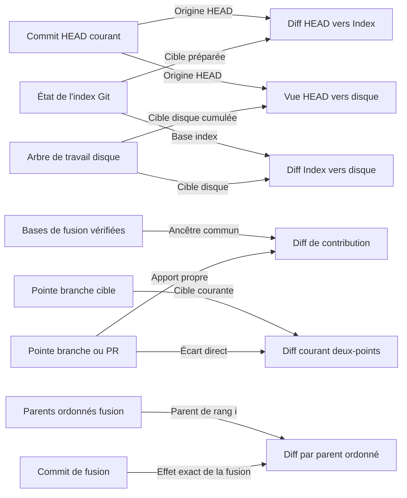

```mermaid
flowchart LR
  trg_fs["Surveillance fichiers"]
  trg_hook["Signal crochet Git"]
  trg_pr_poll["Synchro PR GitHub"]
  trg_reconcile["Réconciliation périodique"]
  que_coalesce["File bornée et époque"]
  obs_read["Lecture Git sans verrou"]
  chk_stable["État Git et index stables ?"]
  ret_objects["Rétention privée d'objets"]
  ext_analyze["Secrets, diffs et AST"]
  stg_batch["Lots préparés SQLite WAL"]
  pub_switch["Bascule de génération"]
  pub_pg_sync["Projection Postgres équipe"]
  rd_clients["Lecteurs /code-git"]

  trg_fs -->|Événements disque| que_coalesce
  trg_hook -->|Notification réf ou commit| que_coalesce
  trg_pr_poll -->|Métadonnées PR| que_coalesce
  trg_reconcile -->|Rattrapage borné| que_coalesce
  que_coalesce -->|Tâche élue| obs_read
  obs_read -->|Empreintes avant et après| chk_stable
  chk_stable -->|Non, replanifier sans écrire| que_coalesce
  chk_stable -->|Oui, capture cohérente| ret_objects
  ret_objects -->|Reçu de rétention valide| ext_analyze
  ext_analyze -->|Faits typés et état local scellé| stg_batch
  stg_batch -->|Lots complets validés| pub_switch
  pub_switch -->|Génération N+1 lisible| rd_clients
  pub_switch -->|Committé uniquement| pub_pg_sync
  pub_pg_sync -->|Vue équipe publiée| rd_clients
```

# Indexation Git continue — état livré, benchmark des outils et complément Scion (Anthropic)

**Date d'arrêté :** 16 novembre 2026 · **Temps de lecture :** ~6 min en lecture ouverte / ~15 min tables dépliées
**Révisions auditées sur `origin/main` `[FAIT]` :** `engram` `f75543a5` · `h2a` `fd067eea1` · `sentropic` `25ba09a6d`
**Statut décisionnel :** toutes les orientations sont **actées** (11–12/10, 17–18/10, 15–16/11) ; **aucune question bloquante** n'est ouverte.

---

## En bref — ce qu'il faut retenir

1. **Arbitrages clos `[FAIT]`.** Les décisions des 11–12/10 (Option D, stockage partagé `cluster-mesh`), 17–18/10 (lecture seule native sur Git, rejet de `feder-cr/git-ai`, 20 investigations pilotées par `engram`) et 15–16/11 sont définitives.
2. **État au 16/11 `[FAIT]`.** Le service n'est pas encore branché de bout en bout (`engram-live/integration.ts:301-322` répond `unavailable`, `/code-git` reste à ouvrir dans `cluster-mesh`/`sentropic`, et `h2a` — qui supervise l'hôte local — reste en refus fermé avant assemblage), mais les producteurs Git/AST/worktrees, le noyau SQLite/Postgres `cluster-mesh` et le harnais des 20 cas sont livrés sur `origin/main`.
3. **Benchmark restauré (11/10) + Scion (Anthropic) `[FAIT]` `[JUGEMENT]`.** Aucun outil sur étagère ne couvre ensemble DAG illimité, PR, worktrees, état local sans verrou et confidentialité ; **Scion (Anthropic)** (*Redesigning source control*, oct. 2026) remplace Git par Spanner pour un monorepo interne et conclut ne pas remplacer Git en usage général — nous gardons Git autoritaire et reprenons en natif ses quatre briques de lecture utiles.

---

## 1. Demandes de l'owner et décisions définitivement actées

### 1.1 Verbatims de référence

> **11 octobre 2026 — cadrage initial `[FAIT]` :**
> *« J'aimerais que tu réfléchisses à comment faire en sorte que l'indexation de git par engram fonctionne en live en permanence. [...] on veut indexer la totalité des branches en cours, les PR mergées, non mergées, etc. Je veux une architecture et une implémentation SOTA, qui n'aient pas d'effets de bord sur les opérations en cours dans les worktrees par les développeurs ou les agents. [...] Pas de LLM dans cette indexation du code et de git. [...] pas de dépendance à python. »*

> **11–12 octobre 2026 — arbitrage du premier dossier et mutualisation stockage `[FAIT]` :**
> *« Q1 A · Q2 B · Q3 A · Q4 A · Q5 A · Q6 A · Q7 A »*, validation de l'Option D sous qualification de stockage, puis précision du 12 octobre : le port générique de stockage vit dans `cluster-mesh` afin d'être réutilisé par les autres modules structurés.

> **17–18 octobre 2026 — arbitrage du volet lecture et gardiennat de l'ontologie `[FAIT]` :**
> Adoption du service de requêtes en lecture seule au-dessus de Git dans la même trajectoire, réalisation native (rejet de `feder-cr/git-ai`), protocole de 20 investigations réelles (seuil médian `≥ 30 %` à qualité constante ; agents d'exécution isolés reportés derrière un gain net additionnel `≥ 20 %`), baux explicites de divulgation aux modèles externes, et directive du 18 octobre : *« engram gardien de toutes les ontologies de dev »*.

> **15–16 novembre 2026 — format Design System, restauration du benchmark, Scion et worktrees `[FAIT]` :**
> 15/11 : *« ok le dossier git je suis ok pour toutes les orientation préconisées. J'aimerais qu'il soit remis au format design system (flowchart ou de composant lee cas échéant) mais ok. il manque la comparaison avec scion j'iamerais un update du dossier remis en forme en ce sens merci »* — 16/11 : *« pour le dossier git je me souviens uq'il y avait un benchmark des outils et j'avais demandé un complément scion. je ne vois plus le bencmark ca me gene, et y a bcp de texte inutile (certaines remarques deja faites a h2a). par contre les dossier sotn beaux. »* ; *« Pour Scion pourquoi tu parles d'un grand étidteur. on parle d'anthropic je comprends pas ton pb de jamais mentionner scion »* ; *« quid des worktrees ? »* et *« ne massacre pas ces schema ils sont super, tu les retouche a la marge pour mes remarques »*.

### 1.2 Registre des décisions actées

Consignes exécutoires closes `[FAIT]` (`engram:spec/SPEC_LIVE_GIT_INDEXING.md:7-41`, `:358-397`, `plan/09-BRANCH_LIVE_GIT_INDEXING.md:39-69`, `:600-651`).

| Décision | Choix retenu | Garde-fou ou repli pré-accepté |
|---|---|---|
| **Architecture** *(Option D)* | `engram-live` neutre sans base ; `cluster-mesh` porte noyau, SQLite, Postgres, adaptateur et `/code-git` ; `h2a` supervise l'hôte local ; `sentropic` opère Postgres. | Repli *Option B* (base dédiée) si échec de qualification, sans redemander sauf violation d'une contrainte acceptée. |
| **Périmètre** *(Q1 → A)* | Activation sur **déclaration explicite** du clone/worktree, jamais par scan ni session d'agent. | Désinscription atomique purgeant l'état privé et les baux. |
| **PR GitHub** *(Q2 → B)* | Synchro automatique paginée de **toutes** les PR (ouvertes, brouillons, fusionnées, fermées). | Métadonnées séparées des objets Git privés. |
| **Rétention** *(Q3 → A)* | **Réserve privée hors clone** de toutes les racines ingérées, sans toucher au `git gc` utilisateur. | Purgé à la révocation explicite du clone. |
| **AST historique** *(Q4 → A)* | DAG complet sans plafond ; AST sur **pointes actives et à la demande avec cache** pour l'ancien. | Couverture partielle signalée explicitement. |
| **État local** *(Q5 → A)* | **Seul dernier état stable** index + working tree par worktree, chiffré après exclusion secrets. | Écrasement immédiat des états remplacés. |
| **Postgres équipe** *(Q6 → A)* | **Committé et PR seuls** dans Postgres ; état local confiné au poste. | Test anti-fuite bloquant toute donnée privée. |
| **Détection** *(Q7 → A)* | Veille fichiers + **crochets optionnels** `< 2 s` non bloquants chaînant l'existant. | Convergence complète sans crochets. |
| **Volet lecture** *(17–18/10)* | **Lecture seule native** (rejet `feder-cr/git-ai`) : lignes, chemins/symboles, raisons vérifiées. | Gain médian `≥ 30 %` sur 20 cas réels (`engram`). |
| **Divulgation LLM** *(G4)* | **Refus par défaut** hors bail révocable `dépôt × fournisseur × portée × durée`. | N'élargit ni Postgres ni l'exclusion des secrets. |
| **Agents isolés** *(17/10)* | **Hors périmètre** (*bisect*/*revert*/conflits) avant mesure de la lecture. | Pilote séparé uniquement si gain net additionnel `≥ 20 %`. |

---

## 2. État au 16 novembre 2026 et séquence d'achèvement

### 2.1 Ce qui tourne sur `origin/main` et ce qu'il reste à raccorder

**Les moteurs producteurs, la sécurité worktree et le noyau de stockage sont sur `origin/main`, mais le câblage vertical jusqu'à `/code-git` reste à assembler** `[FAIT]`.

- **Non câblé de bout en bout `[FAIT]` :** `engram:engram-live/integration.ts:301-322` renvoie `unavailable` avant `parse-adapter.ts` ; `/code-git`, `packages/cluster-mesh/src/live/*`, `live-storage/readers.ts` et les routes Postgres `code-git.ts` restent à ouvrir dans `sentropic` (`cluster-mesh-namespace.ts:3-33`, `catalog.ts:17-18`) ; `h2a` supervise l'hôte local en refus fermé avant assemblage (`L7a`) ; les qualifications (101 502 commits, `< 2 s`, 20 cas) restent `unverified` (`docs/evidence/live-git-qualification.md:1-15`).
- **Livré sur `origin/main` `[FAIT]` :** paquet neutre sans Python ni LLM, crochets `< 2 s`, flux Git sans plafond et DAG complet, rétention privée, synchro PR complète, exclusion secrets et diffs séparés, AST WASM versionné, attribution de lignes (`line-attribution.ts:152`), correspondance de symboles (`symbol-history.ts:50`), ordonnanceur/veille/couverture, noyau SQLite/Postgres `cluster-mesh` (`storage/kernel.ts:80`), garde locale de divulgation (`live-disclosure.ts:142`) et harnais des 20 cas (`scripts/bench-live.mjs`) — détail complet en §2.2.
- **Worktrees livrés `[FAIT]` :** identité canonique séparant le clone commun (`common-dir`) et chaque worktree dans `engram:engram-live/registration.ts:312-442`, capture isolée sans verrou par worktree (principal, liés et jobs d'agents) dans `engram:engram-live/worktree.ts:228-302`, et déclarations de worktrees de l'hôte local dans `h2a:packages/h2a-runtime/src/gateway-host/live-registration.ts:150` et `live-declarations.ts:366`.

### 2.2 État détaillé lot par lot (`origin/main`)

Chaque ligne résume la finalité du lot dans `engram:plan/09-BRANCH_LIVE_GIT_INDEXING.md` `[FAIT]` ; tout jalon non encore exécuté sur la chaîne assemblée est marqué `unverified`.

| Lot (`plan/09`) | Finalité | Statut au 16/11 | Preuves sur `origin/main` (`dépôt:chemin:ligne`) | Reste à livrer / `unverified` |
|---|---|---|---|---|
| **Spécification et contrat stockage** (`S0`) | Figer architecture, confidentialité, noyau partagé et volet lecture. | **Livré** | `engram:spec/SPEC_LIVE_GIT_INDEXING.md:7-425`, `plan/09-BRANCH_LIVE_GIT_INDEXING.md:1-668`. | Portes d'exécution aval suivies par lot. |
| **Corpus Git et oracles** (`L0`) | Banc reproductible (`SHA-1`/`SHA-256`, `reftable`, conflits, renommages, worktrees, 100 001 commits + PR de 1 501 commits). | **Livré** | `engram:tests/helpers/live-git-fixtures.ts:21-521`, `tests/live-fixtures.test.ts`. | Réutilisé en qualification bout en bout (`unverified`). |
| **Exécution sans LLM** (`L1a`) | Surveillance et construction code/Git 100 % sans appel modèle. | **Livré** | `engram:src/watch.ts:167`, `:834`, `src/pipeline.ts:138`, `tests/live-no-llm.test.ts`. | Complet. |
| **Paquet neutre `@sentropic/engram-live`** (`L1b`) | Bibliothèque TS/WASM autonome, zéro dépendance runtime, zéro Python. | **Livré** *(publication différée)* | `engram:engram-live/package.json:1-34`, `integration.ts:266`, `scripts/check-live-package.mjs:136`. | Publication `R-E` après `L5-P` (`unverified` en paquet publié). |
| **Crochets Git de pur signal** (`H0`) | Signaux `< 2 s` hors du clone (`post-commit`, `post-merge`, `post-checkout`, `post-rewrite`, `reference-transaction`), sans `npx`. | **Livré** | `engram:src/hooks.ts:406-456`, `:697-973`, `tests/hooks.test.ts`. | Raccord au démon supervisé en `L7a` (`unverified`). |
| **Lecture Git en flux continu** (`L2a`) | Extraction paginée `git log` / `cat-file --batch` supprimant le plafond de 200 commits. | **Livré** | `engram:engram-live/git-stream.ts:74-501`, `src/extract-git.ts:1257-1279`. | Complet. |
| **Graphe complet et reprise par OID** (`L2b`) | Toutes les réfs locales/distantes, parents ordonnés et reprise incrémentale. | **Livré** | `engram:engram-live/history.ts:268`, `refs.ts`, `repository.ts:90`. | Complet côté producteur. |
| **Noyau générique et adaptateur `live`** (`L3a`) | Noyau transactionnel partagé dans `cluster-mesh` + adaptateur Git continu et qualification 100k commits. | **Partiel** *(noyau livré)* | **Livré :** `sentropic:packages/cluster-mesh/src/storage/kernel.ts:80`. **Absent :** `packages/cluster-mesh/src/live/*`. | Écrire l'adaptateur `src/live/*` et qualifier 100k commits (`unverified`). |
| **Moteur SQLite partagé** (`L3b-S`) | Moteur local `WAL` + `FTS5` (`SQLite >= 3.51.3`) et reprise après crash. | **Partiel** *(moteur livré)* | `sentropic:packages/cluster-mesh/src/storage/sqlite/engine.ts:11-151`, `sqlite/backend.ts:88`. | Raccorder tables `live`, état scellé et compaction `m12` (`unverified`). |
| **Moteur Postgres partagé** (`L3b-P`) | Moteur relationnel partagé dans `cluster-mesh` et schéma Drizzle `sentropic`. | **Partiel** *(moteur livré)* | `sentropic:packages/cluster-mesh/src/storage/postgres/core.ts:253`, `postgres/installed.ts:14-138`. | Schéma `live_git` côté `api/` (`unverified`). |
| **Rétention privée des racines** (`R1`) | Conserver hors clone tous les objets observés avant `git gc`. | **Livré** *(reçus SQLite restants)* | `engram:engram-live/retention.ts:114-167` ; `h2a:packages/h2a-runtime/src/gateway-host/live-object-store.ts:93`. | Relier les reçus à `L3b-S` (`unverified` en restauration). |
| **Synchronisation complète des PR** (`P1`) | Toutes les PR GitHub paginées (ETag/quotas) et attribution `merge`/`squash`/`rebase`. | **Partiel** *(producteur + transport livrés)* | `engram:engram-live/pr-sync.ts:332`, `pr-attribution.ts:43-149` ; `h2a:.../live-github.ts:208`. | Persistance `L3a` et lecteurs `L7b-R` (`unverified`). |
| **Capture worktree sans effet de bord** (`L4a`) | Lire `HEAD`, index, working tree et `.gitattributes` par worktree sans jamais créer `index.lock`. | **Livré** | `engram:engram-live/git-executor.ts:272`, `worktree.ts:228-302`, `tests/live-worktree-safety.test.ts`. | Complet côté producteur. |
| **Diffs séparés, secrets et état scellé** (`L4b` + `L4b-2`) | Séparer `HEAD -> index` et `index -> working tree`, exclure secrets et chiffrer le seul dernier état. | **Partiel** *(producteur livré)* | `engram:engram-live/diffs.ts:255`, `content-policy.ts:92-248`, `snapshots.ts:595-1005`. | Coffre `protected-payload.ts` (`cluster-mesh`) et clé locale (`h2a`) (`unverified`). |
| **AST versionné, comparaisons et lignes** (`L5` + `Δ-L5/G1`) | Symboles/appels par blob, `merge-base --all`, parents ordonnés et attribution de lignes (`-M/-C`). | **Partiel** *(producteurs livrés)* | `engram:engram-live/code-analysis.ts:490`, `analysis-cache.ts:266`, `comparisons.ts:347`, `line-attribution.ts:152`. | Exposition via `L5-P` et `L7b-R` (`unverified`). |
| **Adaptateur WASM empaqueté** (`L5-P`) | Brancher les grammaires WASM signées dans `@sentropic/engram-live` et lever `unavailable`. | **À construire** | `engram:engram-live/integration.ts:301-322` (`delivered: false`) ; `parse-adapter.ts` absent. | Débloque la publication `R-E` (`unverified`). |
| **Déclarations clones et worktrees** (`L6a`) | Inscription, révision, révocation et identité canonique clone/worktree sur les 3 dépôts. | **Livré** | `engram:engram-live/registration.ts:155-470` ; `h2a:.../live-registration.ts:150`, `live-declarations.ts:366` ; `sentropic:.../live-storage/registration.ts:10-85`, `0010_live_git_declarations.sql:1`. | Principal local activé en `L7a`. |
| **Ordonnanceur, veille et couverture** (`L6b`) | Files bornées, priorité à l'interactif, veille et certificats de couverture par axe. | **Livré** | `engram:engram-live/scheduler.ts:86`, `watch.ts:120-366`, `reconcile.ts:95`, `coverage.ts:133-427`. | Raccords finaux en `L5-P` et `L3b-S`. |
| **Contrat d'espace de noms `/code-git`** (`L7b-C`) | Ouvrir `/code-git` dans `@sentropic/contracts` avec compatibilité `N / N-1`. | **À construire** | `sentropic:packages/contracts/src/cluster-mesh-namespace.ts:3-33` sans `'/code-git'`. | Publier `R-C` après `R-E` (`unverified`). |
| **Lecteurs `/code-git`, symboles et raisons** (`L7b-R` + `G2`/`G3`) | Requêtes typées historique, PR, diffs, lignes, correspondance de symboles et citations mémoire/session. | **Partiel** *(producteur `G2` livré)* | **Livré :** `engram:engram-live/symbol-history.ts:50`. **Absent :** `sentropic:.../live-storage/{readers,reasons}.ts`. | Construire les lecteurs dans `cluster-mesh` (`unverified`). |
| **Catalogue du pair neutre** (`L7b-D`) | Enregistrer `@sentropic/engram-live` comme pair optionnel vérifié de `cluster-mesh`. | **À construire** | `sentropic:packages/cluster-mesh/src/modules/catalog.ts:17-18` (seul `@sentropic/engram` déclaré). | Livrable après `R-E`, `R-C` et `L7b-R` (`unverified`). |
| **Supervision hôte local et garde `G4`** (`L7a` + `Δ-L7a/G4`) | Superviser le collecteur sur l'hôte local (`h2a`) et bloquer toute divulgation externe sans bail. | **Partiel** *(garde `G4` livrée)* | `h2a:packages/h2a-runtime/src/gateway-host/live-auth.ts:80`, `live-disclosure.ts:142`, `live-host.ts:7`. | Assembler le démon final sur les paquets publiés (`unverified`). |
| **Publication Postgres et garde serveur** (`L8` + `Δ-L8/G4`) | Projeter uniquement committé + PR dans Postgres, sauvegarde/restauration et garde `G4` serveur. | **À construire** | `sentropic:api/src/routes/namespaces/code-git-ports.ts:43` livré ; `code-git.ts` et `live-publication.ts` absents. | Construire routes, bascule et tests anti-fuite (`unverified`). |
| **Intégrité intégrale du clone** (`L9-E`) | Prouver sur cycle complet zéro mutation du clone, de l'index et de la config Git. | **À construire** | `engram:tests/helpers/live-process-trace.ts` présent ; `live-producer-compatibility.test.ts` absent. | Exécuter dès activation de `L5-P` (`unverified`). |
| **Parité fonctionnelle des lecteurs** (`L9-S`) | Vérifier `/code-git` et `N / N-1` sur vrais moteurs SQLite et Postgres. | **À construire** | `sentropic:packages/cluster-mesh/tests/live-functional-parity.spec.ts` absent. | Dépend de `L7b-R` (`unverified`). |
| **SLO installés et 20 investigations** (`L9-H` + `Δ-L9-S/L9-H`) | Vérifier `< 2 s` au repos chaud et le gain médian `≥ 30 %` sur les 20 investigations réelles. | **Partiel** *(oracles + harnais livrés)* | `engram:tests/fixtures/live-read-side-cases.json:1-20`, `tests/live-read-side-oracles.test.ts`, `scripts/bench-live.mjs`. | Exécuter sur lecteurs `/code-git` réels (`unverified`). |

### 2.3 Séquence critique restante (6 étapes)

1. **Activer `@sentropic/engram-live` (`L5-P`, `L9-E`) :** brancher les grammaires WASM dans `integration.ts`, vérifier l'intégrité du clone et publier le paquet neutre.
2. **Livrer l'adaptateur `live` et le coffre local dans `cluster-mesh` (`L3a`, `L3b-S`) :** connecter `engram-live` à `storage/kernel.ts` et qualifier 100 000 commits.
3. **Ouvrir `/code-git` et ses lecteurs typés (`L7b-C`, `L7b-R`, `L7b-D`) :** exposer historique, PR, diffs par worktree, lignes, symboles et raisons, puis déclarer `@sentropic/engram-live` au catalogue.
4. **Assembler la supervision locale dans `h2a` (`L7a`) :** raccorder clé locale et autorité vérifiée sur les paquets publiés.
5. **Activer la projection Postgres et la garde serveur dans `sentropic` (`L3b-P`, `L8`) :** publier uniquement committé + PR avec sauvegarde/restauration.
6. **Exécuter la double réception (`L9-S`, `L9-H`) :** vérifier `< 2 s` au repos chaud et le gain médian `≥ 30 %` sur les 20 investigations réelles.

---

## 3. État de l'art, benchmark des outils et complément Scion (Anthropic)

Restauration du benchmark du 11/10 (Graphify upstream, solutions sur étagère, trois outils proches actualisés sur `origin/main`) complété par **Scion (Anthropic)** (*Redesigning source control*, oct. 2026) et l'audit de `feder-cr/git-ai` (17/10) `[FAIT]`.
*Note d'homonymie : le projet open source homonyme `scion` (Apache-2.0) est un orchestrateur d'agents conteneurisés, sans rapport avec Scion (Anthropic).*

### 3.1 Graphify upstream, daté sur le code, et lecture fonctionnelle : rester aligné avec upstream

`safishamsi/graphify` renvoie vers **Graphify-Labs/graphify** (`v8`). Références locales vérifiées au SHA ; offre cloud externe établie **à la date du 11/10** (`unverified`) :

| Ref | Commit | Date | Version |
|---|---|---|---|
| `upstream/main` | `91f4d120` | 14 mai 2026 | `0.1.14` |
| `upstream/v8` (cible de `upstream/HEAD`) | `b4e6307b` | 10 octobre 2026 | `0.9.85` |

| Sujet | `main` · `91f4d120` | `v8` · `b4e6307b` |
|---|---|---|
| **Git** | Diff pour sélectionner des fichiers après commit. | Impact, PR, fusion du graphe ; **pas d'extracteur durable branches/commits** équivalent à celui d'engram (vérifié au SHA `b4e6307b`). |
| **Watch** | Watcher de fichiers, reconstruction du code. | File de changements en attente, verrou de reconstruction, modifications concurrentes (`graphify/watch.py:23`, `:167`). |
| **Hooks** | `post-commit`. | `post-commit` et `post-checkout` ; merge driver (`graphify/cli.py:2670`). |
| **Stockage** | Graphe JSON, intégrations optionnelles. | JSON central ; SQLite comme intégration MCP compagnon, pas comme autorité. |
| **Registre global** | Pas de surface comparable. | `global add/list/remove/path`, `global-graph.json` ; agrégation sans surveillance durable démontrée (à la date du 11/10). |
| **Live hébergé** | Watch et hooks locaux. | README annonce Graphify Cloud « always-on », multi-repo (à la date du 11/10 ; architecture, couverture Git et absence d'inférence : `unverified`). |
| **Distribution** | Python `>= 3.10`, MIT. | Python `>= 3.10`, Apache-2.0 avec portions MIT conservées. |

#### Lecture fonctionnelle : rester aligné avec upstream

Engram se réaligne régulièrement sur les fonctionnalités d'upstream : reprendre ses comportements quand ils existent et documenter chaque écart voulu.

| Fonction upstream (`v8` · `b4e6307b`) | Cadrage du 11/10 | État vérifié au 16/11 sur `origin/main` |
|---|---|---|
| **Watch : file de changements en attente, verrou de reconstruction, modifications concurrentes** | `à porter` — même sémantique de file et de verrou dans l'ordonnanceur live (`L6b`). | **Livré côté producteur** : file bornée, permis exclusif et jetons d'époque dans `engram:engram-live/scheduler.ts:44-86`, veille dans `engram:engram-live/watch.ts:120-366` et réconciliateur dans `engram:engram-live/reconcile.ts:95` (activation publique en `L5-P`/`L7a`). |
| **Hooks `post-commit` et `post-checkout`, merge driver** | `aligné` — hooks réduits à un signal bref ; disparition du repli `npx graphify` (`H0`). | **Aligné et livré** : signaux `< 2 s` étendus à `post-merge`, `post-rewrite` et `reference-transaction`, sans `npx` et avec puits hors du clone (`engram:src/hooks.ts:406-456`, `:697-973`). |
| **Impact et PR** | `à étendre` — sync PR automatique et complète (`P1`), impact sur faits live. | **Livré côté producteur et transport, projection `cluster-mesh` restante** : synchro paginée complète et attribution `merge`/`squash`/`rebase` (`engram:engram-live/pr-sync.ts:332`, `pr-attribution.ts:43-149`, `h2a:.../live-github.ts:208`) + comparaisons multi-bases (`engram:engram-live/comparisons.ts:347`). |
| **Registre global `global add/list/remove/path`** | `à porter` — déclarations durables portées par l'hôte et `cluster-mesh` (`L6a`). | **Livré sur les 3 dépôts** : `engram:engram-live/registration.ts:155-442`, `h2a:.../live-declarations.ts:366` et `live-registration.ts:426`, `sentropic:packages/cluster-mesh/src/live-storage/registration.ts:10-85` et `api/src/services/cluster-mesh/live-declarations.ts:74`. |
| **Graphify Cloud « always-on », multi-repo** | `à suivre` — signal fonctionnel proche du live ; couverture Git `unverified`. | **À suivre** (à la date du 11/10 ; couverture Git et architecture `unverified`). |

**Écarts voulus face à upstream :** extracteur durable des branches et commits (`engram:engram-live/history.ts:268`, absent upstream), historique sans plafond (`engram:engram-live/git-stream.ts:501`), stockage transactionnel via `cluster-mesh` (`sentropic:packages/cluster-mesh/src/storage/kernel.ts:80`) alors qu'upstream garde `graph.json` comme autorité, chemin live sans LLM (`engram:src/watch.ts:167`, `src/pipeline.ts:138`) et distribution Node/TS/WASM sans Python (`engram:engram-live/package.json:1-34`).

### 3.2 Solutions sur étagère

Surfaces documentées **à la date du 11/10** (complétées en octobre 2026 pour **Scion (Anthropic)** et `feder-cr/git-ai`) ; adéquation expérimentale et performances hors nos dépôts : `unverified`. « Node/TS sans Python » se lit au regard du socle retenu.

| Outil | Modélise | Stockage | Incrémental | Licence | Node/TS sans Python | Verdict |
|---|---|---|---|---|---|---|
| **Sourcegraph / Zoekt** *(11/10)* | Texte et symboles de branches sélectionnées | Shards | Réindexation, deltas, contenus mutualisés | Zoekt Apache-2.0 ; Sourcegraph distincte | Go natif | Réutilisable pour la recherche texte, en complément |
| **stack-graphs** *(11/10)* | Définitions, références, résolution de noms | SQLite | Par fichier | MIT ou Apache-2.0 | Rust ; dépôt archivé | Inspirant (algorithme) |
| **tree-sitter-graph** *(11/10)* | DSL de graphe depuis un AST | À ajouter | À orchestrer | MIT ou Apache-2.0 | Rust | Réutilisable ; remplacer les extracteurs TS/WASM non justifié |
| **SCIP / LSIF** *(11/10)* | Symboles, occurrences, références d'une version | Protobuf / JSON | Selon indexeur | Apache-2.0 / MIT | Indexeur TypeScript sous Node | Réutilisable plus tard (enrichissement) |
| **Kythe** *(11/10)* | Faits d'unités de compilation | Graphstore, LevelDB | Lié aux compilations | Apache-2.0 | Outils compilés ; chaîne sans Python `unverified` | Inspirant (schéma), adoption lourde |
| **Glean** *(11/10)* | Faits multi-versions | RocksDB | Unités et bases incrémentales | BSD | Haskell/C++ ; à qualifier | Inspirant (invalidation, versions) |
| **OpenGrok** *(11/10)* | Recherche, historique SCM, annotations | Lucene, caches | Incrémental, périodique | CDDL-1.0 | Java, ctags | Hors socle |
| **Recherche GitLab** *(11/10)* | Recherche exacte, branche par défaut | Index Zoekt, jobs | Jobs GitLab | Premium / Ultimate | Produit hébergé | Inspiration opérationnelle |
| **gitoxide / gix** *(11/10)* | Objets, refs, commits, arbres, diffs, état local | Git | Service à construire | MIT ou Apache-2.0 | Rust | Alternative future au CLI, parité requise |
| **libgit2** *(11/10)* | Objets, refs, index, diffs arbre/index/WT | Git | À fournir | GPLv2 + exception de liaison | C ; binding Node sans Python à qualifier | À qualifier |
| **isomorphic-git** *(11/10)* | Git en JS ; `statusMatrix` HEAD / WT / staging | Git | Pas de service live | MIT | Node/JS ; worktrees, reftable, gros dépôts `unverified` | À qualifier |
| **MergeStat Lite** *(11/10)* | Commits, refs, fichiers, blame, stats | Tables virtuelles SQLite | Hunks / W-I non établis | MIT | Go | Référence de schéma et oracle SQL |
| **Dolt** *(11/10)* | Branches, commits, diffs de tables SQL | Base versionnée (MySQL) | Propre à la base | Apache-2.0 | Go | Inspirant |
| **Fossil** *(11/10)* | Son propre SCM | Dépôt SQLite | Imports Git | BSD 2 clauses | C | Inspirant (portabilité, intégrité) |
| **Jujutsu** *(11/10)* | Working copy comme commit, journal d'opérations | Backend Git | Snapshots | Apache-2.0 | Rust | Modèle pour `WorkingTreeSnapshot` |
| **CodeQL DB** *(11/10)* | Faits code, analyses de flux | Base spécialisée | Overlays sous conditions | Requêtes MIT ; CLI à conditions | Chaîne zéro Python `unverified` | Non qualifié |
| **ast-grep** *(11/10)* | AST, recherche, transformations | À fournir | À orchestrer | MIT | Rust + API JS native | Réutilisable ponctuellement |
| **CPG / Joern** *(11/10)* | Syntaxe, contrôle, appels, flux | flatgraph | Diffgraphs (non Git) | Apache-2.0 | Scala / JVM | Inspiration sémantique, hors runtime |
| **GitNexus** *(11/10)* | Graphe structurel, multi-repo ; `analyze --watch`, `auto-sync` | LadybugDB | Mises à jour sérialisées | PolyForm Noncommercial 1.0.0 | TS/Node + natif ; `python3` optionnel au build | Inspiration proche (comportements seuls) |
| **CodeGraphContext** *(11/10)* | Symboles, appels, imports | Plusieurs backends | Veille fichiers | MIT | Non : Python `>= 3.10` | Inspiration seulement |
| **codebase-memory-mcp** *(11/10)* | Extraction structurelle ; polling Git adaptatif | SQLite, FTS5 | Oui, lié aux sessions MCP | MIT | C natif ; embeddings intégrés | Inspirant (coordination, incrémentalité) |
| **CodeGraph** *(11/10)* | Graphe structurel ; veille et rattrapage | `node:sqlite`, WAL, FTS5 | Oui (par SHA-256 fichier) | MIT (fichier LICENSE) | Node/TS + noyau Rust | Référence proche du socle |
| **code-review-graph** *(11/10)* | Graphe structurel, impact des diffs | SQLite | Hooks / watch | MIT | Non : Python `>= 3.10` | Inspiration seulement |
| **Scion (Anthropic)** *(oct. 2026)* | VCS interne monorepo sans branches, vues dérivées par parents (blame, chemins, ascendance) et agents *bisect*/*revert*/conflits | Google Cloud Spanner + objets + caches | Matérialisations partielles à la demande | Propriétaire interne | Service interne cloud | Complément de référence : porter les vues lecture, garder Git autoritaire |
| **`feder-cr/git-ai`** *(audité 17/10)* | Démon `v0.1.0` dérivé de Gitaly tentant d'imiter Scion (Anthropic) sur Git | Caches dans `<git dir>/graft/derived/` | `first-parent` plafonné à 100, `git grep` sur 1 commit | MIT | Go + gRPC | Écarté : mute le `.git` observé, ignore renommages/fusions et duplique l'hôte |

### 3.3 Examen détaillé des trois outils les plus proches et benchmark unifié avec Scion (Anthropic)

Les trois outils open source les plus proches ont été examinés **à la date du 11/10** en lecture de code, licences et changelogs (validation expérimentale `unverified`) ; **Scion (Anthropic)** est établi d'après *Redesigning source control* (octobre 2026) `[FAIT]` :

- **CodeGraph** (`colbymchenry/codegraph` · `fc0da38f` · `1.6.2` · MIT, à la date du 11/10) : TS/Node, `node:sqlite` WAL/FTS5 sans LLM ni embeddings ; incrémental par SHA-256 fichier (pas par OID Git), lots de 2 000 sans génération atomique, daemon arrêté 300 s après le dernier client, `.git` exclu de la veille, pas de refs distantes ni de DAG réécrit, télémétrie activée par défaut.
  1. **À porter -> état au 16/11 :** veille adaptative à écrivain exclusif et état dégradé -> **livré côté producteur** (`engram:engram-live/watch.ts:64`, `:120-366`, `scheduler.ts:44-86`, `sentropic:.../storage/kernel.ts:80`) ; réconciliation et reprise des phases -> **livré côté producteur et noyau** (`engram:engram-live/reconcile.ts:89-95`, adaptateur `L3a` restant) ; détection du dépôt commun et isolation des worktrees -> **livré** (`engram:engram-live/repository.ts:90`, `registration.ts:312-442`, `worktree.ts:228-302`).
  2. **Écarts voulus :** couplage direct SQLite hors `cluster-mesh`, daemon lié aux sessions clientes, télémétrie par défaut.
- **GitNexus** (`abhigyanpatwari/GitNexus` · PolyForm Noncommercial 1.0.0, à la date du 11/10 — licence excluant toute reprise de code, comportements seuls) : riche sur worktrees, caches par commit, fraîcheur Git et clones distants ; stockage LadybugDB ; 4 grammaires optionnelles requérant `python3` au build ; pas d'historique complet par OID ni de synchro PR démontrés.
  1. **À porter -> état au 16/11 :** identité dépôt partagée entre worktrees -> **livré** (`engram:engram-live/registration.ts:312-408`, `h2a:.../live-registration.ts:150`) ; séparation `staged` / `unstaged` / référence -> **livré côté producteur** (`engram:engram-live/worktree.ts:302`, `diffs.ts:255`, `snapshots.ts:595`) ; projets déclaratifs -> **livré sur les 3 dépôts** (`registration.ts:155`, `live-declarations.ts:366`, `0010_live_git_declarations.sql:1`) ; fraîcheur et publication contrôlée -> **livré côté producteur et noyau** (`coverage.ts:133-427`, `kernel.ts:80`, adaptateur `L3a` restant) ; rétention explicite -> **livré** (`engram:engram-live/retention.ts:167`, `h2a:.../live-object-store.ts:93`).
  2. **Écarts voulus :** LadybugDB, embeddings, lecture bornée au checkout courant, licence non commerciale.
- **CodeGraphContext** (`CodeGraphContext/CodeGraphContext` · MIT · Python `>= 3.10`, à la date du 11/10) : extraction structurelle multi-backends et embeddings optionnels, mais provenance limitée à `HEAD` sans refs ni DAG complet.
  1. **À porter -> état au 16/11 :** réconciliation des fichiers présents/disparus -> **livré côté producteur** (`engram:engram-live/reconcile.ts:95`, `worktree.ts:87-104`) ; invalidation incrémentale des appels/héritages -> **livré côté producteur** (`src/watch.ts:167`, `engram-live/code-analysis.ts:490`, `analysis-cache.ts:266`) ; reprise des surveillances déclarées -> **livré en déclarations et producteur** (`registration.ts:155`, `reconcile.ts:89-95`, démon `L7a` restant).
  2. **Écarts voulus :** runtime Python, embeddings, backends Cypher hors contrat `cluster-mesh`.
- **Scion (Anthropic)** (*Redesigning source control*, octobre 2026) : remplace Git par Google Cloud Spanner + objets + caches pour un monorepo interne massif sans branches nommées ni file de fusion globale, sert des vues dérivées par parents (blame, chemins, ascendance) et alimente des agents de *bisect*, *revert* et réparation de conflits post-fusion — tout en concluant qu'il *« is by no means a suitable replacement for git for general use »*.
  1. **À porter (arbitrage 17/10) -> état au 16/11 :** attribution de lignes (`G1`) -> **producteur livré** (`engram:engram-live/line-attribution.ts:152`, lecteur `/code-git` restant) ; suivi chemins/symboles multi-parents et renommages (`G2`) -> **producteur symboles livré** (`engram:engram-live/symbol-history.ts:50`, lecteurs `L7b-R` restants) ; citations vérifiées vers PR/sessions/mémoires (`G3`) -> **spécifié, lecteur `L7b-R` à construire** ; garde de divulgation aux modèles externes (`G4`) -> **livré en local** (`h2a:.../live-disclosure.ts:142`, volet serveur `L8` restant).
  2. **Écarts voulus :** remplacer Git par Spanner, supprimer branches et verrous de PR, ou lancer des flottes d'agents d'exécution avant mesure.

#### Table comparative unifiée du benchmark

| Capacité | CodeGraph *(11/10)* | GitNexus *(11/10)* | CodeGraphContext *(11/10)* | Scion (Anthropic) *(oct. 2026)* | Notre indexation Git continue *(16/11)* |
|---|---|---|---|---|---|
| **Autorité de version** | Fichiers locaux (`.git` ignoré) | Git local (checkout courant) | Git ponctuel (`HEAD` seul) | Base interne Spanner hors Git (API propriétaire) | **Git reste l'unique autorité** (`SHA-1`/`SHA-256`, `files`/`reftable`) |
| **Topologie multi-dépôts et déclarations** | Par projet ouvert en session MCP | Multi-repo déclaratif | Dossiers surveillés | Monorepo interne centralisé (ACL par dossier) | **Multi-dépôts sur déclaration explicite** (`registration.ts:155`, livré sur 3 dépôts) |
| **Worktrees (principal, liés, jobs d'agents)** | Détecte le dépôt commun et isole les worktrees ; sans index/diffs Git | Riche : identité partagée et distinction par worktree (checkout courant) | Non modélisé | Matérialisations partielles par API (pas de worktrees Git standard) | **Livré (producteur + déclarations)** : `cloneId`/`worktreeId` (`registration.ts:312-442`), capture par worktree (`worktree.ts:228-302`), déclarations hôte (`live-registration.ts:150`) |
| **Branches, DAG complet et PR GitHub** | Non (pas de refs distantes ni PR) | Refs/fraîcheur oui ; DAG illimité et PR non démontrés | Non (`HEAD` et stats) | Décourage les branches ; revue interne sans verrou global | **DAG complet sans plafond + toutes les PR** (`history.ts:268`, `pr-sync.ts:332` livrés ; projection `L3a`/`L7b-R` restante) |
| **État local (`HEAD` / index / working tree)** | Disque seul par SHA-256 fichier | `staged` / `unstaged` / réf sur checkout courant | Fichiers sur disque | Orienté changements envoyés au service central | **Captures et diffs séparés chiffrés** (`diffs.ts:255`, `snapshots.ts:595` livrés ; coffre `L4b` restant) |
| **Innocuité sur `.git` et verrous** | N'interroge pas `.git` en veille | Lecture Git (non-mutation stricte `unverified` au 11/10) | Lecture ponctuelle | N/A (client API hors Git) | **Non-mutation prouvée** (`--no-optional-locks`, double contrôle : `git-executor.ts:272`, `worktree.ts:302`, `hooks.ts:809`) |
| **Rétention après suppression ou `push --force`** | Non | Rétention de caches (pas de réserve d'objets Git complète) | Non | Conserve nativement tout état envoyé au serveur | **Réserve privée hors clone** (`retention.ts:167`, `live-object-store.ts:93` livrés ; raccord reçus `L3b-S` restant) |
| **Attribution fine de lignes (`blame`, `-M/-C`)** | Non | Non démontré au 11/10 | Non | Oui, indexé par parents et servi par API | **Producteur livré** (`line-attribution.ts:152`) ; lecteur `/code-git` (`L7b-R`) à brancher |
| **Suivi chemins et symboles à travers renommages** | Non (fichier courant seul) | Non sur tout le DAG | Non | Historique de chemins par parents mis en cache | **Correspondance exacte SHA-256 du corps livrée** (`symbol-history.ts:50`) ; lecteurs chemins/symboles (`L7b-R`) à brancher |
| **AST structurel sans LLM ni Python** | Oui (TS/Node + Rust) | Partiel (`python3` optionnel sur 4 grammaires) | Non (Python `>= 3.10`) | Non revendiqué comme graphe AST multi-dépôts | **Oui, Tree-sitter WASM versionné par blob** (`code-analysis.ts:490` livré ; adaptateur paquet `L5-P` restant) |
| **Lien vérifié vers le « pourquoi »** | Non | Non | Non | Lié à l'outil interne de revue | **Chaîne citée `ligne -> commit/PR -> session / mémoire admise`** (spécifiée, lecteur `L7b-R` à construire) |
| **Secrets et divulgation aux modèles externes** | Télémétrie agrégée active par défaut | Pas de garde multi-fournisseurs dédiée | Pas de garde dédiée | ACL internes chez un opérateur unique | **Secrets exclus (`content-policy.ts:206`), local hors Postgres, baux révocables (`live-disclosure.ts:142` livré en local, serveur en `L8`)** |
| **Agents isolés (*bisect*, *revert*, conflits)** | Non | Non | Non | Oui, flotte d'agents en production | **Hors périmètre immédiat** (porte conditionnelle `≥ 20 %` net après preuve `≥ 30 %` en lecture) |
| **Stockage et exploitation** | `node:sqlite` couplé (sans génération atomique) | LadybugDB | Multi-backends graphes + Python | Cloud Spanner + pile dédiée à grande échelle | **SQLite local + Postgres serveur** via `cluster-mesh` (`kernel.ts:80` livré), bascule atomique de génération |

### 3.4 Synthèse : ce qui vaut d'être comblé et ce qui ne le vaut pas

- **À combler (inscrit au §2.3) `[JUGEMENT]` :** exposer dans `/code-git` les quatre briques de lecture retenues face à Scion (Anthropic) — attribution de lignes (`line-attribution.ts:152`), suivi chemins/symboles (`symbol-history.ts:50`), citations vérifiées vers PR/sessions/mémoires admises, et garde serveur de divulgation — puis chronométrer les 20 investigations (`scripts/bench-live.mjs`, seuil médian `≥ 30 %` ; co-changement suspendu au cas n° 14).
- **À écarter `[JUGEMENT]` :** ne pas remplacer Git ni supprimer branches et verrous de PR (convergent avec la conclusion d'Anthropic) ; n'adopter ni LadybugDB, ni Python, ni embeddings, ni télémétrie par défaut ; ne pas pré-calculer 100 000 AST historiques ; ne lancer aucun pilote d'agents isolés (*bisect*/*revert*) avant preuve d'un gain net additionnel `≥ 20 %`.

---

## 4. Schémas au format Design System Focus (sans coordonnées manuelles)

Conformément au contrat du moteur de rendu Focus (`docs/focus/diagram-renderer-contract.md` et `docs/focus/portable-dossiers.md`), chaque schéma est intégralement spécifié par ses **groupes/conteneurs**, ses **nœuds** et ses **liens orientés**, sans aucune coordonnée X/Y ni dessin SVG manuel :
- les **schémas d'architecture, de modèle de données et de comparaison système** (Schémas 1, 2 et 5) utilisent le profil composant/conteneurs C4 **`generic@1`** (relations hiérarchiques `contains` acycliques à parent unique + relations orientées `link`) ;
- les **schémas de séquence opérationnelle et de comparaisons d'états** (Schémas 3 et 4) utilisent le profil **`flowchart`** strict (identifiants minuscules stables, une déclaration ou un lien orienté par ligne, étiquettes texte pur) accompagné de leurs groupes logiques explicites.

---

### 4.1 Schéma 1 — Architecture cible et frontières de responsabilité *(remplace l'ancienne Figure A)*

- **Type Design System :** schéma de composants et conteneurs (`generic@1`, style C4 — conteneurs, composants et relations orientées).
- **Ce que montre le schéma :** qui possède quoi entre les sources Git/GitHub (distinguant explicitement le clone commun et ses worktrees liés, jobs d'agents inclus), le paquet producteur neutre `@sentropic/engram-live`, le module de stockage et de lecture `@sentropic/cluster-mesh`, l'hôte local supervisé par `h2a` et le serveur applicatif `sentropic`.

#### Groupes et conteneurs (`entities` de type `container` et relations `contains`)

| ID conteneur | Nature du groupe | Libellé affiché | Parent (`contains`) | Enfants contenus (`contains`) |
|---|---|---|---|---|
| `grp_sources` | Colonne amont — sources Git (clone commun et worktrees liés) et GitHub observées | Sources Git et GitHub | *(racine)* | `src_clone`, `src_worktree`, `src_git_hooks`, `src_github_api` |
| `grp_engram_live` | Cadre composant — paquet producteur neutre `engram-live` (`@sentropic/engram-live`, sans Python ni LLM) | Producteur engram-live | *(racine)* | `cmp_safe_observer`, `cmp_extractors`, `cmp_scheduler` |
| `grp_h2a_host` | Cadre hôte local — supervision locale `h2a` | Hôte local h2a | *(racine)* | `cmp_h2a_supervisor`, `cmp_private_objects`, `cmp_key_custody`, `cmp_disclosure_guard_h2a` |
| `grp_cluster_mesh` | Cadre central — module `cluster-mesh` (`@sentropic/cluster-mesh`, stockage partagé et espace `/code-git`) | Module cluster-mesh | *(racine)* | `grp_cm_storage`, `cmp_live_adapter`, `cmp_code_git_readers` |
| `grp_cm_storage` | Sous-cadre stockage — noyau transactionnel générique et moteurs réutilisables | Noyau et moteurs partagés | `grp_cluster_mesh` | `cmp_storage_kernel`, `cmp_sqlite_engine`, `cmp_postgres_engine` |
| `grp_sentropic_app` | Cadre serveur — application serveur `sentropic` (équipe et web) | Serveur sentropic | *(racine)* | `cmp_app_pg_ops`, `cmp_app_publication`, `cmp_disclosure_guard_app` |
| `grp_consumers` | Bande aval — consommateurs autorisés (lecture seule, mémoire associée et frontières externes) | Lecteurs et frontières | *(racine)* | `usr_local_agents`, `usr_web_team`, `cmp_engram_memory`, `ext_llm_provider` |

#### Nœuds (`entities` de type `node`)

| ID nœud | Libellé affiché | Rôle concis (sans jargon interne) |
|---|---|---|
| `src_clone` | Clone (dépôt commun) | Dépôt Git commun (`common-dir` : objets et références partagées, `.git` jamais muté) |
| `src_worktree` | Worktrees liés | Un `HEAD`, un index et des fichiers sur disque par worktree (worktree principal, worktrees liés et worktrees de jobs d'agents) |
| `src_git_hooks` | Crochets Git de signal | Crochets Git optionnels émettant un signal borné `< 2 s` hors du clone après opération Git |
| `src_github_api` | API GitHub des PR | API GitHub (demandes de fusion) : métadonnées paginées de toutes les PR (ouvertes, brouillons, fusionnées, fermées) |
| `cmp_safe_observer` | Lecteur Git sans verrou | Lecteur Git et fichiers sans effet de bord : flux `cat-file`/`log` sans verrou `.git` et double contrôle de stabilité de chaque worktree |
| `cmp_extractors` | Analyseurs AST et diffs | Analyseurs déterministes (AST, diffs, lignes, symboles) : grammaires WASM, filtrage de secrets, comparaisons multi-bases, attribution de lignes et symboles |
| `cmp_scheduler` | Ordonnanceur temps réel | Ordonnanceur et réconciliateur : files bornées, priorité à l'interactif et jetons de clôture d'époque |
| `cmp_h2a_supervisor` | Superviseur démon h2a | Superviseur de l'hôte local `h2a` : identité du poste, déclaration des clones et des worktrees, transport GitHub |
| `cmp_private_objects` | Réserve privée d'objets | Réserve privée d'objets Git : conserve hors du clone les objets de PR fermées ou branches réécrites |
| `cmp_key_custody` | Garde locale des clés | Garde locale des clés de chiffrement : scelle et déchiffre uniquement le dernier état local non committé |
| `cmp_disclosure_guard_h2a` | Garde externe locale | Garde de divulgation externe locale : refuse par défaut tout envoi privé externe sans bail `dépôt × fournisseur × portée × durée` |
| `cmp_live_adapter` | Adaptateur Git continu | Adaptateur de domaine Git continu : valide les lots typés, les reçus de rétention et le cycle privé/committé |
| `cmp_storage_kernel` | Noyau de stockage | Noyau de stockage partagé : clôture d'écrivain, lots préparés et bascule atomique de génération |
| `cmp_sqlite_engine` | Moteur SQLite local | Moteur SQLite local (`WAL` + `FTS5`) : stocke sur le poste l'historique local et le dernier état privé chiffré |
| `cmp_postgres_engine` | Moteur Postgres partagé | Moteur Postgres réutilisable : moteur relationnel partagé exécuté sur le pool injecté par `sentropic` |
| `cmp_code_git_readers` | Lecteurs /code-git | Routeur et lecteurs typés `/code-git` : requêtes paginées d'historique, PR, diffs, lignes, symboles et liens vers les raisons |
| `cmp_app_pg_ops` | Pool et ops Postgres | Pool Postgres, migrations et sauvegarde `sentropic` : exploite l'instance Postgres, le contrôle d'accès d'équipe et la reprise |
| `cmp_app_publication` | Publication committée | Publication committée et bascule : reçoit uniquement les faits committés et PR ; rejette tout état privé local |
| `cmp_disclosure_guard_app` | Garde externe serveur | Garde de divulgation externe serveur : contrôle côté serveur toute émission vers un fournisseur de modèle externe |
| `cmp_engram_memory` | Mémoire admise engram | Mémoire et décisions admises (`engram`) : fournit par citations vérifiées les décisions/mémoires sans copie dans `/code-git` |
| `usr_local_agents` | Agents et poste local | Développeur et agents locaux (`h2a` / MCP) : interrogent `/code-git` (committé + dernier état local autorisé) |
| `usr_web_team` | Équipe web sentropic | Interface web et équipe `sentropic` : consultent uniquement l'historique committé et les PR partagées |
| `ext_llm_provider` | Modèle externe | Fournisseur de modèle externe : ne reçoit du contexte local que sous bail explicite valide et hors secrets |

#### Liens orientés (`relations` de type `link`)

| ID lien | Source | Cible | Étiquette du lien |
|---|---|---|---|
| `lnk_a01` | `src_git_hooks` | `cmp_scheduler` | Signal non bloquant hors clone |
| `lnk_a02` | `cmp_safe_observer` | `src_clone` | Lecture seule du dépôt commun sans verrou Git |
| `lnk_a25` | `cmp_safe_observer` | `src_worktree` | Lecture seule de chaque worktree sans verrou |
| `lnk_a26` | `cmp_h2a_supervisor` | `src_clone` | Déclaration explicite des clones |
| `lnk_a27` | `cmp_h2a_supervisor` | `src_worktree` | Déclaration explicite des worktrees |
| `lnk_a03` | `cmp_h2a_supervisor` | `src_github_api` | Synchronisation paginée de toutes les PR |
| `lnk_a04` | `cmp_h2a_supervisor` | `cmp_scheduler` | Déclaration explicite, bail d'autorité et tâches PR |
| `lnk_a05` | `cmp_scheduler` | `cmp_safe_observer` | Commandes d'observation bornées |
| `lnk_a06` | `cmp_safe_observer` | `cmp_extractors` | Objets Git, arbres et instantanés stables |
| `lnk_a07` | `cmp_safe_observer` | `cmp_private_objects` | Objets à retenir hors clone avant purge Git |
| `lnk_a08` | `cmp_extractors` | `cmp_private_objects` | Lecture hors-ligne des objets retenus |
| `lnk_a09` | `cmp_key_custody` | `cmp_live_adapter` | Clé hôte pour sceller le dernier état local |
| `lnk_a10` | `cmp_extractors` | `cmp_live_adapter` | Lots de faits typés et couverture |
| `lnk_a11` | `cmp_live_adapter` | `cmp_storage_kernel` | Écriture préparée sous jeton d'époque |
| `lnk_a12` | `cmp_storage_kernel` | `cmp_sqlite_engine` | Persistance locale (committé + privé chiffré) |
| `lnk_a13` | `cmp_live_adapter` | `cmp_app_publication` | Transfert des seuls faits committés et PR |
| `lnk_a14` | `cmp_app_publication` | `cmp_storage_kernel` | Publication serveur autorisée |
| `lnk_a15` | `cmp_storage_kernel` | `cmp_postgres_engine` | Persistance partagée (committé uniquement) |
| `lnk_a16` | `cmp_app_pg_ops` | `cmp_postgres_engine` | Injection du pool, migrations et sauvegardes |
| `lnk_a17` | `cmp_sqlite_engine` | `cmp_code_git_readers` | Lecture sur génération locale publiée |
| `lnk_a18` | `cmp_postgres_engine` | `cmp_code_git_readers` | Lecture sur génération serveur publiée |
| `lnk_a19` | `cmp_code_git_readers` | `cmp_engram_memory` | Jointure par citations vérifiées |
| `lnk_a20` | `cmp_code_git_readers` | `usr_local_agents` | Réponses typées `/code-git` (poste local) |
| `lnk_a21` | `cmp_code_git_readers` | `usr_web_team` | Réponses typées `/code-git` (committé équipe) |
| `lnk_a22` | `usr_local_agents` | `cmp_disclosure_guard_h2a` | Vérification avant tout envoi modèle |
| `lnk_a23` | `cmp_disclosure_guard_h2a` | `ext_llm_provider` | Émission autorisée par bail valide uniquement |
| `lnk_a24` | `cmp_disclosure_guard_app` | `ext_llm_provider` | Émission serveur contrôlée par bail valide |

#### Spécification déclarative `generic@1` (directement consommable par le constructeur Focus)

```json
{
  "documentId": "document:fig-1-target-architecture",
  "schemaVersion": { "major": 1, "minor": 1 },
  "revision": 0,
  "profileRefs": ["generic@1"],
  "typeDefinitions": {},
  "entities": {
    "entity:grp_sources": { "id": "entity:grp_sources", "profile": "generic@1", "type": "container", "attributes": { "name": { "kind": "text", "value": "Sources Git et GitHub" } } },
    "entity:grp_engram_live": { "id": "entity:grp_engram_live", "profile": "generic@1", "type": "container", "attributes": { "name": { "kind": "text", "value": "Producteur engram-live" } } },
    "entity:grp_h2a_host": { "id": "entity:grp_h2a_host", "profile": "generic@1", "type": "container", "attributes": { "name": { "kind": "text", "value": "Hôte local h2a" } } },
    "entity:grp_cluster_mesh": { "id": "entity:grp_cluster_mesh", "profile": "generic@1", "type": "container", "attributes": { "name": { "kind": "text", "value": "Module cluster-mesh" } } },
    "entity:grp_cm_storage": { "id": "entity:grp_cm_storage", "profile": "generic@1", "type": "container", "attributes": { "name": { "kind": "text", "value": "Noyau et moteurs partagés" } } },
    "entity:grp_sentropic_app": { "id": "entity:grp_sentropic_app", "profile": "generic@1", "type": "container", "attributes": { "name": { "kind": "text", "value": "Serveur sentropic" } } },
    "entity:grp_consumers": { "id": "entity:grp_consumers", "profile": "generic@1", "type": "container", "attributes": { "name": { "kind": "text", "value": "Lecteurs et frontières" } } },
    "entity:src_clone": { "id": "entity:src_clone", "profile": "generic@1", "type": "node", "attributes": { "name": { "kind": "text", "value": "Clone (dépôt commun)" } } },
    "entity:src_worktree": { "id": "entity:src_worktree", "profile": "generic@1", "type": "node", "attributes": { "name": { "kind": "text", "value": "Worktrees liés" } } },
    "entity:src_git_hooks": { "id": "entity:src_git_hooks", "profile": "generic@1", "type": "node", "attributes": { "name": { "kind": "text", "value": "Crochets Git de signal" } } },
    "entity:src_github_api": { "id": "entity:src_github_api", "profile": "generic@1", "type": "node", "attributes": { "name": { "kind": "text", "value": "API GitHub des PR" } } },
    "entity:cmp_safe_observer": { "id": "entity:cmp_safe_observer", "profile": "generic@1", "type": "node", "attributes": { "name": { "kind": "text", "value": "Lecteur Git sans verrou" } } },
    "entity:cmp_extractors": { "id": "entity:cmp_extractors", "profile": "generic@1", "type": "node", "attributes": { "name": { "kind": "text", "value": "Analyseurs AST et diffs" } } },
    "entity:cmp_scheduler": { "id": "entity:cmp_scheduler", "profile": "generic@1", "type": "node", "attributes": { "name": { "kind": "text", "value": "Ordonnanceur temps réel" } } },
    "entity:cmp_h2a_supervisor": { "id": "entity:cmp_h2a_supervisor", "profile": "generic@1", "type": "node", "attributes": { "name": { "kind": "text", "value": "Superviseur démon h2a" } } },
    "entity:cmp_private_objects": { "id": "entity:cmp_private_objects", "profile": "generic@1", "type": "node", "attributes": { "name": { "kind": "text", "value": "Réserve privée d'objets" } } },
    "entity:cmp_key_custody": { "id": "entity:cmp_key_custody", "profile": "generic@1", "type": "node", "attributes": { "name": { "kind": "text", "value": "Garde locale des clés" } } },
    "entity:cmp_disclosure_guard_h2a": { "id": "entity:cmp_disclosure_guard_h2a", "profile": "generic@1", "type": "node", "attributes": { "name": { "kind": "text", "value": "Garde externe locale" } } },
    "entity:cmp_live_adapter": { "id": "entity:cmp_live_adapter", "profile": "generic@1", "type": "node", "attributes": { "name": { "kind": "text", "value": "Adaptateur Git continu" } } },
    "entity:cmp_storage_kernel": { "id": "entity:cmp_storage_kernel", "profile": "generic@1", "type": "node", "attributes": { "name": { "kind": "text", "value": "Noyau de stockage" } } },
    "entity:cmp_sqlite_engine": { "id": "entity:cmp_sqlite_engine", "profile": "generic@1", "type": "node", "attributes": { "name": { "kind": "text", "value": "Moteur SQLite local" } } },
    "entity:cmp_postgres_engine": { "id": "entity:cmp_postgres_engine", "profile": "generic@1", "type": "node", "attributes": { "name": { "kind": "text", "value": "Moteur Postgres partagé" } } },
    "entity:cmp_code_git_readers": { "id": "entity:cmp_code_git_readers", "profile": "generic@1", "type": "node", "attributes": { "name": { "kind": "text", "value": "Lecteurs /code-git" } } },
    "entity:cmp_app_pg_ops": { "id": "entity:cmp_app_pg_ops", "profile": "generic@1", "type": "node", "attributes": { "name": { "kind": "text", "value": "Pool et ops Postgres" } } },
    "entity:cmp_app_publication": { "id": "entity:cmp_app_publication", "profile": "generic@1", "type": "node", "attributes": { "name": { "kind": "text", "value": "Publication committée" } } },
    "entity:cmp_disclosure_guard_app": { "id": "entity:cmp_disclosure_guard_app", "profile": "generic@1", "type": "node", "attributes": { "name": { "kind": "text", "value": "Garde externe serveur" } } },
    "entity:cmp_engram_memory": { "id": "entity:cmp_engram_memory", "profile": "generic@1", "type": "node", "attributes": { "name": { "kind": "text", "value": "Mémoire admise engram" } } },
    "entity:usr_local_agents": { "id": "entity:usr_local_agents", "profile": "generic@1", "type": "node", "attributes": { "name": { "kind": "text", "value": "Agents et poste local" } } },
    "entity:usr_web_team": { "id": "entity:usr_web_team", "profile": "generic@1", "type": "node", "attributes": { "name": { "kind": "text", "value": "Équipe web sentropic" } } },
    "entity:ext_llm_provider": { "id": "entity:ext_llm_provider", "profile": "generic@1", "type": "node", "attributes": { "name": { "kind": "text", "value": "Modèle externe" } } }
  },
  "relations": {
    "relation:cnt_01": { "id": "relation:cnt_01", "profile": "generic@1", "type": "contains", "endpoints": [{ "role": "parent", "target": "entity:grp_sources" }, { "role": "child", "target": "entity:src_clone" }], "attributes": {} },
    "relation:cnt_02": { "id": "relation:cnt_02", "profile": "generic@1", "type": "contains", "endpoints": [{ "role": "parent", "target": "entity:grp_sources" }, { "role": "child", "target": "entity:src_worktree" }], "attributes": {} },
    "relation:cnt_03": { "id": "relation:cnt_03", "profile": "generic@1", "type": "contains", "endpoints": [{ "role": "parent", "target": "entity:grp_sources" }, { "role": "child", "target": "entity:src_git_hooks" }], "attributes": {} },
    "relation:cnt_04": { "id": "relation:cnt_04", "profile": "generic@1", "type": "contains", "endpoints": [{ "role": "parent", "target": "entity:grp_sources" }, { "role": "child", "target": "entity:src_github_api" }], "attributes": {} },
    "relation:cnt_05": { "id": "relation:cnt_05", "profile": "generic@1", "type": "contains", "endpoints": [{ "role": "parent", "target": "entity:grp_engram_live" }, { "role": "child", "target": "entity:cmp_safe_observer" }], "attributes": {} },
    "relation:cnt_06": { "id": "relation:cnt_06", "profile": "generic@1", "type": "contains", "endpoints": [{ "role": "parent", "target": "entity:grp_engram_live" }, { "role": "child", "target": "entity:cmp_extractors" }], "attributes": {} },
    "relation:cnt_07": { "id": "relation:cnt_07", "profile": "generic@1", "type": "contains", "endpoints": [{ "role": "parent", "target": "entity:grp_engram_live" }, { "role": "child", "target": "entity:cmp_scheduler" }], "attributes": {} },
    "relation:cnt_08": { "id": "relation:cnt_08", "profile": "generic@1", "type": "contains", "endpoints": [{ "role": "parent", "target": "entity:grp_h2a_host" }, { "role": "child", "target": "entity:cmp_h2a_supervisor" }], "attributes": {} },
    "relation:cnt_09": { "id": "relation:cnt_09", "profile": "generic@1", "type": "contains", "endpoints": [{ "role": "parent", "target": "entity:grp_h2a_host" }, { "role": "child", "target": "entity:cmp_private_objects" }], "attributes": {} },
    "relation:cnt_10": { "id": "relation:cnt_10", "profile": "generic@1", "type": "contains", "endpoints": [{ "role": "parent", "target": "entity:grp_h2a_host" }, { "role": "child", "target": "entity:cmp_key_custody" }], "attributes": {} },
    "relation:cnt_11": { "id": "relation:cnt_11", "profile": "generic@1", "type": "contains", "endpoints": [{ "role": "parent", "target": "entity:grp_h2a_host" }, { "role": "child", "target": "entity:cmp_disclosure_guard_h2a" }], "attributes": {} },
    "relation:cnt_12": { "id": "relation:cnt_12", "profile": "generic@1", "type": "contains", "endpoints": [{ "role": "parent", "target": "entity:grp_cluster_mesh" }, { "role": "child", "target": "entity:grp_cm_storage" }], "attributes": {} },
    "relation:cnt_13": { "id": "relation:cnt_13", "profile": "generic@1", "type": "contains", "endpoints": [{ "role": "parent", "target": "entity:grp_cluster_mesh" }, { "role": "child", "target": "entity:cmp_live_adapter" }], "attributes": {} },
    "relation:cnt_14": { "id": "relation:cnt_14", "profile": "generic@1", "type": "contains", "endpoints": [{ "role": "parent", "target": "entity:grp_cluster_mesh" }, { "role": "child", "target": "entity:cmp_code_git_readers" }], "attributes": {} },
    "relation:cnt_15": { "id": "relation:cnt_15", "profile": "generic@1", "type": "contains", "endpoints": [{ "role": "parent", "target": "entity:grp_cm_storage" }, { "role": "child", "target": "entity:cmp_storage_kernel" }], "attributes": {} },
    "relation:cnt_16": { "id": "relation:cnt_16", "profile": "generic@1", "type": "contains", "endpoints": [{ "role": "parent", "target": "entity:grp_cm_storage" }, { "role": "child", "target": "entity:cmp_sqlite_engine" }], "attributes": {} },
    "relation:cnt_17": { "id": "relation:cnt_17", "profile": "generic@1", "type": "contains", "endpoints": [{ "role": "parent", "target": "entity:grp_cm_storage" }, { "role": "child", "target": "entity:cmp_postgres_engine" }], "attributes": {} },
    "relation:cnt_18": { "id": "relation:cnt_18", "profile": "generic@1", "type": "contains", "endpoints": [{ "role": "parent", "target": "entity:grp_sentropic_app" }, { "role": "child", "target": "entity:cmp_app_pg_ops" }], "attributes": {} },
    "relation:cnt_19": { "id": "relation:cnt_19", "profile": "generic@1", "type": "contains", "endpoints": [{ "role": "parent", "target": "entity:grp_sentropic_app" }, { "role": "child", "target": "entity:cmp_app_publication" }], "attributes": {} },
    "relation:cnt_20": { "id": "relation:cnt_20", "profile": "generic@1", "type": "contains", "endpoints": [{ "role": "parent", "target": "entity:grp_sentropic_app" }, { "role": "child", "target": "entity:cmp_disclosure_guard_app" }], "attributes": {} },
    "relation:cnt_21": { "id": "relation:cnt_21", "profile": "generic@1", "type": "contains", "endpoints": [{ "role": "parent", "target": "entity:grp_consumers" }, { "role": "child", "target": "entity:usr_local_agents" }], "attributes": {} },
    "relation:cnt_22": { "id": "relation:cnt_22", "profile": "generic@1", "type": "contains", "endpoints": [{ "role": "parent", "target": "entity:grp_consumers" }, { "role": "child", "target": "entity:usr_web_team" }], "attributes": {} },
    "relation:cnt_23": { "id": "relation:cnt_23", "profile": "generic@1", "type": "contains", "endpoints": [{ "role": "parent", "target": "entity:grp_consumers" }, { "role": "child", "target": "entity:cmp_engram_memory" }], "attributes": {} },
    "relation:cnt_24": { "id": "relation:cnt_24", "profile": "generic@1", "type": "contains", "endpoints": [{ "role": "parent", "target": "entity:grp_consumers" }, { "role": "child", "target": "entity:ext_llm_provider" }], "attributes": {} },
    "relation:lnk_a01": { "id": "relation:lnk_a01", "profile": "generic@1", "type": "link", "endpoints": [{ "role": "source", "target": "entity:src_git_hooks" }, { "role": "target", "target": "entity:cmp_scheduler" }], "attributes": { "label": { "kind": "text", "value": "Signal non bloquant" } } },
    "relation:lnk_a02": { "id": "relation:lnk_a02", "profile": "generic@1", "type": "link", "endpoints": [{ "role": "source", "target": "entity:cmp_safe_observer" }, { "role": "target", "target": "entity:src_clone" }], "attributes": { "label": { "kind": "text", "value": "Lecture dépôt commun sans verrou" } } },
    "relation:lnk_a25": { "id": "relation:lnk_a25", "profile": "generic@1", "type": "link", "endpoints": [{ "role": "source", "target": "entity:cmp_safe_observer" }, { "role": "target", "target": "entity:src_worktree" }], "attributes": { "label": { "kind": "text", "value": "Lecture de chaque worktree" } } },
    "relation:lnk_a26": { "id": "relation:lnk_a26", "profile": "generic@1", "type": "link", "endpoints": [{ "role": "source", "target": "entity:cmp_h2a_supervisor" }, { "role": "target", "target": "entity:src_clone" }], "attributes": { "label": { "kind": "text", "value": "Déclare les clones" } } },
    "relation:lnk_a27": { "id": "relation:lnk_a27", "profile": "generic@1", "type": "link", "endpoints": [{ "role": "source", "target": "entity:cmp_h2a_supervisor" }, { "role": "target", "target": "entity:src_worktree" }], "attributes": { "label": { "kind": "text", "value": "Déclare les worktrees" } } },
    "relation:lnk_a03": { "id": "relation:lnk_a03", "profile": "generic@1", "type": "link", "endpoints": [{ "role": "source", "target": "entity:cmp_h2a_supervisor" }, { "role": "target", "target": "entity:src_github_api" }], "attributes": { "label": { "kind": "text", "value": "Toutes les PR paginées" } } },
    "relation:lnk_a04": { "id": "relation:lnk_a04", "profile": "generic@1", "type": "link", "endpoints": [{ "role": "source", "target": "entity:cmp_h2a_supervisor" }, { "role": "target", "target": "entity:cmp_scheduler" }], "attributes": { "label": { "kind": "text", "value": "Déclarations et baux" } } },
    "relation:lnk_a05": { "id": "relation:lnk_a05", "profile": "generic@1", "type": "link", "endpoints": [{ "role": "source", "target": "entity:cmp_scheduler" }, { "role": "target", "target": "entity:cmp_safe_observer" }], "attributes": { "label": { "kind": "text", "value": "Collecte bornée" } } },
    "relation:lnk_a06": { "id": "relation:lnk_a06", "profile": "generic@1", "type": "link", "endpoints": [{ "role": "source", "target": "entity:cmp_safe_observer" }, { "role": "target", "target": "entity:cmp_extractors" }], "attributes": { "label": { "kind": "text", "value": "Objets et captures stables" } } },
    "relation:lnk_a07": { "id": "relation:lnk_a07", "profile": "generic@1", "type": "link", "endpoints": [{ "role": "source", "target": "entity:cmp_safe_observer" }, { "role": "target", "target": "entity:cmp_private_objects" }], "attributes": { "label": { "kind": "text", "value": "Rétention hors clone" } } },
    "relation:lnk_a08": { "id": "relation:lnk_a08", "profile": "generic@1", "type": "link", "endpoints": [{ "role": "source", "target": "entity:cmp_extractors" }, { "role": "target", "target": "entity:cmp_private_objects" }], "attributes": { "label": { "kind": "text", "value": "Lecture objets retenus" } } },
    "relation:lnk_a09": { "id": "relation:lnk_a09", "profile": "generic@1", "type": "link", "endpoints": [{ "role": "source", "target": "entity:cmp_key_custody" }, { "role": "target", "target": "entity:cmp_live_adapter" }], "attributes": { "label": { "kind": "text", "value": "Clé état local" } } },
    "relation:lnk_a10": { "id": "relation:lnk_a10", "profile": "generic@1", "type": "link", "endpoints": [{ "role": "source", "target": "entity:cmp_extractors" }, { "role": "target", "target": "entity:cmp_live_adapter" }], "attributes": { "label": { "kind": "text", "value": "Faits typés et couverture" } } },
    "relation:lnk_a11": { "id": "relation:lnk_a11", "profile": "generic@1", "type": "link", "endpoints": [{ "role": "source", "target": "entity:cmp_live_adapter" }, { "role": "target", "target": "entity:cmp_storage_kernel" }], "attributes": { "label": { "kind": "text", "value": "Lots sous jeton d'époque" } } },
    "relation:lnk_a12": { "id": "relation:lnk_a12", "profile": "generic@1", "type": "link", "endpoints": [{ "role": "source", "target": "entity:cmp_storage_kernel" }, { "role": "target", "target": "entity:cmp_sqlite_engine" }], "attributes": { "label": { "kind": "text", "value": "Committé + local chiffré" } } },
    "relation:lnk_a13": { "id": "relation:lnk_a13", "profile": "generic@1", "type": "link", "endpoints": [{ "role": "source", "target": "entity:cmp_live_adapter" }, { "role": "target", "target": "entity:cmp_app_publication" }], "attributes": { "label": { "kind": "text", "value": "Faits committés et PR seuls" } } },
    "relation:lnk_a14": { "id": "relation:lnk_a14", "profile": "generic@1", "type": "link", "endpoints": [{ "role": "source", "target": "entity:cmp_app_publication" }, { "role": "target", "target": "entity:cmp_storage_kernel" }], "attributes": { "label": { "kind": "text", "value": "Publication équipe" } } },
    "relation:lnk_a15": { "id": "relation:lnk_a15", "profile": "generic@1", "type": "link", "endpoints": [{ "role": "source", "target": "entity:cmp_storage_kernel" }, { "role": "target", "target": "entity:cmp_postgres_engine" }], "attributes": { "label": { "kind": "text", "value": "Committé uniquement" } } },
    "relation:lnk_a16": { "id": "relation:lnk_a16", "profile": "generic@1", "type": "link", "endpoints": [{ "role": "source", "target": "entity:cmp_app_pg_ops" }, { "role": "target", "target": "entity:cmp_postgres_engine" }], "attributes": { "label": { "kind": "text", "value": "Pool, migrations, backup" } } },
    "relation:lnk_a17": { "id": "relation:lnk_a17", "profile": "generic@1", "type": "link", "endpoints": [{ "role": "source", "target": "entity:cmp_sqlite_engine" }, { "role": "target", "target": "entity:cmp_code_git_readers" }], "attributes": { "label": { "kind": "text", "value": "Génération locale" } } },
    "relation:lnk_a18": { "id": "relation:lnk_a18", "profile": "generic@1", "type": "link", "endpoints": [{ "role": "source", "target": "entity:cmp_postgres_engine" }, { "role": "target", "target": "entity:cmp_code_git_readers" }], "attributes": { "label": { "kind": "text", "value": "Génération serveur" } } },
    "relation:lnk_a19": { "id": "relation:lnk_a19", "profile": "generic@1", "type": "link", "endpoints": [{ "role": "source", "target": "entity:cmp_code_git_readers" }, { "role": "target", "target": "entity:cmp_engram_memory" }], "attributes": { "label": { "kind": "text", "value": "Citations vérifiées" } } },
    "relation:lnk_a20": { "id": "relation:lnk_a20", "profile": "generic@1", "type": "link", "endpoints": [{ "role": "source", "target": "entity:cmp_code_git_readers" }, { "role": "target", "target": "entity:usr_local_agents" }], "attributes": { "label": { "kind": "text", "value": "Lectures /code-git locales" } } },
    "relation:lnk_a21": { "id": "relation:lnk_a21", "profile": "generic@1", "type": "link", "endpoints": [{ "role": "source", "target": "entity:cmp_code_git_readers" }, { "role": "target", "target": "entity:usr_web_team" }], "attributes": { "label": { "kind": "text", "value": "Lectures /code-git équipe" } } },
    "relation:lnk_a22": { "id": "relation:lnk_a22", "profile": "generic@1", "type": "link", "endpoints": [{ "role": "source", "target": "entity:usr_local_agents" }, { "role": "target", "target": "entity:cmp_disclosure_guard_h2a" }], "attributes": { "label": { "kind": "text", "value": "Contrôle avant envoi modèle" } } },
    "relation:lnk_a23": { "id": "relation:lnk_a23", "profile": "generic@1", "type": "link", "endpoints": [{ "role": "source", "target": "entity:cmp_disclosure_guard_h2a" }, { "role": "target", "target": "entity:ext_llm_provider" }], "attributes": { "label": { "kind": "text", "value": "Bail explicite valide" } } },
    "relation:lnk_a24": { "id": "relation:lnk_a24", "profile": "generic@1", "type": "link", "endpoints": [{ "role": "source", "target": "entity:cmp_disclosure_guard_app" }, { "role": "target", "target": "entity:ext_llm_provider" }], "attributes": { "label": { "kind": "text", "value": "Bail serveur valide" } } }
  },
  "ports": {},
  "resources": {},
  "extensions": []
}
```

---

### 4.2 Schéma 2 — Modèle logique des données, des instantanés et des preuves de lecture *(remplace l'ancienne Figure B)*

- **Type Design System :** schéma de composants et domaines de données (`generic@1` — conteneurs thématiques, entités logiques et relations orientées).
- **Ce que montre le schéma :** comment le modèle sépare strictement l'identité déclarée des clones, l'état local privé chiffré (dernier état seul), le graphe immuable des objets Git committés et retenus, l'analyse syntaxique dédupliquée par contenu (`blob`), les preuves de lecture ajoutées le 17/10 (attribution de lignes, correspondance de symboles, citations vers les raisons) et la bande transversale de gouvernance (générations atomiques, couverture et baux de divulgation).

#### Groupes et conteneurs (`entities` de type `container` et relations `contains`)

| ID conteneur | Nature du groupe | Libellé affiché | Parent (`contains`) | Enfants contenus (`contains`) |
|---|---|---|---|---|
| `dom_registry` | Colonne 1 — Périmètre déclaré et identité des clones | Déclarations et clones | *(racine)* | `ent_declaration`, `ent_repo_clone`, `ent_worktree` |
| `dom_local_private` | Colonne 2 — Poste local uniquement (dernier état seul, chiffré, jamais dans Postgres) | État local privé chiffré | *(racine)* | `ent_index_snap`, `ent_wt_snap`, `ent_local_diff` |
| `dom_git_pr` | Colonne 3 — Historique Git immuable, références et demandes de fusion | Graphe Git et PR | *(racine)* | `ent_ref_obs`, `ent_pr_obs`, `ent_commit_dag`, `ent_branch_cmp` |
| `dom_code_ast` | Colonne 4 — Contenus dédupliqués par OID et analyse syntaxique | Contenus OID et syntaxe | *(racine)* | `ent_tree_blob`, `ent_code_analysis`, `ent_cross_repo_call` |
| `dom_read_proofs` | Colonne 5 — Preuves de lecture (17/10) : investigation historique et liens vers le « pourquoi » | Preuves de lecture | *(racine)* | `ent_line_attr`, `ent_symbol_corr`, `ent_reason_link` |
| `dom_governance` | Bande transversale inférieure — publication atomique, rétention et contrôle de divulgation | Gouvernance et baux | *(racine)* | `ent_generation_cov`, `ent_retention_receipt`, `ent_disclosure_lease` |

#### Nœuds (`entities` de type `node`)

| ID nœud | Libellé affiché | Contenu clé et règle d'intégrité |
|---|---|---|
| `ent_declaration` | Workspace Declaration | `WorkspaceDeclaration` — Révision d'inscription explicite, tenant, politique et état de révocation |
| `ent_repo_clone` | Repository / Clone | `Repository / Clone` — Identité canonique du dépôt, format d'OID (`sha1`/`sha256`), origines distantes |
| `ent_worktree` | Worktree | `Worktree` — Arbre de travail principal ou lié, chemin local et référence `HEAD` courante |
| `ent_index_snap` | Index Snapshot | `IndexSnapshot` — Dernier état stable mis en scène (`staged`), stages de conflit `1..3`, scellé au repos |
| `ent_wt_snap` | Working Tree Snapshot | `WorkingTreeSnapshot` — Dernier état stable sur disque (suivis + non suivis non ignorés), secrets exclus |
| `ent_local_diff` | Local Diff / Hunk | `LocalDiff (FileChange / Hunk)` — Différences séparées `HEAD -> index` et `index -> arbre de travail` |
| `ent_ref_obs` | Ref / Observation | `Ref / RefObservation` — Pointes de branches et étiquettes + journal des suppressions et `push --force` |
| `ent_pr_obs` | Pull Request | `PullRequest / PRObservation` — Toutes les PR GitHub, `base_oid`, `head_oid`, `merge_commit_oid`, stratégie d'intégration |
| `ent_commit_dag` | Commit / Ordered Parent | `Commit / OrderedParent` — Métadonnées auteur/committeur et liste **ordonnée** des parents (`parent_0..parent_n`) |
| `ent_branch_cmp` | Branch Comparison | `BranchComparison` — Contribution depuis `merge-base --all`, diff courant et diff par parent de fusion |
| `ent_tree_blob` | Tree / File / Blob | `Tree / FileVersion / Blob` — Arborescences et empreintes de contenu dédupliquées une seule fois par `blob_oid` |
| `ent_code_analysis` | Code Analysis / Symbol | `CodeAnalysis (Symbol / Call)` — Symboles, appels et héritages extraits par `(blob_oid, langue, version_analyseur)` |
| `ent_cross_repo_call` | Cross-Repo Resolution | `CrossRepoResolution` — Résolution inter-dépôts uniquement si cible unique autorisée dans la même langue |
| `ent_line_attr` | Line Attribution | `LineAttribution` — Plage de lignes -> commit et chemin d'origine avec preuves de mouvement/copie |
| `ent_symbol_corr` | Symbol Correspondence | `SymbolCorrespondence` — Continuité entre deux révisions par empreinte exacte du corps syntaxique (ambiguïtés explicites) |
| `ent_reason_link` | Reason Citation | `ReasonCitation` — Lien vérifié vers PR, référence de session `h2a` ou décision/mémoire admise `engram` |
| `ent_generation_cov` | Generation / Coverage | `Generation / Coverage / Job` — Génération lisible atomique, état par axe (`current`, `partial`, `stale`) et époque |
| `ent_retention_receipt` | Retention Receipt | `RetentionReceipt` — Preuve que les objets d'une racine observée sont sécurisés dans la réserve privée |
| `ent_disclosure_lease` | Disclosure Grant | `DisclosureGrant` — Bail révocable `dépôt × fournisseur × portée × durée` contrôlant toute sortie externe |

#### Liens orientés (`relations` de type `link`)

| ID lien | Source | Cible | Étiquette du lien |
|---|---|---|---|
| `lnk_b01` | `ent_declaration` | `ent_repo_clone` | Autorise le clone |
| `lnk_b02` | `ent_repo_clone` | `ent_worktree` | Possède 1..N arbres de travail |
| `lnk_b03` | `ent_worktree` | `ent_index_snap` | Dernier index scellé |
| `lnk_b04` | `ent_worktree` | `ent_wt_snap` | Dernier disque scellé |
| `lnk_b05` | `ent_index_snap` | `ent_local_diff` | Diff préparé (`HEAD -> index`) |
| `lnk_b06` | `ent_wt_snap` | `ent_local_diff` | Diff non préparé (`index -> disque`) |
| `lnk_b07` | `ent_repo_clone` | `ent_ref_obs` | Observe branches et réécritures |
| `lnk_b08` | `ent_repo_clone` | `ent_pr_obs` | Synchronise toutes les PR |
| `lnk_b09` | `ent_ref_obs` | `ent_commit_dag` | Pointe vers `commit_oid` |
| `lnk_b10` | `ent_pr_obs` | `ent_commit_dag` | Épingle `base`, `head` et `merge` |
| `lnk_b11` | `ent_commit_dag` | `ent_branch_cmp` | Compare bases de fusion et parents |
| `lnk_b12` | `ent_commit_dag` | `ent_tree_blob` | Référence l'arbre racine et ses blobs |
| `lnk_b13` | `ent_tree_blob` | `ent_code_analysis` | Analyse indexée par `blob_oid` |
| `lnk_b14` | `ent_code_analysis` | `ent_cross_repo_call` | Candidats d'appels inter-dépôts |
| `lnk_b15` | `ent_commit_dag` | `ent_line_attr` | Attribue chaque plage de lignes |
| `lnk_b16` | `ent_code_analysis` | `ent_symbol_corr` | Prouve renommage ou ambiguïté |
| `lnk_b17` | `ent_line_attr` | `ent_reason_link` | Ancre le commit d'origine |
| `lnk_b18` | `ent_pr_obs` | `ent_reason_link` | Joint la revue et les décisions |
| `lnk_b19` | `ent_retention_receipt` | `ent_commit_dag` | Garantit la survie hors `git gc` |
| `lnk_b20` | `ent_generation_cov` | `dom_read_proofs` | Épingle la génération et la couverture |
| `lnk_b21` | `ent_disclosure_lease` | `dom_local_private` | Verrouille toute sortie vers un modèle externe |

#### Spécification déclarative `generic@1` (directement consommable par le constructeur Focus)

```json
{
  "documentId": "document:fig-2-logical-data-model",
  "schemaVersion": { "major": 1, "minor": 1 },
  "revision": 0,
  "profileRefs": ["generic@1"],
  "typeDefinitions": {},
  "entities": {
    "entity:dom_registry": { "id": "entity:dom_registry", "profile": "generic@1", "type": "container", "attributes": { "name": { "kind": "text", "value": "Déclarations et clones" } } },
    "entity:dom_local_private": { "id": "entity:dom_local_private", "profile": "generic@1", "type": "container", "attributes": { "name": { "kind": "text", "value": "État local privé chiffré" } } },
    "entity:dom_git_pr": { "id": "entity:dom_git_pr", "profile": "generic@1", "type": "container", "attributes": { "name": { "kind": "text", "value": "Graphe Git et PR" } } },
    "entity:dom_code_ast": { "id": "entity:dom_code_ast", "profile": "generic@1", "type": "container", "attributes": { "name": { "kind": "text", "value": "Contenus OID et syntaxe" } } },
    "entity:dom_read_proofs": { "id": "entity:dom_read_proofs", "profile": "generic@1", "type": "container", "attributes": { "name": { "kind": "text", "value": "Preuves de lecture" } } },
    "entity:dom_governance": { "id": "entity:dom_governance", "profile": "generic@1", "type": "container", "attributes": { "name": { "kind": "text", "value": "Gouvernance et baux" } } },
    "entity:ent_declaration": { "id": "entity:ent_declaration", "profile": "generic@1", "type": "node", "attributes": { "name": { "kind": "text", "value": "Workspace Declaration" } } },
    "entity:ent_repo_clone": { "id": "entity:ent_repo_clone", "profile": "generic@1", "type": "node", "attributes": { "name": { "kind": "text", "value": "Repository / Clone" } } },
    "entity:ent_worktree": { "id": "entity:ent_worktree", "profile": "generic@1", "type": "node", "attributes": { "name": { "kind": "text", "value": "Worktree" } } },
    "entity:ent_index_snap": { "id": "entity:ent_index_snap", "profile": "generic@1", "type": "node", "attributes": { "name": { "kind": "text", "value": "Index Snapshot" } } },
    "entity:ent_wt_snap": { "id": "entity:ent_wt_snap", "profile": "generic@1", "type": "node", "attributes": { "name": { "kind": "text", "value": "Working Tree Snapshot" } } },
    "entity:ent_local_diff": { "id": "entity:ent_local_diff", "profile": "generic@1", "type": "node", "attributes": { "name": { "kind": "text", "value": "Local Diff / Hunk" } } },
    "entity:ent_ref_obs": { "id": "entity:ent_ref_obs", "profile": "generic@1", "type": "node", "attributes": { "name": { "kind": "text", "value": "Ref / Observation" } } },
    "entity:ent_pr_obs": { "id": "entity:ent_pr_obs", "profile": "generic@1", "type": "node", "attributes": { "name": { "kind": "text", "value": "Pull Request" } } },
    "entity:ent_commit_dag": { "id": "entity:ent_commit_dag", "profile": "generic@1", "type": "node", "attributes": { "name": { "kind": "text", "value": "Commit / Ordered Parent" } } },
    "entity:ent_branch_cmp": { "id": "entity:ent_branch_cmp", "profile": "generic@1", "type": "node", "attributes": { "name": { "kind": "text", "value": "Branch Comparison" } } },
    "entity:ent_tree_blob": { "id": "entity:ent_tree_blob", "profile": "generic@1", "type": "node", "attributes": { "name": { "kind": "text", "value": "Tree / File / Blob" } } },
    "entity:ent_code_analysis": { "id": "entity:ent_code_analysis", "profile": "generic@1", "type": "node", "attributes": { "name": { "kind": "text", "value": "Code Analysis / Symbol" } } },
    "entity:ent_cross_repo_call": { "id": "entity:ent_cross_repo_call", "profile": "generic@1", "type": "node", "attributes": { "name": { "kind": "text", "value": "Cross-Repo Resolution" } } },
    "entity:ent_line_attr": { "id": "entity:ent_line_attr", "profile": "generic@1", "type": "node", "attributes": { "name": { "kind": "text", "value": "Line Attribution" } } },
    "entity:ent_symbol_corr": { "id": "entity:ent_symbol_corr", "profile": "generic@1", "type": "node", "attributes": { "name": { "kind": "text", "value": "Symbol Correspondence" } } },
    "entity:ent_reason_link": { "id": "entity:ent_reason_link", "profile": "generic@1", "type": "node", "attributes": { "name": { "kind": "text", "value": "Reason Citation" } } },
    "entity:ent_generation_cov": { "id": "entity:ent_generation_cov", "profile": "generic@1", "type": "node", "attributes": { "name": { "kind": "text", "value": "Generation / Coverage" } } },
    "entity:ent_retention_receipt": { "id": "entity:ent_retention_receipt", "profile": "generic@1", "type": "node", "attributes": { "name": { "kind": "text", "value": "Retention Receipt" } } },
    "entity:ent_disclosure_lease": { "id": "entity:ent_disclosure_lease", "profile": "generic@1", "type": "node", "attributes": { "name": { "kind": "text", "value": "Disclosure Grant" } } }
  },
  "relations": {
    "relation:cnt_m01": { "id": "relation:cnt_m01", "profile": "generic@1", "type": "contains", "endpoints": [{ "role": "parent", "target": "entity:dom_registry" }, { "role": "child", "target": "entity:ent_declaration" }], "attributes": {} },
    "relation:cnt_m02": { "id": "relation:cnt_m02", "profile": "generic@1", "type": "contains", "endpoints": [{ "role": "parent", "target": "entity:dom_registry" }, { "role": "child", "target": "entity:ent_repo_clone" }], "attributes": {} },
    "relation:cnt_m03": { "id": "relation:cnt_m03", "profile": "generic@1", "type": "contains", "endpoints": [{ "role": "parent", "target": "entity:dom_registry" }, { "role": "child", "target": "entity:ent_worktree" }], "attributes": {} },
    "relation:cnt_m04": { "id": "relation:cnt_m04", "profile": "generic@1", "type": "contains", "endpoints": [{ "role": "parent", "target": "entity:dom_local_private" }, { "role": "child", "target": "entity:ent_index_snap" }], "attributes": {} },
    "relation:cnt_m05": { "id": "relation:cnt_m05", "profile": "generic@1", "type": "contains", "endpoints": [{ "role": "parent", "target": "entity:dom_local_private" }, { "role": "child", "target": "entity:ent_wt_snap" }], "attributes": {} },
    "relation:cnt_m06": { "id": "relation:cnt_m06", "profile": "generic@1", "type": "contains", "endpoints": [{ "role": "parent", "target": "entity:dom_local_private" }, { "role": "child", "target": "entity:ent_local_diff" }], "attributes": {} },
    "relation:cnt_m07": { "id": "relation:cnt_m07", "profile": "generic@1", "type": "contains", "endpoints": [{ "role": "parent", "target": "entity:dom_git_pr" }, { "role": "child", "target": "entity:ent_ref_obs" }], "attributes": {} },
    "relation:cnt_m08": { "id": "relation:cnt_m08", "profile": "generic@1", "type": "contains", "endpoints": [{ "role": "parent", "target": "entity:dom_git_pr" }, { "role": "child", "target": "entity:ent_pr_obs" }], "attributes": {} },
    "relation:cnt_m09": { "id": "relation:cnt_m09", "profile": "generic@1", "type": "contains", "endpoints": [{ "role": "parent", "target": "entity:dom_git_pr" }, { "role": "child", "target": "entity:ent_commit_dag" }], "attributes": {} },
    "relation:cnt_m10": { "id": "relation:cnt_m10", "profile": "generic@1", "type": "contains", "endpoints": [{ "role": "parent", "target": "entity:dom_git_pr" }, { "role": "child", "target": "entity:ent_branch_cmp" }], "attributes": {} },
    "relation:cnt_m11": { "id": "relation:cnt_m11", "profile": "generic@1", "type": "contains", "endpoints": [{ "role": "parent", "target": "entity:dom_code_ast" }, { "role": "child", "target": "entity:ent_tree_blob" }], "attributes": {} },
    "relation:cnt_m12": { "id": "relation:cnt_m12", "profile": "generic@1", "type": "contains", "endpoints": [{ "role": "parent", "target": "entity:dom_code_ast" }, { "role": "child", "target": "entity:ent_code_analysis" }], "attributes": {} },
    "relation:cnt_m13": { "id": "relation:cnt_m13", "profile": "generic@1", "type": "contains", "endpoints": [{ "role": "parent", "target": "entity:dom_code_ast" }, { "role": "child", "target": "entity:ent_cross_repo_call" }], "attributes": {} },
    "relation:cnt_m14": { "id": "relation:cnt_m14", "profile": "generic@1", "type": "contains", "endpoints": [{ "role": "parent", "target": "entity:dom_read_proofs" }, { "role": "child", "target": "entity:ent_line_attr" }], "attributes": {} },
    "relation:cnt_m15": { "id": "relation:cnt_m15", "profile": "generic@1", "type": "contains", "endpoints": [{ "role": "parent", "target": "entity:dom_read_proofs" }, { "role": "child", "target": "entity:ent_symbol_corr" }], "attributes": {} },
    "relation:cnt_m16": { "id": "relation:cnt_m16", "profile": "generic@1", "type": "contains", "endpoints": [{ "role": "parent", "target": "entity:dom_read_proofs" }, { "role": "child", "target": "entity:ent_reason_link" }], "attributes": {} },
    "relation:cnt_m17": { "id": "relation:cnt_m17", "profile": "generic@1", "type": "contains", "endpoints": [{ "role": "parent", "target": "entity:dom_governance" }, { "role": "child", "target": "entity:ent_generation_cov" }], "attributes": {} },
    "relation:cnt_m18": { "id": "relation:cnt_m18", "profile": "generic@1", "type": "contains", "endpoints": [{ "role": "parent", "target": "entity:dom_governance" }, { "role": "child", "target": "entity:ent_retention_receipt" }], "attributes": {} },
    "relation:cnt_m19": { "id": "relation:cnt_m19", "profile": "generic@1", "type": "contains", "endpoints": [{ "role": "parent", "target": "entity:dom_governance" }, { "role": "child", "target": "entity:ent_disclosure_lease" }], "attributes": {} },
    "relation:lnk_b01": { "id": "relation:lnk_b01", "profile": "generic@1", "type": "link", "endpoints": [{ "role": "source", "target": "entity:ent_declaration" }, { "role": "target", "target": "entity:ent_repo_clone" }], "attributes": { "label": { "kind": "text", "value": "Autorise le clone" } } },
    "relation:lnk_b02": { "id": "relation:lnk_b02", "profile": "generic@1", "type": "link", "endpoints": [{ "role": "source", "target": "entity:ent_repo_clone" }, { "role": "target", "target": "entity:ent_worktree" }], "attributes": { "label": { "kind": "text", "value": "1..N arbres de travail" } } },
    "relation:lnk_b03": { "id": "relation:lnk_b03", "profile": "generic@1", "type": "link", "endpoints": [{ "role": "source", "target": "entity:ent_worktree" }, { "role": "target", "target": "entity:ent_index_snap" }], "attributes": { "label": { "kind": "text", "value": "Dernier index scellé" } } },
    "relation:lnk_b04": { "id": "relation:lnk_b04", "profile": "generic@1", "type": "link", "endpoints": [{ "role": "source", "target": "entity:ent_worktree" }, { "role": "target", "target": "entity:ent_wt_snap" }], "attributes": { "label": { "kind": "text", "value": "Dernier disque scellé" } } },
    "relation:lnk_b05": { "id": "relation:lnk_b05", "profile": "generic@1", "type": "link", "endpoints": [{ "role": "source", "target": "entity:ent_index_snap" }, { "role": "target", "target": "entity:ent_local_diff" }], "attributes": { "label": { "kind": "text", "value": "HEAD vers index" } } },
    "relation:lnk_b06": { "id": "relation:lnk_b06", "profile": "generic@1", "type": "link", "endpoints": [{ "role": "source", "target": "entity:ent_wt_snap" }, { "role": "target", "target": "entity:ent_local_diff" }], "attributes": { "label": { "kind": "text", "value": "Index vers disque" } } },
    "relation:lnk_b07": { "id": "relation:lnk_b07", "profile": "generic@1", "type": "link", "endpoints": [{ "role": "source", "target": "entity:ent_repo_clone" }, { "role": "target", "target": "entity:ent_ref_obs" }], "attributes": { "label": { "kind": "text", "value": "Branches et réécritures" } } },
    "relation:lnk_b08": { "id": "relation:lnk_b08", "profile": "generic@1", "type": "link", "endpoints": [{ "role": "source", "target": "entity:ent_repo_clone" }, { "role": "target", "target": "entity:ent_pr_obs" }], "attributes": { "label": { "kind": "text", "value": "Toutes les PR" } } },
    "relation:lnk_b09": { "id": "relation:lnk_b09", "profile": "generic@1", "type": "link", "endpoints": [{ "role": "source", "target": "entity:ent_ref_obs" }, { "role": "target", "target": "entity:ent_commit_dag" }], "attributes": { "label": { "kind": "text", "value": "Pointe commit_oid" } } },
    "relation:lnk_b10": { "id": "relation:lnk_b10", "profile": "generic@1", "type": "link", "endpoints": [{ "role": "source", "target": "entity:ent_pr_obs" }, { "role": "target", "target": "entity:ent_commit_dag" }], "attributes": { "label": { "kind": "text", "value": "Base, head et merge" } } },
    "relation:lnk_b11": { "id": "relation:lnk_b11", "profile": "generic@1", "type": "link", "endpoints": [{ "role": "source", "target": "entity:ent_commit_dag" }, { "role": "target", "target": "entity:ent_branch_cmp" }], "attributes": { "label": { "kind": "text", "value": "Bases et parents ordonnés" } } },
    "relation:lnk_b12": { "id": "relation:lnk_b12", "profile": "generic@1", "type": "link", "endpoints": [{ "role": "source", "target": "entity:ent_commit_dag" }, { "role": "target", "target": "entity:ent_tree_blob" }], "attributes": { "label": { "kind": "text", "value": "Arbres et blobs" } } },
    "relation:lnk_b13": { "id": "relation:lnk_b13", "profile": "generic@1", "type": "link", "endpoints": [{ "role": "source", "target": "entity:ent_tree_blob" }, { "role": "target", "target": "entity:ent_code_analysis" }], "attributes": { "label": { "kind": "text", "value": "Dédupliqué par blob_oid" } } },
    "relation:lnk_b14": { "id": "relation:lnk_b14", "profile": "generic@1", "type": "link", "endpoints": [{ "role": "source", "target": "entity:ent_code_analysis" }, { "role": "target", "target": "entity:ent_cross_repo_call" }], "attributes": { "label": { "kind": "text", "value": "Cible unique autorisée" } } },
    "relation:lnk_b15": { "id": "relation:lnk_b15", "profile": "generic@1", "type": "link", "endpoints": [{ "role": "source", "target": "entity:ent_commit_dag" }, { "role": "target", "target": "entity:ent_line_attr" }], "attributes": { "label": { "kind": "text", "value": "Origine des lignes" } } },
    "relation:lnk_b16": { "id": "relation:lnk_b16", "profile": "generic@1", "type": "link", "endpoints": [{ "role": "source", "target": "entity:ent_code_analysis" }, { "role": "target", "target": "entity:ent_symbol_corr" }], "attributes": { "label": { "kind": "text", "value": "Preuve corps exact" } } },
    "relation:lnk_b17": { "id": "relation:lnk_b17", "profile": "generic@1", "type": "link", "endpoints": [{ "role": "source", "target": "entity:ent_line_attr" }, { "role": "target", "target": "entity:ent_reason_link" }], "attributes": { "label": { "kind": "text", "value": "Commit d'origine" } } },
    "relation:lnk_b18": { "id": "relation:lnk_b18", "profile": "generic@1", "type": "link", "endpoints": [{ "role": "source", "target": "entity:ent_pr_obs" }, { "role": "target", "target": "entity:ent_reason_link" }], "attributes": { "label": { "kind": "text", "value": "Revue et mémoires admises" } } },
    "relation:lnk_b19": { "id": "relation:lnk_b19", "profile": "generic@1", "type": "link", "endpoints": [{ "role": "source", "target": "entity:ent_retention_receipt" }, { "role": "target", "target": "entity:ent_commit_dag" }], "attributes": { "label": { "kind": "text", "value": "Survie hors git gc" } } },
    "relation:lnk_b20": { "id": "relation:lnk_b20", "profile": "generic@1", "type": "link", "endpoints": [{ "role": "source", "target": "entity:ent_generation_cov" }, { "role": "target", "target": "entity:dom_read_proofs" }], "attributes": { "label": { "kind": "text", "value": "Génération et couverture" } } },
    "relation:lnk_b21": { "id": "relation:lnk_b21", "profile": "generic@1", "type": "link", "endpoints": [{ "role": "source", "target": "entity:ent_disclosure_lease" }, { "role": "target", "target": "entity:dom_local_private" }], "attributes": { "label": { "kind": "text", "value": "Garde sortie externe" } } }
  },
  "ports": {},
  "resources": {},
  "extensions": []
}
```

---

### 4.3 Schéma 3 — Flux de mise à jour continue, rétention et publication atomique *(remplace l'ancienne Figure C)*

- **Type Design System :** diagramme de flux orienté (`flowchart LR`, profil strict du moteur Focus).
- **Ce que montre le schéma :** le parcours complet d'un événement jusqu'à une génération lisible atomique, avec la boucle de re-vérification lorsqu'un développeur ou un agent est en train d'écrire, la mise en réserve privée des objets hors clone avant reconnaissance d'une référence ou PR, et le fait que les lecteurs `/code-git` ne voient jamais d'état intermédiaire incomplet.

#### Groupes logiques (colonnes et cadres fonctionnels pour l'habillage Focus)

| ID groupe | Nature du groupe | Libellé affiché | Nœuds membres |
|---|---|---|---|
| `col_triggers` | Colonne 1 — Déclencheurs d'événements | Signaux d'entrée | `trg_fs`, `trg_hook`, `trg_pr_poll`, `trg_reconcile` |
| `col_queue` | Colonne 2 — Ordonnancement et jetons de clôture | Coalescence et époque | `que_coalesce` |
| `frm_safe_git` | Cadre de sécurité (Colonne 3 — lecture sans mutation, `.git` intact) | Lecture Git sans verrou | `obs_read`, `chk_stable` |
| `col_process` | Colonne 4 — Rétention privée, filtrage secrets et analyse | Rétention et analyse | `ret_objects`, `ext_analyze` |
| `col_publish` | Colonne 5 — Stockage en lots préparés et bascule atomique | Publication atomique | `stg_batch`, `pub_switch`, `pub_pg_sync` |
| `col_readers` | Colonne 6 — Consommation sur génération complète | Lectures cohérentes | `rd_clients` |

#### Nœuds du graphe de flux

| ID nœud | Forme logique | Libellé affiché | Détail complet |
|---|---|---|---|
| `trg_fs` | Entrée | Surveillance fichiers | Surveillance fichiers (coalescée 150 à 400 ms) |
| `trg_hook` | Entrée | Signal crochet Git | Signal crochet Git optionnel (borné à 2 s) |
| `trg_pr_poll` | Entrée | Synchro PR GitHub | Synchronisation paginée PR GitHub (ETag / quotas) |
| `trg_reconcile` | Entrée | Réconciliation périodique | Réconciliation périodique et reprise au démarrage |
| `que_coalesce` | Étape | File bornée et époque | File bornée prioritaire et vérification du jeton d'époque écrivain |
| `obs_read` | Étape | Lecture Git sans verrou | Lecture Git en flux et capture locale sans verrou (`--no-optional-locks`) |
| `chk_stable` | Décision | État Git et index stables ? | Références, index et fichiers stables entre début et fin de lecture ? |
| `ret_objects` | Étape | Rétention privée d'objets | Sécurisation des nouveaux objets dans la réserve privée hors clone |
| `ext_analyze` | Étape | Secrets, diffs et AST | Filtrage des secrets, calcul des diffs, analyse AST WASM et chiffrement local |
| `stg_batch` | Étape | Lots préparés SQLite WAL | Écriture de lots préparés bornés dans SQLite WAL sous bail valide |
| `pub_switch` | Étape | Bascule de génération | Bascule atomique du pointeur de génération et du certificat de couverture |
| `pub_pg_sync` | Étape | Projection Postgres équipe | Envoi asynchrone des seuls faits committés et PR vers Postgres `sentropic` |
| `rd_clients` | Sortie | Lecteurs /code-git | Lecteurs `/code-git` (lisent toujours la dernière génération complète publiée) |

#### Liens orientés du graphe de flux

| Source | Cible | Étiquette |
|---|---|---|
| `trg_fs` | `que_coalesce` | Événements disque |
| `trg_hook` | `que_coalesce` | Notification réf ou commit |
| `trg_pr_poll` | `que_coalesce` | Lots de métadonnées PR |
| `trg_reconcile` | `que_coalesce` | Rattrapage borné |
| `que_coalesce` | `obs_read` | Tâche élue (interactif prioritaire) |
| `obs_read` | `chk_stable` | Empreintes avant / après |
| `chk_stable` | `que_coalesce` | Non — mutation concurrente détectée, replanifier |
| `chk_stable` | `ret_objects` | Oui — capture cohérente prouvée |
| `ret_objects` | `ext_analyze` | Reçu de rétention privée validé |
| `ext_analyze` | `stg_batch` | Faits typés et dernier état local scellé |
| `stg_batch` | `pub_switch` | Tous les lots de la passe validés |
| `pub_switch` | `rd_clients` | Génération N+1 immédiatement lisible (< 2 s cible) |
| `pub_switch` | `pub_pg_sync` | Faits committés uniquement (zéro donnée locale privée) |
| `pub_pg_sync` | `rd_clients` | Vue équipe publiée sur Postgres |

#### Bloc `flowchart` strict (directement consommable par le moteur Focus)



---

### 4.4 Schéma 4 — Comparaisons séparées : états locaux et comparaisons de branches/fusions *(remplace l'ancienne Figure D)*

- **Type Design System :** diagramme de flux et de relations comparatives (`flowchart LR`, profil strict Focus, structuré en deux cadres distincts).
- **Ce que montre le schéma :** pourquoi nous ne mélangeons jamais dans un même « diff flou » (1) ce qui est préparé dans l'index vs modifié sur disque, ni (2) la contribution propre d'une branche depuis sa ou ses bases de fusion vs l'écart courant avec la branche cible avancée vs l'apport propre d'un commit de fusion par rapport à chacun de ses parents ordonnés.

#### Groupes logiques (les deux cadres comparatifs côte à côte ou superposés)

| ID groupe | Nature du groupe | Libellé affiché | Nœuds membres |
|---|---|---|---|
| `pnl_local_states` | Panneau 1 — États locaux d'un arbre de travail (privés au poste, séparation stricte `HEAD` / Index / Arbre de travail) | HEAD, index et disque | `st_head`, `st_index`, `st_worktree`, `df_staged`, `df_unstaged`, `df_cumulative` |
| `pnl_branch_states` | Panneau 2 — États d'historique, de PR et de fusion (committés / retenus, bases de fusion multiples, pointe cible et parents ordonnés) | Branches, PR et fusions | `br_merge_bases`, `br_base_tip`, `br_head_tip`, `mg_parents`, `mg_commit`, `cmp_contrib`, `cmp_current`, `cmp_per_parent` |

#### Nœuds du graphe de comparaisons

| ID nœud | Panneau | Libellé affiché | Détail complet |
|---|---|---|---|
| `st_head` | Panneau 1 | Commit HEAD courant | Commit `HEAD` courant de l'arbre de travail |
| `st_index` | Panneau 1 | État de l'index Git | `IndexSnapshot` (modifications préparées + stages de conflit 1..3) |
| `st_worktree` | Panneau 1 | Arbre de travail disque | `WorkingTreeSnapshot` (fichiers réels sur disque + non suivis non ignorés) |
| `df_staged` | Panneau 1 | Diff HEAD vers Index | Diff préparé (`HEAD -> Index`) — ce qu'un commit immédiat enregistrerait, jamais confondu avec le disque |
| `df_unstaged` | Panneau 1 | Diff Index vers disque | Diff non préparé (`Index -> Arbre de travail`) — éditions locales hors index |
| `df_cumulative` | Panneau 1 | Vue HEAD vers disque | Vue cumulée optionnelle (`HEAD -> Arbre de travail`) dérivée sans écraser les deux précédentes |
| `br_merge_bases` | Panneau 2 | Bases de fusion vérifiées | Toutes les bases de fusion (`git merge-base --all`, gère les fusions croisées) |
| `br_base_tip` | Panneau 2 | Pointe branche cible | Pointe actuelle de la branche cible (`main` ou base de PR) |
| `br_head_tip` | Panneau 2 | Pointe branche ou PR | Pointe de la branche ou de la PR inspectée (`head_oid`) |
| `cmp_contrib` | Panneau 2 | Diff de contribution | Diff de contribution (`merge-base -> head_oid`) — ce que la branche apporte réellement |
| `cmp_current` | Panneau 2 | Diff courant deux-points | Diff courant deux-points (`base_tip -> head_oid`) — écart direct incluant l'avance de `main` |
| `mg_parents` | Panneau 2 | Parents ordonnés fusion | Parents ordonnés d'une fusion (`parent_0`, `parent_1`, ..., `parent_k`) |
| `mg_commit` | Panneau 2 | Commit de fusion | Commit de fusion (`merge_commit_oid`) |
| `cmp_per_parent` | Panneau 2 | Diff par parent ordonné | Diff par parent ordonné (`parent_i -> merge_commit`) — détecte les résolutions de conflit propres à la fusion |

#### Liens orientés du graphe de comparaisons

| Source | Cible | Étiquette |
|---|---|---|
| `st_head` | `df_staged` | Source de référence |
| `st_index` | `df_staged` | État cible préparé |
| `st_index` | `df_unstaged` | Base préparée |
| `st_worktree` | `df_unstaged` | État cible sur disque |
| `st_head` | `df_cumulative` | Origine `HEAD` |
| `st_worktree` | `df_cumulative` | État complet disque (vue optionnelle) |
| `br_merge_bases` | `cmp_contrib` | Ancêtre(s) commun(s) vérifié(s) |
| `br_head_tip` | `cmp_contrib` | Pointe de la branche / PR |
| `br_base_tip` | `cmp_current` | Pointe actuelle de la cible |
| `br_head_tip` | `cmp_current` | Pointe de la branche / PR |
| `mg_parents` | `cmp_per_parent` | Chaque `parent_i` dans l'ordre exact |
| `mg_commit` | `cmp_per_parent` | Résultat de la fusion |

#### Bloc `flowchart` strict (directement consommable par le moteur Focus)



---

### 4.5 Schéma 5 *(Nouveau)* — Comparaison architecturale et fonctionnelle avec Scion (Anthropic)

- **Type Design System :** schéma de composants comparatif côte à côte (`generic@1` — deux grands conteneurs systèmes et une colonne centrale de positionnement fonctionnel).
- **Ce que montre le schéma :** la différence structurelle entre le modèle de Scion (Anthropic) (remplacer Git par une base distribuée propriétaire pour automatiser un monorepo interne) et notre architecture (conserver Git comme autorité universelle, projeter l'état local et committé sans muter le dépôt, absorber nativement les primitives de lecture utiles et verrouiller la confidentialité externe).

#### Groupes et conteneurs (`entities` de type `container` et relations `contains`)

| ID conteneur | Nature du groupe | Libellé affiché | Parent (`contains`) | Enfants contenus (`contains`) |
|---|---|---|---|---|
| `sys_ref_tool` | Colonne gauche — Scion (Anthropic) (monorepo interne, autorité non-Git) | Scion (Anthropic) | *(racine)* | `ref_spanner_vcs`, `ref_derived_api`, `ref_lockless_merge`, `ref_exec_agents` |
| `sys_verdict_bridge` | Colonne centrale — positionnement architectural et fonctionnel par brique | Positionnement retenu | *(racine)* | `vrd_reject_authority`, `vrd_absorb_reads`, `vrd_surpass_local_privacy`, `vrd_defer_exec` |
| `sys_our_live_git` | Colonne droite — notre indexation Git continue (`engram-live` + `cluster-mesh` + `h2a` + `sentropic`, Git autoritaire + `/code-git`) | Indexation Git continue | *(racine)* | `our_git_authority`, `our_local_and_ast`, `our_native_reads`, `our_privacy_disclosure` |

#### Nœuds (`entities` de type `node`)

| ID nœud | Conteneur | Libellé affiché | Détail complet |
|---|---|---|---|
| `ref_spanner_vcs` | `sys_ref_tool` | Autorité hors Git | Autorité de version propriétaire (Spanner + objets, ACL par dossier, sans branches nommées) |
| `ref_derived_api` | `sys_ref_tool` | Vues dérivées parents | Données dérivées par parents (attribution de lignes, historique de chemins, ascendance) |
| `ref_lockless_merge` | `sys_ref_tool` | Fusion sans verrou | Revue interne dédiée et intégration sans verrou global de fusion |
| `ref_exec_agents` | `sys_ref_tool` | Agents intégrés | Flotte d'agents intégrés (*bisect*, *revert*, réparation post-fusion des conflits) |
| `vrd_reject_authority` | `sys_verdict_bridge` | Écarté : remplacer Git | **Délibérément écarté :** ne pas remplacer Git ni supprimer branches et verrous de PR |
| `vrd_absorb_reads` | `sys_verdict_bridge` | Comblé : lectures natives | **Écart comblé nativement :** attribution de lignes, chemins/symboles et liens vers les raisons |
| `vrd_surpass_local_privacy` | `sys_verdict_bridge` | Avantage : local et garde | **Avantage propre chez nous :** état local séparé sans mutation, multi-dépôts, AST WASM et garde externe |
| `vrd_defer_exec` | `sys_verdict_bridge` | Reporté : agents isolés | **Reporté sous condition mesurée :** exécution d'agents isolés uniquement si gain net additionnel >= 20 % |
| `our_git_authority` | `sys_our_live_git` | Git autoritaire et PR | Git standard reste l'autorité + réserve privée d'objets hors clone + toutes les PR GitHub |
| `our_local_and_ast` | `sys_our_live_git` | État local et AST WASM | Capture sans verrou (`HEAD` / index / disque) + AST WASM multi-langages + SQLite local / Postgres équipe |
| `our_native_reads` | `sys_our_live_git` | Lecteurs /code-git | Lecteurs `/code-git` : attribution de lignes, correspondance symboles, citations mémoire |
| `our_privacy_disclosure` | `sys_our_live_git` | Secrets et baux externes | Exclusion secrets, zéro état local dans Postgres et baux révocables modèles externes |

#### Liens orientés (`relations` de type `link`)

| ID lien | Source | Cible | Étiquette du lien |
|---|---|---|---|
| `lnk_e01` | `ref_spanner_vcs` | `vrd_reject_authority` | Non-remplacement de Git reconnu par Scion (Anthropic) |
| `lnk_e02` | `ref_lockless_merge` | `vrd_reject_authority` | Modèle spécifique au monorepo interne |
| `lnk_e03` | `vrd_reject_authority` | `our_git_authority` | Maintien de Git + réserve privée + toutes les PR |
| `lnk_e04` | `ref_derived_api` | `vrd_absorb_reads` | Primitives d'investigation à haute valeur |
| `lnk_e05` | `vrd_absorb_reads` | `our_native_reads` | Réalisation native sans démon tiers `git-ai` |
| `lnk_e06` | `vrd_surpass_local_privacy` | `our_local_and_ast` | Couvre l'encours local et la structure syntaxique |
| `lnk_e07` | `vrd_surpass_local_privacy` | `our_privacy_disclosure` | Cloisonnement multi-fournisseurs et secrets |
| `lnk_e08` | `ref_exec_agents` | `vrd_defer_exec` | Séparé de la couche lecture |
| `lnk_e09` | `our_native_reads` | `vrd_defer_exec` | Doit d'abord prouver >= 30 % en lecture seule |

#### Spécification déclarative `generic@1` (directement consommable par le constructeur Focus)

```json
{
  "documentId": "document:fig-5-reference-tool-comparison",
  "schemaVersion": { "major": 1, "minor": 1 },
  "revision": 0,
  "profileRefs": ["generic@1"],
  "typeDefinitions": {},
  "entities": {
    "entity:sys_ref_tool": { "id": "entity:sys_ref_tool", "profile": "generic@1", "type": "container", "attributes": { "name": { "kind": "text", "value": "Scion (Anthropic)" } } },
    "entity:sys_verdict_bridge": { "id": "entity:sys_verdict_bridge", "profile": "generic@1", "type": "container", "attributes": { "name": { "kind": "text", "value": "Positionnement retenu" } } },
    "entity:sys_our_live_git": { "id": "entity:sys_our_live_git", "profile": "generic@1", "type": "container", "attributes": { "name": { "kind": "text", "value": "Indexation Git continue" } } },
    "entity:ref_spanner_vcs": { "id": "entity:ref_spanner_vcs", "profile": "generic@1", "type": "node", "attributes": { "name": { "kind": "text", "value": "Autorité hors Git" } } },
    "entity:ref_derived_api": { "id": "entity:ref_derived_api", "profile": "generic@1", "type": "node", "attributes": { "name": { "kind": "text", "value": "Vues dérivées parents" } } },
    "entity:ref_lockless_merge": { "id": "entity:ref_lockless_merge", "profile": "generic@1", "type": "node", "attributes": { "name": { "kind": "text", "value": "Fusion sans verrou" } } },
    "entity:ref_exec_agents": { "id": "entity:ref_exec_agents", "profile": "generic@1", "type": "node", "attributes": { "name": { "kind": "text", "value": "Agents intégrés" } } },
    "entity:vrd_reject_authority": { "id": "entity:vrd_reject_authority", "profile": "generic@1", "type": "node", "attributes": { "name": { "kind": "text", "value": "Écarté : remplacer Git" } } },
    "entity:vrd_absorb_reads": { "id": "entity:vrd_absorb_reads", "profile": "generic@1", "type": "node", "attributes": { "name": { "kind": "text", "value": "Comblé : lectures natives" } } },
    "entity:vrd_surpass_local_privacy": { "id": "entity:vrd_surpass_local_privacy", "profile": "generic@1", "type": "node", "attributes": { "name": { "kind": "text", "value": "Avantage : local et garde" } } },
    "entity:vrd_defer_exec": { "id": "entity:vrd_defer_exec", "profile": "generic@1", "type": "node", "attributes": { "name": { "kind": "text", "value": "Reporté : agents isolés" } } },
    "entity:our_git_authority": { "id": "entity:our_git_authority", "profile": "generic@1", "type": "node", "attributes": { "name": { "kind": "text", "value": "Git autoritaire et PR" } } },
    "entity:our_local_and_ast": { "id": "entity:our_local_and_ast", "profile": "generic@1", "type": "node", "attributes": { "name": { "kind": "text", "value": "État local et AST WASM" } } },
    "entity:our_native_reads": { "id": "entity:our_native_reads", "profile": "generic@1", "type": "node", "attributes": { "name": { "kind": "text", "value": "Lecteurs /code-git" } } },
    "entity:our_privacy_disclosure": { "id": "entity:our_privacy_disclosure", "profile": "generic@1", "type": "node", "attributes": { "name": { "kind": "text", "value": "Secrets et baux externes" } } }
  },
  "relations": {
    "relation:cnt_c01": { "id": "relation:cnt_c01", "profile": "generic@1", "type": "contains", "endpoints": [{ "role": "parent", "target": "entity:sys_ref_tool" }, { "role": "child", "target": "entity:ref_spanner_vcs" }], "attributes": {} },
    "relation:cnt_c02": { "id": "relation:cnt_c02", "profile": "generic@1", "type": "contains", "endpoints": [{ "role": "parent", "target": "entity:sys_ref_tool" }, { "role": "child", "target": "entity:ref_derived_api" }], "attributes": {} },
    "relation:cnt_c03": { "id": "relation:cnt_c03", "profile": "generic@1", "type": "contains", "endpoints": [{ "role": "parent", "target": "entity:sys_ref_tool" }, { "role": "child", "target": "entity:ref_lockless_merge" }], "attributes": {} },
    "relation:cnt_c04": { "id": "relation:cnt_c04", "profile": "generic@1", "type": "contains", "endpoints": [{ "role": "parent", "target": "entity:sys_ref_tool" }, { "role": "child", "target": "entity:ref_exec_agents" }], "attributes": {} },
    "relation:cnt_c05": { "id": "relation:cnt_c05", "profile": "generic@1", "type": "contains", "endpoints": [{ "role": "parent", "target": "entity:sys_verdict_bridge" }, { "role": "child", "target": "entity:vrd_reject_authority" }], "attributes": {} },
    "relation:cnt_c06": { "id": "relation:cnt_c06", "profile": "generic@1", "type": "contains", "endpoints": [{ "role": "parent", "target": "entity:sys_verdict_bridge" }, { "role": "child", "target": "entity:vrd_absorb_reads" }], "attributes": {} },
    "relation:cnt_c07": { "id": "relation:cnt_c07", "profile": "generic@1", "type": "contains", "endpoints": [{ "role": "parent", "target": "entity:sys_verdict_bridge" }, { "role": "child", "target": "entity:vrd_surpass_local_privacy" }], "attributes": {} },
    "relation:cnt_c08": { "id": "relation:cnt_c08", "profile": "generic@1", "type": "contains", "endpoints": [{ "role": "parent", "target": "entity:sys_verdict_bridge" }, { "role": "child", "target": "entity:vrd_defer_exec" }], "attributes": {} },
    "relation:cnt_c09": { "id": "relation:cnt_c09", "profile": "generic@1", "type": "contains", "endpoints": [{ "role": "parent", "target": "entity:sys_our_live_git" }, { "role": "child", "target": "entity:our_git_authority" }], "attributes": {} },
    "relation:cnt_c10": { "id": "relation:cnt_c10", "profile": "generic@1", "type": "contains", "endpoints": [{ "role": "parent", "target": "entity:sys_our_live_git" }, { "role": "child", "target": "entity:our_local_and_ast" }], "attributes": {} },
    "relation:cnt_c11": { "id": "relation:cnt_c11", "profile": "generic@1", "type": "contains", "endpoints": [{ "role": "parent", "target": "entity:sys_our_live_git" }, { "role": "child", "target": "entity:our_native_reads" }], "attributes": {} },
    "relation:cnt_c12": { "id": "relation:cnt_c12", "profile": "generic@1", "type": "contains", "endpoints": [{ "role": "parent", "target": "entity:sys_our_live_git" }, { "role": "child", "target": "entity:our_privacy_disclosure" }], "attributes": {} },
    "relation:lnk_e01": { "id": "relation:lnk_e01", "profile": "generic@1", "type": "link", "endpoints": [{ "role": "source", "target": "entity:ref_spanner_vcs" }, { "role": "target", "target": "entity:vrd_reject_authority" }], "attributes": { "label": { "kind": "text", "value": "Usage interne non généralisable" } } },
    "relation:lnk_e02": { "id": "relation:lnk_e02", "profile": "generic@1", "type": "link", "endpoints": [{ "role": "source", "target": "entity:ref_lockless_merge" }, { "role": "target", "target": "entity:vrd_reject_authority" }], "attributes": { "label": { "kind": "text", "value": "Propre au monorepo" } } },
    "relation:lnk_e03": { "id": "relation:lnk_e03", "profile": "generic@1", "type": "link", "endpoints": [{ "role": "source", "target": "entity:vrd_reject_authority" }, { "role": "target", "target": "entity:our_git_authority" }], "attributes": { "label": { "kind": "text", "value": "Git préservé + réserve privée + PR" } } },
    "relation:lnk_e04": { "id": "relation:lnk_e04", "profile": "generic@1", "type": "link", "endpoints": [{ "role": "source", "target": "entity:ref_derived_api" }, { "role": "target", "target": "entity:vrd_absorb_reads" }], "attributes": { "label": { "kind": "text", "value": "Primitives retenues" } } },
    "relation:lnk_e05": { "id": "relation:lnk_e05", "profile": "generic@1", "type": "link", "endpoints": [{ "role": "source", "target": "entity:vrd_absorb_reads" }, { "role": "target", "target": "entity:our_native_reads" }], "attributes": { "label": { "kind": "text", "value": "Implémentation native" } } },
    "relation:lnk_e06": { "id": "relation:lnk_e06", "profile": "generic@1", "type": "link", "endpoints": [{ "role": "source", "target": "entity:vrd_surpass_local_privacy" }, { "role": "target", "target": "entity:our_local_and_ast" }], "attributes": { "label": { "kind": "text", "value": "Encours local + AST" } } },
    "relation:lnk_e07": { "id": "relation:lnk_e07", "profile": "generic@1", "type": "link", "endpoints": [{ "role": "source", "target": "entity:vrd_surpass_local_privacy" }, { "role": "target", "target": "entity:our_privacy_disclosure" }], "attributes": { "label": { "kind": "text", "value": "Cloisonnement strict" } } },
    "relation:lnk_e08": { "id": "relation:lnk_e08", "profile": "generic@1", "type": "link", "endpoints": [{ "role": "source", "target": "entity:ref_exec_agents" }, { "role": "target", "target": "entity:vrd_defer_exec" }], "attributes": { "label": { "kind": "text", "value": "Découplé de la lecture" } } },
    "relation:lnk_e09": { "id": "relation:lnk_e09", "profile": "generic@1", "type": "link", "endpoints": [{ "role": "source", "target": "entity:our_native_reads" }, { "role": "target", "target": "entity:vrd_defer_exec" }], "attributes": { "label": { "kind": "text", "value": "Après preuve >= 30 % lecture" } } }
  },
  "ports": {},
  "resources": {},
  "extensions": []
}
```

---

## 5. Arbitrages ouverts et portes conditionnelles

### 5.1 Reste-t-il une décision owner ouverte aujourd'hui ?

**Non `[FAIT]` `[JUGEMENT]`.** Priorité unique : ouvrir le sillon vertical complet jusqu'aux lecteurs `/code-git` (§2.3) puis mesurer performances et gain sur les 20 investigations.

### 5.2 Les trois seules portes conditionnelles susceptibles de revenir devant l'owner

1. **Porte 1 — Qualification stockage (100 000 commits + PR de 1 501 commits) :** repli pré-approuvé vers *Option B* en cas d'échec ; retour vers l'owner uniquement si une contrainte acceptée (`< 2 s` ou non-mutation) devait être touchée.
2. **Porte 2 — Verdict des 20 investigations réelles :**
   - si `médiane(1 − T1/T0) < 30 %` à qualité constante : gel du co-changement et de tout pilote d'exécution, diagnostic présenté ;
   - si `médiane >= 30 %` **et** gain net additionnel attendu `>= 20 %` (copie/vérification/nettoyage inclus) : dossier séparé sur un éventuel pilote d'agents isolés (*bisect*/*revert*).
3. **Porte 3 — Bail externe sur contenu local :** refus fermé par défaut ; tout bail cloud passera par un accord explicite `dépôt × fournisseur × portée × durée`.

---

## 6. Votre réponse (kit de validation copiable)

Aucun arbitrage bloquant n'étant rouvert, une ligne suffit pour valider ce dossier v6 et poursuivre la séquence d'achèvement (§2.3).

### Option 1 — Validation directe (recommandée)

```text
Dossier indexation Git continue v6 : OK.
- Acquis confirmés (11-12/10, 17-18/10, 15-16/11) sans réouverture.
- Benchmark restauré avec complément Scion (Anthropic) et retouche worktrees validés.
- Priorité d'exécution : ouvrir en premier le sillon vertical complet jusqu'aux lecteurs /code-git, puis exécuter les qualifications de performance et la mesure des 20 investigations réelles.
```

### Option 2 — Validation avec consigne complémentaire (si souhaité)

```text
Dossier indexation Git continue v6 : OK avec précision :
- Séquence d'achèvement jusqu'à /code-git : [OK / modifier l'ordre : ...]
- Porte des 20 investigations (seuil médian >= 30 % en lecture seule ; pilote d'exécution séparé seulement si >= 20 % net additionnel) : [OK / ajuster : ...]
- Politique de divulgation aux modèles externes (refus par défaut hors bail explicite dépôt x fournisseur x portée x durée) : [OK / ajuster : ...]
```
